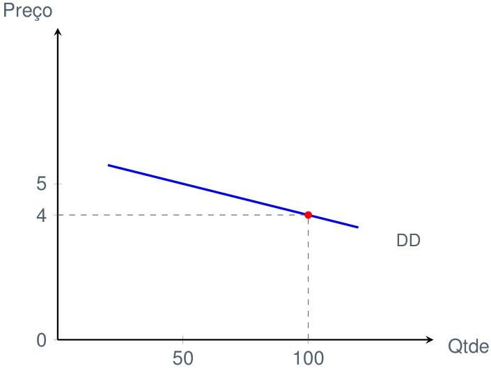
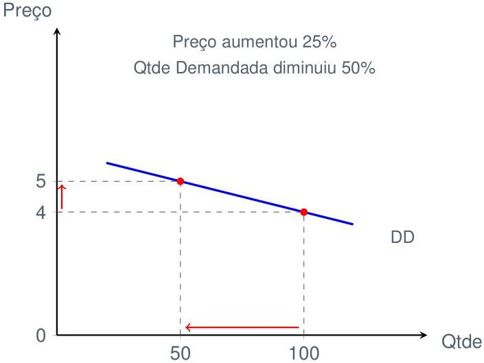
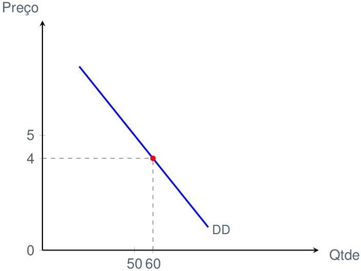
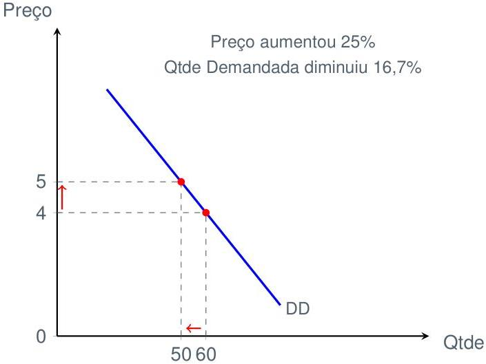
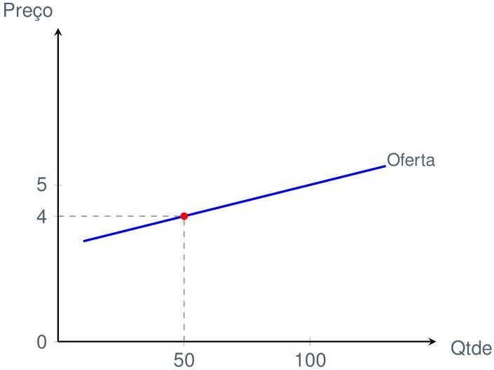
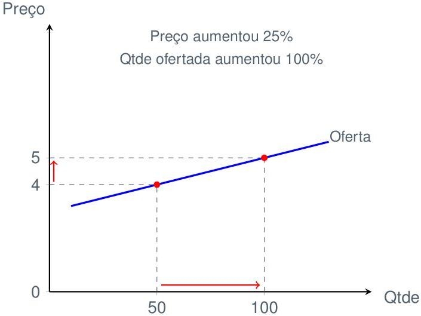
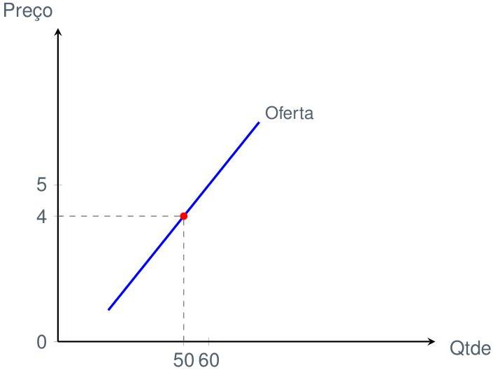
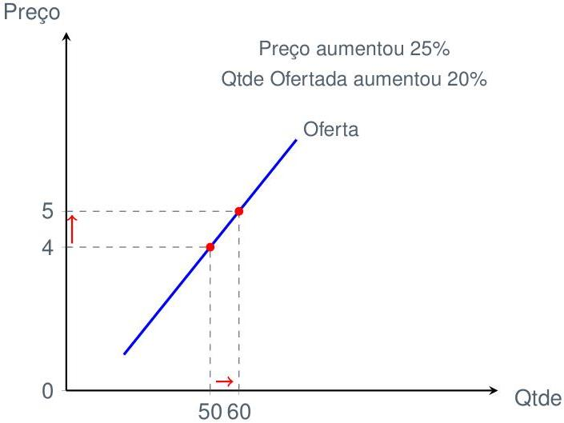

---
tags:
  - INTECO
---
# Aula 6 - Elasticidades

## Objetivos da Aula

- Entender o conceito de elasticidade e sua importância na análise econômica.
- Compreender a elasticidade-preço da demanda e seu determinantes.
- Analisar a elasticidade-preço cruzada da demanda e suas implicações.
- Explorar a elasticidade-renda da demanda e a classificação dos bens.
- Examinar a elasticidade-preço da oferta e seu fatores determinantes.
- Discutir a relação entre elasticidade e receita total.

---
## Ideia

Suponha que a variável Y depende da variável Z, ou seja, mudanças em Z afetam Y.

Queremos medir a sensibilidade de Y a mudanças em Z.

A elasticidade de Y com relação a Z (vamos denotar esse conceito por εYZ) mede a variação que ocorre em Y, em termos percentuais, dada uma variação em Z, também em termos percentuais.

Portanto:

$$\varepsilon_{YZ} = \frac{\text{variação percentual de } Y}{\text{variação percentual de } Z} = \frac{\%\Delta Y}{\%\Delta Z} = \frac{\frac{\Delta Y}{Y}}{\frac{\Delta Z}{Z}} = \frac{Z}{Y} \frac{\Delta Y}{\Delta Z}$$

---
## Intuição

A ideia de usar a mudanças em termos percentuais no lugar de mudanças em termos absolutos é que a primeira independe das unidades em que Y e Z são medidas.

Por exemplo, vimos que a curva de demanda, tudo mais constante, mostra como a quantidade demandada varia com o preço do bem.

Porém medir variações absolutas na quantidade, causadas por variações absolutas no preço, pode levar a inferências vazias de sentido.

---

### Exemplo 1

Suponha que um aumento de R$ 1 no preço de um bem leva a uma queda de dez quilos na quantidade consumida. Isto é uma resposta grande ou pequena?

Não há como saber a não ser que sejam informados o preço e a quantidade iniciais.

Se o preço inicial era R$ 1, então o aumento de R$ 1 representa um aumento de 100% no preço.

Se o preço inicial era R$ 100, então o aumento de R$ 1 representa um aumento de 1% no preço. Raciocínio similar vale para a quantidade.

---

### Exemplo 2: Calculando $\Delta q$ e $\Delta p$

Suponha que medimos o consumo de chocolate de uma família em dois meses, janeiro, $q^{jan} = 10$, e fevereiro, $q^{fev} = 5$, medido em número de barras de chocolate consumido, e que também sabemos o preço da barra de chocolate consumido nesses dois períodos: $p^{jan} = 3$, $p^{fev} = 4$.

A variação na quantidade consumida é $\Delta q = 5 - 10 = -5$, ou seja, houve uma queda de 5 barras no consumo, e a variação no preço é $\Delta p = 4 - 3 = 1$, ou seja, um aumento de 1 real no preço da barra.

Observe a **notação** utilizada: $p$ representa o preço do bem e $q$ a quantidade demandada a esse preço. O símbolo $\Delta$ (letra grega delta maiúscula) é usado normalmente para denotar variação. Então $\Delta p$ denota a variação no preço e $\Delta q$ a variação na quantidade demandada.

---

### Exemplo 2: Variações Relativas

Note as variações (que são em termos absolutos) dependem da unidade que usamos para medir o consumo de chocolate (barras) e da unidade de valor monetário (real).

Quando calculamos a variação em termos percentuais, o problema da unidade de medida desaparece, no sentido de que, qualquer que seja a unidade de medida considerada, a variação percentual será a mesma.

Logo, a medida de elasticidade obtida não dependerá da unidade usada para medir o consumo ou o preço, pois a variação em termos percentuais elimina a unidade considerada.

As variações do preço (e da quantidade) em termos percentuais são normalmente calculadas levando em conta o preço e a quantidade iniciais.

Logo, para calcular essas variações em termos percentuais fazemos:

Variação % do preço: $$\frac{p^{final} - p^{inicial}}{p^{inicial}} = \frac{\Delta p}{p^{jan}} = \frac{1}{3} \approx 33,3\%$$

Variação % da quantidade: $$\frac{q^{final} - q^{inicial}}{q^{inicial}} = \frac{\Delta q}{q^{jan}} = \frac{-5}{10} = -50\%$$

Existe a possibilidade de se utilizar o preço e a quantidade final para o cálculo das elasticidades, e uma média dos preços (e quantidades) inicial e final para o cálculo das elasticidades, o que leva ao conceito de elasticidade-arco (ou método do ponto médio).

---
### Exemplo 2: Obtendo a Elasticidade

Vamos denotar por $\varepsilon$ a elasticidade-preço da demanda do bem analisado.

Obtemos que:

$$\varepsilon = \frac{\Delta q / q^{jan}}{\Delta p / p^{jan}} = \frac{-5 / 10}{1 / 3} = -1,5$$

---

### Exemplo 2: Problema

Note que se utilizarmos os preços e quantidades finais do bem, o valor da elasticidade muda para -4 (faça esse cálculo!), um valor muito discrepante do valor da elasticidade calculada usando as variáveis iniciais.

Essa discrepância ocorre porque a mudança na quantidade e no preço foram grandes (se essas mudanças forem menores, a discrepância será menor).

Por exemplo, para o preço, se usarmos o preço inicial, obtemos uma variação de 33,3%. Já se usarmos o preço final, a variação é de 25%.

Isso motiva o conceito de elasticidade-arco ou o método do ponto médio.

---

### Exemplo 2: Elasticidade Arco

Para calcularmos a elasticidade-arco do efeito do preço sobre a demanda usamos a média entre os valores iniciais e finais para calcular a elasticidade:

Elasticidade-arco: $$\varepsilon_i = \frac{\Delta q/(0,5q^{jan} + 0,5q^{fev})}{\Delta p/(0,5p^{jan} + 0,5p^{fev})} = \frac{-5/7,5}{1/3,5} = -\frac{7}{3}$$

Como $$-7/3 \approx -2,33$$, obtivemos um valor intermediário entre os dois valores obtidos anteriormente ($$-1,5$$ e $$-4$$).

É comum usarmos a elasticidade-arco em casos onde temos poucos dados e variações relativamente grandes nos preços e nas quantidades.

---

## A Intuição do Conceito de Elasticidade

A elasticidade é um conceito que reconhece e leva em conta mudanças relativas das variáveis, o que a torna uma medida independente da unidade em que se mede essas variáveis.

Por exemplo, se $\varepsilon_{YZ} = 2$, isso significa que uma mudança em $Z$ de $\%\Delta Z = 1\%$ leva a uma mudança em $Y$, em termos relativos, de $\%\Delta Y = \varepsilon_{YZ} \times \%\Delta Z = 2\%$.

Então para o Exemplo 2 acima, em que obtivemos que a elasticidade-preço da demanda é $-1,5$, temos que um aumento do preço do bem em $10\%$ leva a uma queda na quantidade demandada de aproximadamente $15\%$.

---
### Exemplo

Portanto, se estivermos analisando a demanda por cerveja em diversos países, tanto faz se essa demanda é calculado em litros ou “ounces” ou qualquer outra medida e se o preço é calculado em reais, dólar ou euros.

Se a elasticidade-preço da demanda por cerveja for –1,5, isso significa que um aumento no preço da cerveja de 1% leva a uma queda no consumo de cerveja de aproximadamente 1,5%.

---

## Elasticidades da Demanda

Primeiro vamos analisar as elasticidades relacionadas à demanda de um bem. As principais elasticidades da demanda são:

- Elasticidade da demanda de um bem com relação a mudanças no seu próprio preço (elasticidade-preço da demanda),
- Elasticidade da demanda de um bem com relação a mudanças no preço de outro bem (elasticidade-preço cruzada da demanda), e
- Elasticidade da demanda de um bem com relação a mudanças na renda do consumidor (elasticidade-renda da demanda).

---

## Elasticidade-Preço da Demanda

Vamos definir a elasticidade-preço da demanda, para variações de preços e quantidade consumidas discretas.

Lembre-se: a elasticidade-preço da demanda, como toda elasticidade, é expressa em termos percentuais. Ou seja, informa a mudança percentual na quantidade demanda em resposta a uma variação de X% no preço do bem.

A elasticidade-preço de um bem, denotada por ε, é calculada como a mudança percentual na quantidade, Δq/q, dividida pela mudança percentual no preço, Δp/p:

$$\varepsilon = \frac{\text{variação percentual da qtde demandada}}{\text{variação percentual do preço}} = \frac{\Delta q/q}{\Delta p/p} = \frac{p}{q} \frac{\Delta q}{\Delta p}$$

A elasticidade-preço da demanda será (quase sempre) um número negativo (a demanda responde negativamente a mudanças no preço do bem).

Ou seja, na prática nunca lidamos com bens de Giffen em trabalhos empíricos e assumimos que a lei da demanda é satisfeita sempre.

Desse modo, é comum reportar o valor absoluto da elasticidade-preço da demanda, já que o que importa é a magnitude do número e não o seu sinal. Vamos adotar esta prática.

---

## Classificação

Quando a elasticidade-preço da demanda (em valor absoluto) for:

Menor do que 1: dizemos que a demanda é inelástica. Isso significica que a quantidade demandada não responde fortemente a mudanças no preco do bem;
- Maior do que 1: dizemos que a demanda é elástica. Isso significica que a quantidade demandada responde fortemente a mudanças nos preços;
- Igual a 1: dizemos que a elasticidade é unitária. Isso significa que a quantidade demandada muda na mesma proporção (percentual) da mudança nos preços.

A demanda pode ser elástica para certas faixas de preço e inelástica para outras faixas de preço.

---

## Graficamente

Como a elasticidade-preço da demanda mede como a quantidade demandada responde ao preço, ela está relacionada à inclinação da curva de demanda.

Além disso, a elasticidade não precisa ser a mesma em toda a curva da demanda: ela pode ir mudando ao longo da curva de demanda.

---

### Gráfico: Demanda Elástica

---
## Determinantes de ε

A elasticidade-preço da demanda de um bem depende da possibilidade de o consumidor abdicar do seu consumo desse bem.

Portanto, ela será maior:

1. Quanto mais fácil for substituir o consumo do bem pelo consumo de outros bens.
2. Quanto menos "imprescindível" o bem for.
3. No longo prazo.
4. Quanto mais estreita a definição do mercado.

Ou seja, o fator fundamental para determinar a elasticidade-preço da demanda de um bem é a possibilidade de substituir o seu consumo.

Observe que tanto a definição do mercado quanto o horizonte temporal considerados são fundamentais para determinar o valor da elasticidade-preço da demanda de um bem.

Com relação à definição do mercado, observe que a demanda por alimentos pode ser pouco sensível a aumento de preços, mas a demanda por arroz “Tio João” pode ser muito sensível, pois há muitos bens substitutos.

Com relação ao horizonte temporal, observe que a quantidade demandada é muito mais sensível a variações nos preços no longo prazo do que no curto prazo.

No longo prazo, as pessoas e as firmas terão mais tempo para pesquisar preços e descartar o consumo de produtos com preços maiores, até mesmo eliminando esses produtos do mercado.

Novamente, a demanda de um bem tende a ser “mais inelástica”:

- Quanto menor o número de substitutos próximos.
- Se o bem é um bem necessário.
-  Mercado definido de modo mais amplo.
- No curto prazo.
- Peso no orçamento é baixo.

---
## Elasticidade-preço e Receita Total

A receita total é o montante pago pelos compradores do bem (o seu dispêndio ou gasto ou despesa) e que é recebido pelos vendedores do bem. Essa receita é calculada por:

$$p \times q$$

Existe uma relação, descrita abaixo, entre a elasticidade-preço da demanda e a receita total do bem, quando preço do bem se altera.

Se o preço de um bem aumenta, a receita total desse bem aumenta caso sua demanda seja inelástica. Se o bem for elástico, então a receita total diminui quando o preço do bem aumenta.

---

## Intuição

Se o bem for inelástico, então a sua demanda variará em proporção menor do que a variação no preço: um aumento no preço em 10%, por exemplo, reduzirá o consumo do bem em menos de 10%. Logo, a receita total desse bem, $p \times q$, aumentará.

Se o bem for elástico, então a sua demanda variará em proporção maior do que a variação no preço: um aumento no preço em 10%, por exemplo, reduzirá o consumo do bem em mais de 10%. Logo, a receita total desse bem, $p \times q$, diminuirá.

---

## Resumo dos Casos

Temos que:

1. Se |ε| < 1 (demanda inelástica): preço e receita total se movem na mesma direção;
2. Se |\ε| = 1 (demanda com elasticidade unitária): receita total não se altera com uma mudança no preço;
3. Se |ε| > 1  (demanda elástica): preço e receita total se movem em direções opostas.

---

## Elasticidade-Preço Cruzada da Demanda

A elasticidade-preço cruzada da demanda de um bem mede a sensibilidade da sua demanda com relação ao preço de algum outro bem.

A elasticidade-preço cruzada de demanda do bem $i$ com relação ao preço do bem $j$ é definida como:

$$\varepsilon_{ij} = \frac{\text{variação percentual da qtde demandada do bem } i}{\text{variação percentual do preço do bem } j}$$
$$= \frac{\Delta q_i / q_i}{\Delta p_j / p_j} = \frac{p_j}{q_i} \frac{\Delta q_i}{\Delta p_j}$$

Essa elasticidade pode ser usada para definir as relações de complementaridade e de substitutibilidade entre os bens, que discutimos na aula 4.

---

## Substitutos e Complementares

Se $\varepsilon_{ij} > 0$: dizemos que o bem $i$ é substituto do bem $j$.

Bens substitutos são bens cujo consumo podem ser substituído um pelo outro, como, por exemplo, manteiga e margarina.

Se $\varepsilon_{ij} < 0$: dizemos que o bem $i$ é complementar do bem $j$.

Bens complementares são bens cujo consumo é normalmente em conjunto, como, por exemplo, arroz e feijão.

---

### Exemplo

Em marketing, bens complementares dão um poder adicional à firma, permitindo que ela “prenda” o consumidor quando os custos para mudar de produto são altos.

Algumas estratégias de valoração usadas por firmas quando produzem um bem base e um bem complementar ao bem base, são:

1. Cobrar barato o bem base em referencia ao bem complementar (incentivo à entrada).
2. Cobrar caro o bem base em referencia ao bem complementar (barreira à entrada).

---

## Elasticidade-Renda da Demanda

A elasticidade-renda da demanda de um bem, denotada por $\eta$, mede a sensibilidade da demanda em relação a mudanças na renda (denotada por $r$):

$$\eta = \frac{\text{variação percentual da qtde demandada}}{\text{variação percentual da renda}} = \frac{\Delta q/q}{\Delta r/r} = \frac{r}{q} \frac{\Delta q}{\Delta r}$$

Logo, se a elasticidade renda de um bem qualquer é 0,5, isso significa que um aumento na renda de 10% leva a um aumento na demanda do bem em 5%.

---

## Classificação dos Bens segundo $\eta$

Classificação do bem quanto à sua variação com a renda:

1. Inferior: \(\eta < 0\);
2. Normal: \(\eta \geq 0\);

- Necessários (ou básicos): $0 \leq \eta \leq 1$;

Os bens que os consumidores normalmente consideram necessidades costumam ser inelásticos em relação a renda.

Exemplos incluem comida, combustível, roupa, energia, e serviços médicos.

- Bens de luxo: $\eta > 1$.

Os bens que os consumidores normalmente consideram “supérfluos/luxo” costumam ser elásticos em relação a renda. Exemplos incluem carros esportivos, casacos de pele e trufas brancas.

---

## Bens de Giffen

Vimos que os bens de Giffen são os bens que constituem exceções à lei da Demanda: quanto maior o preço, maior a quantidade demanda, todo o resto inalterado.

É possível mostrar que todo bem de Giffen é um bem inferior também (ou seja, aumentos na renda reduzem sua demanda).

Além disso, esse tipo de bem normalmente representa uma parcela importante no orçamento.

---

### Bens de Giffen: Exemplo

Pense em uma família que só pode comer batatas – alimento barato que representa 80% do orçamento de alimentação da família-, e alguma carne – alimento mais caro, que representa 20% do orçamento.

Um aumento no preço da batata acaba por comprometer uma parte importante do orçamento.

Como a família não pode substituir carne por batata sem pressionar ainda mais o orçamento, a família se vê obrigada a abdicar do consumo de carne, e a renda extra liberada é direcionada à batatas.

Portanto, o aumento de preços leva a aumento no consumo de batatas, o que a caracteriza como Bem de Giffen.

---

### Bens de Giffen: Exemplo Incorreto

Bens de luxo algumas vezes são considerados bens de Giffen, mas essa classificação é na maioria das vezes incorreta.

Suponha que um bem de luxo, como um carro esportivo, tenha seu preço aumentado como estratégia de marketing para associá-lo à status econômico e poder.

É possível que a demanda por esse bem aumente, pois se torna um símbolo de exclusividade entre indivíduos de maior poder aquisitivo.

Porém note aqui que o condicionante “todo o resto inalterado” deixa de ser válido: o bem agora passa a ter uma característica que antes não tinha: ser um bem de status.

---

## Elasticidades da Oferta

Assim como no caso da demanda, existem vários tipos de elasticidades relacionadas a oferta de um bem.

Porém aqui vamos nos concentrar apenas na principal, a elasticidade-preço da oferta.

A elasticidade-preço da oferta é uma medida de quanto a quantidade ofertada de um bem responde a uma mudança no preço desse bem.

Enfim, há uma infinidade de elasticidades, pode-se calcular a elasticidade da oferta (isso vale também para a elasticidade-preço da demanda!) em relação a qualquer fator que a afete.

---

## Elasticidade-Preço da Oferta

Mais especificamente, a elasticidade-preço da oferta mede a mudança percentual na quantidade ofertada resultante de uma mudança percentual no preço do bem.

A fórmula da elasticidade-preço da oferta $\varepsilon^{Of}$ é

$$\varepsilon^{Of} = \frac{\text{variação percentual da qtde ofertada}}{\text{variação percentual do preço}} = \frac{\Delta q/q}{\Delta p/p} = \frac{p}{q} \frac{\Delta q}{\Delta p}$$

---

## Classificação

Quando a elasticidade-preço da oferta for:

- Menor do que 1: dizemos que a oferta é inelástica.

Isso significa que a quantidade ofertada não responde fortemente a mudanças no preço do bem;

- Maior do que 1: dizemos que a oferta é elástica.

Isso significa que a quantidade demandada responde fortemente a mudanças nos preços;

- Igual a 1: dizemos que a elasticidade é unitária.

Isso significa que a quantidade ofertada muda na mesma proporção (percentual) da mudança nos preços.

A oferta pode ser elástica para certas faixas de preço e inelástica para outras faixas de preço.

---
## Determinantes

Note que na fórmula da elasticidade preço da oferta, consideramos a mudança percentual na quantidade ofertada, enquanto na fórmula da elasticidade-preço da demanda consideramos a mudança percentual na quantidade demandada do bem.

Os determinantes da elasticidade-preço da oferta estão todos relacionados com a habilidade dos vendedores em mudar a quantidade de bens produzida.

Então um fator determinante fundamental da elasticidade-preço da oferta é o horizonte temporal considerado.

No curto prazo, essa elasticidade depende da capacidade ociosa da firma, da disponibilidade de insumos e da disponibilidade de estoque.

---
### Exemplo 1: Elasticidade-Preço da Oferta

Suponha que o preço do petróleo bruto aumente em 10%, e como resultado, a quantidade de petróleo produzida aumenta apenas em 2%.

A elasticidade-preço da oferta nesse caso seria calculada como:

$$\varepsilon^{Of} = \frac{\% \text{ de mudança na qtde ofertada}}{\% \text{ de mudança no preço}} = \frac{2\%}{10\%} = 0,2$$

Neste exemplo, a elasticidade-preço da oferta do petróleo bruto é igual a 0,2, o que indica que a oferta é inelástica em relação ao preço.

Isso significa que os produtores de petróleo estão tendo dificuldade em aumentar sua produção em resposta ao aumento de preço.

---
### Exemplo 2: Elasticidade-Preço da Oferta

Suponha que o preço dos smartphones aumente em 20%, e como resultado, a quantidade de smartphones produzidos aumente em 40%.

A elasticidade-preço da oferta nesse caso seria calculada como:

$$\varepsilon^{Of} = \frac{\% \text{ de mudança na qtde ofertada}}{\% \text{ de mudança no preço}} = \frac{40\%}{20\%} = 2$$

Neste exemplo, a elasticidade-preço da oferta de smartphones é igual a 2, o que indica que a oferta é elástica em relação ao preço.

Isso significa que os fabricantes de smartphones estão respondendo de forma significativa à redução de preços, aumentando a produção em uma proporção maior do que a queda de preço.

---

## Gráfico: Oferta Elástica

---

## Variedades de Curvas de Oferta

Uma oferta perfeitamente inelástica é o caso em que a elasticidade-preço da oferta é zero e a curva de oferta é vertical.

Portanto, a quantidade ofertada é a mesma, qualquer que seja o preço.

Já uma oferta perfeitamente elástica é o caso em que a elasticidade-preço da oferta se aproxima do infinito e a curva de oferta é horizontal.

Variações muito pequenas no preço levam a variações muito grandes na quantidade ofertada.

Observe que quanto mais horizontal for a curva de oferta, maior a elasticidade-preço da oferta.

---

## Conclusão

- Elasticidade é uma medida crucial para entender como variáveis econômicas respondem a mudanças em fatores determinantes.
- Elasticidade-preço da Demanda ajuda a prever o impacto de variações de preço na quantidade demandada e na receita total.
- Elasticidade-preço cruzada identifica relações de substituição e complementaridade entre bens.
- Elasticidade-renda diferencia bens inferiores, normais e de luxo.
- Elasticidade-preço da oferta depende de fatores como capacidade de resposta dos produtores e horizonte temporal.
- Aplicações do conceito de elasticidade são amplas e relevantes para decisões econômicas, tanto no setor público quanto no privado.

---

## Questões de Fixação

- O que é elasticidade-preço da demanda e como é calculada?
- Como os bens substitutos e complementares afetam a elasticidade-preço cruzada da demanda?
- Quais são os determinantes da elasticidade-preço da oferta?
- Como a elasticidade afeta a receita total?
- O que são bens de Giffen e como eles se comportam em relação à lei da demanda?

---

## Leitura Recomendada

Mankiw, Introdução à Economia:

- Capítulo 5: Elasticidade e sua aplicação.

Leitura avançada:

- Tennecia Dacass and Elif Dilden (2023) Teaching price and income elasticities of demand using Excel and Federal Reserve economic data. Journal for Economic Educators, 23(1).

Vídeos:

- Marginal Analysis, Roller Coasters, Elasticity, and Van Gogh: Crash Course Economics 18.
- Principles of Microeconomics - Unit 1: Supply and Demand - Elasticity (Lecture Video).

