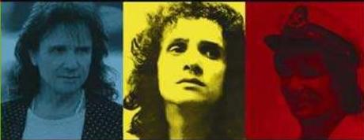
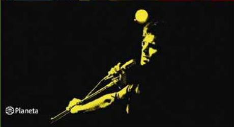

Paulo Cesar de Araújo

# Roberto Carlos em detalhes

## Roberto Carlos em Detalhes

Paulo Cesar de Araújo

Editora Planeta, 2006

**“Quanto mais se tenta esconder a verdade, mais será revelado”**

**FDØRØMØ**

---

# Orelha do livro:

Roberto Carlos é o mais popular cantor brasileiro de todos os tempos - e nenhuma celebridade deste país pode ser considerada mais conhecida ou mais adorada pelo público. Quando começou a fazer sucesso, o homem ainda não havia chegado à Lua, os Beatles ainda não haviam conquistado o mundo, a Guerra Fria ainda dividia o planeta, e o Brasil era apenas bicampeão mundial de futebol. Pois bem: o homem foi e voltou à Lua, os Beatles viraram lenda, a União Soviética acabou, o Brasil já conquistou o pentacampeonato e Roberto Carlos continua fazendo sucesso.

Agora, tem-se a impressão de que a carreira de Roberto Carlos foi um deslizar natural em direção ao sucesso. Um grande equívoco. Neste livro, vai-se descobrir que sua vida também está repleta de percalços, de perdas, algumas muito dolorosas.

Uma das explicações para o sucesso extraordinário que Roberto Carlos alcançou e alcança está numa declaração dele, logo depois de ser desclassificado no festival de San Remo de 1972: "Apesar de tudo não me senti vencido".

Sim, porque, de fato, ele jamais se sente vencido. E isso mesmo nos momentos mais dramáticos de sua vida. Mesmo quando a tragédia lhe causa uma dor sem limite.

Este livro é o resultado de uma história de vida com Roberto Carlos, mais de 15 anos de pesquisa e quase 200 entrevistas exclusivas. O autor, Paulo César de Araújo, além de pesquisador, é um apaixonado pelo cantor desde criança. Somente assim seria possível empreender o trabalho de levantar - em detalhes - toda a trajetória artística, a vida e a intimidade de Roberto Carlos. Nesse sentido, trata-se de uma obra de estatura inédita: nunca um ídolo nacional da dimensão de Roberto Carlos foi esmiuçado de modo tão meticoloso, e com tamanha obsessão de mostrá-lo ao público.

De fato, este livro persegue - e dá conta - do desafio de contar tudo sobre Roberto Carlos, desde o início em Cachoeiro, passando por cada episódio significativo de sua vida. E isso detendo-se em todas as canções de sucesso - canções que expressaram a rebeldia da juventude numa época e que a seguir acompanharam os amores de seu público, como um amigo de horas certas e incertas. Enfim, trata-se de um retrato completo desse ídolo que, como ninguém, pode com sinceridade cantar os versos "se chorei ou se sorri/ o importante é que

---

emoções eu vivi".

Historiador formado pela UFF (Universidade Federal Fluminense), jornalista pela PUC-RJ e mestre em Memória Social pela UNI-RIO, Paulo César de Araújo é profundo conhecedor da história da Música Popular Brasileira. É autor de Eu não sou cachorro não: música popular cafona e ditadura militar, publicado pela Record em 2002, obra considerada referência na historiografia da MPB. Sucesso de público e crítica, o livro recebeu elogios de personalidades como Caetano Veloso, Nelson Motta, entre outros.

Contatos com o Autor: mpbcultura@ibest.com.br

Fim da orelha.

---

# Índice

Orelha Do Livro:

Uma História Bonita... E Triste

Força Estranha No Ar

Little Darling

Fora Do Tom

Daqui Pra Frente Tudo Vai Ser Diferente

Jovens Tardes De Domingo

Parei Na Contramão

O Mais Certo Das Horas Incertas

Quando Eu Estou Aqui

Legal, Imoral Ou Engorda

Vou Cavalgar Por Toda A Noite

Todos Estão Surdos

Como Vai Você

Amante A Moda Antiga

Uma Luz Lá No Alto

Faço No Tempo Soar Minha Sílaba

Depoimentos Ao Autor / (Por Ordem Alfabética):

Jornais E Revistas:

Bibliografia

Obras De Referência:

---

# Uma história bonita... e triste

Era uma manhã de sol, início de agosto de 1973. Recordo que seria o primeiro dia de aula depois das férias de julho. Eu estava a caminho da Escola Municipal Anísio Teixeira, onde cursava o quarto ano primário, quando um cartaz me chamou a atenção. Em um dos muros da avenida Régis Pacheco, no centro de minha cidade, o mural estampava em letras garrafais: "Roberto Carlos vem aí... Dia 31 de agosto, às 21 horas, Estádio Lomanto Júnior. Ingressos à venda". Meu coração disparou.

Finalmente eu poderia ver Roberto Carlos ao vivo. Finalmente Roberto viria a Vitória da Conquista, cidade da Bahia que deu ao Brasil nomes como o cineasta Glauber Rocha e os cantadores Elomar e Xangai, mas que adotou Roberto Carlos como se também fosse seu filho.

Desde pelo menos 1966, auge da jovem guarda, havia uma grande expectativa por um show de Roberto Carlos em minha cidade. Entretanto, o cantor se apresentava em Salvador e outras cidades baianas como Feira de Santana e Itabuna, e nada de vir a Vitória da Conquista. Assim como acontecia na época em relação à possível visita de Frank Sinatra ao Brasil, a presença de Roberto Carlos na cidade era várias vezes anunciada, mas, depois, nunca confirmada. Em setembro de 1969, por exemplo, um show chegou a ser programado, o local reservado, mas a agenda de Roberto não comportou Vitória da Conquista, que foi outra vez excluída do seu roteiro. Mas agora, em agosto de 1973, parecia que ele viria mesmo e imensos cartazes com a foto de Roberto Carlos estavam ali nos muros da cidade para quem quisesse ver. Seria um único show, em um único dia, única oportunidade de ver Roberto Carlos ao vivo em Vitória da Conquista.

Naquele início dos anos 70, Roberto Carlos ainda era chamado de o rei da juventude, mas ele já atingia todas as faixas etárias, principalmente as crianças, que desde a jovem guarda se divertiam ao ouvir temas como O calhambeque, O brucutu e História de um homem mau. Espalhados por todo o Brasil havia milhares e milhares de pimpolhos que cantavam o seu repertório, imitavam seus gestos e repetiam suas frases e gírias, mora?

E eu era uma dessas crianças com os olhos e ouvidos postos em Roberto Carlos, e atento a tudo o que ele fizesse.

Mas, no meu caso, não apenas nele, porque costumava assistir a quase todos os shows que aconteciam em minha cidade. Com nove, dez, onze anos, ia sempre para a porta do Cine Glória, local da maioria

---

dos shows, tentando filar uma entrada. E foi assim que assisti, em abril de 1972, por exemplo, ao primeiro show que Gilberto Gil fez no Brasil após sua volta do exílio em Londres. Seus pais, doutor Gil e dona Florinda, moravam em Vitória da Conquista e, nessa visita à família, Gil fez uma apresentação de voz e violão no Cine Glória. E lá estava eu, aos dez anos de idade, ouvindo Gilberto Gil discursar e cantar Expresso 2 2 2 2, O sonho acabou, Back in Bahia e outras canções do exílio. Recordo também de um concorrido show do cantor Paulo Sérgio, outro de Nelson Ned e até um do veterano Nelson Gonçalves. Mas agora estaria na cidade o ídolo maior, Roberto Carlos, e, diferentemente dos outros, o show dele não seria no cinema e sim no estádio de futebol Lomanto Júnior, o Lomantão.

Na véspera do dia do show eu estava tão ansioso que nem dormi direito. Não tinha ingresso nem dinheiro para comprá-lo. O pior é que, ao contrário do Cine Glória, que fica no centro da cidade e dava para eu ir até lá a pé, o estádio Lomantão fica bem mais distante. Era preciso pegar ônibus e, caso conseguisse entrar no show, chegaria muito tarde em casa. O preço do ingresso, me lembro muito bem, era 10 cruzeiros. Era uma nota vermelha que trazia a esfinge de Tiradentes. Como eu desejei ter uma nota daquelas para comprar logo meu ingresso! Minha mãe percebeu a minha vontade e então tomou uma decisão. Deu-me o dinheiro de ida e volta do ônibus e pediu que eu fosse para a porta do Lomantão. Quem sabe encontraria alguém conhecido que pudesse me colocar dentro do estádio.

Mas recomendou: se não conseguisse entrar, que eu viesse para casa imediatamente. Ela não iria dormir enquanto eu não voltasse.

O ônibus que me conduziu ao estádio estava superlotado. Fiquei na parte de trás junto a um grupo de moças e rapazes que cantavam canções de Roberto Carlos. Era um clima festivo e de muita alegria. O grupo de trás puxava uma canção e a galera do ônibus seguia acompanhando. E assim fomos até o estádio cantando sucessos como Quero que vá tudo pro inferno, Se você pensa, Jesus Cristo e outras.

Ao chegar ao estádio, notei que a fila estava imensa, mas andava com rapidez. A maioria das pessoas já estava com ingresso na mão. Acho que nem tinha mais ingressos para vender, talvez só nas mãos de cambistas.

Eu procurava desesperadamente algum conhecido que pudesse me dar uma entrada. Corria de uma ponta a outra da fila. A pessoa mais conhecida que encontrei foi o gerente de um supermercado que havia perto da rua em que eu morava. Ele estava lá na fila com toda a família: a mulher, os filhos, a cunhada e acho que até a empregada

---

dele ganhou um ingresso para o show. Depois de alguns minutos de hesitação, tomei coragem e me aproximei dele. Perguntei se ele podia pagar a minha entrada. Ele me reconheceu, estranhou que eu estivesse ali sozinho, mas disse que nada podia fazer porque os ingressos estavam contados. Fui para a porta de entrada principal do estádio e apeleio ao porteiro para que me deixasse entrar. "Só com ingresso, e, por favor, saia da frente para não atrapalhar o público."

Na época, Roberto Carlos utilizava para shows em estádios de futebol um equipamento de voz de 800 volts e dois canhões de luz de 2 000 volts de potência. Havia também um gerador próprio para suprir as dificuldades de energia nas cidades do interior. Tudo era transportado num caminhão Ford F-350, que eu vi parado em frente ao estádio. O caminhão trazia a inscrição RC-7 bem grande na sua carroceria de alumínio.

Roberto Carlos era o cantor de todas as classes sociais, mas só o público de classe média para cima tinha o privilégio de ver o seu ídolo ao vivo. Na época, pouco antes de um show em Florianópolis, o próprio Roberto admitia ao repórter que o entrevistava: "Quer apostar como tem mais gente lá fora do que aqui dentro? Meu público é pobre, não pode pagar ingresso muito caro". De fato, a grande maioria do povo brasileiro ficava do lado de fora dos shows de Roberto Carlos. E eu estava ali para provar isso.

Não era somente no Brasil que acontecia essa exclusão. No México acabou explodindo em forma de violência coletiva. O público do cantor provocou uma quase rebelião na cidade de Coatzacoalcos, no estado de Vera Cruz, no norte do país. Foi numa sexta-feira de abril de 1974, quando Roberto Carlos se apresentaria no ginásio de esportes Miguel Alena Gonzalez. Era um show há muito tempo aguardado na cidade e que atraiu uma multidão para a porta do ginásio. Entretanto, grande parte do público foi surpreendida com o preço dos ingressos, considerado muito alto. Os mais endinheirados compraram seus ingressos rapidamente, enquanto a parte mais pobre do público resolveu protestar, de paus e pedras na mão, acusando Roberto Carlos de cantar apenas para ricos.

"Levamos um susto danado porque eles começaram a quebrar vidraças e jogar pedras quando já estávamos lá dentro", lembra o baixista Bruno Pascoal, que tinha chegado mais cedo com os companheiros do RC-7 para testar o som do ginásio. Foi como uma reação em cadeia. Pessoas que passavam pelo local, e que estavam descontentes com o preço do pão ou da tequila, se juntaram aos fãs de Roberto Carlos no quebra-quebra. Segundo relato da imprensa, grande parte das dependências do ginásio foi destruída pela multidão

---

enfurecida. Só faltaram mesmo pegar em armas e iniciar uma nova revolução no México, evocando Zapata e Pancho Villa.

Em Vitória da Conquista isto não aconteceu, até porque o estádio era longe do centro e os excluídos ficaram em casa. Lembro que o tempo estava passando e já não tinha quase ninguém fora do estádio. Corri para o portão lateral onde estava estacionado o imenso caminhão com o nome RC-7. Era por ali que entravam os músicos. Era por ali que entraria Roberto Carlos. De repente um corre-corre, alvoroço no portão lateral, seguranças se aproximando. Um Galaxie LTD metálico chegou lentamente e no banco de trás, com os vidros todos fechados, dava para ver que lá estava ele, com os imensos cabelos encaracolados que usava naquele início dos anos 70. Era ele mesmo, Roberto Carlos! Eu e um grupo de meninos começamos a gritar "Roberto, Roberto...". Ele nos acenou com aquele seu sorriso cândido e triste, e o carro desapareceu no imenso portão lateral que se fechou rapidamente. Parecia o fim da esperança de entrar. Eu, que assistira a tantos shows em Vitória da Conquista, perderia justamente aquele?

Muitos dos que estavam ali no portão foram embora. Ficamos eu e alguns meninos de rua, sem camisa e todos negros que costumavam estar sempre na porta do estádio, fosse em jogos de futebol, shows de música ou eventos religiosos. Mas, antes de dar a última trança no portão, um senhor de terno azul, provavelmente da equipe de Roberto Carlos, nos chamou: "Ei, vocês, entrem aqui, rápido". Corremos todos para o portão.

Que sorte, pensei, no último instante a chance de ver o show de Roberto Carlos. Mas, no momento em que me abaixei para atravessar o portão, aquele mesmo senhor de terno azul fechou a minha passagem com o braço, dizendo: "Você não, você pode pagar" e fechou o portão rapidamente.

É verdade, eu parecia mesmo que tinha dinheiro. Branquinho, de banho tomado e de roupinha arrumada. Naquela quinta-feira, minha mãe me colocou a calça e a camisa que eu só usava aos domingos para ir à igreja ou a alguma festa de aniversário. Eu estava todo limpinho e arrumadinho para ver Roberto Carlos. Por isso fui barrado, enquanto aqueles meninos negros, descamisados e de pés descalços, que historicamente sempre ficavam do lado de fora, naquele dia entraram.

Fiquei ali alguns minutos paralisado na porta do estádio e só então me dei conta de que a noite estava muito fria. Do lado de fora, ouço os primeiros sons de bateria e guitarras. De repente, sinto o estádio estremecer numa explosão de gritos e aplausos. Era Roberto Carlos entrando em cena. E deu para ouvir a voz dele que chegava de

---

longe, meio distorcida pelo vento que soprava forte. "Eu sou terrível/ e é bom parar/ porque agora vou decolar..." O show estava começando. Mas me lembrei da recomendação de minha mãe: voltar imediatamente se não conseguisse entrar. E, francamente, não dava mais para eu ficar ali.

Voltei para o ônibus que agora retornava vazio para o centro da cidade. Ninguém cantava canções do Roberto. Toda aquela galera de jovens felizes na viagem de ida estava agora lá dentro do estádio. Ali, naquele ônibus, apenas o motorista, o cobrador e eu. Os únicos que não puderam ver o show. Perdi o show que mais desejei assistir na vida. Para mim, até hoje, Roberto Carlos nunca foi a Vitória da Conquista.

Rio de Janeiro, abril de 1996.

A entrevista com Roberto Carlos estava marcada para as três da tarde em sua casa, na avenida Portugal, na Urca. Era uma entrevista muito aguardada. Entrevistar Roberto Carlos tem sido tarefa muito difícil - como, aliás, é difícil entrevistar qualquer grande mito da cultura. E obter uma entrevista exclusiva em sua casa, mais difícil ainda. Foram poucos os jornalistas, principalmente a partir dos anos 80, que conseguiram entrevistar Roberto em sua casa. Mas lá ia eu, acompanhando o meu amigo jornalista Lula Branco Martins, que na época escrevia uma matéria para o Jornal do Brasil. Lula sabia da pesquisa que eu realizava há alguns anos sobre a obra de Roberto Carlos. E sabia da minha história com Roberto Carlos. Do show em Vitória da Conquista... Quando recebi o convite, meu coração disparou como daquela vez que vi o cartaz anunciando o show de Roberto Carlos em minha cidade. Eu e Lula montamos juntos a pauta da entrevista. Eu preparei questões mais históricas e ele questões mais atuais sobre o novo show de Roberto Carlos no Rio.

No meio do caminho um imprevisto. Uma passeata de estudantes e funcionários da UFRJ, um punhado de bandeiras vermelhas do PT e, principalmente, do PC do B, com seu tradicional símbolo comunista quase roçando o vidro do automóvel. Trânsito parado, o tempo passando. "Não é possível que vamos perder a entrevista do Roberto por causa de uma foice e um martelo", ironizou Lula ao volante do carro.

A minha preocupação era outra e tinha um nome: Ivone Kassu, assessora de imprensa de Roberto Carlos. Em 1990, iniciei a pesquisa que resultou neste livro. Naquele ano, tentei pela primeira vez uma entrevista com Roberto Carlos. Liguei para o escritório de Ivone, a

---

Kassu Produções, e consegui participar da coletiva daquele ano, no Copacabana Palace. Uma entrevista exclusiva, ela disse que não poderia ser. No ano seguinte, a coletiva foi no mesmo local, mas não consegui convite. Entrei no meio de jornalistas e fiquei ali escondido pelos cantos, evitando me encontrar com a assessora de imprensa. Em 1992, tentei novamente, e já me contentava em participar apenas da coletiva. Afinal, numa coletiva, em meio a uma série de perguntas absolutamente invariáveis através dos tempos, sempre podia surgir alguma informação nova, que eu poderia juntar às outras que estava acumulando. Não consegui falar com Ivone, nem convite. Fui assim mesmo para a coletiva do Imperator, no Méier, onde Roberto faria uma temporada. Dessa vez, não fiquei escondido pelos cantos, arrisquei falar com Ivone Kassu. Mas, assim que ela me viu, chamou um garçom e ordenou: "Por favor, não sirva nada a este rapaz. Ele não foi convidado para a coletiva". E me virou as costas. Fiquei ali alguns minutos paralisado. Mais uma vez estava barrado de um evento com Roberto Carlos. Por tudo isso, o possível encontro com Ivone Kassu na portaria do prédio de Roberto me deixava ansioso. Como ela iria reagir?

Mas, justamente por causa da passeata, chegamos 25 minutos atrasados, e o porteiro informou que a assessora havia acabado de subir. Ele ligou para o apartamento e veio a ordem para o Lula subir. Eu subi junto. No elevador, já fui pensando: "Benditas foice e martelo...". Não tinha dúvida de que, se encontrasse Ivone Kassu na portaria, iria ser barrado mais uma vez.

Mas agora o elevador subia e eu já estava a um passo da porta da sala de Roberto Carlos. A um passo de um encontro e de uma conversa frente a frente com o rei.

Roberto mora na cobertura de um prédio de cinco andares, todos com apenas um apartamento, situado de frente para a baía de Guanabara com o Cristo Redentor ao fundo. Quando saímos do elevador, a porta já estava aberta. Em pé, lá estava ele, Roberto Carlos vestido de Roberto Carlos, com seu tradicional traje de calça jeans azul, camisa branca e tênis brancos. Ivone estava sentada em um sofá de frente para a porta. Lula foi o primeiro a entrar, sendo apresentado a Roberto por ela. Foi logo pedindo desculpas pelo atraso e em seguida me apresentou. "Roberto, este é meu amigo Paulo César..." Roberto estendeu-me a mão efusivamente, fitando meus olhos, e disse: "Já nos conhecemos não é, bicho?". Sem pestanejar, e também olhando no fundo dos seus olhos, respondi: "Com certeza, Roberto. Eu sou o Brasil".

A conversa iniciou de forma descontraída na ampla sala de

---

visitas de seu apartamento decorado em tons azuis e brancos. Bom anfitrião, ele perguntou se queríamos beber alguma coisa, sugerindo água, café ou suco.

Pedimos apenas água, que nos foi servida por uma empregada devidamente uniformizada de azul e branco.

Durante todo o tempo que ali permaneci não pude evitar a lembrança daquele dia do show de Roberto em Vitória da Conquista. Agora, ali estava eu, na sala de sua casa, conversando com ele. É verdade que tinha entrado sem ter sido convidado. Mas só poderia mesmo ter sido daquela maneira: sem convite, sem ingresso, quase pela porta lateral. Como seria naquele show em Vitória da Conquista.

Depois de uma outra amenidade, Lula Branco Martins deu início à entrevista, antes colocando o pequeno gravador na ponta da mesa de centro, para não intimidar muito Roberto, que não se sente à vontade na presença do gravador. Roberto permaneceu a maior parte do tempo encostado no braço direito do sofá. Diante da primeira pergunta, ele sorri e hesita. Mas depois percebi que sempre sorri e hesita quando alguém lhe faz uma pergunta. E responde lentamente, em seguida, procurando as palavras como se estivesse pensando no assunto pela primeira vez. Já diante de perguntas mais embaraçosas, Roberto pára, abaixa a cabeça, esfrega as mãos, olha para o alto, fica algum tempo em silêncio, e só então responde. Outras vezes, ele pára e olha fixamente algum ponto no espaço perdido antes de responder — sempre tomando um cuidado extremo para evitar mal-entendidos.

Uma das últimas perguntas foi sobre a relação de Roberto com o palco, Lula então aproveitou o tema e disse: "Aliás, Roberto, o Paulo tem uma história antiga com você em um show em Vitória da Conquista". Eu relatei tudo, passo a passo até o desfecho final. Roberto riu em algumas passagens, mas depois contraiu seu semblante e com aqueles seus olhos fundos cravados em mim, comentou: "Pôxa, bicho, que história bonita... bonita e triste".

Ao final, ele e Ivone Kassu nos acompanharam até a porta do elevador.

Então a assessora abriu a sua agenda, nos entregou dois convites e falou pra mim sorrindo: "Agora você não vai mais ficar do lado de fora de um show de Roberto Carlos".

Este livro é resultado de uma história de vida com Roberto Carlos, mais quinze anos de pesquisa em jornais, revistas, arquivos, além de quase duas centenas de entrevistas exclusivas.

Para melhor entender a obra musical de Roberto Carlos é

---

necessário conhecer a trajetória de Roberto Carlos. Ele canta o que vive e o que sente. Nas suas canções, fala de sua infância, de sua mãe, de seu pai, de sua tia, de seus amores. Mesmo numa canção como Caminhoneiro, que trata de um personagem distante de sua realidade de astro pop, o fermento que o inspirou a compô-la está nos caminhões que via passar na frente de sua casa em Cachoeiro e no desejo que o menino Roberto acalentou de um dia dirigir um veículo daqueles. Enfim, se outros cantores-compositores têm uma produção musical desvinculada de sua trajetória de vida, este não é o caso de Roberto Carlos. Sua obra é marcadamente pessoal e autobiográfica.

"O maior mérito de meu pai é cantar a sua verdade. A verdade é o que importa. Se alguém quer conhecê-lo ou saber o que pensa ou já pensou, é só ouvir suas músicas", diz seu filho Dudu Braga. Mas o caminho inverso também se faz necessário. Se alguém quer conhecer melhor suas canções e o que elas dizem, é necessário conhecer a trajetória de Roberto Carlos, sua história, seus embates, seus dramas, porque todos estão de certa forma retratados em sua obra. Este livro persegue este desafio, contar a trajetória artística de Roberto Carlos desde o início, canção por canção, detalhe por detalhe.

\* \* \*

# CAPÍTULO 1

## FORÇA ESTRANHA NO AR

### *ROBERTO CARLOS E O RÁDIO*

"Eu estava muito nervoso, mas muito contente de cantar no rádio. Ganhei um punhado de balas, que era como o programa premiava as crianças que lá se apresentavam. Foi um dia lindo."

Dois acontecimentos, um relacionado ao futebol, outro à música popular, marcaram a história do Brasil no ano de 1950. O primeiro teve como palco o estádio do Maracanã, no Rio de Janeiro, e foi percebido e sentido no momento exato em que aconteceu: a derrota da seleção brasileira para o Uruguai na final da IV Copa do Mundo. Naquele domingo ensolarado de 16 de julho, o grito "Brasil campeão" foi silenciado aos 33 minutos e meio do segundo tempo do jogo, quando Alcides Edgardo Ghiggia avançou pela ponta direita e marcou o segundo gol uruguaio. Um sentimento de frustração, vergonha e humilhação tomou conta dos brasileiros assim que o juiz George Reader apitou o fim da partida. Em uma crônica, Nelson Rodrigues

---

escreveu que o Uruguai "extraiu de nós o título como se fosse um dente".

O outro histórico acontecimento daquele ano se deu no auditório de uma pequena rádio do interior do país. Mas, ao contrário do primeiro, não teve, na época, nenhuma repercussão. Nenhum cronista comentou o fato. Não mereceu sequer uma mísera nota de jornal. Só ganharia relevância anos mais tarde, porque nele houve a estréia do cantor que se tornaria o mais popular da história do Brasil. Como que para compensar tanta dor e sofrimento, no ano em que os brasileiros choraram a perda da Copa do Mundo, o país ganhou uma voz, um artista, um rei...

A voz do cantor Roberto Carlos foi mostrada ao público pela primeira vez numa manhã de domingo, pouco depois das nove horas, no mês de outubro do longínquo e trágico ano de 1950. Roberto Carlos tinha apenas nove anos quando estreou num microfone de rádio, em sua cidade natal, Cachoeiro de Itapemirim, interior do Espírito Santo. Era ainda uma criança e apenas mais uma daquelas que semanalmente se apresentavam no Programa Infantil da ZYL-9, Rádio Cachoeiro, a única emissora da região.

Como o próprio título do programa indica, aquela era uma atração destinada exclusivamente para artistas de calças curtas. E quando o menino Roberto Carlos se aproximou do microfone para cantar, ninguém ali poderia imaginar que naquele momento subiria ao céu a voz que seria a mais ouvida até hoje na história do rádio brasileiro. Desde que houve a primeira transmissão de rádio no Brasil, em setembro de 1922, nenhuma outra voz foi tão veiculada nele quanto a do cantor Roberto Carlos.

Vozes de locutores que marcaram época como Heron Domingues ou Luís Jatobá foram exaustivamente ouvidas no rádio enquanto eles estiveram na ativa. Vozes de presidentes da República como Getúlio Vargas ou Fernando Henrique Cardoso foram irradiadas diariamente enquanto eles estiveram no poder. Cantores como Francisco Alves e Orlando Silva tiveram suas vozes bastante ouvidas no passado; as de novos ídolos da música popular são muito ouvidas no presente. A permanência da voz de Roberto Carlos extrapola tudo isso porque, desde que ele se tornou um fenômeno de popularidade, a partir de 1965, suas canções são tocadas diariamente em diversas emissoras de norte a sul do país. Tanto as novas canções de seu disco anual como, e principalmente, os antigos sucessos do cantor aparecem no ar todos os dias em quadros de flashback ou em programas dedicados exclusivamente ao seu repertório. Há muitos anos, em várias emissoras do Brasil existem programas especiais diários só com músicas de Roberto Carlos. É certo que, no momento em que você lê esta página, alguém esteja ouvindo alguma daquelas canções do Roberto. Portanto, já são mais de quatro décadas de execução maciça e cotidiana. E tudo indica que as suas gravações a maioria realizada num padrão de alta tecnologia - continuarão a ser tocadas por anos a fio. A voz de Roberto Carlos tornou-se, assim, a mais ouvida até hoje pelo povo brasileiro - e uma das mais ouvidas do mundo porque alcança multidões da América Latina, África e países da Europa como Portugal, Espanha e Itália.

É óbvio que ninguém poderia prever isto quando aquele menino chegou para cantar na pequena emissora de Cachoeiro de Itapemirim, em 1950. Se soubesse o que o futuro tinha reservado para aquela criança talvez o apresentador do programa não tivesse faltado ao trabalho justamente naquele dia. Sim, o titular do Programa Infantil, o locutor Jair Teixeira, não foi trabalhar naquele domingo perdendo a chance histórica de anunciar ao público a estréia do menino-cantor Roberto Carlos. Quem ganhou esse privilégio foi o locutor reserva Marques da Silva, improvisado na apresentação do programa.

Mas não foi apenas o locutor titular que faltou ao trabalho naquele dia. Porque não tinham bola de cristal, os músicos do Regional L-9 (referência ao prefixo da emissora) também não estavam lá para acompanhar o menino Roberto Carlos. Embora fossem contratados justamente para tocar com as atrações da Rádio Cachoeiro, a maioria dos integrantes do regional tirou sua folga semanal naquele dia. No palco, para acompanhar a estréia do garoto, estava apenas um dos músicos do regional, José Nogueira, um violonista de 22 anos, recém-contratado pela emissora. Os demais integrantes - Mozart Cerqueira (violão), Valdir de Oliveira (acordeom), Angelo dos Santos (cavaquinho), Moacir Borges (contrabaixo), e os ritmistas Hamilton Silva, Carlos César e Zuzu ficaram em casa de papo pro ar.

Os desfalques não impediram que o Programa Infantil transcorresse normalmente. Quem garante é outra testemunha da estréia de Roberto Carlos no rádio: o sonotécnico (operador de áudio), Bernardino Pim, na época um garoto de dezesseis anos, filho do diretor da rádio, Gastão Pim. Bernardino começara a trabalhar no início daquele ano porque seu pai desejava que ele aprendesse a profissão. Depois de um breve período como técnico auxiliar, ele ganhou o comando da mesa de som, começando exatamente pelo Programa Infantil. "Eu já conhecia o Roberto de vista e me lembro desse dia, quando ele apareceu para cantar na rádio", afirma Bernardino Pim.

Registre-se que a idéia e o incentivo para que Roberto Carlos fosse se apresentar lá foram de sua mãe, dona Laura. "Meu filho, por

---

que você não vai cantar na rádio? Lá tem um programa para crianças domingo de manhã", propôs no início daquela semana. Pois uma hora antes de o programa entrar no ar, lá já estava o menino Roberto Carlos, trajando uma roupinha nova, daquelas de domingo, que sua mãe costurou especialmente para a ocasião. Quando o locutor Marques da Silva anunciou a vez de Roberto Carlos cantar, o violonista Zé Nogueira deu o tom no violão e o garoto se aproximou do microfone, soltando educadamente a voz: "Tú no sabes cuanto te quiero/ tú no sabes lo que yo tengo para ti/ tú no sabes que yo te espero para darte/ amor, amor, amor y mas amor...".

Muito romântico desde criança, Roberto Carlos escolheu para sua estréia no rádio o bolero Amor y mas amor, composição do espanhol Bobby Capó, lançada naquele ano. E o garoto cantou em espanhol mesmo, como ele ouvia no rádio na voz do cantor uruguaio Fernando Borel que na época atuava no Brasil.

Ao final da apresentação, como era de praxe, o apresentador do programa e o violonista foram cumprimentar o calouro. "Eu estava muito nervoso, mas muito contente de cantar no rádio. Ganhei um punhado de balas, que era como o programa premiava as crianças que lá se apresentavam. Foi um dia lindo", recorda Roberto Carlos.

E foi assim, por um punhado de balas, que a voz mais ouvida até hoje na história do Brasil cantou no rádio pela primeira vez. O Programa Infantil era patrocinado pela fábrica de doces Esperança e todos os domingos eles mandavam um saco de balas para distribuir entre os participantes e a garotada da platéia. Era uma festa no auditório.

"Garoto, volta no próximo domingo, que o Regional estará completo", disse Zé Nogueira para Roberto Carlos ao final do programa. "E eu posso voltar?" "Pode, quantas vezes quiser", incentivou-o o músico, abrindo-lhe assim as portas da Rádio Cachoeiro.

De propriedade do empresário Alceu Nunes da Fonseca, a ZYL-9 Rádio Cachoeiro de Itapemirim foi inaugurada em junho de 1946. Seguindo o modelo das grandes emissoras da capital, a rádio também tinha seu auditório, com capacidade para duzentas pessoas. Para ocupar esse espaço e tocar a programação, a direção montou um broadcasting a partir de atrações locais como o cantor Genaro Ribeiro, a "voz romântica de Cachoeiro", a cantora Marlene Pereira, "a internacional", com seu repertório de tangos e boleros em espanhol, a cantora Therezinha Vasconcelos, intérprete de sambas e marchinhas carnavalescas, e até a poetisa Marly de Oliveira. E, como não poderia faltar, a rádio produzia também programas de humor, de esporte e,

---

principalmente, radionovelas, com seus radioatores e novelistas como Hercília Surrage, espécie de Janete Clair de Cachoeiro. No elenco da emissora estava também o futuro ator Jece Valadão, mineiro que morava desde criança em Cachoeiro e começara a trabalhar ali como locutor de rádio. Enfim, não seria por falta de atrações que a população de Cachoeiro de Itapemirim deixaria de sintonizar a emissora de sua cidade.

A audiência da rádio visava os 81 082 habitantes de Cachoeiro (segundo o censo daquele ano), sendo 43 846 na sede e o restante em Burarama, Canduru, Jaciguá, Marapé, Palotuba e Vargem Alta onde a emissora também chegava. Portanto, era nesses municípios que se localizavam as possíveis testemunhas dessa primeira e histórica apresentação do menino cantor Roberto Carlos. Comprovadamente ele teve a manifestação da vizinhança, pois, assim que voltou da rádio, atraiu a atenção das pessoas da sua rua, e muitos foram falar com ele, comentar sua apresentação no programa. O menino que saiu de manhã praticamente anônimo voltou artista ao meio-dia. E quando entrou em casa ganhou beijos e abraços bem carinhosos da mãe, que exclamou: "Meu filho, você cantou tão bonito!". De pronto, Roberto Carlos respondeu: "Pois é, mãe.

Mas eu não quero mais ser médico, não. Agora eu quero ser cantor".

É desejo da maioria dos pais no Brasil ter na família um filho doutor. Uns para manter a tradição familiar, outros para garantir um meio de ascensão social. No caso dos pais de Roberto Carlos não foi diferente. Eles também tinham esse desejo e estavam convencidos de que poderiam realizá-lo através do filho caçula. Por isso, devidamente orientado em casa, quando alguém perguntava o que ele ia ser quando crescer, Roberto Carlos respondia: médico. Entretanto, isto era só da boca pra fora, porque, quando bem menininho, nele havia o desejo de ser aviador, depois desejou ser caminhoneiro e por volta dos oito anos veio a vontade de ser desenhista. Mas essas especulações praticamente acabaram nesse dia da sua estreia na Rádio Cachoeiro. A partir daí, Roberto Carlos se firmou na idéia de ser um cantor de música popular, um artista do rádio. "É mesmo, meu filho? Então está bem. Vamos ver se você vai continuar com essa vocação", respondeu dona Laura.

Embora acalentasse o desejo de ver o filho doutor, dona Laura nunca deixou de estimular a sua vocação artística. Foi ela quem, além de incentivá-lo a ir cantar no rádio, lhe ensinou as primeiras noções de violão. Nascida em Mimoso, Minas Gerais, Laura Moreira Braga aprendeu a tocar violão ainda adolescente, prática não muito comum

---

entre as mocinhas de seu tempo. Era de bom-tom que as meninas tocassem piano, e que o violão, instrumento mais rude, ficasse com os homens. Mas na casa de Laura não tinha piano, que sempre foi um instrumento das famílias mais abastadas, e, como ela gostava de cantar, teve que se entender mesmo com o famigerado violão dos meninos.

Esse gosto pela música ela procurou transmitir aos quatro filhos Lauro Roberto, Carlos Alberto, Norma e o caçula Roberto Carlos, os quais costumava reunir para tocar canções tirolesas e rancheiras num velho violão que trouxe de sua cidade natal. "Mostrei para os meus filhos as primeiras posições e ensinei-lhes notas como o lá maior, fá menor e assim por diante. A partir daí, o talento natural de Roberto se impôs e ele buscou se aprimorar." De fato, cada vez mais interessado pelo instrumento, o garoto foi aprender novos acordes, se valendo do tradicional método do violonista Américo Jacomino, o Canhoto, muito usado na época. E também não perdia a oportunidade de ouvir o toque de violão de Hermes Silva, um ajudante de caminhão que trabalhava num depósito perto de sua casa.

"Eu gostava demais de ouvi-lo tocar aqueles sambas de breque estilo Moreira da Silva."

Roberto Carlos é um típico fruto da miscigenação que marcou a colonização portuguesa nos trópicos. Flor amorosa de três raças tristes.

Seu avô materno, Joaquim Moreira, era português, e sua avó, Anna Moreira, era filha de índio e negro. Os pais de Roberto Carlos, seu Robertino e dona Laura, saíram, já casados, do interior de Minas Gerais para morar em Cachoeiro de Itapemirim. Robertino era relojoeiro e instalou uma pequena loja, de uma porta, no centro da cidade. Laura era costureira e atendia uma vasta clientela, porque na época quase não se vendia roupa pronta. Na infância, Roberto Carlos e seus irmãos se acostumaram a dormir acalentados pela máquina de costura de sua mãe, que trabalhava até alta madrugada.

O caçula Roberto Carlos Braga nasceu num Dia do índio, 19 de abril de 1941, às 5 horas da manhã, pesando 2,250 kg e medindo 42 cm. A família morava na rua índios Crenaques coincidência que o garoto gostava de comentar com seus colegas na escola. Essa rua que mais tarde teve seu nome mudado para João de Deus Madureira era mais conhecida mesmo por rua da Biquinha, porque ali há uma bica de água natural muito utilizada pelos moradores. Embora estreita, sem saída e sem calçamento, é uma rua próxima do centro da cidade, começando ao pé da linha do trem da Leopoldina e terminando ao pé

---

do morro do Faria. E ali Roberto Carlos viveu sua infância, numa casa modesta, com varanda e muitas flores na janela, como ele descreve na canção *O divã*. "Era uma casa realmente simples, com três quartos, uma sala e um quintal onde havia uma árvore alta que dava uma fruta pegajosa, cujo leite, quando seco, a gente mastigava e chamava de chiclete", recorda o cantor.

Roberto Carlos cresceu gordinho e bochechudo e logo ganhou o apelido de Zunga, na época um apelido relativamente comum no Espírito Santo.

Havia vários outros Zunguinhas por lá. Mas todos os seus irmãos também tinham apelidos: Lauro Roberto era chamado de Naim; Carlos Alberto era Gadia; e Norma era carinhosamente chamada de Mada ou de Futeza.

"Vivíamos quase sempre sem dinheiro", afirma Roberto Carlos. "Mas o que nos faltava em dinheiro minha mãe compensava em carinho e compreensão.

Lembro-me até hoje que, enquanto meu pai saía para trabalhar, ela ficava comigo horas inteiras, procurando entender meus problemas." Dona Laura, de fato, sempre reservou muito tempo e carinho para seu filho caçula.

"Todas as mães sabem que o filho caçula é o que custa mais a crescer", diz ela. E no caso de Roberto Carlos isto ficou ainda mais evidente porque ele só largou a chupeta aos oito anos de idade. "Foi uma luta para fazê-lo desistir da chupeta", afirmou seu pai Robertino Braga.

Antes de isso acontecer, Zunga já tinha revelado sua vocação de cantor. "Eu era muito pequeno quando descobri que cantava. Minha mãe disse que nasci cantando. E antes de falar assobiava. Uma nota só, mas assobiava." Depois dessa fase do assobio de uma nota só, o garoto começou a cantar todas as notas e todos os ritmos e não parou mais. Aos quatro anos de idade, já divertia a família cantando músicas do cantor Bob Nelson - o primeiro ídolo do menino Roberto Carlos. "Eu usava os cabelos do jeito que Bob Nelson usava e procurava também imitar suas roupas de caubói", recorda. Para dona Laura era realmente um custo convencer o filho a não levar seus revólveres de espoletas no momento de sair com ele para a missa de domingo, na Catedral de São Pedro.

Roberto Carlos insistia em ir para a igreja vestido de Bob Nelson.

Pseudónimo de Nelson Perez (nome que seria mais indicado para um cantor de bolero), o paulista Bob Nelson iniciou a carreira no final

---

dos anos 30, em Campinas. Influenciado pelos filmes de caubói do mocinho Gene Autry, ele desenvolveu um estilo brejeiro que tem como marca o uso de trinados como ti-ro-le-iii, ti-ro-le-iii... O sucesso nacional surgiu a partir de 1944, com a versão de Oh! Suzana e de outros countrys e foxtrotes que evocavam os vaqueiros do velho Oeste americano. De chapéu, botas e lenço no pescoço, Bob Nelson entrava no auditório da Rádio Nacional como se estivesse atravessando o Monument Valley cercado de índios. Depois de assistir a mais filmes de Gene Autry, ele gravou outros temas como Alô xerife, Vaqueiro alegre, Caubói do amor e O boi Barnabé, uma das preferidas do menino Roberto Carlos. Nas reuniões em família era comum Zunga estufar o peito e cantar: "Na minha fazenda tem um boi/ esse boi se chama Barnabé/ sabe, moço, ele anda se babando/ pela minha linda vaca Salomé...". E não devia fazer feio porque, sempre que chegava uma visita em casa, dona Laura apresentava o filho caçula e pedia para ele cantar O boi Barnabé. "Envergonhado, eu cantava escondido atrás da porta", recorda Roberto Carlos.

Chamada de "a princesa do sul", a cidade onde Roberto Carlos nasceu fica no centro da região sul do Espírito Santo, a 50 km do litoral capixaba. Cachoeiro de Itapemirim foi uma cidade difícil de existir porque não tem uma topografia razoável. Ela é cercada de montanhas e cortada por um rio largo e imenso, cheio de pedras que formam pequenos cachoeiros. E a cidade se formou de um lado e de outro desse rio chamado Itapemirim. A população mais pobre se estabeleceu na margem direita do rio; a população mais rica na sua margem esquerda. Uma ponte imensa liga essa cidade partida e tantas vezes exaltada por outros de seus filhos ilustres, como o cronista Rubem Braga, a educadora Zilma Coelho Pinto e o compositor Raul Sampaio. Este último é o autor de Meu pequeno Cachoeiro, tema também gravado por Roberto Carlos, e que evoca recordações da cidade "entre as serras/ doce terra em que nasci". É de suas montanhas, formadas há 4,5 bilhões de anos, que se extrai uma produção de mármore e granito que torna o município emparelhado com as maiores reservas de rochas ornamentais do mundo.

No período da infância e adolescência de Roberto Carlos, Cachoeiro de Itapemirim se destacava por dois aspectos: a beleza de suas mulheres e a postura política de seus habitantes. O primeiro quesito se comprova na relação de beldades que a cidade revelou; por exemplo, Darlene Glória, Margarida Lofego, Nina Pivovaroff e Joselina Cypriano, miss Espírito Santo em 1955. Uma antiga marchinha de carnaval dizia: "Moça bonita lá de Cachoeiro/ nem no Rio de Janeiro tem mulher igual...". Havia ali realmente uma grande concentração de

---

mulheres bonitas em relação à área geográfica e à densidade populacional.

Mulheres bonitas e liberadas, dizem alguns. "No auge do tabu da virgindade muitas garotinhas de Cachoeiro transavam tranquilamente. Era uma loucura. Amigos meus iam para Cachoeiro por causa de sua liberação sexual", garantia o cachoeirense Carlos Imperial. Talvez o clima quente e a proximidade com o Rio de Janeiro tenham influenciado essa postura liberal da mulher de Cachoeiro, cujo protótipo foi a dançarina Dora Vivacqua, mais conhecida pelo codinome Luz Del Fuego. Famosa por dançar com serpentes enroladas no corpo, ela saiu de Cachoeiro para criar o primeiro clube de nudismo no Brasil, em 1956. "O ser humano precisa ver o sexo de seu próximo", justificava.

O outro aspecto no qual Cachoeiro se destacava era a intensa movimentação trabalhista e a contínua agitação política da cidade. Ali tudo era motivo para greves, passeatas, comícios ou quebra-quebras: o aumento das passagens dos trens, o reajuste das tarifas de energia ou até mesmo o simples aumento dos ingressos do cinema. Numa época em que médicos e professores não costumavam fazer greves, categorias como as dos marítimos, portuários e ferroviários eram vistas com grande alarme e desconfiança pelos setores conservadores. Pois as duas estradas de ferro da cidade utilizavam farta mão-de-obra e faziam do Sindicato dos Ferroviários de Cachoeiro um centro de agitação política. A grande concentração de operários conferia à cidade uma cor política incomum para a época e para os padrões de um modesto município do interior.

Está viva na memória da velha guarda cachoeirense os embates entre comunistas, getulistas, udenistas e integralistas que mobilizavam grande parte da população. Nos anos 30, por exemplo, havia na cidade um pequeno núcleo da Ação Integralista Brasileira, organização de inspiração nazifascista liderada pelo escritor paulista Plínio Salgado. Os integralistas eram facilmente identificados pelo uso de uniformes verdes e um distintivo com a letra grega sigma, além de uma típica saudação "anauê" -, vinda da língua indígena tupi. Mas em Cachoeiro - como em grande parte do Brasil - eles eram chamados pejorativamente de "os galinhas verdes", e muitos moradores da cidade recitavam pelas ruas:

"Galinha verde aqui não bota ovo/ se botar não choca/ se chocar não tira/ se tirar não cria/ se criar a gente mata!". Por aí se vê o clima de animosidade que reinava contra os integralistas na cidade de Roberto Carlos.

E isto foi comprovado na manhã do dia 2 de novembro de 1935,

---

um sábado, quando correu a notícia de que Plínio Salgado chegaria do Rio com grande comitiva para promover uma passeata na cidade. O operariado de Cachoeiro declarou-se em guerra contra essa visita e foi de paus e pedras nas mãos cercar a estação ferroviária à espera de Plínio Salgado.

Vislumbrava-se um massacre e, antes mesmo de o trem se aproximar, houve pancadarias, correrias, tiros e duas mortes no largo da estação da Leopoldina. Providencialmente, entretanto, o líder integralista não veio ou foi aconselhado a ficar pelo caminho.

Esse clima de agitação e contestação deu a Cachoeiro o título de "cidade vermelha". Sim, porque na época a cidade de Roberto Carlos abrigava também um aguerrido núcleo do PCB, o chamado Partidão, revelando militantes como Gilson Carone, Oswaldo Pacheco e Dante Palacani, que insuflavam todo tipo de agitação. Um dos líderes históricos do PCB, Hércules Corrêa, também nasceu em Cachoeiro. Assim como era de lá o líder sindical comunista Demisthoclides Baptista, o Batistinha, que, antes de comandar históricas greves com os ferroviários da Central do Brasil, militava no Sindicato dos Ferroviários de Cachoeiro. Como se vê, a cidade de Cachoeiro de Itapemirim poderia muito bem ter sido o berço de cantores de protesto como Chico Buarque ou Geraldo Vandré - mas quis o destino que ali nascesse o artista que atravessaria os anos dizendo não gostar nem entender de política.

A programação da Rádio Cachoeiro -como das demais emissoras do Brasil naquela época - era marcada pela diversidade musical. E o menino Roberto Carlos cresceu ouvindo de tudo: baiões de Luiz Gonzaga, xaxados de Pedro Raimundo, modas de viola de Tonico e Tinoco, sambas-canções de Lupicínio Rodrigues e marchinhas carnavalescas de Marlene, Emilinha e companhia.

Isto para citar apenas o repertório nacional, porque a parte internacional também era grande. Tocava-se muita música estrangeira no Brasil, tanto no original como em versões. E dá-lhe valsa, fado, fox, foxtrote e principalmente tangos e boleros cantados por nomes como Fernando Borel, Fernando Albuerne, Gregório Barrios, Albertinho Fortuna e Rui Rei, cantor paulista que se acompanhava de uma orquestra e cantava rumbas e sambas.

A música latina, páreo duro com a norte-americana, tinha uma presença forte em todo o Brasil nos anos 40/50. O sambista carioca Nei Lopes, que tem a idade de Roberto Carlos, diz que, da mesma forma que os jovens de hoje formam grupos de rap, nos seus tempos de garoto no Irajá, a onda eram os grupos de rumba. "Era uma febre. Os

---

cantores usavam roupas cheias de babados. Além de Rui Rei, que fez muito sucesso com sua orquestra e gravou La bamba dez anos antes da versão clássica de Ritchie Valens, tinha um cantor de Vila Isabel que se aproximava mais dessa mistura latina. Era El Cubanito, que cantava Cao cao mani picao."

Foi também marcado por essa forte presença da música internacional (especialmente a latina) que o menino Roberto Carlos escolheu seu repertório nas primeiras apresentações que fez em público. Depois de Amor y mas amor, que cantou em sua estréia no rádio, outros boleros e tangos, como Adiós, de Enric Madriguera, Solamente una vez, de Agustín Lara, e Aventureira (El choclo), de Villoldo e Catan, desfilaram em sua voz - que voltou a aparecer nas semanas seguintes na Rádio Cachoeiro.

No Programa Infantil havia um concurso para escolher o melhor cantor da semana e o vencedor era decidido pelo público. Mas o candidato tinha que apresentar o número inteiro, sem tropeçar. Quem esquecia a letra ou errava a melodia de uma canção era automaticamente desclassificado.

Cumprida essa exigência, o candidato ia para o trono esperar o próximo concorrente. Os dois eram submetidos aos aplausos do público e quem tivesse um apoio maior continuava no trono aguardando o candidato seguinte. E assim transcorriam as duas horas do programa, coroando ao final o candidato vencedor do concurso. Participava uma média de vinte garotos por programa, pois nem todos conseguiam fazer seu número até o final. As inscrições eram no sábado e os violonistas Zé Nogueira ou Mozart Cerqueira orientavam os calouros na escolha da música e no tom ideal para a apresentação no palco.

Nos três primeiros domingos que participou, Roberto Carlos foi o mais aplaudido pelo público. Não houve concorrente que conseguisse tirá-lo do trono - o que já revelava uma vocação inata para rei. Ele tornou-se então um participante hors-concours do Programa Infantil. Zunga não concorria mais com os outros garotos, simplesmente ensaiava um número com o regional para cantar na abertura ou no final de cada programa. Agradou tanto que semanas depois passou a cantar dois números, abrindo e encerrando o programa. E assim constata-se que, antes de comandar as jovens tardes de domingo na TV Record, nos anos 60, Roberto Carlos viveu as infantis manhãs de domingo na Rádio Cachoeiro, nos anos 50. Foi ali que ele começou a desenvolver a sua grande intimidade com o palco, com o público e com o microfone.

Acompanhado pelos músicos do Regional L-9, ou às vezes

---

apenas pelo violão de Zé Nogueira, o garoto interpretava sucessos como Minha casa, de Joubert de Carvalho, Folha morta, de Ari Barroso, La estrada del Bosco, de Nisa e Rusconi, e Abrazame así, composição do argentino Mário Clavell, que Roberto Carlos gravaria décadas depois, como faixa de abertura do seu CD Canciones que amo. Foi uma distinção especial a um bolero que ele costumava cantar nas manhãs de domingo na Rádio Cachoeiro: "Abrazame así/ que esta noche yo quiero sentir/ de tu pecho el inquieto latir/ cuando estás a mi lado...".

Naquela época não havia música infantil, aliás, não tinha nem a tal da música jovem, e os cantores-mirins tinham mesmo que interpretar o repertório adulto, em sua maioria com muitos dramas passionais, vinganças - o que Roberto Carlos, já com uma forte veia romântica, tirava de letra. Quando não cantava um bolero mexicano ou um tango argentino mandava ver nos sambas-canções de Nelson Gonçalves - outra das referências musicais da infância de Roberto Carlos. Poderia ter sido Orlando Silva, mas, a partir de meados dos anos 40 -quando Zunga começou a se ligar nos cantores do rádio -, o intérprete de Carinhoso já estava em franca decadência, tendo seu posto ocupado exatamente por Nelson Gonçalves. E, depois de ouvi-lo, era com a maior seriedade que o garoto ia para o microfone cantar temas como Renúncia, Caminhemos e Carlos Gardel, tango composto por David Nasser e Herivelto Martins. "Enquanto existir um tango triste/ um otário, um cabaré, uma guitarra/ tu viverás também Carlos Gardel..."

O público devia gostar porque, além do Programa Infantil, Roberto Carlos ganhou a chance de cantar também em outros programas da emissora, como o Vendaval de Alegria, comandado pelo cantor Genaro Ribeiro nas noites de domingo, Ás suas ordens, programa de dedicatórias apresentado diariamente pelo locutor Jair Teixeira. Era tanto trabalho que Zunga teve até direito a receber o seu primeiro cachê na emissora. "Eu ganhava seiscentos cruzeiros velhos, que naquele tempo eram novos e representavam muito na minha vida", afirma Roberto Carlos, que se tornou, assim, uma atração da Rádio Cachoeiro e o mais famoso cantor-mirim da cidade. Todos na escola e no bairro o reconheciam como artista e davam dicas de músicas para ele interpretar no rádio. O garoto, que antes se escondia atrás da porta ao cantar para as visitas em casa, depois de estrear no rádio foi aos poucos perdendo a timidez, ganhando experiência e uma definitiva e inseparável intimidade com o microfone.

Desde essa época Roberto Carlos já se comportava como um profissional da música, um compenetrado cantor do rádio. "Ele costumava chegar antes da gente para se preparar melhor", afirma Zé

---

Nogueira, que também orientava o garoto no aprendizado do violão. Como os dedos de Roberto Carlos ainda eram pequenos, ele tinha dificuldade de fazer as pestanas. Zé Nogueira então lhe ensinava a fazer o fá maior da quarta corda para baixo. "É a mesma coisa?", perguntava Zunga, que numa caderneta desenhava os acordes, anotava os tons maiores, menores e escrevia a letra das músicas. E, sempre cauteloso, observava se o violão estava afinado e conferia seus tons de voz.

Diante disso, o passo seguinte e natural foi Roberto Carlos ganhar o seu próprio programa na Rádio Cachoeiro. Em 1952, aos onze anos de idade, ele estreou um programa semanal de quinze minutos que começava pontualmente ao meio-dia e meia. Acompanhado dos violonistas Mozart Cerqueira (violão de seis cordas) e de Zé Nogueira (violão de sete cordas), o cantor-mirim desfilava um repertório de tangos, boleros e sambas-canções. O detalhe curioso é que o programa de Roberto Carlos começava imediatamente após o programa que Francisco Alves apresentava na Rádio Nacional.

Líder absoluto de audiência no horário de meio-dia, o Programa Chico Alves tinha como uma de suas marcas registradas aquela pomposa introdução feita pela locutora Lúcia Helena: "Ao soar o carrilhão das doze badaladas, ao se encontrarem os ponteiros na metade do dia, os ouvintes da Rádio Nacional também se encontram com Francisco Alves, o Rei da Voz...". E o cantor entrava cantando a valsa Boa noite, amor, composição de Francisco Matoso e José Maria de Abreu, que foi uma espécie de Emoções de Francisco Alves. Todos os seus shows e programas de rádio, mesmo que apresentados ao meio-dia, começavam e terminavam ao som da belíssima valsa Boa noite, amor. Pois logo em seguida ao programa de Francisco Alves na Rádio Nacional, começava o programa de Roberto Carlos na Rádio Cachoeiro. Era uma dobradinha não combinada entre o "rei da voz" e o futuro "rei" da música popular brasileira.

E assim foi durante várias semanas, até o domingo de 23 de setembro de 1952. Naquele dia, enquanto Roberto Carlos já se ajeitava em frente ao microfone da Rádio Cachoeiro, Francisco Alves mais uma vez terminava seu programa na Rádio Nacional dizendo: "Meus amigos e ouvintes, aqui me despeço, desejando um bom domingo para todos. E até o próximo, se Deus quiser". Infelizmente, não houve mais domingo com Francisco Alves. No final da tarde de sábado, dia 29 de setembro, ele ia de São Paulo para o Rio a bordo de seu Buick quando se chocou em alta velocidade com um caminhão na via Dutra. Francisco Alves tinha 54 anos e quase três décadas de carreira e sucesso. E, tão logo a sua morte foi confirmada, todas as emissoras de

---

rádio do país passaram a recordar seus sucessos, principalmente Adeus (Cinco letras que choram), composição de Silvino Neto, lançada pelo cantor em 1947: "Adeus, adeus, adeus, cinco letras que choram/ num soluço de dor...".

Na casa de Roberto Carlos a tristeza também foi geral. Na noite de sábado, ele, seus pais e irmãos ficaram juntos ao pé do rádio, quase numa reverência, rezando, comentando o trágico acontecimento. Aquela foi até então a maior comoção coletiva testemunhada pelo menino Roberto Carlos. Nunca antes ele tinha visto uma morte provocar tanta dor. No domingo, pela primeira vez seu programa foi apresentado sem a dobradinha com Francisco Alves, mas com a presença deste no repertório. Aliás, naquele dia todos os programas da Rádio Cachoeiro foram dedicados ao ídolo tragicamente falecido. Até mesmo um dos moradores da cidade, o fiscal da Receita Federal Júlio Barbosa, fã incondicional do "rei da voz", prestou sua homenagem. Enquanto o funeral do cantor transcorria no Rio de Janeiro, ele acoplou um alto-falante ao motor de seu Chevrolet conversível e saiu pelas ruas tocando músicas de Francisco Alves. "Me lembro como se fosse hoje. Aquele homem sozinho, desolado, rodando com aquele carro de som pelas ruas de Cachoeiro", recorda o compositor cachoeirense Arnoldo Silva.

A sensibilidade, o espírito solidário, o carinho pelas plantas e os animais, a intensa religiosidade - características que marcarão a personalidade do futuro ídolo Roberto Carlos -, já estavam presentes no menino Zunga, especialmente após um grave acidente que o vitimou aos seis anos de idade. "Nos dias que permaneci no hospital criei minha estrutura, inventei orações que repito até hoje", afirma Roberto Carlos.

O fato aconteceu numa manhã de domingo, 29 de junho de 1947, dia de São Pedro. A brisa deslizava do alto das serras.

Naquele dia, Cachoeiro amanheceu sorrindo e em festa para saudar o seu santo padroeiro que, segundo a Igreja Católica, foi morto e crucificado nessa data em Roma, durante o reinado do imperador Nero, no ano 65 d. C. Era feriado na cidade, dia de desfiles, músicas, bandeiras, discursos, ruas cheias de gente e muita alegria.

As duas bandas da cidade, a Lira de Ouro e a Banda 26 de Julho, faziam retreta na praça, tocando dobrados. E muitos meninos já brincavam em volta do coreto ouvindo os músicos tocar.

Como tantas outras crianças da cidade, naquele dia Roberto Carlos saiu cedo e animado de casa para assistir aos festejos.

---

Era tanta bada-lação que muitos pais preparavam roupa nova para os filhos estrearem justamente nesse dia. Por isso Zunga estava ainda mais contente, porque iria desfilar com os sapatinhos novos que ganhara na véspera. E qual criança não fica feliz ao ganhar uma roupinha ou um novo par de sapatos? Logo que saiu à porta de casa, Roberto Carlos se encontrou com sua amiga Eunice Solino, uma menina da sua idade, que ele carinhosamente chamava de Fifinha. Frequentemente os dois estavam juntos, porque moravam na mesma rua e, mais tarde, foram estudar no mesmo colégio. Por várias vezes, a caminho da escola, era ela quem carregava o material de Roberto Carlos. "Fifinha foi a minha grande companheira da infância", diz o cantor.

Pois naquela manhã os dois desceram mais uma vez juntos em direção ao local dos desfiles. Ao chegarem num largo, logo abaixo da rua em que moravam, já encontraram todos em plena euforia. Desfiles escolares, balizas e muitos balões coloriam o céu do pequeno Cachoeiro, ao mesmo tempo em que locomotivas se movimentavam para lá e para cá. Construída na época dos barões do café, no século XIX, quando a cidade era um paradouro de trem de carga, a Estrada de Ferro Leopoldina Railways atravessava Cachoeiro de ponta a ponta.

Por volta de nove e meia da manhã, Zunga e Fifinha pararam numa beirada entre a rua e a linha férrea para ver o desfile de um grupo escolar. Enquanto isso, atrás deles, uma velha locomotiva a vapor, conduzida pelo maquinista Walter Sabino, começou a fazer uma manobra relativamente lenta para pegar o outro trilho e seguir viagem. Uma das professoras que acompanhava os alunos no desfile temeu pela segurança daquelas duas crianças próximas do trem em movimento e gritou para elas saírem dali. Mas, ao mesmo tempo em que gritou, a professora avançou e puxou pelo braço a menina, que caiu sobre a calçada. Roberto Carlos se assustou com aquele gesto brusco de alguém que ele não conhecia, recuou, tropeçou e caiu na linha férrea segundos antes de a locomotiva passar. A professora ainda gritou desesperadamente para o maquinista parar o trem, mas não houve tempo. A locomotiva avançou por cima do garoto que ficou preso embaixo do vagão, tendo sua perninha direita imprensada sob as pesadas rodas de metal. E assim, na tentativa de evitar a tragédia com duas crianças, aquela professora acabou provocando o acidente com uma delas.

Diante da gritaria e do corre-corre, o maquinista Walter Sabino freou o trem, evitando consequências ainda mais graves para o menino, que, apesar da pouca idade, teve sangue-frio bastante para segurar

---

uma alça do limpa-trilhos que lhe salvou a vida. Uma pequena multidão logo se aglomerou em volta do local e, enquanto uns foram buscar um macaco para levantar a locomotiva, outros entravam debaixo do vagão para suspender o tirante do freio que se apoiava sobre o peito da criança. Com muita dificuldade, ela foi retirada de debaixo da pesada máquina carregada de minério de ferro. "Eu estava ali deitado, me esvaindo em sangue", recordaria Roberto Carlos anos depois numa entrevista. Mas naquele momento alguém atravessou apressado a multidão barulhenta e tomou as providências necessárias. "Será uma loucura esperarmos a ambulância", gritou Renato Spíndola e Castro, um rapaz moreno e forte, que trabalhava no Banco de Crédito Real.

Providencialmente, Renato tirou seu paletó de linho branco e com ele deu um garrote na perna ferida do garoto, estancando a hemorragia. "Até hoje me lembro do sangue empapando aquele paletó. E só então percebi a extensão do meu desastre", afirma Roberto, que desmaiou instantes após ser socorrido. Esse momento trágico de sua vida ele iria registrar anos depois no verso de sua canção O divã, quando diz: "Relembro bem a festa, o apito/ e na multidão um grito/ o sangue no linho branco...", numa referência à cor do paletó que Renato Spíndola usava no momento em que o socorreu.

Naquela época em Cachoeiro poucas pessoas possuíam automóvel e Renato Spíndola era uma delas. Ele pegou Roberto Carlos nos braços, colocou-o no banco de seu velho Ford e partiu a toda velocidade rumo ao hospital da Santa Casa de Misericórdia de Cachoeiro, o único hospital daquela região. "Foi uma longa viagem. Traumas, uma de minhas composições conta bem isso", diz Roberto, citando outra canção confessional, lançada por ele em 1971, que em um dos versos fala do "delírio da febre que ardia/ no meu pequeno corpo que sofria/ sem nada entender...".

No meio daquele corre-corre, com várias crianças espalhadas pelas ruas, pais e mães se desesperavam. Chamavam por seus filhos. Perguntavam quem era a criança atingida. Qual o nome dela. A confirmação não demorou. É o Zunga, um menino que mora na rua da Biquinha. O acidente mudou o roteiro daquele dia em Cachoeiro. Para muita gente a festa perdeu a graça. O feriado acabou. Muitas crianças voltaram para suas casas. "Lembro que eu estava desfilando toda prosa de luvas e de uniforme quando houve aquele alvoroço e o desfile dispersou. Todo mundo correu pra ver. É uma coisa de que jamais me esqueci. Houve uma dispersão geral", afirma a pianista Elaine Manhães, que na época tinha quinze anos e desfilava pelo Liceu Muniz Freire.

Ao longo daquele dia, nas ruas, nos bares, nas residências, todos

---

na pequena cidade só comentavam o acidente que vitimara o filho da costureira Laura e do relojoeiro Robertino. Como aconteceu isto?, era a pergunta que mais se fazia na cidade. Foi quando começaram a surgir as mais variadas e fantasiosas versões para o acidente, num disse-me-disse que chegou até os dias de hoje. Acidentes com trem não eram raridade em Cachoeiro de Itapemirim, já que a linha férrea cortava todo o perímetro urbano da cidade. Inúmeros registros estavam na imprensa desde os primórdios, principalmente envolvendo pedestres bêbados na periferia. Esse novo caso ganhou uma repercussão maior na época porque envolveu uma criança, foi no centro da cidade e aconteceu no dia dos festejos do padroeiro, quando havia uma grande movimentação de pessoas nas ruas.

Ao chegar ao hospital, Zunga foi imediatamente atendido pelo médico Romildo Coelho, de 36 anos, que estava de plantão naquele domingo. Segundo ele, ao ver o menino constatou que a parte de baixo da perna acidentada estava pendurada apenas pela pele, mas o garoto não chorava muito, porque não estaria sentindo dor. "Quando o trem esmagou a perna, arrancou todos os nervos e tirou a sensibilidade", explicou o médico. Ele recorda que o menino parecia ainda não ter a noção exata da gravidade do acidente. "Em certo momento, ele apontou para o sapato que estava na perna acidentada e me disse: 'Doutor, cuidado para não sujar muito o meu sapato porque ele é novo'." Foi uma reação típica de uma criança, e de uma criança que não estava acostumada a ganhar sapatos novos com muita frequência.

Os pais e irmãos de Roberto Carlos só ficaram sabendo do fato quando ele já tinha sido socorrido pelo bancário Renato Spíndola. Em seguida foram todos imediatamente para o hospital, sem ainda saber a real gravidade do acidente. A primeira reação foi de revolta contra o maquinista Walter Sabino. O pai de Roberto Carlos estava convencido de que aquilo fora resultado de imprudência e desatenção do condutor do trem. Este, por sua vez, se explicava dizendo que não viu ninguém na linha férrea no momento em que fez a manobra para pegar um outro trilho e seguir viagem. Quando ele percebeu alguma coisa, numa fração de segundo a máquina já tinha atingido o garoto. Robertino Braga não se conformava e queria fazer justiça com as próprias mãos. "Ele ficou tão fora de si que disse que ia matar meu marido. Walter teve que se esconder dentro da estação até que Robertino se acalmasse", afirma Anita Sabino, esposa do maquinista.

30 Naquela mesma manhã, no hospital da Santa Casa, o médico aplicou uma anestesia local de novocaína no acidentado e deu início à cirurgia. Para distrair um pouco a criança, o doutor Romildo pegava

---

uma folha de papel em branco e ficava recortando bichinhos como peixes, lagartixas, cavalos...

Na época, em casos semelhantes, era comum fazer a amputação da perna acima do joelho, prática mais rápida e segura. Mas Romildo ktinha acabado de ler um estudo americano sobre ciência médica que explicava que os membros acidentados devem ser cortados o mínimo possível. Assim, a amputação da perna do garoto foi feita entre o terço médio e o superior da canela - apenas um pouco acima de onde a roda de metal passou. Essa providência fez com que Roberto Carlos não perdesse os movimentos do joelho direito e pudesse andar com mais desenvoltura. Mas por causa dela a cirurgia demorou mais, deu mais trabalho e exigiu um acompanhamento mais cuidadoso ao paciente. Durante seis meses, o doutor Romildo e um outro cirurgião da Santa Casa, Dalton Penedo, tiveram que fazer curativos diários na perna do garoto - tudo acompanhado com grande expectativa pela família, pelos amigos e pelo próprio Zunga.

As coisas não andavam fáceis para o relojoeiro Robertino Braga e depois do acidente com seu filho ficaram ainda mais complicadas. O orçamento da família estava no limite e sem um fundo de reserva para uma emergência como aquela. Cioso de seus compromissos, Robertino andava muito preocupado com uma dívida que tinha com um fornecedor de peças de relógio da cidade mineira de Ubá. Sem condições de pagar a duplicata, decidiu escrever ao credor explicando os motivos que o impediam de honrar o compromisso na data marcada. A resposta do comerciante - datada de 19 de julho de 1947, ou seja, vinte dias depois do acidente - emocionou a família de Roberto Carlos e deixou marcas profundas na memória solidária do futuro ídolo da música popular: "Prezado amigo Robertino: Tenho em mãos sua última carta a qual respondo. Com grande pesar soube do acontecido com teu idolatrado filho, que pedimos a Deus pelo pronto restabelecimento. São essas atribuições que o Poderoso Deus nos dá, e temos que nos conformar e sermos de ânimo forte, conforme é o bom amigo [...] Peço a Deus que o pequeno logo se restabeleça e neste mês se Deus quiser irei visitá-lo. Para a sua senhora o choque deve ter sido tremendo, conforme nós pais que tudo fazemos para os nossos filhos. Robertino, o seu pequeno débito fica cancelado. Compre doces e brinquedos para o pequeno".

Foi o que fez seu Robertino Braga, procurando trazer um pouco de alegria para seu filho naquele momento de dor. Devido aos poucos recursos da família, Roberto Carlos atravessou o restante de sua infância andando de muleta. Só depois que se mudou para o Rio de Janeiro, aos quinze anos, conseguiu colocar sua primeira prótese, ainda

---

precária, mas com a qual já dava para circular sem chamar tanto a atenção. Engana-se, entretanto, quem imagina que a tragédia o tornou uma pessoa infeliz, solitária, recolhida e triste na infância e na adolescência. A ideia de Roberto Carlos como um pobre menino, estigmatizado, a suportar em silêncio a galhofa dos outros, não corresponde à verdade. A auto-estima dele foi muito bem trabalhada pela família e o garoto não se deixava abater.

"Roberto era muito alegre, sempre sorridente e meio gozador. Estava sempre fazendo brincadeiras com um e outro", afirma Marlene Pereira, sua colega na Rádio Cachoeiro.

Sua amiga de infância, Fifinha, enfatiza a mesma coisa. "Naquela época eu me acostumei a ver Roberto sempre rindo, brincando com a gente, com a avó dele, com as professoras.

Ele era bem descontraído."

A Rádio Cachoeiro costumava levar seu elenco de cantores e músicos para se apresentar em feiras ou eventos em cidades vizinhas. Era a chamada Caravana musical, que percorria cidades como Alegre, Marataíses, Guaçu e Mimoso do Sul. Às vezes, Roberto Carlos viajava com a caravana e para isso Zé Nogueira ia até a casa dele pedir autorização a dona Laura, se responsabilizando pelo garoto. Uma das primeiras "excursões" do menino-cantor foi para Mimoso do Sul, cidade que fica a trinta minutos de Cachoeiro de Itapemirim. Roberto Carlos estava com doze anos de idade quando se apresentou lá, no dia 15 de julho de 1953. Era o dia da festa de São José, padroeiro de Mimoso do Sul, cidade que não era propriamente estranha para Roberto Carlos. Seus tios Lúcio e Antonica moravam lá e nas férias escolares ele costumava ficar na casa deles. Mas agora era diferente: ele estava ali como artista, para cantar para o público da cidade. E dessa vez ele viajou acompanhado do próprio dono da Rádio Cachoeiro, Alceu Fonseca, que morava no Rio e naquela semana foi fazer uma visita à sua emissora.

"Ele me levou no carro dele. Me lembro que era um carrão bonito, uma Mercury, uma beleza", recorda Roberto Carlos. Chegando lá, o menino subiu ao palanque da praça central da cidade e soltou a voz, cantando o tango Mano a mano, composição de Carlos Gardel que Roberto Carlos aprendeu na versão em português cantada por Albertinho Fortuna: "Naufragado na tristeza/ hoje vejo o desatino/ que tu foste em meu destino/ uma mulher, nada mais...". A voz de Roberto Carlos começava a se expandir para além de Cachoeiro de Itapemirim.

Percebendo o interesse cada vez mais do filho pela prática musical, em 1954 dona Laura o matriculou no Conservatório de Música

---

Cachoeiro. Ali, duas vezes por semana, às quartas e sextas-feiras, Roberto Carlos estudava piano com as professoras Helena Gonçalves Elaine Manhães. Mas logo nos primeiros dias de aula ele disse para a professora Helena:

"Olha, eu sei que não vou ser pianista estou aqui por causa da música". As professoras insistiam para que o novo aluno aprendesse a ler partitura, mas ele teimava em tocar de ouvido - aquela altura já bastante para um garoto de treze anos.

Numa época em que o estudo da música era uma atividade basicamente reservada para as meninas, Roberto Carlos foi um dos primeiros garotos matriculados no conservatório da cidade.

Até o final dos anos 50, o desenvolvimento musical de um garoto de classe era retardado por conta de um duplo preconceito: ele não era estimulado a tocar violão porque este era um instrumento identificado a vagabundo, malandro; e também não podia aprender piano porque isso era coisa de menina ou de afeminado. O próprio Tom Jobin no início de seu aprendizado musical, compartilhava desse preconceito contra o instrumento "Eu queria deixar o piano lá de casa para minha irmã estudar, porque achava que aquilo era coisa de moça.

Eu preferia ir à praia ou jogar futebol", dizia. A pianista Elaine Manhães confirma essa dificuldade em atrair alunos do sexo masculino para as salas do conservatório em Cachoeiro de Itapemirim. "Havia garotos, filhos de médicos e advogados, que não estudavam piano porque os próprios pais não deixavam, com receio de que eles se tornassem bichas. E violão também não, porque era visto como coisa de pinguço, da ralé."

Por conta disso, para dar vazão ao seu talento musical, muitos garotos se viam obrigados a estudar acordeom, este sim, um instrumento de macho e não identificado à malandragem como o violão. Esta é a única explicação plausível para a onda de acordeons que dominou o Brasil naquela época.

Garotos bem-nasci-dos como Marcos Valle, Edu Lobo, Gilberto Gil, Roberto Menescal, Eumir Deodato e Francis Hime iniciaram seu aprendizado musical tocando acordeom.

E quase todos foram alunos de Mário Mascarenhas, um gaúcho radicado no Rio, e que nos anos 50 montou uma rede de academias de acordeom na maioria das capitais do país. A procura era tanta que, ao final de cada ano, Mascarenhas reunia estudantes e professores de suas academias num concerto de "mil acordeons" no Teatro Municipal do Rio. Para alguém como o humorista americano Ambrose Bierce, que

---

dizia que o acordeom é "um instrumento com sentimento de um assassino", este concerto soava como uma verdadeira carnificina.

Pior era para os alunos, que em pleno verão passavam horas com aquele instrumento pesado sobre o corpo, ensaiando. "Acordeom é um instrumento complicado porque poucos sabem tocá-lo muito bem, como um Sivuca ou um Dominguinhos. O violão, por exemplo, é mole de enganar. Você toca um pouquinho e todo mundo acha que você toca muito. Já o acordeom, não; quando o cara não toca muito bem, é um instrumento muito perigoso. E se o cara tocar mal, é um instrumento insuportável", afirma Edu Lobo, que na adolescência estudou acordeom durante sete anos.

Foi só após a eclosão da bossa nova, em 1958, que o violão (por conta de João Gilberto) e o piano (por conta de Tom Jobim) ganharam a liberdade de ser tocados por todas as classes e sexos sem preconceitos. Mas, sem esperar por isso, Roberto Carlos já praticava os dois instrumentos, além de arriscar algumas aulas até mesmo de violino. Nesse sentido, os pais de Roberto Carlos eram avançados para a época. Não se opunham a que o filho tocasse o violão dos malandros nem o piano das meninas - o que acabou tirando de Roberto Carlos o peso do acordeom que tanto marcou os ombros de seus colegas de geração.

Confirmando a regra da época, na turma dele no Conservatório de Música de Cachoeiro havia 45 alunos, e destes, além de Zunga, apenas mais dois do sexo masculino.

Para Roberto Carlos, isto não era problema, pois sempre se sentiu muito bem entre as mulheres, e estas com ele. Cuidadoso e vaidoso, Zunga procurava então se manter impecavelmente arrumado. Quando descia a escada da sua casa para ir à rua, costumava olhar sua sombra na parede. Se notasse um cabelinho levantado, ele voltava e se arrumava na frente do espelho. E a preocupação continuava ao longo do dia. "Roberto andava com um pente no bolso e de quinze em quinze minutos ele passava aquele pente nos cabelos", lembra o violonista Zé Nogueira. "Quando menino eu tinha um redemoinho nos cabelos e me sentia mal com isso. Comprei gumex. E ficava bem chateado quando não havia gumex para acabar com aquele redemoinho", confessa Roberto Carlos.

Por conta de todos esses cuidados, ele andava mesmo nos trinques, como se dizia. Suas roupas eram muito bem cortadas e passadas porque feitas com o capricho de sua mãe costureira. Nas apresentações no auditório da rádio, por exemplo, Roberto Carlos costumava se exibir vestido de terno. Já nas aulas de piano no

---

conservatório, geralmente comparecia de calça e camisa brancas, suspensórios e sapatos pretos. Em ambos uniformes ficava muito bem. "Roberto atraía muito as meninas. Minhas colegas da escola ficavam ainda mais minhas amigas só para chegar perto dele.

Ele cativava e era bem cotado com as meninas", afirma sua amiga Fifinha. A sua professora de piano Maria Helena Gonçalves também enfatiza esse don-juanismo precoce de Roberto Carlos. "Às meninas do conservatório eram gamadas por Roberto porque ele era muito bonitinho, de bochechinha rosada, arrumadinho, sempre limpinho. E, além disso, já era um artista do rádio."

E seria justamente nesse grande elenco feminino do Conservatório de Música de Cachoeiro que Zunga encontraria a sua primeira namorada: Sirlene da Penha Oliveira, uma típica menina da boa família cachoeirense - e que por isso mesmo estava ali estudando piano. "Sirlene foi meu primeiro amorzinho", confirmou o cantor numa entrevista nos anos 70. Na época do namoro, Roberto Carlos tinha treze e Sirlene doze anos, mas ela estava um ano à sua frente no estudo do piano. Enquanto Roberto Carlos tomava as primeiras noções de aula prática, Sirlene já estudava teoria. Como geralmente a aula de Roberto terminava antes, ele ficava na porta esperando Sirlene sair. "Os dois chegavam juntinhos e sempre saíam juntinhos", lembra a professora Maria Helena Gonçalves.

Como todo brasileiro, desde cedo Roberto Carlos desenvolveu o gosto pelo futebol, escolhendo um clube para torcer. Mas, ao contrário da maioria dos torcedores, que se firmam desde o início num único clube de coração, ele torceu por dois outros antes de se tornar um notório vascaíno.

"Quando eu era menininho torcia para o Flamengo, aos quatro anos de idade eu virei Botafogo e aos oito eu passei pro Vasco e não saí mais", revela o cantor. Mas o que teria feito Roberto Carlos aos oito anos virar um torcedor do clube da Cruz de Malta?

Em Cachoeiro de Itapemirim, como na maior parte do Brasil, os moradores acompanhavam pelo rádio os jogos dos clubes do Rio de Janeiro. As transmissões esportivas, nas vozes de locutores como António Cordeiro, da Rádio Nacional, ou Oduvaldo Cozzi, da Rádio Mayrink Veiga, monopolizavam a audiência no horário. Com seus estilos épicos, grandes eloqüentes, esses locutores transformavam qualquer partida, por mais morna que fosse, numa grande epopeia.

E por força dessas transmissões, que alcançavam todo o país, os times da então Capital Federal, especialmente Flamengo, Vasco, Botafogo e Fluminense, se tornaram times nacionais. Em Cachoeiro,

---

por exemplo, havia dois clubes de futebol: o Estrela do Norte Futebol Clube, time mais popular, e o Cachoeiro Futebol Clube, mais identificado com a elite. Mas os moradores de lá torciam e morriam mesmo era pelos grandes clubes do Rio de Janeiro. E com Roberto Carlos não foi diferente.

Ao lado do pai e dos irmãos ele acompanhava ao pé do rádio as transmissões do campeonato carioca. E quando Roberto Carlos tinha exatamente oito anos, em 1949, estava no auge o chamado Expresso da Vitória, time do Vasco que seria a base da seleção brasileira na Copa de 1950. Com jogadores como Barbosa, Danilo, Eli, Ipojucan, Ademir, Maneco e Chico, o Vasco fez uma campanha arrasadora no campeonato carioca de 1949 e entusiasmou o menino Roberto Carlos. Naquele ano o Vasco aplicou goleadas históricas, por exemplo, 11 x 0 no São Cristóvão, 8 x 2 no América, 5 x 3 no Fluminense e, principalmente, 5 x 2 no Flamengo.

Foi demais para Zunga.

E no último jogo, o Vasco se tornou campeão carioca invicto vencendo o Botafogo por 2x1. Depois de tudo isso, o coração botafoguense de Roberto Carlos não resistiu e ele se bandeou definitivamente para o Vasco da Gama.

Nem todo mundo tinha um aparelho de rádio naquela época, por isso era comum as pessoas se aglomerarem na calçada de algum vizinho ou na sala de algum amigo para ouvir a transmissão dos jogos ou os demais programas, como novelas e seriados. Roberto Carlos não precisava fazer isso, pois na sua casa havia um rádio grande, trabalhado em madeira, com bonito visor, repleto de válvulas. Tão logo ele chegava da escola, a primeira coisa que fazia era ligar esse rádio que reinava na sala. A audiência do público infanto-juvenil cresceu muito a partir do fim dos anos 40, quando as emissoras passaram a investir em uma programação de heróis, a maioria importada dos Estados Unidos. São dessa época, por exemplo, seriados radiofónicos como Buck Rogers, Homem Pássaro, Fantasma Voador, Tapete Mágico e O Vingador. Numa época em que ainda não havia televisão, computador, brinquedos eletrônicos e shopping centers, sobrava tempo e imaginação para a garotada ouvir rádio, o grande veículo de comunicação daquele tempo.

Um dos programas preferidos de Roberto Carlos - e de muitos guris pelo Brasil afora -era Jerônimo, o Herói do Sertão, apresentado na Rádio Nacional sob o patrocínio de Melhoral e do Leite de Magnésia de Philips. Criação de Moisés Weltman, esse seriado tinha um marcante tema de abertura, e que na época Zunga até sabia de cor:

---

"Quem passar pelo sertão vai ouvir alguém falar/ o herói já está cantando/ e eu vim aqui cantar...". Era também a maior emoção acompanhar o seriado O Sombra, transmitido pela Rádio Nacional às terças-feiras, nove da noite. Muitos garotos tremiam de medo ao ouvir a voz cavernosa do locutor Saint-Clair Lopes na vinheta do programa:

"Quem sabe o mal que se esconde nos corações humanos? O Sombra sabe, hahahahahaha...". Esse seriado narrava as aventuras de um policial que tinha uma grande qualidade:

ficava invisível e, assim, penetrava em todos os esconderijos dos bandidos. A sonoplastia mexia com a imaginação das crianças - que também se assustavam ao ouvir o Incrível, Fantástico, Extraordinário, no qual o famoso Almirante contava histórias fantasmagóricas, místicas, eletrizantes.

Em 1955, aos catorze anos, Roberto Carlos ouviu sua voz registrada em disco pela primeira vez. O responsável por isso foi seu colega na Rádio Cachoeiro, o cantor Genaro Ribeiro, que foi até a capital, Vitória, e comprou quatro acetatos (discos de alumínio usados para gravações sonoras experimentais). O objetivo de Genaro Ribeiro era registrar sua própria voz em disco, mas, generoso, deu um acetato para o menino Roberto Carlos também gravar a dele. A gravação foi feita na oficina de um técnico em eletrônica, o único que na época sabia realizar aquela operação com acetato em Cachoeiro de Itapemirim.

Genaro Ribeiro, Roberto Carlos e os músicos do Regional L-9 foram até lá e realizaram a gravação numa sala da oficina improvisada em estúdio. Roberto Carlos gravou uma canção inédita, o bolero Deusa, composição de Joel Pinto, um jornalista de Cachoeiro que se aventurava pelos caminhos da música. Como o próprio título indica, Deusa é um bolero de exaltação à mulher amada, naquele estilo consagrado por Rosa, de Pixinguinha. "Não gostei quando ouvi minha voz gravada", afirma Roberto Carlos. Mesmo assim, essa sua gravação de Deusa foi tocada algumas vezes para anunciar o seu programa na Rádio Cachoeiro.

Paralelo ao seu trabalho com o Regional L-9, o violonista Zé Nogueira formou um conjunto de baile que se apresentava todo domingo na Casa do Estudante de Cachoeiro de Itapemirim. E junto com ele lá estava Roberto Carlos dando canja com seu repertório de tangos, boleros e sambas-canções.

Mesmo quando não cantava, o garoto ficava no palco batendo o bongô ou as maracas. A Casa do Estudante mantinha grande atividade, promovendo concursos de oratória, concursos literários, jogos

---

estudantis e escolha da Rainha dos Estudantes. Mas no domingo, das 16 às 20, era o momento de os brotos dançarem ao som do Conjunto de Ritmos de Zé Nogueira. Para isso, ele tinha dois crooners, Maria Angélica e Nilo Correia, que se revezavam no palco, mas sempre deixando uma brecha para o menino Roberto Carlos cantar. Um de seus números mais aplaudidos era o da canção portuguesa Coimbra, de Raul Ferrão e José Galhardo - que anos depois Roberto Carlos gravaria como uma lembrança desse seu tempo de crooner-mirim nas domingueiras da Casa do Estudante.

Com o crescente envolvimento de Roberto Carlos no universo do rádio, sua mãe começou a ficar preocupada. Temia pela saúde do filho e pelo seu desempenho na escola, porque ele estava cada vez menos interessado nos estudos e começava a passar noites sem dormir. A visão que prevalecia na época era a de que o ambiente radiofónico era mesmo dominado por pessoas sem estudo, de vidas desregradas e muitas vezes doentes de tuberculose. Definitivamente, não era isso o que dona Laura queria para seu filho. Mas a preocupação dela não se traduzia em proibição, e sim em alerta para que o filho tivesse cuidado com tudo à sua volta. E o sinal vermelho piscou quando se descobriu que um dos cartazes da Rádio Cachoeiro, o cantor Genaro Ribeiro, estava com tuberculose. Sim, a "maldita", que já havia vitimado Noel Rosa, Sinhô, Nilton Bastos e tantos outros artistas do rádio, estava ali, bem próxima do menino cantor Roberto Carlos.

Na época um dos mais queridos artistas de Cachoeiro de Itapemirim - e uma promessa de carreira vitoriosa no futuro -, o jovem cantor Genaro Ribeiro padecia tuberculoso num leito de hospital. A Rádio Cachoeiro decidiu então promover um grande show de auditório em seu benefício. Marcado para o dia 12 de agosto de 1955, dessa vez o público teve que pagar ingresso, pois a renda seria revertida para o tratamento do artista. Todo o elenco da emissora foi mobilizado para esse show beneficente, que contou, entre outros, com o cantor Ricardo Assunção, a cantora Marlene Pereira, a pianista Elaine Manhães e também com o croo-ner-mirim Roberto Carlos. Acompanhado do Regional L-9, nesse dia ele interpretou o samba-canção Olinda, cidade eterna, de Capiba: "Olinda, cidade heróica/ monumento secular da velha geração/ Olinda, serás eterna/ e eternamente viverás no meu coração...".

Infelizmente, pouco pôde ser feito em benefício de Genaro Ribeiro porque ele acabou morrendo treze dias depois daquele show. Assim, a Rádio Cachoeiro perdia prematuramente uma de suas principais atrações. Mas as perdas não pararam aí porque meses depois foi a vez de Roberto Carlos também deixar definitivamente os

---

microfones da ZYL-9. Aquela sua participação no show coletivo do dia 12 de agosto foi praticamente a sua despedida do microfone da rádio que o lançou para a carreira artística.

Depois de cinco anos atuando ali, o objetivo maior de Roberto Carlos era agora cantar nas emissoras de rádio do Rio de Janeiro.

Ele sabia que os programas radiofónicos da então Capital Federal eram os que ditavam os sucessos no Brasil.

Uma das grandes atrações era A Hora do Pato, programa de calouros apresentado por César de Alencar, na Rádio Nacional.

Participar desse programa era o desejo de todos os cantores iniciantes. Roberto Carlos também sonhava com isto ou pelo menos conhecer o famoso apresentador, entrar na Rádio Nacional. Em casa ele não falava em outra coisa. Tanto insistiu que certa vez, quando seu Robertino foi ao Rio comprar peças de relógio, levou o filho para conhecer a emissora. E eis que o menino-cantor chegou à praça Mauá, número 7, sede da PRE-8 Rádio Nacional do Rio de Janeiro. Roberto Carlos atravessou deslumbrado aqueles corredores e se espantou com o tamanho do auditório (mais de seiscentos lugares) e o tamanho do estúdio, ambos bem maiores do que os da sua Rádio Cachoeiro. Naquele tempo, os estúdios das principais emissoras eram enormes porque a produção das radio-novelas exigia um espaço amplo para conter o grande número de radioatores participantes.

Em outra viagem ao Rio, seu Robertino levou Zunga para se apresentar no programa Papel Carbono, de Renato Murce, também na Rádio Nacional. Mas nessa época Roberto Carlos estava na idade de mudar a voz e de repente não se sentiu cantando tão bem quanto antes. Chegou até a pensar que encerraria a carreira de cantor porque se surpreendia com alguns falsetes inesperados que desafinavam tudo. Entretanto, depois ele mesmo constatou que aquilo foi apenas uma breve fase de transição. Logo sua voz ficou definida e novamente afinada. E, com a confiança reconquistada, entre uma viagem e outra ao Rio, ia tentando escalar a programação das rádios cariocas.

No início do ano de 1956, Roberto Carlos foi passar as férias escolares em Niterói, na casa de sua tia Jovina Moreira, a Dindinha, irmã de dona Laura. Depois de percorrer mais uma vez alguns programas de rádio, ele se convenceu de que precisava mesmo morar no Rio para tentar com mais afinco a carreira artística. Próximo do final das férias, ele voltou para Cachoeiro e decidiu então conversar com os pais e pedir para ficar morando na casa da tia em Niterói. Roberto Carlos argumentou que, para obter realmente uma chance, teria que ir todos os dias às emissoras de rádio cariocas, conhecer os bastidores da

---

produção, travar contato com outros artistas.

E não dava para fazer isto morando em Cachoeiro de Itapemirim. Os pais concordaram com a mudança, desde que o filho continuasse os estudos regularmente. Isto não seria problema, garantiu Roberto Carlos, porque havia bons colégios em Niterói e bastava pedir sua transferência do Liceu Muniz Freire para lá.

Tudo acertado, ele foi então se despedir de seus colegas da Rádio Cachoeiro. Lá procurou se certificar com o violonista Mozart Cerqueira, chefe do regional da emissora, se aquela era realmente uma boa decisão. "Mozart, você acha que eu tenho condições de tentar a carreira de cantor profissional no Rio? O que você acha disto?" Mozart deu a resposta que Roberto Carlos gostaria e precisava ouvir. "Acho que você tem condições, sim, Roberto.

Você tem uma vozinha bonitinha, canta no ritmo. Vai firme e se Deus quiser vai dar tudo certo."

E foi então que, no início de março de 1956, um mês antes de completar quinze anos de idade, Roberto Carlos se preparou para partir de vez da cidade em que nasceu.

Ainda não era dia quando ele acordou para embarcar no chamado trem expresso, que sairia da estação ferroviária às 4 e meia da manhã com destino ao Rio de Janeiro. Depois de arrumar sua bagagem e tomar café, ele se despediu de dona Laura e foi acompanhado por seu Robertino até a estação. "Andando pela rua/ meu pai junto a mim/ olhava com ternura/ a lágrima manchar meu paletó de brim...", descreveria anos depois numa canção que recorda esse momento da sua vida. Naquela manhã de março de 1956, Roberto Carlos partiu definitivamente de Cachoeiro de Itapemirim levando uma mala, uma muleta e um violão. E muitos sonhos também.

Chegando em Niterói, Roberto Carlos matriculou-se imediatamente no Colégio Brasil, tradicional grupo escolar no bairro de Fonseca, onde sua tia morava. Ele optou por estudar no horário noturno, deixando o dia livre para se dedicar à carreira artística. E quase todos os dias ele pegava a barca e ia tentar a sorte nas principais emissoras cariocas, como a Rádio Nacional, a Rádio Tupi, a Rádio Mayrink Veiga e a Rádio Tamoio. Nessa época estava no auge um jovem cantor chamado Cauby Peixoto.

Ah! como Roberto Carlos queria um pouco daquele sucesso também para ele. Em companhia do primo Alédio Moreira, nos finais de semana ele pegava seu violão e promovia serenatas ali pelo Fonseca. E por várias vezes Roberto Carlos cantou aquele famoso samba-canção

---

que diz: "Conceição, eu me lembro muito bem/ vivia no morro a sonhar/ com coisas que o morro não tem...".

Em Niterói, Roberto Carlos conheceu um jovem violonista, Luiz Fernandes, que começou a lhe ensinar os primeiros acordes mais dissonantes do violão. Acostumado ao violão mais tradicional dos músicos do regional da Rádio Cachoeiro, Roberto Carlos descobria entusiasmado novas possibilidades para o instrumento.

Foi quando passou a se interessar pelo repertório de cantores mais modernos como Lúcio Alves, Dick Farney e Luiz Cláudio.

Foi também nessa fase niteroiense que Roberto Carlos descobriu a música de dois artistas que se tornariam grandes influências em sua carreira: Dolores Duran e Tito Madi.

As suas primeiras tentativas no meio artístico carioca foram cantando sambas-canções de Tito Madi como Chove lá fora, Eu e você e Não diga não... Com sua voz cálida e sentimental, vinda do fundo da noite, Dolores Duran também enternecia os ouvidos e o coração do jovem Roberto Carlos. Ele não se cansava de ouvir e cantar temas que ela ia lançando, como Por causa de você, Não me culpe, Solidão e Fim de caso. E assim, aos poucos, foi se definindo o cantor romântico Roberto Carlos. O principal objetivo dele - e de todos os cantores da época - era conseguir um contrato no rádio. De preferência numa grande emissora como a Rádio Nacional, a Rádio Mayrink Veiga ou a Rádio Tupi, pois todas tinham seu auditório, sua orquestra e seus artistas contratados. Aquele aviso que aparecia nas capas de disco - "proibida a radiodifusão" - era uma realidade da época.

O vinil era para ser executado em casa. As emissoras de rádio tocavam basicamente música ao vivo através de seus cantores contratados ou convidados. E a competição se estabelecia: Emilinha Borba, por exemplo, era exclusiva da Rádio Nacional, Silvio Caldas da Rádio Mayrink Veiga e Dorival Caymmi da Rádio Tupi. Todos os grandes cartazes da nossa música popular eram contratados de alguma emissora de rádio. E quem não era, queria ser.

A estreia de um novo cantor era sempre no rádio. E eles se tornavam conhecidos através de programas de auditório como os de César de Alencar, Paulo Gracindo e Manoel Barcelos.

Era o rádio a porta de entrada do candidato a futuro ídolo da música popular. Antes de gravar um disco, de ser contratado por alguma gravadora, o cantor tinha que brilhar no rádio, mostrar ali sua voz e seu ritmo diante dos músicos e da plateia do auditório. Até porque o rádio era a principal referência para as fábricas de disco.

---

Era nos auditórios que os cantores testavam as músicas que recebiam para gravar. E só depois de passar por um microfone de rádio o cantor conseguia um bom contrato para lançar um disco - que iria confirmar ou não o seu sucesso.

Nomes como Silvio Caldas, Orlando Silva, Luiz Gonzaga e Angela Maria foram cantores do rádio antes de serem cantores do disco. Até mesmo João Gilberto, antes de criar a bossa nova, era crooner do Garotos da Lua, conjunto vocal contratado da Rádio Tupi. E eles tinham sua carteira assinada, precisavam marcar ponto e cumprir horário na emissora. Mesmo se o cantor tivesse um bom contrato com gravadora, continuava importante manter seu emprego no rádio. Aquele era o dinheiro certo no final de mês e sinal de prestígio e popularidade para o artista. Uma das perguntas mais frequentes que se fazia a um músico ou cantor era: em que rádio você atua? Quando ele não tinha o que responder, disfarçava constrangido: sou freelancer. Estar sem contrato no rádio era sinal de decadência para um cantor veterano e de falta de talento para um artista jovem.

Por tudo isso, quando Roberto Carlos saiu de Cachoeiro para tentar a carreira artística no Rio de Janeiro, seu objetivo primeiro e principal era conseguir um emprego de cantor do rádio, fazer parte do cast fixo de alguma emissora. Para conseguir isso ele tinha que ir lá se apresentar, mostrar sua voz, encarar o auditório.

Quem sabe, algum diretor artístico da emissora não se interessaria em contratá-lo? Com isso em mente, Roberto Carlos foi à luta.

"Eu não perdia um programa de rádio que me desse a chance de cantar", afirma.

O problema é que essa chance era mais difícil justamente nos programas de maior audiência e popularidade. Uma das boas vitrinas para um jovem cantor se projetar era o Programa Paulo Gracindo, grande sucesso nas manhãs de domingo da Rádio Nacional: "Está na hora louca/ de cantar assim sorrindo/ faz nascer na boca o nome do Programa Paulo Gracindo/ louras e morenas fazendo grande união/ cantando em coro exclamam todas as pequenas/ programa do meu coração...". Antes das nove horas da manhã, Roberto Carlos já estava lá com seu violão e um repertório de sambas-canções muito bem treinado. Mas havia uma competição muito grande para ser escalado no programa. As suas três horas de duração não davam para comportar todos os cantores da casa, muito menos os que pretendiam ganhar uma chance de se apresentar. Roberto Carlos tentava falar com a produção, os secretários e os assistentes do

---

apresentador e nada conseguia.

Quem sabe o próprio Paulo Gracindo não seria mais atencioso? E Roberto Carlos ficava ali pelo corredor esperando uma chance de falar com ele. "Me lembro do Roberto, bem rapazinho, encostado com um violão, sempre triste", diz Paulo Gracindo. Nem sempre era possível falar diretamente com o apresentador. Uma das poucas chances era nos intervalos comerciais, quando Paulo Gracindo deixava o estúdio para tragar um cigarro no corredor. "Seu Paulo, será que eu podia cantar hoje no programa?", perguntava timidamente Roberto Carlos. "Desculpe, meu filho, mas hoje não dá", respondia Paulo Gracindo, já apagando o cigarro.

No domingo seguinte, Roberto Carlos novamente estava lá tentando uma chance. "Às vezes não dava tempo mesmo porque os contratados da Rádio Nacional tinham prioridade. E eu tinha que escalá-los no programa", justificou Paulo Gracindo anos depois.

Nesse mesmo ano de 1956, um outro futuro grande nome da MPB estava frequentando o auditório da Rádio Nacional: o baiano Caetano Veloso, na época um adolescente de treze anos, que veio passar as férias escolares no Rio e decidiu estendê-las por todo aquele ano. Caetano também estava hospedado na casa de uma tia, em Guadalupe, na zona norte, e, sem mais o que fazer, quase diariamente ia para a Rádio Nacional. Mas, ao contrário de Roberto Carlos, que se infiltrava nos bastidores tentando uma chance de cantar, Caetano Veloso ficava no meio das macacas de auditório, pois queria apenas ver os ídolos no palco.

Mas será que nesse entra-e-sai quase diário no edifício da praça Mauá não teria havido um encontro entre os adolescentes Roberto Carlos e Caetano Veloso? "É bem possível que tenhamos nos esbarrado. Naquele ano eu fui com uma frequência muito grande ao auditório da Rádio Nacional", diz Caetano.

E bem que Roberto Carlos estava mesmo precisando fazer novas amizades. Esse período em Niterói foi bastante difícil porque ele andava muito sozinho. Estava distante de seus pais, de seus irmãos e de seus amigos de Cachoeiro de Itapemirim, que o acompanhavam em tudo desde pequenininho.

Nessa época, Roberto Carlos curtiu uma saudade e uma solidão que ainda não conhecia. Em Niterói, seu único companheiro mais permanente foi o primo Alédio Moreira. Era pouco para quem desde criança andava sempre em grupo. Roberto Carlos ainda não havia encontrado sua turma no Rio, nem alguém que conhecesse os meandros do mundo artístico e pudesse apresentá-lo nas emissoras de

---

rádio. Nenhuma daquelas pessoas que seriam importantes na sua trajetória artística, como Carlos Imperial, Erasmo Carlos e Tim Maia, tinham ainda cruzado seu caminho. Nessa fase inicial no Rio de Janeiro, Roberto Carlos tinha que batalhar uma oportunidade praticamente sozinho, na base da cara-de-pau - que ele, decididamente, não tinha.

Nada conseguindo na Rádio Nacional, Roberto Carlos seguia em direção à Rádio Tupi. Quem sabe ali não poderia obter uma atenção melhor dos produtores dos programas?

"Mas que esperança! Meu nome jamais constava entre os artistas escalados. E mais uma vez eu saía triste daquele prédio da avenida Venezuela", confessa o cantor.

Para ele não estava sendo fácil a busca de um lugar ao sol na grande constelação de astros que brilhavam nas rádios do Rio de Janeiro. Que diferença com sua cidade Cachoeiro de Itapemirim. Ali tudo parecia mais fácil; ele mal batia e as portas já iam se abrindo. Agora tudo era diferente e ele tinha que começar praticamente do zero. Mas até quando Roberto Carlos poderia continuar sozinho nessa batalha?

Dona Laura andava muito preocupada com o filho e escrevia-lhe cartas frequentemente. Como estava sua saúde? Como estava nos estudos? Como estava na carreira?

No final daquele ano, Roberto Carlos não tinha notícias animadoras para dar: ele não conseguira emprego em nenhuma rádio e também não conseguira bom desempenho na escola. Não lhe foi possível conciliar a peregrinação pelas emissoras no Rio com o horário das aulas no colégio em Niterói e acabou sendo reprovado no terceiro ano ginasial. Por tudo isso, o cantor atravessou a virada do ano-novo de 1957 bastante preocupado e pensativo. Ele precisava tomar uma decisão muito séria:

continuar tentando a carreira no Rio ou voltar para Cachoeiro de Itapemirim? Sim, como as coisas estavam muito mais difíceis do que imaginava, Roberto Carlos pensou em voltar para casa, para a Rádio Cachoeiro, para sua escola, para os seus amigos. E comentou sobre isso numa carta que escreveu para sua amiga Eunice Solino, a Fifinha. Datada de 20 de janeiro de 1957, a carta trata de assuntos comuns aos dois, mas no final Roberto Carlos fez um pedido à amiga: "Fifinha, se não lhe causar incômodo, peço-lhe para saber no Liceu quando é e o que é preciso para uma nova matrícula e exame de seleção. Peço-lhe também para não contar nada a ninguém sobre isso pois não é certo ainda a minha volta. Sem mais, aqui vou terminar

---

enviando-lhe abraço e votos de felicidades, do seu amiguinho Zunga".

E talvez Zunga tivesse mesmo voltado para casa se seus pais não resolvessem tomar uma decisão oposta: deixar Cachoeiro de Itapemirim e ir morar no Rio de Janeiro.

"Acho que eles decidiram fazer isto também por minha causa", afirma Roberto Carlos. De fato, dona Laura e seu Robertino não estavam nada felizes com aquela situação e também entendiam que Cachoeiro oferecia poucas opções de emprego para seus filhos. Na época, as duas maiores chances de trabalho na cidade eram a ferrovia, para os homens, e a fábrica de tecidos, para as mulheres. E dada a proximidade da fábrica com a estação de trem era até muito comum o casamento de ferroviários com as moças da tecelagem. Mas dona Laura queria maiores opções para sua filha Norma e para seus outros filhos, Lauro Roberto e Carlos Alberto, que àquela altura já tinham também deixado a cidade, depois de ingressarem na Aeronáutica. Diante disso, os pais entenderam que a única chance de ter a família reunida novamente era morar na então Capital Federal, Rio de Janeiro.

Dona Laura foi primeiro e desembarcou sozinha na estação ferroviária da Barão de Mauá. Seu Robertino ficou algum tempo ainda em Cachoeiro com a filha Norma, pois precisava passar o ponto da loja e vender a casa. Inicialmente, dona Laura se hospedou na casa de sua irmã Jovina em Niterói, onde Roberto Carlos já estava.

Depois foi morar na casa de sua outra irmã, Antônia Moreira da Luz, a Antonica, no subúrbio do Rio. Enquanto procurava uma casa para alugar, dona Laura trabalhou numa fábrica de roupas no Andaraí. A sua vontade de reunir novamente a família começava a ficar cada vez mais próxima de se realizar.

Para Roberto Carlos, o ideal era que os pais alugassem uma casa na zona sul ou no centro do Rio, pois assim estaria bem perto das principais emissoras de rádio.

Mas o valor do aluguel nesses locais era mais alto do que nos subúrbios da cidade. Pois seria exatamente no subúrbio carioca de Lins de Vasconcelos, mais precisamente num sobrado da rua Pelotas, que a família Braga iria passar a morar, a partir de meados de 1957. Não se pense, entretanto, que Roberto Carlos reclamou disso. "Aí ficou mais fácil, assim não precisava tomar a balsa todo dia", afirma o cantor, que deixou Niterói definitivamente para trás. Mas não o seu hábito de pescaria cultivado desde a infância em Cachoeiro. Sempre que possível, Roberto Carlos preparava um anzol, arrancava minhoca do chão, pegava um ônibus e ia pescar na Urca. Os seus dois irmãos logo

---

também se transferiram para o Rio e por fim a sua irmã e seu pai. E assim a família Braga foi novamente reunida e todos se virando para ganhar a vida.

Seu Robertino e dona Laura continuaram no mesmo ofício que exerciam em Cachoeiro, mas agora trabalhando dobrado, porque o custo de vida na capital era mais alto. "Meu pai saía cedo, voltava à noite. Minha mãe passava o dia na máquina de costura.

A situação era ruim, e, assim como meus irmãos, eu precisava fazer alguma coisa", afirma Roberto Carlos, o único que não tinha uma remuneração certa no final do mês. Apesar da sua persistência, indo quase diariamente às emissoras de rádio, o cantor ainda não tinha conseguido emprego em nenhuma delas. Nenhum daqueles badalados diretores artísticos da Rádio Nacional ou da Rádio Tupi ou da Rádio Mayrink Veiga se entusiasmou em contratar Roberto Carlos para o seu cast. Se o tivesse feito, seria hoje uma referência histórica: o diretor fulano de tal, que deu o primeiro contrato para Roberto Carlos numa rádio do Rio de Janeiro. Mas como nenhum deles tomou essa decisão, nenhum pode dizer nada.

O fato é que as coisas estavam difíceis para a família e os irmãos de Roberto Carlos começaram a cobrar dele uma atividade que lhe rendesse uma carteira assinada e um salário fixo todo fim de mês. Seu irmão mais velho, Carlos Roberto, dizia mesmo que esse negócio de cantar era muito bonito, mas totalmente incerto, principalmente para quem não tinha um vozeirão como o de Nelson Gonçalves - o padrão de voz dominante até aquele momento.

Se Roberto Carlos tivesse uma voz à la Nelson Gonçalves - acreditava o irmão -, quem sabe poderia conseguir alguma coisa, mas sem isto ficava difícil. Que ele fosse então procurar alguma outra atividade, mesmo que continuasse cantando diletantemente por aí. Mas fazer exatamente o quê?

Num dia de domingo apareceu nos jornais o anúncio de um curso de datilografia no Colégio Ultra, na praça da Bandeira.

Era uma promoção especial com as primeiras aulas e a matrícula inteiramente grátis. Pronto, disseram os irmãos, eis aí um bom ofício para Zunga aprender: datilógrafo.

Dona Laura também incentivou o filho para que fosse fazer o curso. Já que ele parecia mesmo não ter vocação para medicina, e a carreira de artista era tão incerta, que garantisse seu futuro com um curso de datilografia. E naquela época este se tornava cada vez mais um pré-requisito básico para alguém conseguir um emprego melhor.

---

Foi o que também disse seu Robertino, garantindo que estava em contato com alguém que poderia até conseguir um emprego público para o filho, desde que ele soubesse datilografia. Roberto Carlos foi então fazer o tal curso no Colégio Ultra. A partir daí, uma nova frente iria mesmo se abrir para ele, mas esta, decididamente, não teria nada a ver com as teclas das antigas máquinas Remington...

\* \* \*

"Eu fui entrando ali como um câncer. É como um câncer que a gente vai entrando no ambiente que quer fazer parte."

Erasmo Carlos

# CAPÍTULO 2

## LITTLE DARLING

### **ROBERTO CARLOS E A TURMA DO SUBÚRBIO**

O uobop-bop-a-lum-uobop-bem-bum que Elvis Presley gritou lá de Memphis, em 1956, repercutiu como uma bomba nos subúrbios cariocas e quase abafou o bum bum bati cum dum prucu-rudum do samba do Rio de Janeiro. O bairro da Tijuca, na zona norte da cidade, foi o ponto de aglutinação de uma geração de garotos suburbanos e talentosos que sonhavam em ser americanos, vestir-se como americanos, cantar como americanos, viver como americanos. Seus ídolos eram os mesmos - e todos americanos: Elvis Presley, Little Richard, James Dean, Marlon Brando, Marilyn Monroe, Superman, Capitão América... E todos preferiam Coca-Cola a guaraná e só não passavam as tardes no McDonalds porque essa marca ainda não tinha chegado ao Brasil.

O pessoal se reunia então em frente ao Bar Divino, na esquina da rua do Matoso com Haddock Lobo, próximo ao Cinema Madri e ao Instituto Lafayette. Espécie de Memphis do rock nacional, aquela esquina da Tijuca atraía garotos como Tim Maia, Erasmo Carlos, Jorge Ben (que nos anos 90 mudou o nome para Jorge Benjor), Lafayette, Wilson Simonal, Ar-lênio Lívio, Luiz Ayrão, futuros Blue Caps como Renato e Paulo César Barros, futuros Fevers como Luiz Carlos e Liebert Ferreira... Raul Seixas não andava por ali porque morava na Bahia, mas logo, logo, alguém que vivia mais perto, um capixaba chamado Roberto Carlos, estaria se enturmando naquele clube

---

da esquina carioca - ou quase americano.

As primeiras composições de Erasmo eram em inglês, embora ainda não entendesse quase nada do idioma. O fato é que ele não conseguia pensar musicalmente em português.

E Jorge Ben, antes de criar seus próprios sambas-rock, gostava mesmo era de cantar, num inglês rudimentar, aquele rock de Ronnie Self:

"Bop-a-lena, bop-a-lena/ she's my gal/ oh bop-a-lena, bop-a-lena,/ yeah she's my gal..." -, o que acabou lhe valendo o apelido de Babulina. Para aquela turma, Tio Sam era o seu profeta e os Estados Unidos a sua Meca. E o sonho de todos era um dia conhecer aquele país. A vontade era tanta que um dos garotos, Tim Maia, não quis esperar e se mandou para lá, aos dezessete anos, em 1959. Outro daquela turma, o baixista Paulo César Barros, chegou em Nova York nos anos 70. E, ao descer do carro que o pegou no aeroporto, fez reverência numa esquina da 7a avenida. "No momento que pisei naquela calçada eu senti uma grande emoção porque me lembrei de todos os meus ídolos, que ouvia desde garoto. E ali na 7a avenida eu vibrei dizendo: 'Eles são daqui. E olha eu aqui na terra deles, pisando no chão do país que eles nasceram'. Foi uma emoção maravilhosa."

O triunvirato de consumo cultural daqueles garotos era formado basicamente por discos, filmes e revistas em quadrinhos americanos. E disso o que eles reproduziam eram as canções. Não se pode dizer que faziam rock de garagem porque todos cresceram sem automóvel e entre pessoas que também não tinham. Eles faziam rock de rua e, como ficavam até tarde tocando, frequentemente provocavam a ira de alguns moradores, especialmente os da esquina da rua do Matoso com Haddock Lobo. A polícia era então chamada e prendia o violão dos roqueiros. No dia seguinte, o responsável pelo garoto ia até a delegacia e pegava o instrumento de volta. Mas à noite ele estava novamente na mão da turma. Foi quando um delegado da Tijuca ficou invocado e decidiu prender os seresteiros em vez do violão. "Nós passamos várias noites na delegacia por causa dessas noitadas de rock", afirma Erasmo Carlos, revelando que não foram apenas os antigos sambistas os perseguidos pela polícia. Nos primórdios do rock no Brasil os roqueiros também o foram.

A génese da turma da Tijuca foram os amigos Tim Maia e Erasmo Carlos, que moravam próximos e se viam desde os quatro ou cinco anos de idade. "Eu conheço Erasmo do tempo em que ele trocava o 'r' pelo T. Ele falava 'Elasmo', 'galoto', 'lalanja'', entrega Tim, que nasceu na Tijuca, em 1942. Erasmo Esteves nasceu no mesmo

---

bairro, um ano antes, mas quase foi baiano. Sua mãe, Maria Diva Esteves, tinha acabado de chegar de Salvador - de onde saíra porque ficara grávida de um homem que não quis assumir a criança. Maria Diva veio com sua mãe e foi morar num quarto alugado na rua do Matoso, mudando-se mais tarde para outro quarto, na casa de seu padrinho, numa vila na rua Professor Gabizo.

Distante da figura paterna, Erasmo teve infância e juventude de "filho único de mãe solteira", como ele mesmo define. Para preservar o filho de maiores traumas ou preconceitos, Maria Diva dizia que o pai de Erasmo tinha morrido antes de ele nascer. Entretanto, para surpresa do cantor, quando ele estava com 22 anos e já era um artista famoso, seu pai, o policial baiano Nilson Ferreira Coelho, resolveu dar as caras para conhecer o filho e contar a verdade. História parecida foi vivida pelo ator americano Jack Nicholson, cuja mãe ficou grávida dele muito jovem e também de um sujeito que não quis assumir o relacionamento. Para preservar a filha do estigma de mãe solteira, a avó registrou Jack Nicholson como filho, ficando a verdadeira mãe do ator como irmã dele. Só aos trinta anos - quando já era um astro do cinema - Nicholson descobriu toda a verdade. "O que realmente não me sai da cabeça é como duas pessoas conseguiram manter um segredo como esse por tanto tempo", diz o ator. Tanto no caso dele como no de Erasmo, o pano de fundo é uma época que trazia grande dificuldade para uma mulher assumir um filho fora do casamento.

Maria Diva teve então que trabalhar para criar Erasmo sem o apoio do pai da criança. Ela exerceu os ofícios de empregada doméstica, lavadeira, operária, auxiliar de enfermagem, inspetora de colégio e várias outras atividades que a ajudavam a pagar o aluguel do quarto na casa do padrinho onde morava com o filho. Aliás, nessa época, o padrinho de Erasmo comia de marmita na pensão de seu Altivo Maia, pai do Tim. E este era o entregador de marmitas da pensão. Diariamente, Tim Maia saía pelas ruas da Tijuca carregando duas varetas cheias de ganchos com marmitas. Mas, frequentemente, o tempo passava e a comida do freguês não aparecia. "Meu padrinho chegava com fome, tinha pouco tempo para almoçar, coitado, e nada da marmita chegar. Ele ficava desesperado", lembra Erasmo.

Certa vez, Erasmo olhou pela janela e viu o marmiteiro lá na esquina jogando bola com a garotada - enquanto as marmitas esfriavam num canto da calçada. De vez em quando, Tim ainda abria uma marmita, comia um bolinho de carne, e voltava para o campo de futebol. Erasmo correu até lá e deu uma dura nele. O

---

marmiteiro não gostou da repreensão pública e iniciou um bate-boca. De repente, Tim pegou uma barra de ferro pontuda e saiu correndo atrás de Erasmo. "Eu corri pra casa, entrei e fechei o portão. Tim ficou me xingando lá na porta", lembra. Nesse dia quase não sobrou nada para o padrinho de Erasmo almoçar - e ele se viu obrigado a ir à pensão de seu Altivo reclamar do entregador de marmita.

Erasmo e Tim Maia só vão se entender mesmo, e incrementar a turma da Tijuca, no período da adolescência, quando descobriram o rock'n'roll - manifestação da cultura pop que se projetou através do cinema.

Sim, o cinema é um dos pais do rock'n'roll, porque este não é apenas música, é também atitude, topete, calça jeans, jaqueta de couro, rebeldia... E isto quem primeiro promoveu foram os personagens dos filmes O selvagem, produção de 1954, com Marlon Brando, e Juventude transviada, produção de 1955, com James Dean. Antes de Elvis Presley, os maiores ídolos da juventude eram exatamente os atores Marlon Brando e James Dean, ambos formados pelo Actor's Studios. Aliás, Elvis Presley foi lançado seguindo à risca o visual de James Dean, que morreu um ano antes de o outro se tornar astro. Mas, embora Juventude transviada e O selvagem trouxessem a rebeldia, faltava a esses filmes a sonoridade rock, porque sua trilha musical é jazzística, composta a primeira por Leonard Rosenman e a segunda pelo trompetista Shorty Rogers.

A fusão do cinema com o rock veio num outro filme lançado em 1955: Sementes da violência, com Glenn Ford e Sidney Poitier, que mais uma vez trazia para as telas os conflitos de uma juventude em busca de seu espaço na sociedade. O diferencial desse filme estava na trilha sonora, que mostrava Rock around the clock com Bill Haley e seus Cometas. A música tocava apenas na abertura, durante a apresentação dos créditos, mas o suficiente para acender o rastilho da explosão musical do rock'n'roll.

Composta por Max Freedman, um nova-iorquino então com 63 anos, e gravada por Bill Haley, com 34, Rock around the clock atingiu o primeiro lugar na parada norte-americana no dia 9 de julho de 1955 - data que muitos consideram o marco zero da era do rock. Registre-se, entretanto, que esse single havia sido lançado mais de um ano antes, sem obter qualquer repercussão. Só depois que apareceu no filme Sementes da violência a música tornou-se um hit - comprovando mais uma vez a força do cinema na génese do rock. Explorando e amplificando ainda mais o sucesso da gravação de Bill Haley, na sequência veio o filme Ao balanço das horas (Rock around the clock), basicamente um musical que trazia o próprio cantor e outros

---

intérpretes e personagens, como The Platters, Freddie Bell e o DJ Allan Freed, a quem se credita ter criado a expressão "rock and roll".

No Brasil, o rock já era comentado antes mesmo de as pessoas ouvirem. Falava-se de um ritmo alucinante que levava muitos jovens a provocar quebra-quebra nos cinemas dos Estados Unidos. Diziam até que em algumas cidades americanas espectadores davam tiros na tela durante a exibição da tal música. "Eu me lembro que ia à praia e escutava um zum zum zum. "Vem aí um ritmo alucinante. Isso já me deixava assustado. Deus me livre! Eu não fazia a menor ideia do que fosse um ritmo alucinante", lembra Paulinho da Viola, enfatizando: "Pra mim aquilo era coisa do demónio. Eu não podia imaginar uma música que provocasse tamanha alucinação, a ponto de um cara puxar a arma e dar um tiro na tela. Porra, isso não entrava na minha cabeça. Então eu não quis nem saber e fiquei de fora".

Na verdade essa onda de que cinemas eram quebrados durante a exibição de Ao balanço das horas fazia parte da promoção do filme, era muito mais marketing do que fato concreto. E embora isto tivesse assustado Paulinho da Viola, atraía muitos outros garotos, que ficavam curiosos e estimulados a ver o filme e ouvir a tal música. Foi o que fez Roberto Carlos, indo ao cinema Santa Alice, no bairro de Lins de Vasconcelos. "Bati palma como todo mundo, mas não chegou a ter quebra-quebra, não." John Lennon também não viu nada de mais durante a exibição daquele filme em Liverpool. "Eu tinha lido que as pessoas gritavam e pulavam pelos corredores. Acho que fizeram tudo isso antes que eu fosse assistir. Eu estava pronto para rasgar o estofamento também, mas ninguém aderiu." Atraído pela publicidade, Caetano Veloso também foi ver Ao balanço das horas no Cine Guarany, em Salvador. "Suei frio com medo de ser possuído por alguma força irracional - como tantas vezes sentia no candomblé - até me dar conta, aliviado, de que estava diante de uma chanchada igual àquelas que o cinema brasileiro produzia na época."

A previsão de possível descontrole e baderna que envolvia a exibição do filme Ao balanço das horas deixava muitas autoridades de alerta, entre as quais o governador de São Paulo, Jânio Quadros. Na época, ele mandou um de seus famosos bilhetinhos, ordenando ao secretário de Segurança que "determinasse à polícia deter, sumariamente, colocando em carro de preso, os que promoverem cenas semelhantes; e, se forem menores, entregá-los ao honrado juiz". Pois o tal juiz de Menores, Aldo de Assis Dias, preferiu evitar maiores dores de cabeça e baixou logo uma portaria proibindo o filme de Bill Haley para menores de dezoito anos sob o argumento de que "o novo ritmo é excitante, frenético, alucinante e mesmo provocante, de

---

estranha sensação e de trejeitos exageradamente imorais". É de se imaginar o que ele diria se na época existisse o funk carioca.

O fato é que, através do cinema, o rock "n" roll se espalhou pelo mundo, chegando até os ouvidos dos rapazes da turma da Tijuca. Nas noites de sábado, Erasmo e alguns amigos costumavam ficar paquerando na praça ou às vezes entravam de penetra em algumas festas. Pois foi numa noite de sábado, no início de 1956, quando procurava mais uma boca-livre,: que ele ouviu um som muito alto vindo de uma casa na rua Afonso Pena, perto do campo do América. E o som era Rock around the clock, com Bill Haley e seus Cometas. "Nunca vou esquecer esse dia. Fiquei paralisado. Todo arrepiado. Parei em frente da festa e disse: "Meu Deus, o que é que é isso? Que coisa bonita!". Nunca senti nada tão forte", afirma Erasmo, que a partir daí não largou mais o rock"n"roll. E ele começou a procurar os programas de rádio, as revistas especializadas, os filmes.

Logo depois, Erasmo descobriu o programa A Hora da Broadway, apresentado por Waldir Pinotti diariamente das cinco às seis da tarde na Rádio Metropolitana. O locutor tinha contato com alguém da embaixada dos Estados Unidos que lhe fornecia semanalmente um audioteipe do programa Your Make Believe Ballroom, com os cinqüenta primeiros lugares do Cash Box, a parada norte-americana. Waldir tirava a voz do locutor em inglês e anunciava os sucessos de Chuck Berry, Carl Perkins, Fats Domino, Gene Vicent, The Platters, The Coasters... E Erasmo ia constatando, maravilhado, que o tal de rock and roll tinha ainda mais, muito mais do que Bill Haley e seus Cometas. "Eu fiquei louco. Foi uma identificação natural e instantânea, o que eu sempre imaginei para o meu gosto, embora nunca tivesse visto nem ouvido nada daquilo antes."

O rock pegou Erasmo ainda virgem musicalmente. Ao contrário de Roberto Carlos, que vinha de uma tradição romântica, fã de Tito Madi e de Dolores Duran, até então Erasmo não tinha maiores interesses musicais, a não ser pelas canções do caubói Bob Nelson no seu tempo de criança. Por isso o rock pegou mesmo Erasmo de jeito, e para sempre - o que não o tornou surdo para se encantar com a bossa nova quando essa surgiu logo depois.

Erasmo foi um daqueles de sensibilidade musical aguçada o suficiente para perceber de imediato a grandeza da arte de João Gilberto. Mas, para Erasmo, a bossa nova chegou um pouco atrasada: seu corpo e sua alma já estavam tomados pelo diabo do rock"n"roll.

E isto foi sacramentado quando repercutiu no Brasil a febre mundial pelo cantor Elvis Presley. Ou porque eram negros (como Chuck

---

Berry), ou porque eram homossexuais (como Little Richard) ou porque eram feios (como Carl Perkins) ou porque já não eram tão jovens (caso de Bill Haley), nenhum dos pioneiros cantores de rock conseguiu superar os atores Marlon Brando e James Dean na preferência da garotada. A mudança aconteceu em 1956, quando Elvis Presley estreou na gravadora RCA com o single Heartbreak hotel. Branco, bonito, hétero, jovem e, além de tudo, cantando muito bem, Elvis Presley se tornou o primeiro grande fenómeno de popularidade da história do rock. Uma jovem brasileira que assistiu a um show do cantor nos Estados Unidos disse à revista O Cruzeiro; "A gente fica fascinada, e, quando o homem acaba de cantar, necessita-se ou de um banho de chuveiro ou de um psicanalista".

Logo Elvis Presley fez também os seus primeiros filmes - Ama-me com ternura, A mulher que eu amo, O prisioneiro do rock'n'roll -, mantendo a dobradinha do rock com o cinema. Surpreso e encantado com o novo ídolo, Roberto Carlos ia frequentemente ao cinema Santa Alice, no Lins de Vasconcelos, para ver e ouvir Elvis Presley. "Eu sentia uma alegria, uma vontade de dançar e principalmente de cantar. As guitarras coloridas também me impressionavam muito", lembra Roberto Carlos, que aos poucos ia também descobrindo o novo ritmo e o novo som. O garoto que cresceu cantando boleros e sambas-canções finalmente parecia se identificar com uma música do seu tempo e da sua idade.

No Colégio Ultra, os alunos de datilografia ficavam numa grande sala com mais de trinta máquinas de escrever, enquanto um professor circulava dando orientações básicas a cada um. E lá estava Roberto Carlos treinando nas teclas - ou catando milho, como se diz. Outro que também fazia aquele curso era o jovem Otávio Terceiro, que proporcionou ao cantor a sua primeira real oportunidade de cantar na televisão e o seu primeiro cachê no Rio de Janeiro.

Na época, Otávio trabalhava com Chianca de Garcia, português radicado no Brasil, que produzia e dirigia programas de variedades, as chamadas revistas televisivas, com música, poesia e assuntos da atualidade. Mas a mãe de Otávio não via maiores perspectivas ou segurança naquele trabalho e também insistiu com o filho para que ele fizesse um curso de datilografia - pelo visto uma obsessão das mães naquela época. "Minha mãe falava nisso todo dia", lembra Otávio. Meio a contragosto, ele se matriculou naquele curso da praça da Bandeira que oferecia a matrícula e as primeiras aulas grátis.

Foi no intervalo de uma daquelas aulas que ele viu um dos alunos tocando uma música de Elvis Presley ao violão. "Por que você está fazendo este curso aqui?", perguntou-lhe Otávio, curioso. "Minha

---

mãe pediu para eu fazer", respondeu Roberto Carlos. "Ah, é? Eu também estou aqui por causa da minha mãe." E os dois ficaram ali papeando, antes de voltar para a máquina de escrever. Lá pelas tantas, quando Otávio Terceiro disse que trabalhava na televisão, Roberto Carlos arregalou os olhos e exclamou: "O quê?! Você trabalha na televisão?! Pois eu sou cantor". "Ah! É mesmo? Que bacana. Então aparece lá na TV um dia", convidou-o Otávio Terceiro. No final da aula, ele deu a Roberto Carlos o seu cartão, que o apresentava como assistente de direção dos programas de Chianca de Garcia.

Para Roberto Carlos, aquilo foi o que de melhor o curso de datilografia poderia lhe proporcionar. Nunca até então ele estivera tão próximo de alguém que trabalhava na televisão. Já que não vinha obtendo muitas oportunidades de cantar no rádio, tentaria então a sorte nesse novo veículo, que há poucos anos tinha sido inaugurado no Brasil. A produtora dos programas de Chianca de Garcia - a NMBC Publicidade - ocupava todo o terceiro andar de um prédio na avenida Rio Branco, no centro do Rio. E não demorou muito para Roberto Carlos aparecer por lá, com seu violão de capa de lona preta nas costas, à procura de Otávio Terceiro.

Ele o recebeu para conversar, e no momento em que tomavam um café, numa outra sala mais afastada, Chianca de Garcia escrevia os quadros para o próximo Teletur, programa de variedades, espécie de precursor do Fantástico, que ia ao ar toda segunda-feira à noite, na TV Tupi. Otávio aproveitou a oportunidade e defendeu a escalação de Roberto Carlos para aquele programa, que não costumava apresentar calouros, e sim cantores já consagrados. Chianca concordou desde que Otávio fizesse um pequeno teste com o rapaz. Roberto Carlos foi então conduzido para uma sala no fundo do escritório e ali cantou ao violão Tutti frutti, sucesso do repertório de Elvis Presley. "Que tal o gajo?", perguntou, disfarçadamente, Chianca de Garcia. "Ele canta direitinho", afirmou Otávio Terceiro, que assim garantiu a escalação de Roberto Carlos no Teletur de segunda-feira. Não seria a primeira vez que Roberto Carlos cantaria na televisão porque, aos doze anos, numa daquelas viagens que fez ao Rio com o pai, ele se apresentou no Clube do Guri, programa infantil comandado por Samuel Rosemberg na TV Tupi. Mas a estreia pra valer, na sua fase profissional, seria mesmo esta, aos dezesseis anos, em 1957.

Roberto Carlos cantou Tutti frutti sentado em uma lambreta, num cenário que tinha como tema a juventude. "Roberto estava felicíssimo e muito à vontade no vídeo. Ele comunicou com muita simpatia", lembra Otávio Terceiro. "Para mim, que vivia sonhando em entrar para o rádio, aquilo foi bárbaro, porque eu achava

---

televisão um negócio muito difícil de conseguir", diz Roberto Carlos. De fato, e para ele a televisão era distante e difícil até mesmo para assistir porque em sua casa, em Lins de Vasconcelos, não havia aparelho de TV. Nem seus pais, nem seus irmãos, nem os seus vizinhos puderam assisti-lo naquela apresentação no Teletur. Na época, o aparelho de TV ainda era um bem restrito ao público de alto poder aquisitivo. Mas naquele momento o importante para Roberto Carlos foi que ele conseguiu mais um espaço para se mostrar ao público - e até recebeu algum dinheiro por isso. "Ali ganhei meu primeiro cachê no Rio: 200 cruzeiros velhos, que entreguei à minha mãe. Deixei tudo na mão dela. Eu era menino e aquilo era dinheiro demais pra mim", afirma.

Além do curso de datilografia, naquele mesmo Colégio Ultra, Roberto Carlos cursou o Artigo 91 (espécie de supletivo, o ginásio em seis meses). Um de seus colegas de sala era Arlênio Lívio, morador da Tijuca, que também gostava muito de música. Inicialmente eles não tinham muito papo e Arlênio nem sabia que seu colega era cantor.

Mas, um dia, Roberto Carlos apareceu de violão porque, depois da aula, ia se apresentar numa rádio em Niterói. Arlênio Lívio lhe falou então de um grupo de amigos que frequentava o Bar Divino, na rua do Matoso, ao lado do cinema Madrid. Disse que era uma turma da pesada, que também gostava de música, de cinema, de carros. "Se você quiser eu posso apresentá-lo ao pessoal", ofereceu-se Arlênio Lívio. Não tinha como Roberto Carlos recusar; afinal, naquele momento ele precisava mesmo de uma turma, trocar experiências com outros garotos, compartilhar dessa descoberta do rock and roll. E no dia seguinte para lá foi ele com Arlênio Lívio, que o apresentou a alguns de seus amigos, entre os quais Edson Trindade, o Edinho, José Roberto, o China, e a um gordo chamado Sebastião, que mais tarde ficaria famoso com o nome de Tim Maia. "No dia que o conheci, Tim estava com uma máscara de borracha na cara, ele havia brigado com um guarda e tinha levado uma porrada na testa", lembra Roberto Carlos, confirmando que Tim Maia já era Tim Maia desde essa época.

Aos poucos, Roberto Carlos foi conhecendo outros garotos que frequentavam o Bar Divino. Nem todos seguiram a carreira musical. "Conheço uma série de delegados e policiais que faziam parte da turma da rua do Matoso", afirma Arlênio Lívio. E nem todos moravam na Tijuca como Tim Maia e Arlênio Lívio. Jorge Ben, por exemplo, era do Rio Comprido; os irmãos Paulo César e Renato Barros (do futuro Blue Caps) moravam na Piedade; e Luiz Carlos e Liebert Ferreira (do futuro Fevers), eram do Méier. Wilson Simonal vivia rodando por vários bairros da cidade e Roberto Carlos vinha do subúrbio de Lins de Vasconcelos. Mas o ponto comum deles todos era mesmo aquele bar,

---

na esquina da rua do Matoso com Haddock Lobo.

Cada vez mais se enturmando com o pessoal, na época Roberto Carlos ouviu um som que o deixou deslumbrado: a batida de violão que Tim Maia fazia ao cantar o rock Long tall Sally, de Little Richard. "Ouvi atentamente, fui para casa e fiquei tocando a noite inteira. Aquilo mudou minha forma de tocar", diz Roberto Carlos. Para ele, que desde criança só tocava boleros e sambas-canções ao violão, foi uma revelação poder tirar aquele som metálico, pulsante. Roberto Carlos só foi entender melhor aquilo que Tim Maia tocava anos mais tarde, quando começou a ouvir James Brown, Wilson Picket e outros astros da Motown. Mas era como se tudo já estivesse ali naquela esquina da rua do Matoso. "Tim Maia e a turma da Tijuca me fizeram cancelar saudosas recordações de Tito Madi. Com eles descobri o meu caminho", afirma o cantor, que a partir daí nunca mais saiu sozinho para percorrer os corredores de rádios e televisões. Alguém da turma estava sempre com ele. As turmas mudariam, outras turmas surgiriam, mas Roberto Carlos passou a andar sempre com uma turma. Aquela fase de solidão no Rio de Janeiro, nunca mais.

Tim Maia vivia entrando e saindo de conjuntos. Aos catorze anos era um dos integrantes dos Tijucanos do Ritmo, conjunto formado na igreja e que tinha uma curiosa composição de instrumentos: uma bateria, um bongô, um trom-pete, uma clarineta e dezessete acordeons. Tim ficava na bateria e às vezes no bongô, mas acabou se desentendendo com o padre e deixou o conjunto. Depois ele criou o grupo Universal, formado por ele, seu irmão Luiz Maia, Edson Trindade e José Roberto, o China. Mas Tim não se entendeu com o irmão e o conjunto logo acabou. Foi então que, no final de 1957, surgiu The Sputniks - que foi a sua terceira e última tentativa de participar de um conjunto musical. Ele manteve Arlênio Lívio, do grupo anterior, e convidou dois outros amigos para formar o quarteto: Wellington Oliveira e o recém-enturmado Roberto Carlos.

Naquela época havia muita influência dos conjuntos vocais: The Platters, The Diamonds, The Mareeis - isto para falar apenas dos internacionais, porque no Brasil a tradição era antiga: Bando da Lua, Anjos do Inferno, Diabos do Céu, Os Cariocas, Quatro Ases e um Coringa, Conjunto Farroupilha... Tim Maia formou seu quarteto seguindo essa tradição de conjuntos vocais. E, influenciado pelo noticiário dos voos orbitais, decidiu batizá-lo de The Sputniks - expressão que ganharia maior popularidade no Brasil no ano seguinte com o filme O homem do Sputnik. Em outubro de 1957 os soviéticos haviam lançado ao espaço o primeiro satélite artificial, o Sputnik, uma façanha que ameaçava a soberania espacial americana. Tim

---

justificava que este era um bom nome para o grupo, pois Sputnik era um nome sonoro, que apontava para o futuro, para o alto - e tudo que eles queriam era exatamente subir, subir cada vez mais.

Os demais integrantes concordaram e o grupo começou os ensaios no porão da casa do Tim, na rua Barão de Itapagipe, na Tijuca. "Meu pai adorava música e curtia esse negócio de ensaio lá em casa", diz Tim Maia. De fato, principalmente porque para seu Altivo Maia era melhor ver o filho ali, cantando e tocando com os amigos, do que vagabundeando pela rua em companhia de elementos estranhos. De encrenca em encrenca, Tim Maia - que na infância era também conhecido como Tião Bolinha - não parava em nenhuma escola e acabou sendo expulso do Colégio Vera Cruz. "Ele roubava todo mundo lá dentro da escola. Roubava os objetos dos garotos mais fracos, os lápis, os doces, as merendas. Tim era um rato de porão", afirma o compositor Paulo Sette, seu colega na Tijuca.

Por tudo isso, seu Altivo Maia tratava bem todos os que tocavam e cantavam com seu filho. Quem sabe uma carreira musical não colocaria Tim Maia nos eixos? Quando terminava o ensaio, seu Altivo mandava levar salgadinhos ou sanduíches ou uma rabanada que ele mesmo preparava para o pessoal. "Às vezes ele mandava descer mesmo era uma panela de feijão com arroz, batata e carne. E aí todo mundo caía de boca. Roberto Carlos principalmente. Ele comeu muitas vezes na minha casa.

O bacana é que não foi uma, nem duas, nem três, nem quatro vezes. Roberto Carlos comeu várias e várias vezes lá em casa. Mais ou menos umas trinta mil refeições. Inclusive, ele está me devendo uma grana legal porque ele nunca pagou nada", brincava Tim Maia.

Tim Maia era o líder musical do quarteto. "Mas era um líder muito desorganizado. Os nossos ensaios eram muito conturbados, brigávamos pra burro. Tim ficava muito nervoso e às vezes partia para a agressão", afirma Arlênio Lívio. The Sputniks se apresentavam com no máximo dois violões, um tocado pelo Tim, mais rítmico, pulsante, outro pelo Roberto, mais harmónico. Quando em algum show aparecia alguém com um baixo ou uma bateria oferecendo-se para acompanhá-los era uma festa. Mas isto era muito raro e os shows eram mesmo só com violão. No quarteto todos cantavam em harmonia vocal, com as vozes bem distribuídas.

Mas, embora Tim e Roberto cantassem melhor, Wellington era o principal croo-ner porque era o único do grupo que sabia falar um pouquinho de inglês - o quarteto só cantava música americana. O repertório era montado basicamente em cima do que eles ouviam na

---

Hora da Broadway, com destaque para a canção Little darling, composição de Maurice Williams, lançada pelo grupo Diamonds, que estava estourando na época. Era o número forte do quarteto, o seu carro-chefe, a música mais bem executada, mais bem ensaiada, com um arranjo igual ao dos Diamonds.

The Sputniks cantavam Little darling com tanta perfeição que alguns até pensavam que eles estavam fazendo mímica - prática muito comum na época. A parte declamada no meio da música ("My darling I need you/ to call my own/ and never do wrong..."), ficava a cargo do vozeirão grave do mais baixinho do grupo, Ar-lênio Lívio. Já a percussão (aquele plec, plec, plec do arranjo original), era feita por Wellington com uma canequinha e uma colher pequenininha. Quatro vozes, dois violões e uma canequinha - nisto se resumia o quarteto The Sputniks. "E aquela canequinha chamava a atenção do pessoal. Nós íamos cantar em qualquer lugar sempre com aquela canequinha", lembra Arlênio.

A primeira apresentação pública do quarteto foi em dezembro de 1957, num evento promovido na Igreja de São Sebastião dos Capuchinhos, na Tijuca. Um dos irmãos de Tim, António Maia, congregado mariano, fez a apresentação do grupo. E os Sputniks agradaram tanto que foram convidados a se apresentar nas missas dominicais pela manhã - isto quando Roberto Carlos ou Tim Maia conseguiam acordar cedo aos domingos, porque quase sempre um ou outro perdia a hora. Outra apresentação do quarteto foi na festa de aniversário do Clube Municipal, na rua Haddock Lobo. Ali, os Sputniks participaram de um concurso de calouros, ficando em segundo lugar.

Um amigo de Wellington, o estudante José Campos, morador de Copacabana, viu essa apresentação do grupo e prometeu indicá-los a um rapaz que ele conhecia da praia e que estava começando um programa de rock na televisão. Seu nome: Carlos Imperial. Nenhum dos quatro Sputniks tinha até então maiores referências sobre ele. O seu programa Clube do Rock - o primeiro do género na TV brasileira - estava há pouco tempo no ar e nenhum dos Sputniks o tinha assistido ainda, até porque ninguém ali tinha aparelho de televisão em casa. Diante da possibilidade de se apresentarem na televisão, eles procuraram se informar sobre o programa e sobre o apresentador. Afinal, quem era esse tal de Carlos Imperial?

Carlos Eduardo Souza Monteiro Costa da Corte Imperial nasceu em novembro de 1935, em Cachoeiro de Itapemirim, no mesmo mês e ano em que seu pai tornou-se prefeito da cidade. Gabriel da Corte Imperial era procurador da Fazenda Municipal e assumiu a prefeitura - para um mandato-tampão até janeiro de 1937 -, quando o

---

titular, Brício Mesquita, saiu para ocupar a cadeira de deputado na Assembleia. O pomposo sobrenome de Carlos Imperial se originou em Vila de Itapemirim, um lugarejo vizinho, onde viveu seu tataravô, o barão de Itapemirim, um nobre da Corte Imperial. "Aí alguém muito inteligente da minha família teve a ideia de incorporar este título de nobreza ao nosso sobrenome", gabava-se.

Carlos Imperial morou em Cachoeiro até os sete anos, pois em 1942 seu pai deixou o emprego público na cidade para comandar o Banco Mercantil, recém-instalado no Rio de Janeiro. E foi na zona sul carioca que cresceu e se formou o gordo e alto Carlos Imperial, que na infância tinha o não muito singelo apelido de Brucutu. Como um típico integrante da elite económica, ele frequentava o Country Club e passava feriados e finais de semana na casa da família em Petrópolis. E o garoto era recomendado a não se misturar com pessoas de outra classe social. Quando aparecia com uma nova namoradinha no Country, por exemplo, no outro dia seu pai logo lhe chamava a atenção. "Meu filho, que moça é aquela que você levou ontem ao Country Club? Ela é filha de quem? Já me telefonaram e disseram que ela não tem nada a ver com a sociedade e que foi até rejeitada pelas outras moças." Imperial recorda que certa vez se apaixonou por uma garota, filha de um sócio de restaurante no Leblon. "O quê?! Você está saindo com a filha de um sócio de restaurante?!", protestou seu pai. "Para minha família, eu só devia namorar com uma moça filha de alguém, que falasse francês e tocasse piano."

Mandando tudo isso às favas em 1957, aos 22 anos, Carlos Imperial mergulhou no universo proletário do rock'n'roll, iniciando-se na carreira artística como dançarino e apresentador de programas de televisão. O seu Clube do Rock ia ao ar às terças-feiras, às 12 e 45 da tarde, na TV Tupi. No início era apenas um quadro de quinze minutos dentro do programa Jacy Campos -que cedeu o espaço para aquela nova onda musical que estava surgindo. "E agora com vocês o tão esperado Clube do Rock: one, two, three, four, five, six, seven...". O programa começava ao som de Rock around the clock e imagens de bailarinos dançando o ritmo da moda. Em meio à animação, Carlos Imperial mandava o público tirar o tapete da sala e colocar os móveis no corredor - bordão que repetiria ao longo do tempo em vários outros programas.

Os Sputniks chegaram às onze e quinze da manhã na porta da TV Tupi e ali ficaram à espera de Carlos Imperial. Quando ele apareceu, o quarteto se aproximou pedindo a chance para se apresentar no programa. "Mas o que vocês cantam?", quis saber Imperial. Como não poderia deixar de ser, eles responderam quase em

---

uníssono: Little darling. E com suas quatro vozes, dois violões e uma canequinha cantaram para Carlos Imperial ouvir. Antes mesmo de o grupo concluir a música, Imperial exclamou: "Ok, estão aprovados, vão cantar hoje mesmo no programa". Não tinha mesmo como errar. Little darling era o melhor número do quarteto - e com ele estrearam no Clube do Rock. "A gente cantou vocalizando bonitinho. Era bonitinho mesmo, pois a gente era muito caprichoso com a vocalização", afirma Roberto Carlos.

Ao final do programa, os Sputniks foram fazer um lanche num bar próximo da TV Tupi, menos Roberto Carlos, que ficou no corredor esperando Carlos Imperial deixar o estúdio. Quando ele saiu, Roberto pegou firme no seu braço e disse: "Carlos Imperial, eu também sou de Cachoeiro de Itapemirim e imito Elvis Presley". Um pouco surpreso, Imperial exclamou: "Ah! Você é de Cachoeiro? E imita o Elvis? Então canta aí para eu ouvir". Roberto Carlos pegou seu violão e mandou Tutti frutti. E ali, naquele momento, pela primeira vez Carlos Imperial prestou atenção em Roberto Carlos. Imperial pediu mais uma música e seu conterrâneo cantou Jailhouse rock. "Ok, você está escalado para cantar um número de Elvis no próximo programa." Roberto Carlos saiu eufórico e Imperial ficou ali mais um pouco acertando detalhes com a produção do programa. Mais tarde, um dos assistentes de Imperial foi lhe comunicar que dois integrantes dos Sputniks quase saíram no pau na porta da TV Tupi. Era Tim Maia, furioso ao saber que Roberto Carlos fora escalado para se apresentar sozinho no próximo programa. "Eu boto você no meu conjunto e você vai cantar sozinho, porra!", berrava Tim Maia para quem quisesse ouvir.

Naquele final de semana, o quarteto teria uma apresentação no Colégio Mackenzie, no Méier. Um ensaio estava marcado para a tarde de sexta-feira. Roberto Carlos apareceu na casa de Tim, mas o clima estava por demais pesado. A qualquer pequeno deslize de Roberto Carlos, Tim interrompia o ensaio para dar-lhe uma bronca. "Lá pelas tantas, durante o ensaio, eu falei que ele não cantava porra nenhuma. Eu dei aquele esporro nele sem querer, mas"foi um troço muito sentido", reconhece Tim Maia. Roberto Carlos ficou até o final do ensaio, mas saiu da casa do Tim sem nada dizer. No domingo à tarde Tim, Arlênio e Wellington estavam a postos no Colégio Mackenzie para mais uma apresentação de The Sputniks. "Nesse dia esperamos o Roberto... esperamos o Roberto... esperamos o Roberto... e nunca mais Roberto Carlos apareceu", afirma Tim Maia. E assim terminou a aventura musical de The Sputniks, que nem chegaram a ter uma apresentação de despedida. O quarteto vocal simplesmente acabou quando parecia que ia decolar - e de nada adiantou aquele nome espacial que apontava para o futuro, para o alto.

---

Tim Maia afirmou que não ficou surpreso com a deserção de Roberto Carlos. "Você sabe quando dá um esporro num músico e ele nunca mais vai voltar. Foi isso. E além do mais, Roberto sempre foi muito esperto, muito malandro. Aquilo foi só uma pontezinha para ele conhecer os meandros." Anos depois, Roberto Carlos também afirmou que o quarteto chegou ao fim por individualismo de um de seus integrantes. "Tim Maia estava ali com a gente, mas sempre quis mesmo fazer sua carreira solo."

Na terça-feira seguinte, ao meio-dia, lá estava Roberto Carlos estreando sozinho no Clube do Rock, apresentado por um eufórico Carlos Imperial. "Este é o meu, o seu, o nosso Clube do Rock, porque eu, você, nós gostamos de Robeeerto Caaarlos, o Elviiiis Presley brasileiro...". E Roberto Carlos entrou de violão na mão, sacudindo e cantando Jailhouse rock. "Eu sofria muito a influência dos trejeitos de Elvis quando cantava, fazia até aquele jogo de pernas", afirma Roberto Carlos, que também tentava reproduzir uma batida com certo efeito no violão, um som metálico, de guitarra mesmo -que aprendeu com seu ex-companheiro de Sputniks, Tim Maia.

Se Roberto Carlos cantava sozinho imitando Elvis Presley, por que ele, Tim Maia, não poderia cantar também, imitando o seu ídolo Little Richard? Com esse propósito, Tim procurou Carlos Imperial e pediu uma oportunidade para também mostrar seus dotes de solista. Explicou-lhe que o conjunto The Sputniks tinha acabado e que a partir de agora ele iria fazer o mesmo que Roberto Carlos, tentar a carreira solo. Num estúdio da TV Tupi, de violão em punho, ele desfilou seu repertório de Little Richard:

Tutti frutti, Long tall Sally, Rip it up e outras que faziam a cabeça do jovem Tim Maia. "Eu sempre adorei o Little Richard pela simplicidade, pela garra, a maluquice e o jeito dele cantar", justifica. Incrédulo diante do que ouvia, Carlos Imperial não teve dúvida e imediatamente também escalou Tim Maia. A partir daí, além de Roberto Carlos, o "Elvis Presley brasileiro", o público do Clube do Rock teria também Tim Maia, o "Little Richard brasileiro".

Além de seus programas de rádio e TV, Carlos Imperial organizava shows com o elenco que participava de suas atrações. Ele reunia a turma e saía pelos subúrbios, percorrendo bailes, clubes ou qualquer outro lugar onde pudessem se apresentar. Num desses shows, no bairro do Riachuelo, Roberto Carlos ganhou um cachê de 500 cruzeiros, o maior que tinha recebido até então. "Aí, sim, minha cuca quase fundiu. Era dinheiro demais. Peguei toda a grana e comprei algumas roupas para me apresentar na televisão. Nessa época eu não passava de um joão-ninguém, mas já estava me

---

tornando conhecido para a meninada que via o programa", diz Roberto Carlos.

Nesses shows, além de Roberto Carlos, o "Elvis Presley brasileiro", e de Tim Maia, o "Little Richard brasileiro", Carlos Imperial lançou uma nova atração: Wilson Simonal, apresentado por ele como o "Harry Belafonte brasileiro". Naquele momento, Simonal começava sua carreira cantando calipso e cha-chachá, tudo no rastro do cantor norte-ameri-cano que havia estourado nas paradas com The banana boat song (Day-o). E era exatamente esse hit o carro-chefe dos primeiros shows de Simonal. E foi assim que, naquele início de 1958, Carlos Imperial tinha sob suas asas uma trinca que faria história na MPB: Roberto Carlos, Tim Maia e Wilson Simonal; três garotos suburbanos e talentosos, enfrentando toda barra de preconceitos para se firmar como ídolos da música popular. E logo, logo, Carlos Imperial também teria nas mãos mais um jovem suburbano de talento: Erasmo Esteves, que ficaria mais conhecido pelo nome artístico de Erasmo Carlos.

Ao contrário de Elvis Presley, que não fazia shows fora do território americano (sua única apresentação no exterior foi no Canadá), Bill Haley costumava sair em turnês pela Europa e América Latina. E em abril de 1958 veio se apresentar no Brasil, com espetáculos marcados para São Paulo e Rio de Janeiro. Carlos Imperial foi contratado para organizar o pré-show do astro americano no Maracanãzinho. Grande parte da sua turma de cantores e dançarinos do Clube do Rock teria uma chance de se apresentar. Entre eles estava o "Elvis Presley brasileiro", Roberto Carlos. Era uma chance de ouro, cantar ao vivo para um grande público e, provavelmente, para empresários e músicos norte-americanos que acompanhavam Bill Haley. E se o próprio Bill Haley decidisse chegar mais cedo ao ginásio para ver as atrações brasileiras? Por tudo isto, Roberto Carlos se preparou com muita antecedência para esse show. Ele cantaria apenas uma música - e não podia errar. Roberto Carlos decidiu cantar um número novo do repertório de Elvis Presley. Não mais Tuttifrutti ou Jailhouse rock, que ele costumava apresentar na televisão, mas uma música nova cantada por Elvis Presley: Hound dog. O problema é que ele não tinha a letra daquela música para ensaiar corretamente o número.

Foi quando Arlênio Lívio - seu ex-compa-nheiro de Sputniks - disse que conhecia a pessoa certa para ele procurar: Erasmo Esteves, um cara ali da Tijuca que colecionava tudo sobre Elvis Presley: fotos, figurinhas, pósteres e todas as letras das músicas do rei do rock. Ok, era isso mesmo que Roberto Carlos precisava. E numa tarde de abril

---

de 1958, ele foi com Arlênio Lívio, e mais um amigo comum de ambos, Edson Trindade, bater à porta da casa do tal Erasmo Esteves (que ainda não era Carlos).

Roberto e Erasmo já se conheciam de vista desde o final de 1957, quando Roberto Carlos passou a se encontrar com o pessoal que frequentava o Bar Divino. Mas ali os dois não chegaram a travar maiores contatos, eram encontros esporádicos, rápidos; às vezes, quando um chegava, o outro já estava saindo. Por insistência de sua mãe, no início de 1958 Erasmo foi também estudar datilografia no Colégio Ultra, na Tijuca, onde Roberto Carlos àquela altura estava cursando o supletivo. Os dois se esbarravam pelos corredores do colégio, mas ali também não chegaram a ter uma apresentação formal. Isto só aconteceu mesmo em abril de 1958, quando Roberto Carlos precisou da letra de Hound dog.

"Roberto, este é o Erasmo, o cara que sabe tudo de Elvis." Foi com essas palavras que Arlênio Lívio colocou em sintonia a dupla Roberto e Erasmo. "Eu já conheço você da televisão", afirmou Erasmo, deixando Roberto feliz ao ser reconhecido como artista. E de fato, além de se esbarrarem ali pela Tijuca, Erasmo já tinha visto Roberto Carlos cantar no Clube do Rock, quando Carlos Imperial o anunciava como "o Elvis Presley brasileiro".

Erasmo logo abriu um caderno e pegou a letra de Hound dog, mostrando a Roberto Carlos que era realmente colecionador de tudo relacionado ao rei do rock. E tinha também uma outra coisa que imediatamente chamou a atenção de Roberto Carlos: a sua maneira de andar, o jeito de corpo de Erasmo era igual ao de Elvis Presley. "Eu via todos os filmes de Elvis e prestava atenção nos mínimos detalhes", explica Erasmo. Roberto também via aqueles filmes e por isso soube identificar os movimentos à la Elvis que Erasmo fazia. "E quando a gente comentava, mais ele fazia parecido", afirma Roberto Carlos.

Erasmo tinha um velho violão de cravilha de madeira, presente de sua avó, que até então nunca tinha dedilhado. Pois Roberto Carlos pegou aquele violão, afinou-o mais ou menos e nele fez alguns bordões de Hound dog. Não era o Elvis Presley em pessoa, o que seria demais, mas era o Elvis Presley brasileiro - o que para Erasmo já era muito bom. "Eu fiquei maravilhado. Pô, ele estava ali tocando na minha casa, uma música de Elvis e com o meu violão. O rock"roll nos tornou amigos", afirma Erasmo. Demorou um pouco até que Roberto e Erasmo começassem a parceria musical - a primeira composição assinada pela dupla seria feita cinco anos depois. Mas naquela tarde de abril de 1958 eles logo descobriram muitas afinidades.

---

Embora um tenha nascido no interior do Brasil e o outro na zona norte carioca, ambos estavam envolvidos por aquele universo adolescente criado pela música e o cinema americano. Os dois eram fãs de Elvis Presley, James Dean, Marlon Brando, Marilyn Monroe... Mas Roberto e Erasmo também se descobriram torcedores de um mesmo time, o Vasco da Gama, gostavam das mesmas revistas em quadrinhos, dos mesmos modelos de automóveis e, surpresa, ambos tiveram Bob Nelson como o primeiro ídolo na infância. Para eles, esta foi uma surpreendente identificação. Era a primeira vez que conheciam alguém que também sabia de cor antigas canções como Minha linda Salomé e Boi Barnabé. Anos mais tarde, eles até sacramentaram essa admiração pelo cantor caubói ao comporem a canção A lenda de Bob Nelson, gravada por Erasmo Carlos.

Ao final daquele encontro, quando se dirigia para a porta de saída com a letra de Hound dogna mão, Roberto fez um convite a Erasmo: "Aparece lá na televisão, o pessoal é legal". Não precisou pedir duas vezes. Na terça-feira seguinte lá estava Erasmo na porta da TV Tupi, na Urca, esperando Roberto Carlos chegar. "Eu faltei ao trabalho naquele dia. Inventei uma desculpa para o patrão e fui para lá", diz Erasmo. Não demorou muito ele avistou Roberto Carlos e o pessoal do Clube do Rock se aproximando. Com um pouco de timidez, Erasmo foi falar com Roberto. "Oi, bicho, está lembrado de mim? Você esteve lá em minha casa, na Tijuca." "Claro, vamos entrando aí, vamos entrando", disse Roberto. E Erasmo foi mesmo entrando, entrando... e de repente já estava lá começando sua carreira de artista. "Aquele convite mudou a minha vida, bicho!", reconhece Erasmo.

De fato, até aquele dia em que Roberto Carlos lhe foi apresentado, Erasmo ainda não sabia que rumo dar na sua vida. Era apenas um adolescente sem qualquer relação com a carreira artística. Perto dele, Roberto Carlos até poderia se considerar um veterano da música. Afinal, Roberto cantava em rádio desde criança, aparecia na televisão e agora ia cantar no pré-show de Bill Haley como o Elvis Presley brasileiro. Já Erasmo era apenas um ouvinte de rock'n'roll. Não sabia tocar, não cantava nem compunha. E não tinha contato com ninguém do meio artístico. Seus amigos da Tijuca eram ainda todos amadores. Mas agora tinha conhecido alguém daquele universo da música popular que ele de longe tanto admirava. "Roberto foi o elo entre a minha vida de incertezas e a minha vida concreta. Eu tinha dezessete anos e não sabia que profissão seguir, não sabia de nada. Eu vivia naquela incerteza própria da idade. Roberto apareceu na minha vida justamente nessa época e me trouxe para o mundo com o qual me identifiquei", afirma Erasmo.

---

Até então, sem nenhuma profissão determinada, Erasmo trabalhara em várias atividades até se firmar na carreira artística. Ele foi desde office-boy até vendedor de artigos íntimos para senhoras, passando por recepcionista de escritório e porteiro - de onde foi despedido por ter sido pilhado dormindo. Outro emprego de Erasmo foi o de entregador de tijolos numa fábrica de cerâmica. "Aquele trabalho foi um saco porque, logo que entrei pra trabalhar lá, inventaram uma porra de um tijolo refratário, que pesava pra cacete." E Erasmo tinha que sair com as amostras desse tijolo pela cidade, subindo e descendo dos ônibus. Mesmo reforçando com pano ou jornais a alça de barbante, o peso era tão grande que as mãos de Erasmo chegavam a sangrar. "Jamais esquecerei desse tijolo. Até hoje tenho ódio desse tijolo refratário", diz ele.

Por tudo isso, para a maioria daqueles garotos suburbanos, entre as opções de vida desejada passava o sonho de ser um artista do rádio ou um craque da bola. Vivendo em um país marcado pela desigualdade social, com falta de oportunidades para todos, a carreira musical ou a de jogador de futebol torna-se de fato um dos poucos meios de ascensão social para uma legião de jovens oriundos dos baixos estratos da população. Jorge Ben e Erasmo Carlos, por exemplo, tentaram as duas carreiras, até se firmar em uma delas. Ben, com mais jeito para a coisa, foi fazer teste no Flamengo e conseguiu até uma oportunidade de treinar no time juvenil. Erasmo jogava de zagueiro central e quem o viu em campo nessa época conta que, com sua altura e corpo de gladiador, era uma muralha quase intransponível. Ele era sempre requisitado para jogar pelos times do colégio, do quartel e da rua, participando até de campeonatos de várzea patrocinados pelo Jornal dos Sports.

Disposto a conseguir uma melhor oportunidade no futebol, Erasmo foi tentar a sorte no time do América - quem sabe, no meio daquela peneira, não poderia conseguir uma vaga no clube de Lamartine Babo? Ele participou de um daqueles testes rápidos e definitivos, em que o jogador tem uma única oportunidade para mostrar tudo o que sabe com a bola nos pés. "E naquele dia estava cheio de meninos querendo uma vaga", lembra. No momento do teste, como normalmente acontece, os candidatos foram organizados em grupos: zagueiro para um lado, meio-campista para outro, atacante para lá, lateral para cá... Entretanto, quando foi chamado, em vez de se apresentar como zagueiro central, deu na telha de Erasmo arriscar uma vaga no meio-de-campo. "Geminiano tem mania de se meter a besta. E lá fui eu...", diz. O problema é que ele não tinha realmente maiores intimidades com aquela posição e acabou jogando muito mal no treino. "Ninguém do time me passou uma bola pelo meio

---

e aí não tive mais chance, me mandaram embora. Ali desisti da carreira de jogador", afirma resignado.

Restou então para Erasmo a esperança da carreira artística. Pensando nisso, na outra semana ele foi novamente à procura de Roberto Carlos no Clube do Rock na TV Tupi. Na época, Erasmo trabalhava de recepcionista no escritório de um advogado e para ir ao programa na terça-feira usava a desculpa de que precisava visitar uma velha tia que morava na Urca. E assim ele passou a frequentar os bastidores da televisão, se oferecendo para ir comprar sanduíche para os artistas, os produtores e até para o porteiro da TV Não demorou muito e Erasmo já estava trabalhando de contra-regra no Clube do Rock. Em pouco tempo, até estava namorando uma das dançarinas do programa. "Eu fui entrando ali como um câncer. É como um câncer que a gente vai entrando no ambiente de que quer fazer parte", diz Erasmo.

O show de Bill Haley estava marcado para as nove horas da noite no Maracanãzinho. E Roberto Carlos chegou tinindo, com o violão afinado e Hound dog na ponta da língua. Seria uma noite inesquecível, sua estreia diante de um numeroso público. Entretanto, quando ele se preparava para entrar no ginásio, foi informado de que o Juizado de Menores do Rio de Janeiro não permitiria a entrada em cena de nenhum jovem menor de 21 anos de idade. Na época, muitos pais faziam pressão para as autoridades proibirem mesmo a entrada de seus filhos em espetáculos de rock"roll. E Roberto Carlos, com exatos dezessete anos, não pôde entrar para cantar Hound dog no pré-show de Bill Haley. "Naquela noite, Roberto chorou até não poder mais", diz Carlos Imperial. O cantor foi consolado por sua nova namorada, a futura atriz Maria Gladys, na época uma adolescente de dezesseis anos que atuava como dançarina da equipe de Carlos Imperial. Ela também não pôde participar do show e os dois foram procurar outra coisa para fazer. "Como a época era de vacas magras, não fazíamos grandes programas. Depois das apresentações no Clube do Rock, na TV Tupi, íamos para Copacabana comer queijo quente com guaraná e namorar um pouco. Mais tarde eu seguia para o Grajaú, e Roberto para Lins de Vasconcelos", lembra Maria Gladys.

\* \* \*

Depois que Roberto Carlos e Tim Maia optaram pela carreira solo, implodindo The Sputniks, os dois outros integrantes do quarteto, Wellington Oliveira e Arlênio Lívio, ficaram sem ter o que fazer. Wellington decidiu então se dedicar aos estudos - formando-se anos depois em advocacia. Já Arlênio Lívio resolveu insistir na carreira

---

artística e, em maio de 1958, formou um novo quarteto vocal - para o qual convidou três outros amigos tijucanos: Edson Trindade, José Roberto, o China, e Erasmo Esteves.

Àquela altura, Erasmo já estava convencido de que tinha algum talento para a música e decidiu parar de trabalhar em qualquer outra atividade, arriscando tudo na carreira artística. "Com complexo de culpa, me sentindo o cafetão de mãe, que trabalhava enquanto eu ficava em casa. Eu passava as tardes compondo." Um dos últimos trabalhos de Erasmo foi o de recepcionista num escritório de advogado. "Acontece que a mulher dele era cega e paralítica, e ficava me enchendo a paciência para eu contar pra ela tudo o que o marido fazia, quem tinha ido visitá-lo etc. Eu não agüentei, né?"

Inicialmente eles batizaram o quarteto de The Boys of Rock e tinham a pretensão de disputar popularidade com os Golden Boys, outro conjunto vocal do subúrbio carioca que naquele momento despontava nas paradas de sucesso. "Quando eles passavam, a gente cochichava: 'Hum, lá vêm eles! Lá vêm eles! Finge que não vê, finge que não vê'', lembra Erasmo. Assim como o dos Golden Boys, o repertório do The Boys of Rock era basicamente internacional, temas dos Del Vikings, Only you e Blue moon, que eles ensaiavam em cima da gravação original, botando o disco para rodar e cantando juntos. The Boys of Rock estrearam em um show promovido na Igreja de São Sebastião dos Capuchinhos, na Tijuca. Talvez não tivessem ensaiado o suficiente, porque logo na primeira música Erasmo entrou cantando fora do tom. "Aquilo pra mim foi um arraso. Quando terminou o show eu saí correndo pelas ruas chorando, meus amigos atrás de mim. Todo mundo me consolando e eu jurava que nunca mais iria pisar num palco."

Essa decisão só durou até o dia seguinte, quando os quatro rapazes voltaram com mais garra aos ensaios. Não tardou muito e Carlos Imperial os convidou para participar de shows promovidos pelo Clube do Rock - mas sugeriu que mudassem o nome do quarteto para The Snakes (Os Cobras), o que acabou acontecendo, porque confiavam em Imperial. Além de apresentarem seu número solo, invariavelmente Blue moon, o carro-chefe do quarteto, eles passaram também a acompanhar Roberto Carlos ou Tim Maia em músicas que exigiam um arranjo de vocal.

No início, nenhum dos quatro Snakes sabia tocar violão e em suas apresentações precisavam contar com o auxílio de algum violonista de plantão, invariavelmente Tim Maia ou Roberto Carlos. O problema é que na maioria das vezes o quarteto fazia o pré-show para Tim e Roberto e nenhum dos dois queria aparecer antes no

---

palco para não queimar a atração. A solução era o violonista tocar escondido atrás das cortinas no momento em que os Snakes se apresentavam no palco.

Por tudo isso, Erasmo foi percebendo que já era hora de também aprender a tocar violão. "Tim me ensinou os três primeiros acordes: lá, ré e mi maior. E eu descobri que com eles podia tocar uns quinhentos rocks. Era só inverter os acordes porque era tudo parecido mesmo." Em pouco tempo, Erasmo já estava acompanhando os Snakes - e os serviços de Roberto e Tim foram dispensados. Mas a recíproca não é verdadeira, porque os dois cantores continuaram requisitando os Snakes para fazer vocal em seus shows, que às vezes eram anunciados como Roberto Carlos & The Snakes ou Tim Maia & The Snakes.

Uma das primeiras questões que Erasmo quis resolver foi a escolha de seu nome artístico. Ele se sentia incomodado a cada vez que algum apresentador o anunciava pelo nome Erasmo Esteves. "Pô, eu já entrava pequenininho no palco. Não achava legal este nome. Eu entrava humilhado." Erasmo decidiu então pedir aos locutores para anunciá-lo sem citar o sobrenome Esteves. "E agora, com vocês, Erasmooo!", anunciava o locutor Jair de Taumaturgo. Aí foi pior, bicho. Só Erasmo não deu. Este nome não dizia nada. Picava faltando alguma coisa." Depois de muito pensar, Erasmo teve um estalo: por que não adotar também o mesmo nome Carlos dos amigos Roberto Carlos e Carlos Imperial? Se o Carlos estava dando certo para eles, haveria de ser bom para ele também. E essa ideia se firmou de vez em sua cabeça quando ele leu numa revista que Carlos é um nome que representa cinco divindades: "C" de Cristo, rei dos reis; "A" de águia, rainha dos pássaros; "R" de rosa, rainha das flores; "L" de leão, rei dos animais; "O" de ouro, rei dos metais e "S" de sol, rei dos astros. "Quando eu li esse negócio, eu falei: quero esse nome pra mim também." E assim ele decidiu pelo nome artístico de Erasmo Carlos.

Mas Roberto Carlos não gostou da ideia e protestou com o amigo. "Porra, bicho, vai ficar muito Carlos na jogada. Vai ser Carlos pra lá, Carlos pra cá, assim não dá." Como Erasmo não lhe deu ouvidos, Roberto foi falar com Imperial para que este também tentasse demover o outro de usar aquele nome. "Você tem que tirar de Erasmo esta ideia de colocar Carlos no nome dele, porque vai ficar um festival de Carlos, isto não é legal pra nós." Imperial não deu a mínima importância ao caso, até porque Erasmo, que estava atuando como seu secretário particular, já tinha até mandado fazer cartões com a inscrição: "Erasmo Carlos, cantor". E assim ficou. O secretário Erasmo garimpava informações para o chefe e, às vezes, ele próprio plantava algumas notas na coluna assinada por Imperial. "Erasmo

---

Carlos. Guardem este nome. Este rapaz da Tijuca vai dar o que falar."

No final dos anos 50, o rock"roll pareceu entrar em franca decadência, com alguns de seus principais astros morrendo, se afastando ou tendo a carreira seriamente abalada. O marco dessa fase foi março de 1958, quando, numa decisão surpreendente, Elvis Presley foi servir ao exército, deixando a carreira artística de lado por dois anos. Sem o seu rei, o rock ficou à deriva. Naquele mesmo ano, Jerry Lee Lewis foi execrado e teve seus shows cancelados depois que se tornou público seu envolvimento com uma prima de treze anos. Já Little Richard, após afirmar ter visto Deus, resolveu deixar o rock para se tornar pastor evangélico. Outro pioneiro, Chuck Berry, acabou indo para a cadeia sob a acusação de usar menores em sua casa noturna. E, como se não bastasse, em fevereiro de 1959, um acidente de avião matou o ídolo Buddy Holly, além de Ritchie Valens e os roqueiros do The Big Bopper.

Por tudo isso, naquele final de década havia um clima de fim de festa no universo do rock"roll. Era como se aquilo tivesse sido apenas uma onda que agora chegava ao fim. E isso não era uma boa notícia para alguém que se apresentava como o Elvis Presley brasileiro. Sem patrocínio, o programa Clube do Rock saiu do ar e seu apresentador Carlos Imperial viajou para o exterior. A turma ficou meio sem orientação, afinal, ali ninguém tinha maiores experiências. Foi quando surgiu um vendedor de shows, Ataliba Santos, que prometeu fazer um grande trabalho com eles, repetindo as caravanas do programa de Carlos Imperial. E lá foram Roberto Carlos, Tim Maia, Wilson Simonal, The Snakes e outros percorrer a estrada em circos, clubes e feiras. "Acabamos indo parar em Volta Redonda, catando cacos de shows", lembra Roberto Carlos. "Fizemos um monte de apresentações e estamos para receber até hoje", cobra Arlênio Lívio.

Com Elvis Presley no exército, Little Richard na igreja, Chuck Berry na prisão e Carlos Imperial no exterior, tudo parecia mais difícil para a turma de roqueiros da Tijuca. Sem o Clube do Rock, Roberto Carlos ficava sem espaço para se apresentar na televisão. No rádio ele também continuava sem muita chance, pois ainda prevalecia a preferência por cantores de vozeirão. Para onde ir então, Roberto Carlos? Na infância imitando Bob Nelson e cantando o repertório de Nelson Gonçalves, mais tarde, em Niterói, a influência de Tito Madi e Dolores Duran. Agora sua fase de "Elvis Presley brasileiro" parecia também ter chegado ao fim. O que fazer? Para onde ir?.

Numa tarde de sábado Roberto Carlos chegou cansado e desanimado à sua casa no subúrbio de Lins de Vasconcelos. E de repente, uma voz e um violão irromperam no rádio: "Vai minha

---

tristeza e diz a ela/ que sem ela não pode ser/ diz-lhe numa prece que ela regresse/ porque eu não posso mais sofrer/ chega de saudade...". E então tudo lhe pareceu novo outra vez. Era João Gilberto e a bossa nova chegando para iluminar os caminhos de Roberto Carlos - e de toda uma geração de cantores, compositores, arranjadores, músicos...

"O nosso objetivo era limpar a área porque, de repente, todo mundo virou bossa nova. Tínhamos que nos defender porque sabíamos que aquilo podia estourar a qualquer momento." Ronaldo Bôscoli.

# CAPÍTULO 3

## FORA DO TOM

### *ROBERTO CARLOS E A BOSSA NOVA*

Para Roberto Carlos, aquilo foi literalmente uma revelação. A sala de sua casa foi iluminada pela voz e o violão de João Gilberto cantando a recém-gravada Chega de saudade, de Tom Jobim e Vinicius de Moraes. O fraseado sincopado do cantor e os incríveis jogos rítmicos entre voz e violão deixaram o garoto encantado. "Nunca tinha ouvido nada parecido antes. A forma de ele cantar, a colocação da voz, a emissão, a afinação, a divisão, tudo ali era perfeito. Quando ouvi João Gilberto, eu fiquei parado, porque aquilo era algo simplesmente maravilhoso."

Se aquela gravação soa moderna até hoje -tanto que continua a impressionar novas gerações em várias partes do mundo -, imagine para um garoto que morava no subúrbio de Lins de Vasconcelos, no final dos anos 50! Fascinado pela beleza da nova música revelada por João Gilberto, Roberto Carlos pegou seu violão e imediatamente tentou reproduzir aquele som. E nos dias seguintes saiu comentando sobre o que acabara de ouvir, procurando alguém com quem pudesse compartilhar sua descoberta. "Aquilo era como se fosse um canto de sereia, você começava a olhar para a cara dos outros, perguntando: Você está ouvindo também?

É isso mesmo o que eu estou ouvindo? Eu não estou maluco?". As pessoas começaram a se procurar exatamente para se defenderem da loucura", afirma Gilberto Gil, que ouviu João Gilberto pela primeira vez na mesma época em Salvador. E o mesmo aconteceu com Chico Buarque, que morava em São Paulo, com Caetano Veloso, em Santo Amaro, com Jorge Ben e Marcos Valle, no Rio, e com Edu Lobo, que estava de férias em Recife quando ouviu Chega de saudade pela

---

primeira vez. Nenhum deles se conhecia até então e quando isto aconteceu o ponto de identificação maior seria a descrição do mesmo impacto ao se deparar com a música de João Gilberto.

Naquela gravação de Chega de saudade se concentravam, da maneira mais rigorosa, os elementos renovadores essenciais que a música popular brasileira buscava no momento. Como bem definiu Caetano Veloso em seu livro Verdade tropical, João Gilberto "catalisou os elementos deflagradores de uma revolução que não só tornou possível o pleno desenvolvimento do trabalho de Tom Jobim, Carlos Lyra, Newton Mendonça, Ronaldo Bôscoli, João Donato, Sérgio Ricardo - seus companheiros de geração - e abriu um caminho para os mais novos que vinham chegando - Roberto Menescal, Sérgio Mendes, Nara Leão, Baden Powell, Leny Andrade - como deu sentido às buscas de músicos talentosos que, desde os anos 40, vinham tentando uma modernização através da imitação da música americana - Dick Farney, Lúcio Alves, Johnny Alf, o conjunto vocal Os Cariocas -, revalorizando a qualidade de suas criações e a legitimidade de suas pretensões". Caetano também ressalta que João fez um uso do cool jazz que lhe permitiu "melhor religar-se ao que sabia ser grande na tradição brasileira: o canto de Orlando Silva e Ciro Monteiro, a composição de Ary Barroso, Dorival Caymmi, de Wilson Batista e Geraldo Pereira, as iluminações de Assis Valente [...]".

Enfim, o estilo musical lançado por João Gilberto em 1958 redefiniu o passado, o presente de então e o futuro da música brasileira, incluindo ali o jovem cantor Roberto Carlos. Tom Jobim foi preciso ao escrever na contracapa do LP Chega de saudade, que surgiu logo em seguida: "João Gilberto é um baiano bossa nova de vinte e sete anos. Em pouquíssimo tempo influenciou toda uma geração de arranjadores, guitarristas, músicos e cantores". Além disso, osucesso de João Gilberto deu a Roberto Carlos mais certeza e ânimo para continuar a tentar a carreira artística. Afinal, João estava ali para provar que, definitivamente, não era mais essencial a um candidato a cantor ter a voz de cantor de ópera. Com sua voz pequena, porém afinada e bem colocada, Roberto Carlos poderia também se tornar um astro da música popular.

Revigorado, Roberto Carlos partiu para uma nova fase em sua carreira. Foi quando decidiu batalhar por um emprego de crooner na noite carioca, já que continuava sem espaço nas emissoras de rádio. E, pensando bem, aquele estilo intimista de João Gilberto se aplicava muito melhor ao interior de uma boate do que a um auditório de rádio. Mas trabalhar exata-mente em qual casa noturna? Para sorte de Roberto Carlos, uma de suas primas era casada com um gerente de

---

boate, e não de uma boate qualquer, e sim da badalada boate Plaza, que era chamada de "a jóia de Copacabana". O cantor não teve dúvida: foi lá falar com a prima e com o marido dela, Amaral Ribeiro. Roberto Carlos mostrou pra ele seu repertório de bossa nova e sambas-canções e se disse disposto a encarar a maratona de um cantor da noite. Amaral prometeu que, assim que surgisse uma vaga, esta seria dele. Roberto Carlos ficou na cola e, no início de 1959, véspera de completar dezoito anos, foi contratado para cantar no Plaza, conseguindo assim seu primeiro emprego e seu primeiro salário com a música - seis mil cruzeiros antigos mensais. Por ser menor de 21 anos - na época, a idade mínima exigida para trabalhar em casas noturnas -, Roberto Carlos precisou de uma autorização especial assinada por seu pai. "O primeiro dia que cantei na boate Plaza foi inesquecível. Aquilo foi uma felicidade, uma maravilha, eu me senti um profissional. Pra mim, que tinha vindo de Cachoeiro, cantar naquele nightclub de Copacabana foi um negócio sensacional", afirma o cantor.

Naquele ano o Rio de Janeiro ainda era a capital da República e por seus bares e boates circulavam a elite política e cultural do país. A grã-finalha, empresários, ministros e senadores frequentavam boates como o Sachais, o Vogue, o Fred's e o Drink's. Já artistas e intelectuais preferiam as boates do Beco das Garrafas e, naturalmente, a boate Plaza, um sinónimo de vanguarda e de renovação musical na noite carioca. Inicialmente apenas um bar, o Plaza firmou-se como um dos espaços míticos da bossa nova porque ali, antes de se tornarem famosos, davam canjas músicos como João Gilberto, Johnny Alf, João Donato e Luizinho Eça, ainda de calça curta tocando acordeom.

Mais tarde, o bar do hotel Plaza fechou para se construir um espaço maior, a boate, que entre o palco e as mesas tinha uma pista para uns 20 casais dançarem agarradinhos.

E era nessa boate de classe, bonita, bem decorada, que Roberto Carlos iria agora desfilar sua voz. "Ali eu não podia cantar rock. Mas fiquei à vontade cantando da maneira que fazia em casa, muito parecido com João Gilberto", afirma o cantor. E a tal batida de João Gilberto, ele fazia direitinho? "Bossa nova eu só cantava.

Não tocava aquele violão todo, não."

Como um típico crooner de boate, Roberto Carlos se apresentava uniformizado de terno e gravata, sendo acompanhado ora pelo conjunto de Bola Sete, ora pelo conjunto do tecladista Zé Maria ou pelo conjunto do pistonista Barri-quinha, cujo pianista era João Donato. "Donato é um bicho muito louco, e ele me incentivava muito,

---

me explicava as coisas, dizia: "Você tem que balançar um pouco mais, tá legal, afinadi-nho, mas tem que ter mais balanço", lembra Roberto Carlos. Em algumas noites, Roberto Carlos cantou acompanhado pelo piano de Vadico, ex-parceiro de Noel Rosa, que na época também trabalhava na noite.

No Plaza, os shows eram divididos em duas partes: a nacional e a internacional. A primeira ficava a cargo de Roberto Carlos e de sua colega, a cantora Geny Martins.

Os dois faziam blocos de meia hora, alternadamente, aquecendo o público para a principal atração da boate Plaza, o saxofonista americano Booker Pittman, que conduzia a parte internacional do show. Amigo de Louis Armstrong desde os tempos de juventude em Chicago, Pittman veio morar no Brasil no início dos anos 50, inicialmente em São Paulo e depois no Rio, contratado especialmente para tocar no Plaza. Mas ali nada era muito rígido e, às vezes, Roberto cantava acompanhado pelo Booker Pittman ou fazia a parte internacional quando era dia de folga do músico americano.

Depois que começou a trabalhar na boate Plaza, Roberto Carlos perdeu um pouco o contato com o pessoal da Tijuca. O cantor chegava em casa sempre ao amanhecer e passava o dia dormindo, se recuperando para à noite estar em forma outra vez. Imerso nessa rotina diária, não sobrava muito tempo para vagar até a esquina da rua do Matoso. Mas certa vez, num dia de folga do trabalho, ele se encontrou com Erasmo e contou-lhe as novidades: ele era agora um cantor de bossa nova, crooner da boate Plaza. E disse com quem tocava e para quais personalidades costumava cantar naquela boate. Erasmo ouviu tudo maravilhado e revelou que também tinha novidades:

embora continuasse vocalista dos Snakes, ele era agora um compositor, autor de letra e música, e não apenas de rock. E mostrou para o amigo um tema que tinha acabado de compor: Maria e o samba. "O meu coração/ obedece a uma voz/ Maria, meu bem/ e o samba também..." Roberto Carlos elogiou, pediu para ele cantar outra vez e anotou a letra numa folha de papel. Ao final do encontro, disse para Erasmo aparecer qualquer noite lá no Plaza para ouvi-lo cantar seu samba. Não precisou pedir duas vezes. Dias depois lá estava Erasmo na porta da boate. Mas houve um pequeno imprevisto, porque Roberto se esquecera de dizer ao amigo que ninguém entrava no Plaza sem paletó. E Erasmo apareceu de camisa esporte, aliás, o único tipo que tinha. A solução foi Roberto Carlos pedir emprestado o paletó reserva do porteiro da boate.

Erasmo foi acomodado numa mesa próxima da saída para o Hi-Fi

---

Society, um anexo do Plaza, por onde circulavam mais meninas.

"Bicho, mas como é que funciona o esquema aqui, quanto custa uma cuba-libre?", quis saber o visitante. Roberto explicou que o negócio ali era meio caro, mas que o amigo podia pedir uma cuba-libre, esta ficaria por sua conta. E assim, com um paletó emprestado pelo porteiro e uma bebida garantida pelo crooner, Erasmo tirou uma onda naquela noite na boate Plaza.

"Eu ali, um suburbano, naquele lugar, imagina! Eu ficava impressionadíssimo com as mulheres de lá. Era cada mulherão!" Nos intervalos, Roberto Carlos ficava na mesa papeando com ele, mas lá pelas tantas, se levantou, foi ao palco e cantou a composição Maria e o samba. "Puxa vida, ele ficou radiante de ouvir a musiquinha dele cantada ali no Plaza", lembra Roberto. "Eu chorava. Pô!, era o meu samba", afirma Erasmo, que naquela noite pela primeira vez ouviu uma música de sua autoria na voz de Roberto Carlos. E como já estava mesmo tarde demais, Erasmo agradeceu ao amigo, devolveu o paletó ao porteiro e voltou para casa feliz da vida.

Outra visita que Roberto Carlos recebeu no Plaza - e esta muito mais consequente para ele na época -, foi a de seu conterrâneo Carlos Imperial, recém-chegado da viagem aos Estados Unidos. Imperial passava em frente da boate Plaza quando viu a foto de Roberto Carlos em um pequeno cartaz que anunciava as atrações daquela noite na casa. Era pouco antes das dez horas e naquele momento Roberto Carlos estava num canto, fazendo um pequeno aquecimento da voz, se preparando para subir ao palco. Imperial chegou por trás e bateu-lhe nas costas. "Ô, meu filho, o que faz você aqui no Plaza? Vi seu retrato na porta. O que está acontecendo?" Roberto Carlos informou-o então que havia deixado o rock e que agora era um cantor de bossa nova. "O quê? Bossa nova?", espantou-se Imperial, emitindo uma sonora gargalhada amplificada pela boa acústica da boate Plaza.

Imperial costumava frequentar aquela boate em noites de jam sessions e nunca pensou que poderia encontrar ali o Elvis Presley brasileiro, ainda mais cantando bossa nova. Roberto Carlos então explicou que depois de ouvir João Gilberto tudo mudou para ele e que aquela fase de rock era agora coisa do passado. Imperial sentou-se a uma mesa e ficou ali para ver e crer. Naquela noite, acompanhado pelo conjunto de Bola Sete, Roberto Carlos desfilou mais uma vez canções do repertório de Dolores Duran, Tito Madi e de Tom Jobim, principalmente aquelas do primeiro álbum de João Gilberto. "Eu gostei, achei muito bacana ele cantando bossa nova", afirma Imperial.

E naquela noite mesmo, Imperial vislumbrou que aquele garoto

---

que ele conhecera imitando Elvis Presley poderia muito bem se tornar um novo João Gilberto. "Tá na hora de você gravar um disco, rapaz", disse-lhe Imperial já se oferecendo para produzi-lo. Roberto Carlos ficou feliz com a proposta, ainda mais ao saber que havia um lado bossa-novista em Imperial. Sim, o gordo também se tornara fã de João Gilberto e estava agora compondo suas primeiras canções sob a influência da bossa nova. E ele vislumbrou que o cantor certo para gravá-las estava ali, na sua frente, na boate Plaza: seu conterrâneo, o outrora "Elvis Presley brasileiro" que continuaria mais brasileiro ainda, mas agora na cola de João Gilberto.

Carlos Imperial não esperava convites. Levava Roberto Carlos para toda reunião de bossa nova que soubesse existir. Quando não existia, ele mesmo promovia em seu apartamento duplex na Miguel Lemos. E chamava jornalistas, artistas e produtores para ouvir Roberto Carlos - que ele anunciava como um futuro astro da bossa nova. "Este é o garoto. Toca um violão esperto, igual ao João Gilberto. Saca a batida", dizia Imperial, com certo exagero, para cada convidado.

A relação entre Imperial e Roberto Carlos se estreitou muito nessa época. Rico, culto e falastrão, Carlos Imperial era o oposto de Roberto Carlos em tudo, mas essa diferença só fez aproximá-los ainda mais. Imperial tinha prazer em informar e formar o novo cantor, e este em aprender as coisas com seu conterrâneo. Um dos grandes prazeres de Roberto Carlos era ir para a casa de Imperial ouvir sua coleção de discos. E ali ele passava horas ouvindo e descobrindo artistas como Ella Fitzgerald e Chet Baker, cujos discos ele nunca teve em casa. "Roberto gostava muito de Imperial, tanto que chamava ele de papai", afirma Wilson Simonal, que nessa época era secretário de Imperial. Outras pessoas ouvidas pelo autor também confirmam que Roberto Carlos tratava Imperial carinhosamente de "papai"

- e o incentivo que este lhe dava não seria maior para um filho.

O apoio de Carlos Imperial era tudo de que Roberto Carlos precisava naquele momento. Ou seja, alguém que tinha contatos, conhecimentos no meio artístico e, além disso, a suficiente descontração, o ímpeto, o caradurismo necessários para romper qualquer barreira e chegar aos escritórios dos chefões das companhias de disco.

Imperial sabia, por exemplo, fingir-se de surdo quando ouvia um não e de cego diante das portas que ostentavam cartazes de entrada proibida. E isto seria muito útil a partir de agora, quando eles iriam percorrer as gravadoras na tentativa de lançar Roberto Carlos como um novo astro da bossa nova.

---

Naquela época era uma mão-de-obra para um artista conseguir a oportunidade de gravar um disco - principalmente para aqueles que não tinham contrato em alguma rádio. Como não existiam fitas demonstrativas, o pretendente a astro tinha que chegar com seu violão na frente do diretor artístico da gravadora e dar o seu recado o melhor possível. Isto implicava a disponibilidade do diretor para ouvi-lo, nervosismo e tensão do candidato e, quase sempre, constrangimento para todos. Mas era assim que as coisas funcionavam para os candidatos a cantor e era assim que Roberto Carlos teria que conseguir sua chance de gravar.

Melhor se ele tivesse a indicação de alguém de grande projeção no meio artístico, pois assim poderia ganhar uma atenção maior dos diretores de gravadora. Foi pensando nisso que Carlos Imperial decidiu procurar seu colega Abelardo Barbosa, o Chacrinha, popular radialista, na época iniciando-se na televisão. Chacrinha ainda não era um nome de popularidade nacional, mas já tinha bastante força no meio artístico do Rio de Janeiro. Imperial foi encontrá-lo na Rádio Mauá e ao final de seu programa o apresentou a Roberto Carlos. "Chacrinha me recebeu muito bem, com muito carinho, com muita simpatia", recorda Roberto, que chegou lá de violão na mão. Dali os três foram almoçar na churrascaria Parque Recreio, próximo à emissora.

Depois do almoço, Chacrinha pediu um café e, enquanto tomava, disse a Roberto Carlos: "Canta aí que eu quero ver você cantar". Ele tirou o violão da capa e interpretou uma velha conhecida de Chacrinha, o samba Rosa Morena, composição de Dorival Caymmi que aprendeu no primeiro disco de João Gilberto. Em seguida, Roberto Carlos cantou mais dois outros temas de bossa nova: Fora do tom e Felicidade, ambas compostas por Carlos Imperial.

Sem maiores comentários, Chacrinha lhes informou que tinha um jantar marcado para o dia seguinte, naquela mesma churrascaria, com João Leite, diretor artístico da Chantecler. Pediu então para Roberto Carlos estar presente, pois o apresentaria àquele diretor. De propriedade da empresa de Cassio Muniz, a Chantecler era uma pequena gravadora paulista que tinha como logotipo um galo com uma clave de sol. Seu elenco era formado basicamente de cantores de moda de viola e música sertaneja, mas naquele momento a Chantecler se preparava para entrar no Rio e montava um cast local mais diversificado. Era, portanto, uma boa oportunidade para apresentar um jovem cantor. Chacrinha enfatizava que João Leite estava mesmo disposto a ampliar o elenco da gravadora, que já contava com jovens artistas recém-contratados como The Jet Blacks, Sérgio Reis e Waldik Soriano. Se estes conseguiram, por que Roberto Carlos também não

---

poderia obter uma chance de gravar na Chantecler?

Cheios de esperança, no dia seguinte, no horário marcado, Roberto e Carlos Imperial voltaram à churrascaria. Chacrinha mediu o encontro e pediu para Roberto Carlos mostrar sua bossa nova para João Leite. Roberto Carlos empunhou o violão e cantou aqueles dois temas de Carlos Imperial:

Fora do tom e Felicidade. Devido ao grande movimento na churrascaria, um local realmente pouco indicado para se ouvir canções intimistas, João Leite marcou uma audição para o dia seguinte em seu escritório, no centro do Rio. Lá Roberto Carlos desfilou novamente seu repertório de bossa nova e João Leite pareceu particularmente interessado em ouvi-lo cantar Fora do tom, composição na qual Imperial glosava Desafinado e outras canções de Tom Jobim: "Cheguei, sorri, venci/ depois chorei com a confusão/ no tom que vocês cantam eu não posso nem falar/ nem quero imaginar que desafinação/ se todos fossem iguais a vocês...". Roberto Carlos cantou esse tema umas três vezes para ele.

No dia seguinte, João Leite ligou para Imperial dizendo que gostou da canção Fora do tom, mas não aceitava o cantor Roberto Carlos. Ele queria aquela música para gravar com Paulo Marques, recém-contratado pela Chantecler, e que estava preparando seu disco de estreia na gravadora. Carlos Imperial foi categórico: sua composição só iria junto com o cantor, fora isso, nada feito. Imperial não estava realmente interessado em simplesmente gravar sua música. Mais do que isso, Imperial queria lançar um novo cantor, produzir seu disco, divulgá-lo... Por isso, só aceitava o pacote completo e, além do mais, ele nem conhecia o cantor Paulo Marques. Enfim, para Carlos Imperial naquele momento era tudo ou nada. João Leite não aceitou e ele foi com Roberto Carlos bater em outra porta.

Mais uma vez Imperial pediu ajuda ao < Chacrinha, que fez uma carta de recomendação, indicando que ele levasse Roberto Carlos para ser ouvido na Copacabana Discos. Ali Roberto Carlos poderia ter como colegas Dolores Duran, Elizete Cardoso, o palhaço Carequinha e outros artistas contratados da época. O diretor da gravadora era o compositor Braguinha, mas ele não participou da audição; tinha coisas mais importantes a fazer do que acompanhar testes de jovens cantores. Roberto Carlos cantou então para um dirigente de plantão e este também não aprovou o cantor. "Ele não tem qualidades artísticas", justificou.

Três dias depois, Imperial e Roberto Carlos foram tentar a sorte na Continental, outra gravadora nacional. Esta tinha fábrica própria e

---

uma boa divulgação, que garantia o sucesso de seu cast formado na época por cantores como Ângela Maria, Jamelão e Carlos José. Ali Imperial e Roberto Carlos esperaram horas para ser atendidos. E dessa vez Roberto Carlos nem conseguiu cantar a segunda música. Sem muito tempo ou paciência, o diretor artístico encerrou o teste, não se interessando pelo cantor. "Vozes como a dele aparecem vinte por dia", justificou a Imperial. Em seguida eles tentaram uma cartada mais ousada: a poderosa Odeon, a gravadora de João Gilberto, Anísio Silva e Celly Campello. Imperial conseguiu marcar uma audição com o diretor artístico Aloysio de Oliveira, o mesmo que contratara João Gilberto. Quem sabe ele poderia também se interessar por Roberto Carlos. Não foi o que aconteceu e mais uma vez Roberto Carlos voltou para casa sem ter onde gravar seu primeiro disco.

Nessa época, Roberto Carlos andava com vistosas olheiras porque percorria as gravadoras durante o dia e trabalhava na boate Plaza à noite, chegando em casa ao amanhecer. Mas esta era a única forma de conseguir alguma coisa. E, de posse de uma já surrada carta de recomendação do Chacrinha, ele foi com Imperial bater à porta da gravadora Polydor -que pouco depois seria comprada pela Philips. A representação da Polydor no Brasil era fraca, não tinha um grande elenco nem estúdio próprio, mas o selo era de uma gravadora alemã de grande porte, a Deutsche Grammophon. A Polydor tinha lançado o cantor Agostinho dos Santos e naquele ano de 1959 emplacara um grande sucesso nacional, a balada Quem é?, gravada na voz do próprio autor Osmar Navarro:

"Quem é/ que te cobre de beijos/ satisfaz seus desejos/ e que muito lhe quer...".

Imperial e Roberto Carlos foram recebidos na Polydor pelo diretor artístico Joel de Almeida - ex-integrante da dupla Joel e Gaúcho, que nos anos 30 e 40 emplacou vários sucessos de carnaval. Naquele momento já afastado da carreira de cantor, Joel de Almeida se dedicava à administração da gravadora. Joel recebeu Roberto Carlos em seu escritório, no centro do Rio, e ali o cantor mostrou dois daqueles temas de bossa nova compostos por Carlos Imperial e um do repertório de João Gilberto. Como ocorria na época com a maioria dos cantores da velha guarda, Joel de Almeida não se entusiasmava muito com bossa nova e não demonstrou maior interesse por Roberto Carlos; mas é provável que não se entusiasmasse nem mesmo com o próprio João Gilberto. Chamou a sua atenção, entretanto, o fato de que o garoto cantava realmente parecido com João Gilberto, e isto poderia ser interessante comercialmente, especialmente cantando aquela canção Fora do tom, que glosava Desafinado.

---

Além disso, Joel de Almeida alimentava uma velha rivalidade com Aloysio de Oliveira, o diretor artístico da Odeon. Os dois se estranhavam desde os velhos tempos do rádio, quando Joel fazia dupla com Gaúcho e Aloysio pertencia ao conjunto Bando da Lua. E Joel viu naquele garoto que imitava João Gilberto uma boa chance de provocar Aloysio de Oliveira, que se gabava de ser o lançador do papa da bossa nova. Por tudo isso, ao contrário dos diretores das outras gravadoras, Joel de Almeida aceitou gravar um disco com Roberto Carlos na Polydor - com a recomendação de que ele acentuasse ainda mais na imitação de João Gilberto.

Definida a contratação, em julho de 1959 Roberto Carlos entrou no estúdio para gravar o primeiro disco de sua carreira. A gravação foi no estúdio da Philips, no Rio, que a Polydor alugava para seus artistas. Acompanhado por um conjunto rítmico da Polydor, que se esforçou para fazer o estilo bossa nova, Roberto Carlos gravou a primeira das duas faixas do 78 rpm, Fora do tom, de Carlos Imperial, e em seguida João e Maria, composição dele com Imperial, que acabou ficando com o lado A do disco.

Um dos momentos mais emocionantes da carreira de Roberto Carlos foi quando ele chegou ao escritório da gravadora e recebeu o seu disco nas mãos. Ele lia e relia seu nome no rótulo, virava o disco de lado, revirava, olhava novamente. Era verdade, lá estava: Roberto Carlos, Polydor, João e Maria e Fora do tom. "Saí da gravadora com o disco debaixo do braço, feliz da vida. Tomei um trem para Lins de Vasconcelos e quando cheguei em casa dei o disco de presente para minha mãe", recorda Roberto Carlos. Dona Laura abraçou e beijou o filho, pois sabia que desde que ele cantara pela primeira vez no rádio, aos nove anos, sonhava com esse momento. Mas nem ela nem o marido ou outros filhos puderam ouvir o primeiro disco de Roberto Carlos imediatamente.

Naquela época não tinha vitrola na casa de Roberto Carlos.

Em outubro daquele ano, a estreia discográfica do novo cantor foi comentada na coluna "Discos" do jornal carioca Última Hora, na primeira crítica que Roberto Carlos mereceu na imprensa brasileira. "Agora é que a coisa vai piorar. Vão aparecer mil e um cantores tipo João Gilberto e ninguém vai aguentar mais. João sozinho é bom demais. A sátira de Carlos Imperial é interessante. Porém, falta alguma coisa ao jovem cantor." Como se vê, Roberto Carlos foi recebido mais como uma espécie de Juca Chaves do que como um novo João Gilberto. E, de fato, as duas faixas do disco, especialmente Fora do tom, estavam mais para Presidente bossa nova, que Juca Chaves lançaria no ano seguinte, do que para Chega de saudade. Tanto a letra das

---

canções como a interpretação de Roberto Carlos têm um tom de paródia da bossa nova.

Registre-se, contudo, que Roberto Carlos foi o primeiro artista da sua geração a gravar um disco, e, portanto, foi o primeiro a registrar a influência de João Gilberto. Quando ele entrou em estúdio para gravar Fora do tom, tinham se passado apenas onze meses do lançamento do 78 rpm com Chega de saudade, e apenas três meses do lançamento do primeiro LP de João Gilberto. Outros discípulos de João, como Caetano Veloso, Chico Buarque e Gal Costa, só vão estrear em disco em 1965, ou seja, sete anos depois do lançamento de Chega de saudade. Aí já havia um distanciamento maior entre criador e criatura e se tornou possível assimilar e processar melhor a influência de João Gilberto. Já Roberto Carlos gravou em cima da bucha, no calor da hora, e pagou um preço por isso. "A gente sempre sofre uma grande influência do artista que a gente gosta.

Principalmente para um cantor iniciante é difícil descobrir um estilo, uma forma de cantar diferente, porque a forma que aquele artista gravou é muito marcante e a gente com pouca experiência se influencia e acaba cantando parecido. E eu realmente cantava parecido, muito parecido com João Gilberto", reconhece Roberto Carlos.

E talvez por isso mesmo, o disco dele não aconteceu: ninguém comprou, ninguém tocou, ninguém ouviu. Mas o contrato com a Polydor ainda estava em vigor e havia a promessa de se gravar outro disco, talvez até um possível LP de Roberto Carlos. Porém, o tempo foi passando e nada de concreto acontecia. A gravadora não se manifestava e Carlos Imperial foi ficando impaciente. Conhecedor dos meandros da indústria do disco, ele sabia que isto podia ficar assim por anos a fio. Imperial resolveu então blefar para pressionar a Polydor. Roberto Carlos era contra, achava melhor esperar um pouco mais, afinal seu disco não tinha feito nenhum sucesso. Mas Imperial, com seu ímpeto e estilo voluntarioso, resolveu dar a tacada e fazer uma grande encenação.

Não conseguiu falar com Joel de Almeida, mas se apresentou ao diretor artístico José de Ribamar, exigindo que a Polydor revelasse seu projeto para Roberto Carlos. Imperial afirmou que o seu artista tinha convites para gravar em outras companhias de disco e que ele poderia aceitar, caso a Polydor não definisse um projeto. Ribamar ouviu pacientemente a queixa de Imperial e na mesma hora apresentou os planos que a Polydor tinha para o jovem cantor: a rescisão do contrato. Irrevogável e imediatamente. "O senhor pode assinar com quem quiser. O seu cantor está liberado", afirmou José de Ribamar, que nem consultou Joel de Almeida para tomar essa decisão.

---

Ele sabia que aquela tinha sido uma aposta provocativa de Joel em Aloysio de Oliveira - e uma aposta que não surtira nenhum efeito. Assim, sem choro nem vela, Roberto Carlos foi dispensado da gravadora Polydor.

Eram pouco mais de duas horas da tarde quando Roberto Carlos e Carlos Imperial desceram do prédio da gravadora, no centro do Rio. Eles entraram num bar ao lado e pediram dois pastéis com caldo de cana. Enquanto comiam, o cantor lamentava. "Ah, papai, você não devia ter falado que tinha outras propostas." Para Roberto Carlos, a situação ficara realmente complicada. Naquele momento ele era um artista sem contrato com nenhuma emissora de rádio, e agora dispensado de uma gravadora depois de fracassar no primeiro disco. Era um currículo difícil para um cantor apresentar, mas seria assim que eles partiriam para tentar uma nova chance.

Recomeçaram logo por uma grande companhia, a RCA-Victor - naquela época, a gravadora de Elvis Presley, a gravadora de Nelson Gonçalves e, nos anos 30, a gravadora que lançou Orlando Silva, "o cantor das multidões". Quem sabe ali Roberto Carlos não conseguiria também uma chance de se tornar um astro do disco? Carlos Imperial conseguiu marcar uma audição com o diretor artístico João Ramalho Netto e com o diretor Paulo Rocco. E para lá foram Imperial, Roberto Carlos e seu violão. Os diretores da RCA ouviram Roberto Carlos com atenção, mas não disseram nada na hora. Ficaram por ali conversando amenidades. Esse era sempre um momento difícil no antigo processo de escolha de um artista, pois como dizer na frente do jovem cantor que ele não tinha agradado? Depois de algum tempo ali, Ramalho Netto chamou Carlos Imperial para um canto, reservadamente, e como um Nostradamus às avessas, deu o seu veredicto: "Olha, Imperial, o Paulo não gostou e eu também não. O garoto não dá para o negócio.

Não tem bossa. É frio demais".

Talvez a multinacional RCA-Victor, a gravadora de Elvis Presley, tivesse sido uma aposta alta demais. Imperial e Roberto decidiram então procurar uma gravadora nacional, a RGE, que no início era um estúdio de gravação de jingles em São Paulo. De propriedade de José Scatena, a RGE (Rádio Gravações Especializada), se transformou em gravadora em 1956, lançando a cantora Maysa. Nos anos 60 lançaria outros artistas, como Chico Buarque e Erasmo Carlos. Antes, poderia ter gravado também com o cantor Roberto Carlos, quando este foi bater à porta do diretor artístico Benil Santos, responsável pela gravadora no Rio. "O Benil me recebeu bem, foi muito simpático, mas também não me deu emprego", afirma Roberto Carlos.

---

Em seguida foi a vez de eles tentarem a gravadora Philips (ex-Companhia Brasileira de Discos e ex-Sinter, ambas recém-compradas pela multinacional holandesa). Naquele momento a Philips preparava o lançamento do primeiro disco de Carlos Lyra e estava interessada em investir num elenco de bossa nova. Carlos Imperial insistiu que Roberto Carlos poderia muito bem ser um dos destaques desse elenco. Foi então acertada uma audição do cantor com a presença do diretor Paulo Serrano, do violonista Luiz Bitencourt e do maestro Carlos Monteiro de Souza. Os três ouviram Roberto Carlos cantar alguns temas de bossa nova. E os três unanimemente recusaram Roberto Carlos.

Sem disco na praça e sem emprego na rádio, a única fonte de renda para Roberto Carlos era seu salário de crooner na boate Plaza. Mas isto só durou até quando Amaral, o gerente que o contratara, trabalhou na casa. Quando ele foi demitido, Roberto Carlos também perdeu o emprego, depois de nove meses de trabalho. Amaral foi gerenciar uma outra casa, a boate Bolero, na avenida Atlântica, e para lá também levou Roberto Carlos. Diferentemente do Plaza, o Bolero era um cabaré bastante frequentado por turistas e que, além de música, oferecia atrações como shows de mulatas, vedetes em minúsculos biquins e outros balacobacos. Roberto Carlos cantava na abertura da casa, antes das grandes atrações da noite. Entretanto, ali as coisas não funcionaram muito bem e depois de dois meses de trabalho o cantor acabou também perdendo esse emprego.

Roberto Carlos foi então oferecer seus serviços de crooner a outras boates cariocas. Seu objetivo era conseguir um espaço do mesmo nível do Plaza, frequentado por um mesmo tipo de público, onde ele poderia continuar desenvolvendo o mesmo estilo de bossa nova. O ideal era descolar uma daquelas badaladas casas noturnas do Beco das Garrafas, como o Bottle's Bar, Baccara e o Little Club, ou até, quem sabe, o Drink, outro espaço para cantores modernos como ele. Mas o máximo que Roberto Carlos conseguiu foi trabalhar na boate OK, um ponto de prostitutas frequentado por turistas num sobrado em Copacabana. "Sabia que meu caminho não era por ali. Mas, quando não há opção, a gente se agarra ao que pinta", justifica. Mas a barra naquela boate era muito pesada e ele acabou saindo.

Desde que aderiu à bossa nova, Roberto Carlos ficou afastado da maioria de seus amigos da turma da Tijuca. Foi um distanciamento natural, em função dos novos ambientes e locais onde ele se apresentava tocando o novo estilo musical. Carlos Imperial insistia que ele deveria se enturmar mesmo era com pessoas que também tocassem e cantassem bossa nova.

---

E naquele início de 1960 muito se falava de uma tal Turma da Bossa Nova, que se reunia em apartamentos da zona sul carioca. Liderados pelo jornalista e compositor Ronaldo Bôscoli, a turma era composta por jovens como Carlos Lyra, Roberto Menescal, Nara Leão, Durval Ferreira e Chico Feitosa.

Antes de serem apresentados à música de João Gilberto, esse grupo de rapazes e moças não tinha maiores interesses pela cultura brasileira. Assim como a turma da Tijuca, eles também pensavam como americanos, se vestiam como americanos, comiam como americanos -e bem mais e melhor do que os suburbanos, pela melhor condição económica. A diferença é que, em vez de se prenderam ao rock'n'roll -ritmo primário para uma turma mais culta -, eles admiravam jazz, musicais da Broadway, Frank Sinatra, Cole Porter, que costumavam ouvir desde a infância com seus pais. "Nós éramos um pessoal que negava tudo que existisse no rádio. Dircinha Batista, por exemplo, eu achava horrível. Nem mesmo de Noel Rosa eu gostava. Porque todos esses artistas não tinham nada a ver com a gente", dizia Nara Leão.

Outro integrante da turma, Carlos Lyra, é ainda mais radical. "Politicamente eu sou socialista, mas esteticamente sou aristocrata. Isto é muito confuso, é realmente um choque, mas faz parte da minha história. Eu nunca gostei da música do rádio; eu sempre gostei da música do disco, principalmente da canção americana. O rádio brasileiro sempre foi medíocre, em todas as épocas. E eu detestava aquilo, achava de baixo nível, aquela música de povão, de consumo, que era a música da Rádio Nacional. Aqueles cantores do passado nunca fizeram a minha cabeça. Francisco Alves era desafinado, Orlando Silva tinha uma voz horrorosa, Carlos Galhardo, Marlene, Emilinha, Dircinha Batista, eu tinha pavor disso tudo. Eu gostava dos musicais de Fred Astaire, de Frank Sinatra, dos cantores de jazz. E eu não sou diferente de outros caras da Bossa Nova.

Eles gostavam das mesmas coisas que eu e foi isto que nos uniu e aglutinou a Turma da Bossa Nova: o gosto pelo jazz, pela música fina de classe média."

O depoimento de Nara Leão e, notada-mente, o de Carlos Lyra, são reveladores da grande diferença existente entre eles e o criador da bossa nova, João Gilberto.

Este, ao contrário daqueles, nunca foi aristocrata: veio do interior do Brasil, cresceu e se formou ouvindo exatamente a música do rádio, do povão, a música comercial e de consumo produzida na época por artistas como Anjos do Inferno, Trio de Ouro, Francisco Alves e,

---

principalmente, Orlando Silva, "o cantor das multidões" - o grande ídolo de João Gilberto. Foi esse gosto e interesse pela música popular do Brasil, além da sua genialidade como artista, que permitiu a João Gilberto dar um passo à frente e revolucionar a nossa música com a bossa nova. E, nesse sentido, Roberto Carlos está mais próximo de João Gilberto do que a turma da zona sul carioca, porque Roberto Carlos também veio do interior do país e também cresceu e se formou ouvindo a música comercial do rádio de sua época. A rigor, se fôssemos depender da Turma da Bossa Nova nunca teria existido a bossa nova. Ninguém poderia revolucionar a música brasileira ouvindo apenas discos de Fred Astaire e Frank Sinatra.

E aqui se faz necessária uma melhor distinção entre Bossa Nova (caixa alta) e bossa nova (caixa baixa), coisas distintas, mas que frequentemente aparecem como sinônimos. A Bossa Nova (caixa alta) diz respeito a esse movimento ou reunião de jovens músicos da zona sul carioca, liderados por Ronaldo Bôscoli, no final dos anos 50, logo, um fenómeno datado. Já a bossa nova (caixa baixa), define o estilo musical criado por João Gilberto com base no ritmo do samba sendo, portanto, atemporal.

Ou seja, uma coisa é a Bossa Nova (circunstância, o que foi) outra coisa é a bossa nova (essência, o que é).

Pois naquela virada da década 1950 para a de 1960, Roberto Carlos estava influenciado pela bossa nova (caixa baixa)

e ao mesmo tentava se enturmar com a Bossa Nova (caixa alta), que tinha um de seus pontos de encontro no apartamento de Nara Leão, na avenida Atlântica, em Copacabana. Era um amplo apartamento, um por andar, cuja porta já ficava aberta aos convidados a partir das cinco da tarde. "Antes de ir tocar em algum lugar, eu passava no apartamento de Nara porque sabia que tinha alguém da turma lá", lembra Roberto Menescal. Além dessas reuniões em apartamentos, havia também shows que a Turma da Bossa Nova realizava em faculdades e colégios do Rio de Janeiro. Produzidos e apresentados por Ronaldo Bôscoli, esses shows eram uma espécie de vitrina para os integrantes da turma, em sua maioria ainda amadores.

Carlos Imperial sabia que era importante Roberto Carlos participar desses shows, mostrar que ele também sabia cantar bossa nova. O problema é que a tal turma formava um grupo fechado, que dificilmente admitia alguém de fora do seu círculo de amizades. "Tenho quase certeza que eu e Roberto Carlos não somos hoje cantores de samba, de bossa nova, porque não conseguimos participar da turma

---

deles. Aquele pessoal era muito elitizado e a gente não tinha acesso àquelas reuniões de apartamentos com aquelas meninas ricas e maravilhosas", afirma Erasmo Carlos.

Na época, o cronista António Maria até ironizava dizendo que a Turma da Bossa Nova se dividia em grupos de rapazes que se reuniam "em assembleia de dez. Cada grupo são dez rapazes, que se amam e se elogiam entre si, trancados numa sala, sem janelas para o mundo". Exageros à parte, a turma era realmente fechada e se acreditava dona da bossa nova, considerando uma apropriação indébita alguém de fora usufruir desse estilo musical criado por João Gilberto. "Sempre houve bicões na Bossa Nova", denuncia o violonista Durval Ferreira, ativo integrante da turma.

A questão é saber qual era o problema de qualquer cantor ou músico se valer da bossa nova para expressar sua arte. É como se na década de 1920 alguma turma de Nova Orleans se arvorasse em dona do jazz e taxasse de bicão qualquer outro de fora que quisesse tocá-lo. Pois em relação à atuação da sua turma, Ronaldo Bôscoli foi claro. "O nosso objetivo era limpar a área porque, de repente, todo mundo virou bossa nova. Neguinho vinha com um violão, plec, plec, plec, e se dizia bossa nova. Começamos a limpar a área mesmo. A gente não podia deixar todo mundo entrar. Daí nós sermos acusados de elitistas, e de certa forma com justiça. Mas tínhamos que nos defender. Sabíamos que aquilo ia estourar a qualquer hora."

Essa limpeza de território, essa assepsia da turma liderada por Ronaldo Bôscoli, atingiu em cheio Roberto Carlos, que na época era até pejorativamente chamado por eles de o "João Gilberto dos pobres". O garoto suburbano que, assim como aqueles da zona sul carioca, tinha se encantado pela música de João Gilberto, era visto como um estranho, um intruso, um bicão, e levava sempre um chega pra lá.

"Eu barrei Roberto Carlos", confessa Carlos Lyra em entrevista ao autor. O veto aconteceu em maio de 1960, quando ele organizou a Noite do sambalanço, show de bossa no auditório da PUC do Rio de Janeiro. Carlos Imperial pediu para Lyra escalar Roberto Carlos naquele evento, que contaria com as participações de Sylvinha Telles, Oscar Castro Neves, Alaíde Costa e até de Juca Chaves. Mas para Roberto Carlos não houve nenhuma chance. "Eu fiz o papel de barrador, mas não foi nada pessoal contra Roberto ou Imperial. Era porque eu achava o que eles faziam inadequado para aquele show", justifica Carlos Lyra. Naquela mesma sexta-feira haveria outro show de bossa nova, A noite do amor, do sorriso e a flor, comandado por Ronaldo Bôscoli na Faculdade Nacional de Arquitetura, na Praia Vermelha. Carlos Imperial também tentou descolar uma vaga para

---

Roberto Carlos, mas Bôscoli argumentou que o elenco estava fechado e não daria mesmo para incluir mais ninguém.

Roberto Carlos tentou também se apresentar numa das canjas que às quintas-feiras a Turma da Bossa Nova organizava no Clube do Leblon. Naquela noite, Ronaldo Bôscoli não pôde comparecer e deixou a cargo de Roberto Menescal a seleção do elenco - que mais uma vez não poderia tolerar "bicões" de fora da turma. "Caiu pra mim ter que barrar Roberto Carlos. Era uma situação chata, mas eu tive que falar", afirma Menescal. E pouco antes do início do show ele chamou Roberto num canto do clube e falou: "Olha, bicho, não tá muito legal esse negócio de você imitar João Gilberto. A turma está chiando porque você canta parecido demais. Isto não é legal". Roberto Carlos ainda tentou argumentar que, de fato, ele sofria muita influência de João Gilberto, mas aquele era o seu jeito próprio de cantar. "Sim, mas dá um tempo pra você apagar um pouco mais isso porque nós já temos o João Gilberto", rebateu Menescal.

É muito curioso esse argumento de que Roberto Carlos tinha de mudar de estilo porque cantava muito parecido com João Gilberto.

Afinal, naquele momento, qual daqueles rapazes e moças da Turma da Bossa Nova não era imitador de João Gilberto? Qual deles não procurava imitar a batida de violão criada por João? A entonação natural e sem arroubos de João? Os arranjos e a sonoridade dos discos de João? Enfim, o que faziam Roberto Menescal, Carlos Lyra, Durval Ferreira, Chico Feitosa, Nara Leão e outros da chamada Turma da Bossa Nova a não ser tentar imitar a bossa nova de João Gilberto? Então, por que Roberto Carlos não podia também fazer o mesmo?

Ao recordar o momento que conheceu Roberto Carlos, apresentado por Imperial numa daquelas reuniões de apartamento, Bôscoli afirmou. "Eu não queria decepcionar Carlos Imperial, pois ele fazia muita fé no garoto. Mas aos primeiros acordes vi tudo: o menino estava perdidamente apaixonado pelo estilo de João Gilberto." Ora bolas! E quem daquela turma também não estava apaixonado pela música do papa da bossa nova? Todos, inclusive Bôscoli, não confessavam isso abertamente desde a primeira vez que ouviram João Gilberto? E por que aquele garoto não podia também se apaixonar?

O único show da turma de que Roberto Carlos participou foi o realizado no Liceu Franco-Brasileiro, em Laranjeiras. Ali ele cantou Brotinho sem juízo e foi educadamente aplaudido, como seria qualquer artista desconhecido num show intimista. Mas, depois que terminou o espetáculo, ao lado do colégio, na praça Duque de Caxias, Ronaldo Bôscoli chamou Roberto Carlos para uma rápida conversa.

---

"Com uma sinceridade que não tenho, exceto quando com alguns uísques na cuca", confessa Bôscoli. E enquanto Roberto encapava seu violão, ele falou: "Bicho, quer um conselho? Pára. Reformula. Muda de estilo. O destino de imitador tem caminho curto. Não há lugar para dois João Gilberto." Roberto Carlos entendeu o recado, pegou seu violão e foi embora da Turma da Bossa Nova - mas não da influência da bossa nova de João Gilberto, que o acompanha ao longo de toda a carreira no estilo moderno de cantar. "O pior é que naquela noite do Liceu eu estava durinho. Mas não tive jeito de pedir", lembra Roberto Carlos, que só conseguiu chegar em casa de carona em carona. Mais do que nunca, naquele dia ele foi mesmo o "João Gilberto dos pobres".

Quando, em novembro de 1962, se anunciou que haveria um show de bossa nova no Carnegie Hall, em Nova York, Carlos Imperial não tentou escalar Roberto Carlos porque àquela altura ele já estava novamente cantando rock. Mas se ainda quisesse o assunto não seria mais tratado com Ronaldo Bôscoli. O produtor daquele show foi o americano Sidney Frey, em parceria com o Itamaraty, e não deu para todos da turma participarem. "Eu fui barrado", afirma Ronaldo Bôscoli. Se Bôscoli, o que sempre barrava, estava agora sendo barrado, é sinal de que as coisas estavam mudando. De fato, desde que os primeiros discos de João Gilberto chegaram aos ouvidos dos músicos de jazz americanos, iniciou-se um processo de internacionalização da bossa nova, que virou onda discográfica nos Estados Unidos. O show do Carnegie Hall foi mais uma consequência disso.

Ronaldo Bôscoli esperava ser convidado para cobrir o evento para a revista Manchete. Ao mesmo tempo, ele questionava um nome ou outro escalado para o show, como se fosse mais um daqueles sambas sessions organizados por ele em faculdades. Quando o produtor americano percebeu que a atuação de Bôscoli não se limitaria ao trabalho jornalístico, levou em seu lugar o crítico Sylvio Túlio Cardoso, do jornal O Globo. Como se sabe, o concerto do Carnegie Hall gerou polémica; para uns foi um fracasso, para outros um sucesso. "Aquilo foi um fiasco, não foi uma coisa séria", define Ronaldo Bôscoli que, passados muitos anos, não perdoava aquele barracão de Sidney Frey. "Esse cara acabou morrendo de câncer. Deus é grande! Deus é justo!", exultou em depoimento ao autor.

O fato é que a partir de 1962 a Turma da Bossa Nova acabou implodindo e Ronaldo Bôscoli perdeu a sua função de líder do tal movimento. Cada vez mais a bossa nova ganhava o mundo, sendo ouvida e reproduzida por músicos como Stan Getz, Charlie Bird, Stan

---

Kenton, Miles Davis - que, de longe, Bôscoli provavelmente via como bicões, aproveitadores de uma arte que queria sob controle dele, num apartamento da zona sul carioca. "A coisa começou a ampliar, ampliar, e nós acabamos perdendo o controle da bossa nova", lamentava. Mas a sua derrota não seria total porque restou a Ronaldo Bôscoli um importante trunfo nas mãos: a história da bossa nova. A versão que tem sido contada ao longo dos anos em reportagens da imprensa, livros, filmes e especiais de televisão é basicamente a dele: a de que a bossa nova foi uma criação coletiva de um grupo de rapazes e moças da zona sul carioca descontentes com a música brasileira. E foi Ronaldo Bôscoli e sua turma que também propagou a versão de que Roberto Carlos era apenas um bicão banido do movimento porque imitava João Gilberto.

É certo que João Gilberto mesmo nunca teve nenhuma preocupação se Roberto Carlos o estava imitando ou não. E numa determinada noite, em meados de 1959, ele chegou ver e ouvir o garoto cantar na boate Plaza, num raro e histórico encontro entre o criador e a criatura, Naquele momento, já famoso com os sucessos de Chega de saudade e Desafinado, a presença de João Gilberto causou um certo rebuliço na porta do Plaza e imediatamente alguém foi soprar no ouvido do crooner que o homem estava lá fora, prestes a entrar na boate. Roberto Carlos subiu ao palco um pouco apreensivo, mais tenso do que de costume. "Foi difícil cantar nessa noite porque fiquei preocupado com o que o João pudesse pensar de mim", lembra Roberto Carlos. E a sua preocupação tinha sentido porque naquela época ainda corria na noite carioca um episódio acontecido poucos anos antes, envolvendo duas cantoras brasileiras: Dalva de Oliveira e Ângela Maria.

Assim como Roberto Carlos em relação a João Gilberto, Ângela Maria começou a carreira, no início dos anos 50, imitando Dalva de Oliveira, uma das grandes estrelas da era do rádio. "Eu adorava a Dalva, era sua fã, sua macaca de auditório", afirma Ângela, que também foi trabalhar numa boate carioca, cantando ali basicamente o repertório da cantora que tanto admirava. Pois numa certa noite, Dalva de Oliveira apareceu na boate e ficou com alguns amigos numa mesa próxima ao palco. No meio do show, Ângela decidiu fazer uma homenagem a Dalva: enquanto cantava um dos sucessos da cantora, Ângela desceu do palco e se aproximou da mesa onde ela estava, curvando-se diante dela em sinal de reverência. Nesse momento, Dalva pegou um copo de gelo e atirou na cara de Ângela Maria. "Eu não esperava esta reação dela. Aquele gelo jogado na minha cara me esfriou toda por dentro", diz Ângela. Enquanto Ângela limpava o rosto, tirando a água gelada que entrava nos seus olhos, os

---

amigos de Dalva saíram imediatamente com ela da boate. "Mas eu continuei cantando e cantando com mais vontade. Eu deixei o microfone de lado e soltei a voz com tudo.

E o público da boate me aplaudiu de pé", diz Ângela Maria. É por essas e outras que a presença de João Gilberto na porta do Plaza deixou Roberto Carlos apreensivo.

Lá fora, João Donato insistiu para que João Gilberto entrasse na boate: "João, vem ver você". Como pianista da casa, Donato acompanhava Roberto Carlos desde que ele chegou para trabalhar ali e testemunhava o esforço dele em cantar parecido com João Gilberto. E João entrou para ver, ficando num cantinho, lá atrás. E naquele momento ele se deparou no palco com o primeiro representante daquela geração dos anos 60 que surgiria se dizendo-se filho da sua arte. Sim, João Gilberto ouviu Roberto Carlos antes de conhecer Caetano Veloso, Chico Buarque, Gilberto Gil, Gal Costa, Edu Lobo, Marcos Valle e vários outros de seus fãs confessos. "Lembro que quando entrei na boate Roberto estava cantando Brigas nunca mais", afirmou João Gilberto ao autor. De fato, esse lindo samba-canção de Tom e Vinícius, lançado por João em seu primeiro LP, era um dos números que Roberto Carlos cantava diariamente na boate Plaza. O curioso é que, discreto como sempre, João Gilberto entrou e saiu da boate sem que Roberto Carlos conseguisse vê-lo, até porque o interior do Plaza era muito escuro. "Até hoje eu não tinha certeza se João Gilberto havia mesmo me ouvido cantar naquela noite no Plaza", afirmou Roberto Carlos em conversa com o autor. Pois seu mestre não apenas ouviu como gostou do que ouviu. "Eu achei o Roberto muito musical", diz João Gilberto.

Como se vê, a reação de João Gilberto foi muito diferente da de Dalva de Oliveira em relação a Ângela Maria e também da própria Turma da Bossa Nova em relação a Roberto Carlos. Enquanto aqueles consideravam o jovem cantor apenas um bicão, barrando-lhe oportunidades, o criador da bossa nova enxergava nele talento musical. O tempo daria razão a João Gilberto.

No início dos anos 60 já era possível constatar uma mudança no universo radiofónico brasileiro: a maioria das emissoras de rádio estava compondo a sua programação à base de discos. Isto resultou no desemprego de cantores e músicos, que se viam obrigados a fazer pequenos bicos em bailes e boates. Mas a própria vida noturna já não tinha a mesma movimentação de antes, especialmente no Rio de Janeiro, prestes a perder a condição de capital da República, com a inauguração de Brasília.

---

Numa crónica de julho de 1960, o jornalista António Maria afirmava que "a noite carioca está nas últimas: Anteontem, depois das duas da madrugada, em todos os bares, boates e restaurantes da zona sul, não havia, ao todo, 150 pessoas".

Por tudo isso, foi ficando cada vez mais claro para Roberto Carlos que o seu caminho teria que ser mesmo o disco. O seu tempo de conseguir um contrato em rádio ou mesmo um emprego de crooner numa boa casa noturna carioca estava ficando para trás. E, como a televisão ainda não havia se firmado como um espaço para a música popular, Roberto Carlos vislumbrava na gravação de um disco a sua última chance de conseguir alguma projeção na carreira.

Carlos Imperial também concordava e os dois decidiram partir à procura de uma nova oportunidade para fazer um disco. Mas agora eles bateriam a porta de qual gravadora? Por acaso faltava alguma? Roberto Carlos já tinha sido demitido da Polydor e recusado na Chantecler, na Continental, na RCA-Victor, na Odeon, na RGE, na Copacabana e, por último, na Philips. Para onde ir agora com Roberto Carlos?, pensava Carlos Imperial.

Foi quando ele se lembrou que faltava tentar uma gravadora: a Columbia, do grupo Columbia Broadcast System, a famosa CBS. Mas como chegar lá? Com quem falar?

Folheando um jornal, Carlos Imperial se deparou com o nome do diretor artístico da gravadora: Roberto Côrte Real. "No mínimo tínhamos algum parentesco na Côrte", observou. "Eu me lembro que ele pegou o telefone e ligou para a secretária do diretor na mesma hora", diz Roberto Carlos.

E, cheio de pose, Carlos Eduardo da Côrte Imperial solicitou uma audiência com Roberto Côrte Real. Para surpresa da dupla, o encontro foi marcado para aquele mesmo dia, às cinco horas da tarde. "Eu corri até o Lins de Vasconcelos para botar um paletózinho", lembra Roberto. Pontualmente às cinco horas, os dois chegaram lá.

Quando Roberto Carlos atravessou pela primeira vez a porta de entrada da Columbia é provável que nem de longe tenha imaginado que atravessaria aquela porta milhares de outras vezes pelos anos afora. Afinal, ele já havia atravessado tantas outras portas antes e nada tinha acontecido. Por que agora seria diferente?

Roberto e Imperial foram conduzidos até a ante-sala de Roberto Côrte Real, que estava terminando uma outra reunião.

Ali os dois combinaram que Imperial entraria para falar com Côrte Real e Roberto ficaria do lado de fora com seu violão, esperando o

---

momento para entrar na sala do homem.

Paulista de Campinas, Roberto Côrte Real era uma figura muito conhecida em São Paulo graças ao seu trabalho no rádio e na televisão. Durante muito tempo, ele foi o locutor do Jornal do Mapinn, espécie de Repórter Esso paulista. Sua carreira como homem do disco começou na gravadora RGE, que ele ajudou a fundar com o proprietário José Scatena.

Depois Côrte Real foi trabalhar na Columbia a convite do próprio presidente da matriz americana, James Conckling, de quem se tornou amigo quando esteve nos Estados Unidos. Como diretor artístico de gravadora, Côrte Real foi o descobridor da cantora Maysa, do cantor Sérgio Murilo, além de projetar as carreiras de Cauby Peixoto e Lana Bittencourt. Agora estava ali na sua ante-sala mais um pretendente: Roberto Carlos.

Não demorou muito para Imperial e Roberto verem aparecer na porta um senhor de suspensórios, gravatinha borboleta e camisa listrada, abrindo os braços: "Caaarlos Imperial, entra aqui, meu querido". Imperial se levantou surpreso com a calorosa recepção. E no interior da sala Côrte Real tratou Imperial com uma intimidade e um charme muito grande. "Você não está lembrado de mim?", perguntou Côrte Real. "De você?", ficou sem graça o visitante.

"Sim, rapaz, naquela sua palestra sobre Chet Baker eu fui aquele chato que ficava toda hora lhe fazendo perguntas. Aliás, naquela outra palestra sobre Jelly Roll Morton eu quero dizer o seguinte..."

Roberto Côrte Real era apaixonado por jazz e frequentava o Jazz Club do Rio de Janeiro, em Copacabana, onde Imperial, metido em tudo, andou proferindo duas ou três palestras. Polemista desde sempre, Imperial ocupava aquele espaço para defender as ideias mais extravagantes sobre a música nascida em Nova Orleans. E um dos ouvintes daquelas palestras foi exatamente Roberto Côrte Real - que se lembrou do gordo Imperial e guardou seu nome, provavelmente pela semelhança com o seu.

A mesa de Côrte Real era imensa e vivia amontoada de discos e papéis. Ele revirava tudo à procura de exemplares de jazz para mostrar a Imperial. "Eu recebi agora dos Estados Unidos um disco de jazz fantástico..." E revirava a mesa à procura do tal disco. "Rapaz, aquela sua teoria sobre o jazz de Dave Brubeck, eu acho o seguinte..." E começava a discutir sobre o que Imperial tinha dito de Dave Brubeck na tal palestra. O próprio Imperial não se lembrava de teoria nenhuma porque dizia qualquer coisa lá no clube para polemizar. "Escute aqui este álbum da orquestra de Count Basie..." Corte Real botava o disco

---

para rodar e, deslumbrado, ficava imitando com gestos o solo de sax, de trombone, do trompete, e até o da bateria, com os dois braços subindo e descendo. "Preste atenção agora neste contrabaixo", e ele fazia o gesto com caras e bocas, como se estivesse tocando o instrumento. "Ele imitava toda a orquestra. Era muito engraçado", recorda Carlos Imperial. E assim se passou mais de uma hora e meia de papo...

Enquanto isso, Roberto Carlos esperava lá fora de violão na mão na maior ansiedade. Houve um momento em que Côrte Real parou para atender um telefonema e Imperial aproveitou para ir ao banheiro. "E aí, papai, já falou com ele?", quis saber Roberto. "Calma! Primeiro tenho que fazer um charme." Quando Imperial retornou à sala, Côrte Real pegou o telefone e disse à secretária: "Não quero mais ser incomodado". E reiniciou a conversa discutindo sobre Thelonious Monk, bebop, hard bop, cool jazz, west coast... Eram mais de sete horas da noite quando, finalmente, Roberto Côrte Real perguntou a Carlos Imperial: "Amigo, mas a que devo mesmo a honra de sua visita...".

Imperial explicou que estava ali para conseguir uma oportunidade de gravação para um jovem cantor que tinha tudo para ser um novo astro da bossa nova. E mostrou aquele primeiro disco gravado por Roberto Carlos na Polydor. O cantor foi finalmente chamado à sala e apresentado ao diretor artístico da Columbia, que naquele momento mesmo ouviu o disco dele. Ao final, Côrte Real fez apenas um comentário: que Roberto Carlos não precisava forçar tanto a semelhança com João Gilberto. "Hoje não vai dar mais tempo de ouvi-lo, mas venham na quinta-feira, às dez horas, para fazer um teste comigo", garantiu Roberto Corte Real. Quando desciam do prédio, ele perguntou se Imperial estava de carro ou não, pois poderia dar-lhe uma carona até Botafogo, onde morava. Imperial deixara seu automóvel estacionado num posto próximo da gravadora, mas mentiu dizendo que estava a pé, pois queria mais contato e conversa com o diretor artístico da Columbia.

Distraído, Roberto Carlos não percebeu aquele rápido diálogo, e ao chegar lá fora foi andando em direção ao posto onde estava o carro de Imperial. "Roberto, venha para cá", chamou Imperial. O cantor olhava sem entender, porque o carro estava de um lado e Imperial se encaminhava para outro. "Nós vamos pegar uma carona aqui com Roberto Côrte Real", disse-lhe, piscando, Imperial. E os dois entraram no DKW Vemag do diretor da Columbia - que seguiu até Botafogo discutindo sobre Thelonious Monk, bebop, hard bop, cool jazz, west coast... No final da viagem, Imperial e Roberto desceram e pegaram

---

um ônibus de volta ao centro da cidade.

A ideia de Imperial era inicialmente tentar uma gravação apenas para Roberto Carlos, e mais tarde para outros jovens artistas que ele tinha sob controle. Mas como ele teve uma recepção calorosa na sua visita à Columbia -muito além do que podia esperar - resolveu arriscar um pouco mais. Na véspera do teste, ele ligou para Côrte Real e perguntou se podia levar também um quarteto vocal de muita bossa, na linha de Os Cariocas, que ele tinha descoberto. Côrte Real deu sinal verde e Imperial fez então um rápido ensaio com Wilson Simonal, seu irmão Roberto Simonal, Marcos Moran e Edson Bastos, batizando-os de Drian Boys. Até aquele momento trabalhando durante o dia como secretário de Imperial e à noite como crooner de boates, Wilson Simonal ainda batalhava a oportunidade de gravar o primeiro disco. Se a chance era essa, com um quarteto vocal, os Drian Boys, não seria desperdiçada.

Na quinta-feira, às dez horas da manhã, lá estavam Carlos Imperial, Roberto Carlos e os rapazes de Os Drian Boys no estúdio da Columbia para o definitivo teste com Roberto Côrte Real. O mais tenso de todos era Roberto Carlos porque ele sabia que, se falhasse, não teria mais gravadora para procurar. Aquilo poderia significar um longo adiamento ou até, quem sabe, o fim de sua carreira de cantor. E o teste começou exatamente por Roberto Carlos, que preparou como número inicial o samba-canção Menina-moça, composição de Luiz António que naquele momento era um grande sucesso na voz de Tito Madi.

Na época, os técnicos de som titulares da Columbia eram Sérgio Lara Campos e Um-berto Contardi, mas quem trabalhou no dia do teste de Roberto foi o técnico auxiliar Victor Manga, que apertou um botão na mesa de som e anunciou o início da audição. "Atenção, Roberto Carlos, teste, música Menina-moça." E Roberto soltou a voz em sua derradeira e definitiva viagem pelas gravadoras do país "Você menina moça/ mais menina que mulher/ rosa preciosa/ cada um deseja e quer...". Em seguida ele cantou mais dois temas, um de Carlos Imperial, Ser bem, e outro do repertório de João Gilberto, Brigas mumca mais, sua velha companheira nas noites de crooner na boate Plaza. "Fiz um esforço enorme para não imitar João Gilberto", lembra Roberto Carlos. Mas parece que o esforço não foi suficiente porque Côrte Real comentou na técnica, brincando. "Ele canta igualzinho ao João Gilberto, até o sotaque baiano ele imita."

O nome João Gilberto era uma pedra no sapato de Roberto Côrte Real porque este não se perdoava de ter deixado o cantor escapar-lhe por entre as mãos. Um ano e meio atrás, em maio de 1958, pouco

---

antes de ir para a Odeon, João fizera um teste na Columbia cantando Chega de saudade e Bim bom ao violão. Ou seja, tudo aquilo do que viria a ser chamado de bossa nova já estava com João Gilberto quando Côrte Real o ouviu naquele mesmo estúdio onde agora estava Roberto Carlos. O executivo da Columbia aprovou o teste de João Gilberto - e só um surdo não aprovaria -, mas caiu na besteira de pedir para o cantor modificar um trecho da letra de Bim bom e de editar a composição com seu amigo Fernando César. João Gilberto não quis saber de negócio com a Columbia. "Não gostei nem um pouco deste Côrte Rayol", teria dito ao deixar o prédio da gravadora. Perdido João Gilberto para a Odeon, Côrte Real estava ali agora com sua primeira e mais fiel cópia: Roberto Carlos. Talvez fosse melhor contratá-lo antes que outra gravadora o fizesse, pode ter pensado Côrte Real.

O diretor artístico parecia estar gostando -mas essa impressão não era garantia de nada.

Das outras vezes, em outras gravadoras, outros diretores artísticos também não demonstravam descontentamento na frente do artista. Quando o teste já parecia ter terminado, Roberto Côrte Real apertou o botão da técnica e disse para Roberto Carlos: "Garoto, canta agora a música que você mais gosta de cantar". Para Roberto Carlos tinha chegado a hora da verdade porque, se ele cantasse mal a música que mais gostava de cantar, ele cantaria bem o quê? E se Côrte Real ainda tinha alguma dúvida se contratava ou não o novo cantor, essa dúvida seria desfeita naquele momento. Roberto Carlos se ajeitou no banquinho do estúdio, empunhou com firmeza o violão e cantou Brotinho sem juízo, outra composição bossa nova de Carlos Imperial. "Brotinho tome juízo/ quando comigo sair/ olha bem este vestido/ para ele não subir..." Côrte Real ouviu atentamente e ao final pediu que Roberto Carlos repetisse a música. Antes mesmo que Roberto terminasse de cantar, o diretor artístico pediu para alguém chamar o maestro Lírio Panicalli. Paulista de Ribeirão Preto, na época com 34 anos, Lírio Panicalli já era um mito entre os arranjadores brasileiros, e foi um dos primeiros nomes que Côrte Real contratou quando assumiu a direção artística da Columbia. Lírio entrou na sala da técnica e ficou ao lado de Côrte Real e Carlos Imperial, ouvindo Roberto Carlos cantar, mais uma vez, Brotinho sem juízo. Depois de fazer um ou outro comentário mais genérico com o maestro, Côrte Real determinou: "Lírio, prepara dois arranjos para este garoto que nós vamos gravar com ele na próxima semana". Naquele momento, essa sua ordem definia que o cantor Roberto Carlos Braga era o novo contratado do grupo Columbia Broadcast System, a CBS. "E eu ouvi aquilo sem poder ainda avisar ao Roberto", lembra, emocionado, Carlos Imperial.

---

Roberto Côrte Real identificou no jovem cantor o que talvez nenhum dos outros diretores de gravadora conseguira perceber: embora ele não tivesse grande extensão vocal, era afinado e sabia dividir muito bem. E isto foi uma das coisas que definiram a aprovação de Roberto Carlos naquele teste: a sua maneira de cantar a frase musical, a sua forma de dividir a canção. Enfim, o ouvido jazzístico de Roberto Côrte Real captou naquele garoto uma musicalidade que para outros não era evidente.

Do outro lado do aquário, ansioso, sem entender o que estava se passando, Roberto Carlos olhava para Imperial como quem diz: "E aí, estou agradando?". Quando Côrte Real e Lírio Panicalli saíram por alguns instantes da técnica, sem conseguir mais se conter, Imperial abriu a porta do estúdio e gritou, eufórico, para Roberto Carlos: "Vais gravar na semana que vem, porra!".

Depois do teste eles foram comemorar no apartamento de Carlos Imperial - não tanto pelos Drian Boys, que não tiveram sua contratação efetivada. Para Côrte Real, um novo João Gilberto sim, mas um novo Os Cariocas não, porque o famoso quarteto era do cast da Columbia e ele não quis criar uma concorrência na própria gravadora. O fato é que Imperial e a sua garotada estavam felizes mesmo assim e no final da noite daquele dia estenderam a comemoração até uma boate gay na Galeria Ritz, em Copacabana, onde Wilson Simonal trabalhava de crooner. No meio de sua apresentação, Simonal pediu ao animado público da casa uma salva de palmas para o mais novo contratado da gravadora Columbia, o cantor de bossa nova Roberto Carlos.

Inaugurada no Brasil em 27 de março de 1953, a Columbia era a caçula entre as grandes companhias de discos instaladas no país.

No início não possuía estúdio próprio nem cast nacional. Seus grandes sucessos eram cartazes internacionais como Frank Sinatra, Ray Connif, Doris Day, Percy Faith, Trio Los Panchos... O primeiro contratado no Brasil foi a dupla Frontera e índio, um curioso duo instrumental de acordeom e cavaquinho. Depois vieram Ellen de Lima, Luiz Cláudio, Zezé Gonzaga, Rinaldo Calheiros entre outros menos conhecidos. Dentro da política de expansão do elenco nacional, num segundo momento entraram Silvio Caldas, Cauby Peixoto, Emilinha Borba, Lana Bittencourt, Doris Monteiro, Tito Madi, Sérgio Murilo e Carlos Alberto - o rei dos boleros, e sua versão feminina, Nubia Lafayette. Roberto Carlos fez parte de um terceiro grupo de contratados, e justamente aquele com o qual a Columbia - que em 1962 mudaria sua razão social para Discos CBS - se tornaria a gravadora de maior vendagem no país.

---

No dia seguinte, Roberto Carlos foi chamado à Columbia para assinar seu contrato, o que lhe garantia oficialmente a gravação de um disco. "Foi com os passos trêmulos que me dirigi para o escritório de Othon Russo", lembra o cantor. Na época com 34 anos, o carioca Othon Russo, além de compositor (em parceria com o violonista Niquinho) era o diretor do departamento de divulgação e relações públicas da gravadora Columbia e a pessoa responsável por recepcionar os novos artistas e entregar-lhes o contrato para assinar. Homem de rosto redondo, de óculos e muito gentil, Othon Russo orientava cada artista em início de carreira ou antes de conduzi-lo para entrevistas em rádio e televisão. "Ele foi um dos primeiros que me compreenderam e me incentivaram. Não hesitei um segundo quando Othon me entregou o contrato para gravar", afirma Roberto Carlos.

Depois de muito pesquisar, a Columbia decidiu construir suas novas instalações no prédio do antigo cinema Olímpia, na rua Visconde do Rio Branco, no centro do Rio. O estúdio foi erguido onde antes eram os galpões do cinema. Na época era tecnicamente o mais avançado do Brasil, pois possuía três canais. Os demais estúdios eram monos ou no máximo com dois canais. A inauguração foi em 1958, com a gravação de um 78 rpm do maestro Renato de Oliveira: Bahia e Canção da volta. "Eu considero que este estúdio foi durante muitos anos o melhor som que a gente teve no Brasil", afirma o técnico de som Umberto Contardi. E, de fato, astros internacionais, quando vinham ao país, escolhiam o estúdio da Columbia para gravar. Foi assim com Marlene Dietrich, Sacha Distel, Billy Eckstine, Sarita Montiel, Sidney Frey, Harbie Man (com Tom Jobim), Armando Manzanero - todos gravaram no estúdio da Columbia porque sabiam que era o mais moderno e melhor estúdio do Brasil. E foi esse estúdio, ainda cheirando a tinta, com pouco mais de um ano de vida, que Roberto Carlos encontrou para gravar seus primeiros discos nos anos 60.

A estreia do cantor no estúdio da CBS foi em agosto de 1960: um 78 rpm com as faixas Canção do amor nenhum e Brotinho sem juízo, ambas compostas por Carlos Imperial. A primeira é um samba mais tradicional, com direito até a uma discreta cuíca, mas novamente glosando um tema de Tom Jobim, Canção do amor demais. A segunda faixa, Brotinho sem juízo, é uma típica bossa nova, muito mais bem resolvida e interpretada do que as duas gravadas anteriormente na Polydor.

Escaldado pelo fracasso do primeiro disco na Polydor, Roberto Carlos resolveu arregaçar as mangas e trabalhar mais pela divulgação

---

de seu novo trabalho, sem esperar apenas pela gravadora. Diariamente ele percorria as emissoras de rádio, especialmente o programa do Chacrinha, na Rádio Mauá. "Eu pedi ao Othon Russo que desse mais trabalho a Roberto na CBS para ver se assim ele sossegava e espaçava as visitas diárias para três vezes por semana", afirma o apresentador. Paralelamente à sua atuação no rádio, na época Chacrinha comandava seu programa na TV Tupi, e lá também estava Roberto Carlos, participando do quadro "Adivinha quem é o cantor mascarado?". Roberto Carlos entrava de tarja preta no rosto, sentava em um banquinho e cantava ao violão Brotinho sem juízo. Em seguida, Chacrinha criava uma onda danada, perguntando ao público quem era aquele cantor. Ninguém tinha dúvida na resposta... era João Gilberto. Quando Roberto tirava a máscara, o público fazia oh!!!!!!!!!!, sem entender nada. Naquele momento Roberto Carlos era um cantor ainda desconhecido com máscara ou sem máscara.

Assim como a primeira gravação da Polydor, esse disco também alcançou pouca repercussão nas rádios e foi um grande fracasso de venda. Mas o empenho de Roberto Carlos na divulgação demonstrou à CBS que o cantor estava disposto a trabalhar e que podia render muito mais. O passo seguinte seria gravar um disco explorando outras possibilidades, além da bossa nova. Roberto Côrte Real entendia que, com a sua experiência de crooner, Roberto Carlos poderia muito bem gravar outros ritmos, outros estilos de música popular. Foi quando o diretor artístico da Columbia deu o sinal verde para Carlos Imperial produzir o primeiro LP de Roberto Carlos.

O repertório do disco mirava o estilo de quatro cantores de grande repercussão naquele momento: João Gilberto (bossa nova), Anísio Silva (bolero), Sérgio Murilo (rock, balada, cha-chachá) e Miltinho (samba) - não por acaso quatro cantores de vozes pequenas, nasais, como a de Roberto Carlos.

O cantor Miltinho, por exemplo, estava numa fase de grande sucesso popular interpretando sambas suingados como Palhaçada, Mulher de trinta e Devagar com a louça.

Pois Roberto Carlos gravou o samba Chorei, que não faria feio em nenhuma gafieira. Na cola de Anísio Silva, que emocionava multidões com temas ultrapopulares como Alguém me disse e Quero beijar-te as mãos, Roberto gravou o bolero Não é por mim. Já a bossa nova de João Gilberto estava representada por Ser bem, cuja letra é cheia de referências ao Rio dos anos 50, como o Copacabana Palace, a boate Sachais, o playboy Jorginho Guinle, o colunista Jean Pouchat e o socialite Baby Bocaiuva Cunha -um dos que serviam de mecenas à turminha do amor, do sorriso e da flor. Por fim, o LP trazia a tal da

---

música jovem estilo Sérgio Murilo, nas faixas Linda e Louco por você. O restante do disco era basicamente de variações desses quatro estilos musicais.

Para o diretor artístico Roberto Côrte Real, um daqueles alvos apontaria o futuro de Roberto Carlos. Ou seja, dependendo da faixa que obtivesse maior aceitação, ele seguiria na linha de João Gilberto ou daria uma guinada de 180 graus para ser um novo Anísio Silva ou ficaria na linha intermediária de Miltinho ou, quem sabe, avançaria na trilha dos brotos legais de Sérgio Murilo. Nesse sentido, o primeiro LP de Roberto Carlos foi uma espécie de laboratório. Hoje seria considerado um álbum eclético, plural, lounge de primeira ordem, mas na época revelou mais a indecisão do estilo do jovem cantor.

Os arranjos do disco ficaram a cargo do maestro paulista Astor Silva, que começou sua carreira como trombonista de dancings. Na década de 1940, ele integrou a Orquestra Tabajara, de Severino Araújo, e, mais tarde, a orquestra do maestro Carioca. Depois de montar seu próprio conjunto e orquestra, Astor Silva acompanhou gravações de cantores como Moreira da Silva, Nora Ney, Emilinha Borba e Elza Soares. Ele entrou na CBS em 1960, para ocupar o cargo de maestro e arranjador-chefe. E foi exatamente nessa dupla função que ele trabalhou no primeiro álbum de Roberto Carlos.

As duas primeiras faixas gravadas foram o chachachá Louco por você (versão de Careful, careful) e o bolero Não é por mim. Esta uma composição de Carlos Imperial (em parceria com Fernando César), que traz tudo a que o ritmo tem direito: congas, maracas, bongôs, orquestra de cordas e piano. Mas, mesmo ali, a interpretação de Roberto Carlos revela a nítida influência do João Gilberto de Hô-ba-lá-lá - a não ser por um importante detalhe.

Logo após a gravação de cada faixa, Roberto Carlos ia ansioso para a mesa de som ver os resultados. E depois de mais uma audição atenta, ele ficou incomodado com um trecho da melodia do bolero Não é por mim. A frase "todo o amor que eu sinto agora", especialmente a palavra final da frase "agora" - soava estranha para Roberto Carlos. E ele queria refazer a gravação. Mas Carlos Imperial disse que não, porque estava tudo bem. Alguns músicos que participaram da gravação também disseram que não viam problema algum. Mas Roberto não se convencia e continuava incomodado, achando que tinha desafinado naquela passagem da melodia. Enquanto ele ouvia mais uma vez a gravação, eis que entra na sala da técnica o cantor Tito Madi, na época um dos contratados da gravadora Columbia. Ora, ninguém melhor do que seu ídolo Tito Madi para tirar aquela dúvida atroz. E, humildemente, Roberto pediu para Tito ouvir a faixa e dar o

---

seu parecer. Já um pouco cansado com aquela insistência, o técnico Umberto Contardi colocou a fita para rodar mais uma vez. E, depois de ouvi-la, Tito Madi deu o seu veredicto com segurança: "Roberto, você não desafinou. Você semito-nou um pouquinho. Se botarem um pouco de eco aí ninguém vai perceber nada". Semitonaré quando um cantor emite uma nota um pouco fora da nota exata da melodia e, em alguns casos, dá mesmo para ajeitar isso com um pouco de eco, processo feito na mixagem.

Ainda que um pouco cabreiro, Roberto aceitou a sugestão de Tito. Afinal, era a palavra de uma autoridade, Tito Madi, autor de Chove lá fora, Carinho e amor e tantas outras canções que enterneciam o jovem Roberto Carlos. E se Tito Madi estava dizendo que não havia desafinação, o estúdio da Columbia não ia parar para refazer tudo de novo por puro capricho e perfeccionismo de um cantor estreante. Naquele momento não havia espaço nem tempo para isto, e o técnico Umberto Contardi também não via problema nenhum na gravação. E assim o disco foi liberado para prensagem com recomendação de que se colocasse um pouco de eco na faixa Não é por mim.

Entretanto, quando o disco saiu e Roberto Carlos foi ouvi-lo, não teve mais nenhuma dúvida: ele desafinava feio naquele trecho da melodia do bolero. O cantor ouviu a gravação com outras pessoas e agora todos pareciam concordar: ele desafinava mesmo. Tito Madi errou. Carlos Imperial errou. Todos erraram. Roberto Carlos chorou. Caramba, logo na primeira faixa, no seu primeiro álbum, uma desafinação - e não teve eco que desse jeito.

Era uma triste ironia. O cantor que surgiu com a promessa de ser um novo astro da bossa nova, quem sabe um novo João Gilberto, literalmente desafinava - e cantando um bolero típico do repertório de Anísio Silva.

É principalmente por causa disso que esse primeiro e histórico LP de Roberto Carlos permanece até hoje excluído dos relançamentos de sua discografia.

Outra coisa que Roberto Carlos não gostou daquele disco foi a capa - porque esta saiu sem a sua imagem. O cantor chegou a posar para várias fotos, mas Roberto Côrte Real considerou que nenhuma ficou suficientemente boa para o disco. "Eu não era fotogênico, estava inibido, não fiquei bem", reconhece o cantor, que na época imaginou que fosse ser chamado para fazer uma nova sessão de fotos. Entretanto, Côrte Real decidiu lançar o disco sem a imagem de Roberto Carlos, optando por uma capa temática, que era muito comum na época. Em vez da imagem do cantor, a capa reproduzia o tema da

---

canção-título - modelo consagrado a partir da capa do álbum do musical Dançando na chuva. A capa do LP Pensando em ti, de Nelson Gonçalves, por exemplo, em vez da foto do cantor, mostra uma mulher solitária, fumando um cigarro e com o olhar perdido... pensando em alguém. Da mesma forma, a capa do disco Chove lá fora, de Tito Madi, mostra uma linda jovem sob a chuva. Pois Roberto Corte Real decidiu seguir esse modelo para o LP Louco por você: a foto da capa mostra a troca de olhares de um rapaz e uma menina, esta com uma margarida na mão fazendo aquele joguinho de "bem me quer, mal me quer" - loucura de amor para aqueles inocentes anos 60. Mas, nesse caso, a gravadora nem se deu ao trabalho de fazer a produção da capa do disco. Roberto Corte Real simplesmente mandou surrupiar a foto da capa do LP Ken Griffin at the organ to each his own, que o organista Ken Griffin gravou para a Columbia nos Estados Unidos. Como esse disco não foi lançado no Brasil, a filial aproveitou a foto da capa, apagando as palavras em inglês e colocando o nome de Roberto Carlos.

Quando o cantor soube que essa seria a capa de seu disco ficou muito chateado e foi várias vezes falar com o diretor artístico Roberto Corte Real. "Eu implorei, pedi, conversei, quase chorei, me coloquei à disposição para uma nova série de fotos, mas não teve jeito", lembra Roberto Carlos. Corte Real explicou que o fotolito já estava pronto e até que fizesse uma outra capa iria atrasar muito o lançamento do disco. Roberto Carlos teve que se contentar mesmo com aquela capa temática.

"Eu já sabia, mas foi a maior tristeza quando peguei o LP já pronto e não tinha a minha foto na capa."

Mas não seria exatamente por causa da capa que o LP Louco por você deixaria de fazer sucesso. Até porque aquela foi uma capa bonita para a época, com uma bela foto de um belo e anónimo casal. E, além disso, Corte Real e Carlos Imperial usaram de alguns outros truques na produção do disco. No texto de contracapa, por exemplo, Roberto Corte Real afirma que Roberto Carlos é um jovem cantor "nascido aqui mesmo no Rio de Janeiro". Segundo Imperial, este foi um erro proposital: um cantor jovem carioca - como Sérgio Murilo - venderia mais do que um cantor interiorano, de uma cidade com nome esquisito, Cachoeiro de Itapemirim, que na época quase ninguém conhecia. Outro truque foi afirmar que uma das faixas do disco, o chachachá Linda, seria uma versão de Carlos Imperial para uma composição do americano Bill Caesar.

Na verdade, este é um autor inventado pelo próprio Imperial por acreditar que, no caso de música jovem, sendo versão, teria mais chance de sucesso. Afinal, os grandes sucessos de rock até então,

---

como Estúpido cupido, Diana e Broto legal eram basicamente versões de autores americanos. Na época não se levava a sério um rock feito por brasileiro. E esse mesmo Bill Caesar aparece no primeiro disco de Elis Regina, que Carlos Imperial produziu na Continental, em 1961.

Seria de autoria do americano a faixa Amor, amor, versão de Imperial para Love, love. Como se vê, anos antes de Chico Buarque criar o fictício Julinho da Adelaide, por razões muito diferentes, Carlos Imperial já inventava compositores fantasmas.

Com tudo isso - capa surrupiada de disco americano, cantor interiorano vendido como carioca, compositor americano fictício -, o primeiro álbum de Roberto Carlos para a Columbia foi lançado em setembro de 1961, na expectativa de que poderia realmente abrir um novo caminho para o jovem artista. "O pessoal da gravadora estava muito otimista e eu ainda mais. Ninguém tinha dúvida quanto ao êxito do LP", afirma Roberto Carlos.

A divulgação dos artistas da Columbia era comandada por Othon Russo, que com o tempo se tornaria o mais influente e famoso chefe de divulgação do Brasil. Na época, ele produzia e apresentava programas exclusivamente com o elenco da gravadora, que comprava o horário nas emissoras. Um dos programas era Escala Musical Columbia, reproduzido diariamente em várias rádios do Rio e de São Paulo; havia também o programa semanal de televisão Columbia no Mundo da Música, na TV Continental. E em todos eles Roberto Carlos tinha sua divulgação garantida. Mas ele precisava de mais.

Contando com a ajuda de namoradas, amigas e amigas das amigas, o cantor montou um esquema de divulgação paralelo que não dava trégua aos disc jockeys. "Tinha pelo menos vinte garotas que passavam o dia inteiro ligando para as rádios, pedindo as minhas músicas confessa o cantor. Um dos programas visados era o Peça Bis pelo Telefone, produzido por Jair de Taumaturgo na Rádio Mayrinki Veiga. Quando o locutor anunciava Louco por você, as meninas entravam em ação ligando para a rádio pedindo para tocar a música de novo. O próprio Roberto Carlos fazia o mesmo, ligando geralmente de um telefone público na farmácia Pederneira, em frente à sua rua, em Lins de Vasconcelos. Era uma façanha: ligar rápido, disfarçar a voz, inventar um nome, pedir a música, desligar, ligar de novo com outra voz e outro nome...

Outro reforço importante foi o do próprio Carlos Imperial, que apresentava o seu programa Os Brotos Comandam, diariamente na Rádio Guanabara, das cinco às seis da tarde. Seu programa tinha

---

pouca audiência, mas ele fazia uma grande onda. "Alô, brotos, eu sou Carlos Imperial. Estou aqui na Rádio Guanabara do Rio de Janeiro, avenida Darcio de Matos, 23,252 andar, para apresentar o seu, o meu, o nosso programa, porque eu, você, nós gostamos de música jovem, nós gostamos de Rooooberto Carlos..." E botava para rodar o disco Louco por você.

Por conta de todo esse trabalho de divulgação, em outubro de 1961 a faixa Louco por você acabou despontando nas paradas, mas, como não era um sucesso espontâneo, o LP vendeu apenas 512 cópias. O público ouvia no rádio, mas não tinha interesse em comprar o disco. Em consequência, Roberto Carlos não recebia propostas de shows - nem mesmo em churrascarias. Uma das poucas oportunidades era acompanhar a caravana do locutor Luis de Carvalho, da Rádio Globo, que saía com um grupo de artistas iniciantes percorrendo subúrbios e cidades do interior do Rio de Janeiro. Ainda assim, isto não era garantia de público, como ocorreu num clube no bairro de Cor-dovil, no final de 1961. Foi um show mal organizado, à noite, no meio de semana e sem nenhuma grande atração. Resultado: quando Roberto Carlos subiu ao palco, havia apenas três pessoas na plateia - uma delas era Wanderléa, uma garota de dezesseis anos que foi ao espetáculo porque morava perto do clube e queria conhecer Luis de Carvalho. Acabou conhecendo também Roberto Carlos, que naquela noite cantou Mister Sandman, faixa de seu primeiro LP. "Quando ele entrou no palco não parecia estar se importando se havia muito público ou ninguém. Cantava com introspecção, como se fosse para a amada dele que estivesse ali. Roberto me cativou com a interpretação dele em Mister Sandman. Gostei dele", diz Wanderléa.

Como o salão estava vazio, o cantor não teve dificuldade em avistar Wanderléa, que ficou bem próxima do palco. Depois do show, ele a chamou para conversar, enquanto fazia um lanche no barzinho do clube. Nesse papo, Roberto Carlos ficou sabendo que Wanderléa também gostava de cantar, sonhava em gravar um disco e seguir a carreira artística. O pessoal da caravana já estava no ônibus chamando Roberto Carlos para ir embora, e ele ali, comendo uma coxinha de galinha, na maior prosa com Wanderléa. Alguém chamou o cantor mais uma vez, insistindo que o ônibus já estava de partida. Roberto Carlos atendeu, mas, antes de embarcar, ele puxou Wanderléa e sapecou-lhe um beijo na boca, para espanto da adolescente. "Foi realmente um beijo roubado, de surpresa, eu não estava esperando." Ousado este Roberto Carlos, não? Ainda mais sabendo que no momento do beijo ele estava devorando uma coxinha de galinha. "Prefiro dizer que era um sanduíche, porque fica melhor do que coxinha de frango. O beijo teve um sabor salgado,

---

gorduroso", recorda a cantora. No ano seguinte, Roberto Carlos e Wanderléa voltaram a se encontrar, quando ela foi contratada para também gravar um disco na Columbia. A partir daí, estreitaram a amizade e até engataram um romance - que durante muito tempo tentaram negar.

Disco gravado, namoradas, mas dinheiro mesmo não entrava no bolso de Roberto Carlos. Foi quando seu pai conseguiu-lhe o prometido emprego público, no qual o filho poderia finalmente colocar em prática o que aprendera no curso de datilografia no Colégio Ultra. Numa época em que o sistema de concurso público ainda não estava garantido pela Constituição do país, esse tipo de emprego era obtido através de indicações. E assim Roberto Carlos conseguiu o dele, indo trabalhar na Delegacia de Seguros do Ministério da Fazenda, no centro do Rio. A sua função ali era datilografar ofícios, cartas e capas de processos. "Que coisa maçante", recorda o cantor, "ver paredes o dia inteiro. Paredes, papéis, letras e máquinas de escrever." Para Roberto Carlos isto parecia significar o adeus ao sonho de se tornar um artista de sucesso. Afinal, até aquele momento ele já tinha sido cantor na Rádio Cachoeiro, participado do conjunto vocal The Sputniks, cantado na boate Plaza, gravado discos na Polydor e na Columbia. Depois de toda essa trajetória de luta, ali estava ele carimbando papéis, num trabalho burocrático, alienante. Dinheiro, carrões, mulheres, viagens, tudo parecia agora mais distante para Roberto Carlos. E, como se não bastasse, o cantor ainda corria sério risco de ser dispensado da gravadora Columbia - o seu único elo mais consistente com a carreira artística.

A Columbia tinha um cast internacional de primeira linha (Frank Sinatra, Doris Day, Johnny Mathis, Sarita Montiel) e investia cada vez mais num elenco nacional (Silvio Caldas, Maysa, Tito Madi), mas as suas vendas no Brasil não correspondiam às expectativas. A gravadora dependia basicamente dos discos de Ray Connif, o único que alcançava vendagem expressiva e garantia o pagamento das contas no final do mês. Em maio de 1961, por exemplo, os três LPs mais vendidos da Columbia eram, pela ordem: It's music - Ray Connif, It's concert - Ray Connif e It's Hollywood - Ray Connif. É por isso que na época o músico americano era chamado por todos na gravadora de "São Ray Connif". A matriz sabia da força da música brasileira e entendia que era preciso explorar melhor esse potencial para aumentar as vendagens da gravadora.

Pressionado, no início de 1962, o diretor artístico Roberto Côrte Real deixou a Columbia empresa na qual trabalhava desde a sua inauguração no Brasil, nove anos antes. Havia rumores de corte no

---

elenco e de limpeza geral na gravadora. E se o novo diretor artístico, assim como aqueles das outras gravadoras, não enxergasse muito talento em Roberto Carlos? A sombra da demissão rondava o jovem cantor. Mais do que nunca ele se lembrava de sua demissão da boate Plaza, depois que o gerente Amaral saiu; e da sua demissão da Polydor depois que seu primeiro disco não vendeu.

Pois naquele momento, na Columbia, Roberto Carlos vivia um misto das duas situações: Côrte Real, que o contratou, saiu;

seu primeiro LP na gravadora não vendeu.

Dois bons motivos para um cantor ainda sem prestígio e popularidade ser cortado do cast de uma gravadora. Se isto acontecesse, Roberto Carlos não teria outra porta à qual ir bater. A permanência do cantor no elenco da Columbia significava tudo ou nada para a carreira dele. Mas essa decisão estava agora nas mãos de um único homem: Evandro Ribeiro, o novo diretor artístico da filial brasileira da Columbia Broadcast System.

"O primeiro LP de Roberto Carlos não vendeu muitas cópias, mas nós sentíamos que aquilo poderia ter futuro."

Evandro Ribeiro

# CAPÍTULO 4

## DAQUI PRA FRENTE TUDO VAI SER DIFERENTE

### *ROBERTO CARLOS E O ROCK*

Depois do fracasso do LP Louco por você, Carlos Imperial e Roberto Côrte Real praticamente desaparecem da história de Roberto Carlos. A missão deles estava cumprida.

É quando entra em cena um outro personagem fundamental na carreira do cantor: o produtor Evandro Ribeiro, o todo-poderoso chefão da CBS que, por exatos vinte anos (de 1963 a 1983), produziu todos os álbuns de Roberto Carlos. Foi pelas mãos de Evandro Ribeiro (a quem ele sempre chamava de "seu" Evandro), que Roberto Carlos despontou para o sucesso, se consagrou na jovem guarda e depois se tornou o maior cantor romântico do país.

De Evandro Ribeiro pouco se falou porque ele não dava entrevistas (concedeu uma exceção ao autor), não se deixava

---

fotografar ou citar seu nome nos créditos dos discos que produziu ou na autoria das canções que compôs. Nem mesmo a sua morte, aos 66 anos, em outubro de 1994, foi noticiada. Evandro Ribeiro permaneceu como uma espécie de eminência parda da carreira de Roberto Carlos. Mas, afinal, quem foi esse misterioso produtor da CBS? Evandro Ribeiro nasceu em fevereiro de 1928, em Maiumirim, interior de Minas Gerais. Ainda adolescente, foi morar no bairro de São Cristóvão, no Rio, trabalhando de feirante. Mais tarde arranjou um emprego de office boy numa agência bancária e depois o de balconista numa loja de tecidos - sempre trabalhando e estudando até se formar como técnico de contabilidade. Foi quando trabalhava de contador na construtora americana Morris Kudison do Brasil que Evandro Ribeiro encontrou o elo que o ligaria à história do cantor Roberto Carlos. Em meados de 1955, um colega da construtora saiu para trabalhar no departamento de vendas da recém-inaugurada gravadora Columbia. Alguns meses depois ele informou a Evandro que estava aberta a vaga para um terceiro contador no escritório da gravadora - e que poderia indicá-lo para o cargo. Como não estava mesmo satisfeito com o trabalho na construtora, Evandro aceitou a indicação. Foi uma aposta que deu certo. Em pouco tempo ele passou de terceiro contador para auditor e daí rapidamente para o cargo de gerente administrativo - o homem das finanças da Columbia e com quem os músicos iam brigar pela hora extra. Mas Evandro queria mais, muito mais do que aquele cargo.

Quando Evandro Ribeiro entrou na Columbia, o gerente-geral era Henryjessen, e o produtor artístico, Roberto Côrte Real - este nomeado pelo próprio presidente da Columbia americana, James Conckling. Mas a filial da gravadora não decolava, seus dois dirigentes não se entendiam, e o primeiro foi destituído do cargo, permanecendo Côrte Real, que tinha mais prestígio com o chefão da companhia. A matriz mandou então um outro gerente-geral, o americano John Korba, que foi deslocado da filial da África do Sul. Ele tinha feito um bom trabalho lá e parecia o homem certo para deslanchar a filial brasileira. Entretanto, com John Korba os resultados não foram melhores, até porque ele chegou numa época de crise económica e inflação, no período final do governo Juscelino Kubitschek. Resultado: mais uma vez o gerente-geral caiu e Côrte Real permaneceu firme no seu cargo.

Nesse momento, meados de 1959, a gravadora ficou sob o comando provisório do executivo francês Petter Rougemantt, vice-presidente da Columbia para a América do Sul, sediado em Buenos Aires. Quando ele visitou a sede da gravadora no Rio, a sua primeira providência foi mandar chamar o homem das finanças, Evandro

---

Ribeiro. E Evandro abriu-lhe o livro da contabilidade da companhia, explicando detalhadamente cada gasto, o faturamento, as sobras... E assim se passaram alguns meses, com Petter Rougemantt indo e vindo de Buenos Aires para o Rio, e sempre se encontrando com o homem do livro, Evandro Ribeiro, o responsável pela contabilidade da gravadora.

Numa certa noite, ele foi até a casa de Evandro e ali viu um piano, que este tocava nas horas de folga. E Petter Rougemantt descobriu, surpreso, que, além de números, Evandro Ribeiro também conhecia um pouco de música clássica. Sim, embora de origem humilde, Evandro desenvolveu um gosto musical aristocrático. Desde a adolescência ele se habituou a ouvir óperas e concertos de música clássica. Marlene, Emilinha, Francisco Alves e outros ídolos da Rádio Nacional nada diziam a Evandro, que passava longe do auditório da praça Mauá. Seu espaço de lazer era o Teatro Municipal do Rio de Janeiro, e ele sempre juntava um dinheirinho para ir lá assistir aos cantores líricos. "Quando não tinha dinheiro eu conversava com o porteiro e fazia de tudo para entrar. Eu era um bicão do Municipal", afirma.

Petter Rougemantt também gostava muito de ópera e os dois ficaram ali conversando animadamente sobre o assunto. Pois naquela mesma noite o francês voltou para o hotel certo de ter encontrado a solução para o problema da filial no Brasil. E a solução estava mais perto da empresa do que ele próprio imaginava. Em vez de trazer mais um estrangeiro para o cargo de gerente-geral, este seria oferecido ao homem das finanças, Evandro Ribeiro, que, como consultor técnico, sabia exatamente onde estavam os gastos desnecessários, os excessos, enfim, as mazelas administrativas. Além disso, como esse técnico tinha também sensibilidade para a música, poderia unir o útil ao agradável.

Pois no dia seguinte Petter Rougemantt nomeou Evandro Ribeiro o novo gerente-geral da Columbia.

Nem com todo o otimismo Evandro Ribeiro poderia prever ascensão tão rápida. Ele assumia o comando da Columbia depois de entrar ali como terceiro contador, indicado por um colega, quatro anos antes. Mas ele tinha um problema à vista para resolver: o diretor artístico Roberto Côrte Real, que na visão de Evandro Ribeiro era o principal responsável pelo fraco desempenho da gravadora. "Côrte Real era um sujeito de uma sensibilidade musical muito grande, justiça se faça, só que era um pouco teimoso nas ideias artísticas dele", afirma Evandro Ribeiro. Por teimosia artística entenda-se o fato de Roberto Côrte Real insistir em gravar artistas que, na visão de

---

Evandro, não eram comerciais, não davam retorno financeiro à gravadora. A partir daí ficou estabelecido o confronto de ideias e projetos entre o diretor artístico Roberto Côrte Real e o novo gerente-geral da companhia Evandro Ribeiro. "Havia realmente aquele mal-estar, uma distância entre nós", afirma Evandro Ribeiro. Mas ele também sabia que aquele era um problema delicado, porque Roberto Côrte Real tinha costas quentes com o chefão James Conckling. E que, antes, dois outros gerentes-gerais tinham perdido o cargo e Côrte Real permanecido firme no dele.

Quando Roberto Carlos entrou na Columbia em 1960, a gravadora vivia esse impasse administrativo: de um lado o gerente-geral, recém-empossado, Evandro Ribeiro, e do outro o diretor artístico, Roberto Côrte Real. Um cuidava da administração geral da empresa; o outro da sua parte artística, contratando o elenco e produzindo seus discos. É por isso que na época Roberto Carlos teve que se entender apenas com Roberto Côrte Real, que o contratou e cuidou do lançamento de seu primeiro álbum.

O fato é que a Columbia não estava dando lucro, seus artistas não vendiam e seus novos lançamentos (como Roberto Carlos) fracassavam. Era preciso fazer alguma coisa. E Petter Rougemantt deu carta branca para Evandro Ribeiro decidir o que achasse melhor. Afinal, o próprio Rougemantt também tinha que prestar contas à matriz americana. Com isso, cresceu a pressão sobre Roberto Côrte Real. Evandro Ribeiro tentava passar-lhe algumas das suas ideias e projetos para a parte artística da gravadora - mas Côrte Real educadamente dispensava. Ele se acostumou a ver Evandro Ribeiro apenas como o homem dos números, sem qualquer autoridade para questionar suas decisões na parte artística; afinal, ele, Côrte Real, é que era um profissional do disco, e que muito se gabava de seus contatos com Nat King Cole, Dizzy Gillespie e Marlene Dietrich. Mas, com a carta branca de Petter Rougemantt, Evandro Ribeiro foi se intrometendo cada vez mais na seara de Roberto Côrte Real, até que este, se sentindo desprestigiado, pediu demissão, no início de 1962. "Ele percebeu que não tinha mais clima. E a sua decisão de sair me poupou de ter que demiti-lo, porque eu respeitava o passado musical dele, que de fato tinha sido muito bom", afirmou Evandro Ribeiro ao autor.

Após a saída de Roberto Côrte Real da Columbia (que na época mudou sua razão social para Discos CBS), começaram as apostas para saber quem Evandro Ribeiro iria convidar para o cargo de diretor artístico. Acertou quem disse ninguém. Ele próprio, Evandro, passou a acumular os cargos de gerente-geral e de diretor artístico da

---

gravadora. Ou seja, além da administração geral da empresa, Evandro Ribeiro iria também contratar e produzir os discos de seus artistas. A matriz concordou porque sabia que, como um homem de finanças, ele saberia melhor do que ninguém controlar o custo das gravações. E o ex-contador começou a gravar, sem nenhuma experiência anterior, apenas acompanhando as sessões de estúdio. E aprendeu rápido, porque logo estava produzindo discos de Silvio Caldas, Emilinha Borba, Carlos José, Lana Bittencourt e outros cartazes da gravadora.

A partir daí, nada era resolvido na CBS sem ouvir a palavra de Evandro Ribeiro. Ele contratava, demitia, dava vale, produzia e controlava do pagamento dos artistas à compra do pó de café servido aos funcionários "Eu centralizava tudo, tudo, tudo mesmo, mas por razões económicas", justifica. E ele estava sempre presente, pois chegava ao trabalho às sete horas da manhã e às vezes ficava até a madrugada do outro dia no estúdio gravando. Para usar uma linguagem futebolística, na CBS, Evandro Ribeiro era aquele que corria com a bola, apitava, batia o escanteio, cabeceava e ia defender. Por outro lado, ele era um homem muito simples, discreto. Um visitante que cruzasse com Evandro nos corredores da CBS podia imaginar que aquele homem baixinho e taciturno fosse apenas o terceiro contador da empresa.

Ao pegar para si o cargo de gerente-geral, a primeira providência de Evandro Ribeiro foi fazer uma redução do elenco da gravadora. Na sua visão, havia artistas contratados de mais e com sucesso de menos. Além disso, eram todos contratados por Roberto Côrte Real. Evandro Ribeiro queria fazer o seu próprio elenco - com cantores, cantoras e músicos adequados ao seu perfil e que devessem a ele a oportunidade de gravação. Foi nesse momento que Roberto Carlos ficou na corda bamba. O cantor era um dos contratados de Roberto Côrte Real, e um daqueles que não vendiam discos, uma nulidade no elenco da gravadora. O que fazer com esse rapaz?, pensou Evandro Ribeiro na noite em que levou para casa uma lista de possíveis artistas que no dia seguinte seriam descartados do cast da CBS.

Uma primeira constatação: Evandro não tinha nenhum interesse em ter na gravadora um cantor de bossanova. Como muitos amantes da música clássica, Evandro Ribeiro nutria certo desprezo pela canção popular. "Ele realmente não gostava de música popular", afirma sua esposa Virgínia Ribeiro. "Ele não gostava e não ouvia. Em casa ele só ouvia música clássica e tinha devaneios ouvindo óperas. Frequentemente ele ouvia óperas três, quatro horas seguidas, e não se cansava." Para Evandro Ribeiro, bolero, bossa nova, samba, rock e

---

twist, tudo isso era produto, com a diferença de que uns vendiam mais e outros vendiam menos. E ele queria produzir e gravar a música popular mais comercial. É por isso que, como intérprete de bossa nova, Roberto Carlos não lhe interessava nem um pouco. Como cantor de música jovem poderia ser, mas aí existia um outro problema: a CBS já tinha o seu cantor nesse estilo, Sérgio Murilo, um dos primeiros ídolos do rock nacional.

A grande musicalidade do brasileiro fez com que, além da diversidade de ritmos próprios, o país produzisse também a valsa, o fox, o bolero, o tango e, principalmente, o rock -naquele processo antropofágico de deglutir e depois contribuir com algo mais. E o rock começou aqui como nos Estados Unidos, com Rock around the clock. Esse foi o primeiro rock gravado no país e o ineditismo não coube a Sérgio Murilo, e sim à cantora Nora Nei, num disco lançado pela gravadora Continental, em outubro de 1955. Com sua voz quente e sensual, Nora Nei era mais conhecida pelos temas (dor-de-cotovelo e, segundo ela, foi escolhida" para gravar o sucesso de Bill Haley porque era a única artista que sabia inglês na Rádio Nacional. Outro cantor romântico da época, Agostinho dos Santos, também gravou um tema de Bill Haley, See you later alligator, mas numa versão intitulada Até logo jacaré.

Nem versão nem cantando em inglês, o cantor Cauby Peixoto entrou na onda gravando, em maio de 1957, Rock and roll em Copacabana, de autoria de Miguel Gustavo - que na época se dedicava mais a compor sambas de breque para Moreira da Silva. Talvez por isso ninguém levou a sério, e o que fazia sucesso mesmo eram covers como o de Little darling, gravado por Lana Bittencourt, e versões como a de Diana, lançada por Carlos Gonzaga. Mas tanto este como outros que gravaram esses primeiros rocks no Brasil eram cantores mais ou menos veteranos, com uma discografia construída basicamente com boleros e sambas-canções.

O rock no Brasil passou a ganhar público com a entrada em cena da cantora paulista Celly Campello e do carioca Sérgio Murilo. Eles foram os primeiros ídolos jovens cantando para jovens a música jovem. Ambos estrearam em disco em 1958, mas estouraram nas paradas no ano seguinte: ela pela Odeon com a gravação de Estúpido cupido, composição de Neil Sedaka, numa versão de Fred Jorge; ele pela Columbia com Marcianita, versão de Fernando César para um tema dos italianos Marcone e Alderete. Outros sucessos se seguiram e logo Sérgio Murilo e Celly Campello ostentavam os títulos de rei e de rainha do rock brasileiro, respectivamente.

Portanto, naquele momento em que Evandro Ribeiro decidia o

---

destino artístico de Roberto Carlos, o elenco da CBS exibia o grande nome masculino do rock nacional. E uma das normas administrativas que Evandro Ribeiro seguiu foi a de não criar concorrência na própria gravadora. Ou seja, ele não aceitava dois artistas de um mesmo estilo, brigando pelo mesmo público. O cast da CBS tinha, por exemplo, o cantor de bolero Carlos Alberto. Quando um jovem cantor chamado Altemar Dutra foi lá pedir para gravar um disco, Evandro não aceitou exatamente porque já tinha o seu cantor de bolero.

Com o tempo, ele foi ficando menos radical, mas no início da sua administração seguia essa determinação à risca. Isto significava que, naquele ano de 1962, na CBS só haveria espaço para um cantor de rock: ou Sérgio Murilo ou Roberto Carlos. A preferência natural seria por Sérgio Murilo, um nome já consagrado, um astro da CBS - enquanto Roberto Carlos ainda era uma promessa de sucesso.

Foi então que Sérgio Murilo ousou questionar a autoridade de Evandro Ribeiro - e isto acabou custando-lhe a carreira. Evandro Ribeiro era um civil com cabeça de militar: ele não admitia indisciplina ou quebra da hierarquia na CBS. E, bem de acordo com o regime político que seria implantado no Brasil, ele administrava a gravadora com mãos de ferro. Evandro Ribeiro era o gerente-geral e o diretor artístico e suas determinações deveriam ser seguidas à risca. Artistas temperamentais, rebeldes, questionadores, não tiveram vez na gravadora no tempo de seu Evandro.

Elis Regina, por exemplo, antes de se tornar uma estrela da MPB, foi contratada da CBS e ali gravou dois álbuns com um repertório de boleros e sambas-canções. Quando ela quis questionar o repertório do terceiro álbum, Evandro Ribeiro não concordou e os dois bateram de frente. "Elis Regina era muito malcriada e Evandro gostava de respeito. Eles tiveram um sério atrito, uma discussão pesada e ela acabou saindo da gravadora", afirma Othon Russo. Outros artistas, como Maysa, Tim Maia e Odair José, também passaram pela CBS e lá não ficaram porque bateram de frente com Evandro Ribeiro. E este foi também o caso do cantor Sérgio Murilo.

As desavenças dele com a gravadora se davam em duas frentes. Inicialmente Sérgio Murilo questionou o repertório que o então diretor artístico Roberto Côrte Real selecionava para ele gravar. Em seguida passou a questionar também o valor recebido pelas vendagens de discos que o então gerente de finanças Evandro Ribeiro lhe apresentava. Sérgio Murilo acreditava que vendia muito mais discos do que a gravadora informava. Com a saída de Côrte Real, essa dupla cobrança ficou em cima de Evandro Ribeiro. Tentou-se um acordo, mas o artista permaneceu irredutível. "Sérgio Murilo era um cantor de

---

temperamento difícil", afirma o relações-públicas da gravadora Othon Russo. Angélica Lerner, irmã do artista, confirma que ele não era mesmo uma pessoa muito flexível. "Aquilo que Sérgio achava que tinha que ser feito ele fazia. Se dava errado, ele assumia o erro, mas não aceitava conselhos. Ele era muito exigente com os produtores, discutia com os empresários, e isso tudo dificultou muito a carreira dele." Ou seja, Sérgio Murilo era o oposto do que Evandro Ribeiro gostava que fossem seus contratados.

Insistindo na cobrança dos direitos de vendagem, Sérgio Murilo contratou um advogado para questionar a CBS judicialmente. Isto foi a gota d'água para Evandro Ribeiro. Diante do impasse, ele engavetou o contrato do artista, que só terminaria em junho de 1964. Até lá a CBS não gravou com ele nem o liberou para outra gravadora. Foi um duro castigo por Sérgio Murilo ter ousado questionar números de vendagens de discos - tema que ainda não estava em discussão na época. Até porque a maioria dos cantores era de origem humilde, sem acesso a advogados ou informações sobre direitos fonográficos. Sérgio Murilo foi uma exceção porque era um garoto da zona sul carioca, filho da classe média, estudante de direito. Mas pagou um alto preço por isso, perdendo a causa na justiça e o rumo na carreira. Aliás, uma das faixas do último álbum que gravou na então Columbia, em 1961, foi a premonitória Balada do homem, sem rumo: "Caminhando sem rumo/ eu vou sem destino/ procurando encontrar um mundo melhor...". Angélica Lerner acompanhou o caso de perto e recorda da repercussão na classe artística. "Meu irmão foi muito criticado na época, até pelos outros cantores. Todos dizendo que ele tinha feito uma besteira ao brigar com a CBS."

O fato é que, diante disso, Evandro Ribeiro manteve Roberto Carlos no cast da gravadora e decidiu investir nele para conquistar aquele mesmo público jovem de Sérgio Murilo. "O primeiro LP de Roberto não vendeu muitas cópias, mas nós sentíamos que aquilo poderia ter futuro", afirma Evandro Ribeiro. E sua orientação foi para que o cantor desistisse de vez daquele estilo bossa nova e passasse a gravar rock. Mas qual deles exatamente: de Elvis Presley ou dos Beatles? Nem um, nem outro. Elvis tinha perdido força depois de servir o exército e os Beatles ainda não haviam saído da Inglaterra. O modelo indicado para Roberto Carlos seguir naquele momento foi o dos baladistas Paul Anka (Diana) e Neil Sedaka (Oh! Carol), sucesso mundial exatamente nessa fase de transição de Elvis para Beatles. Para o disco seguinte de Roberto Carlos, o produtor Evandro Ribeiro encomendou ao compositor Rossini Pinto um rock-balada também com nome de mulher. O resultado foi a canção Malena (com direito até a citação da introdução de Diana). Lançado em abril de 1962, esse 78

---

rpm marcou a estreia oficial de Roberto Carlos no campo da música jovem. Para o lado A do disco ele gravou outro rock-balada, Fim de amor, versão de Runaround Sue, de Dion.

A faixa de maior repercussão do disco foi mesmo Malena, mas ainda basicamente restrita às emissoras de rádio do Rio de Janeiro, especialmente os programas de José Messias, na Rádio Guanabara, e de Jair de Taumaturgo, na Rádio Mayrink Veiga. Em São Paulo e em vários outros lugares do país, Roberto Carlos continuava um ilustre desconhecido e com pouca vendagem de discos. Talvez por causa do repertório, talvez pela forma de gravar, o fato é que Roberto Carlos continuava distante da popularidade de outros ídolos do rock. Por isso, naquele ano, Evandro Ribeiro preferiu não autorizar a gravação de um novo LP do artista. O produtor argumentou que antes era preciso conseguir um grande sucesso de single.

Enquanto isso, Roberto Carlos seguia se apresentando onde podia - e os lugares mais frequentes eram no palco dos circos, que na época ainda vagavam pelos subúrbios e cidades do interior do Brasil. Para garantir público em uma temporada de mais de uma semana num local, além dos palhaços, malabaristas e leões, o proprietário contratava atrações diárias, principalmente cantores e humoristas. Uma das atrações de maior sucesso do circo no início dos anos 60 era o humorista mineiro João Ferreira de Melo, o Barnabé. Com suas piadas e toadas de estilo caipira, ele garantia lotação em qualquer espetáculo que anunciasse a sua presença. Mas nem sempre era possível contar com Barnabé, e então o dono do circo apelava para outras atrações, como um jovem cantor chamado Roberto Carlos. O pior é que muitas vezes ele ia cantar em circos de lona rasgada, em dia de chuva e com quase ninguém na plateia. "Era duro, mas não havia outro jeito", afirma o cantor.

Certa vez, Roberto Carlos chamou o guitarrista Renato Barros para acompanhá-lo em três circos, dois no Rio e outro em São Gonçalo. "Eu me lembro que, nesse dia, o melhor dos três shows foi no primeiro circo, que tinha umas dez pessoas. Os outros estavam praticamente vazios", afirma Renato. Em alguns circos, Roberto Carlos se apresentava de megafone na mão porque não havia nem amplificador. Ou, quando havia, às vezes não funcionava direito.

Foi o que aconteceu durante uma apresentação em um circo em Niterói. Roberto Carlos se esforçava para cantar Malena, mas a plateia não conseguia ouvi-lo. Lá pelas tantas, alguém muito impaciente atirou um pedaço de mamão que acertou em cheio o rosto do cantor.

Foi nessa fase do circo que Roberto Carlos conheceu aquele que

---

seria o primeiro músico de sua futura banda RC-7: o baterista e percussionista Anderson Marquez, mais conhecido pelo apelido de Dedé. Carioca do bairro de São Cristóvão, na época Dedé tinha dezenove anos e trabalhava de jornaleiro durante a noite numa banca na praça Tiradentes, em frente à Gafieira Estudantina. "Eu era um garoto protegido pelos grandes malandros, que toda noite chegavam para dançar na gafieira. Eram aqueles crioulos elegantes, sempre de terno branco e sapato de bico fino. Eles me protegiam e faziam o que queriam na banca."

Com seu jeito alegre e brincalhão, Dedé logo ganhou a amizade de Roberto Carlos, que se divertia com as frequentes tiradas de humor daquele jornaleiro que parecia mais malandro do que os malandros que o protegiam na banca da gafieira. "Eu tomava umas bolinhas para não dormir e, quando saía da banca de manhã, já ia direto para a casa de Roberto tomar café com a família dele." Dali ele seguia com o cantor para percorrer emissoras de rádio ou velhos circos pelos subúrbios do grande Rio. No início, Dedé apenas fiscalizava a bilheteria do circo, para tirar a porcentagem do cantor. Até que certa vez Roberto Carlos foi se apresentar em um circo em Caxias, na Baixada Fluminense, e ali Dedé encontrou uma velha bateria. "Eu sentei pra tocar devagarzinho, e aos poucos a coisa foi indo, foi indo... Eu aprendi assim, ninguém me ensinou a tocar." Quando o circo não tinha bateria, Dedé usava um bongô ou qualquer outro recurso para fazer a marcação rítmica. A partir daí, pode-se dizer que estava formado o RC-2: Roberto Carlos no violão e Dedé na bateria. Em outubro de 1962, Roberto Carlos gravou então mais um 78 rpm, com outro rock-balada, Triste e abandonado, de Hélio Justo e Erly Muniz, e no lado A uma composição do próprio cantor, Susie. Mais uma vez a faixa de maior execução foi esta com nome de mulher, indicando que aquela onda de Dianas e Carols continuava rendendo. Mas no caso de Roberto Carlos isto ainda muito se devia ao esquema de divulgação paralelo que mantinha com namoradas e amigas que telefonavam para as rádios pedindo para tocar sua música. Nem era uma divulgação muito original, pois naquele mesmo momento, lá em Liverpool, os ainda pouco conhecidos John, Paul, George e Ringo faziam o mesmo para divulgar Love me do, primeiro sin-gle dos Beatles. Mas logo, logo, nem Roberto Carlos nem os Beatles iriam precisar mais desse reforço particular.

Ao contrário do que se pensa, a onda de versões de músicas estrangeiras no Brasil não começou com a turma do rock. Versionistas como Fred Jorge e Rossini Pinto - que abasteciam artistas como Celly Campello, Golden Boys e Fevers - apenas deram continuidade a uma prática que já existia desde os primórdios do disco

---

e do rádio no país. Um dos grandes hinos do carnaval, Está chegando a hora, é uma versão da mexicana Cielito lindo, assim como Babalu, maior sucesso de Ângela Maria, é versão de um tema cubano. Outros cantores, como Francisco Alves e Emilinha Borba, gravaram quilos de versões produzidas por nomes como Nilo Sérgio, Evaldo Ruy e, principalmente, Haroldo Barbosa. Responsável pela discoteca da Rádio Nacional, Haroldo recebia em primeira mão os lançamentos internacionais, fazia as versões e distribuía aos cantores.

A grande quantidade de músicas estrangeiras vertidas para o português levou Tom Jobim a protestar em 1956 com Samba não é brinquedo, que diz: "Se Noel estivesse aqui/ acabava com a versão...". " Como Noel Rosa não estava, as versões continuaram e, em 1962, Erasmo Carlos contribuiu com mais uma: Splish splash. Lançada cinco anos antes, Splish splash chegou aos primeiros lugares nas paradas americanas na voz de seu autor, Bobby Darin. Na época, ele também cantou esse tema no filme Quando setembro vier, no qual contracenava com Rock Hudson e Gina Lollobrigida. Com tudo isso, Splish splash correu mundo, sendo gravada também por cantores como Little Richard e até pela italiana Rita Pavone. Curiosamente, a gravação de Bobby Darin não fez muito sucesso no Brasil, mas de vez em quando era tocada no programa A Hora da Broadway, na Rádio Metropolitana.

E foi exatamente ali que Erasmo Carlos escutou Splish splash pela primeira vez. "Achei a música engraçada e resolvi fazer a versão", diz.

Na maioria das versões de músicas americanas feitas no Brasil, o termo "versão" não é apropriado porque os chamados versionistas não fazem versão e sim uma outra letra para a melodia. Com Erasmo Carlos não foi diferente. O tal "splish splash" citado na letra original de Bobby Darin faz referência ao barulho de um objeto caindo na água: "Splish splash I was taking a bath/ all about a saturday night/ rubbed up just relaxing in the tub/ thinking everything was all right...". Erasmo Carlos não sabia inglês, apenas imaginava o que a letra poderia dizer. E na sua imaginação aquele "splish splash" se transformou em um beijo seguido de um tapa dentro do cinema.

Numa madrugada de sábado, Roberto e Erasmo voltavam de lotação para a Tijuca depois de participarem de uma festinha em Ipanema. Quando passavam por Copacabana, Erasmo tirou do bolso um papel sujo e amassado e disse: "Olhe aqui, bicho, estou fazendo uma versão de uma música de Bobby Darin. Quer ouvir?". E ali, no meio do burburinho, ele cantou o trecho inicial da sua versão: "Splish splash fez o beijo que eu dei/ nela dentro do cinema...". Aquilo despertou imediatamente o interesse de Roberto Carlos. "Mas isto é

---

bárbaro. Cante o resto da letra", pediu ele, empolgado. "Ainda não terminei", disse Erasmo, que só havia feito mesmo a parte inicial da versão. "Então conclua que eu vou gravar esta música", prometeu o amigo. Pois naquela mesma semana Erasmo Carlos levou para ele a sua versão definitiva de Splish splash.

"Roberto, não faça isso, é loucura", desaconselhou José Messias, quando Roberto Carlos lhe disse que iria gravar a versão do hit de Bobby Darin.

O locutor da Rádio Guanabara temia pela comparação que seria feita com a gravação original, à qual a música ainda era muito associada. Além do mais, ele argumentou que Splish splash era um tema velho, de cinco anos antes, e até então gravado por muitos outros cantores mundo afora. Mas Roberto Carlos estava mesmo seguro e determinado a gravar aquela versão, até porque já vinha testando em shows e festas - e a garotada sempre reagia de forma entusiasta.

Desde que estreou na CBS, Roberto Carlos gravava suas canções com o acompanhamento dos músicos da própria gravadora - pois cada uma tinha sua orquestra, seus maestros e arran-jadores. Sob a liderança do maestro Astor Silva, músicos como o violonista Zé Menezes, o saxofonista Jorginho da Silva e o baterista Wilson das Neves estavam sempre a postos para acompanhar qualquer cantor da CBS, fosse ele um seresteiro como Silvio Caldas, um bolerista como Carlos Alberto ou um cantor de rocks e baladas como Roberto Carlos. Para a gravação de Splish splash, Roberto Carlos decidiu fazer algo diferente: ter um acompanhamento apenas à base de rock e com músicos de rock. Não queria gravar aquela nova faixa com os músicos da orquestra da CBS, que a garotada do rock chamava de "os velhinhos". Roberto Carlos entendia que eles eram excelentes músicos para tocar samba, frevo, valsa, jazz - menos rock-"n"roll. E uma gravação como a de Splish splash exigia o acompanhamento de músicos que tivessem a manha, o swing, o feeling do rock. Mas naquela época no Brasil isto era privilégio de uma garotada que cresceu ouvindo Elvis Presley e Little Richard, e que tinha o rock como algo visceral. Daí a implicância com os "velhinhos" da CBS, por mais que fossem excelentes profissionais.

O violonista Zé Menezes, por exemplo, era um deles quando Roberto Carlos chegou à gravadora em 1960. Natural do Ceará, Zé Menezes veio para o Rio em 1943, substituindo o violonista Garoto na Rádio Mayrink Veiga. Um dos músicos com mais horas de estúdio no Brasil, ele tocou com várias gerações de cantores, como Francisco Alves, Orlando Silva, Lúcio Alves, Cauby Peixoto e... nas primeiras

---

gravações de Roberto Carlos na CBS. "Quando conheci Roberto, magrinho, de calça rota, ele era um ilustre desconhecido e eu já era o Zé Menezes", diz orgulhoso. De fato, Roberto Carlos estava começando a sua carreira na CBS e isto o deixava pouco à vontade para corrigir músicos tão experientes e conceituados. No caso específico de Zé Menezes, havia o agravante de o violonista não ser uma pessoa fácil de lidar. "Realmente, naquele tempo eu era muito brabo. Eu ainda estava com aquele ranço nordestino e não gostava de escutar desaforo, não gostava de cara feia. Eu andava sempre armado e com um paiolzinho no bolso. E eu não queria muito papo, não."

Bem, como se vê, era um pouco difícil para o jovem Roberto Carlos questionar algum acorde de guitarra de Zé Menezes. Antes das gravações, o cantor até levava os discos de rock para os músicos da CBS ouvirem. E ele chamava atenção para o som do contrabaixo, da guitarra, o ritmo da bateria, mas não adiantava nada, porque eles ouviam e não sabiam fazer. "Eu admiro Zé Menezes, um dos grandes músicos do Brasil, mas ele não tinha a mínima noção do que era uma guitarra de rock"n"roll. Os solos dele são bem jazzísticos, bem fox", afirma Erasmo Carlos.

Por tudo isso, para aquela gravação de Splish splash, Roberto Carlos queria trazer uma rapaziada de rock que na época ainda não tinha espaço na gravadora. O maestro Astor Silva foi contra esse pedido do cantor. Afinal, dizia ele, para fazer aquela música de três acordes por que não usar a guitarra de Zé Menezes? Qual era o problema? Apesar de ser um grande músico e excelente pessoa, o maestro Astor Silva também não entendia nada de rock n"roll. E declaradamente não gostava daquilo - o que não era surpresa naquela era pré-Beatles. Qual maestro podia gostar de uma música feita por um bando de garotos sem nenhuma formação musical?

Roberto Carlos foi então falar com o chefe Evandro Ribeiro, e este também achou um luxo, uma despesa desnecessária requisitar outros músicos quando na CBS tinha uma orquestra inteira à disposição do cantor. Mas o cantor insistiu dizendo que a gravação ficaria melhor com músicos jovens, que falassem a sua linguagem, que também gostassem de rock"n"roll. E ele conhecia uns rapazes de uma banda do subúrbio da Piedade que cobrariam bem baratinho para tocar naquela gravação. Bem, diante disso, Evandro Ribeiro deu o sinal verde e Roberto Carlos trouxe Renato e seus Blue Caps para acompanhá-lo na gravação de Splish splash. "Nós entramos na gravadora praticamente contra a vontade do Astor Silva. Ele nos olhava como se fôssemos qualquer coisa", afirma o guitarrista Renato Barros. O baixista da banda, seu irmão Paulo César, tinha dezesseis

---

anos quando participou dessa gravação, tocando um contrabaixo acústico com quase o dobro do tamanho dele. Mas o som que ele tirou do instrumento foi de gente grande.

O resultado foi considerado excelente e a energia que a gravação passou foi comentada por todos na gravadora. O próprio Evandro Ribeiro percebeu a diferença e imediatamente convidou Renato e seus Blue Caps para integrar o cast da CBS. Na época, a banda estava sob contrato na gravadora Copacabana, onde tinha lançado um disco sem nenhum sucesso. "Meu pai foi lá na Copacabana, pediu rescisão do nosso contrato e no mesmo dia nós assinamos com a CBS", lembra Renato Barros.

Logo que seu disco ficou pronto, Roberto Carlos foi ao encontro de José Messias, na Rádio Guanabara. "Taí, Messias, a gravação que eu te falei. Gravei, e gravei melhor do que Bobby Darin." José Messias botou o vinil para rodar e de fato se surpreendeu com a gravação de Roberto Carlos. Estava mesmo muito boa, não devendo nada a nenhuma daquelas versões internacionais de Splish splash. O que o rock tinha de pulsante e jovial estava ali na gravação de Roberto Carlos com todo o frescor do alvorecer da década de 1960. E na mesma batida do estilo da época, ainda mais porque não usou solo de sax tenor no arranjo da música.

O som dos anos 60 foi o som dos Beatles. A modernidade pop da época foi estabelecida por John, Paul, George e Ringo - e eles não usavam solos de sax em suas gravações. Além da base do rock (guitarras, baixo, bateria), eles acrescentavam gaita, piano, órgão, bongô, metais e até orquestras inteiras, mas não usavam aqueles solos de sax, frequentes nas gravações de pioneiros do rock como Bill Haley e Little Richard. Depois dos Beatles, o solo de sax num tema de rock soava tão antigo quanto os topetes, as lambretas e blusões de couro que fizeram a fama da juventude transviada dos anos 50. A gravação de Splish splash com Roberto Carlos é moderna exatamente por isso. Estava em perfeita sintonia com o que os Beatles começavam a fazer naquele momento na Inglaterra. É verdade que o cantor não manteve esse padrão em algumas de suas gravações seguintes, mas, no caso específico de Splish splash, é uma versão atualizada do original de Bobby Darin, que a gravou com aquele indefectível solo de sax tenor. Além do mais, Roberto Carlos canta aquela música muito bem, com swing, e é até possível sentir na sua voz um frescor de beijo molhado. A garotada adorou!

Depois de testar vários estilos, Roberto Carlos finalmente acabou fazendo a sua síntese. Nem João Gilberto, nem Anísio Silva, nem Sérgio Murilo. Com a gravação de Splish splash, ele começava a ser

---

simplesmente Roberto Carlos. Esse foi de fato o seu primeiro disco de rock e o seu maior sucesso até então, mas não o suficiente para tornar Roberto Carlos o rei do rock brasileiro ou algo parecido. Splish splash foi muito bem no Rio de Janeiro e em estados do Nordeste como Bahia e Pernambuco.

Já em outros lugares do país, especialmente São Paulo, não aconteceu. Ou seja, Roberto Carlos ainda não era um nome de popularidade nacional. E mesmo onde a música fez sucesso, o artista continuava saindo às ruas normalmente, como um anónimo qualquer. "Eu sabia que tinha um longo caminho a ser arduamente percorrido, mas começava a olhar as coisas com mais otimismo."

De fato, nessa fase Roberto Carlos teve um acesso maior a programas de rádio e televisão, além de maiores oportunidades de shows. Àquela altura ele já tinha até se mudado com a família de Lins de Vasconcelos para um apartamento na rua Gomes Freire, no centro do Rio. Agora ele estava bem mais próximo do ambiente artístico carioca, pois as principais gravadoras e emissoras de rádio se localizavam no centro da cidade. E estava também mais perto do local de seu emprego, já que Roberto Carlos ainda não podia se dar ao luxo de dispensar sua função de datilógrafo na repartição pública. Mas mesmo preso a um trabalho burocrático, debruçado sobre papéis entre as altas paredes do Ministério da Fazenda, Roberto Carlos vivia no ar, pensando em canções, garotas e carrões. O ritmo das máquinas de escrever despertava a vontade de compor e versos brotavam em sua mente. "De tarde, quando o chefe não espiava, eu tentava compor letras para músicas", afirma o cantor. E foi numa dessas tardes, no meio do batente, que ele começou a compor Parei na contramão, sua primeira canção sobre o tema da velocidade: "Vinha voando no meu carro / quando vi pela frente / à beira da calçada um broto displicente...". Mas naquela repartição pública não dava mesmo para desenvolver o tema completamente, pois Roberto era sempre interrompido com o pedido de algum serviço. Foi quando o cantor se lembrou de Erasmo Carlos, àquela altura seu amigo há cinco anos. "Pôxa, Erasmo fez aquela versão de Splish splash e podia desenvolver esta música comigo", pensou. No final de semana, ele mostrou o tema para Erasmo e imediatamente os dois começaram a trabalhar juntos. Valendo-se de três acordes básicos do rockn'roll, em pouco tempo eles concluíram Parei na contramão, a primeira composição da dupla Roberto e Erasmo, marco do início da histórica parceria.

Em meados de 1963, Roberto Carlos já tinha um single de sucesso, Splish splash, tinha uma composição ainda inédita, Parei na contramão, e outras que estavam sendo feitas com o novo parceiro

---

Erasmo Carlos. Era, portanto, o momento de Evandro Ribeiro lhe dar a chance de finalmente gravar um segundo LP na CBS. Aquele fracassado álbum Louco por você era coisa do passado. O chefe concordou e, em setembro daquele ano, Roberto Carlos entrou no estúdio para gravar o LP que trouxe na capa em destaque exatamente o título da música *Splish splash*. Mas o título oficial do álbum é apenas Roberto Carlos, pois o que vale é o que está no rótulo do disco.

Para a faixa de abertura foi selecionado o rock *Parei* na contramão, a maior esperança de sucesso do LP - que dessa vez finalmente trouxe, para alegria do cantor, a sua foto estampada na capa.

Esse é um álbum de transição da primeira para a segunda fase de Roberto Carlos (ou da fase das vacas magras para a das vacas gordas). Algumas faixas do disco, como *Só por amor* e *É preciso ser assim*, poderiam muito bem estar no álbum Louco por você; outras como *Na Lua não há* e *Professor* do amor se encaixariam no álbum seguinte, *É proibido fumar*. Portanto, esse novo LP de Roberto Carlos se situa exatamente na fase intermediária entre o que ele foi em seu primeiro álbum e o que se tornou a partir do terceiro. Por conta disso, é um álbum muito irregular. Ainda não foi dessa vez que Roberto Carlos gravou seu disco totalmente na forma que quis. O acompanhamento da maior parte das faixas (rocks-baladas) ficou mesmo a cargo dos "velhinhos" da CBS sob a batuta do maestro Astor Silva. Já na gravação de *Parei* na contramão e dois outros rocks do disco, Roberto Carlos pôde contar com os rapazes da banda *The Youngsters* (ex-The Angels), que agitava o cenário carioca como uma das pioneiras do rock instrumental e da surf music no Brasil. Contratada naquele ano pela CBS, essa banda correspondia às paulistas *The Jordans*, *The Clevers* e *The Jet Blacks* - todas sob a confessa influência dos americanos *The Ventures* e dos ingleses *The Shadows*. "Roberto gostava muito de gravar com eles", afirma Evandro Ribeiro. De fato, além de faixas desse LP de 1963, os *Youngsters* acompanharam Roberto Carlos em todas as faixas do LP *É proibido fumar*, e grande parte dos seus dois álbuns seguintes. Aliás, na contracapa do LP Jovem Guarda (1965), há quatro fotos de Roberto Carlos no estúdio gravando exatamente com os músicos dos *Youngsters*: Luiz Carlos (guitarra solo), GB (guitarra base), Jonas (baixo), Romir (bateria) e Sérgio Becker (saxofone).

Teria sido melhor que Roberto Carlos gravasse esses discos apenas com a banda *Renato* e seus *Blue Caps*, pois estes eram melhores músicos (notadamente o guitarrista *Renato Barros* e o baixista *Paulo César Barros*) e faziam uma sonoridade mais moderna

---

para a época, pois estavam em sintonia com o som dos Beatles. Já os Youngsters seguiam a influência de bandas dos anos 50, o que se comprova no uso do indefectível solo de sax tenor em todas as músicas que gravou com Roberto Carlos. Além disso, o saxofonista Sérgio Becker estava longe de ser um exímio músico para tirar um bom som de rock'n'roll do seu instrumento. Ouvindo duas faixas daquele LP de Roberto Carlos, Splish splash (com acompanhamento de Renato e seus Blue Caps) e Parei na contramão (com os Youngsters), nota-se claramente a diferença: a primeira é uma típica gravação dos anos 60, já a segunda soa como se fosse dos primórdios do rock.

É óbvio que esta é uma análise posterior, pois na época não estava ainda muito claro que aquela sonoridade de sax ia ficar tão datada ao rock dos anos 50. Roberto Carlos, por exemplo, só foi perceber isto depois de 1966. Até lá, ele e vários outros cantores de música jovem usaram o instrumento em suas gravações, pois o grande público também não via problema nenhum. E foi exatamente com essa sonoridade que o cantor arrancou para o sucesso nacional, emplacando o seu primeiro hit em São Paulo.

Ontem como hoje, para um artista obter projeção nacional é preciso alcançar sucesso nos dois principais centros económicos do país: São Paulo e Rio de Janeiro.

O que tornava a paulista Celly Campello ou o carioca Sérgio Murilo ídolos nacionais era exatamente o fato de ambos emplacarem hits nos dois principais estados da federação. O sucesso no Grande Rio dava ao artista uma projeção para o Norte e Nordeste do Brasil; já o sucesso na Grande São Paulo o levava para o Centro-Oeste e a região Sul. Portanto, alcançar as duas praças significava alcançar o país inteiro. Mas isto era uma proeza difícil de conseguir, principalmente porque na época São Paulo era muito distante do Rio, e vice-versa. Havia uma profusão de artistas locais, cantores muito conhecidos em um estado e praticamente desconhecidos no outro. E este era exatamente o caso de Roberto Carlos, que, até o final de 1963, cantando Malena ou Splish splash, era um nome basicamente do Rio de Janeiro, sem qualquer penetração em São Paulo.

Conquistar a terra dos bandeirantes tornou-se então o principal objetivo do cantor, até porque a receptividade para o rock era maior em São Paulo do que no Rio de Janeiro, local mais apegado ao samba e outros ritmos tradicionais. "A situação não estava boa para cantor de rock no Rio. E eu ouvia dizer que em São Paulo ganhava-se mais dinheiro. O problema é que eu não podia deixar o emprego, porque, afinal, eu ajudava nas despesas de casa", lembra Roberto Carlos. Esse compromisso com o emprego no Ministério da Fazenda era mesmo

---

uma constante preocupação para o cantor. Ele precisava percorrer as emissoras de rádio, fazer shows fora do Rio, ao mesmo tempo em que tinha um horário a cumprir na repartição pública. Isto o limitava tremendamente. E o chefe da repartição sempre reclamava quando o cantor chegava tarde. Além disso, para Roberto Carlos aquele era um trabalho burocrático, alienante, sem qualquer proximidade com seu ofício de cantor. "Estou indo lá para o curral", dizia ele sempre que interrompia alguma atividade para se dirigir ao emprego. Talvez se ele conseguisse prestar serviço numa área menos burocrática fosse trabalhar mais animado. Pois o cantor tanto insistiu que foi transferido para o Ministério da Educação e Cultura, arranjando uma vaga na Rádio MEC na função de programador musical. Ali ele se sentiu bem mais à vontade; afinal, estava em um ambiente compatível com suas aptidões artísticas e onde poderia divulgar suas próprias músicas. Mas Roberto Carlos continuava faltando ao trabalho por causa de shows e viagens cada vez mais frequentes. Para fazer uma média, na volta de um show à Bahia ele trouxe um berimbau de presente para a sua chefe. E sempre que possível, ele batia o ponto e dava uma escapulida até São Paulo.

O segundo LP de Roberto Carlos foi lançado no momento em que Evandro Ribeiro decidiu investir mais na divulgação dos artistas da CBS. Ele contratou divulgadores em todos os estados do Brasil, dividindo entre os escritórios de São Paulo e Rio de Janeiro o controle dessa numerosa equipe. Foi quando entrou em cena outro importante personagem da história do cantor: a divulgadora Edy Silva.

Edy Silva nasceu em Santa Catarina, mas ainda adolescente se mudou para Curitiba. Ali ela trabalhou como professora primária, cabeleireira, manicure, auxiliar de escritório, não se firmando em nenhum emprego. Numa tarde de maio de 1958, um cartaz de Luiz Gonzaga chamou-lhe a atenção na porta da Rádio Tingui, no centro da cidade.

Edy parou para olhar o cartaz e ouviu, por acaso, o diretor da rádio comentar que estava à procura de uma voz feminina para trabalhar na emissora. Aquilo ficou na cabeça de Edy. Locução de rádio devia ser mais interessante do que o burocrático trabalho no escritório. Naquele mesmo dia ela se apresentou como candidata, foi submetida a um teste e passou. Estava aberto o caminho que levaria Edy Silva ao encontro da história de Roberto Carlos.

Em 1960 ela se transferiu para uma emissora de São Paulo, e lá travou contatos com os principais divulgadores de discos do estado. Um deles, Genival Melo, chefe do departamento de divulgação da Copacabana, gostou do jeito alegre, descontraído e comunicativo de

---

Edy e a convidou para trabalhar na gravadora. Genival garantia que ela ia ganhar muito mais na área de divulgação do que como locutora. Não deu outra. Edy aprendeu rápido o novo ofício, tornando-se uma fabricante de sucessos. Artistas como Agnaldo Rayol, Carlos José e Miltinho rapidamente galgaram as paradas de sucessos com a ajuda de Edy - na época talvez a única mulher a trabalhar na divulgação de discos no Brasil. E a sua fama acabou chegando às gravadoras do Rio de Janeiro e aos ouvidos do todo-poderoso gerente-geral da CBS, Evandro Ribeiro. Em novembro de 1963, aos 34 anos, Edy Silva recebeu uma proposta irrecusável do próprio Evandro: ser diretora de relações públicas da CBS para o Sul do Brasil. Sediada em São Paulo, Edy iria comandar uma equipe de divulgadores com atuação em Santa Catarina, Paraná, Rio Grande do Sul e Minas Gerais, que na lógica da CBS era incorporado à região Sul. Da sede na CBS no Rio, Othon Russo continuaria comandando as equipes das demais regiões do país.

Depois da reunião em que foi acertada sua contratação, na sede paulista da CBS, Evandro Ribeiro conduziu Edy à sala onde ela iria trabalhar - e ali ela viu pela primeira vez uma foto de divulgação do cantor Roberto Carlos. "Quem é este garoto?", perguntou Edy. "É um novo lançamento da companhia. A senhora estará recebendo ele para um trabalho em São Paulo daqui a alguns dias", informou Evandro. "Chegou a sua vez, garoto", brincou Edy, jogando um beijo para a foto do cantor.

No espaço de nove meses houve duas renúncias no Brasil: a de Jânio Quadros à presidência da República, em agosto de 1961, deixando estupefatos todos os seus eleitores, e a de Celly Campello à sua carreira, em maio de 1962, surpreendendo todos os seus fãs. Mas se a renúncia de Jânio estava envolta no mistério de forças ocultas, a de Celly era bem transparente. Antes de completar vinte anos, ela deixou de ser a rainha do rock para ser uma rainha do lar, casando-se com seu namorado de adolescência, o funcionário público Eduardo Gomes Chacon. "Cantar não era o que eu queria, meu lado família é mais forte", justificou-se mais tarde. Aquele era um bom momento para se lançar um novo cantor de rock em São Paulo, porque não apenas Celly Campello parou de cantar após seu casamento, como também Sérgio Murilo estava parado depois de seu divórcio com a CBS. Ou seja, ao mesmo tempo, saíram de circulação o rei e a rainha do rock brasileiro. E, como se diz, rei morto, rei posto. Estava aberto o caminho para Roberto Carlos passar cantando o seu primeiro sucesso nacional. De fato, a partir daí tudo seria diferente. E o próprio cantor indicou isto, numa espécie de antevisão do que seria a sua carreira: "à brasa que agora vou mandar/ nem bombeiro pode apagar...".

---

Ao iniciar o trabalho de divulgação de Roberto Carlos em São Paulo, Edy Silva pediu um novo 78 rpm com duas outras faixas do LP do cantor. Inicialmente Evandro Ribeiro foi contra, dizendo que ainda não era hora de lançar um novo single dele na praça. Edy contra-argumentou afirmando que, com um novo produto na mão, podia fazer uma divulgação mais agressiva e o sucesso seria mais garantido. Raramente Evandro Ribeiro cedia a argumentos dos subalternos, mas Edy o convenceu e em dezembro de 1963 ele liberou um novo 78 rpm de Roberto Carlos: Parei na contramão e Na Lua não há. Para Edy era um grande desafio pessoal, pois já chegava confrontando o chefe Evandro Ribeiro. E Edy fez mais um pedido: que a CBS mandasse imediatamente o cantor para percorrer com ela as emissoras de rádio paulista. Roberto Carlos pediu então mais uma licença do trabalho no Rio e partiu cheio de esperança para São Paulo.

Ele desceu no aeroporto de Congonhas com algumas indicações sobre quem o iria recepcionar: Edy Silva, uma senhora gorda, branca, de pouco mais de trinta anos de idade. Edy já conhecia Roberto pela fotografia e não teve dúvida quando viu aquele garoto com violão na mão. Ela se aproximou e disse quem era. Roberto olhou de cima a baixo e comentou: "Pô, até que enfim a CBS criou vergonha e arrumou uma mulher para trabalhar na divulgação. E que mulher, hein?". "Olha, garoto, você me respeita porque eu sou sua chefe, tá?" E os dois se encaminharam rindo para o táxi, um carro preto Chevrolet que se usava em São Paulo. Entre Roberto e Edy ocorreu uma simpatia mútua e instantânea.

Nessa época, o rádio vivia o início de uma nova fase, pois, com o advento da televisão, precisou encontrar uma linguagem nova e mais económica. Aos poucos foi trocando os astros e estrelas que cantavam ao vivo por discos e fitas gravadas; substituindo as novelas pelas notícias, e os shows de auditório pelos serviços de utilidade pública. "Para mim, dar hora certa e botar música para tocar nunca foi fazer rádio", a frase amarga de Ubaldo de Carvalho ao se despedir do rádio em 1969, depois de 34 anos de serviço, reflete o pensamento da maioria dos antigos locutores. Sem as velhas emoções das novelas e a alegria dos auditórios, para eles aquilo parecia mesmo o fim da estrada. "Não quero assistir ao enterro do rádio brasileiro", desabafou Floriano Faissal ao deixar a Rádio Nacional na mesma época. Porém, o rádio não morria; apenas se transformava.

Por volta de 1964, a Rádio Globo do Rio de Janeiro e a Rádio Bandeirantes de São Paulo tornaram-se líderes de audiência em seus respectivos estados depois de instituírem as bases de um novo formato radiofónico calcado em programação de estúdio com o tripé:

---

música, esporte e jornalismo. Tudo isso sob o comando dos chamados comunicadores - locutores num pique descontraído, alegre, mantendo quase um bate-papo com o ouvinte. Aqueles auditórios barulhentos e cast repleto de estrelas tornaram-se relíquias dos velhos tempos do rádio romântico, que pode ser resumida na fase de ouro da Rádio Nacional.

A geração de cantores que está começando a carreira nessa época deparou-se com uma importante mudança em relação à fase anterior: agora o artista precisa chegar antes ao disco para obter o sucesso no rádio. Aquela advertência nos antigos LPs de que "é proibida a radiodifusão" perdeu seu sentido prático, pois nesses novos tempos é exatamente o disco que fornece a música do rádio. Para alguém como Roberto Carlos, devidamente instalado na CBS e agora com o apoio da divulgadora Edy Silva, estava montada a estrutura que lhe permitiria galgar todas as paradas de sucesso.

Foi com muita gana que Edy Silva entrou nas emissoras de rádio de São Paulo com o novo 78 rpm de Roberto Carlos. E portas que anteriormente estavam fechadas para o cantor começaram a se abrir. Porque Edy Silva nem batia, ela entrava nas rádios e se sentava ao lado dos discjockeys. Quando não era possível colocar o próprio Roberto Carlos falando no ar, ela conseguia que pelo menos tocassem seu disco. Resultado: em poucos dias, Parei na contramão se tornou o primeiro grande sucesso de Roberto Carlos em São Paulo. De lá, o sucesso se espalhou para o Paraná, Santa Catarina, Rio Grande do Sul e Minas Gerais. Da sede da CBS no Rio, Othon Russo divulgou o disco para outras regiões do país.

Aquela gravação tornou-se, assim, o primeiro sucesso de Roberto Carlos a atingir simultaneamente Rio e São Paulo, o Norte e o Sul do país. "Esta é uma música simples, não tem nada de especial, mas pra mim representa muita coisa, justamente porque foi o meu primeiro sucesso nacional. Parei na contramão é a minha moedinha número um", diz Roberto Carlos. Ainda assim, essa música alcançou apenas a garotada interessada em rock. O público mais adulto ou que tinha outras preferências musicais não tomava conhecimento de Parei na contramão ou de seu intérprete. Mas esse primeiro sucesso nacional com o público jovem era o que o artista queria e precisava naquele momento. Especialmente por ele ter conseguido isto com uma composição própria, não com uma versão de música americana. Antes de Roberto e Erasmo, outros autores já vinham compondo rock em português. O pioneiro foi Miguel Gustavo, que no início de 1957 compôs Rock and roll em Copacabana, gravada por Cauby Peixoto. Logo em seguida, Heitor Carrillo fez Enrolando o rock,

---

lançado por Betinho e seu Conjunto, também em 1957. Mas tanto Miguel Gustavo como Heitor Carrillo fizeram incursões circunstanciais pelo universo do rock, porque ambos eram autores basicamente de marchas e sambas-canções.

Os primeiros roqueiros a compor rock no Brasil foram Carlos Imperial (Namorando, Calypso rock), Demétrius (Broto levado, Minha sina) e, principalmente, o paulista Baby Santiago, que era uma espécie de Chuck Berry brasileiro. Naquela fase pré-jovem guarda, ele criou temas originais e bem-humorados, perfeitamente integrados ao espírito da juventude da época. Baby Santiago foi o primeiro compositor a mencionar a Coca-Cola numa letra de música no Brasil. No rock Adivinhão (composição de 1961, em parceria com Tony Chaves), ele narra o ríspido diálogo de um pai com um playboy que namora sua filha: "À noite ela falta à aula/ pra ficar contigo e tomar Coca-Cola/ quando chega o fim do ano/ ela leva bomba e você nem dá bola...".

Mas nem Baby Santiago nem qualquer outro dos pioneiros autores de rock nacional conseguiram emplacar uma composição que tivesse o mesmo sucesso de versões como Broto legal, Estúpido cupido ou Marcianita. Isto foi mérito de Parei na contramão, o que faz dela um marco na história do rock brasileiro. Na sequência, o paulista Ronnie Cord gravou Rua Augusta, com aquela mesma temática de carros, garotas e velocidade - obtendo um sucesso ainda maior. Esse rock fala da famosa rua que liga o bairro dos Jardins ao centro de São Paulo - onde se concentrava o agito noturno da cidade, com badaladas boates e discotecas. Era na rua Augusta que os phyboys, com suas carangas envenenadas, se reuniam para rachas e outras rebeldias. Num tom levemente iconoclasta, a letra da canção fala exatamente disto: "Entrei na rua Augusta a 120 por hora/ botei a turma toda do passeio pra fora/ fiz curva em duas rodas sem usar a buzina/ parei a quatro dedos da vitrina... legal!".

O curioso é que o autor de Rua Augusta não era nenhum novo roqueiro, e sim o pai de Ronnie Cord, o compositor, maestro e arranjador Hervé Cordovil, na época já um veterano da música popular. Atuando desde os anos 30, ele foi parceiro de Noel Rosa (Triste cuíca), de Lamartine Babo (Esquina da sorte) e de Luiz Gonzaga (Vida de viajante), além de fazer sozinho temas como o samba-canção Uma loura e o baião Cabeça inchada. O grande sucesso de Rua Augusta serviu para confirmar que o caminho dos jovens artistas brasileiros era compor suas próprias músicas, e não simplesmente fazer versões ou adaptações.

Afinal, se até Hervé Cordovil, um veterano compositor de samba,

---

parceiro de Noel Rosa, foi capaz de fazer um rock de tanto sucesso (e tão bom quanto Johnny B. Goode ou qualquer outro daqueles rocks americanos de três acordes básicos), por que eles, jovens e com o ritmo na veia, não podiam fazer também?

Foi quando nomes como Renato e Paulo César Barros (do Renato e seus Blue Caps), Renato Corrêa (dos Golden Boys), Getúlio Cortes, Sérgio Reis, Dori Edson e Marcos Roberto começaram a criar suas próprias canções. A frente de todos seguia a dupla Roberto e Erasmo, que, naquele mesmo ano de 1964, compôs mais um tema que se tornaria clássico do rock brasileiro: É proibido fumar. Mas nenhum deles parou imediatamente de produzir versões. E Erasmo Carlos bolou mais uma especialmente para Roberto Carlos gravar:

O calhambeque, versão de Road hog [Porco da estrada], lançada em 1962 pelo cantor e compositor americano John D. Laudermilk.

Essa música não foi um grande hit na época de seu lançamento. No Brasil praticamente não tocou no rádio. Erasmo a ouviu pela primeira vez no escritório da Editora Musical Vitale - onde costumava passar algumas tardes pesquisando discos importados. Ali, além de se atualizar sobre os lançamentos de rock'n'roll, ele aproveitava para esboçar algumas versões. Road hog chamou-lhe a atenção principalmente porque tinha uma buzina de carro na introdução. Assinada por John D. Laudermilk e por sua esposa Gwen, a música fala de forma irónica sobre os policiais de tráfego de Nashville - segundo o próprio John, a contribuição da esposa foi ter achado esta idéia muito boa: "Well me and my buddy went a ridin' last night/ me and my buddy went a ridin' last night/ we topped a hill and we saw his lights/ road hog beep beep do do do do/ road hog beep beep do do do do...".

Tal qual a versão de Splish splash, a que Erasmo pensou para Road hog teve pouco a ver com a gravação original, que não faz qualquer referência a calhambeque.

Mas na percepção de Erasmo a melodia da canção era adequada para evocar aquele antigo modelo de carro. No mesmo dia ele foi para a casa de Roberto Carlos com o disco de Road hog na mão e a ideia da versão na cabeça. No caminho, Erasmo já foi mais ou menos bolando aquela inusitada história de um rapaz que troca o seu rico cadillac por um velho calhambeque. Roberto Carlos gostou muito da música e, principalmente, da ideia de exaltar o calhambeque. "Tive a intuição de que aquele carro antigo poderia empolgar a juventude. Se a lambreta era um motivo de sensação, por que o calhambeque não seria?", afirma o cantor, que incentivou o amigo a concluir logo a

---

versão para ele gravar.

Com o crescente sucesso de Roberto Carlos, tudo parecia certo entre Edy Silva e a gravadora CBS. Afinal, uma de suas missões ao ser contratada por Evandro Ribeiro era a de fazer o jovem cantor um artista de projeção nacional. Mas talvez Edy tenha exagerado na dedicação a Roberto Carlos, se esquecendo de que a CBS tinha outros artistas como Silvio Caldas, Emilinha Borba e Carlos José, que precisavam também de divulgação para seus discos. Numa reunião com Edy, em maio de 1964, Evandro Ribeiro abriu o jogo, cobrando dedicação igual para todos. "O problema é que a senhora só trabalha o Roberto, só vive para o Roberto e os outros contratados da companhia estão se queixando disso comigo." Para Edy Silva acabou aí a sua fase na CBS, pois ela não viu mais clima para continuar trabalhando com os queixosos artistas da gravadora. Mas ela também decidiu que não iria trabalhar mais para gravadora nenhuma. Com a experiência e conhecimento acumulados, Edy Silva se tornou uma divulgadora independente. E a sua prioridade continuaria sendo a mesma - o cantor Roberto Carlos, com ou sem ajuda da CBS.

Depois de conquistar a capital paulista, o desafio seguinte do artista foi avançar numa praça que desde essa época já era vista com grande apetite por qualquer empresário brasileiro: o interior de São Paulo, com suas cidades ricas, populosas e ávidas para consumir as novidades dos grandes centros. No caso específico de um cantor popular, a música dele que tocava nas rádios da capital repercutia muito no interior. Mas como chegar lá? Para Roberto Carlos, na época o interior paulista parecia tão distante quanto qualquer cidade do Oeste americano. O cantor não conhecia nem tinha contato com ninguém da região. Foi quando Edy Silva se lembrou de alguém que poderia ajudá-lo nessa empreitada: o vendedor de shows Geraldo Alves.

Paulista de Baguaçu, ainda criança, Geraldo Alves começou a trabalhar de açougueiro, profissão do seu pai. Na adolescência, descobriu o acordeom e passou a se apresentar em circos e praças públicas, imitando os cantores da época. Quando sentiu que não mais conseguia vender os seus próprios shows, Geraldo Alves decidiu valer-se de seus contatos na região para oferecer outros sanfoneiros como atração. Expandindo o trabalho, em 1961 ele foi para São Paulo e se ofereceu para vender no interior bailes das orquestras de Peruzzi e de Simoneti. Fez a mesma oferta ao empresário de Altemar Dutra, quando o cantor surgiu nas paradas de sucesso em 1963. Enfim, Geraldo Alves era alguém com disposição, experiência

---

e conhecimento para levar un artista aos palcos do interior de São Paulo. E era justamente disso que Roberto Carlos precisava naquele momento.

Até então, Geraldo Alves não tinha maiores referências sobre Roberto Carlos, mas já tinha ouvido Parei na contramão no rádio Quando foi procurado pelo cantor, não viu dificuldade em incluí-lo naquele seu roteiro de circos, cinemas e clubes interioranos.

Rapidamente, Geraldo Alves vendeu dez shows com Roberto Carlos: o primeiro em Limeira, seguindo depois para cidades como Araras, Piracicaba e Moji Mirim. E Geraldo Alves organizava tudo, da apresentação do cantor no palco à água mineral no quarto do hotel.

Roberto Carlos saiu animado daquela excursão e, quando chegou a São Paulo, comentou com Edy Silva que era chegado o momento de ele ter um empresário, alguém que vendesse seus shows, que preparasse sua chegada nas cidades. Mas esse empresário tinha que ser alguém de São Paulo, região onde ele queria investir para valer.

E que tal chamar aquele cara que vendeu dez shows para ele no interior do estado? O homem parecia batalha-dor e organizado. Edy Silva concordou, até porque não tinha nenhum outro nome em vista, e chamou Geraldo Alves para uma reunião em sua quitinete. "Pô, bicho, foi você mesmo que organizou tudo aquilo pra mim?", brincou Roberto Carlos ao cumprimentá-lo. Sem muita demora, nessa reunião ficou acertado que Geraldo Alves seria o empresário do artista, com direito a uma porcentagem sobre cada show que conseguisse em qualquer lugar do Brasil. Assim, aos trinta anos de idade, o ex-açougueiro e ex-sanfoneiro que vivia de bicos vendendo shows pelo interior, conseguia a maior façanha de sua carreira profissional: ter nas mãos - e de bandeja -, aquele que estava próximo de se tornar o mais popular cantor do país, o rei da juventude Roberto Carlos.

Com Edy Silva empenhada na divulgação e Geraldo Alves na venda de shows, a agenda de Roberto Carlos começou a ficar apertada - o que lhe tornou inviável manter seu compromisso com o emprego público no Rio. Era chegado o momento de o cantor também tomar uma decisão, arriscar tudo na carreira, pois não dava mais para simplesmente continuar se desculpando pelas constantes faltas ao trabalho. Seguindo orientações da própria chefia, Roberto Carlos pediu uma licença não remunerada por tempo indeterminado do seu emprego na Rádio MEC. Para o artista, foi mesmo um alívio romper esse compromisso, pois era um constrangimento ter que dar frequentes satisfações ao chefe, sempre se desculpando por atrasos e faltas. Assim, ao mesmo tempo em que perdia um péssimo funcionário

---

público, o país ganhava um cantor de tempo integral.

"Ô, Paulinho, desce aí, vamos pra São Paulo, cara", gritava Roberto Carlos para o baixista Paulo César Barros, que na época morava com os pais num prédio de três andares na avenida Suburbana, na Piedade. Por várias vezes essa cena se repetiu: Roberto Carlos parava na porta do prédio do músico e buzinava de seu fusquinha.

Quando ele aparecia à janela, ouvia o chamado de Roberto Carlos para acompanhá-lo nos programas de rádio e televisão de São Paulo. Na época ainda menor de idade, Paulo César pedia autorização aos pais e com muito custo e várias recomendações eles deixavam o garoto viajar com Roberto Carlos. "A gente fazia a viagem em quatro horas. Roberto metia o pé naquele fusquinha", lembra o músico.

Para a maioria dessas viagens a São Paulo, Roberto Carlos não ganhava nem passagem nem hotel da CBS, pois Evandro Ribeiro argumentava que não tinha verba para divulgação extra. O cantor ia então a bordo de seu fusca e ficava hospedado no pequeno apartamento de Edy Silva, no centro da cidade. Um guarda-roupa servia de divisória, fazendo o quarto dela virar dois. E ali Edy tentava aconchegar o cantor e outros artistas cariocas que começava a divulgar, como Erasmo Carlos, Wanderléa, Ed Wilson e os rapazes do Renato e seus Blue Caps. "Muitas vezes nós chegávamos às quatro ou cinco horas da manhã e Edy preparava o café, colocava a mesa com aquele pãozinho quente. Ela era muito carinhosa com a gente", afirma o cantor Ed Wilson. Roberto Carlos não tinha também do que se queixar, porque até mesmo a sua roupa em São Paulo era lavada por Edy. "Ele só não me deixava passar. Roberto levava um ferrinho e ele mesmo gostava de passar a roupa dele", lembra Edy.

Definitivamente integrado ao rock, nessa época Roberto Carlos comprou a sua primeira guitarra, uma Giannini, logo depois trocada por uma Phelpa, ambas marcas nacionais. Mas o cantor ainda não tinha amplificador e precisava arranjar algum emprestado sempre que ia se apresentar de guitarra nos shows. Faltava também um contrabaixista, pois nem sempre podia contar com a companhia de Paulo César Barros. Isto foi resolvido numa certa tarde de sábado, em meados de 1964, quando o torneiro mecânico Bruno Pascoal parou para tomar um café com colegas num bar na avenida São João, em São Paulo. De repente, ele viu um fusquinha parado na rua e notou que o motorista parecia sem jeito para fazê-lo funcionar. Pascoal foi até lá e se ofereceu para ver qual era o problema. Com uma chave de fenda, ele diminuiu a aceleração do motor, resolvendo em poucos minutos o enguiço do carro. O motorista agradeceu e se apresentou, dizendo que se chamava Roberto Carlos, era um cantor do Rio de

---

Janeiro, e estava indo com aquele fusca fazer um show na cidade de Sorocaba. Bruno Pascoal ficou contente em saber disto e afirmou que, embora trabalhasse como mecânico na Toyota, gostava mesmo era de música, e até tocava contrabaixo numa banda do seu bairro. "Então venha comigo para esse show em Sorocaba", convidou Roberto Carlos.

Bruno esqueceu o que tinha que fazer naquele sábado e, sem pestanejar, entrou no carro. Ele não podia imaginar, mas aquela viagem iria mudar sua vida e levá-lo para muitas outras viagens depois. Na volta de Sorocaba, Roberto Carlos convidou Bruno para ser o seu contrabaixista. "Meu pai foi contrário porque, como mecânico, eu ganhava um salário razoavelmente bom. Ele ficou muito bronqueado quando deixei o emprego para ir tocar com um tal de Roberto Carlos", lembra Bruno. A partir daí, em todos os shows, o cantor passou a ser acompanhado pelo RC-3, com ele próprio na guitarra, o torneiro mecânico Bruno no baixo e o jornaleiro Dedé na bateria.

Além de um novíssimo estúdio, Roberto Carlos encontrou na CBS uma excelente equipe técnica, liderada por Sérgio de Lara Campos, o engenheiro de som da gravadora, e Umberto Contardi, chefe dos operadores. Mas a maior parte de suas canções Roberto Carlos gravou com os técnicos mais jovens, especialmente Jairo Pires, Eugênio de Carvalho e, um pouco mais tarde, Manoel de Magalhães Neto. O som da jovem guarda e a qualidade técnica dos discos de Roberto Carlos se deve muito a essa equipe de operadores de som. Eles se identificavam muito com aquilo porque gostavam de rock n roll, vibravam e sentiam aquela música como se fosse deles também. A história de Jairo Pires é exemplar.

Em 1960, ele tinha dezessete anos e morava num prédio de dois andares na avenida Portugal, na Urca, bairro que na época tinha muito roqueiro. Jairo Pires era um deles e, enquanto não conseguia o seu primeiro emprego, passava horas ouvindo discos de rock"n"roll em casa. Na época mudou-se para o andar de cima do seu prédio um senhor que frequentemente ouvia música clássica. "Ele tocava aqueles discos de ópera com volume muito alto e eu ouvia meu rock também no último volume. Então ficava o rock embaixo e a ópera em cima", recorda Jairo Pires. Um dia os dois se encontraram em uma reunião social no prédio e começaram a conversar. O tal senhor era Evandro Ribeiro, que começou a especular bastante sobre aquelas músicas de rock que Jairo Pires ouvia. E Evandro perguntou se o garoto gostaria de ouvir uns discos que recebia dos Estados Unidos. Jairo não acreditou. Eram caixas e caixas de discos internacionais que a matriz da Columbia mandava para a filial brasileira. Nos finais de

---

semana, Jairo Pires ia ao apartamento de Evandro para ouvir os discos e ajudá-lo a montar a compilação Top 12, que a Columbia lançava com os sucessos internacionais. "Ele queria saber a minha opinião porque percebeu que eu entendia de rock, de música americana, a minha opinião servia de parâmetro", afirma Jairo Pires. Logo Evandro Ribeiro ofereceu a Jairo uma vaga de office-boy na Columbia. Não demorou muito e Jairo Pires começou a trabalhar como auxiliar de estúdio, preparando a mesa de som para Umberto Contardi - seu mestre na técnica de gravação. Jairo aprendeu rápido e logo estava gravando com Roberto Carlos. "Eu me interessava em gravar rock porque aquilo estava no meu sangue, era o que eu curtia, era a minha geração", afirma Jairo Pires.

Outro jovem técnico da CBS, Eugênio de Carvalho, se envolvia tanto com as gravações de Roberto Carlos que às vezes se emocionava e chegava a chorar na mesa de som. "Ele era um técnico de grande sensibilidade, musicalidade e bom gosto. A sonoridade de Eugênio era perfeita para metais, para cordas e para base. Eu não conheci nenhum técnico igual a Eugênio, nem nos Estados Unidos", afirma o produtor Mauro Motta. Mas, para alcançar essa sonoridade, Eugênio e Jairo ficavam noite adentro no estúdio fazendo experiências de sons na mesa de gravação. "Nós virávamos aquela mesa de cabeça pra baixo", afirma Eugênio de Carvalho. Era como se esses técnicos fizessem parte de uma banda e que, em vez de tocar algum instrumento, tocassem nos botões da técnica de som.

Eles entravam no estúdio com discos importados debaixo do braço para ouvir e tentar reproduzir com o máximo de qualidade. O som da CBS tinha muito eco tentativa de imitar a sonoridade dos discos da RCA americana, que era considerada espetacular. Todos queriam obter aquela sonoridade dos primeiros discos de rock"roll, como o eco de Heartbreak hotel, com Elvis Presley, ou o de Be bop a lula, gravação de Gene Vincent. "A gente ouvia atentamente cada som da guitarra, o som do baixo, o som da bateria e depois íamos lá procurar fazer igual. A gente experimentava bastante para chegar o mais perto possível daquela sonoridade do rock", afirma Jairo Pires.

Depois do sucesso de Parei na contramão, Roberto Carlos passou a praticamente dirigir suas gravações, escolhendo os músicos que queria, os técnicos que queria, os instrumentos que queria. E foi nessa condição que, em junho de 1964, ele entrou em estúdio para gravar o seu terceiro LP: É proibido fumar. O repertório foi montado a partir de canções do próprio Roberto em parceria com Erasmo (É proibido fumar, Broto do jacaré, Louco não estou mais), temas de outros compositores, como Rossini Pinto (Um leão está solto nas ruas), e versões (como a

---

já citada O calhambeque). Nesta última, Roberto Carlos manteve praticamente todos os elementos da gravação original: o arranjo acústico, a introdução falada (obviamente com outro texto), a risada, o ronco do carro no final e até a buzina na introdução da música (que foi excluída nas reedições posteriores do disco do cantor). "Eu me lembro que tive que arranjar aquela buzina com um sonoplasta da Rádio Nacional. Na CBS não tinha a fita com o bi-bi", recorda Eugênio de Carvalho. O que mais deu trabalho na gravação foi a risada de Roberto Carlos no final da música, logo depois da frase "mas o meu coração na hora exata de trocar... ah, ah, ah...". Roberto Carlos não estava satisfeito com aquela risada, achava um pouco sem graça. Para não ter que refazer toda a música, o técnico fez um corte na fita no ponto exato onde entra a risada, emendando depois as duas partes. Na época não havia edição eletrônica e os cortes eram feitos mesmo à mão, na base da gilete. E a precisão era tanta que, nas vezes em que um cantor emitia uma palavra no plural quando o certo era cantar no singular, o "s" era tirado na gilete. No caso de O calhambeque, Eugênio de Carvalho pediu para Roberto Carlos refazer apenas aquela risada no final. Depois de o cantor fazer dezoito tentativas, acabou valendo mesmo a primeira, porque ele achou cada risada mais sem graça do que a outra.

O calhambeque tornou-se o maior sucesso de Roberto Carlos naquele ano de 1964, especialmente a partir de setembro, quando foi lançada num disquinho de papelão que era oferecido de brinde para quem comprasse uma caneta da marca Sheaifer. É curioso que, numa época de crescente velocidade, satélites e foguetes, a juventude tenha se apegado tanto a um símbolo de máquina antiga como o calhambeque. O próprio Roberto Carlos passou a colecionar miniaturas daquele carro e sempre que chegava em casa costumava se divertir brincando com eles - tal qual fazia no seu tempo de criança. "Foi brincando com um desses calhambeques que eu inventei o meu grito de guerra: é uma brasa, mora!", afirma o cantor. Registre-se que, na época, O calhambeque só não chegou ao primeiríssimo lugar das paradas por ter encontrado uma imbatível concorrente na canção Dominique, versão gravada pela cantora paulista Giane.

Nas sessões de estúdio do álbum É proibido fumar não houve espaço para os "velhinhos" da CBS nem para aqueles arranjos de cordas do maestro Astor Silva - até porque este tinha deixado a gravadora pouco antes. Nesse seu novo trabalho, Roberto Carlos usou apenas os rapazes da banda The Youngsters - o que faz desse álbum o seu primeiro totalmente rock'n'roll. Mas, como já disse anteriormente, é um rock-n-roll sonoridade anos 50, por causa do uso de sax tenor em praticamente todas as faixas do disco. Curiosamente, na capa do

---

álbum, Roberto Carlos está com um visual moderno para a época, com o cabelo à la Beatles. O topete ficou mesmo na sonoridade do disco, que contém toda a energia e vitalidade do rock.

"A primeira vez que vi um contrabaixo elétrico foi Roberto Carlos quem me mostrou. Era um baixo vermelho que tinha lá na CBS", afirma o baixista Paulo César Barros. Desde que passou a gravar música jovem, Roberto Carlos estava de olho nesse contrabaixo vermelho que até então nunca tinha sido usado nas gravações da CBS.

O instrumento ficava lá guardado num armário, à espera de um dia, quem sabe, poder entrar em ação. Pois Roberto Carlos decidiu testar essa possibilidade exatamente quando preparava o LP É proibido fumar. O cantor já tinha conseguido escalar os músicos que queria, agora ia brigar também para ter os instrumentos que queria. E aquele som de baixo elétrico era o que ele desejava para o seu próximo álbum. O engenheiro de som Sérgio de Lara Campos era contra porque na época não se gravava direto; o som do instrumento era captado por um microfone colocado na frente do amplificador - o que invariavelmente podia provocar chiado. "Mas Roberto insistiu muito para ter baixo elétrico no seu disco e eu apoiei a ideia por curiosidade, para ver o que podia acontecer", afirma Evandro Ribeiro. Navegando contra a má vontade do engenheiro de som, os técnicos mais jovens, Jairo Pires e Eugênio de Carvalho, se empenharam em encontrar uma forma para driblar as limitações técnicas e gravar o baixo elétrico com toda a pulsação do rock"roll. "O resultado ficou muito bom", afirma Evandro Ribeiro. E, a partir do LP É proibido fumar, o baixo elétrico foi deixando de ser tabu nas gravações da CBS - até que em 1966 a gravadora adquiriu os amplificadores Fender, que já permitiam gravar direto, através de linha.

Roberto Carlos teve que ousar no estúdio, experimentar, e pôde fazer isto porque na época não tinha nenhuma autoridade em gravação de rock na CBS - nem em nenhuma outra gravadora do Brasil. O produtor Evandro Ribeiro não sabia gravar rock, assim como os músicos e os técnicos da CBS. Enfim, todos tiveram que aprender juntos como fazer aquele som jovem que estava surgindo no Brasil. Com isso, conseguiram avançar na experimentação, testar novos instrumentos, novas equalizações de som.

Como parte desse processo, surgiu a sonoridade do órgão de Lafayette, que se tornou padrão, modelo seguido por todos os que fizeram a chamada música jovem no Brasil nos anos 60.

O organista Lafayette Coelho Vargas Limp nasceu em 1943, na Tijuca. Quando mal tinha aprendido a andar sempre corria para perto

---

do rádio ao ouvir algum som de piano.

"À o pessoal de casa notou que eu tinha uma queda para a música e me colocou para estudar piano." Lafayette cursou o Conservatório Nacional de Música dos quatro aos onze anos de idade, quando passou a se dedicar exclusivamente à música popular. E, como todo garoto da turma da Tijuca, logo também formou sua banda, o Blue Jeans Rockers. Não se pense, entretanto, que Lafayette se dedicou ao órgão por influência de algum músico de rock americano. A grande influência dele estava aqui mesmo no Brasil: foi o organista Ed Lincoln. "Eu admirava o som e o balanço que Ed tirava do órgão. Eu tinha os discos dele e sempre ia aos clubes para ouvi-lo tocar."

Essa admiração de Lafayette por Ed Lincoln não era por falta de opções. Outros organistas brasileiros, alguns mais e outros menos famosos, pontilhavam naquela época, como Walter Wanderley, Djalma Ferreira, Waldir Calmon, Steve Bernardes, Celso Murilo, André Penazzi -, isto sem falar do órgão percussivo que Eumir Deodato fazia à frente do conjunto Os Catedráticos. "Eu gostava de todos eles, mas Ed Lincoln era mesmo o meu favorito", enfatiza Lafayette.

Em julho de 1964, Erasmo Carlos convidou Lafayette para tocar piano no disco que ia gravar na RGE, um 78 rpm com duas faixas: Jacaré e Terror dos namorados.

A gravadora não tinha estúdio próprio no Rio e alugava para seus artistas cariocas o estúdio da RCA-Victor. Ao chegar lá, Lafayette encontrou encostado em um canto um velho órgão Hammond, modelo B3, semelhante àquele usado por Ed Lincoln. Fascinado pelo instrumento de seu ídolo, Lafayette não perdia a oportunidade de tocar qualquer órgão que encontrasse pela frente. Enquanto Erasmo e os demais músicos se preparavam para a gravação, Lafayette tirou a capa preta que cobria aquele instrumento e ficou ali improvisando alguns temas religiosos e natalinos, coisas típicas de órgão. Aquele som chamou a atenção de Erasmo Carlos, um cara que a turma reconhecia como de idéias avançadas e originais. "Puxa, Lafayette, que som legal." Enquanto ouvia Lafayette tocar mais um pouco, Erasmo teve um estalo. "Bicho, que tal a gente fazer um negócio diferente? Em vez de tocar piano, você tocar órgão na minha música?"

O diretor Benil Santos achou estranho. "Vocês querem tocar órgão em rock? Em música jovem?" De fato, era estranho mesmo, pois até então esse instrumento não era associado ao rock. O mais comum era o uso do piano, que pode ser ouvido à profusão nos discos de Jerry Lee Lewis, Chuck Berry ou Little Richard. A banda inglesa The Animals, que vai propagar o uso do órgão no pop dos anos

---

60, surgiu na parada americana no final de 1964, ou seja, depois da estreia discográfica de Lafayette.

"Sim, vamos experimentar", insistiu Erasmo Carlos. Depois de ouvir o resultado final da gravação, ele exultou. "Puxa vida, é isso aí mesmo o que eu quero." Ainda não era o órgão de Lafayette que apareceria nos discos seguintes, mas já dava para perceber que algo diferente estava surgindo no som da chamada música jovem. Registre-se, entretanto, que no ano anterior a banda Youngsters já tinha usado órgão em algumas faixas de seu disco Twist only twist, gravado na CBS. E, logo depois do disco de Erasmo, o órgão também apareceu no LP de Rossini Pinto, na CBS. Mas essas experiências poderiam ter ficado por aí, sem maiores consequências, se um outro ouvido não tivesse sido também atraído pelo som do órgão: Roberto Carlos. Em janeiro de 1965, Lafayette recebia um telefonema do cantor, convidando-o para participar da gravação de seu novo disco, um compacto simples com as faixas História de um homem mau (versão de Ol man mose, de Louis Armstrong) e Aquele beijo que te dei (de Edson Ribeiro) - logo depois incluídas no álbum Roberto Carlos canta para a juventude. No estúdio da CBS havia um órgão Hammond, modelo B3, que era usado basicamente em gravações de temas instrumentais. Evandro Ribeiro estava em dúvida se devia mesmo usar órgão no acompanhamento daquelas duas músicas, mas bastou a participação de Lafayette no ensaio para convencê-lo da ideia. "Ficou muito bom mesmo", afirmou Evandro após ouvir o resultado das gravações que marcaram a estreia de Lafayette nos discos de Roberto Carlos - e, pode-se dizer, a estreia do órgão no rock brasileiro dos anos 60, dada a pouca repercussão das experiências anteriores.

Aquelas duas faixas tornaram-se hits instantâneos de Roberto Carlos - confirmando a boa aceitação do órgão de Lafayette. A partir daí, o cantor foi restringindo o uso do sax tenor em seus discos, que ganharam assim uma sonoridade pop mais moderna, contemporânea aos anos 60. Sim, porque no mesmo momento em que era adotado por Roberto Carlos no Brasil, o órgão começava a se firmar também como um instrumento bastante utilizado pelos modernos artistas do rock internacional. Foi a partir de 1965 que o órgão apareceu também nas canções de Bob Dylan, como, se pode ouvir em To be alone with you, Positively 4th street e Like a rolling stone - esta eleita pela revista Rolling Stones como a melhor gravação de rock de todos os tempos.

Na época, o órgão se tornou um instrumento tão frequente no rock que várias bandas tinham um organista na sua formação. Além do já citado The Animais, esse foi o caso, por exemplo, de bandas como

---

The Doors, Rascais, Zombies, Procol Harum e Brooker T. Mg's. A sonoridade do órgão marcou o moderno rock dos anos 60. Até os Beatles usaram órgão, especialmente na fase final, quando convidaram o organista Billy Preston para tocar em faixas como Let it be e I me mine. Mas, antes disso, a banda já tinha usado aquele instrumento em canções como Don't pass me by (do Álbum Branco) e Mister Moonlight (LP Beatles for sale) -esta última como se fosse tocada pelo próprio Lafayette.

O fato é que, ao incorporar o som do órgão à sua música, Roberto Carlos caminhava na mesma batida do moderno rock dos anos 60 - e sem que fosse preciso ele ter ouvido bandas internacionais para adotar essa sonoridade.

O órgão Hammond-B3 do estúdio da CBS era semelhante ao que havia na RCA e em outras gravadoras, mas o som que Lafayette criou ali foi diferente de todos porque, além de seu talento de músico, contou com muita pesquisa, trabalho e colaboração dos técnicos de som Jairo Pires e Eugênio de Carvalho. Lafayette ficava com eles até altas horas no estúdio experimentando diversos sons e equalizações para o instrumento. "Eu devo muito daquele som do órgão ao Jairo e ao Eugênio. Eles melhoraram bastante o som do instrumento. Os técnicos faziam uma equalização muito boa e ajudaram a criar aquele som com um timbre legal, diferente", afirma Lafayette.

E foi mesmo depois de muita experimentação que os técnicos encontraram o eco ideal para realçar aquelas puxadas ou chicotadas (o nome é glissando) que Lafayette fazia no órgão - efeito que marcaria o seu som definitivamente a partir do toque de abertura em Quero que vá tudo pro inferno. Aquela introdução marcou muito e ficou como uma espécie de toque registrado de Lafayette. Evandro Ribeiro sempre pedia para ele fazer aquela chicotada em algum momento das gravações de Roberto Carlos. Às vezes Lafayette fazia no primeiro toque da introdução, outras, fazia no meio, como em Tempo de amar (do álbum Roberto Carlos em ritmo de aventura), ou no fim da introdução, como em Esqueça (do álbum de 1966).

Em fevereiro de 1965, Roberto Carlos voltou ao estúdio para prosseguir a gravação das faixas de seu novo álbum, que foi lançado dois meses depois com o título Roberto Carlos canta para a juventude. Esse foi o seu primeiro álbum com a nova sonoridade do órgão de Lafayette - embora em algumas faixas mantivesse o velho solo de sax. Além daquelas duas canções lançadas anteriormente em compacto, o disco trouxe novos temas como A garota do baile, Os sete cabeludos, Parei... olhei e Não quero ver você triste. A aposta de todos na gravadora era de que o sucesso do disco seria o rock Os sete cabeludos,

---

por ser um tema animado, falando de gangues, garotas, velocidade, bem naquele clima de juventude transviada. Entretanto, o maior sucesso do LP foi a romântica Não quero ver você triste - que com o tempo também se tornaria um dos clássicos da música popular brasileira.

Não quero ver você triste nasceu a partir de uma melodia que, de repente, Erasmo começou a assobiar para o parceiro, durante um encontro no Rio. Roberto Carlos gostou do tema e imediatamente começou a fazer a letra, que ficou pronta em dez minutos. "A poesia passou quase que imperceptivelmente para o papel. Parece que, mesmo que eu não quisesse, a mão iria escrever", diz o cantor. A ideia de gravar esse tema com a letra declamada foi inspirada em quadros de programas radiofônicos, especialmente Cartas de Amor, produzido na época por Fred Jorge na Rádio São Paulo. Ali, diariamente, às nove da noite, os locutores Waldemar Ciglioni e Enio Rocha declamavam textos românticos de Fred Jorge sob um fundo musical que podia ser algum tema mais suave de Mozart ou Beethoven. Para os críticos, aquilo não passava de uma dose diária de água com açúcar, mas o público se emocionava e o programa tinha grande audiência. De vez em quando, Roberto Carlos também ouvia e então teve a ideia de gravar sua nova canção naqueles moldes, declamando, como se fosse um quadro de Cartas de Amor.

Para Lafayette, isso foi bom porque seu órgão aparece em primeiro plano durante toda a música. E, como ela fez muito sucesso, acabou mesmo chamando a atenção do público para o toque daquele órgão suave, romântico e diferente. Foi quando Evandro Ribeiro decidiu oferecer um contrato para Lafayette gravar seu primeiro disco na CBS. O curioso é que naquela época um órgão Hammond era um instrumento muito caro e, como todo objeto importado, difícil de comprar no Brasil. Lafayette só foi adquirir o seu primeiro órgão Hammond em 1966, ao saber que uma igreja evangélica do Rio tinha posto o seu instrumento à venda. O problema era que o pastor não aceitou parcelar o pagamento, só aceitava vender à vista. Como Lafayette não tinha dinheiro suficiente, decidiu pedir emprestado a Roberto Carlos. "Ok, Lafa, mas você tem que ir a São Paulo para pegar o cheque comigo." Lafayette viajou até lá, pegou o cheque e assinou dez promissórias. Dias depois, Roberto Carlos veio ao Rio e deu as promissórias para sua mãe. Todo mês, dona Laura mandava descontar o documento. "A imprensa divulgou na época que eu tinha ganhado o órgão de presente de Roberto. Mas não era verdade; eu paguei as dez promissórias para dona Laura. E fazia uma força danada para pagar aquilo todo mês", lembra Lafayette.

---

Até meados de 1965, Roberto Carlos ainda não tinha se tornado um fenómeno da música brasileira, mas aquela aposta de Evandro Ribeiro, ao segurá-lo na CBS para conquistar o público jovem de Sérgio Murilo, estava ganha. A questão agora era manter o sucesso arduamente conquistado. Muitos outros cantores chegaram somente até esse ponto. Porém, o sucesso que ainda estava por vir, era muito, muito maior do que eles podiam imaginar. E o marco dessa fase foi uma nova composição da dupla Roberto e Erasmo: a explosiva Quero que vá tudo pro inferno. Essa música nasceu numa noite fria, em junho de 1965, na cidade de Osasco, interior de São Paulo. Roberto Carlos estava nos bastidores do cinema Rex, onde ia participar de um show com outros artistas de música jovem. Enquanto o cantor aguardava o momento de entrar no palco, ao seu lado a secretária Edy Silva rodava o dial de um rádio à procura da execução de alguma música dele. Naquela época era comum os dois ficarem atentos aos programas de música jovem para saber a posição de Roberto Carlos nas paradas de sucesso. No instante em que Edy rodou o dial de uma emissora para outra, Roberto Carlos ouviu um fragmento de som que imediatamente lhe sugeriu uma melodia. Isto é um fato relativamente comum com os compositores: eles ouvem determinados sons que lhes sugerem o início de uma nova melodia. E ali, nos bastidores daquele cinema, Roberto Carlos começou a cantarolar a melodia inicial de uma nova canção, fazendo o ritmo com a mão na parede. "Sabe, Edy, estou fazendo uma música agora, mas tenho que falar que tudo mais vá pro inferno." "É muito bacana, bem diferente, faça logo que quero ouvi-la", incentivou Edy, batendo palmas. "E eu comecei a cantar aquilo e imediatamente fiz o refrão 'quero que você me aqueça neste inverno / e que tudo mais vá pro inferno'', lembra Roberto Carlos.

Mas, afinal, por que naquele momento o artista queria mesmo mandar tudo para o inferno?

A inspiração para compor a melodia surgiu por acaso nos bastidores do cinema, mas o tema da canção já estava há algum tempo fustigando Roberto Carlos. Naquela noite fria em Osasco ele apenas expressou em forma de música a saudade que sentia por alguém que estava muito distante. "Eu tinha uma namorada na época que viajou para os Estados Unidos e naturalmente naquele dia eu estava pensando nela e isto sugeriu a música", afirma Roberto Carlos. Pois, embora não quisesse revelar na entrevista, essa namorada tem nome e sobrenome: Magda Fonseca - que foi a primeira grande musa de Roberto Carlos e para quem ele compôs várias canções de amor. "Magda foi uma grande paixão de Roberto Carlos", diz o compositor Paulo Sette, que testemunhou o namoro dos dois. "Roberto era

---

apaixonadíssimo por ela", afirma a divulgadora Edy Silva. Ao contrário das outras importantes mulheres da vida de Roberto Carlos - Nice, Myrian Rios e Maria Rita -, Magda namorou com ele na fase anterior ao grande sucesso do programa Jovem Guarda, portanto, quando o cerco da mídia sobre o cantor ainda não era tão grande. Por isso Magda Fonseca passou despercebida e foi excluída da história de Roberto Carlos. Até agora.

Roberto Carlos conheceu Magda no final de 1961, quando foi divulgar o LP Louco por você na Rádio Carioca, que funcionava no sétimo andar de um prédio na rua Senador Dantas, centro do Rio de Janeiro. Magda fazia a produção de programas de música jovem e também exercia a função de relações-públicas, atendendo os divulgadores e cantores que iam à emissora trabalhar seus discos. E, mais do que isto: Magda era filha do dono da rádio, Alceu Nunes Fonseca, na época presidente da Rede de Radiodifusão Interior, um conglomerado de 106 emissoras espalhadas pelo Brasil. Algumas dessas emissoras, como a Rádio Carioca, eram de propriedade do próprio Alceu; outras foram fundadas por ele e depois vendidas, caso, por exemplo, da Rádio Cachoeiro, em Cachoeiro de Itapemirim. Sim, a emissora onde Roberto Carlos começou sua carreira era também do pai de Magda, e ele frequentemente estava naquela cidade acompanhando o trabalho de seus funcionários. Como já foi relatado no primeiro capítulo deste livro, foi no carro do dono da Rádio Cachoeiro que o menino Roberto Carlos fez uma viagem para cantar na vizinha Mimoso do Sul. Portanto, Alceu Fonseca conhecia Roberto Carlos desde criança e sabia do esforço dele para se tornar um cantor de sucesso.

Até o início de 1960, o público jovem não se identificava com a Rádio Carioca, pois ali não se ouviam cantores como Elvis Presley Paul Anka ou Neil Sedaka. "A programação da rádio era muito careta, muito antiga. Eu tinha até vergonha de contar para minhas amigas que aquela rádio era de meu pai", afirma Magda. Pois um dia ela reclamou disto com o pai e se dispôs a ir trabalhar na rádio para dar uma renovada na programação. Alceu não queria deixar de jeito nenhum, sob o argumento de que rádio não era ambiente para uma moça, muito menos para a filha dele. Magda insistiu, bateu o pé e conseguiu dele a licença para fazer uma hora por dia na programação da manhã. "Ainda assim com mil regras, não podia isto, não podia aquilo, e com a expressa recomendação de não me envolver com ninguém daquele meio", lembra Magda, que inicialmente criou o programa Nós, os Brotos, no horário das dez às onze horas da manhã. O programa foi muito bem e a partir daí a rádio ganhou uma fatia do público jovem, aumentando sua audiência. Isto animou o pai de Magda que a deixou

---

produzir um programa também no horário da tarde, o Parada Carioca, e depois o Escolha Você o Melhor, no horário da noite. Magda também mobilizou os ouvintes e criou o "Clube dos Brotos", com carteirinha para os associados e várias promoções durante a programação.

Aos poucos a Rádio Carioca tornou-se uma emissora de música jovem, com uma audiência renovada e aumentada. E foi nessa fase, no final de 1961, que lá apareceu um jovem cantor chamado Roberto Carlos, promovendo o seu primeiro LP Louco por você. Até então, Magda nunca tinha ouvido falar em Roberto Carlos, mas os dois logo se entenderam muito bem, como se se conhecessem há muito tempo. Ambos tinham vinte anos, eram solteiros, gostavam de rock, de cinema e de automóveis. Em pouco tempo estavam namorando - e o que poderia ter sido um romance de final de semana rendeu um, dois, três... quase quatro anos e várias canções de sucesso, a maior delas. Quero que vá tudo pro inferno.

No último Natal que passaram juntos, o de 1964, Magda e Roberto Carlos brindaram à felicidade de ambos e o fato de que as coisas estavam indo realmente muito bem para eles. O sucesso do cantor era cada vez maior, especialmente depois do lançamento do terceiro LP, É proibido fumar, em agosto daquele ano. Da mesma forma, Magda estava feliz com seu trabalho na Rádio Carioca, cuja audiência aumen tara consideravelmente depois que ela implantou uma programação de música jovem que mudou o antigo perfil da emissora. Em suma os dois jovens estavam fazendo o que queriam, da forma que queriam e com o resultado que queriam.

Acima de tudo, estavam apaixonadíssimos um pelo outro e felizes com o namoro, que para Roberto Carlos unia o útil ao agradável. E assim as coisas poderiam ter seguido por muito mais tempo não fosse a intervenção do pai da moça, o dono da Rádio Carioca, Alceu Nunes Fonseca.

Na época, os pais de Magda já estavam há muitos anos separados e Alceu vivia com outra mulher, com quem tinha uma filha adolescente. Por uma contingência moral própria da época, era ocultado dessa garota o fato de que seu pai teve uma outra família e mais cinco filhos. Portanto, a garota se julgava filha única e Alceu Nunes Fonseca procurava a todo custo manter essa aparência. Mas isto tornou-se mais difícil no momento em que o nome Magda Fonseca começou a aparecer na imprensa, especialmente nas colunas de fofocas, que falavam do namoro do jovem cantor Roberto Carlos com a filha do dono da Rádio Carioca. "Isto incomodou muito meu pai, porque ele estava sendo cobrado em casa pela outra mulher, que não queria que meu nome aparecesse na imprensa", diz Magda.

---

Alceu estava realmente aborrecido e arrependido de ter permitido à filha trabalhar na emissora, até porque ela desobedecera sua ordem de não se envolver com ninguém do meio radiofónico.

Mas o que fazer agora? Proibi-la simplesmente não seria mais possível. Afinal, àquela altura, Magda já tinha 23 anos, pegara gosto pela coisa e era reconhecida pelos artistas do rádio. Alceu bolou então uma estratégia melhor: convencer a filha a passar uma temporada nos Estados Unidos estudando inglês.

Para não assustá-la, nem ao namorado, ele propôs que seria um curso básico de apenas três meses no exterior. "Eu fui conquistada a viajar para os Estados Unidos.

Qual moça não gostaria de ir para Nova York fazer um curso de inglês?", diz Magda. Ainda mais naquela época, auge da beatlemania, podendo ver de perto John, Paul, George, Ringo e outros ídolos do rock que ela tanto gostava de ouvir e de programar na Rádio Carioca.

Dias antes de seu embarque para Nova York, em fevereiro de 1965, Magda Fonseca acompanhou Roberto Carlos ao estúdio da CBS durante a gravação do álbum Roberto Carlos canta para a juventude. Duas canções daquele disco são marcantes e representativas dessa fase do namoro deles. A primeira é Não quero ver você triste, pois Roberto Carlos costumava declamar seus versos para Magda sempre que a percebia tristonha ou chateada. Quando estavam no automóvel conversível do cantor, ao citar o trecho, "enxugue a lágrima/ não chore nunca mais/ e olha que céu azul/ azul até demais", ele abertava o botão para abrir o teto do carro e mostrar o céu para a namorada.

A outra canção daquele disco é Os velhinhos, composição de José Messias, que fala de um romance que dura até a velhice do casal. No momento em que Roberto Carlos cantava essa música no estúdio, Magda comentou com Edy Silva. "Será que eu e Roberto vamos mesmo alcançar esse tempo juntos?" Edy deu aquela resposta óbvia, afirmativa.

"Claro, Magda, vocês são muito apaixonados." E essa paixão Roberto Carlos manifestou na balada Emoção, que compôs na época em parceria com Erasmo e depois entregou para Os Vips gravarem.

A letra fala exatamente desse momento da viagem de Magda para os Estados Unidos. "Eu queria pedir pra você ficar/ mas a voz não me saiu/ e eu não pude nem falar/ eu queria pedir pra você não ir/ e

---

ficar perto de mim/ eu queria lhe pedir..." Porém, na segunda parte, ele manifesta a certeza de que a viagem não afetará o relacionamento dos dois, porque "o nosso amor é grande até demais/ e vai durar até você voltar...".

E se eram mesmo apenas três meses de ausência, que passassem logo, porque Roberto Carlos ficou aqui contando os dias para o reencontro. O problema é que, depois de fazer o curso básico, Magda decidiu ficar mais três meses para fazer o curso intermediário. Depois seu pai insistiu para ela ficar mais alguns meses para fazer o curso avançado. "E assim eu acabei ficando um ano em Nova York, porque estava achando aquilo tudo muito interessante", diz Magda, que ali acompanhou, entre outras coisas, o lançamento de Help!, dos Beatles, e a explosão dos Rolling Stones com Satisfaction, o maior hit de 1965 nos Estados Unidos.

Enquanto isso, no Brasil, Roberto Carlos remoía-se de tristeza e saudade da namorada. No tempo em que Magda esteve fora, o casal se comunicava por telefone, cartas e fitas de rolo, que iam e voltavam pelo correio. Nas fitas, além de gravar mensagens para a namorada, Roberto Carlos mostrava novas canções que estava compondo - algumas dedicadas especialmente a ela. Foi assim em maio de 1965, quando Magda recebeu uma fita em que Roberto Carlos mostrava uma música composta naqueles dias de saudade e de alegria por saber que os três meses de ausência da namorada estavam acabando. E o título da nova canção era exata-mente A volta: "Estou guardando o que há de bom em mim/ para lhe dar quando você chegar/ toda a ternura e todo o meu amor/ estou guardando pra lhe dar...". E um lindo tema para saudar o reencontro de um casal apaixonado, como destaca o autor na segunda parte da letra: "Grande demais foi sempre o nosso amor/ mas o destino quis nos separar/ e agora que está perto o dia de você chegar/ o que há de bom vou lhe entregar...". Mas Magda não voltou no prazo prometido, o que deixou Roberto Carlos muito triste e chateado. Tão chateado que ele nem quis gravar A volta. Preferiu entregar esta também para a dupla Os Vips, que na época a levaram para os primeiros lugares das paradas. A volta só seria gravada por Roberto Carlos quase quarenta anos depois, e de novo fazendo muito sucesso, como um dos principais temas da novela América, da TV Globo.

Mas então chegou o inverno de 1965, quando Roberto Carlos estava nos bastidores daquele cinema de Osasco. E ele expressou sua saudade de Magda com um desabafo, mandando tudo para o inferno. "Eu queria que tudo fosse realmente para o inferno. Naquela música eu queria dizer que para mim o que importava era o amor, a saudade que

---

eu sentia e aquelas coisas que envolviam o meu estado de espírito. Então, no momento em que eu fiz aquela música, pouco importava o resto do mundo, porque na minha opinião só o que valia era o amor que eu sentia. Então, que tudo mais fosse realmente pro inferno." No dia seguinte, ele procurou Erasmo para mostrar a primeira parte e o refrão da nova música. "Erasmo, bolei um tema aqui, o que você acha?" Erasmo ficou entusiasmado com o que ouviu e juntos fizeram a segunda parte e o restante da letra de Quero que vá tudo pro inferno. Foi um trabalho de dois meses, aproveitando intervalos de shows, viagens e programas de televisão.

Por volta de agosto de 1965, Magda recebeu uma nova fita de Roberto Carlos na qual ele mais uma vez chorava sua ausência e dizia ter composto uma nova música especialmente para ela. "Oi, Guida, eu continuo aqui sentindo muita saudade de você. Outro dia fui cantar no interior de São Paulo e estava um frio tão grande, mas tão grande que lamentei muito por você não estar ao meu lado para me aquecer Então eu desabafei tudo nesta música que fiz especialmente pra você." E Roberto Carlos cantou ao violão os versos e a melodia da canção que brevemente milhões de brasileiros saberiam de cor. "De que vale o céu azul e o sol sempre a brilhar/ se você não vem e eu estou a lhe esperar só tenho você no meu pensamento e a sua ausência é todo o meu tormento quero que você me aqueça nesse inverno e que tudo mais vá pro inferno..." Magda ficou sensibilizada com a mensagem do namorado mas não voltou imediatamente para o Brasil porque faltavam ainda alguns meses para concluir o curso de inglês.

Para quem Roberto Carlos mostrava a música, a reação era sempre entusiasta. "". fiquei alucinada quando ouvi esta composição pronta", afirma Edy Silva. Uma das primeiras pessoas da gravadora a quem Roberto Carlos mostrou a nova canção foi o diretor de relações públicas Othon Russo. "Eu me lembro como se fosse hoje. Estava saindo do prédio da C B S quando Roberto chegou de táxi com seu violão I." foi ali mesmo, na portaria, que Othon Russo foi apresentado a Quero que vá tudo pro inferno. "Othon, o que você acha desta música 'Grava logo, isto vai ser sucesso na certa', disse o experiente divulgador. Quando Evandro Ribeiro ouviu, também não teve dúvida:

aquela seria a música de trabalho, a faixa de abertura do próximo álbum de Roberto Carlos.

Outro que conheceu Quero que vá tudo pro inferno antes de ser gravada foi Nené, então baterista dos Beatniks, num encontro no apartamento de Edy Silva. Logo depois de Roberto Carlos cantar o refrão, Nené se levantou do sofá e exclamou: "Cara, esta música é do caralho! Isto vai explodir, vai ser um puta sucesso". Reações

---

como esta ,o cantor ouviu de várias outras pessoas a quem mostrou Quero que vá tudo pro inferno. Mais do que um sucesso, aquilo era uma bomba musical que Roberto Carlos tinha nas mãos. Quando essa bomba explodisse, a carreira do artista ia dar uma guinada de 180 graus. Mas antes Roberto Carlos recebeu uma proposta para apresentar um programa de televisão.

E para a sorte da TV Record a bomba explodiu quando já estava no ar o programa Jovem Guarda.

"Eu me lembro de ver a polícia correndo atrás de estudantes na rua, carros revirados, ônibus incendiados e Quero que vá tudo pro inferno tocando no rádio. Era um cenário louco, um apocalipse danado."

Zé Ramalho

# CAPÍTULO 5

## JOVENS TARDES DE DOMINGO

### **ROBERTO CARLOS E A TELEVISÃO**

Roberto Carlos não foi a primeira opção da TV Record para apresentar o programa Jovem Guarda, que ocuparia as tardes de domingo em sua programação a partir de agosto de 1965. O cantor também não foi a segunda nem a terceira opção. Outros artistas foram convidados ou lembrados antes que o programa fosse parar nas mãos de Roberto Carlos.

Na época, a TV Record estava vivendo a sua melhor fase - que se manteria até o fim daquela década, período dos grandes musicais e festivais produzidos pela emissora.

De propriedade da família Machado de Carvalho, as Emissoras Unidas (Grupo Record) eram formadas pela TV Record, Rádio Record, Rádio São Paulo e Rádio Pan-Americana (depois Jovem Pan) - todas agrupadas em um mesmo edifício, no bairro de Congonhas, em São Paulo. Posteriormente, um incêndio destruiu seus estúdios, e a TV Record praticamente se mudou para o Teatro Record, na rua da Consolação, no centro da cidade. A emissora deu seu grande salto depois que o patriarca Paulo Machado de Carvalho entregou a administração aos três filhos: Alfredo de Carvalho, que cuidava da área comercial, António Augusto, que comandava a parte técnica e o

---

jornalismo, e Paulinho Machado de Carvalho, que assumiu a direção artística.

Enquanto as duas principais concorrentes, a TV Tupi e a TV Excelsior, priorizavam novelas e jornalismo, a TV Record, canal 7, investia em esportes e musicais - uma tradição herdada da Rádio Record, esta sim velha de guerra, e que sempre foi forte em transmissões esportivas e programas de auditório. Numa das primeiras reuniões após assumir a direção artística, Paulinho Machado de Carvalho definiu a filosofia da emissora: "Não dou vida longa às novelas. Vamos investir nos musicais".

Além de trazer atrações internacionais como Louis Armstrong e Ray Charles para cantar na TV Record, ele investiu pesado num elenco nacional. E a ordem era contratar os principais cartazes da música popular brasileira, sem deixar nenhum artista importante de fora, fosse da nova ou da velha geração. Certa vez, Manoel Carlos pediu Cauby Peixoto e Angela Maria para cantarem no programa Bossaudade, mas a produção não conseguiu trazê-los. "Por que não vieram?", quis saber Paulinho de Carvalho. "Porque não são nossos contratados", respondeu Manoel Carlos. "Não são?! Pois então vamos contratá-los agora", determinou o dono da Record. Assim foi feito. A "era do rádio"

chegou definitivamente ao fim com a escalada da TV Record, nos anos 60. O objetivo de todo cantor não era mais ser contratado pela Rádio Nacional, e sim pela emissora de televisão da família Machado de Carvalho.

Roberto Carlos, por exemplo, desde que começou a viajar para São Paulo, tentava participar dos musicais da TV Record. Um dos mais visados era Astros do Disco, apresentado por Randal Juliano aos sábados à noite. O programa era semelhante ao carioca Noite de Gala, da TV-Rio: um musical com grande orquestra no qual os convidados só podiam se apresentar vestidos de smoking. Astros do Disco destacava a parada de sucessos, lançamentos recentes e, às vezes, uma ou outra antiga canção num quadro de flashback. Era o programa musical de maior audiência e prestígio da televisão paulista. Aparecer no Astros do Disco era o desejo de todo artista de música popular e, por isso, toda semana Edy Silva estava na TV Record tentando escalar Roberto Carlos no programa.

Não era uma tarefa fácil. A concorrência era grande e ali não havia muito espaço para rock. Mas Edy tanto insistiu que os produtores concordaram em escalar Roberto Carlos numa das edições do Astros do Disco, no fim de 1963. Vestindo um smoking alugado, o

---

cantor interpretou Parei na contramão acompanhado pela banda The Jordans. "A gente não queria colocar Roberto, mas Edy era uma chata de galocha, tanto insistiu que acabou conseguindo", afirma Paulinho de Carvalho.

Uma outra atração da emissora era o programa Gentes, produção de Manoel Carlos apresentado por Blota Júnior. Era um programa de variedades que em cada bloco focalizava artistas de diversas áreas. Edy Silva queria que Roberto Carlos fosse uma atração do bloco musical sob o argumento de que o cantor estava começando a se destacar com a garotada de São Paulo. Mas o máximo que conseguiu da produção foi colocar Roberto Carlos sentado em um piano fazendo "vocal num samba-canção cantado por Aracy de Almeida. O cantor topou porque ganhou de cachê uma passagem aérea para o Rio.

Até meados de 1965, a TV Record era soberana no horário nobre, mas sempre perdia para as concorrentes à tarde, quando se iniciava a transmissão televisiva. Dispostos a abocanhar também a audiência desse horário, os Machado de Carvalho bolavam muitas estratégias, principalmente para os finais de semana. Um dos alvos era o programa Festival da Juventude, apresentado por António Aguillar nos domingos à tarde na TV Excelsior. O programa era líder de audiência desde sua estreia no ano anterior.

Durante um tempo, a TV Record conseguiu derrotá-lo, quando passou a transmitir ao vivo os jogos do campeonato paulista de futebol. Como chefe da delegação brasileira nas copas de 1958 e 1962, Paulo Machado de Carvalho tinha livre trânsito entre os dirigentes de futebol e por isso conseguiu deles o direito de transmissão. Entretanto, os clubes chiaram com a queda do público nos estádios e, em julho de 1965, a Federação Paulista se viu obrigada a revogar a autorização.

A partir daí ficou um buraco na grade de programação da TV Record, que voltou a perder feio para as concorrentes nas tardes de domingo.

Foi quando tiveram a ideia de fazer um programa de música jovem para competir com força no horário. A ideia original da Record era contratar dois cantores jovens, um masculino, outro feminino, seguindo o modelo que a própria emissora já apresentava com êxito em O Fino da Bossa, apresentado por Elis Regina e Jair Rodrigues.

Era uma forma de agradar o público de ambos os sexos, que se via representado e, ao mesmo tempo, atraído pelo artista do sexo oposto. Anos antes, essa fórmula já havia sido testada pela própria

---

emissora no programa Tony e Celly em Hi-Fi (depois Crush em Hi-Fi), apresentado pelos irmãos Campello nas tardes de sábado. O seu título era uma referência à bebida hi-fi, mistura de Crush com vodca, uma alternativa ao cuba-libre, muito em moda na época. O programa era transmitido ao vivo do estúdio da TV Record e tinha praticamente o mesmo modelo de outros musicais em dupla: Tony e Celly Campello se alternavam no palco cantando alguns de seus sucessos e apresentando as atrações do rock.

Para o novo programa, que se chamaria Jovem Guarda, os Machado de Carvalho pensaram inicialmente em reunir Celly Campello e Sérgio Murilo, os dois cantores de música jovem mais conhecidos até então. Apesar de Celly ter abandonado a carreira após se casar em 1962, e Murilo ter ficado quase dois anos afastado do disco depois do litígio com a CBS, ambos eram ainda duas grandes referências quando se pensava em artistas de rock no Brasil.

Seus antigos sucessos, como Estúpido cupido e Banho de lua (dela) ou Marcianita e Broto legal (dele), ainda estavam fresquinhos na memória do público. Além do mais, os dois eram ainda muito jovens: em 1965, Celly era uma senhora de apenas 23 anos e Sérgio um garotão de 24.

A prioridade da TV Record era ter Celly Campello. Primeiro porque, desde que ela havia abandonado a carreira, ainda não surgira nenhuma outra cantora de música jovem com o mesmo carisma e popularidade; segundo porque a volta de Celly especialmente para comandar um programa de televisão seria uma atração por si só capaz de alavancar a audiência. A TV Record já imaginava toda uma campanha publicitária explorando essa volta da rainha do rock brasileiro ao lado do rei Sérgio Murilo - os dois ídolos pioneiros da juventude.

O mais acessível naquele momento era Sérgio Murilo, que estava em nova gravadora, tentando reconquistar o antigo sucesso. Um programa musical seria uma excelente vitrina para ele. A grande dificuldade seria convencer Celly Campello. Mas parecia haver alguma chance, pois ela concordara em receber um emissário da TV Record com a proposta do programa. Paulinho Machado de Carvalho designou para essa missão o empresário Marcos Lázaro, seu braço direito na programação da emissora. Este, por sua vez, procurou a ajuda de Fred Jorge, amigo da cantora e autor da maioria das versões que ela gravou. Lázaro entendia que com a mediação de Fred Jorge poderia ser mais fácil convencer Celly. Foram então ao encontro da cantora, que na época estava morando em Tremembé, interior de São Paulo.

---

Celly Campello os recebeu em companhia do marido e de seus dois filhos ainda pequenos - numa prova de que, definitivamente, era uma cantora-família. Marcos Lázaro explicou-lhe a ideia do programa, as vantagens do contrato, enquanto Fred Jorge falava animado de novas versões que estava fazendo bem ao estilo dela. Seria uma volta por cima, recebendo um tratamento à altura de uma autêntica rainha do rock. A cantora ouviu os dois com bastante atenção e ficou de dar uma resposta alguns dias depois. Para desapontamento da TV Record, a resposta foi negativa. Pesou nessa decisão a opinião do marido, que não se entusiasmou com a ideia, e também o fato de que Tony Campello, irmão de Celly, estava fora do projeto. A cantora imaginava que a proposta da Record seria reeditar a dupla Tony e Celly Campello, numa nova versão do antigo Crush em Hi-Fi. Ou seja, ela poderia voltar, mas queria continuar ainda em família. Entretanto, os produtores sequer cogitaram em dar o comando do programa a Tony Campello, àquela altura da carreira um nome indicado apenas para compor o elenco. Embora não tenha verbalizado isto aos emissários da TV Record, Celly não sairia de casa para apresentar um programa com Sérgio Murilo ou com qualquer outro cantor que não fosse o seu irmão. "Ela achou que podia me magoar se aceitasse aquilo. Mas talvez pra mim não fizesse diferença", afirmou Tony Campello em entrevista para este livro.

Malograda a tentativa de ter a rainha do rock no comando do novo programa, os produtores tiveram que repensar o projeto inicial. Agora a prioridade era definir o cantor, porque havia mais alternativas, e secundariamente a cantora. Embora enfraquecido depois da recusa de Celly, o nome de Sérgio Murilo chegou a ser cogitado para ser o principal apresentador. Entretanto, em conversa com o autor, três ex-funcionários da TV Record disseram que na última hora a família Machado de Carvalho teria vetado o nome do cantor, porque não queria um homossexual no comando de um programa de música jovem na emissora.

"Isto nunca ocorreu", afirmou Paulinho de Carvalho ao autor. "Porque, se fôssemos vetar Sérgio Murilo por ser homossexual, teríamos vetado também o cantor Agnaldo Rayol, que era nosso contratado. Nunca houve veto a homossexual algum na TV Record."

O fato é que aquela proposta de entregar o programa a Sérgio Murilo foi definitivamente descartada. A partir daí era preciso pensar em outros nomes de artistas jovens com popularidade comprovada. Foi quando a produção sugeriu dois possíveis apresentadores masculinos: Ronnie Cord ou Demétrius.

---

Intérprete de sucessos como Rua Augusta e Biquini de bolinha amarelinha, Ronnie Cord era um dos cantores favoritos da garotada. Em 1963, foi eleito o rei da juventude brasileira numa eleição promovida pelo apresentador António Aguillar na TV Paulista. A outra opção, o cantor Demétrius, não ficava por baixo, pois também colecionava hits como Corina, Corina, Beije-me e, principalmente, Ritmo da chuva. Como vários ídolos da época, ele começou a carreira imitando Elvis Presley. E, de fato, o seu timbre de voz era muito parecido com o do rei do rock.

Por tudo isso, Ronnie Cord e Demétrius eram nomes que se enquadravam no perfil desejado pela TV Record e poderiam ter sido convidados para apresentar o novo programa. Mas aí alguém lembrou algo que imediatamente eliminou a chance dos dois: tanto Demétrius como Ronnie tinham se casado recentemente e na época não era recomendável entregar o comando de um programa jovem nas mãos de um cantor comprometido. Isso poderia afastar a audiência do público feminino que sonhava com seus ídolos. Na dúvida, a produção achou melhor procurar outra alternativa.

Desse modo, o futuro musical Jovem Guarda ia ficando cada vez mais perto de Roberto Carlos. Afinal, em 1965 ele ainda era solteiríssimo (e heterossexual). Mas ainda não seria Roberto Carlos a próxima tentativa da TV Record.

Com exceção de Sérgio Murilo, todos os cantores pensados até então para o programa eram paulistas - o que se explica pelo fato de a TV Record ser uma emissora de São Paulo e sua programação transmitida ao vivo apenas para aquele estado, pois, na época, ainda não havia transmissão em rede nacional. Mas, diante da recusa de Celly Campello e do descarte de Sérgio Murilo, Ronnie Cord e Demétrius, era chegada a hora de pensar em outros artistas, mesmo que não fossem de São Paulo. E o primeiro nome lembrado foi o de... Erasmo Carlos. Isto mesmo. Antes de pensarem em Roberto Carlos, foi Erasmo Carlos a opção seguinte da TV Record. A razão é simples:

naquele momento, meados de 1965, Erasmo estava nas paradas com seu primeiro sucesso nacional: Festa de arromba. A própria música já sugeria um programa e seu elenco inteiro, uma grande festa reunindo os principais artistas do chamado iê-iê-iê. E a TV Record não precisava mais do que isso para fazer um programa: uma música de sucesso e um cantor.

Erasmo Carlos escreveu Festa de arromba depois de participar de um programa do Chacrinha na TV Excelsior, no fim de 1964. Era um daqueles programas especiais de final de ano, com todo o elenco

---

da emissora reunido. Erasmo saiu dali com a ideia de retratar aquele clima festivo numa canção que reunisse os principais artistas de rock da época. E ele então descreveu uma festa que não existiu, tendo como cenário uma mansão com piscina e vários andares por onde se espalham os convidados.

A letra de Festa de arromba cita dezesseis nomes da música jovem do Rio e de São Paulo. E Erasmo foi salomônico na escolha, pois dividiu o elenco da festa entre oito paulistas e oito cariocas, com o claro objetivo de agradar a fãs e discjockeys das duas principais cidades do país. A canção começa citando três nomes de São Paulo: Ronnie Cord, Prini Lorez e Meire Pavão. Depois cita três do Rio: Wanderléa, Cleide Alves e a banda Renato e seus Blue Caps. Em seguida mais três paulistas:

The Clevers, The Jet Blacks e The Bells. Na sequência aparecem mais dois do Rio: Rosemary e Roberto Carlos, seguidos de dois paulistas: Tony Campello e Demétrius, fechando a conta com três cariocas: Sérgio Murilo, Zé Ricardo e Ed Wilson.

Alguns desses nomes continuavam em evidência, outros sumiram no tempo, mas todos tinham alguma projeção na época. "Festa de arromba me deu uma dor de cabeça danada, por causa dos artistas que não foram citados na letra e vieram reclamar", diz Erasmo. Essa queixa, que ele se acostumou a ouvir pelos anos afora, às vezes é totalmente despropositada porque alguns artistas ainda não eram conhecidos quando a música foi composta. É o caso, por exemplo, da dupla Leno e Lilian, lançada em 1966; como também o da cantora Martinha, que só apareceu no final daquele ano. Outros possíveis participantes daquela festa, como Eduardo Araújo e Sérgio Reis, também despontaram nas paradas depois de 1965. Alguém que pode reclamar alguma coisa é Wanderley Cardoso, que era um cantor de sucesso na época. Já a não inclusão de Celly Campello foi proposital. Ela era uma senhora casada e afastada da carreira artística. O que estaria fazendo naquela festa?

Pois o título do novo programa da TV Record seria exatamente o mesmo da música de Erasmo Carlos. Um grande musical apresentado por ele e por uma cantora a ser ainda escolhida. Para acertar os detalhes e conhecer o artista, Paulinho de Carvalho chamou Erasmo para uma reunião na emissora. Eles conversaram sobre a possível cantora (Wanderléa ou Rosemary, citadas na letra de Festa de arromba), mas Erasmo indicou também um amigo que poderia apresentar o programa com eles. Um cantor do Rio que tinha começado a também fazer sucesso em São Paulo. "Foi Erasmo quem me sugeriu o nome de Roberto Carlos", afirma Paulinho de Carvalho.

---

Erasmo argumentou que seu amigo estava se destacando nas paradas, tinha bastante jeito para a coisa e poderia muito bem fazer o programa com ele.

Se, em julho de 1965, a TV Record tivesse encomendado uma pesquisa ao Ibope para saber qual cantor de música jovem deveria apresentar seu programa de domingo à tarde, talvez não tivesse perdido tempo em procurar Celly Campello ou qualquer outro nome: o escolhido teria sido mesmo Roberto Carlos. Sim, porque de todos os cantores de música jovem ele era o que tinha acumulado maior número de sucessos até aquele momento. Depois de Parei na contramão, que o projetou nacionalmente no início de 1964, ele emplacou na sequência O calhambeque, É proibido fumar, Um leão está solto nas ruas, História de um homem mau, Aquele beijo que te dei, Parei...

olhei, A garota do baile e Não quero ver você triste. Nenhum outro cantor jovem da época tinha conseguido tantos hits em tão pouco tempo, nem mesmo Sérgio Murilo.

Mas isso só era visível para adolescentes e amantes do rock, porque nenhuma dessas músicas foi um megassucesso, daqueles que Roberto Carlos lançaria brevemente.

Por isso Paulinho Machado de Carvalho e demais executivos da TV Record não viam muita diferença entre Roberto Carlos, Erasmo, Demé-trius, Ronnie Cord, e mal conseguiam identificar quais músicas eram de cada um. Para eles, Roberto Carlos era simplesmente mais um de um bando de cantores juvenis que gravavam versões de música americana.

Pois foi esse equívoco que Erasmo Carlos tentou corrigir naquela reunião com o dono da TV Record.

"Não gostei da idéia. Para mim, Roberto Carlos ainda era um chato que vivia querendo aparecer no Astros do Disco. Mas aceitei que ele fizesse um teste", afirma Paulinho Machado de Carvalho. Foi uma decisão acertada porque, além daqueles sucessos citados, Roberto Carlos tinha nas mãos uma bomba musical quase pronta para ser detonada. Mas o dono da Record não sabia, o público não sabia, talvez nem o próprio artista soubesse.

No final de julho, Roberto Carlos entrou no prédio da TV Record para se submeter àquele que seria o último teste da sua carreira. Ele foi conduzido até o estúdio, onde o aguardavam o dono da emissora e o produtor Manoel Carlos. O teste foi feito com duas câmeras focalizando o cantor. Da sala de videoteipe, Paulinho de

---

Carvalho analisava a imagem. "Eu me lembro como se fosse hoje. Estou vendo Roberto aqui na minha frente, sentado em um banquinho, olhando para as câmeras."

Ao contrário daqueles vários outros testes aos quais Roberto Carlos se submeteu para gravar seu primeiro disco, nesse ele não precisou cantar ou tocar. "Nós não estávamos preocupados com a música nem com a voz dele. O que nos interessava era ver a sua imagem no vídeo", afirma Paulinho de Carvalho.

De fato, na era da televisão, um novo fator passou a ser determinante para a projeção de um artista de música popular: a sua imagem no vídeo. Uma voz que agradasse muito quando ouvida no rádio podia perder o encanto quando o rosto do cantor aparecia na televisão. Por isso, a escolha de Roberto Carlos só se tornou uma possibilidade quando sua imagem foi vista com atenção por Paulinho de Carvalho. E foi o que bastou para ele mudar radicalmente de posição em relação ao cantor. "Quando vi na sala de videoteipe as primeiras imagens de Roberto eu realmente me empolguei porque ele me passou uma expressão infantil, o olhar de quem precisa de apoio e, ao mesmo tempo, uma coisa maternal de quem quer tomar conta de todo mundo. Ali tive certeza de que só poderia ser ele."

Bem, o novo programa que teria o título de Festa de arromba e seria apresentado por uma dupla, agora tomava outro rumo: seria comandado por Roberto Carlos, uma cantora e Erasmo Carlos. "Nós não podíamos mais deixar Erasmo para trás, até porque Roberto era amigo dele e podia não concordar", explica Paulinho de Carvalho.

A escolha do nome feminino não foi muito fácil. Fora Celly Campello, nenhuma outra cantora parecia muito atraente aos produtores. Para eles pouca diferença havia entre nomes como Wanderléa ou Rosemary, ambas ainda pouco conhecidas em São Paulo. No momento do teste elas ficaram muito bem no vídeo, embora Wanderléa parecesse mais desinibida e à vontade. O que definiu mesmo a escolha foi a amizade que já unia Wanderléa a Erasmo e principalmente a Roberto Carlos, seu colega na gravadora CBS.

Descendente de libaneses, Wanderléa Charlup Boere Salim tem olhos verdes e 1,64 m de altura, "mas engano muito porque tenho pernas compridas, no palco pareço bem mais alta", confessa. A cantora nasceu em 1946, em Governador Valadares, mas passou os primeiros anos da infância em Lavras, interior de Minas Gerais. Ali ela começou a se apresentar no rádio, interpretando sucessos de Emilinha e Dalva de Oliveira. Ainda criança, Wanderléa se mudou com a família para o Rio de Janeiro, onde cresceu superprotegida pelos pais e pelos doze

---

irmãos.

Rebelde e independente, aos catorze anos Wanderléa já era crooner de orquestra de baile, defendendo um repertório de tangos e boleros que faziam sucesso na época.

Depois de ganhar um concurso de "mais bela voz infantil", ela foi contratada pela gravadora CBS e gravou seu primeiro disco em 1962. Foi na véspera da estreia do novo programa que ela lançou a música Ternura (versão de Somehow it got to be tomorrow), seu primeiro grande sucesso nacional - e que lhe valeu o apelido de Ternurinha.

Manoel Carlos foi o encarregado de fazer a proposta de contrato aos artistas. A direção da Record ofereceu quatro milhões de cruzeiros mensais a Roberto Carlos, além de porcentagens na renda da bilheteria do teatro e na venda dos videoteipes para outras emissoras. A Erasmo e Wanderléa foram oferecidos dois milhões mensais a cada um. Roberto Carlos aceitou o salário que lhe foi proposto, desde que fosse pago o mesmo valor aos outros dois companheiros. "Eu levei a proposta ao Pauli-nho de Carvalho afirmando que Roberto só assinaria se o valor fosse igual para os três", lembra Manoel Carlos. O dono da Record concordou e apresentou um contrato de seis meses para cada artista - tempo médio de duração de programas daquele estilo.

Quando o musical já estava definido e com a data de estreia marcada, ainda faltava resolver duas coisas importantes: o título e o patrocinador. O nome Festa de arromba agradava à produção, mas perdeu força quando ficou definido que Erasmo Carlos não seria mais o principal apresentador. Era preciso, então, pensar em outro título. Para resolver a segunda questão, Paulinho Machado de Carvalho procurou o publicitário Carlito Maia, sócio da agência de publicidade Magaldi, Maia & Prosperi. O dono da Record apresentou-lhe o projeto do programa, mostrou o teipe do teste de Roberto Carlos, e tudo foi rapidamente acertado. Ficou a cargo da agência de Carlito Maia encontrar alguma empresa interessada em patrocinar o musical.

Entretanto, as primeiras consultas aos possíveis patrocinadores não foram muito animadoras. Alguns empresários temiam a identificação de seus produtos a artistas cabeludos, que poderiam evocar a delinquência juvenil, a rebeldia ao sistema, à pátria ou à família. Outros se interessavam pelo programa, mas não conheciam Roberto Carlos, Erasmo Carlos e muito menos Wanderléa. Cantores jovens para eles ainda eram Celly Campello ou Sérgio Murilo. Cadê eles? Carlito Maia informava que Celly tinha abandonado de vez a carreira, e que a onda agora era Roberto Carlos e não mais Sérgio Murilo. Explicava que o novo cantor subia cada vez mais nas

---

paradas, enquanto o outro estava com a carreira estagnada, priorizando o curso na faculdade de Direito. Um dos clientes da agência era a marca Ovomaltine, que queria a imagem de um cantor jovem para divulgar o produto. Carlito Maia foi lá com discos e fotos de Roberto Carlos, defendendo que aquele era o artista ideal para divulgar o produto.

"Mas tudo deu errado. O pessoal da Ovomaltine não quis saber de Roberto Carlos", afirma o publicitário.

Resultado: nem Carlito Maia nem seus sócios Magaldi e Prosperi conseguiram convencer qualquer empresa a patrocinar o programa que seria comandado por Roberto Carlos. Diante disso, a direção da TV Record pensou em adiar a estreia e até mesmo criar um outro tipo de programa para o horário que atraísse algum patrocinador. Foi quando Carlito Maia, Magaldi e Prosperi decidiram eles próprios bancar o novo programa e lançar no mercado a marca Calhambeque, explorando o título do até então maior sucesso de Roberto Carlos. A grife Calhambeque seria franqueada para diversos produtos como calças, cintos, broches, blusões, mediante recebimento de royalties. Para o cantor, foi um bom negócio naquele momento porque, ao mesmo tempo que garantia a realização de seu programa, aumentaria ainda mais o seu rendimento mensal.

Ah! sim, faltava ainda definir o título do programa. Numa reunião com os artistas e a direção da TV Record, Carlito Maia sugeriu: que tal Jovem Guarda? Ninguém ficou entusiasmado. "Eu não gostei", afirma Paulinho de Carvalho. O apresentador Roberto Carlos também não. "Achei o nome estranho", justifica. Mas, como estava se aproximando o dia da estreia e ninguém apresentou ideia melhor, ficou valendo mesmo o título sugerido pelo publicitário. Mas de onde Carlito Maia tirou essa ideia de batizar o programa de Jovem Guarda?

Anos após o fim do programa, e quando a expressão "jovem guarda" já dava nome a um período da música jovem no Brasil, ele divulgou a versão de que a ideia do título foi inspirada num discurso do revolucionário russo Vladimir Ilitch Ulianov, mais conhecido por Lenin: "O futuro do socialismo repousa nos ombros da jovem guarda, porque a velha está ultrapassada". A rigor, esta é uma frase de Engels citada por Lenin num discurso em um congresso da Internacional Socialista.

Essa versão de Carlito Maia é muito citada em livros e reportagens sobre a jovem guarda. De fato, é bastante charmosa, especialmente pelo contraste que estabelece entre o universo do cantor Roberto Carlos e o do líder bolchevique. A verdade, porém, é que o publicitário não precisava fazer um caminho tão longo e tortuoso

---

para dar título ao musical da TV Record. Desde o início de 1965, "Jovem guarda" era o título de uma coluna assinada por Ricardo Amaral dentro da página de Tavares de Miranda, colunista social da Folha de São Paulo. Espécie de Ibrahim Sued de São Paulo, Tavares de Miranda cedeu espaço em sua página para Ricardo Amaral focalizar os filhos da grã-finalha: os playboys e mocinhas que transitavam pela rua Augusta, na época o point mais chique da juventude paulistana. E foi exatamente de Tavares de Miranda a ideia de batizar aquela coluna de "Jovem guarda" - uma contraposição à expressão "velha guarda", que na época estava em bastante evidência, especialmente depois da redescoberta de sambistas do passado como Cartola e Nelson Cavaquinho.

Pegando carona na popularidade da página de Tavares de Miranda, a coluna "Jovem guarda" tornou-se rapidamente popular entre os jovens leitores paulistanos. Portanto, não seria preciso Carlito Maia se debruçar sobre tratados e discursos dos revolucionários russos para encontrar aquela expressão. O nome jovem guarda estava ali, diariamente, ao alcance de qualquer leitor da coluna de Ricardo Amaral. E, mesmo que Carlito Maia já conhecesse a tal frase de Lenin, ela não faria muito sentido para um programa musical se não existisse uma coluna social dedicada à juventude com o título de "Jovem guarda". Aliás, quando ficou decidido que o novo programa da TV Record teria mesmo esse nome, Paulinho de Carvalho teve o cuidado de pedir autorização tanto a Ricardo Amaral como a Tavares de Miranda. Mas é óbvio que para Carlito Maia, um dos fundadores e mais aguerridos militantes do PT, era preferível admitir ter se inspirado num discurso de Lenin do que nas páginas de um colunista social. "Carlito inventou aquela versão para dar um toque mais intelectual ao título do programa", confirma Paulinho Machado de Carvalho.

Nome definido, patrocínio definido, era chegado o momento da estreia. Foi quando Roberto Carlos procurou se lembrar de tudo o que aprendera com os principais discjockeys de rádio, até então sua maior referência em comunicação com o público. E para o cantor foram muito importantes as lições do veterano Jair de Taumaturgo, um dos pioneiros na divulgação do rock no Rio de Janeiro. Jair dava muitas dicas de como Roberto Carlos devia se movimentar no palco e tornar sua performance mais dinâmica e moderna. "Não tenho palavras para descrever o quanto ele me ajudou no começo. Jair sempre soube me compreender e dele recebi valiosíssimos conselhos", afirma o cantor. Pois foi Jair de Taumaturgo quem sugeriu a Roberto Carlos fazer aquele peculiar gesto de apontar o indicador com o corpo curvado e a cabeça abaixada ao anunciar a entrada de algum artista no palco.

---

O primeiro Jovem Guarda foi ao ar no dia 22 de agosto de 1965, às 16h 30. Ao longo da semana, a chamada para o programa mostrava Roberto Carlos sentado num banquinho, com um violão, tocando Não quero ver você triste. "Olá, pessoal, aqui é Roberto Carlos. Estarei com vocês na TV Record a partir deste domingo, às quatro e meia da tarde, no programa Jovem Guarda. Espero contar com todos vocês."

Na época, Roberto Carlos tinha apenas um Volkswagen, mas no dia da estréia do programa um amigo lhe emprestou um Impala conversível para ele chegar à TV Record com um carro melhor, à altura de um ídolo da juventude. O cantor chegou ao teatro três horas antes de o programa começar. Era preciso acertar os últimos detalhes com a produção e também esticar seu cabelo crespo, dando aquela aparência de cabeleira lisa - igual à dos Beatles. Para isso, Roberto Carlos ficou nos bastidores usando uma touca daquelas feitas de meia de mulher. Quando se aproximou o momento de entrar no palco ele retirou a touca e penteou-se cuidadosamente, utilizando um secador elétrico por cerca de dez minutos. Era uma operação trabalhosa, mas indispensável para ele naquela época. E, como último ato antes de se apresentar à plateia, Roberto Carlos tomou duas taças de vinho Saint Raphael, suficientes para relaxar a tensão e calibrar a garganta. Agora sim, ele estava pronto para dar início àquele que se tornaria o maior programa de música jovem de todos os tempos da televisão brasileira.

Pontualmente às 16h 30, a cortina do Teatro Record foi levantada. E Roberto Carlos apareceu de cabelo à Beatles, botas, calça justa, paletó sem gola, pulseira de prata no pulso esquerdo e anéis de ouro e jade nos dedos da mão direita. Em meio à barulheira de guitarras elétricas, bateria, palmas e coro de vozes femininas, o cantor agradeceu a presença de todos, saudou o público de casa e começou a cantar: "Vinha voando no meu carro/ quando vi pela frente / na beira da calçada um broto displicente". Roberto Carlos estreou no programa com Parei na contramão, o seu primeiro sucesso em São Paulo, o seu primeiro sucesso nacional, a música que ele mesmo definiu como a sua "moedinha número um". A plateia o acompanhou com palmas durante toda a execução da música.

Foi no momento de chamar ao palco o seu mais constante parceiro que Roberto Carlos fez aquele gesto sugerido por Jair de Taumaturgo que, de tão repetido a partir daí, se tornaria uma de suas marcas registradas: o cantor abaixou a cabeça até a altura dos joelhos, esticou o braço e de dedo em riste anunciou: "E agora com vocês o meu amigo Eraa-asmo Caaaaarlos...". Os dois se abraçaram e

---

em seguida Erasmo cantou o sucesso Festa de arromba. Depois foi a vez de Roberto Carlos chamar ao palco a maninha Wanderléeeeeee! De calças pretas bem justas, camisa e botinhas pretas também, Wanderléa estreou no programa cantando Exército do surf e já dançando de forma sensual, a mão junto à pélvis - talvez uma adaptação da coreografia da dança do ventre que ela, como filha de libaneses, trazia no seu inconsciente.

Naquele dia, os torcedores do Santos não viram ao vivo pela televisão a goleada de 4 x 1 de seu time sobre a Portuguesa de Desportos, com três gols de Pelé.

A partir daí, as tardes de domingo na TV Record ganhavam um novo elenco: saíam Pelé, Coutinho, Pepe... entravam Roberto, Erasmo, Wanderléa, e outros ídolos da música jovem como Prini Lorez, Rosemary, The Jet Blacks, Os Incríveis...

A estrutura do programa Jovem Guarda era a mesma dos demais musicais de televisão da época, que ainda seguiam basicamente o modelo estabelecido pelo rádio. Exemplos:

Brasil 60, programa de Manoel Carlos apresentado por Bibi Ferreira na TV Excelsior. Bibi ficava no centro do palco, cantava alguns números, contava histórias e chamava os seus convidados -que entravam pela direita e saíam pela esquerda. O Fino da Bossa, apresentado por Elis e Jair Rodrigues, era a mesma coisa; da mesma forma o Bossaudade com Elizete Cardoso e o Jovem Guarda com Roberto Carlos. A diferença é que Elis falava menos que Bibi, Elizete falava menos que Elis e Roberto menos do que todos e Nesse sentido, o Jovem Guarda foi o mais estridente musical. Seu lema era pouco papo muita música.

O programa era transmitido ao vivo para São Paulo e em videoteipe para outras capitais do país e não necessariamente no domingo a tarde. Em Belo Horizonte, por exemplo, o teipe ia ao ar sábado à noite. A gravação era feita com três câmeras fixas: duas nas laterais e a outra no meio, mudando apenas as lentes. Ao contrário de hoje, quando o público do auditório é meio figurante dos programas de TV, naquela época privilegiava-se muito a plateia presente e por isso soava desrespeitoso colocar câmeras, fios microfones atravessando na frente das pessoas, às câmeras ficavam paradas e quem estava no auditório assistia àquele programa como se fosse feito especialmente para a plateia, não para o público de casa diante da televisão.

O Jovem Guarda já estava no ar havia algu mas semanas e quase ninguém tinha tomado< conhecimento disso no Rio. Naquele tempo Rio e São Paulo eram ainda dois mundos distantes. Mesmo entre

---

os artistas de rock, poucos sabiam da existência do novo programa. Foi o caso, por exemplo, do guitarrista Renato Barros. Numa certa tarde, ele estava em casa dormindo quando um senhor alto, de terno, bateu à porta procurando-o. Seu pai atendeu até preocupado, pensando que fosse algum oficial de justiça.

Era um representante da TV Record convidando a banda Renato e seus Blue Caps para ir a São Paulo assinar um contrato de participação no programa Jovem Guarda. "Jovem Guarda" Quem participa desse programa?", quis saber Renato. Quando lhe foi informado que alguns dos participantes eram Roberto Carlos, Erasmo e Wanderléa, a sua surpresa foi ainda maior. Afinal, eram todos amigos seus e a banda costumava tocar nos discos de todos eles. Até hoje não entendi por que ninguém me contou nada na época." Na verdade, tudo aconteceu muito rápido e nem tinha havido tempo de todos serem informados. Mas, aos poucos, Roberto Carlos foi escalando no programa sua turma de amigos do Rio. "Me lembro que Roberto sempre dizia que no dia que tivesse um programa nós todos seríamos chamados", afirma Renato Corrêa dos Golden Boys, grupo que logo depois também foi convidado.

Na época não era comum o uso de gírias na televisão. O recomendado era apresentar os programas usando uma linguagem mais formal, bem comportada. Roberto Carlos decidiu subverter essa regra no Jovem Guarda. "Queríamos apresentar o programa da maneira mais natural possível, do jeito que falávamos na rua", justifica o cantor. A partir daí ele propagou gírias como "é uma brasa, mora", "papo firme", "barra limpa", "bidu", "carango", "goiabão" e "tremendão". Aquele momento lindo que hoje o cantor chama de "emoções", na época era um "sentimento bárbaro". Com exceção de "é uma brasa, mora", nenhuma dessas gírias foi criada por Roberto Carlos ou por alguma agência de publicidade. O cantor simplesmente adotava e divulgava o que ia ouvindo no seu cotidiano. A expressão "barra limpa", por exemplo, Roberto Carlos ouviu de Jorge Ben e decidiu divulgá-la no programa. Um caso curioso é o da expressão "Vem quente que estou fervendo". Tratava-se de uma gíria do mato, mais especificamente do Vale do Jequitinhonha, interior de Minas Gerais, onde nasceu o cantor Eduardo Araújo. Certa vez ele estava de férias na fazenda da família e observava seu irmão negociar cabeças de gado com outro fazendeiro. "Eu te pago trinta mil, mas refugo cinco cabeças de gado que não me interessam", propôs seu irmão. "De forma nenhuma, você pode refugar apenas duas cabeças. E se o negócio estiver bom pra você pode vir quente que eu estou fervendo", retrucou o fazendeiro. Naquele momento Eduardo Araújo percebeu que aquela gíria ficaria bem numa música. E foi ali mesmo na fazenda que

---

ele compôs a primeira parte do rock Vem quente que estou fervendo - concluído depois em parceria com Carlos Imperial.

Além de divulgar canções, frases e gírias, o programa também servia para denunciar o ambiente repressor em que os jovens da época viviam. A produção recebia várias cartas e muitas delas eram de denúncias contra diretores de escolas que não estavam deixando alunos cabeludos frequentarem a sala de aula. Roberto ou Erasmo ia para o palco e lia a carta de protesto, provocando uma vaia generalizada quando era pronunciado o nome do diretor ou do colégio. O protesto causava repercussão porque no dia seguinte a imprensa ia para a porta da escola entrevistar alunos e professores. "A gente era porta-voz destas coisas todas porque na época havia uns tabus muito imbecis", diz Erasmo Carlos. Mas havia também momentos do programa mais inconsequentes. Por exemplo, quando Roberto Carlos provocava o auditório com gestos, tapando os ouvidos com as mãos depois de atirar uma granada fictícia no fundo da plateia.

Em novembro de 1965, Roberto Carlos entrou em estúdio para gravar o seu quinto álbum, Jovem Guarda. A ideia de batizá-lo com o mesmo título do programa foi do chefe de divulgação da CBS, Othon Russo, sob o argumento de que isto reforçaria tanto a venda do disco como a audiência do programa. O produtor Evandro Ribeiro concordou e Roberto Carlos, embora ainda continuasse achando aquele nome meio esquisito, não se opôs. E não tinha mesmo com o que se preocupar, porque o importante daquele disco não seria o título nem a capa, e sim o repertório, que tinha Lobo mau, Mexerico da Candinha, Pega ladrão, Não é papo pra mim. e, principalmente, a faixa de abertura Quero que vá tudo pro inferno.

Nessa gravação, Roberto Carlos foi mais uma vez acompanhado pela banda Youngster, mas sem o uso do sax de Sérgio Becker. O complemento da base ficou novamente com o órgão de Lafayette. O sucesso da música começou dentro da própria CBS. Todos comentavam e queriam ouvir a fita com a nova gravação. Fato pouco comum, até o pessoal do escritório ia à sala da técnica para ouvir Quero que vá tudo pro inferno. E todos diziam que a música seria um sucesso. Evandro Ribeiro dizia isso; Lafayette dizia; o técnico Jairo Pires dizia. E todos se enganaram, porque ela não foi apenas um sucesso. Foi a de maior impacto popular na história da música popular brasileira.

Até então, nenhuma outra canção lançada no Brasil tinha causado tanta polémica e repercussão. "Quero que vá tudo pro inferno foi o fenómeno de massa mais intenso que eu vi na minha geração", afirma Caetano Veloso. A rigor, essa gravação não foi lançada, explodiu.

---

Na época, um padre carioca, António Neves, reagiu antes mesmo de ouvir a nova canção. "Eu levei um choque quando soube do título era Quero que vá tudo pro inferno. Imagine se a mocidade toda começa a cantar isso!

". Uma canção que assustava alguém apenas com a leitura de seu título, o que não poderia provocar quando todos começassem a ouvir o refrão com aquelas mesmas palavras? "Para a época, aquilo foi realmente uma coisa muito forte, agressiva. É como se hoje fosse lançada uma música com o refrão "quero que vá tudo pra puta que o pariu'', compara a cantora Wanderléa. Essa comparação é pertinente, mas, talvez, depois da liberação dos costumes e de tantas outras músicas com o tema da libertinagem, um puta que pariu hoje causasse menos impacto do que o provocado pela canção de Roberto Carlos em 1965. "Aquilo assustou muita gente naquele ambiente de forte religiosidade. Lembro que havia um comentário geral das pessoas criticando Roberto: "esse cara não tem o direito de dizer isso'', afirma o cantor Wando. De fato, Quero que vá tudo pro inferno atingiu em cheio a sensibilidade de um país sufocado pela repressão moral, política e social. Enfim, uma sociedade reprimida que, de repente, foi tomada por uma canção com um grito de guerra arrebatador. A canção provocou e perturbou os setores conservadores, ou seja, a maioria da sociedade brasileira. Na época, muitas emissoras de rádio se recusaram a tocar a música por determinação do proprietário, numa censura interna motivada por razões religiosas.

Quero que vá tudo pro inferno foi uma febre, uma verdadeira coqueluche, como se dizia na época. E ninguém podia evitar a música de Roberto Carlos, que alcançava mesmo quem não a procurasse, mesmo quem não quisesse, mesmo quem não gostasse. A letra não seguia a temperatura ambiente. Em pleno verão, sob um sol de 40 graus à sombra, toda a juventude brasileira, suando e resfolegando, cantava freneticamente o refrão-. "Quero que você me aqueça nesse inverno / e que tudo o mais vá pro inferno...". Foi talvez a primeira vez que alguém ousou praguejar através de uma canção popular no Brasil. Nas ruas das principais capitais do país, muitos transeuntes paravam diante das lojas de disco para escutá-la.

O sucesso da música foi tão grande e impactante que muitos ainda se lembram onde estavam e o que sentiram ao ouvi-la pela primeira vez. É o caso, por exemplo, da cantora Fafá de Belém, na época uma menina de dez anos de idade. "Nunca me esqueço. Eu estava dentro da Rural Willys de papai, em frente à sorveteria Santa Marta, em Belém, tomando um sorvete, quando começou a tocar

---

Quero que vá tudo pro inferno. Falei na hora: "Humm, como esse cara é moderno"." Outro que também se lembra dessa primeira vez em que escutou a canção é o cantor e compositor pernambucano Alceu Valença, na época um jovem estudante de dezenove anos. "Eu me lembro que estava numa festa, num bairro em Recife, o carro parado e eu tomando alguma coisa, já meio bêbado. E de repente começou a tocar Quero que vá tudo pro inferno. Eu achei aquilo uma coisa muito forte e bonita."

O futuro cantor e compositor Djavan tinha dezesseis anos quando ouviu a música de Roberto Carlos pela primeira vez numa rádio de Alagoas. "Foi um impacto, fiquei muito empolgado. Quero que vá tudo pro inferno foi uma das primeiras músicas que aprendi a tocar no violão." Quem também estava descobrindo o instrumento nessa época foi o então adolescente cearense Raimundo Fagner. "Me lembro que logo depois de ouvir essa música eu corri para o violão. E em pouco tempo estava tocando porque era um tema fácil e que todos cantavam juntos, em coro. A música mexia em muitas feridas e com grande alegria." Na época, o cantor e compositor Zé Ramalho tinha quinze anos e morava em Campina Grande, cidade do interior da Paraíba, que também não ficou imune ao sucesso de Quero que vá tudo pro inferno. "A música tocava alucinadamente na rádio e provocava uma emoção coletiva, pois todos paravam tudo para ouvir. Adorava aqueles arpejos que o cara faz na guitarra, simples, mas uma aula de base, e também o jeito agressivo de Roberto cantar e, claro, a mensagem de rebeldia." Para Zé Ramalho, a música se confundia com o cenário de repressão pós-golpe militar que na época ele ainda não compreendia direito. "Eu me lembro de ver a polícia correndo atrás de estudantes na rua, carros revirados, ônibus incendiados e Quero que vá tudo pro inferno tocando no rádio. Era um cenário louco, um apocalipse danado. E eu ali, inocente, puro e besta, como diz Raul Seixas, vendo estas coisas acontecerem e cheio de sonhos na cabeça."

Assim como repercutiu no Nordeste, terra do baião de Luiz Gonzaga, a música de Roberto Carlos alcançou também os morros cariocas, berço de sambistas como Ismael Silva e Cartola. O cantor e compositor Luiz Melodia é uma testemunha disso. Ele cresceu entre o morro de São Carlos e o largo do Estácio, uma área mitológica do Rio de Janeiro, e foi ali que ouviu Quero que vá tudo pro inferno pela primeira vez. "Foi uma febre no morro. A gente ouvia a música o dia inteiro."

Nem Nordeste nem morros cariocas, na época a cantora Nana Caymmi estava morando em Caracas, para onde se mudara depois de se casar com um venezuelano. E mesmo ali ela foi alcançada pelo

---

sucesso da música de Roberto Carlos. "Quero que vá tudo pro inferno foi um estouro na Venezuela. Pra mim foi uma grata surpresa porque até então não conhecia nada de Roberto Carlos. E eu cantava muito essa música para minhas filhas Stelinha e Denise. Irreverente como sou, adoro aquela letra."

Sem compartilhar do mesmo entusiasmo de Nana, a escritora Edinha Diniz também foi alcançada pelo sucesso da música, mesmo estando em alto-mar. Em fevereiro de 1966, embarcou no porto do Rio de Janeiro com destino a Nápoles em um navio italiano da linha Federico C que fazia a rota Buenos Aires-Roma. "Durante a viagem, Quero que vá tudo pro inferno ocupava inteiramente o ar. Era uma febre. Lembro que nas máquinas de jukebox do navio havia muitas outras coisas para ouvir, mas o que se tocava mesmo era a música de Roberto Carlos. Os jovens argentinos a bordo eram fanáticos pela canção e a cantavam sem parar. De todas as formas, aquela minha viagem foi ao som de Quero que vá tudo pro inferno."

Como explicar um sucesso tão grande e fulminante? O que essa canção trazia de tão especial? Na época, educadores, sociólogos e psicólogos teorizaram sobre o tema e muitos deles amarraram interpretações para além de um mero drama amoroso. O refrão conteria um grito rebelde contra todos os males existenciais e urbanos:

repressão familiar, social e política, baixos salários etc. "Quero que vá tudo pro inferno deu voz a um estado de espírito geral da atualidade brasileira", afirmou o poeta Augusto de Campos. "Na época, Décio Pignatari era meu professor de Teoria da Comunicação e ele fazia interpretações semióticas da letra dessa música, metáforas com a ditadura", lembra Nelson Motta. Até mesmo Alziro Zarur, o carismático líder da Legião da Boa Vontade, se manifestou sobre o fenómeno. "Compreendo perfeitamente o drama da juventude rebelada. É um fenómeno da nossa época. São os jovens inconformados em todo o mundo com a política dos velhos que desgovernam as nações. No setor musical Roberto Carlos encarna esse protesto que pode ser sintetizado em Quero que vá tudo pro inferno."

A repercussão da música chegou até as áreas rurais do Norte e Nordeste do país, onde Roberto Carlos passou a ser figura de lenda sertaneja. Nas feiras nordestinas, os cantadores faziam variações sobre a letra e a melodia. A literatura de cordel também explorou o tema em histórias como A briga que Satanás teve com Roberto Carlos. A vendagem foi grande e logo depois surgiu outro livreto com a continuação da briga do Tinhoso com o ídolo da juventude. É curioso observar que naquele momento cantores da MPB como Sérgio Ricardo e Geraldo Vandré estavam recolhendo temas folclóricos para utilizar

---

em seus trabalhos musicais.

Já os artistas do folclore nordestino faziam um caminho inverso: pegavam um tema urbano de Roberto Carlos e o folclorizavam. Não será de todo impossível que, daqui a uma centena de anos, algum pesquisador desavisado recolha numa feira do Nordeste a melodia de Quero que vá tudo pro inferno como um tema do folclore.

Por tudo isso, esta é uma das mais importantes canções produzidas no Brasil. Nesse sentido, ela bem poderia ser o outro lado de um disco com Chega de saudade, de Tom e Vinícius, na versão bossa nova de João Gilberto. As duas canções ganharam projeção histórica e são marcos referenciais de movimentos musicais. E ambas são ainda mais emblemáticas porque, enquanto a gravação de João Gilberto resultou na canção de maior impacto estético da história da MPB, a de Roberto Carlos foi certamente a de maior impacto social.

Pode-se dizer que, naquele ano de 1965, o rock'n'roll ganhou três grandes temas: Help!, dos Beatles, Satisfaction, dos Rolling Stones e... Quero que vá tudo pro inferno, de Roberto Carlos - que só não alcançou a mesma visibilidade das outras duas porque foi composta e gravada em português. Não se enganem: qualquer banda de rock da época teria incendiado o mundo com a gravação de I want that everything goes to hell. Ela é tão rock'n'roll quanto Help! ou Satisfaction.

Ao retornar da Europa no final daquele ano, o jornalista José Carlos de Oliveira se surpreendeu quando ouviu Quero que vá tudo pro inferno nas rádios brasileiras. "Esta gravação está no mesmo nível das melhores dos Beatles", afirmou em sua coluna no Jornal do Brasil. De fato, até dezembro de 1965, o que os Beatles faziam eram basicamente canções de amor na linha das que Roberto Carlos iniciou a partir de Quero que vá tudo pro inferno.

o estouro da música chamou a atenção da grande mídia do país para o grupo de jovens cantores que se reunia nas tardes de domingo da TV Record em São Paulo. E não mais apenas o público adolescente, mas também adultos, pais, autoridades, todos queriam ver a imagem daquele cantor que ousadamente mandava tudo pro inferno.

A repercussão da música alavancou a audiência do programa Jovem Guarda, que por sua vez amplificou ainda mais o sucesso da canção. Note-se que o programa estreou em agosto de 1965 com uma audiência apenas razoável de 15,5%. E assim se manteve até o final de novembro, quando então foi lançado Quero que vá tudo pro inferno.

A partir daí, os índices de audiência começaram a crescer,

---

alcançando o pico de 38% no mês de abril de 1966. O programa Jovem Guarda tornou-se assim, definitivamente, uma brasa, mora?

E a carreira de Roberto Carlos também, já que viu se abrir um mundo novo na sua frente. Nunca mais ele foi confundido com outros cantores de música jovem; nunca mais precisou fazer teste, nunca mais foi demitido, nunca mais foi cantar em modestos circos de subúrbios. A partir daí suas apresentações seriam em grandes ginásios, estádios de futebol e badaladas casas de espetáculos do Rio, São Paulo, Buenos Aires, Lisboa, Madri... Enfim, aos vinte e cinco anos de idade e quinze depois de estrear como cantor na Rádio Cachoeiro, o artista iniciava o seu longo reinado de astro da música popular brasileira. E agora não faltavam empresas querendo patrocinar o programa e desejosas de associar sua marca ao novo ídolo da juventude.

Aquilo que tinha acontecido com a bossa nova, que gerou uma profusão de produtos como geladeira bossa nova, carro bossa nova, repetiu-se com a jovem guarda.

A publicidade se apropriava dos bordões e gírias em anúncios que diziam: "Está uma brasa a nossa liquidação". O anúncio de uma nova peça de Dercy Gonçalves brincava:

"Coco, my darling, hoje, mora, é uma brasa". Uma churrascaria de São Paulo estampava na porta de entrada: "Aqui o churrasco é feito na brasa, mora!". Isso sem falar na exploração da imagem fotográfica dos artistas e até de seus familiares. Nas bancas de jornais era comum encontrar à venda fotos de dona Laura, mãe de Roberto, ou de dona Diva, mãe de Erasmo. "Mas eles não tinham nem a consideração de escrever o nome delas nas fotos. Era apenas assim: "Mãe do Erasmo Carlos" ou "mãe do Roberto Carlos'', reclama Erasmo.

A procura de empresas pelo direito do uso da marca Calhambeque iam num crescendo. Em pouco tempo, foram despejados no mercado diversos produtos como calças, camisas, minissaias, bolsas, blusões, cintos, bonés, botas, sapatilhas, chaveiros e outros apetrechos usados pela juventude. E Roberto Carlos ainda recusou ceder a marca para vários outros produtos. Um fabricante de aguardente, por exemplo, queria rotular sua caninha com a marca Calhambeque. A negativa do artista, entretanto, não impediu seu uso e a cachaça Calhambeque foi vendida em vários bares de São Paulo. A partir daí, o uso indevido da marca começou a ser indiscriminado e se alastrou por vários lugares do Brasil. Inicialmente, a apropriação

---

indébita era apenas por parte daquela empresa que tinha seu produto recusado, mas logo depois qualquer fabricante de fundo de quintal percebia que era moleza usar a marca sem pagar. Na época, o controle era difícil e a fiscalização precária, e a marca Calhambeque passou a rotular uma gama variada de produtos que ia de cachaça a cebola - tudo sem pagar royalties. Quando Roberto Carlos percebeu a extensão do roubo, decidiu encerrar a parceria com a agência e parar de promover a marca. Até mesmo a música O calhambeque ele deixou de cantar no programa, pois entendeu que estaria fazendo propaganda de graça.

O panorama musical brasileiro havia mudado radicalmente, no início de 1966. Foi quando Magda Fonseca finalmente voltou para o Brasil, e teve a sensação de que havia passado bem mais tempo no exterior. Aquela turma de artistas que frequentava a Rádio Carioca agora estava quase toda morando em São Paulo, inclusive seu namorado Roberto Carlos, que comandava um badalado programa de televisão chamado Jovem Guarda. "A primeira vez que fui ao programa me surpreendi com tudo aquilo: a histeria, as meninas gritando, o auditório vindo abaixo. Foi incrível porque, quando viajei para Nova York, deixei o pessoal ainda cantando em circos e clubes dos subúrbios do Rio e, de repente, encontro aquela loucura em São Paulo, com todos eles nas capas de revistas e seus modelos de roupas em todas as vitrinas. Meus olhos não acreditavam no que viam, porque foi uma mudança muito grande. Realmente, eu levei um susto." O curioso é que duas das músicas que ela mais ouvia nas rádios nesse período eram exatamente Quero que vá tudo pro inferno, com Roberto Carlos, e A volta, cantada pela dupla Os Vips - duas mensagens de amor feitas especialmente para ela. Mas talvez Magda não devesse mesmo ter demorado tanto nos Estados Unidos, porque ela não acompanhou de perto toda essa reviravolta que ocorreu, especialmente na carreira de Roberto Carlos, agora cercado de uma grande equipe de assessores, secretários, seguranças, e com mil novos compromissos e viagens, cada vez mais frequentes. "Depois que voltei, já não conseguia mais falar direito com Roberto, porque era aquela avalanche de pessoas em torno dele. Além do mais, ele estava morando em São Paulo e eu continuei no Rio.

A gente só conseguia se falar às três horas da manhã, quando ele me ligava de um hotel depois de algum show. Com tudo isto, foi ficando difícil o nosso relacionamento."

Para complicar as coisas definitivamente, pouco depois de Magda voltar do exterior, Roberto Carlos conheceu Cleonice Rossi, a Nice, que seria a nova dona de seu coração, e para quem ele iria agora compor

---

suas novas canções de amor. "O engraçado é que eu e Roberto não chegamos a terminar o namoro, fomos nos afastando um do outro. Foi como se um vendaval nos atingisse e arrastasse cada qual para um lado diferente", afirma Magda.

Descendente de italianos, Cleonice Rossi Martinelli era uma típica mulher da classe média paulistana. Ex-aluna do Colégio Sion, entre a infância e a adolescência estudara também piano e pintura. Com um 1,70 m de altura, 60 quilos, cabelos castanho-claros, ela vestia-se com elegância. Casara-se muito jovem com o empresário António Carlos Martinelli, mas, numa atitude audaciosa para a época, rompeu esse relacionamento quando percebeu total incompatibilidade com o marido, mesmo já tendo uma filha pequena com ele.

Nice e Roberto se conheceram num final de tarde de domingo, em meados de 1966. O pai dela, o jornalista Edmundo Rossi, tornou-se amigo do cantor quando escrevia uma coluna sobre o programa Jovem Guarda no jornal Notícias Populares. Na época, Nice estava desenvolvendo um trabalho filantrópico na Legião Brasileira de Assistência (LBA) e pediu ao pai para facilitar-lhe a entrada no Jovem Guarda com um grupo de cinquenta crianças do Orfanato São Judas Tadeu. O pai atendeu a seu pedido e no final do programa ainda levou Roberto Carlos para um rápido contato com as crianças que sua filha trouxera do orfanato. E teria sido mesmo um contato rápido se Roberto Carlos não se tivesse encantado à primeira vista por Nice. Os dois ficaram conversando animadamente e o cantor até prometeu que iria se apresentar no orfanato. Demorou para as pessoas descobrirem, mas em pouco tempo Roberto Carlos estava amando loucamente aquela filha de um amigo seu. "Aí eu visitava a casa dela, a família dela, mas só fomos namorar tempos depois", afirma o cantor.

Na época, Nice não era exatamente uma fã do cantor Roberto Carlos. Leitora de Érico Veríssimo e de Jorge Amado, admiradora de Marlon Brando e de Elizabeth Taylor, assídua frequentadora de teatro, Nice participava de um circuito cultural que não incluía o universo iê-iê-iê do rei da jovem guarda. Do repertório disponível do cantor até aquele momento ela gostava especialmente apenas de uma canção: Não quero ver você triste - justamente um dos temas que o artista mais cantava para sua namorada Magda Fonseca. Mas Nice logo ganharia também sua música, e a primeira delas foi Como é grande o meu amor por você, que o cantor compôs numa noite de junho de 1966, num quarto de hotel em Recife. "Não foi fácil, precisava de uma frase forte para dizer tudo o que sentia por ela. Afinal encontrei e deu sorte. A canção me ajudou a conquistar a Nicinha definitivamente." O Brasil só foi ouvir Como é grande o meu amor por você um ano e meio

---

depois. Até lá ela foi exclusiva dos ouvidos da nova namorada de Roberto Carlos, que o país também ainda não conhecia.

Nice não foi a única moça de família elegante a descobrir Roberto Carlos. Já desde 1965, com a ampliação de seu público, Roberto Carlos passou a agregar também um segmento que inicialmente não contava entre seus fãs: a jovem grã-finagem. E isso podia ser constatado a cada semana no auditório do programa Jovem Guarda. Ao contrário do que se pensa, o público que predominava ali não era o mesmo do Chacrinha ou do Silvio Santos nem semelhante àquele que frequentava o auditório da Rádio Nacional para brigar por Marlene e Emilinha. Quem se atirava aos pés de Roberto Carlos nas tardes de domingo eram moças e rapazes de classe média e da elite paulistana que àquela altura também já tinham sido arrebatados por sua música.

Na primeira fila do teatro era comum a presença de filhos e netos do governador, do prefeito ou de conhecidos empresários. "A alta sociedade comparecia ao auditório e às vezes a gente ganhava presentes caríssimos", lembra Erasmo Carlos. O produtor Manoel Carlos também observa que a plateia era um espetáculo à parte no Jovem Guarda. "Aquilo ficava lotado de meninas lindas, ricas, cheirosas e muito bem vestidas que iam lá gritar por Roberto Carlos." As madames, que às vezes acompanhavam suas filhas, iam elegantemente vestidas, como se fossem assistir a uma peça de teatro ou uma première de cinema. Nas tardes de inverno, muitas apareciam com casacos de pele. Para esse clima solene muito contribuía o espaço do Teatro Record, com seus camarotes e uma luxuosa sala de espera. Aquele público não se sentia em um programa de auditório e sim em um teatro que abrigava um show.

Esse traço elitista da plateia já podia ser percebido na porta do teatro, quando muitas moças desembarcavam de Mercedes com seu motorista. Ou então ao final do programa, quando Roberto Carlos arrancava em seu carrão, sendo perseguido por um cortejo de fanáticos de luxo a bordo de Mustangs, Cougars e Camaros - os carros da moda. Pela primeira vez no Brasil um público de elite gritava por um cantor que suas empregadas também ouviam em casa. Nesse sentido, pode-se dizer que Roberto Carlos transformou moças da sociedade em macacas de auditório.

Diante do microfone, sob as luzes piscando, flores e serpentinas eram jogadas em direção ao cantor. Roberto se abaixava, pegava uma rosa, levava a flor aos lábios e em seguida a jogava de volta à plateia. Isso na parte mais suave, porque quando ele estava cantando as meninas o bombardeavam com diversos objetos atirados ao palco.

---

Elas ainda não tinham idade ou ousadia para jogar peças íntimas como calcinhas e sutiãs, mas arremessavam tudo o mais que tivessem nas mãos: drops, chocolates, anéis, colares, pulseiras, chaveiros, retratos, sapatos, bichos de pelúcia, entre vários outros objetos. "Você não imagina o perigo que era levar uma barra de chocolate na cara", afirma Erasmo. O ápice era nos números finais do programa, quando o chão do palco ficava totalmente coberto, parecendo uma feira de camelô. Todo o elenco do programa acenava sorrindo para a platéia enquanto as cortinas iam se fechando e mais coisas eram atiradas. Mas quando finalmente o pano se fechava havia um avanço geral sobre os objetos no palco. "Aquilo parecia uma guerra. Eram cantores, contra-regras, produtores, todo mundo queria pegar algo para levar para casa", entrega Erasmo Carlos. E no fim só sobravam mesmo as flores.

A cada domingo, cerca de dez a quinze guardas-civis eram destacados para proteger Roberto Carlos. O Teatro Record não tinha garagem nem estacionamento e o carro dele entrava de ré até uma porta do edifício do teatro. Era sempre uma operação complicada para o cantor chegar ou sair. A maior preocupação era no momento da saída, quando as fãs se aglomeravam à espera do artista na porta do teatro. Com muita dificuldade, o cantor era conduzido para o interior de um automóvel que tinha imediatamente os seus vidros fechados e as portas travadas. Sentado no banco de trás, Roberto Carlos permanecia muito tenso porque o veículo era sacudido violentamente. As fãs mais entusiasmadas se atiravam sobre o carro, dando pontapés nos pneus e murros nos vidros e no teto. Através das janelas e do pára-brisa, o artista via os rostos jovens e aflitos das meninas que acenavam, choravam, gritavam. Na confusão, algumas delas desmaiavam e muitas eram empurradas, pisoteadas e até apanhavam dos seguranças comandados pelo truculento delegado Fleury. Sim, ele mesmo, o famigerado delegado Sérgio Paranhos Fleury era o chefe de segurança destacado para proteger Roberto Carlos desse assédio na televisão. "Nós contratamos o Fleury especialmente para fazer a segurança na entrada e saída do Teatro Record no horário do programa Jovem Guarda", afirma Paulinho Machado de Carvalho.

Registre-se que, na época, Fleury era ainda um modesto delegado de segunda classe que reforçava seu orçamento com uma pequena empresa particular de segurança.

Ele ainda não se havia revelado o grande torturador de presos políticos do regime militar, o que lhe valeria o apelido de "o carniceiro".

Mas pode-se dizer que muitas das meninas que iam ouvir Roberto Carlos na TV Record experimentaram, antes dos presos políticos, uma boa dose do estilo frio e violento do delegado Fleury. Toda semana a

---

cena se repetia. Uma grande balbúrdia se formava à porta do Teatro Record e o público tomava quase por inteiro a rua da Consolação, na época uma rua um pouco estreita, pois ainda não tinha sido duplicada. E Fleury ficava ali de prontidão, com pulso e determinação, para fazer Roberto Carlos passar.

Era sempre com muita dificuldade que o carro do cantor se retirava do local. Incansáveis e decididas, muitas fãs continuavam a perseguição motorizadas, outras corriam atrás do carro do artista até onde suas pernas pudessem aguentar.

Com o tempo, foram sendo criadas alternativas de segurança, como a estratégia de se encenarem falsas saídas para Roberto Carlos. Um primeiro carro saía do teatro levando Almir Ricardi, um sósia do cantor. Pouco mais tarde, saía outro carro conduzindo no banco de trás um boneco também parecido com o artista. Apenas quando grande parte das fãs já se havia dispersado é que finalmente saía um terceiro veículo conduzindo o verdadeiro Roberto Carlos. Mas às vezes nem isso dava jeito e a solução de emergência era o cantor sair dentro do porta-mala de seu Cadillac presidencial, automóvel que tinha um espaço maior. E que o delegado Fleury cuidasse do resto.

No dia 17 de abril de 1966, o programa jovem Guarda mereceu uma edição especial. O motivo foi o aniversário de Roberto Carlos (oficialmente dois dias depois), quando o artista completou 25 anos de idade. Até o ano anterior, essa data passava despercebida do grande público e da imprensa porque Roberto Carlos ainda não era um fenómeno de popularidade. Mas, naquela tarde de domingo, aconteceu muito mais do que uma festa de arromba. Foi a primeira grande manifestação de histeria coletiva em torno do novo ídolo, marco do surgimento da robertomania.

Em vez de ser gravado no Teatro Record, o programa especial aconteceu no Cine Universo, na avenida Celso Garcia, zona leste de São Paulo. Com seus 4354 lugares, era na época um dos maiores cinemas da América Latina e o maior espaço possível para a gravação de um programa de auditório em São Paulo. Todos os ingressos postos à venda foram disputados a tapas e esgotados com vários dias de antecedência. Como a procura continuava insistente, a produção colocou centenas de bilhetes extras - que também se esgotaram rapidamente. Resultado: no dia do espetáculo, mesmo depois de ocupadas as mais de 4 mil poltronas da sala, os organizadores ainda tiveram que colocar gente de pé nos corredores, no balcão, nos banheiros e até mesmo na cabine de projeção do cinema.

---

Lá fora a confusão não era menor. Uma multidão de cerca de 15 mil pessoas tomou conta dos arredores do cinema protestando por não poder ver o ídolo de perto.

Soldados do Exército e da Aeronáutica foram convocados para ajudar os policiais civis no trabalho de controle da ordem pública. Como medida de segurança, a avenida Celso Garcia foi fechada e o trânsito da área totalmente interditado. Naquele dia foi difícil chegar e foi difícil sair do Cine Universo. "Eu fui pra lá com um carro zero e saí com ele todo amassado pela multidão. Aquilo foi uma coisa absurda. Até então nunca tinha visto tanta gente reunida para um show nem uma histeria coletiva tão grande", diz Marcio Antonucci, da dupla Os Vips.

Dentro do cinema, o público se espremia e o calor chegava a 50 graus, provocando uma onda de desmaios. Numa emergência, a produção optou pela abertura do teto removível do cinema. Ainda assim, a temperatura continuou altíssima, forçando muitos rapazes a retirar da cabeça um elemento básico da sua indumentária: as quentes perucas à la Beatles. Sim, com a mesma naturalidade com que a garotada do funk usa bonés, os daquela época costumavam botar na cabeça perucas imitando as cabeleiras de John Lennon e Paul McCartney. No palco, os artistas olhavam perplexos para o que viam. E foi entre lágrimas que Roberto Carlos recebeu cada convidado do programa.

"Foi realmente um dos momentos mais emocionantes da minha carreira. Eu jamais posso esquecer o que vivi naquela tarde de domingo no Cine Universo."

Mergulhado definitivamente na roda-vida do show business, nos finais de semana Roberto Carlos chegava a fazer três apresentações por dia. Foi quando o cantor decidiu ampliar o RC-3, contratando um guitarrista para acompanhá-lo no palco. O primeiro candidato que apareceu foi António Wanderley, tecladista do Milton Banana Trio, grupo paulista que tocava repertório de bossa nova. "Eu olhava pela televisão e via aquela festa, aquela mulherada toda no Jovem Guarda e dizia pra mim mesmo:

"eu preciso entrar nessa onda aí'', justifica Wanderley, que nas apresentações com Milton Banana pelas boates de São Paulo o que mais via na plateia eram executivos bêbados e engravatados. O problema é que ele não sabia tocar guitarra nem conhecia o repertório de Roberto Carlos. Mas Wanderley teve a cara-de-pau de dizer que sabia tudo isso e subiu ao palco para acompanhar o cantor numa apresentação em Santo André ABC paulista. Naquela época,

---

Roberto Carlos fazia um show atrás do outro e não havia tempo para teste, ensaio ou passagem de som.

músicos chegavam em cima da hora, ligavam amplificador e mandavam brasa. Foi, portanto em pleno show que Roberto Carlos descobriu que seu novo guitarrista não dominava o instrumento Cabisbaixo e triste, achando que tinha perdido sua grande chance de compartilhar o mulherio da jovem guarda, ao final do espetáculo o falso guitarrista procurou se desculpar ao chefe. "Pô, Roberto, você me desculpe, mas eu topei esta parada porque queria muito me aproximar de você. Na verdade, o meu negócio é piano.

Eu sou músico da noite e gravo com Milton Banana Trio..." E Wanderley desfilou seu currículo de pianista de bossa nova. "Pô, bicho, mas eu estou precisando é de um guitarrista. E você não toca nada", retrucou o cantor, que, entretanto, parece ter ficado sensibilizado com o constrangimento de Wanderley, pois decidiu lhe dar uma segunda chance. "Vamos fazer o seguinte: aparece domingo lá no Jovem Guarda. Tem um órgão lá, vamos ver como você funciona nos teclados, porque como guitarrista realmente não dá."

Era tudo o que Wanderley queria: participar daquele programa e tocar o seu verdadeiro instrumento. Dessa vez, ele não deu chance para o azar: ouviu os discos de Roberto Carlos, aprendeu o repertório e no domingo mandou ver, tudo direitinho. O cantor ficou muito bem impressionado. "Cara, parabéns, gostei muito. Aí sim!", disse-lhe ao final do programa. Naquela mesma semana, Wanderley arranjou um teclado e passou a acompanhar Roberto Carlos nos shows, que até então não reproduziam aquela sonoridade do órgão presente nos seus discos.

Logo em seguida, o cantor foi à procura de um guitarrista. Afinal, era isso que queria quando Wanderley apareceu na sua frente. Mas dessa vez Roberto Carlos não quis mais correr o risco de ser surpreendido. A experiência com o falso guitarrista fora suficiente e ele então resolveu convidar para a sua banda um músico que já conhecia muito bem: o paulista José Provetti, o Gato, guitarrista do conjunto The Jet Blacks. Gato foi um guitarrista de grande popularidade e era sempre o músico mais aplaudido da banda de Roberto Carlos, agora rebatizada de RC-4: Gato na guitarra, Wanderley no teclado, Bruno no baixo e Dedé na bateria.

Roberto Carlos foi o primeiro cantor brasileiro a ter a sua própria banda de acompanhamento - fato que depois se tornaria comum entre os demais artistas de nossa música popular. Na época, nomes como Ângela Maria ou Nelson Gonçalves se apresentavam pelo país

---

acompanhados apenas de um violonista ou qualquer outro músico recrutado no local do show. Elis Regina era normalmente acompanhada pelo Tamba ou Zimbo Trio. Já Chico Buarque se socorria de Toquinho ou do MPB-4, enquanto Caetano e Gil procuravam o apoio dos Mutantes. Enfim, até o final dos anos 60, nenhum deles tinha uma banda própria de acompanhamento. Isto era um luxo que os artistas brasileiros ainda não se permitiam.

Até então, também, Evandro Ribeiro participava pouco dos discos de Roberto Carlos na CBS. O chefe entrava no estúdio, conferia o andamento das gravações, dava algumas coordenadas e voltava para o escritório. Porém, quando as canções de Roberto Carlos ganharam uma repercussão maior, aí sim Evandro Ribeiro assumiu definitivamente a produção de seus discos e também os de Wanderléa e Renato e seus Blue Caps. "Entrei na seara da jovem guarda por razões de organização e de economia. Eles eram jovens, não tinham muita experiência, não sabiam o tamanho dos gastos, então tive que entrar no estúdio para segurar o ímpeto da garotada", justifica.

Em consequência do grande sucesso do álbum Jovem Guarda criou-se uma expectativa em torno do disco seguinte de Roberto Carlos, que chegaria ao mercado no final de 1966. Duas faixas dele Evandro Ribeiro lançou antecipadamente na coletânea As 14 mais: Esqueça e É papo firme - e ambas entraram logo nas paradas. Era um sinal de que o cantor continuaria com força no cenário musical do país. E quem não acreditou nisso, perdeu. O novo álbum foi outro estouro de execução e vendagem, repercutindo canções como Namoradinha de um amigo meu, Eu te darei o céu, Negro gato e Querem acabar comigo. A sonoridade do órgão de Lafayette predomina nesse disco, que teve uma única faixa com solo de sax: O génio - a última de Roberto Carlos com aquele típico som de rock anos 50.

O curioso é que por pouco Namoradinha de um amigo meu não ficava de fora do LP, pois Roberto Carlos compôs essa música especialmente para os Beatniks. Um dos destaques da cena de garagem paulistana, os Beatniks foi a primeira banda de palco do programa Jovem Guarda, e Roberto Carlos havia prometido entregar uma canção inédita para eles gravarem no seu primeiro single. Mas o tempo foi passando e a prometida composição não chegava. Quando a banda já estava no estúdio da CBS no Rio gravando duas outras músicas, o guitarrista Márcio Morgado recebeu um telefonema de São Paulo: era Roberto Carlos, pedindo desculpa pela demora e dizendo que a canção estava pronta e que podia passá-la naquele momento pelo telefone. Márcio ouviu, anotou a letra em um papel, mas

---

não houve mais tempo de incluí-la naquele disco. A banda concordou que era melhor deixar a composição para o seu próximo single. E assim teria sido se o destino não tivesse reservado outro caminho para Namoradinha de um amigo meu.

No final do ano, quando preparava seu novo álbum, Roberto Carlos lembrou-se da canção oferecida e não aproveitada pelos Beatniks. O cantor achava aquele tema muito bom, mas como tinha sido feita meio às pressas precisava ainda de alguns ajustes. Ele deu então uma mexida na segunda parte da melodia, ajustou um pouco mais a letra e pediu a opinião de Evandro Ribeiro. O que fazer com aquela nova composição: deixar mesmo com os Beatniks ou aproveitá-la no seu álbum? Bastou Evandro ouvir a frase inicial da canção "estou amando loucamente/ a namoradinha de um amigo meu" para ter certeza de que estava diante de outro grande sucesso de Roberto Carlos.

Que Beatniks que nada. Aquele tema era ousado, provocador, perfeito para o disco que viria na sequência do sucesso de Quero que vá tudo pro inferno. E assim foi feito, contando dessa vez com uma bela participação de António Wan-derley no órgão.

Na época, Roberto Carlos sofria uma certa pressão de setores da Igreja, notadamente do arcebispo de São Paulo, dom Agnelo Rossi, no sentido de que ele fizesse uma mensagem para compensar aquela em que mandou tudo pro inferno. Foi então que o artista compôs Eu te darei o céu, faixa de abertura de seu álbum de 1966. Essa canção nasceu em março daquele ano, quando Roberto Carlos estava em Presidente Prudente, interior de São Paulo. O cantor e seus músicos ficaram hospedados no oitavo andar do principal hotel da cidade e ali, num final de tarde, antes do show que faria à noite no ginásio, ele teve a idéia do tema com a qual pretendia aliviar sua barra com a Igreja. Era mais uma canção de amor e que, em vez do "inferno", evocava o seu oposto, o "céu". Roberto Carlos ficou entusiasmado com a idéia e chamou os músicos para logo trabalhar na canção.

"Nós levamos os instrumentos para dentro do quarto do hotel e bolamos o arranjo da nova música ali mesmo", lembra o baixista Bruno Pascoal.

Enquanto isso, o tempo ia consagrando a idéia de que havia um programa chamado Jovem Guarda, o tal das jovens tardes de domingo, que reunia todos os ídolos da juventude dos anos 60 numa grande festa de guitarras, sonhos e emoções. E que esse programa seria marcado pelo congraçamento de todos os jovens artistas, dentro daquela idéia mística de um por todos e todos por um. Na

---

verdade, o Jovem Guarda foi apenas mais um - e o mais bem-sucedido - entre vários outros musicais que eram levados ao ar nas emissoras de tevê da época. E, em vez de só congraçamentos e abraços, havia também competição entre os programas e entre os artistas participantes.

A TV Record determinava que quem cantasse em programas de outros canais não cantava no Jovem Guarda - e vice-versa. Do elenco do Jovem Guarda os nomes fixos eram Roberto, Erasmo e Wanderléa. Os demais entravam e saíam do programa ao sabor das oportunidades. Nomes como Ronnie Von e Eduardo Araújo, por exemplo, nunca cantaram ali porque tinham seus próprios programas.

No início, Roberto Carlos teve dificuldade em trazer convidados para o seu programa, porque muitos artistas simplesmente não quiseram participar. Ele queria garantir algumas atrações como o cantor Wanderley Cardoso, na época despontando com grande sucesso. Este disse que participaria desde que Roberto Carlos fizesse uma canção especialmente para ele gravar. Pois Roberto Carlos compôs para ele abalada Promessa: "Amanhã estarei/ tão distante de ti/ mas prometo sincero serei...", que se tornaria um dos grandes sucessos de Wanderley Cardoso.

Entretanto, o empresário Genival Melo não permitiu a participação de Wanderley no Jovem Guarda, sob o argumento de que seu artista não seria figuração para o programa de Roberto Carlos. "Bronqueado, Roberto ficou muito tempo sem falar com Genival Melo", afirma Wanderley Cardoso.

Depois do crescente sucesso do Jovem Guarda, o problema se inverteu e muitos artistas queriam participar do programa e não conseguiam. Foi o caso, por exemplo, do cantor Nelson Ned, na época iniciando a carreira. "Eu nunca fui convidado a cantar naquele programa porque ali só os bonitinhos tinham vez. Havia muita discriminação e eu era revoltado com isto. Sabia que cantava pra caramba e tentava participar, mas o diretor Carlos Manga nem olhava pra minha cara, como, aliás, não olha até hoje. Sofri muita discriminação", desabafa. Mas se o diretor não deixava, por que Nelson Ned não procurou falar com o próprio Roberto Carlos? "Eu tentava, mas ninguém conseguia falar com ele naquela época. Entre secretários, seguranças e motorista, o mínimo de pessoas que andavam ao redor dele eram oito. Roberto Carlos não ia, levavam-no; ele não vinha, traziam-no."

Quem também enfrentou muitas barreiras no jovem Guarda foi Tim Maia. Quando voltou dos Estados Unidos, no início de 1964, Tim

---

Maia encontrou sua antiga turma às portas do sucesso. Roberto Carlos estava nas paradas com Parei na contramão; Jorge Ben saboreava o estouro de Mas que nada; e logo depois foi a vez de Erasmo Carlos aparecer com Festa de arromba. Enfim, aquela rapaziada da Turma da Tijuca começava a mostrar sua cara ao Brasil. Tim Maia tentava também desesperadamente encontrar um espaço para mostrar o seu trabalho. Ele voltou dos Estados Unidos com uma percepção musical bem maior. Depois de frequentar o Harlem e de beber na fonte nascente do rhythm and blues e da soul music, chegou afro-americanizado e com uma série de informações que os antigos companheiros ainda não tinham. A cabeça de Tim Maia girava a mil e ele queria mostrar tudo ao mesmo tempo. O problema é que não era compreendido, porque estava em descompasso com o cenário musical brasileiro de então. A música que fazia só seria entendida e aceita no país algum tempo depois. Tim Maia se martirizou muito quando percebeu que não estava sendo compreendido.

No momento em que seu ex-companheiro dos Sputniks Roberto Carlos alcançava o topo do sucesso, Tim Maia descia ao inferno. No início de 1966, ele foi preso por tentativa de roubo. "Eu queria dinheiro para comprar um negocinho para ficar mais alegre", afirma ele. Em companhia de um amigo da Tijuca, Peroba, Tim Maia decidiu roubar uma mesinha de vidro com quatro cadeiras que pareciam estar dando sopa na varanda de uma casa na praça Afonso Pena, no mesmo bairro onde morava. "Mas roubei igual esquartejador, por partes: roubei a mesa e uma cadeira. Quando voltei para roubar as outras, os homens me pegaram." Para maior azar de Tim, a mesinha com cadeiras ornamentava a casa de um almirante - talvez o local menos indicado para se roubar alguma coisa naquele período do regime militar. Esse vacilo se deu porque Tim Maia voltou dos Estados Unidos desatualizado sobre os moradores de seu bairro, principalmente os da praça Afonso Pena, que ele costumava frequentar desde o tempo de criança. "Tentei explicar que era filho do bairro, que meu pai tinha uma pensão ali, que toda minha família era dali, mas os caras não quiseram saber." Resultado: Tim e o comparsa foram presos em flagrante e levados para o PP, uma delegacia que funcionava junto à penitenciária Lemos Brito, a Quinta da Boa Vista.

Tim Maia trazia a experiência de cinco outras prisões nos Estados Unidos e encarou aquele flagrante sem o calafrio dos marinheiros de primeira viagem. Mas bastou o primeiro interrogatório para ele sentir na pele que as coisas aqui seriam um pouco diferentes. "Quando cheguei à delegacia já levei uma primeira porrada no pé do ouvido", lembra Tim. E isto foi apenas um aperitivo do que ele iria experimentar nos porões de uma cadeia brasileira. "Eu fui torturado e sou

---

traumatizado com isso até hoje", afirmou em entrevista ao autor. O suplício começou um pouco antes, quando Tim ouviu os gritos de seu parceiro numa sala ao lado. "Na hora eu pensei: 'Meu Deus! Depois eu vou levar isto aí também!'. Aí eu já me preparei para o pior." E não demorou muito. "Agora é sua vez, gordo", anunciou um dos policiais, informando que o preso estava enquadrado no artigo 155, por roubo a residência. Imediatamente se enfileiraram sete policiais para espancar Tim Maia. Um a um, e depois todos juntos, deram-lhe porradas no pé do ouvido, na cara, no estômago, além de chutes e cacetadas. Enquanto isso, um oitavo policial candidamente dormia ao lado numa cama de campanha. "Mas, quando esse policial acordou, aí é que foi foda, porque ele acordou com muita disposição. Ele se levantou e me acertou um soco no ouvido que valeu por todas as porradas que já tinha levado antes. Foi tão forte que caí meio desacordado e fui chutado no chão." E toda essa barbárie transcorreu sob o olhar complacente de um tenente. "O mais terrível disso tudo é que você nunca sabe quando é que eles vão parar de te bater. Se dissessem que seria cinco minutos ou meia hora, você ficaria ali encolhido, concentrado. Mas você não sabe o tempo de duração e aquilo parece infinito." A partir daí, o artista não deixou de fazer uma constatação comparativa. "Eu fui preso cinco vezes nos Estados Unidos e nunca levei uma pancada. E aqui no Brasil já fui levando porrada da delegacia até o presídio. Na hora eu pensei: 'Caramba! Aqui o negócio é diferente. Eu estou levando porrada em meu país, coisa que nunca me aconteceu lá'."

Tim Maia ficou na delegacia aguardando o julgamento, sendo depois transferido para a penitenciária Lemos Brito, onde permaneceu preso durante dez meses. No radinho dos carcereiros a todo momento ele ouvia alguma música de Jorge Ben, Wilson Simonal, Erasmo Carlos e, principalmente, de Roberto Carlos. Certa vez, o carcereiro lhe mostrou uma revista que trazia uma reportagem com o título: "Roberto Carlos compra o seu oitavo carrão". Para Tim Maia, aquela prisão chegou na hora errada, pois ele estava perdendo a festa de arromba comandada por sua turma. "Quando eu sair dessa porra eu vou à luta", dizia Tim Maia para si mesmo na prisão.

O artista ganhou liberdade no final de 1966 e tratou logo de se mandar para São Paulo à procura de seus antigos companheiros. Ele queria participar daquela festa de qualquer jeito. Mas, na condição de ex-presidiário, as coisas não seriam muito fáceis para Tim Maia. Ele desembarcou na rodoviária de São Paulo num final de tarde de domingo e foi de táxi direto para o Teatro Record.

Mas não tinha ingresso nem convite para entrar. De nada

---

adiantou Tim explicar aos seguranças que era amigo de Roberto Carlos desde a adolescência, que muitas vezes o cantor almoçara em sua casa e que o ensinara a tocar várias posições no violão. Não houve jeito de Tim Maia entrar para falar com seus amigos.

Para complicar as coisas, ele tinha gasto quase todo seu dinheiro com aquela corrida de táxi. Restaram-lhe uns trocados que mal davam para pagar uma passagem no coletivo. Assim, ele foi até o prédio em que Roberto Carlos morava, na rua Albuquerque Lins.

O porteiro sempre dizia que o cantor estava viajando para qualquer visitante não anunciado. Tim sabia que aquilo era mesmo uma desculpa e insistiu para ser recebido pelo artista, relatando mais uma vez sua convivência com o ídolo, na adolescência. O porteiro ouviu pacientemente toda a história, mas não deixou o visitante subir.

Este não se deu por vencido. Deu meia-volta e entrou escondido pela garagem do prédio, subiu pela escada de serviço e bateu à porta da cozinha do apartamento de Roberto Carlos. A cozinheira Sebastiana se assustou com a presença do estranho e lhe informou que efetivamente o patrão não estava em casa, tinha viajado com a namorada para o Rio. Tim insistiu, contou toda sua história novamente... Sebastiana chamou então o baterista Dedé, que também ainda não conhecia Tim Maia, nem sabia da história dos Sputniks, nem da pensão de seu Altivo Maia. Quando Dedé conheceu Roberto Carlos em 1962, Tim morava nos Estados Unidos. E com sua experiência de jornaleiro da praça Tiradentes achou que aquele cara ali na porta dos fundos não passava de um autêntico malandro. Mas, depois de tanto caminhar pela cidade, duro e sem teto, Tim Maia queria nem que fosse um prato de comida. "Eu mandei fazer um prato pra ele e Tim comeu na escada lá atrás", lembra Dedé.

Nessa época, o roteiro de Tim Maia em São Paulo era definido pelos endereços de seus antigos companheiros do Rio, começando sempre pelo de Roberto Carlos. Uma das frases mais ouvidas por quem andava com Tim nessa época era: "Vamos lá no Roberto arrumar um dinheiro". Se não o encontrasse, ia atrás do Erasmo; não encontrando, ia atrás do Simonal; não encontrando, ia atrás do Jorge Ben. A perseguição só acabava quando descolava alguma grana.

Certa vez, Tim Maia entrou na TV Record disposto a falar de qualquer jeito com Roberto Carlos. "Mas ali só dava para falar com ele andando. Roberto ia caminhando com uns quinze secretários, seguranças e o motorista atrás dele." Tim seguiu a procissão. Quando

---

Roberto Carlos percebeu a presença dele, acenou sorrindo, "oi, Tião, como vai?", e continuou andando com sua equipe. "Roberto, Roberto, eu estou durinho, cara. Eu não tenho dinheiro nem pra voltar pra casa", implorou Tim Maia. "Manga, dá um dinheiro aí pro Tião", ordenou Roberto ao diretor do programa que caminhava ao seu lado. Carlos Manga também ainda não conhecia Tim Maia, nem sabia da história dos Sputniks, nem da pensão de seu Altivo Maia. Então tirou uma nota de dez cruzeiros do bolso, amassou-a e fez uma bolinha de papel, jogando-a para o alto. A bolinha fez um arco no ar e caiu num canto do corredor, distante de onde estava Roberto Carlos. Humilhado e ofendido, Tim Maia se agachou para pegar o dinheiro. "Eu tive um acesso de choro na hora", afirma Tim.

Outro barrado no baile do Jovem Guarda, mas por razão inversa, foi o cantor Ronnie Von. Corpo longilíneo, rosto anguloso, cabelos lisos e compridos, e faiscantes olhos verdes, o rapaz causou sensação quando surgiu em 1966, com a gravação de Meu bem, versão de Girl dos Beatles. Imediatamente foi disputado pela TV Excelsior e pela TV Record, ambas com propostas para ele apresentar um novo programa musical. O da Excelsior seria aos domingos à tarde, no mesmo horário do Jovem Guarda. Já a proposta da TV Record era para Ronnie Von comandar um musical aos sábados à tarde, sem competir diretamente com o programa de Roberto Carlos. Ronnie aceitou a segunda proposta, porque a Record tinha uma estrutura melhor mas depois se arrependeu amargamente. "Eu fiquei sabendo, por pessoas de dentro da própria emissora, que eles me contrataram para me anular, pois temiam que em outro canal eu pudesse ameaçar o trono do rei da jovem guarda."

Segundo o cantor, o seu programa O Pequeno Mundo de Ronnie Von foi lançado e logo depois abandonado à própria sorte pela TV Record. E ele está convencido de que isso foi feito mesmo de propósito para queimá-lo. Qualquer artista que cantasse no programa de Ronnie Von não podia participar no de Roberto Carlos - e vice-versa.

"Então era uma dificuldade conseguir alguém para vir ao meu programa, pois todos preferiam cantar no Jovem Guarda. E ninguém pode fazer um programa de televisão se não tem um elenco, se não tem uma produção, se não tem nada. Como é que se pode fazer um programa assim? Eu fiquei num desamparo total", protesta Ronnie Von.

A solução foi convidar bandas de garagem paulistanas e uma delas alcançaria grande projeção, Os Mutantes - nome sugerido pelo próprio Ronnie Von quando foram se apresentar no programa. "Um dia eu tive que fazer um programa inteiro só com Os Mutantes porque não

---

tinha mais nenhum convidado."

Como estava de folga aos domingos, Ronnie Von tentava se apresentar no programa Jovem Guarda, mas também não conseguia. "Eu não podia pôr meus pés ali, era proibido. De onde vinha essa ordem não sei. O fato é que eu pedia para participar e nunca consegui. Eu pedi ao diretor Carlos Manga, pedi ao Paulinho Machado de Carvalho, e eles sempre desconversavam. Eu tentava de todas as formas falar com Roberto Carlos e também não conseguia, ele não me atendia. Enfim, todos escorregavam feito quiabo. E hoje fico doido quando ouço alguém dizer que eu era da jovem guarda, não gosto disto, porque nunca participei daquele programa. Depois fiquei com um ressentimento de tudo aquilo porque eu não estava com a intenção de tomar o lugar de ninguém. E foi exatamente esse o motivo da explosão de uma crise existencial, que me fez mergulhar fundo no que estava acontecendo na minha vida pessoal. Pensei em morrer, procurei um psiquiatra e levei algum tempo tomando tranquilizante. Não suportava as pessoas repetindo sempre aquela mesma história de que Paulinho Machado de Carvalho teria me convidado para fazer um programa na Record por medo de que, em outro canal, me tornasse uma ameaça para seu grande astro."

Para esclarecer esse caso, este autor ouviu o próprio ex-dono da TV Record, Paulinho Machado de Carvalho. O que ele tem a dizer sobre essa versão de Ronnie Von?

Esse cantor foi mesmo contratado para depois ser colocado para escanteio? "Eu acho que sim, porque a gente não era de brincadeira. E show business é negócio, é comércio.

Sabendo que ele poderia fazer um programa na TV Excelsior no mesmo horário do Jovem Guarda, a gente o contratou para deixá-lo em outro horário na nossa TV. Nós não tínhamos muito dinheiro, mas tínhamos criatividade."

De fato, e há um outro episódio que ilustra bem como a direção da emissora não via limites quando o assunto era a briga pela audiência. Em julho de 1968, a TV Excelsior estreou no horário das seis horas a novela *A pequena órfã*, um dramalhão sobre uma criança desprezada pelos pais. Escrita por Teixeira Filho, a novela despontou com grande sucesso, incomodando bastante a TV Record. Aquele horário normalmente era dominado, pela Excelsior, mas a audiência de *A pequena órfã* estava extrapolando.

Foi então que Paulinho de Carvalho decidiu jogar duro para não perder feio.

---

A protagonista da novela era a menina Patrícia Aires, em seu primeiro trabalho na televisão e já conquistando grande simpatia do público. Paulinho Machado de Carvalho se reuniu então com os irmãos e disse que a solução seria justamente tirar aquela jovem atriz da novela, pois isto quebraria a história e a TV Excelsior perderia a audiência. Mas como fazer isto? O próprio ex-dono da Record relata: "Aí eu falei: só tem uma maneira, vamos sumir com essa menina, raptá-la. Chamamos o pai dela, o ator Percy Aires, que era meio malandro também, e lhe oferecemos algum dinheiro. Ele aceitou e nós sumimos com a menina". A produção da novela entrou em polvorosa porque a atriz desapareceu das gravações sem dar qualquer explicação. Nem ela nem seus pais foram localizados pela TV Excelsior. "Mandamos a menina e os pais para Buenos Aires", entrega-se Paulinho Machado de Carvalho.

Nas duas primeiras semanas, a novela se arrastou sem a sua atriz principal. Enquanto isso, os dirigentes da TV Excelsior se empenhavam desesperadamente na busca de outra atriz mirim semelhante à protagonista desaparecida. Depois de muito procurar, decidiram-se pela garota goiana Marize Ney, parecida com Patrícia Aires, mas que tinha três anos a mais do que ela - o que para uma criança dava uma grande diferença. A solução do autor da novela foi curiosa: ele apelou para um "três anos depois..." e dali a novela continuou com seus mesmos dramas e personagens. E com o mesmo sucesso - para desgosto da TV Record.

Registre-se que essa prática de dar sumiço em alguém não era novidade para a família Machado de Carvalho. Durante a copa de 1962, no Chile, o chefe da nossa delegação, Paulo Machado de Carvalho, fez algo parecido com o juiz peruano Arturo Yamazaqui, que apitou o jogo da semifinal do Brasil com o Chile. Garrincha foi expulso nessa partida e ficaria de fora da final contra a Checoslováquia. Foi então que a súmula e o juiz peruano misteriosamente desapareceram, o que impediu a comissão de arbitragem da Fifa de condenar Garrincha. Consta que, no momento em que transcorria a sessão no tribunal, o juiz Arturo Yamazaqui se divertia em Copacabana, para onde fora levado às pressas por João Etzel Filho, auxiliar de Paulo Machado de Carvalho.

Os Beatles e os Rolling Stones construíram parte de sua glória dormindo. Sim, porque as duas músicas de maior sucesso de cada uma das bandas, Yesterday e Satisfaction foram compostas enquanto seus autores dormiam.

Numa manhã de maio de 1965, Paul acordou com uma melodia na cabeça que tinha todo o frescor de um sonho. Imediatamente ele

---

foi para o piano que havia no seu quarto em Wimpole Street, em Londres, e tocou a música inteirinha, completa, com primeira e segunda parte. Ainda não tinha letra e ele a chamou de Scrambled eggs. Mas Paul ficou encucado, achando que já tinha ouvido aquela melodia em algum lugar. Então passou vários dias mostrando para os amigos e perguntando se eles já não a conheciam. Não, ninguém nunca tinha escutado aquilo antes. Paul McCartney fez então uma letra definitiva para a canção que ganhou o título de Yesterday.

Já numa certa noite de 1965, Keith Richards estava no Hilton Hotel de Londres quando também sonhou com uma canção. Ele acordou no meio da noite, pegou a guitarra, ligou o gravador, tocou aquele tema e voltou a dormir. No dia seguinte foi ouvir a fita e descobriu que tinha composto Satisfaction.

Pois isso também aconteceu com Roberto Carlos, e mais de uma vez. A primeira foi em meados de 1967, quando morava num apartamento da rua Albuquerque Lins, em São Paulo. Ele acordou por volta das dez e meia da manhã e pediu para o amigo Luiz Carlos Ismail lhe trazer imediatamente um violão, lápis e papel. O cantor sonhara com um tema melódico e não queria perder a ideia. Ismail lhe entregou o violão e ele começou bater um ritmo forte, quase percussivo, ao mesmo tempo em que ia anotando os primeiros rascunhos da nova composição: "Quando/ você se separou de mim/ quase que a minha vida teve fim/ sofri, chorei...". Ainda meio sonolento, Roberto Carlos deu o título provisório de Quando para depois pensar em algo melhor. Mas o tempo foi passando, a música foi gravada e acabou mesmo ficando conhecida pela primeira palavra do seu texto. É um péssimo título para uma das grandes faixas do álbum Roberto Carlos em ritmo de aventura, lançado no final de 1967.

Naquele ano, Roberto Carlos decidiu ampliar sua banda RC-4 e designou o tecladista Wanderley para escolher três músicos de sopro entre os melhores que estivessem disponíveis na praça. Wanderley aceitou com prazer a tarefa e sem muita demora convidou para a banda o trombonista Raul de Souza, o saxofonista Ernesto Neto, o Nestico, e o trompetista Magno D'Alcântara Pereira, o Maguinho - ficando assim formado o RC-7. O resultado da nova sonoridade da banda também apareceu naquele álbum, mais especificamente nas faixas Eu sou terrível e Quando. Ali se ouve o som de metais do RC-7 acrescido de mais um sax e trompete.

Uma outra mudança importante ocorreu a partir desse novo LP de Roberto Carlos. Depois de gravar quatro álbuns acompanhado apenas da rapaziada do rock, o cantor mandou chamar de volta "os velhinhos da CBS". Os veteranos músicos da gravadora

---

agora teriam novamente espaço nos discos de Roberto Carlos. Influenciado pelo moderno rock da época (especialmente aquele dos álbuns Rouber soul e Revolver dos Beatles), o cantor quis revestir suas novas composições com arranjos um pouco mais elaborados e instrumentação mais diversificada. Por isso, o pessoal do rock como Lafayette e a banda Renato e seus Blue Caps teria que conviver no mesmo estúdio e na mesma gravação com os experientes e sisudos músicos que antes o próprio Roberto Carlos tinha dispensado de seus discos.

Os arranjos dos primeiros discos de rock do cantor eram feitos praticamente na hora de gravar. Não era de improviso porque o artista sempre sabia o que queria, mas tudo era decidido entre ele e os músicos no momento da gravação. A partir do álbum Roberto Carlos em ritmo de aventura isso mudou porque entraram em cena dois maestros arranjadores contratados da CBS: José Pacheco Lins, o Pachequinho, e o maestro Alexandre Gnattali. Pachequinho era mais áspero, bom nos arranjos de metais, se prestava melhor para os rocks. Já Alexandre Gnattali era mais suave, bom nos arranjos de cordas, saía-se melhor nos temas românticos. Mas ambos estavam ali para traduzir para a pauta musical as novas ideias que Roberto Carlos tinha para a sua música. Além da instrumentação básica do rock, ele queria usar metais, quarteto de cordas, cravo, flauta, violão de doze cordas e outros instrumentos que ouvia nos discos de bandas como Beatles e Rolling Stones.

Essa influência se expressou, por exemplo, na canção E por isso estou aqui, que Roberto Carlos compôs num final de tarde de domingo, logo depois do programa Jovem Guarda. "Eu estava triste com alguma coisa, mas não conseguia descobrir o que era, aproveitei meu estado de espírito para compor. Talvez seja esta a razão de gostar tanto dessa música." De fato, é uma das grandes canções do repertório de Roberto Carlos, bem estruturada musicalmente e com um belo arranjo barroco, com quarteto de cordas e cravo - que na época só podia mesmo ser realizado pelos "velhinhos da CBS". A orquestra da gravadora tinha grandes músicos e um deles era o flautista e saxofonista Jorge Ferreira da Silva, mais conhecido como Jorginho da Flauta. A ele foi encomendado um solo de flauta para uma outra faixa daquele álbum de Roberto Carlos. O resultado está na canção Como é grande o meu amor por você. Aquele solo de flauta é um dos grandes momentos da nossa música popular. Renato e seus Blue Caps e Lafayette já tinham gravado a base quando Jorginho chegou ao estúdio para colocar a flauta em cima da sequência harmónica da canção.

Apesar da volta dos "velhinhos da CBS", a rapaziada do rock que

---

acompanhava Roberto Carlos continuava afinada e com uma sonoridade cada vez melhor. Um exemplo disto está na faixa Você não serve pra mim, um rock pesado para a época e que Roberto Carlos canta muito bem. Nele, Renato Barros faz um riff de guitarra com distorção fuzz que revela influência de bandas como Cream e Yardbirds. Durante toda a música, Lafayette sola um órgão pré-psicodélico no que foi talvez seu melhor desempenho numa gravação de Roberto Carlos. E Paulo César Barros, mais uma vez, dá uma aula de contrabaixo. Por tudo isso, Você não serve pra mim é uma gravação espetacular, à altura dos melhores rocks gravados nos anos 60, por qualquer artista, em qualquer idioma. Outra grande faixa, Quando, teve seu ritmo inspirado em Taxman, do álbum Revolver dos Beatles. A bateria com uma levada funky, o baixo suingado e os metais à la Atlantic do RC-7 fazem dessa música um marco da transição de Roberto Carlos da fase da jovem guarda para a fase soul. Ou seja, nessa gravação já havia alguns elementos da black music que o artista utilizaria com maior intensidade em futuros trabalhos.

Assim, constata-se que Roberto evoluía cada vez mais em seus discos, no entanto, depois de dois anos no ar, o programa Jovem Guarda começou a apresentar as primeiras quedas significativas de audiência, sinalizando que sua fórmula estava gasta e que o público já estava se cansando. Era sempre aquele mesmo esquema: entrava Erasmo, saía Roberto, voltava Roberto, entrava Wanderléa... Além disso, houve uma crescente desorganização e relaxamento na produção do programa. Aos artistas era solicitado chegar com pelo menos duas horas de antecedência para o programa entrar no ar sem atropelos. Entretanto, muitos chegavam em cima da hora, outros depois que o programa já tinha começado, e todos cansados de shows que tinham feito no sábado à noite em algum lugar do país. A equipe de produção ficava possessa tentando localizar o disperso elenco do Jovem Guarda. "Não sei como aquilo ia para o ar", reflete Marcio Antonucci. Às vezes os artistas se esqueciam de entrar em cena, pois ficavam nos bastidores de ouvidos colados nos rádios, escutando as transmissões esportivas de futebol. Nas decisões de campeonatos era uma luta para localizar determinados cantores.

Entre os que mais davam trabalho estavam os componentes da banda carioca Renato e seus Blue Caps. Invariavelmente, aos domingos eles iam para a praia e só pegavam a ponte aérea lá pelas quatro horas, quando o programa estava prestes a entrar no ar em São Paulo. Resultado: a banda sempre se apresentava no último bloco do programa.

Quando chegava o momento do número final com todo o elenco

---

reunido no palco, o contra-regra perdia tempo procurando por eles. Aquela altura, Renato e seus Blue Caps já estavam voando de volta para o Rio. "A gente terminava de cantar e saía rapidamente pelo corredor. Pegávamos um táxi e íamos para Congonhas tomar o primeiro vôo de volta ao Rio. Não queríamos saber de São Paulo", lembra Paulo César Barros. O pior é que muitas vezes eles chegavam tão atrasados que nem tinham tempo de mudar de roupa. E entravam no palco meio largados mesmo, de chinelo ou tamanco, do jeito que saíam da praia. Até que certa vez Roberto Carlos deu uma dura no band leader:

"Porra, Renato, você quer bagunçar meu programa, é?". Por essas e outras, Renato Barros decidiu procurar a direção da Record e cancelar o contrato da banda. As jovens tardes de domingo de Renato e seus Blue Caps passaram mesmo a ser curtidas nas praias e campos de futebol cariocas.

Outro fator que contribuiu para a decadência do programa foi o desgaste provocado pela superexposição do elenco. O contrato da maioria dos artistas determinava uma participação semanal no Jovem Guarda e em mais quatro outros programas da emissora - o que passasse disso seria extra. "Então todo mundo queria fazer quinhentos programas por mês para ganhar extra", afirma Erasmo Carlos -que no domingo estava no Jovem Guarda, na terça-feira no Agnaldo Rayol Show; na quarta-feira no Show em Si... monal; na sexta aparecia no Bossaudade de Elizete Cardoso; no sábado no Astros do Disco ou em qualquer outro programa da emissora, até mesmo naqueles de culinária à tarde. "Às vezes nem trocávamos de roupa. Saíamos de um programa e íamos direto cantar em outro", lembra João José, da dupla Os Jovens. Além disso, muitos deles nem se preocupavam em renovar o repertório e cantavam a mesma música em todos os programas durante meses.

Isto tudo acabou contribuindo para esvaziar o Jovem Guarda, que no final de 1967 marcava dezoito pontos de audiência no Ibope - índice baixo para o outrora campeão das tardes de domingo. A TV Record decidiu então fazer algumas mudanças no programa, começando pela troca de diretor: saiu Hélio Ansaldo e entrou Carlos Manga, indicação de Roberto Carlos, que gostou de trabalhar com ele no Jovem Guarda-Rio, na TV Rio. Manga assumiu a direção tentando impor a linha dura: o artista que chegasse atrasado seria automaticamente suspenso. E ele efetivamente puniu dois ou três cantores de menor expressão. Entretanto quando quis suspender Wanderléa por atrazo, Erasmo reagiu: "Então, vai ter de me suspender também". Assim, o diretor acabou revogando a punição.

---

Talvez já fosse mesmo tarde para tentar qualquer mudança no programa - até porque a queda de audiência atingia não apenas este como também os demais programas de música jovem de outras emissoras. Para o dono da TV Record, a causa disso era a fraca produção musical dos artistas. "O iê-iê-iê entrou em franca decadência e não durará mais três meses se não sofrer profunda modificação", sentenciava Paulinho de Carvalho. Já para Roberto Carlos, o problema estava na estrutura dos programas em si. "Meus discos continuam bem colocados nas paradas de sucessos. O iê-iê-iê tem as mesmas virtudes e defeitos de qualquer outro ritmo. Se os programas estão caindo de audiência, as causas devem ser atribuídas às estruturas, às formas desses programas." Na verdade, ambos tinham razão: tanto a forma dos programas estava gasta como o repertório da maioria dos cantores se pautava mesmo por muita redundância.

Quando, no início de 1968, o Ibope registrou que o Programa Silvio Santos bateu o Jovem Guarda em audiência, Roberto Carlos percebeu que era hora de tomar uma decisão. A sorte do seu programa estava selada. Não dava mais para reformular. A operação de salvamento do novo diretor Carlos Manga fracassara. E este se justificou com o fato de naquele momento os jovens estarem com preocupações sociais, envolvidos em passeatas e manifestações de protesto no Brasil e em várias partes do mundo.

"Se a juventude mudou, se a juventude em lugar de ir para o auditório fazer romance com a namoradinha de um amigo, se ao invés de botar uns óculos bonitinhos e gostar das pulseiras do Erasmo ou gostar dos cabelos louros da Wanderléa prefere ir para a rua, prefere lutar por uma coisa mais sólida, mais positiva, mais objetiva, mais ofensiva, mais agressiva, isso não é problema meu."

Roberto Carlos se despediu oficialmente do Jovem Guarda no domingo, dia 17 de janeiro de 1968. O programa continuaria ainda mais algumas semanas comandado por Erasmo e Wanderléa, mas todos sabiam que de fato acabava ali a grande festa de arromba.

Erasmo Carlos era um dos que tinham essa certeza. "Foi uma tarde trágica. Eu só soube do que estava para acontecer quando cheguei à TV Record. Levei um choque, fiquei atordoado, não sabia o que fazer, o que dizer, chorei como criança. Eu não estava preparado para aquela situação. Era muito jovem. Na minha cabeça o Jovem Guarda não ia terminar nunca. Aquele clima, aquele encontro, festa, alegria, aquelas tardes de domingo nunca teriam fim. De repente, anunciavam o fim. Era como se tivesse perdido, de uma vez, meu pai e minha mãe."

---

Na sua despedida, Roberto Carlos apareceu vestindo um terno azul-marinho, paletó esporte, camisa branca olímpica e uma capa preta de gola vermelha muito larga sobre os ombros. Deu alguns passos na curta passarela que levava até o microfone e, acompanhado pelo RC-7, cantou Quando, faixa do álbum Roberto Carlos em ritmo de aventura, lançado pouco mais de um mês antes. Ou seja, o cantor deixava seu programa de televisão logo após gravar um dos discos mais representativos da jovem guarda. Mas, àquela altura, o público já conhecia a maioria das faixas do álbum e cantou junto com ele, gritando, vibrando, atirando flores e serpentinas no palco.

Em seguida, Roberto Carlos chamou Wanderléa, que apareceu de blusa e minissai cinza-clara brilhante e botas brancas. Ela agradeceu ao amigo o longo tempo de parceria no programa e com a voz emocionada cantou Te amo: "Quisera ter a coragem de dizer que é bem grande o meu amor/ mas não sei o que acontece/ minha voz desaparece quando ao teu lado estou...". E o programa seguiu nesse esquema: os cantores iam chegando pela passarela e, antes de apresentar seu número musical, agradeciam e se despediam de Roberto Carlos. "Vim de Minas por suas mãos, Roberto. Deus lhe pague o que você fez por mim", disse Martinha antes de cantar Barra limpa. Na sequência se apresentaram Trio Esperança, Jerry Adriani e a dupla Os Vips. Roberto Carlos abraçava e agradecia a todos. Na metade do programa, o cantor voltou ao centro do palco para mostrar mais uma novíssima canção: Como é grande o meu amor por você. Um foco de luz forte caía sobre o rosto do artista que cantou a música sob absoluto silêncio do auditório.

A produção do programa tinha entregado a Erasmo Carlos um texto para ele ler no momento de despedida do companheiro. "Você, Roberto, não está deixando vago o seu trono de rei da jovem guarda para que este seu amigo tome posse dele. O trono é seu e ninguém vai ocupá-lo. O que vamos procurar fazer é continuar sua luta...", e o texto prosseguia com mensagens de agradecimentos e desejo de boa sorte na nova fase que começava para Roberto Carlos. Mas Erasmo não conseguiu ler nada na hora.

Inconsolável, tirou um enorme lenço e soluçou profundamente, enquanto o parceiro o abraçava.

Todo o elenco do Jovem Guarda estava no palco do Teatro Record quando a banda RC-7 deu os primeiros acordes da inevitável Valsa da despedida. E todos cantaram, menos Erasmo e Wanderléa que, abraçados, choravam copiosamente. Em seguida, Roberto Carlos foi para o microfone e novamente com todos cantou a última canção da tarde, a música símbolo daquela fase do pop

---

brasileiro e que projetou definitivamente o nome do cantor no cenário artístico: Quero que vá tudo pro inferno. No fim, Roberto Carlos se afastou do microfone e, com lágrimas nos olhos, juntou-se ao abraço de Erasmo e Wanderléa. Na plateia, as moças disputavam à unha as rosas beijadas e atiradas pelos artistas. As cortinas do teatro subiram e abaixaram uma, duas, três, quatro vezes, enquanto o público, quase todo de pé sobre as poltronas, acenava e gritava num só coro: "Rei, rei, rei, Roberto Carlos é nosso rei".

Na época, houve um consenso geral de que Roberto Carlos tomara a decisão certa ao deixar o programa. Ronaldo Bôscoli, por exemplo, foi enfático. "Além de seu inegável talento, Roberto mostrou inteligência nessa decisão, pois se desligou de um grupo com limitações para tomar seu caminho próprio como cantor de qualidade que é. Não seria justo que um artista de mérito afundasse junto com outros que sempre existiram em função de seu mito." Carlos Imperial também concordou com a decisão de seu ex-pupilo. "Roberto caiu fora com razão. E quem quer que entre no seu lugar no programa pegará um tremendo rabo de foguete, porque a estrutura está gasta, e nessas alturas nem os Beatles levantariam mais o Jovem Guarda."

Pois esse "rabo de foguete" ficou nas mãos de Erasmo e Wanderléa. E foi como dois autênticos desanimadores de auditório que eles encararam a missão. "O programa já deu o que tinha que dar. Só continuo mesmo se isso for absolutamente necessário", afirmou Erasmo Carlos. "Se depender de mim, não faço mais o programa, que já está condenado há algum tempo, com Roberto ou sem Roberto", sintetizou Wanderléa. Nesse clima, eles carregaram o Jovem Guarda mais algumas semanas, enquanto a TV Record tentava criar uma outra atração para aquele horário. Mas tudo foi em vão, porque não deu mais para competir com um novo fenómeno da televisão brasileira:

Silvio Santos, o "rei da miséria", segundo a imprensa da época. Foi em 1968 que o Programa Silvio Santos se consolidou como líder de audiência na TV Tupi. A partir daí, as tardes de domingo na TV, que antes tiveram a participação de Pelé e companhia, depois Roberto Carlos e sua turma, agora seriam - e por muitos e muitos anos - de Silvio Santos e suas colegas de trabalho.

Se o Jovem Guarda era uma fase encerrada, os shows de Roberto Carlos passaram a representar o novo ponto forte de sua carreira - e seu novo momento de contato direto com o público. Aliás, pode-se dizer que Roberto Carlos teve três fases no show business: a fase do bolso, a fase da mala e a fase do cheque. A fase

---

do bolso foi a do início da carreira, quando o que recebia por uma apresentação num circo dava para colocar no bolso da calça; depois veio a fase da mala, consequência do sucesso nacional, com vários shows nos finais de semana vendidos por Geraldo Alves, que só trabalhava com dinheiro vivo. "Que cheque o quê, rapaz. Até hoje você recebe cheque sem fundo, imagina naquele tempo", afirma o empresário.

Foi uma fase complicada, porque o contratante do show pagava o cachê de Roberto Carlos em duas parcelas: a primeira pouco antes do espetáculo e a segunda logo depois, com o dinheiro que era retirado da bilheteria. E era tudo em notas miúdas de 1, 2 e 5 cruzeiros que o contratante colocava num pacote e dava para o empresário do artista. Este empurrava aquelas notas para dentro de uma mala sem nem ter tempo de conferir. Num final de semana, Roberto Carlos voltava para casa com )

porta-malas do carro abarrotado de maços e maços de dinheiro. O que também fez o artista reforçar sua segurança pessoal.

A fase da mala acabou para Roberto Carlos no início de 1968, quando ele passou a ser empresariado por Marcos Lázaro. A partir daí, o artista entrou definitivamente na fase do cheque. Filho de imigrantes judeus, Marcos Lázaro nasceu em Buenos Aires e tinha 38 anos quando veio morar em São Paulo, em 1963. A primeira artista que ele empresariou foi Elis Regina, que surgiu como uma estrela da MPB exatamente pelas mãos de Marcos Lázaro. Ele profissionalizou o show business no Brasil e com ele acabou aquele negócio de artista voltar dos shows com o dinheiro na mala do carro. O artista recebia seu cachê na véspera do espetáculo e com cheque assinado pelo próprio Marcos Lázaro. O responsável pelo pagamento do artista não era mais o dono do clube ou o diretor da televisão. Se estes pagassem com cheque sem fundo, isso era problema de Marcos Lázaro; e se o show não tivesse público, era também problema dele, porque o artista recebia o seu cachê do mesmo jeito.

Por isso, muitos cantores queriam trabalhar com Marcos Lázaro, embora ele não aceitasse empresariar qualquer um. E um dos artistas que faziam brilhar os olhos do empresário argentino era Roberto Carlos, obviamente depois da explosão de Quero que vá tudo pro inferno. Na época, o diretor Carlos Manga tinha muita influência sobre Roberto Carlos e o aconselhou a contratar Marcos Lázaro para empresariá-lo. Era consenso na TV Record que Roberto Carlos deveria investir mais na carreira internacional e que Geraldo Alves não tinha cacife para bancar isso. Roberto Carlos foi convencido e dispensou os serviços do ex-sanfoneiro e ex-açougueiro Geraldo Alves. "Perdi tudo quando

---

Roberto deixou de trabalhar comigo, fiquei na lona. Tive que começar praticamente do zero." Geraldo Alves foi então trabalhar com o cantor Paulo Sérgio, que entrava na fase da mala no momento em que o outro ídolo estreava na do cheque.

A primeira grande missão de Marcos Lázaro foi levar seu novo contratado Roberto Carlos a participar do Festival de San Remo. Mas o empresário já encontrou meio caminho andado porque, àquela altura, era cada vez maior o renome de Roberto Carlos no exterior, iniciado quando o cantor atingiu o Sul do Brasil, via São Paulo, a partir do sucesso de Parei na contramão, no começo de 1964. Na época, algumas das principais emissoras de rádio do Rio Grande do Sul eram captadas pela população do norte argentino. E muitos moradores de cidades da região ligavam para as rádios gaúchas pedindo para ouvir a música de "un cantor brasileno que me gusta mucho...".

Em pouco tempo, algumas emissoras de rádio da Argentina começaram a tocar discos de Roberto Carlos importados do Brasil. Foi quando Alberto Caldeiro, produtor da CBS Argentina, se interessou em lançar Roberto Carlos cantando em espanhol no mercado local. Ele contactou seu colega Evandro Ribeiro, da filial brasileira da CBS, e ambos acertaram a versão para o espanhol do LP É proibido fumar, que naquele momento fazia sucesso no Brasil e fronteira. O idioma de Cervantes não era estranho a Roberto Carlos; afinal, desde pequeno ele cantava tangos e boleros no original, mas, antes de gravar o disco, tomou algumas aulas básicas para burilar melhor a pronúncia. O resultado chegou ao mercado argentino em abril de 1965, trazendo versões como Mi cacharrito (O calhambeque) e La chica del gorro (Broto do jacaré).

O repertório e a ordem das faixas foram as mesmas do LP É proibido fumar, mudando apenas a capa e o título, rebatizado para Roberto Carlos canta a la juventud - que curiosamente também daria título ao novo LP que Roberto Carlos estava gravando no Brasil.

O disco alcançou boa aceitação entre o público jovem portenho, especialmente a faixa Mi cacharrito, bastante tocada nas rádios de Buenos Aires. Dali, o sucesso de Roberto Carlos repercutiu no Paraguai, na Venezuela e no Chile. Depois chegou às ilhas do Caribe, especialmente a Cuba, e um pouco mais tarde ao México. Ou seja, o cantor brasileiro partiu da fronteira com a Argentina e foi literalmente se espalhando por toda a América Latina. Em outubro daquele ano, Roberto Carlos realizou a sua primeira viagem internacional, exatamente para Buenos Aires, onde passou dez dias se apresentando em clubes e na televisão local. Nesse sentido, foi a Argentina a porta de entrada de Roberto Carlos para o mundo.

---

Em abril de 1966, o cantor viajou para Lisboa a convite da RTP, Rádio e Televisão Portuguesa, que programou a gravação de um especial com o ídolo brasileiro, que naquele momento também ocupava as paradas de sucessos de Portugal. Essa primeira viagem à Europa deixou Roberto Carlos particularmente feliz, porque iria cantar na terra de seus avós. Ele embarcou para Lisboa num domingo, logo depois daquela badalada festa de aniversário no Cine Universo. O cantor saiu do palco diretamente para o aeroporto, onde uma multidão de jovens o aguardava, acenando lenços brancos e gritando o seu nome. Era a robertomania se manifestando a plenos pulmões. No avião, o artista já foi se preparando psicologicamente para não encontrar uma multidão como aquela em Portugal. Entretanto, ele se deparou com o aeroporto de Lisboa repleto de jovens gritando seu nome. "Foi uma grande surpresa ver aquele aeroporto lotado, tinha muita gente mesmo", lembra Roberto Carlos.

A repercussão do sucesso de Roberto Carlos no Brasil e no exterior chamou a atenção de José Pigianinni, gerente-geral da c b s italiana. Ele pediu à matriz brasileira os discos do cantor e depois de ouvi-lo decidiu se empenhar para colocar Roberto Carlos no Festival de San Remo. A CBS italiana era associada à CGD (Companhia Generale de Disco), umas das editoras de música mais importantes do país - e com grande influência no Festival de San Remo. Pois foi exatamente a CGD que convidou Roberto Carlos para participar daquele festival.

O Festival della Canzone Italiana di San Remo, realizado anualmente na pitoresca cidade de Costa Azul, teve início em 1951, quando a Itália começava a reerguer-se no cenário internacional, com um surpreendente crescimento político e económico. Antes de San Remo, a música italiana situava-se quase exclusivamente no campo da ópera ou nos temas folclóricos, sendo poucas as canções populares que conseguiam repercussão no exterior.

Os primeiros anos de San Remo, que vão de 1951 a 1957, podem ser considerados a fase primitiva do festival, quando ainda era restrito à península itálica ou aos países europeus circunvizinhos. A grande virada se deu em 1958, marco do início da fase de ouro do festival, quando ele efetivamente se internacionalizou, tornando-se a grande vitrina da nova música italiana. O principal responsável por isto foi um jovem e talentoso siciliano, descendente de ciganos, que da noite para o dia transformou-se no maior nome da canção italiana: Domenico Modugno. Foi no Festival de San Remo de 1958 que ele apresentou a sua composição Volare (Nel blu dipinto di blu), conquistando naquele ano o indiscutível primeiro lugar. De San Remo para o mundo, essa canção tornou-se um dos maiores sucessos

---

populares de todos os tempos. Além do prémio no festival italiano, a gravação de Domenico Modugno também conquistou duas das principais categorias do Grammy, premiação da indústria do disco norte-americano que começava a existir exatamente naquele ano de 1958.

Depois do estupendo sucesso de Volare, o Festival de San Remo incorporou-se ao calendário da música popular internacional. A cada ano, a Itália e grande parte do mundo aguardava com expectativa a realização do festival, todos ansiosos para ouvir um novo Volare. E foi quase isto o que apareceu com a vencedora do Festival de San Remo em 1961: a linda canção Al di là, de Donida e Mogol, que, interpretada por Emilio Pericoli, correu o mundo como tema do filme *O candelabro italiano*. Naquele momento, a música italiana era presença constante nas paradas de sucessos internacionais e no rastro de Domenico Modugno uma nova geração de cantores despontava para a glória: Sérgio Endrigo, Gianni Morandi, Rita Pavone, Peppino di Capri e Gigliola Cinquetti, cantora que se consagrou no festival de 1966 ao defender a romântica *Dio come ti amo, outro hit mundial* composto por Domenico Modugno.

Com a crescente importância de San Remo, vencer aquele festival tornou-se questão de vida ou morte para alguns artistas. Foi literalmente isso que aconteceu no festival de 1967, quando o cantor e compositor Luigi Tenco suicidou-se logo após ser informado de que a sua canção *Ciao amore*, *ciao não se classificara* para a segunda fase da competição. Era a tragédia atingindo em cheio o glamour que cercava naquele momento o festival italiano. Mas já havia uma mística em relação a San Remo semelhante àquela que envolve os vencedores do Oscar no cinema. O resultado final do festival era comentado pelos principais jornais do mundo, dos capitalistas Estados Unidos à comunista União Soviética. Intérpretes de vários países tinham em San Remo uma fonte para seu repertório de canções. Elvis Presley, por exemplo, gravou *You don't have to say you love me*, versão de *Io che non vivo senza te*, e Chico Buarque gravou *Minha história*, versão de 4 marzo 1943 (Gesubambino), ambas músicas participantes de San Remo.

Portanto, quando Roberto Carlos desembarcou na Itália, olhos e ouvidos de boa parte do mundo estavam voltados para a pequena cidade italiana.

A primeira oportunidade que Roberto Carlos teve de participar de San Remo foi em 1967, para defender a canção *Dove credi di andare*, de Sérgio Endrigo. Roberto Carlos ouviu a canção, gostou e concordou em defendê-la no festival. Entretanto, um mês antes de começar o

---

evento, enviou um telegrama para os organizadores comunicando sua desistência do festival. O motivo foi a decepção de Roberto Carlos ao saber que aquela mesma música seria também defendida no festival por outro cantor, o italiano Memo Remige. "Eles queriam me fazer de Zé. Isto não!", disse Roberto Carlos à imprensa brasileira.

Na verdade, ninguém queria enganar Roberto Carlos. Ele é que não estava devidamente informado sobre o regulamento do Festival de San Remo. Acostumado aos festivais do Brasil, Roberto Carlos não sabia que em San Remo cada música concorrente era interpretada por dois cantores, geralmente um italiano e outro estrangeiro. A justificativa dos organizadores era que assim seria mais bem avaliada a potencialidade de cada canção, além de atender à crescente repercussão e importância do festival no cenário internacional. Mas o regulamento determinava que só podiam concorrer autores italianos, e que as canções tinham que ser cantadas nesse idioma.

As duas versões de cada música eram apresentadas no mesmo dia. Os italianos cantavam na primeira parte e na segunda entravam os estrangeiros, dando a sua versão para cada canção já apresentada. A rigor, para efeito de votação do júri, o que valia mesmo era a interpretação dos italianos. Os convidados estrangeiros ficavam mais como uma atração especial ou mera curiosidade. A obrigatoriedade de se cantar em italiano complicava as coisas para os estrangeiros. No festival de 1968, por exemplo, Louis Armstrong fez muito esforço para decorar a letra de Mi va di cantare, mas mesmo assim poucos conseguiram entendê-lo. Imagine se os festivais da TV Record tivessem esse mesmo regulamento. Teríamos, por exemplo, Jair Rodrigues cantando Disparada e depois essa música cantada em português por alguém como Charles Aznavour. Estranho, não? Pois era mais ou menos isto o que acontecia naquela época no Festival de San Remo.

Depois de esclarecido sobre o regulamento, Roberto Carlos concordou em participar do festival de 1968. Faltava definir qual música iria defender. A CBS italiana enviou duas composições: Canzoneperte, de Sérgio Endrigo e Sérgio Bardotti, e Uultima cosa, de Luciano Bereta e Bálsamo. O cantor gravou as duas canções com arranjos de cordas de Alexandre Gnattali, mas logo depois ficou definido que ele iria defender a composição de Endrigo e Bardotti. A canção Uultima cosa não passou na pré-seleção do festival que escolhia as 28 canções concorrentes.

Naquele festival de 1968, a Itália compareceu com sua força máxima, liderada por Do-menico Modugno e Gigliola Cinquetti. E os convidados internacionais foram os mais fortes de toda a história daquele festival. Participaram, por exemplo, os americanos Louis

---

Armstrong, Dionne Warwick e Wilson Pickett; o canadense Paul Anka;

o francês Sacha Distel e os ingleses The Sandpipers. Talvez, naquele ano, Roberto Carlos fosse o convidado menos conhecido do público italiano. E a desinformação era tanta que o jornal II Tempo de Roma o apresentou como "o rei da bossa nova brasileira".

Roberto Carlos partiu para a Itália na véspera de sua apresentação, em 12 de fevereiro, e lá chegou bastante tenso e nervoso. Na época, o cantor ainda não dominava o idioma italiano e temia que a preocupação com a pronúncia pudesse prejudicar sua interpretação. Além do mais, como reagiriam diante dele os espectadores de uma terra que ama o bel canto? "Lembro muito bem de quando eu cheguei a San Remo.

Eu tremia no aeroporto; eu tremia no hotel.

Quando eu abri a mala para pegar a roupa eu tremia ainda mais. Mas talvez se soubesse o que ia acontecer não tivesse tremido tanto ou de repente até tivesse tremido mais."

Um outro fato contribuiu para aumentar a sua tensão. Ao chegar à tarde para ensaiar com a orquestra do festival, Roberto Carlos foi surpreendido com a informação de que os autores de Canzone per te tinham feito modificações na letra da composição para torná-la ainda mais romântica e adequada à melodia. Roberto Carlos tratou de aprender rapidamente a nova letra, mas, como já tinha deixado Canzone per te ; gravada no Brasil - e não houve tempo de refazer a gravação -, a versão que seu público ouviria em disco seria diferente da que ele cantou no festival e da que foi gravada pelo autor Sérgio Endrigo.

O festival foi realizado na sala de concertos do cassino de San Remo e a sua plateia era formada por pessoas que estavam ali como se fossem ver a ópera Aída, de Verdi. Diferentemente de outros festivais, em San Remo não havia vaias, cartazes ou palmas fora de hora. Depois de Sérgio Endrigo apresentar Canzone per te, foi a vez de Roberto Carlos subir ao palco para dar a sua versão. De calça e paletó escuros e com uma camisa branca cujos punhos longos de babados quase lhe ocultavam as mãos, o cantor foi recebido sob palmas comedidas da plateia. O maior entusiasmo ficou por conta de alguns brasileiros, entre os quais a sua noiva Nice, o empresário Marcos Lázaro e o produtor Evan-dro Ribeiro, todos devidamente acomodados na sala de concertos do cassino. Precavido, Roberto Carlos levou trechos da letra escritos na palma de sua mão esquerda. E optou por não ficar muito preocupado com a pronúncia para não prejudicar a interpretação. Foi uma decisão certa, pois sua interpretação agradou

---

ao júri e ao público, que aplaudiu com entusiasmo o cantor brasileiro.

San Remo tinha um corpo de jurados imenso, quase 2 mil votantes, em sua maioria jornalistas credenciados pelo festival. Quase todos acompanhavam o desfile de canções pela televisão porque não precisavam estar no local do festival. No momento da apuração, os organizadores telefonavam para as redações dos jornais e revistas e pediam os votos de cada jurado - tudo transmitido ao vivo por várias emissoras de rádio. No dia da contagem final, sábado à noite, o empresário Marcos Lázaro foi para a sala de imprensa anotar em um papel as notas que eram passadas pelo rádio. Bom de número, enquanto anotava já ia somando mentalmente a totalização final dos votos. Lá pelas tantas, ele deu um grito de guerra que chamou a atenção de todos na sala. Era a sua certeza de que a música de Sérgio Endrigo não poderia mais perder aquele festival.

Marcos Lázaro imediatamente correu para o camarim onde Roberto Carlos aguardava ansioso pelo resultado. Ao final da apuração, Canzone per te foi declarada a música vencedora com um total de 905 votos dos jurados. O segundo lugar ficou com Casa bianca, composição de Capponi e La Valle, defendida por Ornella Vanoni e Marisa Sannia. "Depois da vitória perdi a noção do que fazia, fiquei tonto. Fui empurrado para uma sala onde havia mais de 60 fotógrafos. Quis escapar, mas trouxeram-me de volta aos empurrões. Foi engraçado", lembra Roberto Carlos. "Aquela avalanche de repórteres e fotógrafos para cima de Roberto Carlos foi um negócio incrível. E ele ficou realmente inibido, porque Roberto é muito tímido", afirma Evandro Ribeiro.

Naquela mesma noite houve a premiação e Roberto Carlos teve de voltar ao palco sob a pressão de mais câmeras, luzes, flashes e milhares de espectadores. Endrigo e Sérgio Bardotti receberam o trofeu pela autoria da canção vitoriosa; já Roberto Carlos ganhou uma medalha, entregue por dois convidados do festival, que abraçaram e cumprimentaram o cantor efusivamente. "Infelizmente, nem guardei os seus nomes, sei que eram dois sujeitos importantíssimos, mas com toda aquela emoção da vitória, nem escutei o nome deles direito", desculpa-se o cantor. Depois de atravessar aquela noite numa comemoração particular com Nice, Evandro Ribeiro e o empresário Marcos Lázaro, no dia seguinte Roberto Carlos enviou um curto telegrama para dona Laura. "Minha mãe, seu filho vitorioso. Contentíssimo. Abraços. Seu filho."

Como sempre acontecia com a canção campeã, Canzoneper te tornou-se uma das músicas mais ouvidas e vendidas naquele ano na Itália. Foi a vitória mais unânime em San Remo desde Volare, dez anos

---

antes. Ninguém protestou ou questionou o resultado final. O jornal Izvestia, da União Soviética, comentou que aquele festival deixou muito a desejar, ressaltando, no entanto, a canção de Sérgio Endrigo, "realmente bela, adjetivo que pouquíssimas outras do Festival poderiam merecer". Na época ninguém sabia, mas aquele foi o último grande Festival de San Remo - tomando como referência as participações estrangeiras. O festival do ano seguinte não atraiu nenhum grande astro e, a partir do início da década de 1970, o grande público já não sabia de cor a música vencedora de San Remo. A sua fase de ouro terminou ali e compreende exatamente o período de 1958-1968, de Volare a Canzoneper te.

Diz-se no Brasil que Roberto Carlos foi o primeiro ou o único não-italiano a ganhar o Festival de San Remo - informação que é repetida até hoje no Brasil, inclusive no site oficial do cantor. Mas isto não é verdade. Em 1964, por exemplo, a cantora francesa Patrícia Carli defendeu com Gigliola Cinquetti a canção vencedora Non ho l'età per amarti. No ano seguinte, os ingleses do The New Christy Minstrels defenderam com Bobby Solo a canção campeã Se piangi se ridi. Nos anos posteriores à vitória de Roberto Carlos, outros não-italianos também venceram, por exemplo, Dee Dee Bridgewater e Sarahjane Morris. E todos nas mesmas condições de Roberto Carlos. Ou seja, defendendo com algum italiano a canção concorrente.

Mas aqui no Brasil ninguém quis saber disso. O vencedor era Roberto Carlos e o caneco era nosso, de mais ninguém. E foi como um autêntico campeão do mundo que o cantor foi recepcionado na sua volta da Itália. Desde as cinco horas da manhã começou a chegar gente ao aeroporto de Congonhas em São Paulo para ver o desembarque de Roberto Carlos. Às seis horas, toda a ala nacional do aeroporto já estava isolada por grossas cordas e um pelotão de duzentos guardas-civis, além de quarenta soldados da Polícia Marítima. Com a cidade num dia claro de sol forte, às sete horas da manhã milhares de jovens já gritavam, choravam e se aglomeravam próximos do coreto de onde Roberto Carlos os saudaria. Por toda parte havia gente - e muitos de caras pintadas.

A recepção era digna de um campeão do mundo. Faixas imensas eram estendidas pelo aeroporto, uma delas com a frase "Salve Roberto Carlos, rei legítimo da juventude brasileira". Lá fora, flâmulas com o cantor erguendo o trofeu de San Remo eram vendidas aos montes. Uma das fãs do cantor, a empregada doméstica Glória Francisca Costa, constatava, entre perplexa e entusiasmada. "Nunca vi tanta gente reunida assim por uma só pessoa. Mas o Brasa merece muito mais. E se minha patroa reclamar da falta ao serviço,

---

peço as contas e vou embora."

A expectativa aumentou depois das nove horas e cada avião da ponte aérea que aterrissava era saudado com acenos de bandeiras e muitos gritos. A imprensa relata que uma senhora inglesa que estava de passagem no aeroporto comentou, surpresa: "What is happening? Is the queen arriving?" (O que está acontecendo. A rainha está chegando?). Não, não era Sua Majestade nem os Beatles. Mas, para aquela senhora inglesa, era como se fosse.

Às onze horas, sol quente, a multidão crescia e já não respeitava mais os cordões de isolamento. Aos poucos, ia invadindo a pista do aeroporto. Os alto-falantes anunciavam a cada cinco minutos que às doze horas Roberto Carlos iria desembarcar em Congonhas. E, com uma pontualidade inglesa, o Caravelle da Cruzeiro despontou na cabeceira da pista. Como numa operação de guerra, quarenta soldados agrupados em círculo foram correndo em direção ao avião. Aos gritos, os fãs se lançavam contra as cordas de isolamento. Fotógrafos disputavam aos empurrões um melhor ângulo para fotografia. O policiamento foi reforçado e ficou ainda mais violento. Houve empurrões, cacetadas, socos, gente espremida. No corre-corre e confusão, algumas meninas caíram na pista, se feriram, outras quase foram atingidas pelas asas do Caravelle. Centenas de pessoas foram atendidas no ambulatório do aeroporto. Com muita dificuldade, a escada foi colocada à porta do avião, que ainda permaneceu fechada por mais de dez minutos. Quando finalmente Roberto Carlos apareceu na porta do avião, as aeromoças gritavam pedindo passagem, os guardas gritavam, o povo gritava. Loucura total no aeroporto de Congonhas.

"Estou muito emocionado...", disse Roberto diante de um muro de microfones na pista. "Foi uma grande emoção ganhar o Festival de San Remo..." O barulho ensurdecedor não permitia ouvir o que mais ele falou. Carregado nos ombros, Roberto Carlos atravessou um corredor formado pela Polícia Marítima e chegou até o carro de bombeiro - aquele mesmo que transportou os bicampeões mundiais de futebol pelas ruas de São Paulo, em 1962. Mas a multidão se aproximou perigosamente do veículo, querendo pegar, tocar, ver mais de perto o cantor. Temendo pela segurança do artista, os policiais o retiraram do carro aberto e o colocaram dentro de um Cadillac presidencial que partiu dali sob uma chuva de papéis picados e serpentinas. Muitos automóveis seguiram o carro do cantor boa parte do percurso até se dispersarem no caótico trânsito de São Paulo.

Para além da alegria sincera dos fãs e admiradores do cantor, essa monumental recepção a Roberto Carlos foi o primeiro reflexo do

---

ufanismo coletivo que iria caracterizar os anos de chumbo da ditadura militar no Brasil. Reportagens na imprensa e manifestações de comunicadores de rádio e TV celebravam aquele triunfo em um tom grandiloqüente e por mais de uma vez se afirmou que em San Remo "a Europa curvou-se ante o Brasil". O empresário Marcos Lázaro captou esse clima na época ao afirmar que "a vitória do artista brasileiro teve um sabor e uma sensação só comparáveis à conquista de uma copa do mundo". De fato, o clima de catarse coletiva que cercou o desembarque de Roberto Carlos, especialmente em São Paulo, só tinha paralelo com a chegada dos jogadores da seleção brasileira após as conquistas das copas do mundo de 1958 e 1962. Aquilo extrapolava a mera conquista individual de um artista e parecia saudar uma conquista coletiva do povo brasileiro. Se, no universo do futebol, o Brasil era definido como a pátria de chuteiras, diante daquela vitória de Roberto Carlos em San Remo, mais do que nunca o Brasil parecia a pátria de microfone. E isto chegou em boa hora para o governo militar brasileiro, que, desde que se instalara no comando do país, em abril de 1964, desejava alguma conquista internacional para insuflar a onda nacionalista, tão do agrado dos regimes autoritários. A primeira oportunidade que a ditadura teve foi com a participação do Brasil nas Olimpíadas de Roma, em junho de 1964, mas os nossos atletas voltaram sem conseguir uma mísera medalha. A outra grande chance foi a Copa do Mundo da Inglaterra em 1966, quando se esperava que o Brasil conquistasse o tricampeonato mundial de futebol. Entretanto, Pelé, Garrincha, Gérson e companhia fracassaram e a seleção não passou da primeira fase da competição.

Nesse quadro de derrotas, a vitória de Roberto Carlos em San Remo serviu de alento para elevar o moral do brasileiro e fazê-lo andar outra vez de cabeça erguida.

A monumental recepção ao cantor foi o primeiro evento não oficial do regime militar em que símbolos da pátria foram exibidos à exaustão. Como se fosse uma parada de Sete de Setembro, houve uma farta distribuição de bandeirinhas verde-amarelas para o público presente no aeroporto. Era como se Roberto Carlos tivesse mesmo ganhado a taça do mundo para o Brasil. O rei do iê-iê-iê, depois do ousado passo de abandonar o programa Jovem Guarda, já decolava sozinho rumo a reinos além do horizonte.

"Temos de lutar pela música nacional e contra a invasão do mercado brasileiro pela canção estrangeira."

Geraldo Vandré

---

# CAPÍTULO 6

## PAREI NA CONTRAMÃO

### *ROBERTO CARLOS E A MPB*

Roberto Carlos provocou um curto-circuito na MPB, algo que não estava previsto no script. De certa forma, ele sempre fora um estrangeiro em seu próprio país. Desde criança, cantando country de Bob Nelson ou boleros e tangos no rádio; e, depois, cantando rock na televisão e baladas românticas em todos os seus discos. Aos olhos e ouvidos mais radicais, o cantor sempre foi visto como um invasor cultural, alguém que fez o gosto e o sentimento populares aderirem aos ritmos alienígenas.

O impacto é compreensível. Afinal, foi o primeiro grande artista brasileiro desvinculado dos ritmos nacionais. Ídolos populares como Francisco Alves, Carmen Miranda, Orlando Silva, Luiz Gonzaga ou Nelson Gonçalves consagraram-se cantando basicamente sambas, sambas-canções, baiões ou marchinhas carnavalescas - ou seja, ritmos identificados às raízes da música do Brasil. Embora no repertório de cada um deles se encontrem exemplos de ritmos estrangeiros como fox, valsa, tangos e boleros, a base é brasileira. Exatamente o contrário de Roberto Carlos, que, embora tenha gravado um ou outro samba, tem como base a música internacional. Mais radical, portanto, do que Carmen Miranda, aquela que teria voltado americanizada, Roberto Carlos já surgiu americanizado.

A Roberto Carlos deve-se a institucionalização da sigla MPB. Sim, porque foi por causa do enorme sucesso dele que o ambiente da música popular de então se armou defensivamente numa sigla que surgiu na mesma época da explosão do fenômeno Roberto Carlos. Até o final de 1965, a música popular brasileira de origem universitária era chamada genericamente de bossa nova - dada a confessa influência que tinha da sonoridade criada por João Gilberto. Entretanto, a partir do final de 1965, quando Roberto Carlos despontou como um artista de projeção nacional, a música de origem universitária, ou a nova bossa nova, passou a ser chamada de MPB. Nesse primeiro momento, a sigla tinha um caráter marcadamente nacionalista, surgiu como uma bandeira de luta contra um outro tipo de música popular produzida no Brasil, porém considerada alienígena, não-brasileira.

A música que Roberto Carlos produziu nos anos 60 foi uma manifestação brasileira de um fenômeno mundial chamado rock'n'roll. Só que aqui esse fenômeno recebeu o nome de iê-iê-iê - aportuguesamento da expressão "yeh, yeh, yeh" que os Beatles popularizaram em canções como She loves you e It won't be long. Não se sabe quem no Brasil teve a infeliz ideia de chamar o rock dos anos 60 de iê-iê-iê - mas, seja quem for, era alguém do contra, definitivamente do contra, que não amava os Beatles nem os Rolling Stones nem nada daquilo que na época era considerado música jovem. O pior é que quem gostava acabou aceitando e a famigerada expressão colou no Brasil, principalmente depois que o primeiro filme dos Beatles, A hard day's night, recebeu aqui o esdrúxulo título de Os reis do iê-iê-iê.

Em qualquer outro lugar do mundo, o que os Beatles faziam era chamado de rock, não de iê-iê-iê. Em qualquer outro lugar do mundo, canções como As curvas da estrada de Santos, Eu sou terrível ou Se você pensa seriam chamadas de rock, não de iê-iê-iê. No caso específico de Roberto Carlos, a expressão é ainda mais inadequada porque ele tinha um grito de guerra próprio, e este era o "ou, ou, ou" - que ele solta em canções como Quero que vá tudo pro inferno, Quando, Ana e várias outras. De tão frequente na época, o "ou, ou, ou" era quase uma marca de Roberto Carlos e o seu correspondente para o "yeh, yeh, yeh" dos Beatles. Mas, no Brasil, tanto as músicas de um como a dos outros eram chamadas de iê-iê-iê - substantivo que ajudou a desqualificar o rock produzido nos anos 60. Não dá para levar a sério um género musical que se chama iê-iê-iê. Expressões como jazz, samba, blues e rock and roll são fortes e impõem respeito antes mesmo de alguém ouvir a música correspondente. Já a expressão iê-iê-iê remete a algo risível e que consegue ser até pior do que o antigo chachachá.

Felizmente, isso ficou datado apenas aos anos 60, pois a partir da década seguinte o rock feito no Brasil passou a ser chamado simplesmente pelo seu próprio nome:

rock.

No entanto, quando Roberto Carlos explodiu, vivíamos de fato um tempo de guerra e de guerrilhas no campo da música popular brasileira. Um inflamado Geraldo Vandré declarava: "Temos de lutar pela música nacional e contra a invasão do mercado brasileiro pela canção estrangeira". Por canção estrangeira entenda-se todo o repertório do chamado iê-iê-iê - fosse versão, cantada em inglês ou composta por artistas brasileiros. Ainda não havia consenso de que uma canção como Quero que vá tudo pro inferno pudesse ser considerada música brasileira. Aliás, os próprios artistas do chamado iê-iê-iê concordavam com isso: o que eles faziam não era música brasileira, embora nenhum deles parecesse preocupado com o problema.

Hoje é consenso que música brasileira é toda música feita por brasileiro. Uma música que tanto pode ser samba, forró, rock, reggae, funk ou a mistura disso tudo.

Artistas de produções tão díspares como Rita Lee, Zeca Pagodinho e Marcelo D2 pertencem a uma mesma categoria: a música popular brasileira. Entretanto, quando Roberto Carlos despontou com grande sucesso as coisas não eram assim.

Música brasileira era aquela produção identificada aos ritmos nacionais como samba, baião, frevo, forró, moda de viola ou marchinha carnavalesca. Quem não tivesse a sua produção fincada em pelo menos um desses ritmos era como se fosse um artista estrangeiro.

Na contracapa do segundo LP de Gilberto Gil, lançado em maio de 1967, há um texto de Torquato Neto, no qual ele afirma que "há várias maneiras de se cantar e fazer música brasileira: Gilberto Gil prefere todas". Aos olhos de hoje pode parecer contraditório que dois meses depois de lançar um LP com essas palavras Gilberto Gil tenha participado de uma passeata contra a guitarra elétrica. Entretanto, não há contradição alguma porque o texto de Torquato Neto fala em "música brasileira"

e não em música popular de uma maneira geral. Ou seja, Gilberto Gil seria um artista eclético e produziria sambas, baiões, frevos, maracatus... todos ritmos genuinamente nacionais. O texto expressa a ideia predominante do que se entendia por música brasileira e, posteriormente, foi tomado como uma profissão de fé tropicalista quando na verdade ainda expressava uma visão da música popular anterior à eclosão daquele movimento.

Numa entrevista nos anos 80, foi perguntado a Roberto Carlos: "Você diria que faz música brasileira?". A resposta do cantor foi clara e objetiva. "A música independe do ritmo, do arranjo. O que vai de brasileiro numa obra é o tipo de sentimento que ela expressa. E, logicamente, tudo o que eu digo na minha música é bem brasileiro.

A música hoje em dia é universal por causa da informação que o compositor tem, que é uma informação universal. A música não é brasileira porque é samba ou porque é rock. A Rita Lee faz um rock bem brasileiro: o ritmo, a informação que ela usa é universal, mas leva um papo brasileiro, um sentimento daqui." Demorou um tempo para o próprio Roberto Carlos chegar a essa conclusão, porque até o final dos anos 60 compartilhava daquela visão de que o que ele e seus colegas

---

da jovem guarda faziam não era música brasileira.

Então, no primeiro semestre de 1965, o ambiente da MPB encheu-se de euforia. A causa do fenómeno foi a repercussão do 1 Festival da TV Excelsior, mas também o sucesso do programa o Fino da Bossa, na TV Record, e sobretudo a grande vendagem do LP Dois na bossa, com Elis Regina e Jair Rodrigues. Lançado pela Philips em maio de 1965, aquele LP bateu todos os recordes de vendagem, atingindo a cifra de 500 mil cópias. Nunca até então um LP tinha vendido tanto no Brasil. Capitaneada pela dupla Elis Regina e Jair Rodrigues, a música brasileira parecia ter entrado numa fase de popularidade e sucesso comercial.

O primeiro e histórico programa O Fino da Bossa foi ao ar no dia 19 de maio de 1965. Em menos de dois meses, tornou-se o cerne de uma nova linha de programação para a TV Record. O musical era gravado às segundas-feiras e transmitido às quartas-feiras à noite em São Paulo. Por problemas de direitos autorais, pouco antes do fim de 1965 O Fino da Bossa passou a se chamar simplesmente O Fino, mas mantendo a mesma estrutura básica.

Ao longo de 1965, Elis Regina tornou-se a maior estrela da música popular brasileira; seu cachê era o maior do nosso show business; seu LP Dois na bossa, com Jair Rodrigues, foi o mais vendido do ano, e seu programa, O Fino da Bossa, era o musical de maior audiência da televisão. Como se dizia na época, Elis Regina navegava em céu de brigadeiro. Em 20 de dezembro, a cantora gravou o último programa do ano e viajou para uma temporada de férias na Europa, deixando a apresentação do programa temporariamente com Peri Ribeiro e Wilson Simonal. Ficaria por lá dois meses e meio, e partiu com a certeza de que a liderança de audiência e de vendagem de discos estaria assegurada até sua volta. Só que foi aí que surgiu Quero que vá tudo pro inferno.

Quando Elis Regina retornou, em março de 1966, encontrou um cenário musical transformado. O cantor mais badalado, comentado e requisitado era Roberto Carlos;

o disco mais vendido era Quero que vá tudo pro inferno, e o musical de maior audiência da nossa televisão era o Jovem Guarda. Iria começar a guerra da MPB contra o iê-iê-iê.

Nos bastidores do Teatro Record, foi afixada uma proclamação que não deixa dúvida do clima de radicalismo. "Atenção, pessoal, O Fino não pode cair! De sua sobrevivência depende a sobrevivência da própria música moderna brasileira. Esqueçam quaisquer rusgas pessoais, ponham de lado todas as vaidades e unam-se todos contra o

---

inimigo comum: o iê-iê-iê."

Mas O Fino acabaria saindo do ar em 19 de junho de 1967. Dias antes, no Show do Dia 7 daquele mês, Elis Regina entrou no palco após um aplaudido número de Roberto Carlos e mandou logo um recado: "No dia 19, O Fino será apresentado no Paramount com a presença de Vandré, Jair, Gil e outros. Será a nossa redenção. Vamos ver quem vai ficar, quem vai sair". Depois de cantar seu número emendou: "Quem estiver do nosso lado, muito bem, quem não estiver que se cuide".

Não houve uma migração do público de O Fino da Bossa para o Jovem Guarda, não só porque atingiam públicos diferentes como também pelo fato de os dois programas serem apresentados em dias e horários diferentes. Na verdade, o que houve foi uma mudança no foco das atenções da mídia acompanhada de um crescente aumento do público do chamado iê-iê-iê.

Até o final de 1965, o panorama da música popular brasileira estava bem demarcado e dividido em três principais blocos: de um lado a turma do iê-iê-iê (Roberto Carlos, Erasmo, Wanderléa, Renato e seus Blue Caps), de outro, cantores de bolero (Anísio Silva, Altemar Dutra, Carlos Alberto, Silvinho), e finalmente o terceiro e maior bloco, o da chamada música brasileira (Elis Regina, Jair Rodrigues, Wilson Simonal, Nara Leão, Maria Bethânia). Até então, todos os artistas de ponta da nossa música popular - de Chiquinha Gonzaga a Elis Regina - eram do terceiro bloco. Ou seja, tinham sua obra musical identificada a algum ritmo nacional. Cantores de bolero como Anísio Silva ou de rock como Sérgio Murilo sempre estiveram à margem do debate, eram considerados como sem maiores consequências. Pois o primeiro artista dos grupos marginais a romper a barreira e se impor na linha de frente do cenário musical do país foi exatamente Roberto Carlos, após o sucesso de Quero que vá tudo pro inferno. É compreensível a perturbação que isso causou. A partir daí, todos tiveram que se posicionar a favor ou contra. Não dava mais para ficar indiferente ou em cima do muro. E quem não estava a favor estava contra Roberto Carlos. Instalou-se uma competição mercantil-ideológica entre a MPB e o iê-iê-iê.

O fenómeno Roberto Carlos deslocou a disputa que havia entre velha guarda e bossa nova para outro embate, agora entre o iê-iê-iê e a MPB. Os nacionalistas que denegriam a bossa nova como música de influência americana, urbana e cosmopolita, encontravam agora, perdida a primeira batalha, um prato muito mais suculento na turma da jovem guarda, tradutores de ritmos totalmente desvinculada da tradição nacional.

---

O embate entre a MPB e o iê-iê-iê foi também reflexo da guerra fria ideológica entre Estados Unidos e União Soviética. A jovem guarda era vista pelos nacionalistas como ; contraface, no campo da cultura, do golpe mili tar de 1964, sendo relacionada aos efeitos do entreguismo cultural e da alienação política.

Em 1966, sentindo a pressão, Roberto Carlos desabafou: "Não entendo como é que tem gente que ainda picha a jovem guarda. Não tem importância. Isso é papo furado.

o que interessa é que eu já mandei essa gente para o inferno". Na época, o clima era de tensão e polémica. Pelos jornais - através das figuras de maior projeção como Elis Regina e Geraldo Vandré - ou pelos corredores ou salões - no caso de figuras ainda pouco conhecidas como Caetano Veloso -, o fato é que Roberto Carlos sofria um bombardeio de críticas dos artistas da MPB. "Fizeram um cerco em torno de mim que às vezes me angustia,! Muitos falam mal de mim. Tenho muita mágoa do pessoal de música brasileira", desabafou o cantor no calor da hora, acrescentando que "um dos poucos de quem não tenho mágoa é do Chico Buarque de Hollanda, que me parece um ótimo sujeito". De fato, Chico Buarque não entrou na roda-viva de críticas ao ídolo da jovem guarda e por isso ganhou para sempre a simpatia de Roberto Carlos. "Para os meus ouvidos de bossanovista, o iê-iê-iê seria uma heresia, mas na época eu já era menos radical e a minha relação com o pessoal da jovem guarda foi sempre cordial", afirma Chico Buarque. O mesmo não pode ser dito do humorista Toledo, que pegou pesado, acusando Roberto Carlos de ter se vendido ao imperialismo ianque. "Respeito a opinião dele, como a de todos os demais que me criticam. Acho apenas que ele foi muito exagerado nas suas apreciações a meu respeito. Nada impede, entretanto, que ele faça a sua arte e eu a minha.

Tudo é uma questão de respeito à opinião e à vida que outros levam", afirmou Roberto Carlos.

Anos mais tarde, avaliando aquele momento numa entrevista já no final da década de 70, o cantor declarou: "Caetano foi o primeiro artista da MPB a reconhecer meu trabalho dentro daquilo que ele era e não do que queriam que fosse". Aqui, Roberto Carlos cometia uma injustiça histórica. Não foi Caetano Veloso o primeiro nome da MPB a reconhecer o talento e a obra de Roberto Carlos. Também não foi a sua irmã Bethânia, pois, como se vê no documentário Maria Bethânia bem de perto, dirigido por Júlio Bressane, em 1966 ela criticava a música do rei da jovem guarda. Nessa época, era outra a estrêla da MPB que defendia o cantor. Seu nome: Sylvinha Telles.

---

Esta sim, foi a primeira figura dentro do universo da MPB a defender, cantar e gravar canções de Roberto Carlos. E pagou um preço por isto: o da intolerância.

Sylvia Telles despontou no cenário musical nos anos 50 - década que também revelou outras importantes divas como Maysa, Dolores Duran, Nora Ney e Angela Maria.

Mas, das quatro, Sylvia Teles é considerada a mais sofisticada e moderna, e aquela que teve maior envolvimento com os músicos e o repertório da então nascente bossa nova. Sylvinha foi namorada de João Gilberto - antes de o cantor fazer sucesso - e participou dos primeiros shows organizados por Ronaldo Bôscoli com a chamada Turma da Bossa Nova. Em seus discos, Sylvia Telles gravava basicamente compositores modernos como Tito Madi, Luiz Bonfá e Carlos Lyra.

Era uma cantora com um faro musical incomparável. Em 1955, decidiu gravar composições de um jovem músico, ainda pouco conhecido, chamado António Carlos Jobim. Foi Sylvia Telles quem lançou canções como Insensatez, Amor em paz e Corcovado. Ou seja, bom gosto é o que não lhe faltava. Dez anos depois, ela foi fazer uma apresentação na Bahia e precisou de um músico para acompanhá-la no palco. Foi-lhe indicado um jovem compositor chamado Caetano Veloso, que ela ainda não conhecia. Sylvinha se encantou com o talento do rapaz e o incentivou a vir tentar a carreira artística no Rio de Janeiro. Caetano já tinha vindo ao Rio para acompanhar a irmã Maria Bethânia, mas logo depois retornara para Salvador. Quando, em maio de 1966, desembarcou sozinho na rodoviária do Rio de Janeiro, para sua agradável surpresa lá estava Sylvinha Telles com seu cachorrinho na mão esperando Caetano para levá-lo em seu automóvel até a casa de um amigo.

No verão de 1965, Sylvinha Telles e a cantora Claudette Soares estavam numa praia em Santos quando ouviram no rádio uma canção de Roberto Carlos. Sylvinha interrompeu a conversa para comentar com a amiga. "Claudette, este garoto é muito bom." Foi um comentário rápido, mas que chamou a atenção de Claudette Soares para o ainda pouco destacado Roberto Carlos. Para Claudette e demais artistas da MPB, não havia muita diferença entre Roberto Carlos e outros jovens ídolos do iê-iê-iê. Mas Sylvinha Telles viu em Roberto Carlos um diferencial. E isso se acentuou quando ela ouviu uma nova canção lançada por Roberto Carlos em abril de 1965: Não quero ver você triste. Sylvinha se apaixonou pela melodia dessa canção declamada e decidiu gravá-la em estilo bossa nova.

---

Daí, pediu ao irmão Mário Telles que fizesse a letra para ela. Nessa época, os companheiros de bebida de Mário eram Vinícius de Moraes, Baden Powell e Ciro Monteiro.

Pois Mário Telles comprou uma garrafa de uísque e foi para a casa de Sylvia ouvir o LP Roberto Carlos canta para a juventude.

"Eu passei aquela noite tomando uísque e ouvindo a canção de Roberto Carlos. Às sete da manhã a letra estava pronta", lembra Mário. Não foi uma letra muito inspirada, mas ficou no estilo bossa nova, como queria sua irmã, que imediatamente a gravou acompanhada pelo conjunto de Roberto Menescal: "Olha o céu/ repara o mar/ que há muito mais pra te mostrar/ não chore, não/ não fique triste assim...".

A primeira apresentação pública que Sylvinha fez dessa música foi num show de bossa nova, o Denti-samba, no Teatro Paramount em São Paulo. Como sempre ocorria, a cantora foi recebida com aplausos, pois o público imaginou que ela fosse interpretar apenas os clássicos do repertório de bossa nova. Entretanto, quando perceberam que ela estava cantando um tema de Roberto Carlos, começaram a vaiar. E foi uma vaia estrondosa porque o teatro estava lotado. Sylvinha Telles ficou muito nervosa e saiu chorando do palco. Essa mesma vaia e pelo mesmo motivo voltou a acontecer meses depois quando ela se apresentou no palco do Golden Room do Copacabana Palace.

Era um espetáculo beneficente com participação de alguns outros artistas. Sylvia preparou três: dois sucessos de seu repertório e aquela canção de Roberto Carlos.

Mas só conseguiu cantar os dois primeiros, porque foi duramente vaiada pelo público anti-Roberto Carlos. Aborrecida, deixou o palco e foi embora. "Eu ia também me apresentar naquela noite, mas me levantei e fui embora com ela. Sylvia ficou realmente muito chateada com aquela demonstração de preconceito", lembra Mário Telles.

A atitude de Sylvinha Telles em relação a Roberto Carlos também vinha sendo motivo de muita discussão nas reuniões semanais no Teatro Jovem, no Rio de Janeiro. Lá os debates eram permeados pelas ideias de arte nacional-popular, cultivadas desde antes do golpe militar de 1964, no CPC. Ou seja, a defesa de nossas tradições musicais contra a internacional-americanização. "Era unanimidade no nosso meio que isso que a Sylvinha fez era imperdoável. Ela não devia cantar Roberto Carlos, aquilo era se render a uma coisa comercial", lembra Caetano Veloso.

Sylvinha Telles morreu num acidente de automóvel, na

---

madrugada de 17 de dezembro de 1966. Portanto, sem ver a confirmação da longa carreira que previu para o jovem cantor e sem alcançar a fase das grandes canções de Roberto Carlos. É provável que ela também tivesse gravado temas como *De tanto amor*, *Você*, *Detalhes* e outros numa fase em que os intérpretes de Roberto Carlos ganhavam aplausos, e não vaias.

Não foi à toa, no entanto, que Roberto Carlos atribuiu a Caetano Veloso o pioneirismo do apoio ao seu trabalho. Essa imagem se deve ao fato de Caetano não ser tão conhecido na fase em que pichava o rei da jovem guarda,! As suas críticas e observações circulavam apenas no ambiente interno da MPB; já quando Caetano se rendeu ao talento de Roberto Carlos e passou a elogiá-lo, isso foi amplificado! porque coincidiu com o início do tropicalismo quando as opiniões e manifestações do ar baiano ganhavam grande destaque na mídia *Na Bahia*, o compositor Carlos Coqueijo juiz do TRT, amigo de João Gilberto, numa conversa com Caetano Veloso e Maria Bethânia em meados de 1965, chamou a atenção dela para um jovem cantor que estava começando a aparecer nas paradas de sucesso das rádios de Salvador. Carlos Coqueijo comentou que aquele cantor parecia muito musical, com muita bossa, um fraseado preciso, soando muito bem ao cantar uma música com a história de um calhambeque. Ou seja, no meio daquela diversidade de vozes que dominavam as paradas radiofônicas da época, Carlos Coqueijo conseguiu identificar uma que destoava da geléia geral. "Mas aquele comentário dele não foi suficiente para atentarmos para Roberto Carlos", declara Caetano Veloso.

Roberto Carlos surgiu como ídolo numa época em que o rock era considerado lixo e vulgaridade pela elite intelectual. Foram os Beatles, especialmente a partir do álbum *Sargent*. Peppers, em 1967, e Bob Dylan que deram *sta-tus* ao rock. Até então, nem os próprios Beatles eram levados a sério. A opinião de Caetano Veloso é ilustrativa.

"Roberto Carlos estava enquadrado justamente dentro daquele mundo da música comercial, fácil, do pop rock, meio internacional, simplório, com os verbos no infinitivo no final dos versos para rimar. Aquela coisa juvenil ignorante. Eu não gostava de Roberto Carlos, não tinha interesse. Nem nos Beatles eu tinha qualquer interesse ainda. Nada me interessava nesse tipo de música."

De música americana, Caetano Veloso ouvia com interesse cantoras como Ella Fitzgerald, Sarah Vaughan, Billy Holliday, e expoentes do jazz como Miles Davis, Jimmy Giuffre e, sobretudo, Chet Baker. "Costumo dizer que, se dependesse de mim, Elvis Presley e Marilyn Monroe nunca se teriam tornado estrelas", afirma o artista,

---

revelando o quanto estava distante daquele universo pop da jovem guarda. "A gente achava rock um negócio muito primário, uma coisa muito quadrada, antiquada e chata." Ele tinha particular aversão por dois instrumentos muito identificados à sonoridade roqueira dos anos 50: o sax e a bateria. Do primeiro, achava o timbre vulgar, sem a nobreza do trombone ou da trompa, sem sequer a respeitabilidade do trompete. E o segundo sempre lhe pareceu uma aberração. "Um apanhado grotesco de instrumentos de percussão marcial ligados por porcas e parafusos para que um homem pudesse tocá-los sozinho, como uma atração de circo."

Em dois artigos publicados no jornal Correio da Manhã, o primeiro em junho e o segundo em outubro de 1966 (mais tarde incluídos na coletânea de textos Balanço da bossa), Augusto de Campos fazia uma acurada análise do panorama da moderna música popular brasileira e situava com destaque o trabalho que Roberto e Erasmo Carlos realizavam naquele momento. Augusto de Campos observava que, enquanto as duas principais figuras da jovem guarda cantavam descontraídas, com espantosa naturalidade, em estilo claro e despojado, muitas outras estrelas da MPB apelavam para efeitos melodramáticos, num estilo de interpretação teatral que nada tinha a ver com o estilo de interpretação da bossa nova. E exemplificava citando Elis Regina, Wilson Simonal e Leny Andrade, que teriam "enveredado para o campo do virtuosismo vocal exacerbado, imitativo da improvisação instrumental do jazz e dos be-bops americanos, artificiosos, pleno de afetações e maneirismos que faziam da música mais simples verdadeiros labirintos melódicos". Roberto Carlos, ao contrário, não se valia de nenhuma peripécia vocal ou gestual, e sim da simplicidade interpretativa característica da bossa nova. "Apesar do iê, iê, iê ser música rítmica e animada, e ainda que os recursos vocais, principalmente de Erasmo, sejam muito restritos, estão os dois Carlos, como padrão de uso da voz, mais próximos da interpretação de João Gilberto do que Elis e muitos outros cantores de música nacional moderna, por mais que isto possa parecer paradoxal."

Augusto de Campos ia mais longe e aplicava a Roberto e Erasmo aquele conceito oswal-diano modernista que seria tão caro aos tropicalistas - a antropofagia cultural.

"Como excelentes tradutores que são de um estilo internacional de música popular, Roberto e Erasmo Carlos souberam degluti-lo e contribuir com algo mais: parecem ter logrado conciliar o mass-appeal com um uso funcional e moderno da voz. Chegaram assim, nesse momento, a ser veiculadores da informação nova em matéria de música."

---

Defesa mais clara, precisa e contundente Roberto e Erasmo até então jamais haviam tido de qualquer outro intelectual brasileiro.

Caetano Veloso leu o artigo de Augusto de Campos na época e, como ele próprio admite, aquilo poderia ter sido o verdadeiro estopim de sua virada estética porque o autor tocou com muita precisão nos pontos-chave dos problemas específicos da música popular de então. "Mas a revisão crítica que Augusto esboçava fazer de Roberto e Erasmo Carlos ainda me era inaceitável", afirma Caetano, acrescentando que "o texto trazia um roteiro pronto que eu não poderia enxergar se não o refizesse por minha própria conta".

Enquanto isso, outro atento observador da nossa cena musical, o maestro Júlio Medaglia, também destacava na época que as interpretações de Roberto Carlos "são muito mais despojadas, mais enxutas e, por incrível que pareça, aproximam-se mais das interpretações de João Gilberto do que os gorjeios dos que se pretendem sucessores do bossanovismo". Mas o maestro estendia sua análise ao panorama da música pop internacional, ao afirmar que enquanto no Brasil Roberto Carlos se postava com sobriedade diante do microfone, cantando muito discretamente as suas canções, na Europa, "os ídolos de juventude atiram-se ao chão com guitarras e microfones, emitem os mais incríveis ruídos, deixam crescer os cabelos e promovem outros semelhantes escândalos para se fazerem perceber pela massa, dando-nos não raro a ideia de que a jovem guarda brasileira é que pertence a um país supercivilizado e que aqueles músicos cabeludos, barbados, sujos, mal vestidos, urra-dores, é que pertencem a um país de bárbaros ou subdesenvolvidos".

É provável que na época nem Júlio Medaglia nem Augusto de Campos conhecessem o passado musical de Roberto Carlos, sua passagem pela nascente bossa nova no Rio de Janeiro e suas primeiras gravações sob a direta influência de João Gilberto. Mas isso só torna mais surpreendente a análise que ambos fizeram de um artista que comumente não era associado ao estilo musical brasileiro.

E seria querer demais que eles estendessem sua análise a outros aspectos da obra de Roberto e Erasmo. Pode-se citar também o conteúdo literário das canções da jovem guarda, que trazia afinidades com o da bossa nova - e não apenas] porque de um lado havia O barquinho e de outro; O tijolinho. Assim como na produção da bossa nova, nas letras das canções de autores como Roberto e Erasmo não há o romantismo derramado de sambas-canções e boleros sentimentais, que evocavam imagens (como a de "toda quimera se esfuma na brancura da espuma". Ao contrário, constata-se a linguagem sem metáfora espontânea, direta e popular, exemplares

---

canções como Namoradinha de um amigo; Não é papo pra mim ou Mexerico da Candinha:

"Olha o que a Candinha está falando aqui/ puxa! mas como fala...". O tom coloquial da narrativa, o uso do linguajar simples, feito de elementos extraídos do cotidiano da vida urbana, tudo isto que caracteriza as letras de bossa nova com seus barquinho e máquinas rolleyflex também fazem parte das canções da dupla.

Um marco no reconhecimento da importância de Roberto Carlos teria de vir daquele que era a referência maior do grupo da música brasileira. No final de 1965, João Gilberto fez sua primeira visita ao Brasil depois de quase três anos morando nos Estados Unidos. Numa certa noite de reunião familiar, seu então cunhado Chico Buarque selecionou alguns discos para João Gilberto ouvir e constatar a quantas andava a música popular brasileira. Chico selecionou produções recentes de artistas que João Gilberto provavelmente ainda não conhecia como Edu Lobo, Marcos Valle, Elis Regina e o recém-lançado LP Jovem Guarda, do rei da juventude Roberto Carlos. Quando Chico tocou a primeira faixa desse disco, com o megas-sucesso Quero que vá tudo pro inferno, João Gilberto imediatamente comentou: "Conheço esse rapaz. O nome dele é Roberto Carlos. Ele é muito musical". Chico Buarque ficou surpreso pelo comentário e pela rápida identificação que João fez do ídolo do iê-iê-iê. Até então, Chico Buarque não sabia do passado musical de Roberto Carlos, das suas noitadas na boate Plaza, quando ele cantava para uma plateia que contava até com a presença do próprio João Gilberto. E Chico voltaria a se surpreender com um comentário de João alguns dias depois, quando este foi se apresentar no programa O Fino da Bossa. Depois de ouvir um desfile de conjuntos de samba-jazz como Tamba Trio, Bossa Três, Zimbo Trio, e cantores influenciados pelo bebop como Wilson Simonal e Leny Andrade -João desabafou: "É melhor tocar iê-iê-iê do que este jazz retardado". Ou seja, com outras palavras, João Gilberto compartilhava das opiniões de Augusto de Campos.

Outro dado importante do período foram sem dúvida os grandes festivais que marcaram a música brasileira na segunda metade dos anos 60, trazendo a articulação televisão e indústria fonográfica, que impulsionava ambos os setores e potencializava as expectativas de sucesso. O público acompanhava aquelas disputas musicais com uma atenção e ferocidade só verificadas nas competições de futebol e de política. Numa leitura mais sociológica do fenómeno, o cronista José Carlos de Oliveira dizia que, na impossibilidade de poder escolher presidentes da República, a população brasileira se mobilizava para

---

escolher suas canções preferidas.

Dentre os vários festivais promovidos na época, os da TV Record eram os melhores e mais concorridos. A maior razão para isso está no fato de que os principais artistas da nossa música popular eram contratados da emissora. "Nós todos compositores guardávamos a nossa melhor música para os festivais da Record. Pra nós aquilo era como se fosse uma final de campeonato de futebol", afirma Edu Lobo. E, como numa disputa de campeonato, o clima era tenso nos bastidores da emissora. "Eu me angustiava com o fato de que a disputa e a competição se tornavam uma coisa degradante e ameaçadora da afetividade e do respeito entre nós. Eu sentia os olhares arredios dos colegas e isto tudo me deixava muito nervoso", afirma Gilberto Gil. "Parecia que algo nos transformava em animais, colocados ali, em concentração, cada qual na sua raia, à espera do sinal de largada para uma disputa pelo primeiro lugar", compara o compositor Sérgio Ricardo.

As canções inscritas eram selecionadas por uma comissão formada pela TV Record. Para não prejudicar ou favorecer ninguém, nenhum dos membros da comissão sabia quem eram os autores das músicas. Mas o escrúpulo da emissora parava aí, porque depois disso seria produzido um programa de televisão - o festival - comandado por apresentadores e cantores da TV Record. E tudo era inteiramente planificado para tornar esse programa atraente, empolgante, com a disputa de várias tendências políticas e musicais. Da escolha dos intérpretes à ordem de apresentação, tudo era organizado para que os principais contratados do elenco da TV Record estivessem com suas músicas classificadas na finalíssima do festival. Para a emissora pouco importava qual canção iria vencer o festival, o fundamental era que seus astros e estrelas, como Elis Regina, Jair Rodrigues e Roberto Carlos, seguissem até o último dia do festival. A presença deles significava maior audiência para o programa.

A estreia de Roberto Carlos em festivais aconteceu em 1966, no primeiro grande festival que a TV Record promoveu. Como intérprete contratado da emissora, Roberto Carlos foi escalado para defender duas canções: Anoiteceu, de Francis Hime e Vinícius de Moraes, e Flor maior, do compositor Célio Borges Pereira. Eram dois sambas, género predominante nos festivais da época. No caso de Anoiteceu, foi o próprio Vinícius de Moraes quem escolheu Roberto Carlos para defendê-la. A canção era apontada como forte concorrente, justamente por unir o prestígio de Vinícius com a força e popularidade do rei da jovem guarda.

Roberto Carlos defendeu Anoiteceu logo na primeira eliminatória,

---

na noite de terça-feira, dia 27 de setembro de 1966. Cantou com segurança e afinação, revelando a uns e confirmando a outros a sua força de intérprete. Entre os doze concorrentes daquela eliminatória estavam nomes como Wilson Simonal, Isaurinha Garcia e Jair Rodrigues, que ali apresentou ao público pela primeira vez a épica Disparada, de Geraldo Vandré e Théo de Barros.

Para sua sorte, Roberto Carlos se apresentou antes de Jair Rodrigues, que incendiou o auditório com uma marcante interpretação da moda de viola que evocava o boiadeiro que foi rei nas patas de seu cavalo...

Ao final do programa, todos estavam certos de que uma canção daquela noite já estava garantida para a final: era obviamente Disparada. A surpresa foi que entre as outras três classificadas não estava a canção defendida por Roberto Carlos. A composição de Vinícius e Francis Hime foi eliminada na primeira fase do festival.

Roberto Carlos ficou tão desapontado que chegou a chorar nos bastidores do Teatro Record. O júri justificou que ele cantou bem, mas que Francis Hime, que fez a música, e Vinícius de Moraes, que fez a letra, não acertaram a mão. Para um dos jurados, o compositor paulista Denis Brean, notório adversário tanto da bossa nova como da jovem guarda, a desclassificação de Anoiteceu significava "a destruição de dois mitos: Vinícius e Roberto Carlos". Na época, em depoimento à imprensa, um concorrente, que preferiu não se identificar, ironizou: "Pensavam que ia ser canja que Vinícius e Roberto já tinham papado os 2 milhões de prémio. Mas nem todo dia é dia santo".

Depois do resultado, todos os concorrentes daquela eliminatória voltaram ao palco,! Todos, menos um: Roberto Carlos.

O cantor foi mais cedo para casa e não escondia de ninguém sua tristeza, principalmente porque apostava mais em Anoiteceu do que em Flor maior, a canção que defenderia na eliminatória do dia seguinte.

Para Roberto Carlos, era como se o festival tivesse acabado ali. Muito preocupado ficou Paulinho Machado de Carvalho. Ele também dava como certa a classificação do cantor naquela noite porque a música era considerada melhor e a eliminatória parecia mais fácil. O dono da Record temia não contar com a presença de Roberto Carlos na finalíssima do festival - o que significaria perder a grande parcela do público que só assistia ao festival para ver e torcer pelo Rei. .

Na segunda eliminatória, na noite seguinte, Roberto Carlos seria o último dos doze intérpretes a se apresentar. Mas o cantor chegou

---

cedo ao Teatro Record e se trancou no seu camarim. E nem viu a primeira concorrente da noite, a marchinha A banda, composição do jovem Chico Buarque de Hollanda, defendida pela musa da bossa nova Nara Leão. Era um sinal de que aquela eliminatória não seria nada fácil. Das quatro vagas que seriam disputadas para a final, só restavam três, porque todos já davam como certa a classificação da composição de Chico Buarque. Entre os outros concorrentes de Roberto Carlos naquela noite estavam nomes como Elis Regina, Maysa e o veterano cantor Orlando Silva, que defendeu o samba Amor de mentira, de Zé Kéti.

A competição entre Roberto Carlos e Orlando Silva no palco do festival era especial por envolver os dois ídolos máximos, o da jovem e o da velha guarda. Orlando Silva, 57 anos, e Roberto Carlos, 25, representavam naquele momento o passado e o futuro da música brasileira. E ambos estavam naquele festival como corpos estranhos, pois nem um nem outro pertencia ao ambiente da moderna música popular brasileira, àquilo que se estava começando a chamar de MPB. "A visão dos dois ali no mesmo palco foi uma coisa muito emocionante para nós", lembra Caetano Veloso.

No final daquela noite, a vitória foi de Roberto Carlos, classificado para a final com a canção Flor maior. Já Orlando Silva, eliminado, voltou para casa certo do dever cumprido e nunca mais participou de festivais. Para Paulinho Machado de Carvalho, o importante era isso mesmo, a classificação de seu principal contratado.

"Eu tentava acomodar algumas coisas", confessa o ex-dono da TV Record. E cita como exemplo o festival de 1967, quando Elis Regina ficou de fora das primeiras colocações e, para compensar, acabou levando o prémio de melhor intérprete. "Eu fiz um trabalho no júri e ela ganhou", afirma. É óbvio que esse "trabalho" tinha certos limites.

Não adiantava o dono da TV Record "trabalhar" para que um cantor sem nenhuma qualidade ganhasse o prémio de melhor intérprete. No caso de Elis Regina isto era possível - e talvez até desnecessário. Mas indica que havia uma margem de manobra, no limite da irresponsabilidade, onde era possível atuar e influir no resultado. E isso pode ter garantido a classificação da canção defendida por Roberto Carlos na segunda eliminatória. Entretanto, o cantor foi para a final apenas para garantir maior audiência para o programa, pois todos sabiam que a grande disputa seria mesmo entre A banda e Disparada. "A solução do empate foi fantástica. Nós mesmos não sabíamos para quem torcer", afirma Paulinho Machado de Carvalho.

No entanto, mesmo com toda essa exposição e reconhecimento,

---

algo não mudava na cabeça da MPB. Na época, ainda não era aceitável que um cantor-compositor brasileiro pudesse fazer rock. Era algo considerado uma anomalia, e assim deveria ser tratado e corrigido. O rock era a coisa mais visceralmente oposta ao ritmo nacional do samba. Os artistas influenciados pelo bolero podiam fazer samba-canção ou sambolero, como se dizia; aqueles que eram influenciados pelo jazz tocavam bossa nova ou promoviam samba-sessions. Já dos artistas de rock não se esperava nada além disso mesmo porque na época ainda não existia o tal do samba-rock. Portanto, a única a solução possível para os roqueiros seria convertê-los à "música brasileira". E foi o que Chico Buarque e Geraldo Vandré tentaram fazer com Roberto Carlos. Depois do festival da Record de 1966, Roberto Carlos foi bastante elogiado. Muitos se surpreenderam com seu desempenho, cantando bastante à vontade um repertório diferente do iê-iê-iê. Foram tantos elogios que o cantor até pensou em propor à CBS a gravação de um disco com repertório de "música brasileira". Nara Leão foi uma das que mais o incentivou nesse projeto. Numa conversa com Roberto Carlos logo depois do festival ela até se prontificou a ajudá-lo na escolha do repertório do disco. "Nara, já pensou? Eu gravar uma música do Chico?", perguntou-lhe Roberto. "Que é que tem isso de mais? Grava!", incentivou Nara. A notícia de que Roberto Carlos poderia gravar um disco de música brasileira motivou a revista Manchete a promover um encontro do cantor com os dois vencedores do festival de 1966: Chico Buarque e Geraldo Vandré. Segundo a revista, os dois estavam ali para completar o serviço de Nara, ou seja, aliciar o ídolo da jovem guarda para as hostes da MPB. E não apenas para gravar um disco: a missão deles era atrair Roberto Carlos definitivamente para o time da música brasileira.

Assim que chegou ao encontro, Roberto Carlos foi logo afirmando que o negócio dele não era falar e sim cantar, mas se dispôs a responder a todas as perguntas dos dois colegas. Chico Buarque abriu a conversa perguntando a Roberto Carlos se ele ia mesmo escolher um repertório de música brasileira para gravar. "Bem, eu preciso pensar muito antes de fazer um repertório nacional", respondeu o cantor. "Por que pensar muito?", retrucou Vandré, fiel à sua ideia de que quem sabe faz a hora, não espera acontecer. "Sabe o que é?", ponderou Roberto Carlos. "Acho que preciso ter muito cuidado, por já estar num género e de repente começar em outro. Não sei se teria de começar tudo de novo ou pegar a coisa pela metade. Seria assim um..." Antes de ele achar a palavra, Chico Buarque completou: "Um jogo?". "É. Um jogo", confirmou Roberto. "E você não gosta de jogar?", perguntou Chico. "Gosto", respondeu Roberto. "Então, por que não

---

entra no nosso jogo?", provocou Vandré. "Estou na dúvida", confessou o cantor. "Você não acha que o grande prestígio que tem, sua grande popularidade, colocado a serviço da música popular brasileira, traria um grande benefício para ela?", insistiu Vandré. "Me alegra muito ouvir isso, principalmente partindo de você, Vandré. Mas fazer música, para mim, embora viva disso, não é um negócio. A música é a música. Ela não deve ser feita para servir a outros interesses. Ao menos a minha, eu só faço quando tenho vontade e do jeito que tenho vontade."

Aqui Roberto Carlos procurou marcar uma grande diferença de visão a respeito da música popular. Mas Vandré não aceitou a ideia de música pela música e questionou se Roberto não estaria ganhando dinheiro demais com a profissão. "Não posso me queixar. Mas não componho para faturar. Se faturo, é outro problema", respondeu o cantor. "De qualquer forma, deve ser bom faturar como você", provocou Chico Buarque. Roberto não se intimidou e partiu para o ataque lembrando o alto valor de cachê que Chico estava cobrando para se apresentar.

"Não é bom faturar, Chico Buarque?", devolveu Roberto. "Bom, lá isso é. Mas, não é essencial. Ou, ao menos, não é a única coisa importante para quem faz música", respondeu o autor de A banda. "E você, Vandré, o que diz quanto a faturar?", insistiu Roberto Carlos. "Com música, recebi pouco até agora", defendeu-se o autor de Disparada. "Mas seu nível de vida não é dos piores", questionou Roberto. "Tenho outra profissão. E minha vida não é fácil", defende-se Vandré. "Que profissão?", quis saber Roberto. "Fiscal da Sunab", respondeu Vandré, afirmando uma meia verdade, já que naquele momento ele estava de licença de seu cargo no órgão público.

"Por falar em trabalho, que tal seria trabalhar do outro lado, Roberto? Quer dizer: jogar no nosso time? Você acha que corre o risco de comprometer essa popularidade toda, mudando de time, ou melhor, de género musical?", perguntou Chico Buarque. "Não, acho que não", respondeu Roberto. "Mas isso tudo é um negócio muito sério. Tenho pensado bastante. Acharia muito bacana cantar música brasileira. Inclusive, em todas as oportunidades que tenho, canto. E evito gravar versões."

Para melhor convencê-lo, Chico e Vandré elogiaram o desempenho de Roberto Carlos no festival da Record. "Você conseguiu um rendimento tão grande para um tipo de canção que não é o seu, que prendeu muita gente, inclusive a mim", afirmou Chico. "Você cantou com uma segurança que poucos cantores conseguiram. Daí a gente fica sem saber por que você duvida tanto em partir para

---

isso", insistiu Vandré. "Não é duvidar, é... Estão vendo, eu não disse a vocês que não sou de falar?", desconversou Roberto. Chico Buarque aproveitou este seu momento de vacilo e encostou o cantor na parede: "Já disseram que você não muda porque no iê-iê-iê vem sendo único, e na música brasileira seria apenas mais um. Endossa isso?". Acuado, Roberto Carlos desabafou: "É duro responder a esses caras".

Chico procurou então amenizar: "Está bem, vamos mudar de assunto. Você concorda com o empate de Disparada com A banda. Dessa vez Roberto foi rápido na resposta.

"É o primeiro empate de dois caras que jogam no mesmo time." Vandré pegou a deixa. "E nesse time tem camisa sobrando. É só você querer".

Roberto preferia continuar falando do resultado do festival, mas logo Vandré retomou o tema central do encontro, perguntando ao cantor: "Se você pudesse escolher entre a música brasileira e o iê-iê-iê, continuaria optando pelo iê-iê-iê?". Roberto não titubeou na resposta: "Gosto dos dois géneros. E, além disso, comecei cantando bossa nova. A minha intenção, no início, era ser cantor de música brasileira. Depois que fiz uma experiência no iê-iê-iê, me acostumei com o género. Acabei achando nele alguma coisa boa, e passei a gostar". "Significa que você criou um compromisso com o género?", perguntou Chico. "E com o público também", acrescentou Roberto. "E além disso comigo mesmo. Porque já me identifiquei com o público, com o género e com a minha turma."

Essa tentativa de aliciar Roberto Carlos para as hostes da música brasileira esbarrava numa pessoa: o produtor do rei, Evandro Ribeiro. Na época, os dois conversavam bastante sobre o assunto, mas nem mesmo a gravação de um disco com clássicos da música brasileira teve a aprovação do gerente-geral da CBS. Evandro Ribeiro dizia para Roberto Carlos não dar ouvidos àquele pessoal da música brasileira, que tinha era inveja e receio de seu sucesso, e queriam Roberto Carlos ao seu lado para mais facilmente tentar anulá-lo. Quando, no ano seguinte, apareceram Caetano Veloso e Gilberto Gil usando guitarra no festival da Record, Evandro não deixou por menos. "Está vendo, Roberto? Eles queriam que você aderisse à música brasileira. Agora estão aí aderindo ao iê-iê-iê e se dando bem."

Mas, a guerra continuava. Wilson Simonal foi contratado pela TV Record no final de 1965 e, antes de ter o seu próprio programa, participava do elenco de O Fino da Bossa. Tudo ia bem até o domingo em que Simonal apareceu cantando no programa Jovem Guarda. "Isso foi o bastante para Elis Regina abrir guerra contra ele, e

---

Simonal passou a ser sabotado no Fino da Bossa", afirmou Roberto Colossi, seu empresário na época. "A Elis Regina me cortou por eu ter cantado no programa de Roberto Carlos.

Durante um bom tempo eu fazia todos os musicais da TV Record, menos O Fino da Bossa", afirma a cantora Claudette Soares.

Em 1966, o violonista Toquinho tinha 22 anos e era um músico em início de carreira.

Militando na ala da MPB, acompanhava de longe o fenómeno Roberto Carlos. "Eu achava que Roberto cantava bem - e ele continua cantando muito bem, não desafina nunca, mas na época eu tinha vergonha de falar uma coisa dessas Era tanto patrulhamento que eu não teria coragem de admitir nada disso." Nara Leão não teve receio de responder a um jornalista que lhe perguntou o que achava do rei do iê-iê-iê. "Eu gosto de Roberto Carlos, acho ótimo, ele canta muito bem." Mas essa declaração repercutiu negativamente entre seus colegas da MPB.

"Aquilo soou para nós como uma bomba, foi um escândalo a Nara fazer aquela declaração publicamente. Muitos colegas diziam pra mim:

"Pôxa, como é que Nara dá uma desta". Todo mundo ficou cobrando mesmo", lembra Caetano Veloso. ...

Até então, havia um apartheid entre rock e samba, era cada qual no seu espaço:

sambista era sambista, roqueiro era roqueiro. Não havia esse negócio de misturar rock com maraca ou baião. Assim, todos os principais nomes da MPB faziam samba e suas variantes:

bossa nova, samba moderno, samba de raíz, sambas enredo etc. Wilson Simonal, por exemplo, era um cantor de samba moderno; Jorge Ben, a mesma coisa; Chico Buarque, Caetano Veloso e Gal Costa se lançaram em 1965 como cantores de samba. Nara Leão, com canções de protesto. Maria Bethânia idem. A mudança começou a ocorrer exatamente após a explosão de Roberto Carlos com Quero que vá tudo pro inferno. A partir daí, alguns nomes da MPB passaram a incorporar elementos do rock a suas músicas, criando o chamado samba jovem. Este é o caso, por exemplo, de Wilson Simonal.

Seus quatro primeiros álbuns gravados na Odeon são de samba moderno: (Tem algo mais, 1963; A nova dimensão do samba, 1964; S'imbora, 1965; Wilson Simonal, 1963).

Foi a partir de 1966 que ele incorporou elementos da música pope lançou o álbum Vou deixar cair..., com composições

---

como Mamãe passou açúcar em mim, Carlos Imperial.

Caso semelhante foi o de Jorge Ben. Seus quatro primeiros álbuns gravados na Philips (Samba esquema novo, 1963; Sacundin Ben samba, 1964; Ben é samba bom, 1964;

e Big ben, 1965), são de sambas modernos. Entretanto, apenas o primeiro, puxado pelo hit Mas que nada, fez grande sucesso. Os demais soaram redundantes repetitivos, e não conseguiram alcançar boa execução nem vendagem. Resultado: Jorge Ben acabou sendo dispensado da gravadora Philips e caiu num quase ostracismo. Parecia o fim prematuro de sua carreira e o cantor chegou a pensar seriamente em tentar a sorte como jogador de futebol.

No início de 1966, Jorge Ben vagava por diversos programas de televisão à procura de um espaço para mostrar sua música. Na maioria das vezes as portas estavam fechadas para ele. Espaço mesmo só no programa O Fino da Bossa, pela afinidade com seu repertório, e no Jovem Guarda, pelo acesso aos seus antigos companheiros da Tijuca. Como um trapezista, Jorge Ben tentava se equilibrar entre os dois programas, até o dia em que recebeu o ultimato de Elis Regina. "Afinal, quando é que esse negrinho vai se definir?", quis saber a cantora numa reunião com produtores da TV Record. "Ele já se definiu. Vai cantar no Jovem Guarda", afirmou Edy Silva, que estava na reunião e defendia a escalação de Jorge Ben para o elenco fixo do programa de Roberto Carlos. O autor de Mas que nada foi então contratado pela TV Record e mudou-se para São Paulo, indo morar inicialmente com Erasmo Carlos numa casa que alugaram no Brooklin.

E foi no programa Jovem Guarda que Jorge Ben começou a renascer e eletrificar sua música. "Ali eu me senti no meu mundo. Podia tocar minha guitarra em pé, e não apenas um violão sentado num banquinho como na bossa nova." No programa ele ganhou o apelido de Bidu -que deu título ao seu primeiro álbum dessa nova fase de sua carreira. Acompanhado pela banda The Fevers, Jorge Ben imprimiu ao disco alinha "jovem-samba", uma síntese entre iê-iê-iê e MPB. As pedras começavam a rolar na música brasileira. "O que ele fazia agora era um uso de guitarra elétrica que ao mesmo tempo o aproximava do blues e do rock e revelava melhor a essência do samba tal como ela podia manifestar-se nele. O que estivera latente na fase inicial se explicitava e aprofundava nessa fase de degredo na jovem guarda", afirma Caetano Veloso, que acompanhou com especial interesse esse novo Jorge Ben que surgia. Um dos destaques do disco é a faixa Se manda, um híbrido de baião e marcha-funk pouco comum naquela época. Para quem estava interessado em alargar os horizontes da música brasileira, esta e outras canções do disco

---

estimulavam a busca de novos sons e palavras. Segundo Caetano Veloso, naquele LP Jorge Ben cantava e tocava "com uma violência saudável e uma natural modernidade pop que nos enchiam de entusiasmo e inveja".

Entretanto, Jorge Ben não ficou imune às críticas dos colegas da linha nacionalista, e desabafou na época. "Sofro gelo, piadinhas, indiretas e críticas dos subversivos do samba, a turma do samba social. Não tenho nada contra eles, mas deixem que eu cante minhas composições para o público que eu quiser, junto com os cantores que quiser e acompanhado pelo instrumento que me for mais conveniente."

Os primeiros contatos pessoais de Caetano Veloso com Jorge Ben ocorreram exatamente nos bastidores do programa Jovem Guarda. "Nas vezes em que me apresentei lá, antes de entrar em cena eu ficava sempre conversando com Jorge", lembra Caetano. Pode-se dizer que naquele programa os dois se encontravam como se estivessem no meio de uma travessia. Caetano Veloso vinha do ambiente da música universitária, bossa-novista, e desejou conhecer aquele universo pop que o fascinava e com o qual não convivia. Já Jorge Ben era da turma da Tijuca, amigo de Roberto Carlos, e estava ali de passagem para o universo da MPB que ele namorava mais à distância. Naquele momento, Caetano Veloso e Jorge Ben atravessavam a mesma ponte em sentido contrário; enquanto um ia, o outro vinha. E ambos iriam se encontrar definitivamente a partir do programa Divino Maravilhoso, na TV Tupi, quando Jorge Ben deixou a jovem guarda para cair nos braços tropicalistas.

Enquanto isso, diante da crise que se instalou na MPB após a explosão da jovem guarda, correntes mais tradicionalistas pregavam o retorno da nossa música popular a etapas anteriores à da bossa nova. Para eles, a MPB deveria se manter fiel ao violão e aos instrumentos de percussão ligados ao samba e outros géneros considerados autênticos, como baião, maracatu etc. Era preciso simplificar para ser entendido e aceito pelo grande público brasileiro. Esta seria a saída para enfrentar o forte inimigo. A vitória de A banda, uma marchinha, e Disparada, uma moda de viola, no festival de 1966, serviram como alento para os que defendiam essa posição. E a grande vendagem e execução das duas gravações seria a prova de que aquele era o caminho que a MPB devia seguir para alcançar e reconquistar o grande público.

A consagração artística e comercial de Chico Buarque, em pleno auge da jovem guarda, deu aos setores tradicionalistas a certeza de que tinham encontrado o salvador da pátria musical brasileira. O autor de A banda seria a contrapartida à popularidade de Roberto Carlos. E o

---

otimismo ainda era maior porque, dentro daquela lógica nacional-popular, Chico Buarque era autêntico e iria ficar; Roberto Carlos era fabricado pela mídia e logo iria desaparecer. Portanto, o futuro da música brasileira estaria garantido por sambas e marchinhas iguais aos que Chico Buarque fazia.

O problema é que Chico Buarque não estava disposto a carregar essa bandeira e logo tirou o corpo fora. "Eu não tinha a ilusão de atingir a popularidade de Roberto Carlos, que possuía um público muito maior do que o meu. Sabia que A banda era uma coisa passageira e, pra mim, secundária. Queria cantar outras músicas, que eu sabia que não teriam alcance popular, não teriam como concorrer com a popularidade do Roberto Carlos. Até mesmo pelo fato de Roberto Carlos assumir desde o começo a coisa do estrelato. E eu nunca quis assumir isso. Na verdade, não levava muito a sério essa coisa do starsystem. Eu recusava isso, recusei o tempo todo." Portanto, não seria Chico Buarque o baluarte da redenção da autêntica música brasileira contra o iê-iê-iê.

Assim, em 1967, com o trono da MPB vago, o impasse permanecia. Que caminhos então devia seguir a MPB? Recuar a uma música mais tradicional, à base de pandeiro e violão, dominantes antes da bossa nova, ou seguir adiante na modernização e até incorporar alguns elementos da jovem guarda?

Estimulada pela mídia, a guerra entre as duas facções da música brasileira explodiu franca e aberta. Paulinho Machado de Carvalho decidiu explorar esse filão na programação de sua emissora e propôs a criação de um novo programa para substituir o decadente o Fino. Seria um programa semanal que reuniria elenco emepebista da emissora, numa afirmação da música nacional contra o iê-iê-iê. basicamente o modelo antigo numa roupagem nova para reconquistar a audiência perdida, i maior novidade é que haveria um revezamento de apresentadores. A cada semana uma dupla de artistas estaria no comando da apresentação.

O dono da TV Record convocou uma reunião de emergência para discutir o tema.

Dela participou o principal elenco da MPB contratado da emissora. Alguns fizeram imensos discursos, naquela retórica inflamada e nacionalista típica da época. Tomado pela própria eloquência, Geraldo Vandré chegou a ficar com os olhos cheios d'água.

Depois de ouvir as falas e concordar com as indignações, todos decidiram alistar-se no exército de salvação da identidade nacional. Paulinho Machado de Carvalho concordou com o modelo e o nome do

---

novo programa: Frente Única - Noite da Música Popular Brasileira. O nome era uma óbvia referência à Frente Ampla, manifesto político que naquele momento unia João Goulart, Juscelino Kubitschek e Carlos Lacerda contra o regime dos generais. Ou seja: assim como esses três políticos esqueciam suas divergências ideológicas e rusgas pessoais para se unir contra o inimigo comum, a ditadura, os artistas da MPB faziam o mesmo contra o seu principal inimigo, o iê-iê-iê. Aliás, a proposta inicial era que o programa se chamasse mesmo Frente Ampla, mas alguém ponderou que esse título seria visto como adesão à organização política e afastaria os patrocinadores.

O novo programa estreou na primeira semana de julho de 1967. Palavras de ordem contra o iê-iê-iê e a invasão cultural norte-americana foram a tónica do show. Mas a audiência não foi das melhores, e na semana seguinte o programa patinou no Ibope tal qual seu antecessor. Foi quando a produção decidiu organizar um evento para melhor promover o Frente Única. Um grupo de artistas, liderado por Geraldo Vandré, sugeriu fazer um ato público de afirmação da música brasileira contra o iê-iê-iê.

A TV Record concordou plenamente com a ideia e ofereceu toda a infra-estrutura necessária: caminhonete, alto-falantes, faixas, cartazes, além de requisitar a Banda da Força Pública do Estado de São Paulo para tocar durante a manifestação - que ficaria marcada na história como passeata contra a guitarra elétrica.

o ato foi programado para o dia da gravação do terceiro Frente Única, na quarta-feira, dia 17 de julho. A concentração começou por volta das 17 h, no largo São Francisco, palco de outras históricas manifestações no centro de São Paulo. Enquanto a banda tocava temas de festivais e antigas marchas carnavalescas, vários artistas foram chegando: Geraldo Vandré, Elis Regina, Gilberto Gil, Edu Lobo, Jair Rodrigues, Zé Kéti, os integrantes do MPB-4 (Rui, Miltinho, Aquiles e Magro) e outros cantores e músicos do elenco da TV Record. Uma imensa faixa com a inscrição "Frente única da música popular brasileira" informava o caráter sectário, nacionalista e propagandista daquela manifestação. Agitando bandeirinhas do Brasil, os artistas seguiram caminhando e cantando o Hino da Frente Única: "Moçada querida/ cantar é a pedida/ cantando a canção da pátria querida/ cantando o que é nosso/ com o coração...". Um pouco mais atrás, em pé sobre uma caminhonete da TV Record, Geraldo Vandré empunhava um microfone com palavras de ordem contra a invasão da música estrangeira no Brasil.

Em pouco tempo, um grande número de pessoas, entre estudantes, senhoras e desocupados se reuniu à manifestação.

---

Afinal, não é todo dia que se assiste a uma passeata de artistas pelas ruas da cidade. É provável que ali estivessem até muitos fãs de Roberto Carlos, indiferentes à real motivação do ato. Aliás, o rei do iê-iê não viu o banzé promovido por seus colegas da Record porque naquela semana estava viajando em excursão com sua banda pelo Sul do país. Já o amigo e parceiro Erasmo Carlos estava em São Paulo, mas procurou manter distância dos manifestantes. "Fiquei escondido dentro de casa, debaixo da cama porque se eu aparecesse ali eles podiam me linchar", brinca Erasmo.

A passeata atrapalhou o caótico trânsito do centro de São Paulo, provocando uma ensurdecedora onda de buzinas. Do largo São Francisco, os artistas seguiram até o Teatro Paramount, na avenida Brigadeiro Luís António, onde era gravado o programa Frente Única, que naquela noite seria apresentado por Chico Buarque, Nara Leão e Wilson Simonal. Curiosamente, nenhum dos três apresentadores participou da passeata. Ou melhor, praticamente nenhum dos três, porque Chico Buarque ameaçou desfilar, mas desistiu. "Chico chegou a caminhar um pouquinho na rua. Ele deu uma idazinha rápida e saiu", lembra Caetano Veloso, que acompanhou a passeata de uma janela do hotel Danúbio, que ficava na mesma avenida. Ao seu lado, a cantora Nara Leão também acompanhava boquiaberta a passeata dos colegas. "Nara, acho isso esquisito", comentou Caetano. "Esquisito? Isso é um horror. Está parecendo uma passeata do Partido Integralista." Para Caetano, esse comentário de Nara lhe deu ainda mais gás para se opor àquela atitude dos colegas. "Eu não fui à passeata, não iria mesmo, mas não tinha uma formalização crítica tão nítida do que era aquilo. Hoje, é muito óbvio, mas na hora não tanto assim e Nara me ajudou a compreender o absurdo daquela posição."

No futuro, todos os participantes daquele episódio teriam um certo constrangimento em falar do assunto. "Eu fui lá defender uma coisa que eu acreditava, um som mais acústico, uma música brasileira mais... como dizer... mais..." "Autêntica?", perguntou Léo Lobato ao cantor e compositor Edu Lobo. "É, eu não queria dizer esta palavra, mas era isto mesmo. Hoje eu jamais iria a lugar nenhum para desfraldar essa bandeira, mas na época eu era um garoto e acreditava naquilo. E realmente existe um tipo de música que me interessa e existe um outro tipo de música que não me interessa. Aquele rock de três ou quatro acordes que eu ouvia no rádio não me interessava mesmo. E se eu ouvir agora vai continuar não me interessando, por mais respeito que eu possa ter pelos artistas que fazem essa música. O que hoje eu acho extremamente romântico, e até meio bobo, é sair pra rua para protestar contra isso. Aquilo foi coisa de garotada."

---

Gilberto Gil afirma que na época não percebeu o interesse promocional da TV Record no episódio. "Para mim isso não era muito claro na época. O que eu entendia é que aquela era uma passeata da minha turma. Ou seja, minha turma organizou uma passeata e eu fui lá participar, porque eu sempre tive esse espírito de grupo, muito mais do que Caetano, que é mais de apostar na solidão individual, na escolha pessoal. Mas aonde a turma vai eu vou junto, embora muitas vezes a escolha individual possa ser outra. Eu tenho muito essa coisa gregária, que é a característica do militante, apesar de ser muito pouco ideologizado. Eu sempre fiz esforço para assumir posturas ideológicas por questão de fidelidade a grupos. Por exemplo, eu não era comunista, não gostava, não acreditava no comunismo e no entanto militava com os comunistas e fui fazer o CPC com eles justamente por ser da turma. Com o episódio da passeata foi a mesma coisa. Era a minha turma, a Elis, o Edu Lobo, o pessoal do MPB-4, todos me convocando para fazer uma passeata. Como também fui à Passeata do Cem Mil no ano seguinte, porque todos da minha turma participaram daquilo.

Enfim, eram contextos sociais que me impulsionavam, não eram impulsos individuais. Eram enxurradas da história de seu tempo e eu levado a trambolhões por ela. Para mim sempre foi assim."

No começo de 1967, aconteceu o episódio em que Maria Bethânia deu aquele famoso conselho a Caetano Veloso. "Caetano, assista ao programa do Roberto Carlos."

"Roberto Carlos?!", surpreendeu-se. "Sim, Roberto Carlos, veja o programa dele. Eu sou vidrada. Assisto toda semana", incentivou Bethânia.

"Mas eu nem assisto televisão", desconversou. "Então você está por fora, Caetano. Este pessoal da música brasileira não tem vitalidade e está um negócio muito chato e deprimente. Roberto Carlos é que é forte. Tem muito mais vitalidade e poesia nas coisas dele. Veja o programa domingo, você vai ver que coisa viva. É uma maravilha. Você já ouviu uma música do Roberto que diz 'Querem acabar comigo'?"

Até pouco tempo antes, Maria Bethânia acompanhava Roberto Carlos à distância e, como todas as pessoas que a circundavam, não tinha maior interesse em ver o programa Jovem Guarda. Mas, numa certa tarde, recebeu um telefonema de alguém da produção da TV Record pedindo para ela assistir ao programa naquele domingo. Bethânia ficou curiosa e desconfiada de que pudesse ir para o ar alguma coisa relacionada a ela. De fato, naquele domingo à tarde Roberto Carlos cantou Andaluzia, antigo sucesso de Braguinha que

---

Maria Bethânia tinha gravado em seu LP de estreia, no ano anterior. Antes de cantar a música, Roberto Carlos fez referência exatamente à gravação de Bethânia, dizendo que ficou apaixonado pela gravação dela, uma das coisas mais lindas que tinha ouvido na música brasileira. "Eu fiquei louca com aquela homenagem. Foi uma felicidade muito grande porque eu me achava longe de Roberto ouvir um disco meu. Ainda mais Andaluzia, uma marcha de carnaval. E ele cantou lindamente." A partir daí, ela passou a assistir ao programa todos os domingos. "E eu fiquei adorando o Roberto ainda mais. Ele era um gatinho, todo cheio de charme. Fiquei também louca pelo Erasmo, achava ele lindo, grandão, maravilhoso. Depois fui lá conhecer os dois pessoalmente e ficamos camaradinhas."

Para Caetano Veloso seguir o conselho da irmã, havia uma pequena dificuldade a vencer. Ele não tinha televisão em seu quarto no Solar da Fossa. "Não via televisão, detestava. Só passei a gostar de televisão depois que ficou colorida. Televisão preto-e-branco pra mim era uma coisa desinteressante com aqueles tracinhos borrados. Nem de jornal eu gostava por causa daquelas imagens borradas, de baixa definição. Só gostava de revista porque tinha fotografia nítida e colorida." Ele foi ver o programa no apartamento da avó de sua namorada Dedé, no Flamengo. E Caetano nem precisou assisti-lo inteiro para reconhecer que Bethânia tinha razão. Naquele início de ano, quando canções do novo disco de Roberto Carlos como Negro gato e Querem acabar comigo eram cantadas a plenos pulmões por toda a plateia, o programa exibia uma vitalidade e uma alegria que deixaram Caetano maravilhado. "Puxa, que vida! Quanta vida! Eu estou num ambiente de fantasmas", exclamou ele enquanto assistia ao programa. Para Caetano, o visual pop do Jovem Guarda trazia uma informação poética bem mais contundente do que a música dos seguidores da MPB, com seus concertos para estudantes universitários, cheios de boas intenções sociais.

Caetano Veloso passou a se interessar pelo universo pop a partir de um caminho intelectual proposto por dois franceses: Edgar Morin e Jean-Luc Godard. O primeiro com o livro Cultura de massas no século XX, sobre a mitologia hollywoodiana. "Aquilo me impressionou muito"; e o segundo através dos filmes em que ele redimia Hollywood, o cinema comercial e até a publicidade. "Depois disso, comecei a assumir uma atitude diferente da do resto do pessoal. Esses dois franceses me encaminharam para o que veio a ser chamado de tropica-lismo. E por causa deles eu já pensava em Quero que vá tudo pro inferno e em Roberto Carlos diferentemente. Mas eu não ficava assistindo aos programas nem ouvindo as novidades dos discos dele." Mas, então, aconteceu o conselho de Bethânia, e daí... "Eu já estava me

---

interessando pela cultura de massa e este toque da Bethânia caiu num terreno fértil dentro de mim. Aquilo que Carlos Coqueijo tinha notado em O calhambeque, que Roberto cantava bem, que tinha suingue e musicalidade, à medida que eu ia vendo os programas e ouvindo seus discos só se fez confirmar", afirma Caetano.

Quando Caetano se tornou um fã declarado de Roberto Carlos, isso causou uma grande celeuma entre o pessoal daquilo que veio a se chamar MPB. "Não me surpreendi com as guitarras no festival. Eu me surpreendi com algumas declarações de Caetano sobre Roberto Carlos. Foi uma virada de posição muito rápida e radical, e que eu não acompanhei", afirma Edu Lobo.

Mas Edu Lobo não foi o único a deixar de perceber a mudança de Caetano. Gente muito mais próxima a ele ficou na mesma situação... "Gil, como é que você foi nessa passeata, nessa coisa horrorosa?", cobrou Caetano Veloso logo que se encontrou com o amigo, no dia seguinte ao evento. Gilberto Gil reconheceu o equívoco e prometeu que no Frente Única que seria apresentado por ele haveria espaço para redimir aquele ato. Imediatamente, convidou Caetano e Torquato Neto para escreverem o roteiro do programa. Caetano defendeu então que o programa de Gil deveria se transformar num escândalo antinacionalista e anti-MPB. "A necessidade de compensação por aquele papelão de Gil exacerbou a minha verve rebelde."

O ato de subversão dos baianos seria realizado no dia 24 de julho de 1967, na quarta edição do programa Frente Única, dirigido por Goulart de Andrade. A ideia era simples e arrojada: um dos blocos do programa teria como principal atração a cantora Maria Bethânia, acompanhada por uma banda de iê-iê-iê cantando um dos grandes sucessos de Roberto Carlos naquele momento: Querem acabar comigo. Seria um quadro bomba, porque a intérprete de Carcará apareceria num modelito jovem guarda, de bota e minissaia, empunhando uma guitarra elétrica de madeira maciça, cantando agressiva, ao estilo roqueiro. Ou seja, naquela noite, Maria Bethânia seria a personificação da garota papo firme que o Roberto falou.

E mais: a sua interpretação da música viria antecedida de um texto - o que já era uma marca do estilo cénico de Maria Bethânia. Mas aquele seria um violento texto de exaltação à figura de Roberto Carlos. Escrito por Caetano Veloso, o texto fazia uma consideração da força mitológica do cantor, de sua significação como vislumbre do inconsciente nacional, e de como ele era, comoventemente, a cara do Brasil. "Quando Beta, depois de dizer isso, cantasse Querem acabar comigo, ficaria claro com o que queriam acabar - e quem queria",

---

explica Caetano.

O número seria um escândalo porque Maria Bethânia ainda estava muito associada à imagem de cantora de protesto do agreste nordestino, reflexo do seu grande sucesso com Carcará, dois anos antes. Portanto, contrariaria todas as expectativas, pois nada parecia mais anti-Roberto Carlos do que Bethânia. Ainda não era pública a admiração que a cantora já cultivava pelo ídolo do iê-iê-iê. E Bethânia se preparou com afinco para o programa, ensaiando o número com a guitarra elétrica na mão e já com o seu figurino de botinha e minissaaia. Entretanto, na véspera do programa, foi informada de que tudo seria modificado...

Na época, Gil, Vandré, o bailarino Lennie Dale e vários outros contratados da TV Record moravam no hotel Danúbio, próximo do teatro da emissora. Lennie Dale, que era muito ligado a Vandré, assistiu ao ensaio de Bethânia e contou para ele os detalhes do ataque interno à corrente musical nacionalista que os baianos estavam armando nos bastidores da TV Record. Vandré ficou possesso - "Filhos-da-puta!" - e, furioso, foi imediatamente bater à porta do quarto de Gilberto Gil, que naquele momento estava reunido com Caetano, tratando justamente do programa. "Vandré chegou transtornado, com os pêlos dos braços arrepiados, dando socos no ar, gritando que nós não podíamos fazer aquilo. Ele parecia personagem de uma cena operística", lembra Caetano. Irado, Vandré vociferava que não ia admitir um quadro como aquele num programa que fora idealizado justamente para combater o que Roberto Carlos representava. "Geraldo, eu vou ler o texto pra você, você vai entender", tentou argumentar Caetano. "Não me interessa. Isso pode ser muito bom como sociologia, mas não estamos fazendo tese académica. Estamos fazendo arte e temos que defender a música brasileira."

Para Vandré, aquele quadro era uma sabotagem dos baianos, uma alta traição à cultura e à música nacional. Gilberto Gil também tentava argumentar, mas o autor de Disparada não queria saber de conversa. Transtornado, com os olhos verde-cinza arregalados, ele esmurrava o ar e dizia que não estava ali para brincadeira e que tudo faria para defender a música brasileira. Vandré ameaçou inclusive entrar no palco e fazer um escândalo se aquela homenagem a Roberto Carlos fosse realizada.

"Gil ficou meio assustado com tudo aquilo, e era realmente assustador", afirma Caetano. "Aquele dia foi um inferno", resume Gilberto Gil.

---

Por tudo isto, Gil e Caetano decidiram cancelar o quadro pró-Roberto Carlos, que poderia ter sido um marco da Tropicália. "Aquele ia ser o nosso primeiro grande momento tropicalista. Ia ser uma superporrada tropicalista. E não foi por causa daquela desmedida reação de Geraldo Vandré", lamenta o artista, enfatizando que a sua preocupação maior no episódio foi preservar Maria Bethânia. "A gente não podia botar a cara dela a tapa daquele jeito. Bethânia é muito individual, não estava ali para fazer um movimento. Ela topou participar daquilo porque adorava Roberto Carlos. Então achamos melhor preservá-la."

E era prudente mesmo temer as ameaças de Geraldo Vandré. Na época, ele chegava para cantar na televisão com um objeto pouco usual para um cantor: um imenso chicote preto, usado numa cenografia bolada pelo bailarino Lennie Dale. Para surpresa e espanto do público, era de chicote na mão que Vandré cantava sua ríspida canção de protesto Arueira, que falava do dia em que o oprimido iria se vingar do opressor. E, no momento do refrão - "é a volta do cipó de aroeira/ no lombo de quem mandou dar" -, Vandré dava várias chicotadas no chão. Era ameaçador.

O fato é que a fúria de Vandré melou o quadro-bomba do programa de Gilberto Gil, que ainda assim contou com a presença de Bethânia, mas sem a guitarra elétrica, sem o texto pró-Roberto Carlos e sem o modelito jovem guarda da botinha e minissaia. Naquela noite, a cantora se apresentou num sóbrio vestido do figurinista Denner.

Mas Geraldo Vandré ainda parecia insatisfeito e numa entrevista à imprensa desfiou cobras e lagartos contra os inimigos da MPB e aqueles que se curvavam ao imperialismo musical norte-americano. Sobraram críticas até para o dono da TV Record, acusado pelo cantor de não investir em música brasileira, priorizando os programas de iê-iê-iê. Achando que dessa vez Geraldo Vandré tinha ido longe demais - ou talvez assustado com a cenografia de Arueira -, Paulinho Machado de Carvalho afastou o artista do elenco da TV Record. Que Geraldo Vandré fosse bater seu chicote em outro lugar...

A reação da jovem guarda veio no começo de agosto de 1967 por meio do "Manifesto do iê-iê-iê contra a onda de inveja". Publicado na revista Manchete, esse manifesto, atribuído a Carlos Imperial, afirmava que o pessoal do samba combatia a jovem guarda porque 90% das músicas tocadas no rádio e apresentadas na TV seriam de iê-iê-iê.

Esta seria a razão de toda a polémica envolvendo a jovem guarda: inveja, nada mais do que inveja. E para quem cobrava

---

participação política e canções de protesto dos artistas da jovem guarda, o texto de Imperial manifestava sua clara opção pela filantropia. "Fazer música reclamando da vida do pobre e viver distante dele não é o nosso caso. Preferimos cantar para ajudá-lo a sorrir e, na hora da necessidade, oferecer-lhe uma ajuda mais substancial." Por fim, o manifesto expressava, em pose de superioridade típica do próprio Carlos Imperial, que a jovem guarda "é um movimento otimista, onde não há lugar para derrotados".

A seguir, Carlos Imperial sugeriu a Roberto Carlos que convidasse um compositor tradicional e o homenageasse no programa Jovem Guarda. De preferência um compositor negro, ligado ao samba. E Roberto Carlos devia gravar uma canção desse compositor para mostrar que a turma da jovem guarda não tinha preconceito contra ninguém do samba. O compositor que Carlos Imperial sugeriu foi o mineiro Ataúlfo Alves, autor de clássicos como Ai que saudades da Amélia, Atire a primeira pedra e O bonde de São Januário. Se o pessoal da música brasileira anda se vangloriando de revalorizar e redescobrir valores do passado como Cartola e Nelson Cavaquinho, por que a jovem guarda não podia fazer o mesmo com o mineiro Ataulfo Alves Naquela metade dos anos 60, a vida não estava fácil para compositores da antiga. Ataulfo estava tão por baixo que nem sequer foi citado no quilométrico Samba da bênção, no qual Baden Powell e Vinícius de Morais homenageiam uma penca de sambistas do passado e do presente de então.

Roberto Carlos concordou com a ideia de Imperial. Ataulfo compareceu ao programa, numa bela tarde de domingo, e cada qual cantou uma música do outro. No final, ambos cantaram juntos o eterno sucesso Ai que saudades da Amélia. Semanas depois, para surpresa de muitos, Roberto Carlos entrou no estúdio e gravou esse samba, que tem a mesma idade que ele - Ataulfo Alves e Mário Lago compuseram Ai que saudades da Amélia em meados de 1941. Lançado em janeiro do ano seguinte, tornou-se um dos grandes sucessos daquele e de todos os carnavais.

Roberto Carlos obteve vários elogios da crítica para a sua interpretação. O poeta Augusto de Campos, por exemplo, observou que ele deu " à música de Ataulfo Alves um tratamento semelhante ao de João Gilberto para o antigo sucesso de Orlando Silva Aos pés da Santa cruz. "Interessante é que Ai que saudades da Amélia era uma música fora do género que eu cantava na época, mas eu me identificava terrivelmente com ela. Isso foi muito bom pra mim porque, através desse samba, eu pude mostrar que também cantava outras músicas, outras coisas diferentes das da jovem guarda", afirma

---

Roberto Carlos.

Também para Ataulfo Alves a gravação do jovem cantor foi um bom negócio, porque trouxe seu nome de volta à mídia, além de render bons direitos autorais para ele e o parceiro Mário Lago. Mas a boa relação de Ataulfo Alves com a jovem guarda não pararia por aí. Agradecido pelo empenho de Carlos Imperial nesse seu processo de redescoberta pelo público jovem, Ataulfo estreitou relações com ele e juntos fizeram o samba Você -passa e eu acho graça, que se tornaria o primeiro sucesso da cantora Clara Nunes, em 1968. A inusitada parceria do antigo sambista com o jovem-guardista causou surpresa em muita gente, desconfiada de que aquilo pudesse ser mais uma pilantragem de Imperial. "Mas se o branquinho classe média Carlos Lyra compôs com o sambista de morro Zé Kéti, por que eu não posso fazer o mesmo com Ataulfo Alves?", perguntava o irónico Imperial.

Ocorreu então o Festival da Record de 1967. Desapontado com esse tipo de evento, Roberto Carlos não queria participar. "Na primeira vez foi fácil convencê-lo a concorrer, porque entrou todo mundo na onda e ninguém sabia direito como era aquele negócio de festival. Mas depois ficou muito mais difícil contar com a participação do Roberto", afirma Pau-linho Machado de Carvalho.

O cantor chegou a anunciar que não participaria do festival, alegando inúmeros compromissos assumidos anteriormente. Mas reconsiderou sua decisão depois do apelo dos amigos, dos colegas da TV Record e, principalmente, da grande quantidade de compositores que solicitou à comissão o nome de Roberto Carlos para a defesa de suas músicas. "Isto tudo criou em mim, além de enorme satisfação íntima, o sentimento de obrigação de dizer sim", justificou o cantor. Entretanto, ao contrário de outros contratados da emissora, que defenderam duas ou até três canções (caso de Wilson Simonal), naquele festival, Roberto participou cantando apenas uma: o samba Maria, Carnaval e cinzas, do compositor Luiz Carlos Paraná. Trata-se de uma composição de temática social, que bem poderia ter feito parte do musical Opinião. Ali, Roberto Carlos foi o porta-voz da denúncia da alta mortalidade infantil nos morros e recantos pobres do país: a história de Maria que nasceu e logo morreu na Quarta-Feira de Cinzas, vivendo apenas os três dias de Carnaval.

E Luiz Carlos Paraná sabia do que estava falando. Filho de camponeses, nasceu em Ribeirão Claro, interior do Paraná, e até os dezoito anos trabalhou de lavrador em sua região. Ali ele se cansou de presenciar velórios de anjinhos, como se chamavam as crianças que morriam aos primeiros dias de vida. No início dos anos 50, Luiz Carlos foi trabalhar de balconista no Rio de Janeiro, morando numa pensão

---

em que dividia o quarto com o ainda desconhecido João Gilberto. Nessa época, já com o apelido de Paraná acoplado ao nome, iniciou a carreira artística cantando em bares e boates da zona sul carioca. Quando anunciou para os amigos que compusera esse samba para Roberto Carlos cantar no festival, todos riram. Afinal, nada parecia mais distante daquele universo de Maria, samba e Carnaval do que o ídolo do iê-iê-iê brasileiro. Mas Luiz Carlos Paraná estava decidido e quando inscreveu seu samba no festival indicou o nome de Roberto Carlos para defendê-lo.

Roberto Carlos se apresentou na primeira eliminatória, que foi a mais difícil das três, porque revelou canções fortíssimas como Ponteio, Roda viva, Eu e a brisa e a panfletária O combatente, que Jair Rodrigues interpretou com a mesma vibração de Disparada, ganhando o rápido apoio da ala politizada da plateia. Para usar uma linguagem do mundo do futebol, pode-se dizer que essa foi a "eliminatória da morte" porque dela acabaram saindo três das cinco primeiras colocadas daquele festival. Maria, Carnaval e cinzas passou, mas não foi fácil. Basta dizer que um futuro clássico da MPB, a belíssima Eu e a brisa, foi eliminada.

Quanto a O combatente, não foi por falta de apoio e de barulho da torcida que não foi para a final. A composição tinha a torcida mais bem organizada do festival. Um grupo de mais ou menos trinta jovens militantes contra o regime militar. Era natural que fizessem de Roberto Carlos um de seus principais alvos de rejeição. Naquela primeira eliminatória, sentados na parte central do auditório, começaram a vaiar o cantor ao mesmo tempo que levantavam cartolinas a favor de O combatente. Quando o resultado final confirmou a exclusão da música cantada por Jair Rodrigues, seus defensores partiram para a ignorância, vaiando indiscriminada e estrepitosamente os jurados e todos os concorrentes.

Na finalíssima do festival, as vaias a Roberto Carlos foram mais intensas, mas o cantor não se deixou perturbar mesmo diante de gritos de "Fora! Sai daí!". No auge dessa vaia, um dos músicos que acompanhava o cantor, o flautista Franklin Silveira, se aproximou do microfone com seu instrumento e, fingindo que estava tocando, começou a xingar a plateia: "Vocês são uns merdas, seus escrotos, seus putos...". As pessoas ficavam olhando para os lados, mas ninguém conseguia saber de onde estava partindo o xingamento. O ato de rebeldia do flautista só foi percebido por quem estava ao seu lado no palco.

A vaia sempre foi um ingrediente à parte na história dos festivais. Nessa fase áurea do evento, havia dois tipos principais de

---

vaias: aquela direcionada a alguma canção apresentada (vaia circunstancial) e aquela vaia direcionada a determinado artista, independentemente do que ele estivesse cantando (vaia preconcebida). Do primeiro caso pode-se citar a vaia que derrubou Sérgio Ricardo no festival da Record em 1967. Aquela foi uma vaia circunstancial, contra uma canção de que a plateia não gostou ou porque foi mal tocada e cantada ou porque era ruim mesmo. Ou seja, a plateia não rejeitava o artista Sérgio Ricardo e sim a música que ele estava apresentando naquele momento. Já a vaia preconcebida era aquela que atingia Roberto Carlos nos festivais da Record. O cantor era vaiado não pela canção que estava defendendo, mas pelo que ele representava no panorama da música popular brasileira.

De maneira geral, a vaia circunstancial pegava o artista desprevenido e despreparado psicologicamente para enfrentar a rejeição. A destemperada reação de Sérgio Ricardo, quebrando o violão e jogando-o na plateia, foi em certa medida reflexo da sua surpresa diante da vaia. Já Roberto Carlos entrava no palco do festival sabendo que poderia ser vaiado. E tirava a vaia de letra, porque já entrava concentrado, psicologicamente preparado para o pior.

Além disto, Roberto Carlos sabia que seu público não era aquele do festival. Em seu estudo sobre a canção brasileira dos anos 60, o estoriador Marcos Napolitano observa que, palco dos festivais, Roberto Carlos tinha performance televisual - o que pode ser observado em determinado momento de sua interpretação de Maria, Carnaval e cinzas, quando ele fixa a câmara e encolhe a ponta do nariz, fazendo o clássico gesto de cumprimento sensual às fãs.

"Um gesto aparentemente displicente, mas que nunca era visto entre músicos de MPB que concentravam sua atenção na plateia viva dos auditórios, como se estivessem num comício. Inconscientemente, Roberto Carlos, ao assumir a câmera como o 'olho eletrônico' de um público virtual, reiterava o locus privilegiado do festival: a televisão." De fato, Roberto Carlos sabia que o público dele estava do outro lado e era muito maior do que aquela plateia que estava ali no Teatro Record. O rei da jovem guarda cantava para uma grande multidão. Já cantores como Sérgio Ricardo ou Caetano Veloso se perturbavam com a vaia porque o público deles era aquele que os vaiava. Roberto Carlos cantava para uma outra audiência, muito maior e além das câmeras de televisão.

Para a TV Record, era importante que ocorressem vaias, pois festival sem vaia era festival frio, sem polémica, sem debate - e com menos audiência. A vaia circunstancial podia acontecer ou não, dependendo de fatores não muito controláveis; já a vaia preconcebida

---

era mais certa. Para garantir isso entravam em cena os chamados bois de piranha, cantores escalados especificamente para serem vaiados pelo público. "A gente colocava alguns artistas como bois de piranha para serem vaiados mesmo. E eles eram bois de piranha sem saber", confessa Paulinho Machado de Carvalho. Foi o caso, por exemplo, de Hebe Camargo, escalada para o festival de 1967 porque a produção sabia que ela iria provocar a reação da plateia. Naquele festival, Hebe Camargo foi vaiada do início ao fim da música que defendeu, a composição Volta amanhã, de Fernando César. "Chega! Volta amanhã!", gritavam, rindo dela, na frente do palco. Segurando uma pequena imagem de Nossa Senhora na mão direita, Hebe se segurou para não chorar.

Segundo Paulinho Machado de Carvalho, outro boi de piranha foi Erasmo Carlos, convidado a participar do festival de 1967 porque se sabia que o Tremendão seria vaiado pela linha dura da MPB - mesmo com o artista se apresentando com um tema quase folclórico, a sua composição Capoeirada. Não adiantou: a plateia do festival assobiava e berrava estrepitosamente contra qualquer cantor de iê-iê-iê, fosse Erasmo, Roberto Carlos ou Ronnie Von, boi de piranha escalado em 1967 para defender Uma dúzia de rosas, composição de Carlos Imperial. Aliás, nesse caso, as vaias começaram assim que foi anunciado o nome do autor da música. Outro boi de piranha era o cantor Agnaldo Rayol, escalado em todos os festivais da TV Record e sempre vaiado antes mesmo de começar a cantar. "A Record trabalhava com a cabeça e nós organizávamos os festivais mais ou menos como uma reunião de luta-livre: tinha o mocinho bonito, tinha o bandido... e isso empolgava o público", afirma Paulinho Machado de Carvalho.

Enquanto Caetano e Gil rompiam os cânones da MPB e se apresentaram de guitarra no festival, Roberto e Erasmo entraram conforme o figurino festivalesco: ambos defendendo temas e géneros da linha nacional-popular. Erasmo com a sua Capoeirada, que tematizava o folclore popular, e Roberto Carlos com o samba de protesto Maria, Carnaval e cinzas -que acabou sendo o maior sucesso de vendas de todos os festivais produzidos pela Record. "Se Roberto aparecesse com guitarras elétricas, tenho a impressão de que a plateia não iria aceitar do jeito que aceitou Gil e Caetano. No caso dele, aquilo seria tomado como uma provocação e a plateia iria reagir muito mal", acredita Paulinho Machado de Carvalho.

A ideia inicial de Caetano Veloso era convidar o RC-7, a banda de Roberto Carlos, para acompanhá-lo em Alegria, alegria. E esta teria sido realmente a melhor opção para aquele momento do festival: as

---

guitarras da banda do rei do iê-iê-iê servindo ao artista que rompia com os códigos da MPB. Ou seja, o nascimento do tropicalismo sob o acompanhamento da jovem guarda. Teria sido a imagem da transição e mais um reforço à grande geléia geral brasileira. A apresentação de Alegria, alegria com o RC-7 no palco ganharia em intensidade simbólica e talvez tivesse provocado muito mais polémica. E era justamente isto o que Caetano Veloso queria.

Entretanto, ele ficou receoso e sem jeito de fazer o convite porque na época ainda não tinha qualquer contato pessoal com Roberto Carlos. Recorde-se que, antes do sucesso de Alegria, alegria, Caetano Veloso não passava de uma promessa da música popular brasileira, um compositor conhecido apenas no ambiente da canção universitária.

Nem Roberto Carlos nem nenhum dos integrantes do RC-7 tinha maiores referências sobre ele. Portanto, para Caetano Veloso foi muito mais fácil convidar os Beat Boys, banda argentina que tocava covers dos Beatles e Rolling Stones numa casa de espetáculos em São Paulo. Por indicação de Guilherme Araújo, seu empresário na época, Caetano foi vê-los no palco e gostou do visual daqueles cinco jovens portenhos de cabelos longos e guitarras coloridas. Mas, como o próprio Caetano Veloso admite, "foi mais por timidez do que por opção estética que não convidei os músicos do rei".

De fato, nem musicalmente ele teria por que preferir a banda argentina. Esta tinha uma formação básica de banda de rock pré-Sargent Peppers, enquanto o RC-7 compunha-se de um naipe de metais sobre uma base de baixo, guitarra, bateria e teclados que teria dado maiores opções de arranjo para Alegria, alegria. Sem contar que o guitarrista Gato e, principalmente, o tecladista António Wanderley eram muito melhores do que os dos Beat Boys. Mas Caetano Veloso não desistiu de ter a banda de Roberto Carlos tocando com ele. Já famoso, depois do festival tomou coragem e convidou o RC-7 para acompanhá-lo na gravação de Super-bacana, uma das faixas de seu primeiro LP solo. Mas aí a transformação já havia ocorrido e não houve repercussão.

Em contrapartida, Roberto Carlos gostou muito de Alegria, alegria e da postura de Caetano Veloso, e o convidou para cantar no programa Jovem Guarda. E Roberto fez questão de que Caetano subisse no queijinho redondo, no centro do palco, onde só subiam ele, Erasmo e Wanderléa. Nenhum dos outros convidados cantava ali. "Foi uma distinção especial a mim. Fiquei superfeliz porque ele estava querendo demonstrar com aquilo a gratidão pelo upgrade que eu estava dando ao trabalho dele naquele momento", afirma Caetano.

---

O ano de 1968 foi explosivo em todo o mundo e, no Brasil, em todos os setores da vida. Na música, o tropicalismo ganhava o status de novidade do momento, e havia quem enxergasse na proposta uma consistência há muito ausente na MPB e na cultura brasileiras. De fato, nos meses que antecederam o festival da Record de 1968, o tropicalismo foi o acontecimento musical mais debatido. E o reflexo do movimento estaria presente no repertório daquele festival. Houve uma diversidade maior de géneros musicais, rompendo a hegemonia de sambas e marchas. Outro claro sinal de transformação: das dezoito músicas apresentadas na primeira eliminatória, pelo menos dez traziam guitarras elétricas em seus arranjos.

A inesperada profusão de plugues e cabos elétricos chegou a provocar problemas técnicos no palco do Teatro Paramount.

Em alguns momentos, as tomadas disponíveis não foram suficientes para conectar todos os fios. Os tropica-listas pareciam ter arrombado a porta da MPB para a entrada do que antes era privilégio apenas de Roberto Carlos e da turma da jovem guarda. Caetano Veloso e Gilberto Gil não participaram como cantores porque em março haviam se desligado da TV Record, mas a composição deles, Divino maravilhoso, estava lá defendida por Gal Costa. Além disto, os tropicalistas Tom Zé e Os Mutantes também marcaram presença. E a vitória final de Tom Zé com São São Paulo, meu amor não deixou dúvida: aquele festival foi mesmo dos tropicalistas.

Roberto Carlos sabia que os festivais da TV Record haviam se transformado em um circo romano, em que os cantores eram atirados às feras. Mas no festival de 1968 ele ousou mais, porque concordou em defender uma canção inusitada: Madrasta. Dessa vez, nem rock nem samba, o rei da jovem guarda se apresentou cantando uma valsa lenta antifestival com posta por Beto Ruschel e Renato Teixeira, que haviam mandado duas músicas para aquele festival: a toada Meu rumo todo lugar e a valsa Madrasta. Apostavam mais na primeira, mas foi Madrasta a selecionada entre as 36 composições classificadas para disputar o prémio daquele ano. Maior surpresa tiveram quando foram chamados à TV Record para uma reunião com Solano Ribeiro. "O que vocês acham de Roberto Carlos defender esta canção?", perguntou-lhes o produtor do festival. Beto e Renato se olharam surpresos com a proposta. Eles tinham pensado que talvez Taiguara ou Silvio César pudessem cantar aquela composição; jamais Roberto Carlos. Beto Ruschel estava tão descrente que aconselhou o parceiro a não aceitar a proposta da direção do festival. "Roberto Carlos não é da nossa praia e nós só vamos perder tempo com isso. é melhor procurar logo outro intérprete."

---

Já Renato Teixeira acreditou naquela possibilidade porque se lembrou de um fato muito comentado na época pela imprensa: Roberto Carlos havia se casado havia poucos meses com Nice, que tinha uma filha pequena, Ana Paula, de seu casamento anterior. E os três estavam morando juntos; ou seja, naquele momento, Roberto Carlos era um padrasto que de repente entrou na vida de uma criança ainda atónita com a presença de um homem que não era o seu pai. "Na hora eu pensei: 'taí o cara para entender esse assunto'', conta Renato Teixeira. "Acreditava que aquele cantor da jovem guarda, que mandava tudo pro inferno, de repente estava vivendo um momento da vida de profunda intimidade e que aquela canção pudesse mexer com a emoção dele."

Madrasta foi composta numa certa noite, no inverno de 1968, quando Beto Ruschel estava tocando violão em sua casa, em São Paulo. "É a história da minha madrasta, que apareceu na minha vida quando eu tinha catorze anos", afirma o compositor, que no dia seguinte chamou o parceiro Renato Teixeira para trabalhar na nova canção. Na época, Beto estava morando com sua mãe, a escritora gaúcha Mary Dukia, que caminhava pela casa enquanto os dois compunham sentados no chão da sala. Lá pelas tantas, ela até contribuiu com uma frase no final da segunda parte da letra: "o ponto, o sol de um novo dia".

A madrasta a que se refere a canção é a atriz Marli Bruno, que o pai de Beto, o ator Alberto Ruschel, conheceu quando fazia o filme Cara de fogo, no fim da década de 1950. "Ela era muito nova em relação ao meu pai. A idade dela estava mais próxima da minha do que da dele. Então logo se estabeleceu uma amizade profunda entre nós. Marli era jovem, bonita, ao contrário da imagem vulgar da madrasta, aquela coisa feia e velha de verruga."

Beto Ruschel foi com seu violão à TV Record para mostrar a canção para Roberto Carlos. "Apresentei os dois e eles se entenderam muito bem. Roberto teve uma empatia com Beto Ruschel", afirma Solano Ribeiro. Como Renato Teixeira previra, o cantor gostou muito da composição, se identificando logo com os primeiros versos que dizem: "Minha madrasta/ bem-vinda/ no caminho onde andaremos os três..." - palavras que talvez gostasse que a filha de Nice dissesse para ele naquele momento. O cantor se identificou tanto com Madrasta que, de todas as canções que defendeu em festivais, tanto no Brasil como em San Remo, foi a única que incluiu em seu LP de fim de ano. As demais, ou sequer foram gravadas (caso de Anoiteceu e Flor maior, do festival de 1966) ou foram registradas apenas em compactos simples (caso de Maria, Carnaval e cinzas, do festival de

---

1967, e de Canzoneperte e Ungatto nel blue, do festival de San Remo). Já a composição de Beto Ruschel e Renato Teixeira ganhou uma das faixas do álbum O inimitável, e, no dia da gravação, Roberto Carlos chamou o próprio Beto Ruschel para tocar o violão. O cantor queria que a canção ficasse a mais próxima possível da forma apresentada no festival: arranjo de cordas e flautas, com apenas um violão fazendo um discreto arpejo. "É uma gravação linda", afirma Renato Teixeira.

O arranjo ficaria por conta de um amigo de Beto Ruschel, o então desconhecido Nelson Ayres, que faria para aquela canção o seu primeiro arranjo. Na época, Nelson Ayres tinha um songbook com arranjos e composições de Henry Mancini. E no livro aparecia aquilo que o autor de Moon river usava muito em seus arranjos: as quatro flautas, uma flauta em sol e mais três flautas, quatro trombones e duas trompas. O encarte do songbook vinha acompanhado de um LP, e em cada faixa do disco Mancini apresentava os instrumentos, ensinando como usava os naipes nos seus arranjos. o songbook era uma verdadeira aula de arranjo de Henry Mancini. "E assim foi feito para Madrasta: um arranjo de cordas e quatro flautas à la Henry Mancini", afirma Beto Ruschel.

Madrasta foi apresentada ao público do festival na quarta-feira à noite, dia 18 de novembro de 1968. Roberto Carlos subiu ao palco do Teatro Record acompanhado por um quarteto de cordas e flautas regido por Nelson Ayres, e por Beto Ruschel ao violão. "Roberto estava absolutamente tranquilo e eu nervosíssimo. Entrei me cagando todo", confessa o compositor. No ensaio à tarde, Beto Ruschel já estava muito tenso, principalmente quando constatou que Roberto Carlos ainda não tinha decorado a letra. "Fica frio que na hora ela aparece", tranqüilizou-o o cantor. De fato, a letra apareceu, mas para isso Roberto Carlos escreveu parte dela nas palmas de suas mãos. "Mas acho que ninguém percebeu, até porque ele cantou lindamente", diz Beto Ruschel.

Como no festival do ano anterior, Roberto Carlos se deparou com um público hostil. "Nunca me esqueço daquele momento, porque a plateia vaiou Roberto de tal forma que não se podia nem ouvir a introdução da orquestra. Mas ele manteve-se impassível, com afinação perfeita, segurança total, sinceridade, concentração, intocável", lembra Caetano, que desse modo confirma mais uma vez que o cantor mirava a plateia do Teatro Record, mas sim a multidão que o assistia pela televisão.

"Madrasta era uma música difícilima de cantar, com uma harmonia diferente e uma letra esquisita. Todo mundo da bossa nova ficou impressionadíssimo com a maneira como Roberto defendeu

---

essa música no festival", afirma Nelson Motta.

No momento em que os apresentadores da TV Record iam anunciar o resultado final, Roberto Carlos pegou Beto Ruschel e Renato Teixeira pelo braço e os levou para a boca do palco. "Fiquem aqui que, vocês vão entrar comigo", disse-lhes o cantor, certo de que a música estaria entre as primeiras colocadas. E os três, de braços dados, viram da coxia o anúncio da sexta colocada, Benvinda, de Chico Buarque, a quinta colocada, Dia da graça, de Sérgio Ricardo, a quarta colocada, 2001, com Os Mutantes...

chegou-se ao primeiro lugar e, para grande decepção deles, Madrasta não estava incluída. Virando as costas para a confraternização de artistas que começava no palco, Roberto Carlos saiu bruscamente do Teatro Record, sem nem mesmo se despedir dos autores da canção que ele defendeu. "Ele foi embora revoltado, puto da vida", lembra Renato Teixeira. E dali Roberto Carlos saiu para nunca mais disputar um festival de música no Brasil.

Aliás, o festival da TV Record de 1968 foi também o último da geração dos festivais: nomes como Chico Buarque, Edu Lobo, Geraldo Vandré, Caetano Veloso, Gilberto Gil e Milton Nascimento se despediram ali desse tipo de disputa.

Logo depois do festival, Gilberto Gil ligava para Renato Teixeira chamando-o para um encontro com ele e Caetano Veloso em seu apartamento, no centro de São Paulo.

"Nós queremos dizer pra você que Roberto Carlos cantando Madrasta é o primeiro fruto do tropicalismo. Você e Beto Ruschel criaram uma canção tropicalista", disse-lhe Gil. De fato, a gravação de Roberto Carlos não destoaria se fosse uma das faixas do álbum-manifesto Tropicália, lançado naquele ano de 1968. "Madrasta é uma linda canção e Roberto a canta divinamente bem. Sou louco por essa música", afirma Caetano Veloso, que incluiu essa interpretação de Roberto Carlos na letra de Pra ninguém, composição de 1994 na qual ele cita várias das grandes gravações da música brasileira.

A admiração de Caetano por Roberto Carlos ocasionou outro confronto dos baianos com Geraldo Vandré. O fato ocorreu na época do lançamento de Baby, canção em que Caetano Veloso repassa a sugestão que Bethânia lhe fizera para "ouvir aquela canção do Roberto". Aliás, Baby nasceu a partir de uma ideia da própria Maria Bethânia.

Em 1968, a cantora estava fazendo uma temporada na boate Cangaceiro, no Rio, quando, numa certa noite, um de seus

---

músicos chegou vestindo uma camiseta com a frase "Eu gosto de cereja". Bethânia se surpreendeu com a inusitada mensagem. "Eu achei aquilo tão lindo, uma pessoa usar uma roupa com uma opinião, expressando seu gosto numa camisa. Eu gostei tanto que aquilo ficou martelando na minha cabeça", lembra.

Quando ela se encontrou com Caetano Veloso, pediu para o irmão fazer uma canção que também trouxesse uma mensagem escrita numa camisa; mas que fosse uma mensagem de alguém apaixonado querendo surpreender outra pessoa. "Caetano, se lembra de What's no, quando a pessoa encontra a outra que ama depois de muito tempo de separado?

Faça uma coisa assim pra mim, um reencontro, mas totalmente diferente e que termine com um pedido para que o outro leia na camisa a frase "baby, I love you'', sugeriu.

Como Caetano costuma dizer, diante de um pedido de Bethânia só lhe resta obedecer.

E ele foi para casa trabalhar na canção, que ficou pronta dias depois. "Eu brincava com ele dizendo que merecia parceria nessa música", diz Bethânia. "E merecia mesmo, porque Beta praticamente me ditou toda aquela letra", confirma Caetano Veloso. Ficou combinado que Baby seria a faixa cantada por Maria Bethânia no álbum coletivo Tropicália, que Gil e Caetano estavam preparando naquele momento. Entretanto, poucos dias antes da gravação, a cantora mudou de ideia e comunicou que não participaria mais do projeto. O dia e o horário do estúdio já estavam reservados para ela, o arranjo da canção já estava pronto, mas assim mesmo Bethânia disse que não participaria de nenhum disco-manifesto. Temia ficar rotulada de cantora tropicalista, como fora três anos antes rotulada de cantora de protesto por causa de Carcará. Bethânia preferia ficar livre para cantar o que quisesse - o que não impediu que mais tarde fosse rotulada de cantora romântica. O fato é que, repentinamente sem a voz de Bethânia, Baby foi entregue à voz de Gal Costa - até aquele momento uma cantora conhecida apenas entre os músicos e cantores da MPB. Alguns até diziam que ela era a jóia mais bem guardada da música brasileira.

Não o seria mais. Não depois que Gal entrou no estúdio da RGE em São Paulo para gravar Baby com Caetano Veloso. A reação positiva se verificou no próprio estúdio entre os técnicos e músicos presentes. A gravação ficou sensacional. Sublime interpretação de Gal, belíssimo arranjo orquestral de Rogério Duprat, mistura de bossa nova e música pop, com citação de Diana de Paul Anka e outra mais sutil de Nossa

---

canção, no trecho em que cita o nome de Roberto Carlos. Gal e Caetano chegaram a chorar no estúdio logo depois de terminar a gravação. E a música que foi feita para Bethânia, por um pedido de Bethânia e a partir de uma ideia de Bethânia, se transformaria no primeiro sucesso de Gal Costa. Baby foi a canção que revelou ao Brasil a moça baiana de lábios de carmim e voz de cristal.

Naquela mesma noite, Gal e Caetano saíram do estúdio para jantar no restaurante Patachou, na rua Augusta. Lá eles conversavam animadamente numa mesa com alguns amigos quando Geraldo Vandré se aproximou, cumprimentou-os e perguntou pelas novidades. Caetano falou entusiasmado da gravação de Baby, provocando a curiosidade de Vandré, que pediu para Gal cantar a tal canção. A cantora começou a atendê-lo, mas não conseguiu chegar até o fim da música porque Vandré a interrompeu de modo brusco, dando um murro na mesa e exclamando: "Isto é uma merda!". A cantora calou-se assustada, enquanto Caetano, de dedo em riste, retrucou no mesmo instante à agressão. "Respeite pelo menos Gal, seu filho-da-puta!. Saia imediatamente daqui e nunca mais fale comigo!"

Embora injustificável, a reação de Vandré se explica, porque Baby sintetizava de modo gritante tudo o que a ala radical e nacionalista da MPB mais temia e odiava naquele momento: a influência da cultura pop norte-americana, a submissão ao idioma inglês, a exaltação ao iê-iê-iê de Roberto Carlos, o descompromisso com a temática social e aquela visão positiva da realidade, imperdoável numa ditadura, expressa no verso "comigo vai tudo azul/ contigo vai tudo em paz/ vivemos na melhor cidade da América do Sul". Vandré ainda tentou ensaiar novamente o discurso de que aquilo era uma traição à música e à cultura nacional, mas Caetano Veloso não quis conversa.

Alheia a essa reação sectária, a jovem guarda também tocava não para o público restrito, mas para o público maior. Para o seu público. A sonoridade instaurada pela jovem guarda nos anos 60 foi herdada e usufruída, em maior ou menor medida, por grande parte dos jovens artistas que se dedicavam à música popular naquele período. Liderada por Roberto Carlos, a eletrificação da música popular brasileira espalhou-se pelo país junto com uma maior abertura nos costumes e tradições. Os tropicais-lisas deram continuidade a esse processo, que se consolidou a partir do início dos anos 70.

"As primeiras músicas que toquei no violão foram canções de Roberto Carlos e da turma da jovem guarda porque aquilo foi muito marcante", afirma Luiz Melodia, que na época formou o seu primeiro conjunto de baile, Os Instantâneos, que tocava o repertório da jovem

---

guarda em festas nos morros e subúrbios cariocas.

Outro que em meados dos anos 60 era fã do rock foi o adolescente João Bosco, e nada na época indicava que se tornaria um dos grandes compositores de samba do país.

Como tantos outros garotos de então, não perdia os shows dos artistas da jovem guarda que apareciam em Ponte Nova, cidade do interior de Minas onde nasceu. Roberto Carlos não se apresentou por lá, mas João Bosco se lembra de uma apresentação do cantor Eduardo Araújo, que de guitarra na mão incendiou a plateia mineira com uma perfeita mímica de Elvis Presley. "Ele fazia aquele lance todo de pernas que o Elvis fazia e a gente ficava pasmo, maluco. Depois íamos todos para a porta do hotel tentar pegar um autógrafo de Eduardo Araújo", lembra. Ao contrário de Jorge Ben, que partiu do violão para a guitarra, João Bosco deixou a guitarra e se consagrou mesmo foi com o violão. "Mas quando comecei a tocar violão tentei fazer isso com aquela mesma força da guitarra. E talvez por essa razão tenham surgido os bordões, o batuque, um violão cheio de percussão."

João Gilberto e a bossa nova contribuíram para uma maior aceitação do violão, que a partir daí foi perdendo o estigma de instrumento de malandro, bebum e tuberculoso.

Mas a popularização definitiva do instrumento no Brasil aconteceu com a eclosão de Roberto Carlos e da turma da jovem guarda. Ao contrário do repertório da bossa nova, repleto de acordes dissonantes, as canções de Roberto Carlos são fáceis de reproduzir. Com um mês de violão, qualquer garoto já tocava quase tudo, porque se deparava com acordes simples, perfeitos, sem maiores complicações. Isto ajudou muito a incrementar a venda de violão e de guitarra no Brasil. Aliás, foi exatamente nessa época que a fábrica de violões Giannini passou a fabricar guitarras elétricas, fazendo no início apenas uma cópia dos modelos de guitarras Fender.

A popularização foi tamanha que, no auge da onda da jovem guarda, havia no Rio cerca de 500 conjuntos de iê-iê-iê. Em São Paulo, outras centenas ensaiavam ou se formavam. Foi uma febre coletiva. O sonho de grande parte dos jovens se resumia num objetivo: formar um conjunto, gravar um disco e participar do programa Jovem Guarda.

Esses jovens estavam espalhados por todo o Brasil e muitos se tornariam famosos anos depois. Lulu Santos, por exemplo, tinha doze anos em 1966 e não perdia um Jovem Guarda. "Eu me paramentava todo, colocava a roupa mais tremendona que tinha, pendurava meu violão, sentava na frente da televisão e assistia àquilo como quem quer tomar parte", recorda. Assim como Lulu Santos, vários

---

outros futuros guitarristas, cantores e compositores iniciaram-se ao som e imagem de Roberto Carlos e companhia. Como Pepeu Gomes, que começou a carreira de músico profissional em 1967, aos quinze anos, tocando na banda Os Minos, que acompanhava Eduardo Araújo no programa O Bom, na TV Excelsior. "Eduardo Araújo representa primeiro em tudo pra mim: minha primeira Gibson, meu primeiro dinheiro, minha primeira fugida de casa e o meu primeiro e grande encontro com São Paulo", afirma Pepeu.

Nessa época começou também a febre dos chamados grupos de baile - e isso por todo o Brasil. Mais do que influência de uma ou outra banda, os garotos se reuniam em bandas musicais porque ficava mais fácil para eles conseguirem espaço para se apresentar. Quem gostava de bateria, por exemplo, como se apresentaria a não ser participando de uma banda? Um contrabaixista era a mesma coisa. Embora muitos rapazes sonhassem com uma carreira solo igual à de Roberto Carlos, eles sabiam que precisavam cavar as primeiras oportunidades batalhando em grupo. Como, aliás, fez o próprio Roberto Carlos ao começar a carreira no Rio de Janeiro tocando com The Sputniks. "A primeira vez que subi num palco", conta Zé Ramalho, "e coloquei a correia da guitarra no pescoço, senti um arrepio que eu nunca me esqueço. E toda vez que fazia aquele gesto de botar a correia da guitarra sobre o pescoço eu me achava bonito, forte, me sentia um guerreiro, parecia que eu estava botando uma armadura."

Naturalmente, quando Roberto Carlos ia se apresentar em alguma cidade, era uma festa para as bandas locais. Todas disputavam o privilégio de fazer o show de abertura.

Num espetáculo do cantor no Clube Astréia, em João Pessoa, na Paraíba, houve uma concorrência com votação do público na rádio local para eleger a banda que faria o pré-show de Roberto Carlos. A escolhida foi a banda que tinha como vocalista o futuro cantor Zé Ramalho.

"Ganhamos porque tínhamos um vocal muito bom Fazíamos cover do Renato e seus Blue Caps.

Foi uma glória tocar na abertura do show do Roberto. Os outros grupos morreram de inveja da gente", afirma Zé Ramalho, que naquela noite se apresentou com os companheiros com uma incrementada roupa de lamê azul-brilhante com camisa cor-de-rosa. "E ainda tivemos a felicidade de tirar uma foto com Roberto, foi uma foto rápida quando ele saía do camarín a caminho do palco. Parece que estou vendo a cena agora: ele olhou pra gente, deu um sorriso abriu os braços para nós."

---

No Ceará, Fagner, ainda ensaiando entra na profissão, formou um conjunto de rock no colégio e começou a participar de programa na televisão. E o repertório era basicamente às canções de Roberto Carlos e da jovem guarda "Na época da jovem guarda Roberto entrou d sola na minha vida. Eu me via o Roberto, eu sonhava com o Roberto, eu queria ser o Roberto", afirma. Outro talentoso garoto de então, Djavan, formou um grupo de baile em Maceió que tocava essencialmente o repertório de Roberto Carlos e dos Beatles. O nome do grupo, LSD, causou alguns problemas na cidade. "Foi terrível isto na época. Usamos aquele nome porque estava na moda, mas nem sabíamos o significado da palavra", conta. É inegável: depois de Luiz Gonzaga, o cantor Roberto Carlos foi o maior ídolo musical do Nordeste. Até hoje, os artistas da jovem guarda exercem um encanto peculiar na região e encontram ali uma praça permanentemente receptiva a seus discos e apresentações. E mais, a nova geração de artistas nordestinos que surgiu da influência direta da jovem guarda desmistificou aquele arquétipo de que eles só sabiam fazer baião, forró ou música folclórica. Até então, quando algum artista do Nordeste chegava para tentar carreira no Rio ou em São Paulo, os executivos de gravadora procuravam logo enquadrá-lo nos modelos clássicos: uma carreira solo deveria seguir o estilo de Luiz Gonzaga; um grupo seguiria o modelo do Trio Nordestino. Só os artistas baianos eram vistos como cosmopolitas - o que levava alguns até a dizer que baiano não era nordestino. Mas, a partir dos anos 70, no rastro da jovem guarda, inaugurou-se uma nova era da música feita no Nordeste.

Se lembrarmos ainda que Caetano Veloso e Gilberto chegaram à eletrificação da música, em parte, motivados pelo fenómeno Roberto Carlos, não resta dúvida de que o que hoje é chamado de jovem guarda foi de fato um movimento musical. E com consequências diretas nos rumos da música popular em dimensão nacional. De fato, quando o tropicalismo eclodiu em 1968, o processo de eletrificação da MPB já estava em curso a todo vapor desde a explosão da jovem guarda, em 1965. A repercussão de Alegria, Alegria e Domingo no parque apenas confirmou mudanças que efetivamente já estavam ocorrendo na base da música popular brasileira.

Em fevereiro de 1967, logo depois de terminar as gravações de seu primeiro LP, Louvação, Gil decidiu aceitar o convite do Teatro Popular do Nordeste para passar aquele mês em Recife. Foi nessa viagem que ele conheceu a Banda de Pífanos de Caruaru: grupo musical de flautistas toscos do interior de Pernambuco. Ver e ouvir uma manifestação tão típica do universo da caatinga, em pleno sertão nordestino, trouxe imediatamente ao baiano de Ituaçu lembranças de sua infância e origens musicais. Gil chegou a

---

chorar, tamanha a emoção que sentiu, ao conhecer aquela banda tocando no seu habitat natural, em Pernambuco. Para ele foi uma verdadeira revelação. No entanto, houve mais: Gil viu em Pernambuco uma juventude parecida com a do Rio de Janeiro e São Paulo: garotas de minissaaia, rapazes cabeludos e todos ouvindo Roberto Carlos e música internacional. Aquilo já era um caldeirão tropicalista. Gilberto Gil voltou de Recife dizendo. "Olha, Caetano, não dá. Este ambiente doentio de ficar choramingando, é triste. Não está acontecendo nada, a gente não está fazendo nada, está todo mundo demonstrando impotência. Isto não está certo, a gente precisa se expressar, fazer alguma coisa."

Em julho daquele ano, Gilberto Gil ouvira o LP Sargent Peppers Lonely Hearts Club Band. Para Gil aquilo era a própria Banda de Pífanos de Caruaru eletrificada. Caetano convenceu Gil a ouvir melhor Roberto Carlos e Gil convenceu Caetano a ouvir melhor os Beatles.

Nesse mesmo mês, Gilberto Gil convidou todos os colegas para reuniões. Houve duas na casa de Sérgio Ricardo com as presenças de Chico Buarque, Dori Caymmi, Torquato Neto, Edu Lobo e outros jovens talentos da MPB. Nessas reuniões, Gilberto Gil não ousava citar o nome de Roberto Carlos, e quando falava em Beatles, alguns olhos arregalavam-se, outros baixavam, todas as bocas silenciavam.

Os Beatles chegaram ao Brasil via Estados Unidos, depois de fevereiro de 1964, data em que a beatlemania explodiu na terra do Tio Sam. E, aqui como lá, o primeiro sucesso da banda foi o seu quinto single I want to hold your hand. Caetano Veloso ainda morava em Salvador quando ouviu essa gravação pela primeira vez. Ele estava na casa de sua namorada Dedé, no bairro da Graça, quando um amigo deles, Pedro Novis, chegou animado para mostrar uma grande novidade, um compacto da banda mais badalada do momento, The Beatles, e o sucesso número 1 nos Estados Unidos, I want to hold your hand. Caetano, Dedé, mais a amiga Gracinha (futura Gal Costa, que morava na casa em frente), pararam para ouvir a novidade. Para quem já tinha sua sensibilidade musical depurada pela bossa nova de João Gilberto, aquela gravação não provocou qualquer entusiasmo.

"Achei a música alegre, bonitinha, mas uma coisa popularesca, comercial", afirma Caetano. E quando viu a foto dos Beatles na capa do disco achou todos com cara de boxeadores. "Que gente feia!", exclamou. Para Caetano era como se os quatro rapazes de Liverpool tivessem o nariz quebrado. "Acho que Ringo tem um pouco a cara assim e eu achei que todos tinham a cara dele. Enfim, achei uma coisa esquisita, meio barra pesada e de mau gosto." Caetano Veloso só começou a se interessar pelos Beatles depois que a banda gravou

---

canções como Eleanor Rigby e Strawberry fielãs forever. Depois disto ele começou, inclusive, a ouvir o que os Beatles tinham feito antes. Ou seja, a contaminação do rock pegou primeiro a turma da Tijuca, e, bem posteriormente, por conta da repercussão que a jovem guarda alcançou, outros setores da nossa música popular. Mas quem enfrentou a barra da rejeição contra a guitarra e outros símbolos pop foram os cabeludos da jovem guarda, não os tropicalistas. Quando estes decidiram incorporar elementos do universo pop em sua música, o público e o mercado já estavam devidamente conquistados para as guitarras elétricas. Mas criou-se o mito da ruptura, quando na verdade os tropicalistas deram continuidade ao que já vinham fazendo Roberto Carlos, Erasmo Carlos e, mais especificamente no campo da MPB, Jorge Ben e Wilson Simonal. Como bem aponta o historiador Marcos Napolitano, a mística posterior criada em torno do tropicalismo superdimensionou o ato de ruptura de Caetano e Gil com o código vigente da MPB. Para essa afirmação do tropicalismo como vanguarda heróica contribuíram principalmente dois mitos: que as estruturas de festival rejeitaram o movimento e que eles foram os alvos preferenciais das vaias da plateia.

Vejam-se os casos, por exemplo, de Alegria, alegria e Domingo no parque no festival da Record de 1967. Ambas entraram para a mitologia dos festivais como um momento de confronto com as preferências da plateia estudantil e de esquerda. Entretanto, não houve grandes vaias nem para Caetano Veloso nem para Gilberto Gil naquele festival. Ao contrário, ambos foram aplaudidos nas suas apresentações. No dia da final, Caetano Veloso foi recebido com aplausos, flores e sob uma gritaria generalizada de "Já ganhou!". O público tinha decorado a letra da música e cantou junto com ele, gritando ao final: "Primeiro! Primeiro!". Foram tantos os pedidos que Caetano Veloso teve de bisar sua música. As vaias mais fortes foram direcionadas ao júri quando foi anunciado que Alegria, alegria tinha ficado em quarto lugar. O público queria uma melhor colocação para a música de Caetano Veloso. Na apresentação final de Domingo no parque, a mesma coisa: aplausos para Gil e Os Mutantes e gritos de "Já ganhou!".

O tropicalismo sofreu rejeição de setores radicais e minoritários no interior da própria MPB - não das chamadas estruturas ou da plateia jovem universitária.

Tanto que, depois do festival, teve um sucesso rápido e intenso. Caetano Veloso tornou-se um pop star e Alegria, alegria um hit, tocada intensamente nas rádios.

No festival da Record de 1968, Gal Costa foi também muito

---

aplaudida ao defender Divino maravilhoso, composição de Caetano e Gil. Na final, ela teve uma recepção triunfal, com grande parte da plateia de pé gritando "Já ganhou!". A canção de Gal ficou em 42 lugar, mas o vencedor daquele festival foi o tropicalista Tom Zé com São São Paulo, meu amor. Naquele mesmo ano, Os Mutantes defenderam Caminhante noturno, no FIC, e foram também muito aplaudidos pelo público do Maracanãzinho. E o maestro Rogério Duprat ganhou o prémio de melhor arranjador pela canção. Como também já tinha ganho pelo arranjo de Domingo no parque, no festival da Record do ano anterior.

A única vaia efetiva direcionada a um tropicalista foi a que Caetano Veloso recebeu durante sua apresentação de É proibido proibir com Os Mutantes, na eliminatória paulista do FIC de 1968. Mas aquilo não foi resultado de um choque pela ruptura estética que aquela canção ou a tropicália teriam provocado na plateia estudantil e de esquerda. Naquela noite, Caetano Veloso e os músicos foram recebidos com aplausos e saudações de "Caetano! Caetano!". E tudo transcorria bem até quase o final da música quando, para surpresa do público, entrou no palco uma excêntrica figura loura de roupas estranhas, a quem Caetano cedeu o microfone. Era o hippie norte-americano John Dandurand, um rapaz de dois metros de altura que teve uma doença que o fez perder todos os pêlos do corpo. "Ele parecia uma lombriga, sem um fio de cabelo nem na cabeça, nem na sobrancelha", lembra o cantor. Pois o hippie se contorcia, pronunciando grunhidos e palavras incompreensíveis, num happening combinado antes com Caetano Veloso. A plateia se irritou e começou a vaiar, enquanto o hippie continuava grunhindo. Cada vez mais irritada, a plateia virou de costas para o palco, ao mesmo tempo que os Mutantes viraram de costas para a plateia. Enquanto isso, Caetano fazia uma dança, movendo os quadris para a frente e para trás. Lennie Dale, que estava na plateia, quando viu todos de costas para Caetano, gritou: "Baby, você está enrabando todos eles!". Como se vê, todo esse bafafá se deveu muito mais a uma atitude provocativa de Caetano do que à música que ele cantava ou às guitarras distorcidas dos Mutantes.

Mas, lá pelas tantas, Caetano reagiu e pronunciou aquele seu famoso discurso, que foi gravado e depois lançado em disco: "Mas é isto que é a juventude que diz que quer tomar o poder... vocês não estão entendendo nada, nada...".

Se o tropicalismo deu continuidade a inovações trazidas pela jovem guarda, com a eclosão do novo movimento, a partir de 1968, Roberto Carlos começou a ser aceito por setores da intelectualidade

---

que anteriormente lhe negavam qualquer crédito. Mas essa maior aceitação não teria se sustentado se não coincidisse com o início de uma nova e grande fase do ídolo Roberto Carlos.

É a partir daquele ano que Roberto Carlos grava seus grandes discos e compõe suas grandes canções. Há um notável salto de qualidade na produção da dupla Roberto e Erasmo, quando eles assinam títulos como Se você pensa, As curvas da estrada de Santos, Sua estupidez, Sentado à beira do caminho e Jesus Cristo. O final dos anos 60 é a época de fundação da grande obra do artista Roberto Carlos. O marco inaugural desse processo foi a canção Se você pensa, lançada por Roberto Carlos no álbum O inimitável, em dezembro de 1968. "Se você pensa é uma das canções mais lindas que já foram feitas no Brasil", afirma Caetano Veloso, que estava em seu apartamento em São Paulo quando ouviu Roberto Carlos cantar essa música pela primeira vez. Foi durante uma apresentação do cantor num programa noturno da TV Record, pouco antes de o LP O inimitável ser lançado. Acompanhado pelas guitarras e metais da banda RC-7, naquela noite Roberto Carlos brindou o público com sua canção, ainda inédita.

Caetano estava assistindo ao programa em companhia de sua mulher Dedé e, antes mesmo de Roberto Carlos terminar de cantar Se você pensa, exclamou: "Pô, isso aí é uma obra-prima total!".

E lembraria depois: "Aquela canção, cantada daquela maneira agressiva, com os metais do RC-7, me deixou entusiasmado. E eu fiquei numa fúria, ainda mais irado, por causa do preconceito que havia contra Roberto Carlos. Na hora, disse para Dedé: 'Esse pessoal que está botando banca não tem o décimo do talento desse cara.

Esses meus colegas pretensiosos não fazem nada que chegue de longe aos pés de uma coisa tão forte esteticamente como essa canção que acabamos de ouvir''.

Clássico instantâneo, Se você pensa ganhou várias gravações imediatamente após seu lançamento. Apenas em 1969, obteve, entre outras, gravações de Elis Regina, Gal Costa, Wilson Simonal, Maysa e Eliana Pittman. E, desde então, inúmeras outras, tornando-se uma das canções mais gravadas da dupla Roberto e Erasmo.

Iniciava-se uma outra etapa, a do reconhecimento da importância de Roberto Carlos no cenário da música brasileira. Muitos se surpreenderam quando souberam que Elis estava cantando uma canção de Roberto Carlos no seu badalado show no Teatro da Praia, no Rio. Como não poderia deixar de ser, a primeira canção de Roberto Carlos a merecer a voz de Elis Regina foi Se você pensa. A

---

explosiva versão que a cantora fazia dessa música constituiu-se num dos grandes momentos do seu show. Naquele mesmo ano, ela registrou a composição de Roberto e Erasmo no LP Elis in London, gravado em Londres com arranjo do maestro inglês Peter Knight. Além de Se você pensa, esse disco, na época voltado para o mercado externo, traz canções de Michel Legrand, Johnny Mandei e Tom Jobim.

Em 1970, quando Elis Regina cantou As curvas da estrada de Santos num programa do qual também iria participar a cantora Claudette Soares, esta não perdeu a oportunidade: "E agora, Elis, você chegou finalmente a conclusão de que Roberto Carlos é rei?". Segundo Claudette, Elis fez uma careta e virou-lhe as costas sem responder. "Aquilo me deu um sabor maravilhoso de vitória. O mundo é bom para quem sabe esperar", filosofa Claudette Soares.

No ano seguinte, Elis Regina levou As curvas da estrada de Santos para seu show no Canecão, Rio de Janeiro. Como se ainda não estivesse acreditando, Erasmo Carlos foi conferir. Ficou em companhia de André Midani e de outros executivos da Phonogram numa mesa grande, próxima do palco. E todos foram testemunhas do pranto convulso de Erasmo Carlos no momento em que Elis Regina começou a cantar aquela música. "Chorei adoidado mesmo", lembra Erasmo, que, enquanto chorava, pensava: "A gente é legal, porra! Taí a prova de que nós somos legais". Naquele momento, Erasmo Carlos parecia chorar por ele, por Roberto Carlos e por todos os músicos e cantores da jovem guarda que tiveram em Elis Regina uma das mais ferrenhas opositoras. Ouvir Elis Regina cantar As curvas da estrada de Santos era como assistir à queda da última resistência. "Para mim aquilo significava a volta por cima, o começo do reconhecimento. Mas era também o fim de mágoas antigas, o começo de uma nova proposta, de um novo tempo, de amizade entre os intérpretes e compositores das mais variadas tendências", afirma Erasmo. "Aos poucos foi crescendo o cordão das pessoas que gostavam da gente. Graças a Deus foi aumentando... aumentando. Com o tempo foram se convencendo do contrário e hoje em dia está esta maravilha."

De fato, tratava-se ali do fim de uma era, a era dos extremos na música popular brasileira, quando artistas pareciam entrincheirados em campos estéticos opostos.

Ou, nem tanto, talvez o preconceito persistisse... Em meados dos anos 60, o Museu da Imagem e do Som do Rio de Janeiro instituiu o prémio Golfinho de Ouro. A cada ano eram escolhidos os melhores artistas e as personalidades que mais se destacavam no país nas mais diversas áreas. Na lista de compositores indicados ao prémio de 1969 não constavam os nomes da dupla campeã de sucessos naquela época.

---

O que motivou um protesto de Nelson Motta em sua coluna na Última Hora. "Por que o nome de Roberto e Erasmo Carlos não consta para ser votado para o Golfinho de Ouro do Museu da Imagem e do Som? Será que os caras ainda estão naquela de autêntica música brasileira? Jorge Ben, Gil e Caetano estão lá. Quando vai acabar totalmente esse nariz torcido de uma parte da crítica em relação ao trabalho sério dessa dupla terrível?"

As curvas da estrada de Santos foi gravada por Elis Regina no seu LP Em pleno verão, trabalho produzido por Nelson Motta e lançado naquele mesmo ano de 1970.

Era um disco que aproximava Elis Regina do universo pop, o que se reflete na sua interpretação, no repertório e nos arranjos de Erlon Chaves, especialmente o arranjo com o qual revestiu a composição de Roberto e Erasmo, utilizando metais suingados e estridentes e pesada base de blues. "Elis tinha a ambição de fazer uma gravação melhor do que a do Roberto, mas visceral, bem blues, por isso ela grita, ela queria fazer uma crioula americana", afirma Nelson Motta, acrescentando que ali Elis levou sua voz ao limite, terminando a gravação com a voz quebrada, rasgada, como uma blues-woman desesperada.

No ano seguinte, Elis Regina decidiu gravar uma canção inédita de Roberto e Erasmo. E eles fizeram especialmente para ela Mundo deserto, composição que Elis lançou em outro LP também produzido por Nelson Motta. Além da confirmação da paz definitiva entre eles, a gravação representou mais um aval de qualidade para a dupla porque naquele momento Elis Regina já era considerada a maior e melhor cantora do Brasil. O fato de ela aderir a Roberto e Erasmo dava carta branca para que outros, mais resistentes, seguissem o mesmo caminho. Ou seja, depois de atravessar parte dos anos 60 liderando uma campanha contra a música de Roberto Carlos, Elis Regina abria agora uma frente de apoio a ele. E Roberto Carlos parece não ter se esquecido dessa segunda opção da cantora. Quando Elis Regina morreu, no dia 19 de janeiro de 1982, ao contrário de outros artistas, ele cancelou o espetáculo que faria naquela noite no Canecão. Dias depois, mandou chamar para um bate-papo em seu camarim o filho de Elis, João Marcelo Bôscoli, na época com doze anos. "Como sinal de intimidade, e para dizer que eu podia contar com ele, Roberto ficou de cuecas na minha frente. Imagina? Eu vi o Rei nu", conta João Marcelo.

Hoje, muitos questionam a sigla MPB, e há mesmo quem se recuse a ser identificado a ela. Caetano Veloso a renega; Gilberto Gil a renega; Ivan Lins a renega;

---

Djavan a renega. Caetano Veloso, por exemplo, bate nesta tecla: "MPB é uma classificação restritiva; como uma categoria, é um erro que as pessoas usam o tempo todo.

O termo MPB deveria ser, ao contrário, abrangente, um reconhecimento da música popular que se faz no Brasil". Deveria, mas não é, e isso efetivamente até hoje, quando muitos outros artistas são rotulados de brega. No entanto, esses dois rótulos restritivos nunca colaram em Roberto Carlos, que é reconhecido por aquilo que sempre quis ser - simplesmente um artista da música brasileira.

"Antes os compositores corriam atrás de nós cantores; depois nós passamos a correr atrás deles." Cauby Peixoto

# CAPÍTULO 7

## O MAIS CERTO DAS HORAS INCERTAS

### *ROBERTO CARLOS E ERASMO CARLOS*

No Brasil nunca houve uma parceria musical como a de Roberto e Erasmo Carlos. Nenhuma outra dupla produziu tantos sucessos populares; nenhuma outra durou tanto tempo.

E também não há outros exemplos de parceiros que se tenham mantido tão fiéis um ao outro. Eles formam a mais duradoura e bem-sucedida parceria da história da nossa música popular e são de certa forma uma exceção nesse cenário. Ao contrário do que ocorre na Inglaterra e nos Estados Unidos, não é da tradição da MPB uma parceria musical durar décadas - a dupla Roberto e Erasmo é mesmo caso único na nossa música popular: estão juntos há mais de quarenta anos e compondo praticamente só entre eles.

A maioria dos nossos principais compositores tem uma obra marcadamente solitária. É o caso, por exemplo, de Chiquinha Gonzaga, Ary Barroso, Dorival Caymmi, Caetano Veloso e Jorge Benjor. Outros que foram mais de dividir a criação, como Noel Rosa, Tom Jobim e Milton Nascimento, tiveram vários parceiros, com pouca fidelidade.

Foi Noel Rosa quem inaugurou no Brasil a prática de se compor em parceria. E nisto ele foi pródigo, porque em sua curtíssima carreira, que vai de 1929 até sua morte em 1937, teve cerca de sessenta parceiros diferentes. Uma verdadeira promiscuidade musical, bem

---

típica de Noel, que nunca se pautou mesmo pela monogamia. Os dois mais constantes parceiros dele foram o sambista carioca Ismael Silva e o músico paulista Osvaldo de Almeida Gogliano, o Vadico. Com o primeiro, Noel compôs dezoito sambas, entre os quais Adeus e Para me livrar do mal; com Vadico, ele compôs menos, mas grandes clássicos como Feitiço da Vila, Feitio de oração e Conversa de botequim.

Outra importante parceria da nossa música popular foi a de Luiz Gonzaga e Humberto Teixeira, autores de sucessos como Asa branca, Paraíba e Assum preto. Mas, ao longo de sua carreira, Luiz Gonzaga compôs com vários parceiros, entre os quais Miguel Lima, David Nasser e Hervê Cordovil. A parceria com o advogado cearense Humberto Teixeira durou apenas sete anos, de 1945 a 1952. A separação ocorreu quando Luiz Gonzaga se transferiu da UBC, onde a dupla editava suas músicas, para a recém-fundada sociedade de autores, SBACEM. Humberto Teixeira não quis acompanhá-lo nessa transferência e a parceria acabou.

Outra histórica dupla de compositores foi formada por Tom Jobim e Vinícius de Moraes. Fidelidade não era com eles. Vinícius, aliás, trocava de parceiro assim como trocava de mulher. Ele teve nove casamentos e quase o mesmo número de parceiros, o último deles, o violonista Toquinho. Tom foi mais económico com as mulheres, pois se casou apenas duas vezes, mas em matéria de parceiros teve tantos quanto Vinícius. Mas a mais importante e bem-sucedida parceria tanto de Tom como de Vinícius foi mesmo a formada entre eles. No entanto, a dupla durou também apenas sete anos. Eles começaram a compor em 1956, para o musical Orfeu da Conceição, e pararam, de forma abrupta, em 1963, por coincidência, no ano em que começava a dupla Roberto e Erasmo. O curioso é que Tom e Vinícius encerraram a união no auge do sucesso. Basta lembrar que entre as últimas composições da parceria estão O morro não tem vez, Ela é carioca e... Garota de Ipanema. Depois disso, nunca mais se sentaram para compor juntos.

Para uma exposição de fotografias que lembrava os dez anos da morte de seu ex-par-ceiro, Tom Jobim escreveu um pequeno texto em que dizia: "Meu Vinícius de Moraes/ não consigo te esquecer/ quanto mais o tempo passa/ mais me lembro de você/ cadê meu poetinha?/ cadê minha letra, cadê?". Por que esse pedido de letra não foi feito a Vinícius em vida, durante os mais de quinze anos em que os dois ficaram sem compor juntos? Em 1977 eles fizeram com Toquinho e Miúcha uma longa temporada de apresentações no Canecão. E mesmo ali, com Tom e Vinícius se encontrando quase diariamente durante seis meses, não surgiu nenhuma nova composição da dupla. É realmente um dos grandes mistérios da MPB o precoce fim dessa badalada

---

parceria. Mas isto é comum na nossa música popular.

Nos anos 60, o Brasil conheceu uma nova dupla de compositores: Milton Nascimento e Fernando Brant. O sucesso e a qualidade de Travessia, primeiro trabalho dos dois, prenunciava uma parceria que emplacou vários outros sucessos, como San Vicente, Ponta de areia e Sentinela. Mas essa dupla já nasceu aberta, pois, em coerência com seu espírito de Clube da Esquina, Milton Nascimento sempre trabalhou com outros compositores. Um dos mais profícuos foi Ronaldo Bastos, seu parceiro em clássicos como Cais, Nada será como antes e Fé cega, faca amolada. Da confraria musical de Milton Nascimento participam também os irmãos Márcio e Lô Borges, Wagner Tiso, Nelson Ayres e outros que vão sendo incorporados a cada novo trabalho do artista.

Na década seguinte, novas duplas enriqueceram o repertório musical do Brasil. Uma das mais importantes foi a formada por João Bosco e Aldir Blanc. E eles começaram coesos, fechados, emplacando uma sucessão de hits como O mestre-sala dos mares, Dois pra lá, dois pra cá e O bêbado e a equilibrista. Parecia que esta seria a dupla para rivalizar com Roberto e Erasmo. Aos poucos, porém, eles foram abrindo a parceria, suas composições foram rareando até que brigaram e cada um seguiu seu caminho. Por que mais uma vez isso aconteceu?

"O fim de qualquer coisa é o desgaste. O ser humano morre porque a máquina humana desgasta e morre; o motor pára porque tem um desgaste", explica João Bosco, acrescentando: "Tem uma matéria no curso de engenharia chamada fadiga: tudo tem fadiga. A própria vida tem o seu tempo de fadiga. Quando alguém não morre de acidente, de bala ou vício, como diz Capinan, morre de fadiga. A minha parceria com Aldir acabou por desgaste, por fadiga. Tudo se gastou, cumpriu-se, a máquina cumpriu sua finalidade e acabou. Você não pode viver como nós vivemos tantos anos juntos, compondo, criando, vivendo, revivendo, dialogando, discutindo, optando juntos tantos anos juntos sem fadiga. É impossível. Ninguém escapa a isso. Nem Beatles, nem ninguém, nem Deus e o Diabo escaparam e também brigaram por fadiga", teoriza.

Se é mesmo verdade que tudo tem o seu tempo determinado, tempo de nascer e tempo de morrer - como diz o Eclesiastes -, chama a atenção o fato de que na música brasileira o tempo para a fadiga parece ser menor e algumas parcerias logo morrem. Este foi o caso da dupla Raul Seixas e Paulo Coelho - uma parceria intensa e acidentada, uma nos resultados, mas conflituosa no processo de criação. Eles começaram a compor juntos em 1973 e pararam em 1978, depois de produzir sucessos como Al Capone, Gita e Sociedade alternativa. Raul Seixas parecia mesmo se fadigar muito rápido dos

---

parceiros, porque nem Paulo Coelho nem os posteriores Cláudio Roberto e Marcelo Motta duraram muito tempo com ele.

Portanto, é nesse contexto de parcerias curtas e às vezes abertas que se deve destacar a singularidade da dupla Roberto e Erasmo no panorama da nossa música popular.

Desde que fizeram a primeira canção juntos, Parei na contramão, no distante ano de 1963, continuaram compondo em parceria, e praticamente só entre eles. Erasmo deu uma ou outra escapadela, fazendo, por exemplo, Mais um na multidão, com Marisa Monte e Carlinhos Brown, e Mulher (Sexo frágil), com sua ex-esposa Narinha. Já Roberto Carlos, quando não compõe sozinho (caso das canções para Maria Rita), segue mesmo apenas com o Tremendão.

Isso não quer dizer, entretanto, que ao longo desse tempo não tivessem atritos, problemas, desgaste, fadiga. Numa entrevista ao programa Domingão do Faustão, em dezembro de 1996, Roberto Carlos exaltou sua longa amizade e parceria com Erasmo Carlos, afirmando que "em todos esses anos trabalhando juntos, sendo amigos como somos, nunca tivemos uma discussão, uma coisa pela qual a gente se desentendesse". Nesse dia, Roberto Carlos foi traído pela memória ou preferiu mesmo ocultar que, trinta anos antes, a parceria dele com Erasmo esteve perto do fim. Foi uma briga séria, por motivos profissionais.

Acontece que, quando Roberto Carlos iniciou sua carreira nos anos 60, prevalecia ainda no Brasil o que chamaremos aqui de a era dos cantores - fase que antecedeu a atual era dos cantores-compositores. Naquela época, uma canção era reconhecida pelo seu intérprete, era ele a grande estrela, e poucos sabiam os nomes dos autores das canções que tocavam nas rádios. Em certa medida, isto ainda acontece, mas, como hoje a maioria dos autores grava suas próprias composições, a associação da música com o autor acaba prevalecendo. Antigamente não, e um clássico como Carinhoso, de Pixinguinha, por exemplo, era considerado uma criação de Orlando Silva, no sentido de que foi graças à gravação dele, à forma como interpretou e vestiu aquela música que ela se tornou um sucesso. Da mesma forma, a valsa A deusa da minha rua era considerada uma criação de Silvio Caldas, embora os autores fossem Jorge Faraj e Nilton Teixeira. A atividade de compositor era totalmente isolada e os que não se tornavam uma celebridade como Ary Barroso ou Dorival Caymmi continuavam ignorados pelo grande público.

Nessa época, o compositor vivia muito dependente do cantor. Este era basicamente seu único porta-voz, aquele que poderia levar

---

sua composição ao sucesso. Especialmente para um compositor iniciante ou sem muita projeção, era difícil ser atendido pelos chamados grandes cartazes do rádio. Carlos Imperial, quando iniciou sua carreira de compositor, em meados dos anos 50, namorava uma menina da alta sociedade carioca e descobriu que a cozinheira da casa dela, uma negra chamada Sebastiana, pertencia ao fã-clube da Emilinha Borba. Imperial tinha composto alguns sambas e marchas carnavalescas que talvez pudessem fazer sucesso na voz de uma cantora popular como Emilinha. Através dessa cozinheira, Imperial conseguiu agendar um encontro com a cantora para um sábado à tarde na Rádio Nacional, logo depois do programa César de Alencar.

Naquele dia, ele acompanhou o programa ao lado das macacas de auditório e imaginava que depois Emilinha iria recebê-lo num estúdio da emissora, com seu maestro ao piano, ouvindo e depois tocando a marchinha que Imperial tinha composto. Entretanto, ele foi conduzido a uma sala superlotada de pessoas, parecia um mercado popular, tamanha a gritaria. "Vem cá, meu querido, você que é o compositor que a Sebastiana me falou? Canta sua música aqui para eu ouvir", disse-lhe Emilinha, sentada em uma poltrona. Meio sem graça, Imperial se aproximou do ouvido dela e começou a cantar a primeira marchinha. De repente chegava um amigo da cantora, ela se levantava para cumprimentá-lo e deixava Imperial cantando sozinho. Quando Emilinha retornava, pedia para Imperial cantar outra música. E mais outra e outra. Imperial cantou umas cinco composições em meio àquela algazarra. No final, ele nem conseguiu saber se Emilinha gostou de alguma, porque a cantora foi arrastada para uma outra sala e não voltou mais para falar com ele. "Foi um vexame. Eu fui embora dali e quase abandonei a carreira de compositor. Eu dizia: 'Se ser compositor é isso, eu vou parar com essa porra'', diz Imperial, que viveu naquele dia o drama de um compositor popular na era dos cantores.

Compositores como Noel Rosa, por exemplo, gravavam alguns de seus sambas, mas ninguém levava a sério e o que repercutia mesmo era o registro dos cantores. O compositor Adelino Moreira também tentou ele mesmo gravar suas composições, mas logo desistiu. "Numa época que tinha Orlando Silva, Carlos Galhardo e Nelson Gonçalves, não dava para competir. Eu não era cantor", justifica. Assim, o compositor acabava mesmo ficando no seu lugar, que não era o mesmo do cantor. Havia uma nítida separação entre o ofício de um e do outro. E isto até na bossa nova, com João Gilberto, o cantor, e Tom e Vinícius, os compositores.

Por outro lado, quando determinado cantor aparecia assinando a

---

autoria de alguma canção, ninguém lhe dava muito crédito. Quem muito contribuiu para isto foi Francisco Alves que, embora fosse também compositor, nos anos 30 co-assinou vários sambas compostos exclusivamente por Noel Rosa e Ismael Silva.

Nelson Gonçalves também aparecia como co-autor junto com Adelino Moreira em alguns sambas-canções que gravou. "Nelson foi meu parceiro mesmo apenas com a voz", admite Adelino. O compositor Adilson Silva afirma que perdeu muitas oportunidades no início da carreira porque se recusava a ceder parceria. "Tinha cantor que só gravava se na música entrasse também o nome dele." O cantor Ary Monteiro era um dos que faziam essa exigência e pedia ao "parceiro" absoluto sigilo no negócio. "Ele até nos ameaçava: 'Se alguém disser pra minha mulher que eu não sou compositor, eu mato!'", afirma o compositor Raul Sampaio.

A mutreta também acontecia nos Estados Unidos. Um dos casos mais notórios é o do cantor Elvis Presley, que aparece como co-autor de alguns de seus grandes sucessos como Heartbreak hotel, Don't be cruel e Love me tender. O rei do rock não compôs uma palavra dessas canções, mas entrou como parceiro por uma imposição do seu empresário, o coronel Parker, que queria ganhar também na edição da música. Aos verdadeiros autores restava pegar ou largar.

Por tudo isto, quando Roberto Carlos surgiu nos anos 60, ninguém o levava também muito a sério como compositor. Pensava-se que suas músicas eram compostas por Erasmo Carlos, que por sua vez ninguém levava a sério como cantor. Enfim, havia ainda aquela nítida separação entre os dois ofícios, e a ideia predominante era a de que Roberto Carlos seria apenas um cantor que colocava seu nome nas composições de Erasmo - como era comum na época. Era março de 1966, por exemplo, a revista Intervalo afirmava que "com aquela simpatia que Deus lhe deu, e as boas músicas do mano Erasmo, Roberto continua sendo o número 1 nas paradas de sucesso".

Aqui é nítida a separação: Erasmo compõe, Roberto Carlos grava. Outras reportagens da época apresentavam Erasmo Carlos como o "cérebro da jovem guarda", por causa de suas composições.

Numa outra matéria publicada naquele ano na revista Realidade, Erasmo é apresentado como "o compositor de maior sucesso e a segunda figura do iê, iê, iê brasileiro".

Ou seja, Erasmo é o segundo nome porque perdia em popularidade para o cantor Roberto Carlos, mas como compositor Erasmo seria o número um. Nesse sentido, Roberto seria um Nelson Gonçalves e Erasmo Carlos o seu Adelino Moreira.

---

Tudo isso deixava Roberto Carlos chateado porque ele se via confundido com outros cantores que realmente não compunham nada e só eventualmente entravam de gaiato numa parceria. E ele pedia para Erasmo não deixar esse engano prosperar. Mas nem sempre isso era possível.

Em abril de 1966, Erasmo Carlos foi convidado para receber o trofeu como "destaque de compositor" no programa Show em Si... Monal, da TV Record. Para justificar o prémio, a produção preparou um pot-pourri com vários sucessos que traziam a assinatura de Erasmo Carlos, entre os quais Parei na contramão, Quero que vá tudo pro inferno e Festa de arromba. O problema é que em nenhum momento o texto de apresentação do quadro lido por Wilson Simonal citou que aquelas músicas do homenageado foram compostas em parceria com Roberto Carlos. E nem Erasmo fez a correção quando foi ao palco receber o seu trofeu. "Eu estava distraído no camarim e não ouvi o que Simonal falou na introdução do programa", justifica.

Assim, mais uma vez foi reforçada a visão de Roberto Carlos apenas como um cantor e Erasmo como o compositor que fornecia suas canções. Para Roberto Carlos, foi a gota d'água.

Ele não viu o programa porque fazia show em Belo Horizonte, mas uma hora depois já estava devidamente informado pelo telefone e ficou furioso. "Nice e o empresário Geraldo Alves encheram a cabeça dele, e Roberto veio querendo me dar esporro. Não gostei e dei também um esporro nele. E ficamos nos esporrando", lembra Erasmo. Resultado: a amizade e a parceria foram imediatamente suspensas. Era a primeira vez que isto acontecia desde 1958, quando os dois se conheceram na véspera do show de Bill Haley no Brasil. De repente, ficou sendo cada um para seu lado, cada um fazendo suas canções e tocando sua vida. Parecia que a fadiga tinha mesmo chegado e que eles iam confirmar mais uma vez a tradição brasileira de parcerias precocemente interrompidas.

Roberto Carlos agora queria provar para todos - e talvez também para si mesmo - que não era apenas um cantor, mas um compositor. E mergulhou com toda a gana no trabalho de composição. A primeira que fez sozinho foi Querem acabar comigo - um reflexo e resumo de todas as críticas e pressões que o atingiam na época. Depois vieram em sequência: Namoradinha de um amigo meu, Como é grande o meu amor por você, Quando, E por isso corro demais e De que vale tudo isso. Foram estas as composições que lançou em seus discos, porque saiu distribuindo outras, todas composições solo, para diversos intérpretes gravarem. Foi o caso, por exemplo, de Meu grito (lançada por Aguinaldo Timóteo), Não presto, mas te amo (Demétrius),

---

Faça alguma coisa pelo nosso amor (Os Vips), Estou começando a chorar (Wilson Miranda) e Tenho um amor melhor do que o seu (António Marcos). E todas obtendo bastante sucesso. Roberto Carlos era ou não era também um compositor?

Na época, os fãs não ficaram sabendo da briga porque todo domingo Roberto Carlos seguia normalmente o script do programa Jovem Guarda: ele se curvava para a encenação gestual no momento de apresentar "o meu amigo Erasmo Carlos", e fazia as brincadeiras que a produção preparava para os dois no palco. "Cumpríamos o texto normalmente, mas fora dali não tínhamos mais papo nenhum", lembra Erasmo. A amiga de ambos, Wanderléa, ficou numa situação delicada e lamentou muito o que estava acontecendo. "Fiquei consternada, chocada, triste, porque sabia que aquilo foi causado por uma coisa menor. Eu percebia Erasmo muito triste, muito arrasado com a situação. E Roberto também, porque a amizade deles era muito forte. E, por mais que se disfarçasse ali no programa, era uma coisa que a gente estava vivendo e sentindo."

Registre-se que essa briga de Roberto Carlos para ser reconhecido como compositor aconteceu no momento em que chegava ao fim a era dos cantores na música brasileira. E seus últimos instantes de glória foram vividos no palco dos grandes festivais de 1965 e 1966. No primeiro festival da TV Excelsior, por exemplo, é ainda nítida a separação entre compositores e cantores. Chico Buarque, Edu Lobo e Francis Hime foram alguns dos compositores concorrentes daquele festival. Mas nenhum deles foi escalado para defender sua música no palco. Isto foi tarefa para intérpretes como Elis Regina, Wilson Simonal e Elizete Cardoso. Nos três principais festivais do ano seguinte, o da TV Excelsior, o da TV Record e o FIC da TV Globo, essa separação se manteve inalterada. No festival da Record, por exemplo, compositores como Caetano Veloso, Gilberto Gil e Edu Lobo ficaram mais uma vez nos bastidores torcendo para os cantores que foram ao palco defender suas canções. Outro concorrente, o compositor carioca Paulinho da Viola, nem sequer viajou para São Paulo. "Eu era muito tímido e queria me esconder com medo das vaias, com medo de alguém me reconhecer como autor daquela música", justifica. Ou seja, para o bem ou para o mal, até então o cantor é que mostrava sua cara em um palco de festival.

Isso mudou em 1967. A partir daí, os autores das canções, e não apenas os cantores, começaram a aparecer para o público, enfrentando aplausos ou vaias, estúdios de gravação, orquestras, enfim, tudo aquilo que antes era exclusivo do ofício do cantor. Essa nova postura pode ser notada a partir dos festivais de

---

1967. No da TV Record, por exemplo, vários compositores, como Caetano Veloso, Gilberto Gil, Edu Lobo e Erasmo Carlos, apareceram pela primeira vez no palco defendendo suas próprias composições. Até mesmo Paulinho da Viola esqueceu a timidez e foi enfrentar o público dos festivais.

Mas o que teria provocado essa mudança de um festival para outro? Por que até 1966 os compositores ficavam no seu lugar e no ano seguinte decidiram ocupar o espaço dos cantores? É possível identificar um marco desta virada?

Sim, o fim da "era dos cantores" foi provocado pela emergência de um fenómeno: o fenómeno Chico Buarque, que, no rastro do fulminante sucesso de A banda, no final de 1966, ganhou destaque de pop star, foi capa de várias revistas, fez shows de norte a sul do país, desfilou de carro aberto, enfim, tudo aquilo que antes era privilégio só de cantores populares como Cauby Peixoto, Angela Maria e... Roberto Carlos.

Antes de Chico Buarque, outros compositores como Carlos Lyra e Marcos Valle já tinham se aventurado como cantores de suas próprias composições, mas nenhum deles alcançou grande popularidade e muito menos foi considerado unanimidade nacional pelas elites intelectuais. Este é o diferencial do caso Chico Buarque e por isso pode ser atribuída a ele a institucionalização da figura do cantor-compositor na música popular brasileira. Chico Buarque foi o primeiro compositor a alcançar prestígio e popularidade de cantor. Lançado em outubro de 1966, seu LP de estreia trazia faixas como A banda, Pedro pedreiro, Olê, olá e A Rita, alcançando grande vendagem e alta posição nas paradas.

Este sucesso de Chico Buarque foi um marco porque abriu as portas da indústria fono-gráfica para todos os que achavam que sua função era apenas compor e depois procurar algum cantor para gravar. "Se Chico Buarque conseguiu isto, por que não eu?", pensaram os outros compositores. E a partir daí muitos quiseram também investir numa carreira de cantor, defendendo e gravando suas próprias composições. E foi o que fizeram artistas como Caetano Veloso, Gilberto Gil e Edu Lobo, inscrevendo-se eles próprios para cantar suas músicas no festival da Record em 1967. "Aquilo foi uma exigência dos compositores, porque eles achavam que não estavam colhendo os frutos da vitória. Então decidiram que eles mesmos é que seriam os intérpretes de suas composições", afirma Paulinho Machado de Carvalho.

O próprio Chico Buarque fez involuntariamente essa transição no

---

festival da Record em 1966. Conforme acontecia na época, sua composição A banda seria normalmente defendida por um cantor - no caso, a cantora Nara Leão. E assim foi feito na primeira apresentação do festival. Entretanto, muitos reclamaram que não conseguiram entender muito bem a letra da música por causa do som da bandinha que acompanhava a cantora no palco. O produtor Manoel Carlos sugeriu então que, na reapresentação das classificadas da noite, Chico Buarque cantasse a primeira parte de sua composição sozinho ao violão, fazendo uma espécie de introdução para a entrada de Nara com a bandinha. Chico Buarque não queria, mas acabou subindo ao palco, e o resultado agradou tanto que foi mantido para o dia da final. Era o compositor pela primeira vez dividindo com o cantor a apresentação de sua música em um festival. Essa entrada vitoriosa de Chico Buarque no palco serviu de estímulo para que outros também fossem defender suas músicas nos festivais seguintes.

Quem não fez essa exigência no Festival da Record em 1967 foram basicamente compositores estreantes em festivais, como Martinho da Vila e Renato Teixeira, ou que não se aventuravam mesmo a cantar, como Roberto Menescal e Nelson Motta. Ainda assim, os cantores que defenderiam suas músicas não teriam mais a liberdade de antes, pois os compositores agora botavam banca.

Como o até então desconhecido compositor Martinho José Ferreira, que logo ficaria famoso com o nome de Martinho da Vila. Ao ser escalado para defender o seu partido-alto Menina moça, o cantor Jamelão pediu ao maestro Astor Silva que fizesse um arranjo de orquestra com muitos violinos, tal qual estava acostumado a criar para os discos dele. Martinho da Vila não gostou daquele arranjo por achar que sua música, como era um partido-alto, pedia um acompanhamento mais per-cussivo. "Jamelão já era complicado naquela época. E partido-alto não é a praia dele. Jamelão queria mudar meu samba pra lá, eu queria mudar pra cá. E ficamos assim nos desentendendo", lembra Martinho.

Para variar, Jamelão ficou realmente muito zangado com a intromissão do compositor e abandonou o ensaio bronzeando com a produção. "Esse menino chega agora e já quer entender mais do que eu de interpretação?! Eu quero outra música para defender neste festival." Era a reação do cantor diante da intromissão do compositor. Jamelão parecia não entender que havia chegado uma nova era na música popular. Mas a produção do festival explicou-lhe que era melhor ele se entender com Mar-tinho porque, do contrário, ficaria de fora do festival como todos os demais cantores da velha guarda. Não tinha outra música para Jamelão cantar porque grande

---

parte dos compositores tinha se escalado para defender suas próprias composições. E Martinho estava pronto a fazer o mesmo se Jamelão insistisse naquele arranjo de orquestra. Diante disto, não restou outra alternativa a Jamelão a não ser cantar Menina moça do jeito que o petulante Martinho José Ferreira queria.

Definitivamente, o festival da Record de 1967 não foi muito bom para os cantores. Estrelas de festivais anteriores como Elis Regina, Jair Rodrigues e Nara Leão saíram derrotados porque os primeiros lugares foram conquistados por cantores-compositores, pela ordem: Edu Lobo (Ponteio), Gilberto Gil (Domingo no parque), Chico Buarque (Roda viva) e Caetano Veloso (Alegria, alegria). No FIC daquele ano, a parte nacional teve também em primeiro lugar o cantor-compositor Gutemberg Guarabira (Margarida) e em segundo Milton Nascimento (Travessia). Foi a consagração da figura do cantor-compositor e a prova de que um cantor não era mais imprescindível para defender uma composição no festival. Aliás, o cantor não era mais imprescindível nem mesmo para defender uma canção no disco ou no show.

Assim, a maioria dos principais cantores-compositores do Brasil chegou ao final do ano de 1967 consagrada. Entre eles, Roberto Carlos, que, mesmo não tendo concorrido no festival com composição própria, colocou várias canções de sua exclusiva autoria nas paradas de sucesso. Com isso, Roberto Carlos mostrou que não era apenas um cantor, e sim um cantor-compositor, essa nova instituição da música popular brasileira.

E Erasmo Carlos? Como estava se virando sem a parceria com Roberto? E como ele chegava naquele final de ano? Bem, para o Tremendão as coisas foram mais difíceis, pois ele não era reconhecido como cantor e perdeu força como compositor. Das doze faixas do álbum O tremendão, lançado por ele no início de 1967, apenas duas eram de sua autoria: O sonho de todas as moças e O dono da bola (esta ainda da safra composta com Roberto Carlos). As demais faixas eram versões e composições de outros autores. O álbum seguinte, intitulado Erasmo Carlos, lançado em setembro daquele mesmo ano, trouxe novamente apenas duas faixas compostas por Erasmo: Larguem meu pé e Neném, corta essa. Portanto, o compositor Erasmo Carlos gravava dois álbuns praticamente como cantor, principalmente pelo fato de nenhuma de suas composições incluídas nos discos terem feito sucesso. Ao contrário da fase anterior à briga com Roberto Carlos, quando Erasmo se destacava com composições da dupla (Minha fama de mau, Festa de arromba, A pescaria, Gatinha manhosa), em 1967 ele se manteve nas paradas graças a autores

---

como Carlos Imperial e Eduardo Araújo (Vem quente que estou fervendo), Dori Edson e Marcos Roberto (O tremendão) e Olmir Stocker (O caderninho).

A composição Capoeirada, defendida por Erasmo Carlos no festival da Record de 1967, também não obteve repercussão. O único sucesso de Erasmo Carlos como compositor naquele ano foi Prova de fogo, lançado pela cantora Wanderléa. Aliás, na época muitos disseram que um dos versos dessa música, "sei que você não é bobo/ porém o seu reinado está chegando ao fim", seria uma referência a Roberto Carlos, o rei da juventude que estaria condenado a perder o trono pela falta do parceiro. Mas, talvez, a referência mais lógica ao amigo estivesse numa música gravada pelo próprio Erasmo no seu segundo álbum em 1967. Na última faixa ele interpreta Não me diga adeus, antigo samba lançado por Aracy de Almeida, e que naquele contexto da jovem guarda parecia uma mensagem direta ao seu parceiro Roberto Carlos: "Não, não me diga adeus/ pense nos sofrimentos meus/ se alguém lhe dá conselho pra você me abandonar/ não devemos nos separar...".

Roberto Carlos nem precisou ouvir a mensagem, pois pouco antes do lançamento do disco de Erasmo, depois de mais de um ano de separação, mandou um mensageiro levar uma fita de rolo para ele. Surpreso, Erasmo colocou a fita para rodar e reconheceu a voz do ex-parceiro: "Oi, bicho, como vai? Olha, eu não estou mais zangado com você, não. Eu já te desculpei", disse Roberto na introdução da mensagem. Erasmo se surpreendeu com a iniciativa de Roberto, mas não com a magnanimidade de suas palavras. "Ele sempre fala isso quando briga por alguma coisa. Mesmo que tenha culpa, ele diz: 'Eu já te perdoei! Não estou mais com raiva de você'', observa. Mas Roberto Carlos não queria apenas reatar a amizade com Erasmo; buscava também retomar a parceria, e lhe fez um pedido na fita. "Eu comecei a fazer uma música aqui que pede um tipo de letra que você faz em dez minutos. Nesta música eu quero dizer que eu sou um cara terrível, que dirijo em disparada e que as mulheres me adoram. Faz essa letra pra mim porque eu quero incluir no filme que estou fazendo."

Naquele momento, Roberto Carlos estava fechando o repertório da trilha de seu primeiro filme, Roberto Carlos em ritmo de aventura, que o diretor Roberto Farias já tinha começado a rodar. E o último tema que faltava era exatamente uma canção de ritmo pulsante e agressivo que daria o tom do filme. Envolvido com filmagens, shows, gravações, Roberto não conseguia concluir a música e decidiu recorrer ao ex-parceiro. Na fita, ele tocava a melodia no violão, cantando

---

apenas fragmentos da letra: "Eu sou terrível/ e é bom parar/ parapapá/ parapapá...". Conforme previsto por Roberto, Erasmo fez aquela letra com facilidade, embora tenha demorado bem mais do que dez minutos. E assim nasceu outro grande sucesso dos anos 60: Eu sou terrível, canção que marcou o recomeço da parceria Roberto e Erasmo.

Eles voltaram com a corda toda, pois a partir daí iriam compor grandes canções como Se você pensa, Sentado à beira do caminho, As curvas da estrada de Santos, Sua estupidez, Jesus Cristo. Pode-se dizer que Eu sou terrível marcou o recomeço e também o fim de uma fase na parceria da dupla, pois foi a última composição estilo jovem guarda. As canções seguintes já iriam revelar outras influências, notadamente a soul music, marcante nos discos de Roberto Carlos até o início da década de 1970.

Essa retomada da parceria interferiu também nos discos de Erasmo Carlos, que voltaram a ganhar mais composições de sua autoria. O LP Erasmo Carlos, lançado em 1968, veio com metade das doze faixas assinadas por ele, cinco delas em parceria com Roberto Carlos. E essa média se manteve nos álbuns seguintes, com exceção de Sonhos e memórias, lançado em 1972, com as doze faixas assinadas pela dupla. Era a consolidação definitiva da parceria com Roberto e do trabalho autoral de Erasmo Carlos.

A geração de compositores que iniciava sua carreira em meados dos anos 60 foi surpreendida com a instituição da figura do cantor-compositor e teve que se reposicionar na carreira. Alguns seguiram simplesmente como compositores (caso mais frequente dos letristas); já os músicos melodistas aproveitaram mais as oportunidades de gravar suas canções. Este foi o caso, por exemplo, de Odair José. "Eu vim para o Rio com a intenção de me estabelecer como um compositor, mostrar minhas composições para os cantores gravarem. Nunca pensei que pudesse ser cantor." Outro que também foi surpreendido com a mudança que se operava no mercado discográfico foi Martinho da Vila. Quando ele recebeu uma proposta de contrato da RCA imaginou que fosse apenas para fornecer músicas para os cantores da gravadora. "Eu não me imaginava cantando. Eu sonhava em ser compositor, em ouvir os cantores gravando meus sambas. Era isso o que eu queria."

Nesse período de transição, o empresário Guilherme Araújo também vislumbrava posições bem definidas para os artistas baianos que ele contratara. Maria Bethânia e Gal Costa seriam as cantoras, as intérpretes; já a função de Caetano Veloso e Gilberto Gil seria escrever canções, roteiros para shows e releases para os discos dos cantores

---

contratados do empresário. "Guilherme não via nenhuma possibilidade de eu subir num palco para cantar e viver disso", afirma Caetano Veloso. O empresário pensava assim porque até 1966 ainda não havia se instituído a figura do cantor-compositor. Guilherme Araújo acabou sendo surpreendido pelos acontecimentos.

E muitos cantores também, pois de repente começaram a faltar canções para eles gravarem. "Houve uma época em que nós fugíamos dos compositores, que viviam nos corredores das rádios atrás da gente", afirma Cauby Peixoto. "Quando alguém dizia 'Vem fulano aí', saíamos rápido pelo elevador dos fundos. Enfim, antes os compositores corriam atrás de nós cantores; depois nós passamos a correr atrás deles." O ponto de separação do antes e do depois se situa exatamente em 1967, marco divisório do início de uma nova era na música popular brasileira. "Isto foi um arraso para nós cantores", desabafa Nana Caymmi. "Eu, particularmente, me ferrei e senti muito, muito, muito quando os compositores começaram a gravar suas próprias canções. Nós cantores ficamos de mão abanando, sem ter mais a quem recorrer. Ele mesmo faz, ele mesmo grava, isto foi um mal muito grande para nós porque ficamos dependendo da generosidade de um ou outro compositor ou então regravando antigos sucessos." E se Nana, que é filha de compositor, irmã de compositor e foi casada com compositor, sentiu tanto assim, imagine aqueles cantores que tinham que se virar sozinhos.

Pense-se, por exemplo, num artista como Emílio Santiago, um excepcional cantor, dos maiores de todos os tempos. Entretanto, qual a contribuição de Emílio Santiago para o repertório musical brasileiro? Que clássico ele "criou" em quase quatro décadas de carreira? A rigor, Emílio Santiago vive de regravações e se tornou um cantor de popularidade apenas quando gravou a série de álbuns Aquarela brasileira, um potpourri de clássicos da MPB. A Emílio Santiago faltou aquilo que sobrava a cantores como Orlando Silva, Francisco Alves e Dick Farney: compositores e mais compositores entregando suas grandes criações para eles gravarem.

Numa entrevista à Rádio Jornal do Brasil, no início dos anos 70, a cantora Maysa fez um longo desabafo contra o fato de Vinícius de Moraes gravar suas próprias composições com Toquinho em vez de entregá-las aos cantores -como ocorria no passado. "Vinícius devia dar chance um pouquinho aos outros de gravar as maravilhas que ele faz. Ele devia se recolher àquele maravilhoso compositor que é e permitir que os outros cantem também, não só ele. Porque isto é quase como se destruir. E um homem como Vinícius de Moraes não tem por que seguir uma linha que não é dele. Vinícius pode brigar comigo, não

---

tem a menor importância. Ele sabe que estou dizendo uma verdade que ele talvez nunca tenha tido coragem de aceitar. Vinícius está meio embotado e muito a fim de ganhar dinheiro. E então cortou a onda dos cantores que poderiam valorizar muito mais as composições dele. E há cantores que estão precisando de música. Dirá Vinícius mas eu preciso de dinheiro". Não. Ele precisa ser posto lá em cima, como uma coisa maravilhosa que ele fez chamada Antologia Poética. E vamos ser coerentes alguma vez na vida, minha Nossa Senhora! Eu duvido que alguma vez Pablo Neruda saísse cantando por aí as letras dele. Porque Vinícius pra mim merece todo respeito. E espero que Vinícius faça por merecer este respeito. Porque ele não pode estragar aquelas músicas maravilhosas que faz. Porque ele estraga. Vinícius, você me perdoe, se não quiser perdoar, dane-se! Mas você estraga! Você quer se adaptar a um género que não é o seu. Você tem mania de ser o garotinho que está de acordo com tudo o que todo mundo faz. E não é o seu género, meu filho, desculpe. Vinícius de Moraes, eu quero cantar!"

Nos primeiros anos da parceria de Roberto e Erasmo ainda não estava estabelecido qual nome apareceria primeiro na grafia da dupla. Algumas canções eram registradas como de "Roberto e Erasmo", outras como de "Erasmo e Roberto". Foi quando decidiram uniformizar o nome da dupla para firmar uma sonoridade e uma marca próprias - assim como Tom e Vinícius e Lennon e McCartney. A questão era definir qual nome apareceria primeiro nessa marca: o de Roberto ou o de Erasmo? No dia que se encontraram para resolver a questão, Erasmo foi logo dizendo que queria o nome dele depois do de Roberto. Este concordou e até interpretou o pedido do parceiro como um gesto de desprendimento e humildade. Engano dele. "Aquilo foi uma esperteza minha", confessa Erasmo. "Eu quis o meu nome em segundo porque, como nós tínhamos o segundo nome igual, sempre que os locutores de rádio anunciassem uma canção nossa, diriam: 'Vocês acabaram de ouvir de Roberto e Erasmo Carlos...'. Ou seja, o meu nome seria citado completo." E assim ficou para sempre.

O entendimento dos dois se perpetuou, segundo Erasmo, até por razões estéticas mais profundas. A escola de Roberto Carlos é a do samba-canção de Dolores Duran, Tito Madi e Luiz Cláudio. As harmonias que ele usa são de samba-canção. Já a escola de Erasmo Carlos é basicamente a do rock de Elvis Presley, Little Richard e Chuck Berry. Assim como Raul Seixas, o quase baiano Erasmo Carlos é um roqueiro tradicional, daqueles que não gostam de rock pesado, alucinógeno ou progressivo tipo Led Zeppelin, The Who e Yes. O Tremen-dão abre uma exceção apenas ao Pink Floyd. No mais, Erasmo gosta mesmo é do puro rock'n'roll primitivo, que ele descobriu na adolescência e continua ouvindo e reproduzindo em seus discos - o

---

interesse musical, aliás, que aproximou dele o futuro rei da jovem guarda, nos tempos das vacas magras. "Quando a gente se junta, as influências se cruzam e geram um filho que se chama balada romântica, que não é nem samba-canção nem rock", define o Tremendão.

Em relação ao método de trabalho, quando se reúnem, geralmente chegam com um tema definido, com início, meio e fim. A partir daí, começam a desenvolver a composição, a burilar as palavras. O parceiro então sugere estrofes e até algumas alterações na melodia do outro. Às vezes a mensagem que Erasmo Carlos quer passar numa canção não é aquela que Roberto gostaria, mas um se transporta para o tema e ajuda o parceiro a compor a mensagem do jeito que o outro quer. A dupla Roberto e Erasmo funciona bem e há muito tempo exatamente porque há um acordo tácito entre eles de que um não deve interferir ou patrulhar a mensagem do outro. "Quando a música é minha, o início, o meio e o fim da mensagem quem conduz sou eu. Se quiser matar o personagem no final da história, eu mato, porque a música sou eu que vou gravar", afirma Erasmo. Já quando o tema é proposto por Roberto Carlos e será gravado no disco dele, Erasmo o ajuda a fazer aquilo do jeito que o parceiro quer, com as palavras que ele quer, com a moral da história que ele quer. "Eu não imponho a minha história na música dele; ele não impõe a história dele na minha música.

Então não há choque. Isto é muito respeitado entre nós dois", garante Erasmo.

Roberto Carlos não gosta de algumas canções que assina com o parceiro, e o mesmo acontece com Erasmo em relação a algumas que foram gravadas por Roberto. "De vez em quando saem algumas músicas com meu nome e que eu de fato não curto muito", confirma Erasmo. Um exemplo disto é a canção O quintal do vizinho, que Roberto Carlos gravou no álbum de 1975. Erasmo acha a mensagem e a melodia muito simplórias. Entretanto, Roberto Carlos queria a canção exatamente daquela forma, com aquelas palavras e aqueles acordes. E Erasmo contribuiu para que O quintal do vizinho ficasse exatamente do jeito que o parceiro queria. Outra composição da dupla da qual Erasmo Carlos não gosta é Minha tia, gravada por Roberto Carlos no álbum de 1976. "Com todo o respeito à tia dele, eu não curto essa música. É uma composição que não me diz muita coisa. Mas talvez por não ser a minha tia e sim a dele", brinca. Do repertório de Erasmo que Roberto Carlos jamais gravaria pode ser citada a canção apologética Maria Joana, faixa do álbum Carlos, Erasmo..., de 1971. Na mensagem de sua letra, Erasmo Carlos exalta não

---

uma mulher, mas a marijuana: "Só ela me traz beleza nesse mundo de incerteza/ quero fugir, mas não posso/ esse mundo inteirinho é só nosso...".

Raramente uma parceria de Roberto e Erasmo é feita meio a meio ou só música de um e letra do outro. Mas isso já aconteceu algumas vezes. Amigo, Amada amante e Ana, por exemplo, são melodias de Erasmo e letra de Roberto Carlos. Às vezes acontece de o tema ser proposto por um e o outro acabar gravando. Em 1980, por exemplo, Roberto Carlos cantou para Erasmo uma frase que ele tinha acabado de criar: "Amar pra viver ou morrer de amor", batendo o violão num ritmo pesado, estilo Cat Stevens. Isso ficou rolando na cabeça de Erasmo e tempos depois ele completou a canção que deu título ao seu álbum de 1982.

A maioria das canções de Roberto e Erasmo traz de fato a participação de um e de outro, nem que seja só um acorde, só uma palavra. Mas existem algumas que, embora assinadas pela dupla, foram compostas inteiramente apenas por um. As flores do jardim de nossa casa, por exemplo, é uma composição apenas de Roberto Carlos; já o samba Coqueiro verde é apenas de Erasmo. Outras: Eu sou fã do monogoiní, que Roberto Carlos gravou, é apenas de Erasmo; já É preciso dar um jeito meu amigo, que Erasmo gravou, Roberto Carlos compôs sozinho. Mas a maioria das canções assinadas por eles foi feita realmente a quatro mãos, como Detalhes, Café da manhã e A montanha.

Como todo processo de criação artística, o ato de compor tem também basicamente dois momentos: o de inspiração e o de transpiração. Roberto Carlos explica: "O momento da inspiração é quando você pensa em uma música e surge um tema ou uma melodia naturalmente. A transpiração vem depois, quando você se debruça para dizer algo mais sobre aquele tema, sobre aquela melodia, sobre aquela frase com a qual você começou a música. Então nesse momento é trabalho mesmo, porque ali a gente pára, pensa, desenvolve, vai, volta e vai de novo, enfim, até chegar àquele ponto que a gente considera ideal". Mesmo nos dias em que não se encontra com o parceiro, Roberto Carlos adianta o trabalho em casa. "Às vezes, depois do jantar, eu durmo uma horinha, acordo, tomo um café, sento pra compor e aí vou a noite toda", revela.

Ao compor suas canções de amor, Roberto e Erasmo não precisam recorrer a nenhuma outra fonte que não a experiência, sentimento e emoção de cada um na vida. Mas alguns outros temas exigem deles um trabalho de pesquisa. Para fazer a canção Amazónia, por exemplo, eles pesquisaram alguns livros do naturalista

---

francês Jacques Cousteau e reportagens sobre a devastação da floresta amazônica. Da mesma forma, ao compor Apocalipse, consultaram a Bíblia e alguns livros sobre as profecias de Nostradamus. Todos estão surdos exigiu um trabalho exaustivo da dupla, que durante meses coletou pacientemente frases relacionadas com a paz.

Ao longo do ano, cada um vai gravando ideias de melodias ou anotando rascunhos de letras. Inicialmente, eles fazem trocas de fitas. "Bicho, ouça isto aqui que eu estou fazendo, que tal?" Depois vem a troca de telefonemas, quando Erasmo comenta o que ouviu na fita e dá algumas sugestões. Finalmente, por volta de setembro, começam os encontros para os ajustes finais, geralmente na casa de Roberto, entre segunda e quarta-feira, ficando o restante da semana para a agenda de shows. "Nesse momento, reunimos nossas fitinhas, anotações e terminamos juntos o que começamos individualmente", diz Erasmo, que chega para o encontro empunhando o seu velho violão. Já o parceiro, ultimamente, tem preferido compor ao piano. Do início da carreira até o fim da década de 1970, Roberto Carlos compunha suas canções basicamente ao violão. A partir da década seguinte ele começou a compor também no piano, alternando canções entre um instrumento e outro. Nos anos 90, passou a compor exclusivamente no piano, seu instrumento de trabalho mais constante até hoje.

Os dois varam noites trabalhando, comendo biscoitos e tomando sucos de frutas, chá ou café. "Não dá para tomar vodca, senão desconcentra", explica Erasmo. Ao lado, além do bule, da caneta, do papel e do gravador, há sempre alguns dicionários: o Aurélio, um dicionário de rimas, um outro de antônimos e sinônimos, e até um dicionário inglês /português. A partir dos anos 90, quando chegaram aos cinquenta anos, tornaram-se também imprescindíveis os óculos de cada um à mão. Nesse trabalho notur-no, nem sempre Roberto resiste ao sono e lá pela madrugada costuma dar uma paradinha estratégica para descansar um pouco. "Eu aguento firme. Vou ao banheiro, lavo o rosto, tomo um café, enfim, luto contra o sono, mas Roberto, não", afirma Erasmo.

Quando terminam uma nova composição, Roberto e Erasmo passam a limpo o rascunho e geralmente até se emocionam ao cantar a canção pela primeira vez. "Houve várias vezes em que, literalmente, choramos de emoção", afirma Roberto Carlos. Isto aconteceu, por exemplo, logo após terminarem de compor Jesus Cristo, Emoções, As baleias e Pássaro ferido -esta última uma canção do álbum de 1989 e que não teve nenhum sucesso. Ou seja, só atingiu mesmo a sensibilidade dos autores.

---

Eles trabalham em ritmo lento. Às vezes ficam semanas inteiras em busca da palavra certa, da frase melódica mais adequada. Muitas vezes, a composição empaca e lá se vão dias e dias, madrugadas e madrugadas tentando avançar aquela música. É óbvio que eles não ficam presos exclusivamente a uma determinada composição, mas o tempo passa e consome muita energia da dupla. O country Meus amores da televisão, por exemplo, demorou para ser concluído. Era uma ideia antiga da dupla, mas nunca ficava boa e eles acabaram deixando-a de lado. Em 1982, retomaram essa composição e finalmente conseguiram concluí-la. Às vezes, Roberto e Erasmo passam a noite inteira trabalhando exaustivamente na estrofe de uma letra e, no dia seguinte, um dos dois faz sozinho, com a maior facilidade, em duas horas, uma nova canção.

Roberto e Erasmo desenvolveram um método de compor que chamam de cineminha. Cada ideia que surge é desenvolvida pela dupla como uma filmagem, e de câmera na mão eles passeiam pela cena proposta. E assim vão criando cada imagem poética. "O cinema é uma paixão e é o nosso método de compor. Comigo e com Roberto sempre foi assim, contamos histórias e a narrativa é com a visão da câmera", explica Erasmo. A canção Rotina por exemplo, do álbum de 1973, foi feita desse modo, como se fosse uma narrativa cinematográfica, com cortes e planos. Inicialmente, montaram o cenário: o quarto onde um casal dorme; depois imaginaram uma cena: o homem saindo para trabalhar, mas tentado pelo belo corpo adormecido e mal coberto da mulher; em seguida, os autores foram definindo os personagens e montando a história, que é narrada em primeira pessoa num estilo câmera na mão e em planos simultâneos. Enquanto o homem chega para mais um dia de trabalho, a mulher desperta para a rotina de seu dia. "Eu quase posso ver a água morna a deslizar no corpo dela/ em gotas coloridas pela luz que vem do vidro da janela", diz o narrador. E assim o dia vai passando, a tarde vem e eles esperam pela noite - numa canção revestida com belo arranjo de Chiquinho de Morais, que efetivamente sugere a passagem das horas. Quando finalmente o homem volta pra casa, exulta: "O nosso amor começa/ e só termina quando nasce mais um dia/ um dia de rotina". Foi depois de ouvir o samba Cotidiano, uma das canções de Chico Buarque de que mais gosta, que Roberto Carlos se inspirou para compor esse tema com Erasmo Carlos.

Mas, enquanto o samba de Chico denuncia as agruras de um casal de operários que todo dia faz tudo sempre igual, Rotina narra o cotidiano mais cor-de-rosa de um casal apaixonado de classe média.

Roberto Carlos compõe a qualquer hora, em qualquer lugar,

---

porque a inspiração lhe surge da forma mais imprevisível. Por isso, o cantor anda sempre com um pequeno gravador na sua bolsa para registrar alguma palavra, alguma frase, alguma melodia ou até mesmo uma canção quase inteira. Às vezes ele está numa reunião de negócios ou num bate-papo informal quando de repente lhe vem algum trecho melódico na cabeça. Roberto Carlos pede licença, vai para um canto e fica cantarolando aquela nova melodia. Volta em seguida e continua a conversa normalmente. "Essas ideias de música a gente não pode deixar passar porque às vezes depois não se lembra mais. Só quando é uma coisa muito marcante", justifica Roberto Carlos. Outras vezes a inspiração aparece no meio da madrugada. O cantor está dormindo e sonha com uma determinada melodia ou estrofe de letra. Ao acordar, de sobressalto, vai imediatamente registrar a ideia. Na época em que ainda não usava o gravador portátil, o cantor tinha de recorrer mesmo aos recursos tradicionais, fazendo apressadas anotações que depois se transformariam numa nova canção.

Conta-se que Beethoven costumava perguntar para a sua empregada o que ela achava das composições dele. Para o músico, a empregada representava uma parcela importante do público e ele precisava ouvir sua opinião. Pois Roberto Carlos também coloca as pessoas de casa para opinar em seu processo de criação. Quando fica muito em dúvida sobre determinado verso ou palavra, chama a mulher ou a mãe ou um dos filhos ou a sua empregada para opinar. Ele canta a música com as duas versões e ouve a opinião do interlocutor. A empregada Neomi dos Santos, que todos na casa de Roberto Carlos chamavam simplesmente de Zezé, foi uma dessas colaboradoras do rei. Antes de chegarem aos ouvidos do público brasileiro, Detalhes, Cavalgada e Café da manhã passaram pelo crivo de Zezé.

Por isso, quando perguntado sobre o que dá mais trabalho numa composição, a letra ou a música, Roberto Carlos responde: "A letra". "A música pinta mais naturalmente.

Já a letra precisa ser trabalhada verso a verso", justifica. Às vezes, ele e Erasmo têm uma melodia já definida, mas não sabem ainda o que fazer com ela. É uma melodia ainda sem tema, sem letra, sem aquela primeira frase que faz que a canção se desenvolva. "Essas são as músicas mais difíceis de se colocar letra", diz Roberto Carlos.

Há sempre um trabalho exaustivo na procura das palavras adequadas para uma canção romântica. Veja-se, por exemplo, o caso do processo da composição de O portão, gravada por Roberto Carlos no álbum de 1974. A ideia inicial dos compositores foi contar a história de uma pessoa que está há muito tempo longe de casa e, ao

---

retornar, o primeiro reencontro que tem é com seu cachorro, que o recebe abanando o rabo no portão. Como dizer isto numa letra de música? "Abanando o rabo" não caberia bem num tema romântico. Roberto e Erasmo pensaram, pensaram e criaram a frase "o meu cachorro me sorriu latindo", que consideraram ideal para descrever a cena. "Isso encaixou bem e não feriu a linguagem. Adoro criar essas imagens, essa coisa de cronista", diz Erasmo, enfatizando que esse processo não é fácil. "A gente batalha, queima as pestanas, vara a madrugada para achar as imagens certas. Ao final, pode surgir uma ótima canção, como pode surgir uma canção água-com-açúcar, mas, nesse caso, de uma coisa ficamos tranquilos: será uma água-com-açúcar de bom gosto."

Fora tudo isso, há um ritual a cumprir, antecedendo cada encontro de trabalho. Sempre. "Antes de começarmos, rezamos, pedimos a Deus que nos dê sabedoria, equilíbrio e inspiração", diz Roberto. "Eu também rezo antes de compor. São orações feitas com minhas próprias palavras, além de preces como o Pai-Nosso", diz Erasmo Carlos.

E assim a parceria dos dois sobreviveu não apenas ao desentendimento de 1966, mas também a crises individuais profundas.

A fase pós-jovem guarda foi particularmente muito difícil para Erasmo Carlos. Logo após o fim do programa, no início de 1968, ele se sentiu completamente desestruturado emocional e musicalmente. "Pra mim foi como se tivesse chegado a minha meia-noite de Cinderelo e acabado o encanto", compara. Aquela previsão tantas vezes feita de que a turma do iê-iê-iê não sobreviveria ao fim do Jovem Guarda parecia querer se confirmar com ele. O último sucesso do cantor, assim mesmo apenas em São Paulo, tinha sido O caderninho, composição do guitarrista Alemão, gravada por ele em julho do ano anterior. O seu contrato com a TV Record terminou e ninguém da emissora o procurou para falar em renovação; tampouco outro canal de televisão se revelou interessado em contratá-lo. Quando se apresentava em algum programa de TV, não recebia nenhum cachê, porque era como se lhe estivessem fazendo um favor. O seu LP lançado em 1968, além de muito pichado pela crítica, não obteve sucesso nem de execução nem de vendagem. Os discjockeys das rádios já não recebiam Erasmo com o mesmo entusiasmo. Na sua própria gravadora RGE, o cantor sentia que o tratamento dado a ele não era o mesmo da fase áurea do sucesso da jovem guarda. "Ninguém mais me recebia, nem sequer para um cafezinho na sala. E por quê? Porque pra eles eu já tinha rendido tudo, tinha esgotado a minha imagem e tinham tirado de mim tudo o que eu poderia dar. A

---

partir daí, comecei a me sentir um ser humano descartável e entendi finalmente o que era a tal máquina", desabafa.

Esse período coincidiu (e foi também consequência) da emergência do tropicalismo, quando o foco da mídia estava voltado para o polémico movimento liderado por Caetano e Gil. Foi entre surpreso e atónito que Erasmo constatou o surgimento de um novo grupo de artistas de formação universitária com atitudes mais ousadas do que as dele, com cabelos mais compridos do que os dele, com roupas mais extravagantes do que as que ele usava, com guitarras mais distorcidas e, principalmente, com canções mais elaboradas do que as que ele fazia até então. Parecia que realmente ele era uma página virada na história da nossa música popular. "Nessa época eu fiquei perdidão, sem saber o que fazer nem para onde ir. De repente tiraram o chão de debaixo dos meus pés e eu comecei a pirar. Estava desempregado, sem crédito, arrasado pela crítica e completamente desacreditado no meio artístico. Ninguém queria saber de mim. Foi um período brabo e que me fez mergulhar na bebida", confessa.

A única coisa sólida que restava a Erasmo Carlos era justamente a parceria com Roberto - e pensar que até isso quase lhe escapara das mãos naquela briga de vaidades.

Pois seria essa amizade e parceria que possibilitariam a Erasmo dar a volta por cima. "Roberto foi muito importante pra mim naquele momento e nunca permitiu que eu perdesse a confiança em mim mesmo", afirma. De fato, Roberto Carlos estava preocupado com a situação do amigo e achava que ele só poderia se recuperar através da música.

E cabia a Erasmo dar uma resposta à altura para todos aqueles que diziam que ele estava acabado. Portanto, puseram mãos à obra.

Naqueles dias, Roberto Carlos começou a compor uma balada romântica que, com sua intuição e faro para o gosto popular, tinha certeza de que seria um grande sucesso.

Ele mostrou para Evandro Ribeiro as primeiras estrofes da composição, ainda incompleta, e este também não teve dúvida de que ela seria um estouro. E o produtor queria que Roberto Carlos completasse a música para incluí-la a tempo no seu álbum de 1969. Entretanto, Roberto Carlos tinha outro destino para aquela composição: ela seria oferecida para Erasmo Carlos gravar. "Mas esta é uma balada romântica e a praia do Erasmo é mais o rock", contestou Evandro. Pois seria pelo romantismo que Erasmo Carlos se reergueria. "Olha, bicho, eu estou fazendo uma canção aqui que acho vai dar pé você gravar",

---

disse Roberto ao parceiro. Quando Erasmo ouviu os primeiros acordes, também não teve dúvida: queria aquele tema para ele. E os dois se reuniram para trabalhar nessa nova composição, intitulada Sentado à beira do caminho.

A canção levou quase cinco meses para ser composta, porque nem Roberto nem Erasmo conseguiam criar um refrão para essa música. Eles fizeram a primeira, a segunda, a terceira e quarta estrofes - e cada uma melhor do que a outra -, mas empacaram no refrão, que não saía de jeito nenhum. Numa certa noite, no início de 1969, os dois se reuniram mais uma vez para trabalhar no estúdio da casa de Roberto, no Morumbi, em São Paulo. O cantor estava muito cansado e lá pelas três e meia da madrugada, como de costume, deitou-se no sofá para dar uma cochilada. Erasmo continuou trabalhando, mas sem conseguir encontrar o fechamento para a música. Entretanto, depois de uns vinte minutos dormindo, Roberto acordou elétrico e pulou do sofá exclamando. "Já sei, já sei!" E, enquanto ainda esfregava os olhos, cantou bem compassadamente: "Preciso acabar logo com isto/ preciso lembrar que eu existo". Imediatamente, Erasmo Carlos pegou lápis e papel e anotou a frase. Agora sim, depois de meses, Sentado à beira do caminho estava finalmente concluída. "Eu acho que ele sonhou com o refrão, só pode ser isso. E se demorasse mais um pouco para anotar ele ia esquecer, porque ao acordar ainda estava recente o elo entre sonho e realidade", afirma Erasmo.

Roberto Carlos estava tão envolvido com a nova composição que pediu para produzir aquela faixa no disco do amigo. Para tocar a guitarra base na gravação, Erasmo Carlos chamou Aristeu Alves dos Reis, integrante de sua banda Os Tremendões. Músico de formação eclética, Aristeu começou tocando rock, jazz e, principalmente, bossa nova. "Eu me entusiasmei pelo violão depois de ouvir João Gilberto. E tirava de ouvido todas as músicas dele. Até hoje toco as músicas de João no tom e nos acordes que ele gravou. Aquilo foi uma escola para mim." Mesmo depois de atraído para o universo do rock'n'roll, Aristeu não perdeu as referências bossa-novistas, notadamente o uso de acordes dissonantes.

E isto seria útil no momento da gravação de Sentado à beira do caminho, para a qual Aristeu criou uma bela harmonia, cujo exemplo podia ser ouvido também em hits como Everybody loves a clown, do Gerry Lewis and his Playboys, e Honey, de Bobby Goldsboro. Até então, Roberto e Erasmo usavam apenas acordes perfeitos em suas composições. E assim fizeram em Sentado à beira do caminho, com uma harmonia bem simples montada em sol maior, lá menor, ré maior e sol. Aristeu sugeriu então uma variação harmónica com

---

acordes de sétima maior e sexta, que ele tocou na guitarra base. "Puxa, Aristeu, que legal, cara", exclamou Roberto Carlos, que levou a fita com o play back da música para ouvir com mais calma em casa. Roberto Carlos gostou tanto daquilo que no momento da mixagem colocou a guitarra base de Aristeu na frente da gravação, junto com o órgão. Uma outra guitarra mais sutil, também tocada por Aristeu, ficou ao fundo. Na época, Roberto Carlos chegou a comentar que Sentado à beira do caminho tinha três autores: ele, Erasmo Carlos e Aristeu Alves dos Reis. A partir daí, aquela sequência harmónica acabou se tornando um maná para Roberto e Erasmo, que a usaram em várias outras composições, a mais famosa delas sendo Detalhes.

Sentado à beira do caminho foi gravada no estúdio da Gazeta em São Paulo. No momento de colocar a voz, Erasmo Carlos cantou bem e de primeira. Ele gravou mais uma vez para se certificar, mas ficou valendo mesmo a primeira tentativa. Ao ouvir a nova gravação ainda no estúdio, a divulgadora Edy Silva exclamou: "Nossa, Erasmo, que coisa linda, parece Chico Buarque". Naquela noite, Erasmo Carlos saiu do estúdio realmente muito contente com a canção, com sua interpretação e com o arranjo.

E foram todos comemorar tomando um grande pileque. "Eu nem me lembro onde foi porque também saí de porre", confessa Aristeu.

Com essa gravação, descortinou-se uma nova fase para o artista Erasmo Carlos. "A música foi um soco no estômago do mundo porque, na minha carreira, eu nunca havia feito algo tão avassalador", diz Erasmo. "Voltei a ganhar tapinhas nas costas e a ser recebido novamente com cafezinho na gravadora." E mais do que isso:

Erasmo passou a receber convites e novas propostas de trabalho. O mais importante veio no final daquele ano, quando André Midani, o manda-chuva da Polygram, o convidou para se integrar ao elenco da gravadora, garantindo-lhe plena liberdade de criação. "Você vai gravar o que quiser, com quem quiser, da forma que quiser. Faça o que você quiser, mas faça. É importante qualquer coisa que você crie", disse o executivo. Ou seja, a Erasmo era prometido o mesmo tratamento que a gravadora dispensava a figurões de seu cast como Elis Regina, Chico Buarque e Caetano Veloso. Para quem há pouco tempo não estava merecendo nem um cafezinho foi uma reviravolta e tanto. Parecia que a "máquina" estava novamente interessada no Tremendão Erasmo Carlos.

Foi naquela fase de baixo-astral e depressão, intensificada ainda mais pela garoa paulistana, que Erasmo sentiu necessidade de voltar para o Rio de Janeiro, especialmente após ouvir o samba Aquele abraço,

---

de Gilberto Gil, que despontava em todas as paradas em 1969. "Aquela música me deu uma saudade imensa do Rio e eu decidi voltar de vez pra lá", afirma. Assim, no início do ano seguinte, Erasmo Carlos mudou de cidade, mudou de gravadora, mudou de estado civil - só não mudou de parceria. A dupla Roberto e Erasmo continuou cada vez mais firme, embora mais distantes um do outro, porque Roberto continuou morando em São Paulo até o fim dos anos 70. Grandes canções que fizeram naquela década como, por exemplo Proposta, Cavalgada, Olha e Café da manhã contaram com o auxílio luxuoso de um telefone.

Mas, sim, algo havia efetivamente mudado... "Durante muitos anos, lutei para me projetar individualmente, mas a força do meu parceiro era tão grande que me amedrontava, me sufocava. Lutei muito para afirmar o meu valor, lutei não só nas paradas de sucessos, mas também dentro de mim", confessa Erasmo Carlos. E essa luta foi muito mais intensa após a retomada da parceria, em 1967. Até aquele período, a força de Roberto Carlos não o sufocava tanto porque Erasmo era visto como o compositor e Roberto como o cantor. Ou seja, o Tremendão tinha brilho próprio e campo de atuação demarcado. Entretanto, após a instituição da figura do cantor-compositor, Roberto Carlos se impõe com força nas duas funções, restando para Erasmo a condição de coadjuvante da dupla. É a partir daí, portanto, que começa o seu processo de luta interna e externa contra a forte presença do nome Roberto Carlos.

Um processo que também teve seus momentos peculiares.

Quando o compositor argentino Fausto Miguel Frontera decidiu processar Roberto Carlos sob a alegação de que Amigo era um plágio do tango Cortando caminhos, Erasmo Carlos desabafou: "Mais uma vez fui esquecido. O processo é apenas contra Roberto numa música que é nossa". Anos depois, uma repetição do episódio, quando o compositor Sebastião Braga entrou na justiça alegando que O careta, da dupla Roberto e Erasmo, era plágio de sua canção Loucura de amor. Quem foi intimado a comparecer às barras dos tribunais e responder ao processo foi mais uma vez Roberto Carlos. Ou seja, para o bem ou para o mal, a força do nome Roberto Carlos se sobrepõe ao trabalho da dupla.

Um fato mostra claramente como Erasmo se via dentro da parceria. Em 1983, a TV Manchete apresentava um programa chamado Bar Academia que a cada mês entrevistava um grande nome da música popular brasileira. Na semana da gravação, a produção pedia a cada convidado para indicar um patrono, ou seja, um músico, cantor ou compositor do passado com o qual ele se identificasse para ser homenageado no quadro final. Geralmente, os convidados elegiam

---

como patrono algum nome que tinha exercido forte influência na sua obra. Chico Buarque, por exemplo, escolheu Noel Rosa, e o reverenciou interpretando um samba de autoria do compositor de Vila Isabel. Paulinho da Viola fez o mesmo ao eleger o compositor Cartola; o patrono de Jorge Benjor foi o rei do suingue Jackson do Pandeiro; e o de Tom Jobim foi o maestro Villa-Lobos. Ou seja, tudo a ver.

Essa regra foi quebrada quando Erasmo Carlos foi o entrevistado do mês no Bar Academia. Para surpresa geral, ele escolheu como seu patrono o compositor e pianista Newton Mendonça, parceiro de Tom Jobim em alguns dos clássicos da bossa nova. O que Erasmo tem a ver com ele?, perguntava-se na produção do programa. De fato, à primeira vista não haveria muita coisa em comum entre os dois, pois Newton Mendonça viveu distante do universo do rock'n'roll que sempre envolveu Erasmo Carlos. Entretanto, o que Erasmo priorizou nessa escolha não foi a afinidade estética e sim a identificação com a trajetória de Newton Mendonça: alguém que teve pouco reconhecimento diante da fama, do prestígio e da glória do parceiro Tom Jobim. Erasmo fazia assim uma analogia entre ele e Newton, em contraposição a Tom e Roberto. "Exalta-se muito Tom Jobim e quase nada Newton Mendonça, seu parceiro em vários sucessos da bossa nova. E por isso decidi prestar essa homenagem ao Newton, um compositor que eu considero hoje muito esquecido", justificou Erasmo no programa.

De fato, Newton Mendonça foi um dos músicos mais injustiçados da história da MPB e a sua trajetória é paradigmática do que pode acontecer à memória de um artista no Brasil.

Carioca do subúrbio de Cachambi, Newton Mendonça foi o primeiro parceiro de Tom Jobim, com quem compôs temas como Desafinado, Samba de uma nota só, Meditação, Foi a noite, Discussão e Caminhos cruzados. Só não fez mais porque morreu de infarto em novembro de 1960, aos 33 anos, quando a bossa nova ainda era absoluta novidade no Brasil. Ou seja, morreu no auge da criatividade e quando seu nome começava a se estabelecer no panorama da nossa música popular. Mas o que se seguiu em relação à memória de Newton foi um misto de omissão e equívoco.

Por força da bem demarcada parceria Tom e Vinícius, deduziu-se que no trabalho da dupla Tom e Newton o primeiro também fizesse a música e o segundo apenas a letra. Todos pareciam desconhecer que, ao contrário de Vinícius, um poeta, Newton era músico, trabalhara muitos anos na noite como pianista e ainda bem jovem até ganhara o apelido de Semifusa. Não é desonra ser letrista - uma atividade fundamental na canção popular -, mas, no caso de Newton, esta não

---

era a sua única nem principal contribuição. Entretanto, o próprio Vinícius de Moraes em algumas entrevistas se referia a Newton como um "letrista da bossa nova". Visão que seria consagrada no clássico Balanço da bossa, organizado por Augusto de Campos em 1968, no qual os autores são pródigos em elogiar o trabalho do "letrista Newton Mendonça". Pensando estar fazendo uma grande homenagem ao compositor, naquele mesmo ano os organizadores do Festival Internacional da Canção instituíram o Troféu Newton Mendonça, prémio dado ao melhor letrista da competição.

Ressalte-se que essa versão do Newton letrista já corria na imprensa quando ele ainda estava vivo. Numa nota em sua coluna no jornal última Hora, em maio de 1960, o cronista e compositor António Maria destacava que Meditação era a música mais bonita do momento, mas fazia restrições à letra, aconselhando Tom a compor mais com Vinícius e menos com Newton Mendonça. Dessa vez, porém, houve reação. No dia seguinte, o compositor Marino Pinto - amigo de Newton e também parceiro de Tom - procurou o cronista para lhe informar que no processo de criação daquela canção ocorrera exatamente o contrário: a melodia era de Newton Mendonça e a letra de Tom Jobim. "Ao compositor Newton Mendonça nossas desculpas pela injustiça e parabéns pela melodia. Ao Tom, lamentamos não ser possível enviar congratulações ao letrista", corrigiu Maria, que na época não recebeu qualquer questionamento de Tom Jobim.

Diante disso, uma pergunta se impõe: se Newton foi o autor da melodia de Meditação, uma das mais representativas da bossa nova, por que não poderia tê-lo sido também em outras canções que compôs com Tom? Em seu trabalho de pesquisa sobre a vida e obra de Newton Mendonça, publicado em 2001, o jornalista Marcelo Câmara garante que Samba de uma nota só, por exemplo, foi um tema do qual Newton compôs sozinho ao piano a primeira parte, concluindo a segunda meses mais tarde em parceria com Tom Jobim.

Logo após a morte de Newton Mendonça, algumas de suas composições com Tom Jobim começaram a ganhar o mundo. Antes do fim de 1962, por exemplo, Samba de uma nota só e Desafinado alcançaram quase trinta gravações nos Estados Unidos, sendo que as de Stan Getz e Charlie Byrd entraram no hitparade e venderam cerca de um milhão de cópias. Elas foram uma espécie de cartão de apresentação da bossa nova ao mundo. Ao longo do tempo, das cinco músicas de Tom Jobim mais tocadas e gravadas no exterior, uma é apenas dele (Corcovado), uma outra é em parceria com Vinícius de Moraes (Garota de Ipanema)

e três são da parceria com Newton Mendonça (Samba de uma

---

nota só, Desafinado e Meditação). A rigor, pela quantidade de clássicos que compôs, a glória de Tom Jobim não seria menor se a autoria das três últimas melodias fosse dividida com outro autor. No entanto, a Tom foram creditadas as ousadias formais daquelas composições, restando a Newton Mendonça ou a omissão de seu nome ou a condição de coadjuvante na autoria das letras - que no caso das gravações internacionais nem sequer são usadas.

Tudo isso só fez ainda mais louvável a homenagem de Erasmo a Newton Mendonça naquele programa, em 1983; afinal, já estava mais do que na hora de alguém tirar da sombra esse importante personagem da nossa música popular. Mas, talvez, Erasmo tenha exagerado na analogia pretendida porque nem de longe a falta de reconhecimento a Newton na parceria com Tom se compara ao caso dele com Roberto Carlos. Primeiro, porque Erasmo Carlos continua produzindo e chamando a atenção do público para a sua música, e, segundo, porque o próprio Roberto Carlos tem o cuidado de sempre citar a autoria de uma composição sua no plural, "minha e do Erasmo". Isto não é suficiente para equilibrar as coisas, porque a força do mito Roberto Carlos acaba mesmo prevalecendo sobre o parceiro, mas de uma forma menor do que aquela que pesou sobre o compositor e pianista Newton Mendonça.

Erasmo Carlos é tão identificado ao universo do rock'n'roll que ele deseja que na sua lápide, em vez de "aqui jaz Erasmo", escrevam "aqui rock Erasmo". Mas ele é um cantor de rock curioso, porque seu maior hit no Brasil é uma balada romântica, Sentado à beira do caminho, e no exterior é um samba, Cachaça mecânica, sucesso na Holanda e em vários países da América do Sul, onde o nosso Tremendão era apresentado como "el rei del carnaval brasileño". Mas, entre essa balada e esse samba, Erasmo Carlos construiu uma obra que de fato o coloca ao lado de Raul Seixas e Rita Lee como a santíssima trindade do rock brasileiro.

Entre Roberto e Erasmo, no entanto, há mais do que uma parceria musical. Os dois têm uma história juntos. E isto foi consagrado na canção Amigo, lançada por Roberto Carlos em seu álbum de 1977. Essa composição foi concluída por Roberto três anos depois de Erasmo ter criado a melodia, que ficou na gaveta para um dia trabalharem com mais calma a letra. Era uma daquelas melodias que sabiam apropriada a uma canção-mensagem, ou seja, de tema religioso, ecológico ou de fraternidade que a cada ano Roberto Carlos incluía em seus discos. Geralmente trabalham esse tipo de canção sem muita pressa justamente porque, ao contrário das de temática romântica, que cobrem várias faixas no disco de Roberto Carlos, apenas uma desse

---

tipo é usada a cada ano. Por isso aquela melodia ficou tanto tempo na gaveta a espera de uma letra.

E esta viria na noite de 19 de abril de 1977, dia do aniversário de Roberto Carlos. Houve uma pequena comemoração na casa dele no Morumbi, à qual Erasmo Carlos compareceu. Roberto Carlos ficou feliz com a presença do amigo e, ao final da noite, depois que ele foi embora, se lembrou daquela melodia. E Roberto Carlos decidiu que a canção-mensagem do seu disco daquele ano seria uma homenagem ao amigo e parceiro Erasmo Carlos. Portanto, foi sozinho e em segredo que Roberto Carlos começou a trabalhar na letra que resultaria na canção Amigo. Ele escreveu os primeiros rascunhos naquela noite de seu aniversário, concluindo a canção num hotel em Los Angeles, quando chegou para gravar o disco. O arranjo de Amigo ficou a cargo do maestro Al Capps, que entendeu perfeitamente a mensagem e procurou valorizá-la ao máximo.

Logo depois de retornar da gravação de seu disco nos Estados Unidos, Roberto Carlos foi com sua esposa Nice à casa de Erasmo, em Ipanema, no Rio. Nice cochichou do que se tratava com Narinha, mulher de Erasmo, mas pediu para ela segurar a surpresa. Lá pelas tantas, Roberto Carlos pediu ao amigo para ligar o gravador, pois queria que ele ouvisse algo que trouxera numa fita de rolo. Erasmo nada desconfiou, pois esta era uma cena relativamente comum entre eles. Um ou outro costumava levar uma nova gravação sua para o parceiro dar uma opinião e, às vezes, mostrava também novidades de outros artistas que um queria compartilhar ou comentar com o outro. Enquanto Erasmo preparava seu gravador japonês, daqueles completos, com dispositivo para cartucho, cassete e rolo, as respectivas mulheres se posicionaram para melhor acompanhar a cena.

Quando a fita começou a rodar e entrou aquela abertura instrumental, Erasmo percebeu que estava diante de uma canção forte, grandiosa. E ao ouvir as primeiras palavras cantadas por Roberto Carlos, "Você meu amigo de fé/ meu irmão camarada/ amigo de tantos caminhos/ e tantas jornadas...", ele não se conteve e começou a chorar. Aquela mensagem só podia ser para ele. Erasmo chorou no início, no meio e no fim da música. "Choro até hoje. É a música que as pessoas escolhem quando querem me homenagear, e eu choro sempre", enfatiza. Mas, talvez, nem Roberto nem Erasmo tenham se lembrado de que naquele ano de 1977 fazia dez anos que a dupla havia reiniciado a parceria. Foi em 1967 que; compuseram Eu sou terrível, depois da briga que os afastou no auge da jovem guarda. De eu sou terrível a Amigo foram exatos dez anos de amizade e parceria ininterrupta. Era uma data redonda e merecia mesmo uma

---

comemoração. Entretanto, ao contrário do que tudo isso dá a entender, Roberto e Erasmo não são irmãos siameses, nem se encontram e se falam com frequência. "A gente não se preocupa de ficar se ligando a toda hora um para o outro, pois nossa amizade é tão sólida que isso não faz diferença", confirma Roberto Carlos. "Às pessoas acham que a gente se telefona, fica de conversinha: 'Bicho, vamos jantar?' ou 'Bicho, o que vai fazer hoje?' ou 'Bicho, vem aqui em casa?'. Não há nada disso. Eu e Roberto é cada um na sua e cada qual no seu trabalho", explica Erasmo Carlos. E isto não está assim apenas hoje, sempre foi assim. Antigamente, na fase de produção do disco, eles ficavam uns dez dias juntos. Hoje, como produzem menos, se encontram bem menos. Depois de terminado o trabalho, só voltam a se falar no Natal e no aniversário de cada um. "São conversas que não duram mais que três minutos", diz Erasmo, enfatizando que não há nenhuma cobrança entre eles, nem mesmo se um esquecer de ligar para o outro numa dessas datas especiais. "Eu e Erasmo somos amigos acima desse tipo de coisa. Somos o tipo de amigo que liga um para o outro no dia do aniversário e diz: 'tô ligando pra você me dar os parabéns porque você não me ligou até agora!'", confirma Roberto Carlos. "Realmente, a gente não é amigo de ficar enchendo o saco do outro. Então, se Roberto não me ligar para desejar um feliz Natal, eu não me importo.

Sei que ele me ama e que não me ligou porque não pôde", diz Erasmo.

Nem Roberto é o amigo mais próximo de Erasmo nem Erasmo é o amigo mais próximo de Roberto Carlos. No caso de Roberto Carlos, o seu amigo de todas as horas é Dedé Marquez, o percussionista de sua banda. Como já foi relatado neste livro, Roberto e Dedé se conheceram em 1962, e desde então nunca brigaram, nunca se separaram.

Com seu jeito irónico e brincalhão de eterno moleque sapeca, Dedé consegue fazer Roberto Carlos sorrir mesmo em momentos de muita tensão e seriedade. Dedé é o mais antigo músico da banda de Roberto Carlos, o primeiro a acompanhar o cantor no Rio, ainda no tempo em que ele se apresentava em circos. Desde essa época até hoje, os dois estão juntos, se apresentando em todos os shows, em todas as cidades e países. É simbólico que, no final de cada espetáculo, ao lançar as rosas para a plateia, Roberto Carlos mantenha perto dele o seu amigo Dedé Marquez. No momento daquele ritual é exatamente Dedé que sempre vai ao fundo do palco buscar mais flores para o cantor oferecer aos fãs. O que Roberto Carlos viveu e sofreu ao longo de mais de quatro décadas de carreira, Dedé acompanhou do mesmo modo, bem de perto, ao seu lado. "Tudo aquilo que Roberto escreveu

---

na música Amigo ele ofereceu amim também", diz Dedé. De fato, não há uma única palavra naquela canção, oferecida publicamente a Erasmo, que Roberto não diga sinceramente a Dedé, o seu outro grande amigo de fé, irmão, camarada.

Foi motivado por um caso do amigo que Roberto Carlos compôs um de seus grandes sucessos, As canções que você fez pra mim, faixa do álbum O inimitável, de 1968.

Na época, Dedé estava namorando a cantora Martinha, e Roberto Carlos torcia muito por esse romance.

"Dedé era meio louquinho, fazia aquelas besteiras que todo rapaz faz e Roberto achava que comigo ele iria se aquietar um pouco mais. Então Roberto realmente deu a maior força para o nosso namoro", lembra Martinha. O casal seguia firme, com Dedé projetando planos para o futuro e Martinha dedicando-lhe canções de amor, como o sucesso Eu te amo mesmo assim. Por tudo isso, foi um duro golpe para Dedé quando num certo dia Martinha decidiu pôr fim ao namoro. "Nós éramos apaixonadíssimos, mas Dedé fez umas bobagens, eu fui me enjoando e decidi mesmo terminar com ele", afirma a cantora. Dedé ficou arrasado e foi chorar sua dor nos ombros do amigo Roberto Carlos. Este ainda tentou contornar a situação e pediu para Martinha pensar melhor, mas a resposta dela foi enfática: não voltaria nunca mais para Dedé.

Diante do fato consumado, Roberto Carlos chamou o amigo para passar uns dias com ele num sítio em Eldorado, interior de São Paulo, onde de vez em quando ia descansar da maratona de shows. Era uma forma de distrair Dedé e não deixá-lo sozinho naquele momento difícil, em que ele ficava frequentemente se lembrando das canções de amor que a namorada lhe dedicara havia tão pouco tempo. E numa daquelas noites no sítio, Roberto Carlos começou a compor uma nova canção, inspirada justamente no romance de Dedé e Martinha. A dor e a solidão que o amigo estava curtindo, a sua saudade da ex-namorada, tudo isto Roberto Carlos sintetizou nos versos de As canções que você fez pra mim: "Hoje eu ouço as canções que você fez pra mim/ não sei por que razão tudo mudou assim/ ficaram as canções/ e você não ficou...".

No outro dia, depois do café-da-manhã, Roberto Carlos chamou Dedé, pegou o violão e mostrou o tema que estava compondo para ele. "Como assim pra mim?", perguntou Dedé, sem entender direito. "Isto é como se você estivesse lembrando para a Martinha tudo aquilo que ela lhe dizia nas canções que fez pra você", explicou Roberto Carlos. Dedé pediu então para ele cantar outra vez e depois de

---

ouvi-lo atentamente a sua vontade foi sair correndo e mostrar aquela música para Martinha. Quem sabe depois desta ela não ficaria sensibilizada e voltaria aos braços dele? Pois Martinha ouviu As canções que você fez pra mim, ficou sensibilizada, mas não voltou para Dedé. Até porque, àquela altura, ela já estava completamente apaixonada pelo cantor António Marcos, com quem começou a sair depois de terminar o namoro com o baterista. E o romântico António Marcos era páreo duro para qualquer concorrente no campo amoroso. "Quando eu soube que Martinha estava saindo com ele eu tirei meu time de campo de vez", diz Dedé.

Certa vez, perguntaram a Mickjagger como os Rolling Stones conseguiam se manter juntos por tanto tempo. Ele respondeu que o segredo era, justamente, não estarem juntos. Que aquilo só funcionava porque cada um deles levava uma vida diferente, morava num país diferente, se encontrando apenas durante as turnês. Em certa medida, isto parece também explicar a durabilidade da parceria Roberto e Erasmo Carlos. Os dois se encontram apenas no momento de trabalhar na composição. Ao longo dos anos 70, por exemplo, Roberto morava em São Paulo e Erasmo no Rio, e eles se encontravam apenas para os ajustes finais das composições. O grosso do trabalho era feito à distância, através de trocas de fitas cassetes e telefonemas.

Para Erasmo, existe um outro importante fator para a manutenção da amizade deles, que é o fato de um torcer muito pelo outro. "Não há a mínima inveja entre nós, não há a mínima competição. Eu não quero saber se Roberto é mais famoso do que eu, se ele tem mais carisma do que eu, se ele tem mais dinheiro do que eu. Nada disso me interessa. Eu gosto do homem Roberto Carlos, do ser humano Roberto Carlos, do artista Roberto Carlos. E acho que ele também pensa assim de mim. E outra coisa importante. Nós respeitamos a individualidade um do outro. Negócios, por exemplo, eu não me meto nos negócios dele; ele não se mete nos meus. Eu não me meto na vida artística dele; ele não se mete na minha", afirma Erasmo Carlos. Ou seja, Roberto e Erasmo evitam criar possíveis zonas de atrito.

Talvez por isso Erasmo Carlos jamais tenha sido convidado a gravar na CBS no tempo do diretor-geral Evandro Ribeiro. Note-se que alguns dos principais nomes da jovem guarda, como Wanderléa, Jerry Adriani, Renato e seus Blue Caps, estavam com Roberto Carlos na CBS - que era reconhecida como a gravadora da jovem guarda. Por que então o Tremendão não estava lá? "Porque seu Evandro nunca me quis no elenco da gravadora", diz Erasmo. Mas Evandro não o queria por quê? Porque talvez entendesse que, para o bem da parceria Roberto e

---

Erasmo, era melhor que ambos continuassem em gravadoras diferentes. Com Erasmo gravando na CBS, poderiam surgir zonas de atritos entre ele e Roberto Carlos, aquela queixa tão comum de a gravadora estar privilegiando um ou outro artista de seu elenco. Evandro Ribeiro sabia que naquela época Roberto e Erasmo ainda eram sensíveis a essas questões e o episódio da briga por causa do crédito na parceria demonstrava bem isto. Portanto, para o bem da amizade e, principalmente, da parceria, era melhor que continuassem tocando suas carreiras em gravadoras diferentes. Talvez isto nunca tenha sido verbalizado entre eles, mas foi assim que funcionou.

E será que, depois de tanto tempo trabalhando com Erasmo Carlos, haveria possibilidade de Roberto Carlos compor com outra pessoa? "Muitas vezes eu pensei nisso", diz o cantor, "mas de modo geral, componho numa época que já é próxima de começar a produzir o meu disco. E aí acabo não tendo tempo de me encontrar com outros compositores.

Mas é uma possibilidade que existe. Gosto de pensar que de repente eu possa fazer músicas com outros parceiros." De fato, essa possibilidade chegou mesmo a ser vislumbrada algumas vezes por Roberto Carlos, principalmente entre os anos 70 e 80. "Bicho, acho que vou fazer um samba com Tom Jobim. Será que Tom faria uma canção comigo?", perguntou Roberto ao produtor Ronaldo Bôscoli. Esse projeto de compor com o autor de Garota de Ipanema não foi adiante, mas, em 1980, Roberto Carlos acabou ensaiando uma parceria com o próprio Ronaldo Bôscoli, que também tinha em seu currículo composições de estilo bossa nova como O barquinho (com Roberto Menescal), Lobo bobo e Saudade fez um samba (com Carlos Lyra).

Aquela foi a primeira vez que Roberto Carlos iria assinar uma composição com outra pessoa desde que iniciara a parceria com Erasmo Carlos, em 1963. Por isso mesmo, teve o cuidado de conversar antes com Erasmo, falar da necessidade dessa experiência para enriquecer o seu processo criativo, e pediu a Bôscoli que fizesse o mesmo.

"Erasmo não criou problema algum, pelo contrário. Até nos incentivou", lembra Bôscoli, que enxergava ali o seu retorno à composição, praticamente interrompida desde o fim da parceria com Roberto Menescal, nos anos 60. Entretanto, trabalhando na produção dos shows de Roberto Carlos havia dez anos, Ronaldo Bôscoli só foi ter a real dimensão da complexidade do cantor quando se sentou com ele para compor a canção Procura-se, faixa do álbum de Roberto Carlos em 1980. Achei péssima a experiência", afirma Bôscoli, explicando que as manias e superstições de Roberto Carlos com-prometeram o

---

processo de composição.

Em seu trabalho com outros parceiros, Bóscoli estava acostumado a usar qualquer palavra, qualquer cor de caneta e rabiscar livremente frases ou setas para cima ou para baixo no papel. Nada disto foi possível com Roberto Carlos. "Não se risca nada. Tem que guardar tudo", dizia o cantor quando Bóscoli ameaçava rabiscar algum trecho da letra. "Foi o maior drama. Roberto também ficava puto quando eu usava determinadas palavras. Como não podia isso, não podia aquilo, eu fui ficando totalmente inibido e o resultado final acabou sendo muito ruim. Procura-se é uma música bem fraquinha", admite Ronaldo Bóscoli. Assim, a parceria musical entre ele e Roberto Carlos começou e acabou ali.

Na época, Roberto Carlos também esteve perto de compor em parceria com Ronaldo Bastos. "Havia um certo clima de que talvez pudéssemos realmente fazer alguma coisa juntos", afirma Ronaldo. "Mas nessa época eu estava muito próximo do Erasmo, saíamos juntos, bebíamos juntos, e eu me achava um pouco como se estivesse traindo ele. Então fiquei no meio campo dos dois, sem perseguir muito isso." Ainda assim, em 1987 Roberto Carlos pediu para Ronaldo Bastos colocar letra numa melodia de Mauro Motta e Lincoln Olivetti que ele ia gravar no seu disco daquele ano. Ronaldo Bastos concluiu a letra de Canção do sonho bom junto com Roberto Carlos no apartamento deste na Urca.

"Eu adorei porque tive a experiência de estar ali compondo com ele. Roberto sabe muito desse ofício. Ele mudou algumas palavras, mas sempre para melhor. Se eu tivesse ficado ali com ele uma semana teria saído muita coisa."

Em 1986, Roberto Carlos voltou a falar da possibilidade de compor com outros parceiros. Dessa vez, seria a compositora paulista Isolda, autora de Outra vez, Um jeito estúpido de te amar e outros sucessos gravados pelo próprio Roberto Carlos. Mesmo não aproveitando todas as canções que ela lhe mandava, o cantor gostava do estilo das composições de Isolda, especialmente das suas letras. "Nos encontramos há poucas semanas e combinamos compor juntos. Quero muito levar esse projeto à frente", disse Roberto Carlos na época. Isolda ficou feliz, claro, Erasmo ficou preocupado, natural, mas esse projeto também não foi adiante. Quando chegava a época de trabalhar no novo disco, Roberto Carlos nunca tinha tempo de agendar um encontro com a compositora. E aí ele continuava se entendendo mesmo com o velho amigo e parceiro de sempre. A cumplicidade e intimidade de tantos anos juntos tornava tudo mais fácil. Da amizade e da parceria de Roberto com Erasmo Carlos já se teceram muitas

---

louvações ao longo dos anos.

O jornalista e ex-governador da Guanabara Carlos Lacerda, por exemplo, certa vez escreveu que "em Erasmo Carlos, co-autor de músicas e letras, Roberto se completa, se anima. É como se Erasmo fosse a mola a partir da qual ele toma coragem e salta. Amizades assim existem. Trampolins da alma". O próprio Roberto Carlos é pródigo, tanto em música como em entrevistas, nos elogios ao parceiro. "Quando nasci, Deus me deu três irmãos maravilhosos: Carlinhos, Laurinho e Norma. Quando eu cresci, aos dezesseis anos, Deus me deu mais um irmão maravilhoso, que é o meu amigo primeiro, meu parceiro, Erasmo Carlos. É difícil encontrar as palavras para falar exatamente o que ele é. Erasmo é sempre melhor do que a gente pode dizer."

"No primeiro show, Roberto decolou com aquela força que empurra o cara para trás, a desaceleração negativa; no segundo ele pôde fazer todos os malabarismos que quis porque estava sem gravidade."

Chiquinho de Morais

# CAPÍTULO 8

## QUANDO EU ESTOU AQUI

### ROBERTO CARLOS E O PALCO

Ao longo de sua carreira, Roberto Carlos já pisou em quase todos os tipos de palcos possíveis para um artista de música popular. Depois daquela sua primeira apresentação, aos nove anos, no auditório da Rádio Cachoeiro, cantou em circos, cinemas, clubes, boates, ginásios, estádios de futebol, praças públicas e até em alto-mar, no palco de um navio em cruzeiro pela costa brasileira. "Eu sou um apaixonado pelo palco, sou apaixonado por música, sou apaixonado por cantar e por tudo que isso envolve.

Eu me sinto bem cantando no Anhem-bi, no Canecão, na Espanha ou numa cidade-zinha do interior, às vezes sem conforto, sem um ótimo hotel. Gosto de ver o público de perto, gosto realmente do palco, não importa onde ele esteja."

De todos esses palcos, um dos mais importantes para a carreira do cantor foi o do Canecão, na zona sul do Rio de Janeiro. Pode-se

---

dizer que o Canecão está para Roberto Carlos assim como o Maracanã para Pelé. Em ambos os espaços, os dois grandes ídolos brasileiros viveram momentos marcantes, inesquecíveis de suas carreiras.

Grandes gols e jogos de Pelé no Maracanã; grandes shows e performances de Roberto Carlos no Canecão. E com os dois artistas - o da bola e o da música - contando com o testemunho das multidões, reunidas num só jogo no caso de Pelé ou somadas numa longa temporada no caso de Roberto Carlos. Diante do estádio onde estreou na seleção e mais tarde marcou seu milésimo gol, Pelé pode também muito bem dizer: "Quando eu estou aqui/ eu vivo este momento lindo/ de frente pra você/ e as mesmas emoções sentindo...".

Quando Roberto Carlos estreou sua primeira temporada no Canecão, em 1970, foi um desafio para o artista, para os produtores Bôscoli e Miéle e para o próprio Canecão.

Até então nenhum deles tinha se aventurado num espetáculo de grande porte, com produção requintada e grande orquestra - semelhante àqueles que Frank Sinatra fazia nos Estados Unidos. Aliás, nem o Canecão nem qualquer outra casa de espetáculos do Brasil tinha ainda levado ao público um show dessa magnitude. Inaugurado três anos antes, o Canecão foi concebido originalmente como uma grande cervejaria que apresentaria shows de variedades. Só em 1969 tornou-se um espaço para os cantores brasileiros.

Ainda assim, com shows que poderiam ser também realizados em qualquer teatro ou boate. Foi a partir dessa primeira temporada de Roberto Carlos que o imenso palco do Canecão (o maior do Brasil na época) foi devidamente utilizado em um espetáculo de música popular.

Até então, Roberto Carlos fazia shows em ginásios e estádios de futebol acompanhado apenas de sua banda RC-7 e sem qualquer outro recurso como iluminação ou cenário. E era tanta correria de uma apresentação para outra que mal dava tempo de se fazer a passagem de som. Já os produtores Miéle e Bôscoli se notabilizaram fazendo pocket shows no Beco das Garrafas e o máximo que tinham produzido até então eram shows de Elis Regina acompanhada de um quarteto (violão, piano, baixo e bateria) em teatros do Rio e São Paulo. Portanto, aquele primeiro espetáculo de Roberto Carlos no Canecão era um desafio para todos os envolvidos. A partir daí, estava inaugurada no Brasil a fase das grandes temporadas de um artista em um único palco.

O curioso é que Roberto Carlos por pouco deixava de se apresentar no Canecão naquele ano porque a direção da casa queria abrir o espetáculo em agosto e o cantor só aceitava setembro como mês de estreia. Roberto Carlos temia estrear num mês que para ele e

---

outros supersticiosos é de mau agouro. O artista já estava decidido a procurar outro espaço no Rio quando a direção do Canecão aceitou refazer sua programação para encaixar a estreia em setembro. Foi uma sábia e oportuna decisão porque essa primeira temporada de Roberto Carlos durou três meses de absoluto sucesso. Foi a partir daí que o Canecão se firmou como a principal casa de espetáculos do Brasil, Miéle e Bôscoli como os megaproduidores do nosso show business e Roberto Carlos definitivamente como o grande cantor do país - muito além do que simplesmente um ídolo do iê-iê-iê.

O trabalho para aquela temporada de Roberto Carlos começou em junho de 1970, quando Ronaldo Bôscoli recebeu um recado de Marcos Lázaro, convidando ele e Miéle para uma reunião em seu escritório, em São Paulo. Ao chegarem lá, o empresário foi direto ao ponto. "Roberto Carlos quer fazer um espetáculo no Rio, e eu sugeri o nome de vocês para cuidarem da produção. Será um show no Canecão. Que tal?" Miéle e Bôscoli se entreolharam, surpresos com o convite, porque até então haviam tido contatos muito discretos com Roberto Carlos. Um deles foi em 1968, quando produziam o programa de Elis Regina na TV Record e em uma das edições fizeram o quadro "O rei e Elis Regina rainha", reunindo ela e o convidado Roberto Carlos. No ano seguinte, já contratados da TV Globo, Miéle e Bôscoli produziram outro programa que teve Roberto Carlos como convidado especial. O cantor gostou do estilo de direção da dupla e aquilo ficou como uma referência para ele. Por isso, quando Marcos Lázaro lhe sugeriu seus nomes para produzirem o espetáculo, o artista concordou imediatamente.

A dupla de produtores foi para a primeira reunião com Roberto Carlos cheia de ideias na cabeça. O show seria com uma grande orquestra, pois suas músicas mais recentes ficavam muito bem com esse acompanhamento. De fato, o álbum de Roberto Carlos lançado no final de 1969, aquele da bela capa do artista sentado na areia da praia, trazia canções com arranjos de cordas muito bem trabalhados pelo maestro Alexandre Gnatalli.

Faixas como As flores do jardim da nossa casa, Sua estupidez, Aceito seu coração e As curvas da estrada de Santos, deram a Ronaldo Bôscoli a certeza de que Roberto Carlos já tinha um repertório para sustentar uma big band no palco. Aquela fase das canções com o órgão de Lafayette estava encerrada.

"Bicho, você está louco. Eu jamais cantei ao vivo com uma orquestra. Tenho medo. Sei que posso, mas não devo", reagi Roberto Carlos, enfatizando que queria se apresentar apenas com seus rapazes do RC-7. Bôscoli explicou que o palco do Canecão tinha 25 metros e que o RC-7 não preencheria nem cénica nem musicalmente um

---

espaço como aquele. "Vinte e cinco metros de palco, bicho?! Como é que o Marcos Lázaro não me falou isso?", espantou-se o cantor, que até então não tinha ideia do tamanho da boca de cena do Canecão. E Bôscoli prosseguiu a reunião apresentando outras ideias: entre uma música e outra, Roberto Carlos iria falar pequenos textos preparados pelos produtores. "Bicho, texto não! Eu não ficaria à vontade para falar! O máximo que eu já disse em show foi 'o meu amigo... fulano de tal!'", cortou Roberto.

Aos poucos, porém, Bôscoli e Miéle foram vendendo-lhe a ideia do espetáculo. Seria importante, naquele momento de sua carreira, Roberto Carlos se apresentar no Rio com uma bigband de show americano, estilo Frank Sinatra. E eles até sugeriram o nome do maestro Chiquinho de Morais para comandar a orquestra. Ao final da reunião, já menos assustado, Roberto Carlos prometeu pensar melhor no assunto. "Deixei cravados na cuca de Roberto dois fatores a serem destilados: o desafio e o medo", afirma Bôscoli. Dias depois, o cantor deu a resposta: aceitou o desafio. "Estou pronto para o mergulho", disse aos produtores.

No início dos anos 70, o paulista Chiquinho de Morais e o carioca Erlon Chaves eram os dois mais caros e requisitados maestros do show business brasileiro. Eles eram o top da orquestração - e sabiam disso. Os principais artistas, emissoras de televisão ou casas de espetáculos contavam com os serviços de um ou de outro. Erlon Chaves atuava mais no Rio e Chiquinho mais em São Paulo, mas havia entre eles uma espécie de acordo de cavalheiros. Quando Erlon era requisitado para determinado trabalho, dava o seu preço e imediatamente comunicava a Chiquinho o valor cobrado. Se o contratante achasse o cachê dele caro, invariavelmente procurava Chiquinho.

Aí este cobrava o dobro do preço do colega. E vice-versa. "A gente ganhava muito bem porque não concorríamos entre nós", afirma Chiquinho de Morais.

O maestro e o cantor ainda não se conheciam pessoalmente e a primeira reunião dos dois foi mediada por Ronaldo Bôscoli. A partir do segundo encontro, Chiquinho de Morais já foi sozinho até a casa de Roberto Carlos para ouvi-lo tocar no violão as canções que queria apresentar no show. E o maestro ia anotando o tom, as modulações.

"No início de nosso trabalho, percebi que havia um certo acanhamento da parte de Roberto. Era uma falta de espontaneidade que com o decorrer do tempo foi superada", afirma Chiquinho. Talvez essa postura de Roberto diante de Chiquinho de Morais fosse reflexo da falta de intimidade que na época caracterizava a relação de um cantor

---

popular com um maestro. Em sua maioria de origem humilde e de musicalidade intuitiva, os cantores viam um maestro como uma figura de autoridade, o dono do saber musical. E se portavam diante dele com timidez e reverência, tal qual as demais pessoas diante de um médico ou de um juiz. Dificilmente um cantor se encontrava com o maestro para trocar ideias. Eram mundos separados e distantes.

Pois Chiquinho de Morais teve a preocupação de procurar quebrar esse gelo nos primeiros encontros com o artista. "Nós conversamos bastante e eu passei a frequentar a casa dele porque entendia que precisava ter maior contato com Roberto, saber o que ele pensava das coisas, senti-lo. Porque existem infinitas formas de se orquestrar uma música e são pequenos detalhes que formam um contexto. Ainda sou absolutamente defensor da música artesanal. Lamento o arranjador que pega uma música e manda bala, como numa linha de montagem. Gosto de saber com que emoção o intérprete está cantando aquilo, quando é que ele altera a voz quando diz determinada frase. E quanto mais o maestro souber dos segredos do cantor tanto mais ele vai poder puxar pela emoção. Por exemplo, ao descobrir que o cantor gosta de tal timbre, o maestro tem que colocar esse timbre, e num lugar estratégico para ele suspirar. Então, nas conversas que tive com Roberto, fui aos poucos percebendo todas essas coisas, todos esses detalhes." Aliás, o maestro frequentou tanto a casa de Roberto Carlos na época que acabou namorando duas das babás que cuidavam dos filhos dele. "Eu atacava por onde podia", brinca.

No primeiro dia de ensaio no Canecão, Chiquinho de Morais foi apresentado aos músicos do RC-7: o guitarrista Gato, o baixista Bruno, o tecladista Wanderley, o baterista Dedé, mais o naipe de metais de Raul de Souza, Maguinho e Pick (que havia entrado no lugar de Nestico). O maestro disse aos músicos que precisava sentir a acústica do Canecão e pediu que tocassem qualquer coisa de improviso, que fizessem uma espécie dejam session. "Que acústica que nada. Eu queria saber a força de cada um deles no instrumento", afirma o maestro, que, dando uma de distraído, ouvia atentamente cada músico da banda. Um deles logo lhe chamou a atenção: o pianista António Wanderley. "Quando ele atacou no piano, eu levei um susto. Wanderley foi uma gratíssima surpresa", afirma.

De fato, quem via Wanderley discretamente tocando iê-iê-iê no programa Jovem Guarda não podia imaginar o excepcional músico que ele é. "Wanderley é quieto, de pouca conversa, você não sabe o som da voz dele, mas, quando ele começa a tocar, sai de baixo. Bom é pouco. Wanderley é muito mais do que isso. Ele é um cara de um bom gosto e de uma musicalidade excepcionais. E é bastante económico,

---

toca apenas o necessário. Isto é extremamente difícil, porque alguém com a musicalidade dele quer extrapolar, tocar as notas possíveis e impossíveis ao mesmo tempo. Wanderley, ao contrário, quando precisa, ele está, e, quando não precisa, desaparece.

É um músico extraordinário que, inclusive, nem lê música, mas eu prefiro meio Wanderley a vinte concertistas de piano", afirma Chiquinho de Morais.

Além das virtudes, em pouco tempo, Chiquinho de Morais identificou também as deficiências musicais do RC-7, e pediu a substituição do guitarrista Gato, do baixista Bruno e do baterista Dedé. "Eles sabiam fazer aquela batida básica de iê-iê-iê, mas eu estava preparando um espetáculo na levada das big bands americanas. Gato, por exemplo, era um solista de rock, mas eu queria um guitarrista estilo mais jazzístico, com maior desenvotura para acompanhar uma big band", Chiquinho. No caso do baterista Dedé, o maestro argumentava que ele não tinha técnica nem experiência com grande orquestra para segurar um show daquele porte.

Roberto Carlos ouviu atentamente as explicações do maestro, entendeu a necessidade de mudança, mas disse que não iria despedir nenhum dos três músicos de sua banda.

Eram todos seus amigos, estavam com ele desde o início da carreira e não era justo dispensá-los naquela véspera de estreia no Canecão.

"Roberto, se você aparecer com meia bomba no Canecão não vai dar certo. Você tem que estourar a boca do balão; não pode ser um show mais ou menos", advertiu o maestro, enfatizando que pelo menos um deles teria que ser substituído sob risco de comprometer o espetáculo: o baterista Dedé. Ele já tinha até escolhido um baterista: Wilson das Neves. E seria uma mudança temporária, apenas para o período de apresentações no Canecão.

Roberto Carlos achou a proposta razoável e concordou em acatá-la com uma condição: a de que o próprio Dedé concordasse. Ou seja, Roberto Carlos só tiraria Dedé daquele show se ele aceitasse sair. A relação de amizade entre eles era muito forte e o cantor não arriscaria essa amizade para beneficiar o espetáculo. Se Dedé compreendesse e concordasse em sair, ótimo; se não, paciência. E Dedé não compreendeu. Ele queria continuar sentado na sua bateria durante aquela temporada no Canecão, como fazia desde 1962 em todos os shows de Roberto Carlos. Afinal, dizia Dedé, no tempo em que Roberto Carlos cantava nos circos da periferia do Rio de Janeiro, não tinha baterista nenhum querendo acompanhá-lo. Era apenas ele, Dedé,

---

quem fazia isso. Por que agora, na véspera da estréia do Canecão, aparecia um time inteiro de bateristas querendo tocar com Roberto Carlos?

Formou-se então um impasse e só depois de muita conversa, a produção chegou a uma solução inusitada. O show teria duas baterias: a bateria A com Wilson das Neves no ataque da banda, e a bateria B com Dedé na marcação rítmica. "Eu nunca tinha visto isso na vida, mas foi a solução possível. Uma bateria que tocava e outra que dublava", brinca o maestro. O curioso é que as duas baterias posicionadas no palco não pareciam uma extravagância. "A crítica achou a ideia fantástica e arrojada, mas ninguém nunca soube que a intenção foi apenas suprir uma deficiência musical", diverte-se Miéle. Mas como Dedé se sentiu na outra bateria? "Tranquilo. E, de tanto olhar para Wilson das Neves, com uma semana de show eu já sabia tudo o que ele ia fazer: o ataque da banda, as convenções, tudo", garante.

Depois de definida a estrutura e o elenco, todos se mobilizaram para o início dos ensaios. Estava cada vez mais próximo o histórico encontro de Roberto Carlos com o palco do Canecão. Para o primeiro dia de ensaio, Chiquinho de Morais preparou o arranjo de quatro das dezessete músicas do espetáculo. "Eu queria ver como é que Roberto iria se comportar, como é que a orquestra iria funcionar, como é que a garçonete iria olhar, enfim, queria sentir a vibração do local", afirma o maestro.

E o seu processo de trabalho com outros cantores era exatamente este. A cada dia ele passava um bloco de canções até montar o repertório completo do show.

No momento do ensaio, Chiquinho de Morais foi para o palco com a banda RC-7, uma orquestra de trinta músicos e mais o Quinteto Villa-Lobos - enquanto Roberto Carlos ficou na plateia, numa mesa ao lado da dos produtores Bôscoli e Miéle. A expectativa era de que, após ouvir o maestro passar as quatro músicas, o cantor subisse ao palco para interpretá-las acompanhado pela orquestra. Entretanto, Chiquinho de Morais passou as músicas duas, três, quatro vezes e nada de Roberto Carlos sair de seu lugar. Ele permaneceu o tempo todo apenas ouvindo a orquestra tocar. No intervalo para o lanche, como ainda não tinha intimidade com Roberto, o maestro chamou Bôscoli para um canto do palco e perguntou: "O que está acontecendo? O cara não canta nunca. Qual é a dele?" "Fica frio, Chiquinho, por enquanto ele não quer cantar", respondeu Bôscoli. "Como não quer cantar? Ele não está gostando dos arranjos?", retrucou o maestro. "Calma, Chiquinho, não é nada disso, pode ficar tranquilo." Os músicos retornaram para o

---

ensaio, passaram e repassaram as músicas e Roberto Carlos permaneceu até o fim sem se manifestar.

Para o dia seguinte, Chiquinho de Morais preparou o arranjo de mais três músicas -agora totalizando sete números do show. E o mesmo processo se repetiu. O maestro passava e repassava as músicas com a orquestra e Roberto Carlos não se apresentava para cantar. Ele permanecia sentado, apenas ouvindo. O cantor tinha um microfone sobre a mesa e poderia se manifestar de lá se quisesse, mas não falava nada. Não dizia se estava bom, se estava ruim. Apenas ficava ouvindo atentamente cada número tocado pela orquestra.

Veio o intervalo, lanche para os músicos, retorno deles ao palco e nada de Roberto Carlos dar a graça de sua voz. "Eu comecei a achar que ele estava inseguro, com medo de cantar. Então chamei Ronaldo e falei que aquilo não ia dar certo, que era melhor eles procurarem outro maestro", lembra Chiquinho de Morais. "Pode continuar, Chico, não tem problema nenhum. O homem vai cantar", garantiu Bôscoli. E assim se passaram três, quatro, cinco, seis dias de ensaio e nada de Roberto Carlos subir ao palco do Canecão. Ele permanecia em silêncio, só ouvindo a orquestra tocar.

Para Chiquinho de Morais, aquela era uma situação inusitada porque, geralmente, nos ensaios os cantores ficam ansiosos para subir ao palco e testar a voz. E o grande problema do maestro sempre foi o de segurar os cantores, pois todos já queriam sair cantando enquanto ele ainda passava a orquestra. Era muito comum Chiquinho dizer aos cantores nos ensaios: "Calma, deixa eu primeiro passar a orquestra porque preciso ouvir os músicos. Por favor, depois você canta". No caso de Roberto Carlos aconteceu exatamente o contrário: o artista não tinha nenhuma pressa em cantar. "Aquilo foi pra mim um fato surpreendente e que nunca tinha me acontecido", afirma o maestro.

No sétimo dia de ensaio, o repertório já estava devidamente arranjado e ensaiado pelos músicos da orquestra: cada virada das duas baterias, cada solo de guitarra, cada emissão do sopro, cada toque do piano. "De tanto ensaiar, me lembro que nesse dia eu passei a orquestra já sem muito entusiasmo", admite Chiquinho de Morais. Mas então veio o intervalo e os músicos pararam para um lanche. Na volta, Roberto Carlos finalmente resolveu subir ao palco para cantar. "Na hora eu pensei: vou me preparar porque isto vai ser uma guerra de foice. Aquela altura eu não dava mais um tostão por ele", confessa o maestro.

Assim que pisou no palco, Roberto Carlos se encaminhou para o microfone, passou as mãos no cabelo, ajeitou o medalhão no peito

---

e, finalmente, soltou a voz no Canecão. De uma levada só, cantou todo o repertório do show, da primeira à última música, sem intervalo e sem nenhum erro. O experiente maestro Chiquinho de Morais ficou estupefato. "O homem me surpreendeu porque ele cantou bem pra caralho! Em cada música, Roberto entrava no tempo certo, respirava no momento certo, enfim, ele cantou com muita propriedade. Eu levei um choque porque era como se tivéssemos ensaiado juntos durante um mês." Na plateia, como únicas testemunhas daquela estreia, apenas a dupla de produtores Miéle e Bôscoli. "Roberto nos brindou com o show pronto, maravilhoso, o repertório afinadíssimo, os textos bem passados, estava tudo perfeito", lembra Miéle.

Com direção e roteiro da dupla Miéle e Bôscoli, o espetáculo Roberto Carlos a 200 km por hora trazia em sua estrutura básica a paixão do cantor pela velocidade e pelos automóveis -tema de algumas de suas principais canções naquela época. O cenário procurava reproduzir um clima de pista automobilística no palco do Canecão.

Um automóvel esporte vermelho foi colocado num canto do palco e era efetivamente ligado no início do show, espalhando um cheiro de gasolina no ar. No alto do cenário,] dois velocímetros simulavam a velocidade,] aumentando ou diminuindo ao ritmo de cada música. Para completar o ambiente, a maioria dos músicos, inclusive o maestro, se exibia uniformizada de macacão - como se fosse uma legítima equipe pronta para fazer a máquina sonora de Roberto Carlos funcionar.

Na noite de estreia compareceram ao Canecão diversas personalidades do mundo da música, do esporte, do cinema e da televisão, além de representantes da elite política nacional como o ex-governador Carlos Lacerda. Todos curiosos para ver de perto aquele fenómeno da música brasileira.

Sim, porque a maioria daquele público nunca tinha visto um show de Roberto Carlos, e muitos nem sequer tinham discos dele. Portanto, estavam ali para conferir o que aquele rapaz tinha de tão especial para cativar tantos brasileiros. E às nove e meia da noite as luzes do Canecão se apagaram. O show ia começar.

É possível que, no instante em que caminhou do camarim ao centro do palco do Canecão, Roberto Carlos tenha pensado em toda a sua trajetória de cantor: do início no microfone da Rádio Cachoeiro aos picadeiros dos circos vazios dos subúrbios; das noites frias na boate Plaza às tardes de domingo no auditório da TV Record. Até ali quantos shows? Quantas viagens? Quantas canções? Mas agora ele estava diante de um novo desafio e prestes a dar um novo salto na sua carreira.

---

De calça vermelha, colete preto de franjas e cinto largo de couro - visual hippie e moderno na época -, Roberto Carlos entrava no palco ao som dos primeiros acordes de Eu sou terrível. A orquestra, o Quinteto Villa-Lobos e a banda RC-7 se exibiam juntos ou alternadamente, criando climas musicais diferentes para canções como Eu te amo, te amo, te amo, Não vou ficar e As flores do jardim da nossa casa. Mostrando sua faceta de intérprete maduro e eclético, Roberto Carlos viajou por outras paragens, como no samba Ai que saudades da Amélia, de Ataulfo Alves e Mário Lago, e na canção americana Laura, de David Raksin e Johnny Mercer. Na parte final, o tema da velocidade voltava com toda a força e o cantor brindava o público com pulsantes interpretações de As curvas da estrada de Santos e 120... 150... 200 km por hora.

Segundo Nelson Motta, "o show trazia o maior astro pop nacional em plena fase de transformação, mais popular do que nunca e refinado como jamais se imaginou".

De fato, quem foi lá esperando ouvir ou conhecer um cantor de iê-iê-iê se surpreendeu diante de um intérprete à la Frank Sinatra. "Por melhor que o show estivesse ensaiado, bem montado, o que fez a diferença não foi previsto por nenhuma pessoa. Ninguém contava com o agigantamento de Roberto Carlos no palco. E ali ele se revelou um leão, bom pra cacete!", afirma Miéle.

Ao final daquela temporada, na última apresentação, quando o último acorde ainda reverberava e Roberto Carlos se curvou para agradecer os aplausos da plateia, ele sabia que sairia dali com uma nova imagem. Aquele rei do iê-iê-iê, ídolo teen do programa Jovem Guarda, ficaria como um registro do passado. O show imprimiu credibilidade e sofisticação à carreira de Roberto Carlos e uma faixa de público mais elitizada somou-se aos fãs tradicionais do cantor. Roberto Carlos saiu maior do Canecão.

E maior ele entrou no estúdio para gravar o seu novo álbum, lançado em dezembro de 1970.

O cantor tinha agora uma nova parcela do público de elite atenta ao que ele estivesse gravando.

E Roberto Carlos não decepcionou. Seu novo LP chegou com grandes canções revestidas de belos arranjos de Chiquinho de Morais e Alexandre Gnattali. Era o ápice da influência da Black music em sua obra. Na faixa de abertura, uma das melhores composições de Roberto e Erasmo, a balada Ana. Fato pouco comum, nesta, a melodia é de Erasmo, e a letra de Roberto Carlos fala sobre a saudade de um amor perdido. "Ana Paula, minha filha, não tem nada com a história, mas o

---

título foi uma homenagem a ela. É uma das minhas canções favoritas", diz o cantor, que se inspirou para fazer a letra durante um vôo de São Paulo para o Rio. Mas o disco tem outros clássicos, como Jesus Cristo, 120... 150... 200 km por hora e Meu pequeno Cachoeiro.

A capa do disco mostra Roberto Carlos no palco do Canecão, numa foto basicamente em preto-e-branco, sem tons médios; quase em alto-contraste, o rosto, os cabelos revoltos e a mão do cantor conduzindo o microfone. Foi uma capa muito moderna e que anunciava mudanças no artista. A foto foi tirada pela baiana Thereza Eugenia, que na época se iniciava na carreira fotografando outras estrelas como Maysa, Maria Bethânia e Gal Costa. Ela foi contratada pela CBS para fazer o registro do espetáculo numa série de fotografias para a divulgação. No dia da estreia, Thereza Eugenia ficou numa mesa à beira do palco e dali fez uma sequência de fotos em vários ângulos. "Eu gostei daquele gesto dele e dei o click", recorda. Era um gesto que começava ali, naquele dia, e iria se constituir na imagem que mais traduz Roberto Carlos no palco. Foi nessa primeira temporada no Canecão que Roberto Carlos criou uma relação muito especial com o microfone. Não com um microfone qualquer, mas com aquele microfone inclinado, de haste dobrável que ele mexe e remexe de um lado para outro várias vezes no palco. A cristalização dessa imagem do artista com o microfone inclinado foi fixada exatamente a partir da foto tirada por Thereza Eugenia. Ela entregou as fotografias na gravadora e um mês depois ligaram-lhe dizendo que Roberto Carlos escolhera uma das fotos para a capa do disco. "Foi uma agradável surpresa. Eu não esperava. Fiquei radiante de alegria." De tão frequente a partir daí, essa imagem de Roberto Carlos com o microfone inclinado nas mãos tornou-se uma espécie de marca do artista, um logotipo, como a língua de Mickjagger.

Normalmente os cantores mantêm uma relação mais discreta com o microfone. Nomes como João Gilberto, Caetano Veloso e Milton Nascimento, por exemplo, usam bastante o microfone - afinal, é um acessório de sua profissão -, mas, perto de cada um deles, o aparelho permanece quase invisível, como se não existisse. Já no caso de Roberto Carlos, o microfone ganha tanto destaque que aparece no palco quase como uma extensão de seu corpo. Talvez o cantor brasileiro mais próximo de Roberto Carlos nesse ponto seja Renato Russo, líder da banda Legião Urbana, que também tinha uma relação cénica com o microfone no palco.

Até o final dos anos 60, Roberto Carlos cantava com um microfone comum, reto, como o que aparece na contracapa dos álbuns de 1966 e O inimitável, de 1968. A mudança deu-se exatamente a

---

partir daquela primeira temporada do artista no Canecão, em 1970. Na fase de ensaio, o cantor encomendou um novo equipamento de som da Itália, e recebeu um microfone Tin prine, de haste dobrável. Como uma criança diante de um novo brinquedo, Roberto Carlos pegou aquele microfone e começou a regulá-lo para cima e para baixo, para dentro e para fora. A brincadeira continuou durante toda a temporada do show e o artista acabou se identificando com esse modelo, usando-o como uma espécie de apoio no palco. O fato de aquela temporada ter-se constituído num retumbante sucesso contribuiu ainda mais para o supersticioso Roberto Carlos adotar de vez seu novo brinquedo. E, de tanto o cantor virar e revirar seu microfone no palco, ocorrem frequentes quebras na dobra de borracha do aparelho. Para evitar maiores transtornos, a produção mantém à mão um estoque de peças de reposição. "Quando pifa um microfone, Roberto dá sinal e a dobra de borracha é imediatamente trocada", afirma o percussionista Dedé.

A segunda temporada de Roberto Carlos no Canecão foi em 1973.

Novamente Chiquinho de Morais pediu mudanças na banda. E as mesmas mudanças da temporada anterior: o baterista Dedé, o baixista Bruno e o guitarrista Gato. Os demais músicos não comentavam abertamente, mas àquela altura também torciam por uma troca de componentes. "Roberto precisava realmente de músicos melhores porque, sempre que a gente ia montar um novo show, era um problema. Roberto estava evoluindo musicalmente junto com o restante do RC-7, mas Gato, Bruno e Dedé não acompanhavam", afirma o trompetista Maguinho.

Mas Roberto Carlos continuava não pretendendo despedir seus antigos companheiros. E já foi logo dizendo que o caso Dedé poderia ter a mesma solução da temporada anterior: duas baterias no palco. Tudo bem, disse o maestro, Dedé continuava e até o baixista Bruno também, mas ele não abria mão de ter um outro guitarrista para o lugar de Gato. O tipo de show que ele estava montando exigia um músico mais eclético e de melhor técnica. E no caso de Gato tinha ainda o agravante do alcoolismo, que por certo comprometia ainda mais seu desempenho profissional. "Gato teve muita dificuldade para se adaptar ao meu trabalho. Fiz muita pressão e Roberto relutantemente acabou dispensando-o", afirma Chiquinho. "Gato ficou arrasado e saiu da banda muito contrariado. Aquilo foi meio traumático para ele. O pior é que, para ajudá-lo, depois, Roberto lhe deu um bar, o que não era o mais indicado para um alcoólatra", afirma Maguinho. Indicado por Chiquinho de Morais, o novo guitarrista da banda de Roberto Carlos passou a ser Aristeu Alves dos Reis, o criador da harmonia de Sentado à beira do caminho.

---

O show Além da velocidade estreou no Canecão na noite de 14 de novembro de 1973. E dessa vez não havia uma plateia de curiosos querendo conhecer Roberto Carlos: todos já sabiam das potencialidades do cantor e estavam ali justamente porque eram ou haviam se tornado seus fãs. O próprio Chiquinho de Morais agora já conhecia melhor o seu artista. Na primeira temporada, o maestro não estava seguro das potencialidades interpretativas de Roberto Carlos e cercou-se de cuidados para não expô-lo. Na hipótese de que o cantor pudesse vacilar, tinha um suporte sonoro para cobrir a falha. Já a partir da segunda temporada, Chiquinho de Morais arriscou mais para valorizar o intérprete Roberto Carlos. "No primeiro show, Roberto decolou com aquela força que empurra o cara para trás, a desaceleração negativa; no segundo ele pôde fazer todos os malabarismos que quis porque estava sem gravidade", compara o maestro.

À aquela altura dos anos 70, a carreira de Roberto Carlos seguia a todo o vapor, e não só no Brasil como também no exterior. Mais uma vez a convite da CGD, em fevereiro de 1972, ele voltou ao palco de San Remo para concorrer com uma nova canção italiana. E o artista foi bastante animado, porque naquele ano o festival apresentava regulamento diferente: cada música seria defendida por um único intérprete (o compositor estava dispensado de também apresentar sua versão). Além disso, Roberto Carlos gostou muito da canção que a CBS italiana indicou para ele defender: Un gatto nel blue, composição do guitarrista italiano Totó Sávio. É realmente uma belíssima canção, com uma letra surrealista e que recebeu ótimo arranjo de Chiquinho de Morais, rendendo muito bem na voz de Roberto Carlos. Un gatto nel blue é, inclusive, muito mais rica melodicamente do que Canzoneper te, mais consistente, enfim, melhor do que a composição de Endrigo e Bardotti. Por tudo isso, Roberto Carlos viajou confiante para a Itália, pois sabia que tinha tudo para vencer aquele festival.

O problema é que, àquela altura, o festival de San Remo já não era o mesmo, e estava em curva descendente: desorganização, desinteresse e seu próprio inchaço contribuíram para o declínio. E a edição de 1972 foi confusa e polémica antes mesmo de começar. Contando com o apoio de importantes nomes da canção italiana, os sindicatos que representavam os cantores, músicos e regentes de orquestras ameaçaram uma greve nacional na véspera do início do festival. O protesto tinha objetivos gerais como a queixa dos artistas contra "as manobras industriais, económicas e políticas do festival". Mas a gota d'água foi a escolha do maestro francês Franck Pourcel para ser presidente do júri e regente da orquestra do festival. Os

---

maestros italianos sentiram a sua dignidade ferida com essa decisão e também apoiaram a greve em bloco. Fizeram de tudo para que o músico francês fosse substituído. Criou-se um impasse e o festival quase foi cancelado - fato que seria inédito. Contudo, a comissão organizadora acabou convencendo os músicos de que não havia mais tempo para efetuar mudanças, mas se comprometeu a atender às suas reivindicações a partir do festival seguinte. De maneira geral, os artistas italianos achavam que San Remo tinha se internacionalizado demais, inchado demais, e decidiram protestar. Os músicos lembravam que aquele era um festival da canção italiana e que, portanto, deveria ficar restrito a eles.

Como se vê, o clima não estava nada favorável para os estrangeiros. Diante de todo esse imbróglio, o porto-riquenho José Feliciano acabou desistindo de participar na véspera. Outros nem aceitaram o convite. Assim, Roberto Carlos foi o único estrangeiro concorrente naquele ano. Era um brasileiro contra toda a Itália - e jogando no campo adversário. Dispostos a ocupar todos os espaços, os italianos vinham mais uma vez com sua força máxima: Domenico Modugno, Gigliola Cinquetti, Gianni Morandi, Lúcio Dalla...

Ao contrário de 1968, quando Roberto Carlos chegou a San Remo praticamente desconhecido dos italianos, nessa nova edição do festival chegou com status de astro, e não apenas por ter sido o intérprete vencedor com Canzone per te. Aquela altura, os italianos conheciam também o compositor Roberto Carlos, pois algumas de suas canções ganhavam versões dos cantores locais. Naquele ano, por exemplo, L'appuntamento, versão de Sentado à beira do caminho, era um grande sucesso na voz da cantora Ornella Vanoni. A canção, aliás, ganhou a Gôndola de Ouro, oferecida pela prefeitura de Veneza à mais bonita canção do ano.

Novamente transmitido ao vivo para toda a Europa pela Eurovisão, o XXII Festival della Canzone de San Remo foi realizado no mesmo cassino municipal da cidade.

Na primeira eliminatória, noventa canções disputaram 28 vagas para a fase seguinte. E a que mais se destacou foi exatamente Un gatto nel blue. Com segura interpretação de Roberto Carlos, a música foi a que obteve maior porcentagem de votos do júri: 62%. A imprensa e grande parte do público italiano apontavam a composição de Totó Sávio como a provável vitoriosa daquele festival. Seria, portanto, o bi de Roberto Carlos em San Remo. Ainda mais confiante, o brasileiro voltou a cantar Un gatto nel blue na segunda eliminatória. E foi aplaudido no meio da música -pouco comum para uma plateia formal, acostumada a esse tipo de manifestação.

---

Mais uma vez aquela composição foi apontada como favorita pela imprensa.

Roberto Carlos foi para o seu camarim despreocupado, feliz e confiante na classificação da música para a finalíssima do festival. Entretanto, para surpresa dele, do público, da imprensa e dos próprios concorrentes, quando saiu o resultado oficial do júri, Un gatto nel blue não estava entre as classificadas. "Foi horrível!", lembra Roberto Carlos. "Na hora, fiquei atónito. Perdi o controle e acabei chorando ali mesmo, magoado e surpreso com tanta injustiça."

Na época, a gravadora CBS protestou afirmando que, em meio àquela confusão, ameaças de greve dos músicos, Roberto Carlos foi usado como bode expiatório. Houve também acusações de que o júri funcionou como a Cosa Nostra. Até mesmo cantores concorrentes, como Domenico Modugno e Gianni Morandi, se mostraram solidários a Roberto Carlos e reclamaram da sua desclassificação. Resumo da ópera: em 1968, Roberto Carlos foi para San Remo apenas para competir, e ganhou; em 1972, ele foi para ganhar, e perdeu. Por isso, voltou bastante chateado para casa - até porque ele estava empolgado com Un gatto nel blue. "A música é linda e eu tinha certeza da sua classificação entre as finalistas. Mas, apesar de tudo, não me senti vencido e isso é muito importante para um profissional."

De fato, o sucesso que ele vislumbrou para a música na entusiasta reação do público do festival se confirmou na Itália e muitos outros países. Un gatto nel blue tornou-se um dos maiores sucessos de Roberto Carlos no exterior. A sua versão para o espanhol, El gato que está triste y azul, alcançou grande sucesso em toda a América Latina e também na Espanha, onde foi uma das mais tocadas e vendidas em 1972. Aliás, naquele país, a canção acabou firmando-se como um clássico popular, presente na memória do público ao longo de todos esses anos. "Sempre cantam essa canção nos karao-kês na Espanha", afirma o diretor de cinema espanhol Saura Medrano.

Quanto à música vencedora de San Remo em 1972, I giorni dell'arcobaleno, de Nicola Di Bari, não teve a mesma sorte. Era mesmo uma fase em que a canção campeã do festival já não tinha mais repercussão fora da Itália. Era literalmente o San Remo para os italianos, como eles tanto queriam. As transformações na indústria do disco e na própria música popular levariam seus principais criadores para outros rumos e estes não conduziriam mais a San Remo - nem Roberto Carlos passaria mais por lá.

O que não significa que ele tenha deixado de cantar na Itália. Em

---

março de 1976, por exemplo, fez um concorridíssimo show no Teatro Sistino, em Roma. Vestido de terno branco e acompanhado pela sua banda, o cantor se apresentou para um público de mais de três mil pessoas, incluindo várias celebridades. Estavam lá, por exemplo, os cantores Domenico Modugno, Sérgio Endrigo e Ornella Vanoni, além do ator Bud Spencer e da atriz Ursula Andress - esta num belo vestido vermelho que mostrava as curvas reveladas ao mundo no primeiro filme da série James Bond. Roberto Carlos foi muito aplaudido durante todo o show e no final teve de bisar algumas canções, especialmente a distância, que naquele momento ocupava as paradas de sucesso italiana na versão gravada pela cantora Iva Zanicchi. Segundo relato do jornal O Globo, "depois do show Roberto teve seu camarim invadido. Em meio aos empurrões, gritos, safanões, Ursula Andress conseguiu aproximar-se do cantor para convidá-lo a jantar".

Na Argentina, o sucesso de Roberto Carlos era ainda maior e, em março de 1973, ele, o maestro Chiquinho de Morais e a banda RC-7 desembarcaram em Buenos Aires para mais uma temporada no Teatro Ópera. Havia uma orquestra portenha que todo ano acompanhava o cantor sob a batuta de Chiquinho de Morais. Na época, Roberto Carlos era o cantor que mais vendia discos na Argentina, sobrepujando por larga diferença os ídolos locais. Era comum os automóveis de lá exibirem adesivos plásticos com a imagem de Roberto Carlos. O que levou certa vez o cantor a dizer que "a Argentina é a minha segunda pátria". De fato, a velha e tradicional rivalidade entre Brasil e Argentina parece não existir quando o assunto é Roberto Carlos. Na tarde do último ensaio antes daquela estreia, o cantor chamou seu maestro e disse: "Chicote, eu preciso cantar uma música em homenagem aos argentinos".

Até então, em todos os shows de Roberto Carlos no exterior, ele interpretava apenas canções de seu repertório. Entretanto, como uma forma de homenagear o público portenho, daquela vez ele resolveu arriscar e incluir algum tema do repertório local. Sentado no palco do teatro, Roberto Carlos pegou o violão e cantou para o maestro três canções argentinas que ele conhecia desde seu tempo de cantor infantil em Cachoeiro: Mano a mano, Abraza-me así e El día que me quieras. Chiquinho de Morais achou-o mais à vontade interpretando a última, escreveu o arranjo em cima do joelho, ensaiou com os músicos e, para surpresa e emoção do público argentino, naquela noite mesmo Roberto Carlos cantou o clássico tango de Carlos Gardel. A canção rendeu tão bem nos shows que o cantor decidiu incluí-la no seu álbum daquele ano.

O disco chegou ao mercado brasileiro trazendo na capa apenas o

---

nome do cantor, mas na Argentina foi lançado com o título de El dia que me quieras, o carro-chefe do LP O sucesso no show se repetiu nas rádios argentinas e até mesmo renitentes admiradores de Carlos Gardel, daqueles que preferem ouvi-lo em gramofone para manter a autenticidade, elogiaram a versão do cantor brasileiro. Estimulado, Roberto Carlos passou a incluir em seus discos e apresentações outros clássicos da música latina, como Inolvidable, do cubano Júlio Gutierrez, Solamente una vez, do chileno Agustín Lara e Esta tarde vi llover, do mexicano Armando Manzanero.

Apesar de tudo, o grande sucesso não impediu que ocorressem algumas situações difíceis que beiraram a tragédia.

Um dos problemas mais comuns nas excursões de Roberto Carlos são os atrasos no início do espetáculo. Tolerados no Brasil como uma prática comum, em outros países o atraso é tido como desrespeito e repudiado. Um caso grave ocorreu em Santa Cruz de la Sierra, na Bolívia, onde o pau quebrou literalmente. Os músicos do RC-7 jamais esqueceriam. Numa sexta-feira de março de 1976, Roberto Carlos tinha duas apresentações programadas na cidade. Era um tempo em que o cantor ainda trabalhava dobrado. A primeira estava marcada para as 19 horas no luxuoso hotel Holliday; a segunda para as 22 horas no Clube Central. O recomendável em caso como este seria alugar um outro equipamento de som e deixá-lo montado para o segundo show. Entretanto, por medida de economia, a produção decidiu que as duas apresentações seriam realizadas com o mesmo equipamento.

Apenas se esqueceram de programar um intervalo suficiente para que tudo fosse desmontado, transportado e novamente montado no outro local Para complicar ainda mais, não previram que poderia ocorrer algum atraso no início do primeiro espetáculo - o que de fato acabou acontecendo. Resultado: enquanto Roberto Carlos ainda cantava no hotel, a plateia do ginásio já o aguardava na maior expectativa, gritando pelo seu nome. Era uma apresentação para um grande público numa área aberta do clube, com várias mesas próximas do palco. Salgados e bebidas, especialmente cerveja, eram consumidos em abundância.

O público do clube esperou pacientemente por Roberto Carlos até uma hora da manhã. Quando não havia mais o que comer, começaram a atirar ao palco os pratos descartáveis. Era ainda uma forma pacífica de protesto. Mas, quando os relógios marcaram duas horas, e perceberam que os equipamentos ainda estavam sendo montados no palco, os bolivianos partiram para a ignorância. Então, despejaram uma chuva de copos e garrafas de cerveja sobre os músicos que

---

naquele momento estavam afinando seus instrumentos. O baterista Norival não pensou duas vezes: saiu correndo e pulou o muro do clube, feito o Homem-Aranha. Já se dava por salvo quando foi atacado na rua por um furioso pastor alemão. Norival teve de correr mais ainda para não ser mordido pelo cão. No momento do quebra-quebra, cada músico correu para um lado, enquanto a massa gritava "mata, mata, mata". E foi o que quase fizeram com o técnico de som Luiz Santiago, derrubado e pisoteado. O trompetista Maguinho usou como escudo o estojo de seu instrumento. "Por sorte, era um estojo de madeira, muito forte, que me protegeu bem das garrafadas", afirma.

Roberto Carlos já estava a caminho do clube quando foi avisado da revolta dos bolivianos. Imediatamente o motorista deu meia-volta e retornou com ele para o hotel. "E se não voltasse, Roberto também ia dançar", acredita Norival, que ficou meio perdido pelas ruas da cidade até conseguir uma carona para chegar ao hotel. Lá se reuniu com a produção na suíte de Roberto Carlos aguardando a chegada dos demais companheiros. "E cada um que chegava ao hotel era festejado como uma vitória, uma alegria, porque a gente sabia que naquela noite tudo podia acontecer", afirma Maguinho. Quando o sol raiou, ainda havia músico que não tinha chegado ao hotel.

No dia seguinte, os músicos voltaram ao clube para ver o que tinha sobrado do equipamento. O quadro era desolador. Parecia um campo de batalha: mesas e cadeiras caídas, instrumentos quebrados e o palco destruído. Norival, que costumava deixar o passaporte guardado no estojo das baquetas, encontrou sua bateria destroçada, porém, jogado em um cantinho, lá estava seu estojo com o passaporte dentro, intacto. "Era tudo o que eu queria, ter meu passaporte para sair da Bolívia o mais rápido possível", diz.

Mas isso não foi tão fácil porque os bolivianos não queriam deixar Roberto Carlos ir embora sem antes fazer a apresentação para a qual fora contratado. Marcos Lázaro recusou-se, alegando falta de segurança para o artista e seus músicos, que nem tinham mais instrumentos para tocar. Houve, entretanto, uma forte pressão sobre o empresário, que bronqueou, esperneou, mas acabou cedendo. Um dos contratantes era um general do exército boliviano e a sua ordem expressa era para que Lázaro não deixasse o hotel antes de definir o dia e o horário do show. Chegou-se a um acordo para que Roberto Carlos cantasse em outra cidade, próxima de Santa Cruz de la Sierra, com um equipamento alugado especialmente para a ocasião. Dessa vez, a apresentação do artista não poderia começar fora do horário marcado. Foi o show mais pontual da carreira de Roberto Carlos.

---

Como resultado da tensão daqueles dias, Marcos Lázaro chorou no momento em que embarcou no avião para deixar a Bolívia. "Foi a primeira e única vez que vi Marcos Lázaro chorar, porque ele sempre foi um homem muito durão", afirma Clécio Fortuna. Para os músicos da banda, o consolo foi que, ao chegar ao Brasil, Roberto Carlos mandou trazer de Nova York novos instrumentos. A fúria dos bolivianos serviu para modernizar o equipamento de som do rei.

Bem a calhar, já que, no início dos anos 70, Roberto Carlos e Elis Regina eram o principal cantor e a principal cantora do país. E ambos tinham o mesmo empresário, Marcos Lázaro, e o mesmo maestro, Chiquinho de Morais. "Marcos, e se Roberto e Elis tiverem shows com orquestra marcados para o mesmo dia. Como é que eu vou fazer?", perguntou o maestro. "Fique tranquilo, o empresário dos dois sou eu", respondeu Marcos Lázaro. Às vezes ele chegava a marcar apresentações dos dois para o mesmo dia, mas em horários diferentes. "Aí eu saía correndo de um show para o outro, mas chegou um momento em que não deu mais", afirma Chiquinho, que optou por ficar apenas com Roberto Carlos. Duas razões pesaram nessa escolha: a primeira de ordem económica. O maestro cobrava o mesmo cachê para Elis e Roberto, mas ganhava muito mais com o cantor porque a agenda de shows dele era maior. A segunda razão foi de ordem pessoal: na época recém-casado, Chiquinho ouviu de sua esposa o pedido para não viajar mais com a cantora. "Eu e Elis éramos como dois irmãos, mas minha mulher era uma italiana muito ciumenta e eu não quis contrariá-la naquele início de casamento."

Entretanto, Elis Regina não ficaria totalmente desamparada porque o maestro disse que continuaria como arranjador de seus discos. Para substituí-lo na direção musical dos shows, indicou o nome do músico César Camargo Mariano, jovem pianista do grupo de Wilson Simonal. O maestro entrou em contato com César, que na época morava em São Paulo, fez-lhe a proposta de trabalho e convidou-o para um encontro com a cantora, numa quarta-feira, no Rio. Elis e seu marido Ronaldo Bôscoli ficaram de sobreaviso. No dia e horário combinados, Chiquinho ainda estava na cama quando recebeu um telefonema de César Mariano informando que acabara de desembarcar no aeroporto Santos Dumont. "Levantei-me e nem banho tomei. Deixei minha mulher dormindo, peguei o carro e fui ao aeroporto buscar o César. Dali fomos direto para a casa de Elis", lembra Chiquinho, que, lá chegando, já foi se despedindo da cantora. "Aqui está o homem, o seu novo líder. Faça um bom proveito. E vou indo porque tenho uma foda interrompida para continuar."

Essas foram as suas últimas palavras para Elis porque, depois da

---

chegada de César Camargo Mariano, não houve mais o que conversar: Chiquinho perdeu seu emprego de arranjador, Marcos Lázaro o de empresário e Ronaldo Bôscoli o de marido. Todos trocados por César Camargo Mariano. "Foi uma demissão geral", brinca o maestro.

Enquanto isso, Chiquinho de Morais continuava tentando substituir alguns componentes do RC-7, encontrando sempre a resistência de Roberto Carlos.

O cantor segurou o ex-torneiro mecânico Bruno Pascoal, seu companheiro desde o RC-3 o máximo possível. Até que, em 1974, o baixista estava tomando alguns remédios anti-inflamatórios, sem saber que tinha propensão à otosclerose. Resultado: começou a perder a audição de seu ouvido direito. Primeiro perdeu os agudos, depois os médios e, em seguida, os graves. Em pouco tempo, Bruno Pascoal não estava ouvindo mais nada no ouvido afetado. Então, Chiquinho de Morais tratou logo de substituí-lo.

O próprio músico compreendeu que era necessário sair da banda. Para ocupar seu lugar, Roberto Carlos convidou o contrabaixista Paulo César Barros, ex-integrante da banda Renato e seus Blue Caps, que já tocava em seus discos desde a gravação de Splish splash.

Chiquinho de Morais aproveitou a saída de Bruno para novamente pedir a Roberto Carlos a substituição do baterista Dedé. O maestro não queria mais improvisar duas baterias na temporada seguinte do Canecão e indicou o paulista Norival D'Angelo para ser o novo dono do instrumento na banda. Roberto Carlos ouviu o pedido e a indicação do maestro e novamente lhe disse que não dispensaria Dedé. Para o cantor era mesmo difícil colocar na rua companheiros que estavam com ele desde os tempos das vacas magras.

Os demais integrantes da banda eram unânimes em reconhecer que a entrada de Norival faria um bem enorme à sonoridade do RC-7. Músicas mais funkeadas como Se você pensa e As curvas da estrada de Santos exigiam um baterista do estilo de Norival. "Este tipo de música era a minha especialidade, essa era a minha praia e o pessoal da banda sabia disso." Roberto Carlos também sabia, mas nem por isso iria dispensar seu amigo Dedé, o ex-jorna- leiro que o acompanhava desde que se apresentava nos circos dos subúrbios cariocas.

Foi quando o maestro apresentou uma ideia que poderia resolver de vez o problema: criar uma nova função na banda especialmente para Dedé: a percussão. O pessoal do RC-7 achou a ideia excelente, menos Dedé, que acusou os colegas de estarem querendo puxar-lhe o tapete. Mas aos poucos todos foram convencendo-o de que o melhor para a banda, e também para ele, era ficar com a vaga de

---

percus-sionista. Roberto Carlos também achou a proposta excelente porque, ao mesmo tempo que conservava o emprego para o fiel amigo, garantia uma melhor sonoridade para sua banda. Um pouco cabreiro, Dedé concordou com a mudança, mas ainda assim fez uma exigência: queria continuar se apresentando na segunda bateria durante a temporada seguinte do Canecão. "Eu concordei porque acho que até psicologicamente para ele seria bom aparecer mais uma vez no Canecão como baterista. Foi uma transição difícil, mas, com o tempo, Dedé foi se acostumando na percussão", afirma Norival. E com este acréscimo de componente a banda de Roberto Carlos passou a ser chamada de RC-8 - e pouco tempo depois de RC-9, com a entrada de mais um tecladista.

Para a temporada de 1978 no Canecão, o maestro Chiquinho de Morais finalmente conseguiu montar a banda à sua imagem e semelhança. Todas as mudanças que ele vinha pedindo desde que assumira o comando dos shows de Roberto Carlos tinham sido feitas. É verdade que demoraram um pouco, mas aconteceram -e por músicos que ele mesmo escolhera. "Quando consegui colocar Norival na bateria, Paulo César no baixo e Aristeu na guitarra, aí ficou uma banda para ninguém botar defeito." A temporada seguinte de Roberto Carlos no Canecão prometia ser aquela com a melhor sonoridade. Mas então houve mais uma mudança - e desta vez a do próprio maestro. Saiu Chiquinho de Morais e entrou Eduardo Lages no comando da banda de Roberto Carlos.

Chiquinho de Morais trabalhou com Roberto Carlos de 1970 a 1978. Foram oito anos de intenso convívio em shows, viagens e gravações em disco. Foi uma parceria boa para ambas as partes. Para Roberto Carlos porque seus shows ficaram mais sofisticados e suas canções mais bem trabalhadas e harmonizadas. Foi uma grande fase na carreira do cantor. E para o maestro essa parceria resultou em maior visibilidade, prestígio e rendimento financeiro para o seu trabalho. "O que me permitiu realmente ganhar dinheiro e fazer o meu pé-de-meia foi o fato de ser o maestro de Roberto Carlos, inclusive porque isso aumentou bastante o meu mercado paralelo. Muitos outros artistas começaram a me chamar para gravar justamente porque eu era o maestro do rei. Todos me queriam e eu trabalhei muito naquela época", afirma Chiquinho.

Mas essa parceria chegou ao fim por causa de um fator extramusical: o temperamento do maestro. Se de repente algo o irritava, ele parava o espetáculo ou o ensaio e ia embora. Foi o que aconteceu, por exemplo, num show de Roberto Carlos em Brasília, em abril de 1971. Era uma apresentação aberta promovida pelo governo

---

do Distrito Federal para festejar os onze anos de fundação da capital federal e também o aniversário de Roberto Carlos, ocorrido na véspera. O show estava marcado para as 19 horas num espaço chamado Concha Acústica, na verdade um palco montado próximo de um muro, nos arredores da cidade. Quando Chiquinho de Morais subiu ao palco para passar o som com os músicos, ficou preocupado com o que viu. Faltavam ainda algumas horas para a apresentação começar e uma grande multidão já ocupava extensa área ao redor da Concha Acústica. Estava chegando cada vez mais gente, e o maestro não via muita segurança no local. A multidão crescia tanto que se foi aproximando perigosamente do palco. Os músicos da primeira fileira reclamaram e toda a orquestra teve que ser recuada. O maestro começou a se sentir encurralado entre o muro e a multidão que não parava de crescer.

Preocupadíssimo, foi até o camarim de Roberto Carlos e lhe disse que aquilo parecia muito perigoso, que o público estava numa excitação tremenda e que, se acontecesse algum tumulto durante o espetáculo, nem o cantor nem os músicos teriam como sair do palco. O mais prudente, disse o maestro, seria cancelar aquele negócio enquanto ainda era tempo. "Ô Chico, você está ficando nervoso à toa", amenizou Miéle, que seria o mestre-de-cerimônias. "Miéle, você gosta deste negócio de ser herói da canção, eu não. E acho uma loucura insistir na realização deste show", retrucou Chiquinho, que saiu do camarim contrariado e nervoso, principalmente porque Roberto Carlos não se manifestou sobre o problema.

O maestro voltou ao palco e constatou que a multidão continuava crescendo. Aperta daqui, aperta dali, todos de pé e querendo ficar o mais próximo possível do palco. "Eu estava na frente da orquestra e sentia aquele povo vindo pra cima de mim, já fungando no meu cangote. Chegou uma hora que realmente estávamos espremidos e ninguém tomava uma atitude", afirma o maestro. Faltavam trinta minutos para o início, todos os músicos da orquestra e da banda RC-7 já estavam a postos quando Chiquinho de Morais decidiu agir. Diante do olhar perplexo de seus músicos, o maestro largou a batuta no chão e disse: "Que se dane o show! Que se dane o mundo! Eu vou me mandar daqui. E vocês que se cuidem". Chiquinho de Morais subiu numa cadeira, trepou no muro e pulou para o lado de fora da Concha Acústica. Largou o público, largou a orquestra, largou Roberto Carlos, pensando em pegar um táxi e voltar rápido para o hotel. Mas tão logo ele sumiu do palco, as autoridades tentavam localizá-lo através de um megafone. "Maestro Francisco de Morais, o exército brasileiro garante a sua integridade. Por favor, apresente-se ao palco."

---

Ao pular do muro, o maestro caiu em um terreno pantanoso, um brejo, com muita lama e distante da rua principal. Parecia uma área de treinamento de soldados para a guerra. E bastou caminhar poucos metros para seus sapatos ficarem totalmente encharcados de lama. De repente, como num filme, sem que ele tivesse visto de onde surgiram, seis mãos avançaram ao mesmo tempo sobre Chiquinho de Morais. Eram soldados da Polícia Especial do Exército que tinham ido atrás do maestro fujão. Ele ouviu apenas uma voz de comando que dizia: "Não batam nele". Os soldados pegaram Chiquinho pelas calças e pelo paletó e o levantaram até o alto do muro de onde ele tinha pulado. Do outro lado havia mais soldados que estenderam as mãos, agarraram o maestro e o levaram de volta até a frente da orquestra no palco. "Faça o show", ordenou uma voz ao seu ouvido. Aquela altura, a gravata borboleta do maestro devia estar nas costas, a camisa totalmente amarrotada e as calças e os sapatos sujos de lama. "Do jeito que estava, eu toquei, já que insistiram", afirma Chiquinho.

E pontualmente às 19 horas, ao som da orquestra tocando um pot-pourri de sucessos de Roberto Carlos, o apresentador Miéle anunciou o começo do show. "É isso aí, pessoal. Esse é o som da pesada. Tá todo mundo na nossa. De repente as coisas começam a acontecer, o coração dispara e o sangue começa a correr acima de 300 km por hora. Com vocês, Rober-tooooo Carlosssssss..." O cantor chegou ao palco num jipe do exército, pois não tinha como passar a pé. Protegido por uma corrente de soldados de braços dados, o carro subiu as escadas e deixou o artista ao lado do microfone. Acompanhado pelos metais em brasa, o cantor abriu o espetáculo com Eu sou terrível, tema que só contribuiu para aumentar a temperatura ambiente.

O panorama continuava tenso, com o agravante de agora milhares de jovens gritarem o nome de Roberto Carlos e protagonizarem cenas de histeria coletiva nunca antes vistas em Brasília. O próprio Miéle convenceu-se da gravidade da situação e interrompeu a apresentação do cantor para pedir calma à multidão. Agora todos pareciam preocupados e foi pedido reforço às autoridades. Logo foi enviado um pelotão de soldados do Exército. Não foi suficiente. Em seguida mandaram soldados da Aeronáutica.

Depois uma tropa de fuzileiros navais. As três Forças Armadas foram mobilizadas para dar segurança ao show de Roberto Carlos. E mesmo assim estava difícil conter os milhares de pessoas que insistiam em avançar sobre o palco da Concha Acústica. "Os músicos já nem conseguiam mais tocar direito porque estava um por cima do outro", diz Chiquinho de Morais. Mais uma vez Roberto Carlos parou de cantar e Miéle ocupou o microfone pedindo calma. Nesse momento ele

---

sentiu alguém puxar a barra de sua calça: era António Carlos, representante do empresário Marcos Lázaro, deitado no chão, todo sujo. "Miéle, faça ele cantar pelo menos três números, porque eu já estou com o cheque no bolso e vamos ter problemas se o homem não atacar."

Em determinado momento, a vibração foi tão grande que algumas autoridades encarregadas da segurança até sugeriram o imediato cancelamento do espetáculo. Entretanto, outros ponderaram que encerrar o show àquela altura poderia inflamar ainda mais a multidão. A apresentação continuou, mas quando o público se exaltava um pouco mais, Roberto Carlos parava temeroso e chamava um assustado Miéle ao microfone. Resultado: o show que fora anunciado a um pique de 300 km por hora se arrastava com o pé no freio. E chegou ao final sem que Roberto Carlos tivesse cantado nem seis músicas completas - mas suficientes para António Carlos garantir o cheque na mão. Um bolo de aniversário ainda foi levado ao palco e todos homenagearam Roberto Carlos cantando Parabéns pra você. Menos o maestro Chiquinho de Morais que, precavido, correu para o hotel assim que executou a última música. Para ele, aquele episódio em Brasília ficou como a sua mais forte lembrança dos anos de chumbo da ditadura militar. "Eu fugi e fui literalmente caçado pelo exército."

Outra deserção do maestro, e por razões bem diferentes, ocorreu nas vésperas da estreia do show de Roberto Carlos no Canecão em 1975. Para aquela temporada, Chiquinho de Morais procurou Marcos Lázaro e disse que queria ganhar um aumento de cachê. "Eu sabia da grana preta que eles faturavam e por isso pedi mais", justifica.

O empresário disse que isso não seria problema e pediu para o maestro iniciar os ensaios. Entretanto, uma certa tarde, durante o ensaio, Marcos Lázaro se aproximou dele e sussurrou-lhe que não seria possível dar aquele aumento. "Você tem certeza?", perguntou o maestro. "Tenho." Chiquinho de Morais parou a orquestra, pegou as partituras e saiu do Canecão. Roberto Carlos e os músicos ficaram se entreolhando no palco, enquanto o dono da casa, Mário Priolli, e o empresário Marcos Lázaro foram lá fora tentar falar com o maestro. Não houve tempo, pois ele rapidamente embarcou em sua Rural e foi embora. Naquele dia, o ensaio acabou, a orquestra foi dispensada e Roberto Carlos voltou mais cedo para o hotel. Chiquinho de Morais só voltou a ensaiar quando Mário Priolli garantiu que lhe daria o aumento pedido. "Mas a partir daí não quis mais conversa com Marcos Lázaro", afirma o maestro. Na época, ele também não se dava bem com o produtor Evandro Ribeiro, e não apenas porque este achava que o maestro cobrava caro demais. "Entre mim e Evandro houve uma

---

antipatia mútua, recíproca e verdadeira. Ele não ia com a minha cara; eu não ia com a cara dele. Evandro era uma pessoa muito temida e que procurava exercer o seu poder de forma autoritária, com uma cara de general alemão pronto para ordenar o fuzilamento. Isto me irritava muito e eu tinha que me segurar para não explodir." As sessões de gravação de Roberto Carlos com Evandro Ribeiro na produção e Chiquinho de Morais na condução dos músicos se realizavam em um clima de muita tensão, pois frequentemente os dois batiam defrente. Lá pelas tantas, Evandro Ribeiro dizia que a flauta estava desafinada. Chiquinho dizia que não estava. Outras vezes era o maestro que pedia para refazer a gravação porque percebia um dos violinos desafinado. "Não precisa refazer nada. Os violinos estão ótimos", afirmava Evandro Ribeiro. "Acredito que o porteiro ou a faxineira da CBS não tivessem grandes problemas com Evandro. O grande embate dele era mesmo comigo." O fato é que, tendo batido de frente com o produtor de Roberto Carlos, e depois com o empresário dele, ficou difícil a permanência do maestro - que também tomava atitudes autoritárias.

Durante um show de Roberto Carlos, Chiquinho de Morais interrompeu a música para retirar do palco uma cantora recrutada especialmente para compor o back vocal. No ensaio, ela fez uma voz em determinado acorde que não agradou ao maestro. Ele então pediu-lhe para não repetir mais aquilo.

Durante a apresentação, ela se esqueceu ou não entendera o pedido e repetiu a vocalização. A moça estava posicionada atrás do baterista Dedé, que gelou quando o maestro apontou em sua direção e disse "saia".

Dedé lembra que na hora pensou: "Pô, será que eu fiz alguma merda aqui? Mas Chiquinho estava tirando a moça que cantava atrás de mim". A atitude do maestro deixou todos constrangidos - nada mais anti-Roberto Carlos. "Não gostei do que ele fez. Roberto Carlos não gostou. Mas Chiquinho de Morais era assim."

Tudo isso contribuiu para o desgaste de relacionamento que fez a produção de Roberto Carlos concordar que era melhor arranjar outro maestro para a direção musical do show seguinte do cantor no Canecão. O primeiro nome escolhido foi o do maestro Leonardo Bruno, que aceitou e começou imediatamente os ensaios. Mas não houve muita sintonia entre ele e os músicos de Roberto Carlos, que também não se identificou com os primeiros arranjos do novo maestro. Leonardo Bruno percebeu que as coisas não fluíam bem e decidiu sair.

Aproximava-se a data da estreia de Roberto Carlos no Canecão e os ensaios estavam muito atrasados. Era preciso encontrar outro

---

maestro urgentemente, nem que fosse para trabalhar apenas naquele show. Esta pareceu ser uma boa solução, pois um maestro provisório seria mais fácil e rápido de se encontrar. E o escolhido foi o jovem maestro Eduardo Lages. "Até hoje não sei quem me indicou para Roberto Carlos", afirmou o maestro em depoimento ao autor. "Quem indicou Lages foi o uísque Black and White", respondeu Miéle, também ao autor. E ele explica que numa certa noite foi à boate Preto 22, em Ipanema, no Rio, e ouviu Eduardo Lages tocar com um quarteto. Na época, Lages era um dos maestros da orquestra da TV Globo e tocava na noite para reforçar o orçamento. "Eu já estava na oitava dose de uísque quando vi que ele podia ser uma solução de emergência para aquele show de Roberto Carlos", diz Miéle, que logo ligou para Ronaldo Bôscoli sugerindo o nome do maestro. Bôscoli conhecia o trabalho de Eduardo Lages em alguns musicais da TV Globo, como o Globo de Ouro, e concordou com a indicação.

Faltava agora a aprovação final de Roberto Carlos, e para isso foi marcada uma reunião do maestro com ele.

Aquela altura da década de 1970, Roberto Carlos estava seguro de si, de seu sucesso e de seu talento como cantor. Em consequência disso, mudou a sua relação com a figura do maestro. Se tinha alguém ali tímido e reverente era Eduardo Lages. E agora não seria mais o maestro que testaria o cantor; seria o cantor que testaria o maestro. Antes de contratá-lo, Roberto Carlos pediu para Eduardo Lages fazer o arranjo para duas canções: uma do repertório dele, Os seus botões, e a outra, For once in my life, sucesso de Stevie Wonder. O maestro Eduardo Lages sabia que aquilo era um teste e foi para casa decidido a não errar. "Eu queria muito este emprego e não podia perder aquela chance", afirma. E que tipo de arranjos ele preparou?

Lages sabia que a saída de Chiquinho de Morais não ocorrera por problemas de ordem musical com Roberto Carlos e sim por questões relacionadas ao temperamento do maestro. Então, malandramente, vestiu as duas músicas com o mesmo tipo de arranjo que Chiquinho fazia para Roberto Carlos - de que o cantor gostava e com o qual já estava acostumado. Na época, Lages trabalhava com Chiquinho de Morais na TV Globo e conhecia muito bem o estilo do colega. "Eu era fã do Chiquinho e imitava ele em tudo." Portanto, foi fácil para ele preparar aqueles dois arranjos bem ao gosto do freguês. Eduardo Lages não inventou nada e com isso ganhou o emprego. Depois mudou um pouco de estilo e foi ficando cada vez mais Eduardo Lages e menos Chiquinho de Morais -mas sempre fazendo exatamente o que Roberto Carlos queria. "É muito fácil trabalhar com Roberto a partir do momento que você sabe do que ele gosta. E ele confia muito

---

em mim justamente por causa disso."

Durante doze anos, Eduardo Lages procurou conciliar os seus dois empregos: o da TV Globo com o de maestro de Roberto Carlos. Ele se desdobrava ao máximo para deixar adiantado seu trabalho na emissora e poder viajar com a banda de Roberto Carlos. O grande problema eram as excursões internacionais do cantor. Às vezes, Eduardo Lages estava na Espanha ou na Argentina e lhe telefonavam dizendo que Chacrinha estava reclamando que o arranjo de tal música não tinha ficado pronto. A situação chegou a um ponto insustentável e a TV Globo acabou demitindo o maestro, que a partir daí se dedicou exclusivamente ao trabalho com Roberto Carlos.

A estreia de Eduardo Lages no comando dos músicos de Roberto Carlos não poderia ter sido melhor, porque aquela quarta temporada do cantor no Canecão, que ficaria conhecida como "o show do palhaço", foi a mais espetacular de todas. Iniciada em setembro de 1978, o show ficou seis meses em cartaz com absoluto sucesso - e só acabou porque o artista tinha turnês agendadas em outros países. A ideia do rei-palhaço foi de Ronaldo Bôscoli, inspirado no disco *Only the lonely*, em que seu ídolo Frank Sinatra está como palhaço na capa. Quando Bôscoli apresentou a ideia ao parceiro Miéle, este ponderou que seria uma tacada de risco muito alto para a dupla. "Se isso der errado, nossa carreira acabou. Roberto resiste, mas a gente morre", advertiu Miéle, que funcionava também como uma espécie de administrador técnico das loucuras do parceiro. Mas se Sinatra que é Sinatra apareceu assim na capa de um disco por que Roberto Carlos não poderia fazer o mesmo em um show?, retrucou Bôscoli, apostando no grande sucesso de sua proposta. O produtor do Canecão, Manoel Priolli, também acreditava que o espetáculo poderia ser muito bem-sucedido, mas acreditava que o cantor não concordaria com a ideia. "Roberto é um covarde.

Ele tem muito medo de ousar, de arriscar coisas novas", justificava. De fato, foi muito difícil convencer o artista. "Eu, de palhaço, bicho? É muito arriscado, não dá não...", respondeu quando Bôscoli lhe apresentou a ideia. Entretanto, ao contrário do que pensava Manoel Priolli, aquele não foi um não definitivo, pois Roberto Carlos ficou de pensar melhor no assunto.

Nesse processo de convencimento do artista, os produtores ganharam uma aliada importante: a mãe de Roberto Carlos, dona Laura. Ela se revelou profundamente comovida com a ideia de o filho se maquiar de palhaço em cena e defendeu isso em casa. "Desde criança, fui fascinada por palhaços. Era a minha fantasia preferida quando menina", justifica. Embora forte, esse apoio não garantia por si

---

só que o cantor se deixaria convencer.

"Quando Roberto não aceita uma ideia, não tem Cristo que o convença. Se ele cisma que não quer, que não acredita, nem cem anos de discussão o farão mudar de ideia", afirma Miéle.

Felizmente para a produção, este não foi o caso da ideia do show do palhaço, mas até o último momento Roberto Carlos ficou em dúvida se entraria em cena ou não com aquela máscara. Chegou a posar de palhaço para a capa da Veja - que daria destaque ao espetáculo -, mas a edição da revista estava prestes a ir para a gráfica e o artista ainda não tinha autorizado a publicação. Aquela altura havia uma pressão geral para Roberto Carlos aceitar a ideia: pressão da Editora Abril (que daria o furo de imagem), pressão da direção do Canecão, dos produtores, dos anunciantes do show e até de sua própria mãe, que queria vê-lo em cena de palhaço. Pesou na decisão de Roberto Carlos também o fato de que aquele roteiro ia permitir-lhe uma viagem nostálgica aos circos de sua infância em Cachoeiro de Itapemirim e aos circos dos subúrbios onde tantas vezes ele cantou no início da carreira.

Os produtores tiveram o cuidado de providenciar uma maquiagem fácil de retirar e durante quinze dias de ensaio Roberto Carlos repetiu cuidadosamente o ritual de compor com elementos colocados em cena o seu próprio palhaço. Próximo da estreia foram encomendadas umas trinta perucas de palhaço novas, vistosas e bonitas para ele escolher e mudar à vontade. Entretanto, nenhuma satisfazia Roberto Carlos. No dia da estreia, o cantor finalmente escolheu uma. "Bicho, quero esta peruca aqui, a que eu ensaiei com ela." Era uma peruca velhinha, sambada dos ensaios. "Não teve jeito, quando o Roberto cisma... Demos uma recauchutada e ele usou a peruca velha mesmo", lembra Bôscoli.

A transformação ocorria na parte final do espetáculo, quando ele se virava de costas para o público e, diante de um espelho vazado, colocava a peruca, o nariz, a boca e uma lágrima de palhaço. Enquanto isso, a orquestra tocava os primeiros acordes da canção O show já terminou, que ele cantava logo a seguir: "O show já terminou/ vamos voltar à realidade/ não precisamos mais/ usar aquela maquiagem/ que escondeu de nós/ uma verdade que insistimos em não ver...". Numa época em que o cantor estava efetivamente se separando de sua primeira esposa Nice, esse momento alcançava alta carga de dramaticidade e repercussão.

Roberto Carlos compôs O show já terminou, em 1973, pensando na voz do cantor americano Tony Bennett, de quem é fã incondicional.

---

No momento em que escrevia cada verso da nova canção, já ia imaginando a versão dela em inglês cantada por Tony Bennett. "É lógico que depois eu a cantei do meu jeito. Mas ela começou de uma ideia pensada na voz de Tony, que é em minha opinião o maior cantor do mundo." Entretanto, o sucesso e o prestígio que Roberto Carlos acumulava naquele momento da carreira faziam muitos citarem o cantor como um Frank Sinatra brasileiro -especialmente por esse uso de grande orquestra nos seus espetáculos. Pois certa noite estava na plateia do show de Roberto Carlos no Canecão não exatamente Frank Sinatra, mas o compositor Sammy Cahn, autor de *All the way* e outros clássicos do repertório do cantor americano. Amigo do empresário Paulo Fernando Marcondes Ferraz, Sammy Cahn estava de férias no Brasil e quis ver o show do tal "Frank Sinatra brasileiro".

Ele ficou numa mesa próxima dos produtores Miéle e Bôscoli e ao final comentou, animado. "Eu não sabia que havia este nível de espetáculo no Brasil. É tudo muito bom mesmo, o cantor, a orquestra, o som, a luz. Parabéns." E numa prova de que não dissera aquilo apenas por gentileza, no dia seguinte Sammy Cahn fez questão de levar amigos americanos para assistirem ao show de Roberto Carlos no Canecão.

Ao final da última apresentação daquela temporada, aplausos e cortina engoliram Roberto Carlos. Ele correu para o camarim em prantos convulsos e se atirou ao colo de dona Laura, que o aguardava também emocionada. "Ali dentro, Roberto era um menino chorando desesperadamente no colo da mãe", afirma Ronaldo Bôscoli, que testemunhou a cena. Mãe e filho ficaram abraçados no camarim por cerca de cinco minutos. "Foi uma carga intensa demais, foi tudo muito difícil", desabafava Roberto Carlos, ainda com a maquiagem de palhaço no rosto. Dona Laura apenas afagava seus cabelos, rezava e dizia: "Meu querido palhacinho, meu querido palhacinho, Deus nos ajudou".

Foi nessa temporada que Roberto Carlos inaugurou um ritual que se repetiria sempre a partir daí em todas as suas apresentações: jogar flores para os fãs. Na de 1978, Roberto Carlos entrava em cena trajando terno branco, camisa prateada, foulard branco e um cravo vermelho no peito. Ao final de uma das apresentações, o cantor retirou esse cravo da lapela e jogou para uma fã. Na noite seguinte repetiu o mesmo gesto. E nas outras também. O problema é que agora ficavam centenas de mãos erguidas na boca do palco tentando pegar aquele único cravo. A ideia foi de sua maquiadora Neide de Paula: por que Roberto Carlos não pedia à produção para reservar meia dúzia de cravos para ele oferecer aos fãs no final? O cantor gostou da ideia e a

---

colocou em prática. Depois até pediu para aumentar a quantidade de cravos. Só que em algumas cidades e épocas do ano era difícil encontrar cravos. A produção começou então a comprar rosas para que Roberto Carlos não deixasse de oferecer flores aos fãs. E as rosas ficaram em definitivo. A cada show são oferecidas seis dúzias de rosas vermelhas e brancas, todas com os espinhos cuidadosamente removidos. O cantor vai jogando uma a uma para o público, sempre dando antes um beijo em cada flor. Depois de tantos anos repetindo esse ritual, Roberto Carlos desenvolveu uma ótima pontaria, que lhe permite mirar alguém a uma boa distância do palco e colocar a rosa exatamente nas suas mãos.

As flores são apenas um entre muitos hábitos que foram se incorporando ao ritual dos shows. Por exemplo, Roberto Carlos costuma chegar três horas antes ao local do espetáculo. "Saber que ainda faltam três horas para o início do show me tranquiliza e ajuda a relaxar. Sempre tenho que tirar dúvidas da produção e da equipe técnica, coisas que não dariam certo se fossem resolvidas em cima da hora", justifica. Mais tarde, trancado no camarim, ele faz um relaxamento e um pouco de exercício de voz. "Mas tudo com muita calma, muito devagarinho", avisa. Quando o momento de subir ao palco vai se aproximando, Roberto Carlos entra naquilo que a sua equipe chama de ritmo alfa - um período de intensa concentração psicológica em que ignora todos os problemas que não estejam diretamente ligados ao ato de cantar. Aí, calmamente se veste, reza uma breve oração e entra em cena.

Roberto Carlos costuma falar sozinho naquele momento em que se curva para agradecer os aplausos, deixando curioso o público mais próximo do palco. "Falo para desabafar", explica o cantor. Mas fala exatamente o quê? Com sua experiência de mais de vinte anos de produção de shows do artista, Ronaldo Bôscoli diz que, naquele momento no palco, Roberto Carlos "descarrega sua tensão xingando, rezando, falando coisas desconexas. Tudo fora do alcance do microfone. Enquanto duram as longas palmas, ele aceita e nega, roga e excomunga, sonha e vive. E desse plasma vai criando sua força misteriosa e incontrolável". Outro atento observador do cantor, o vip Mareio Antonucci, simplifica: "Quando Roberto se abaixa, o movimento labial dele mostra que ele está xingando é de puta que pariu pra cima. Ele gosta de dizer (palavrão no palco)".

Além daquele momento no aplauso, Roberto Carlos costuma se manifestar também diante de qualquer problema técnico que surja durante a apresentação. O cantor Zé Ramalho testemunhou isso durante uma apresentação de Roberto Carlos em Campina Grande, na

---

Paraíba, em 1968. Na época, Zé Ramalho fazia parte da banda local que tocou na abertura do show. E ele ficou no palco, por trás dos amplificadores, vendo Roberto Carlos cantar. "Dali eu vi muitos trejeitos do Roberto. Ele xingava bastante durante o show e sem ninguém perceber. às vezes, enquanto os músicos solavam, ele se virava para trás e dizia: 'Porra, bicho! Este som está uma merda! Puta que pariu!''.

E voltava pra cantar a música no microfone de novo. Era muito engraçado a gente ver isso tão de perto." O próprio Roberto Carlos admite que, no momento em que está no palco, uma espécie de força estranha se apossa dele. "No palco sou outra pessoa. Ali, mesmo inconscientemente, sinto que mostro minha face oculta. Somente no palco, diante daquela solidão enorme a ser vencida, eu me sinto totalmente feliz. E me transporto, e me transponho com uma lucidez brutal. Dizem que falo uma porção de coisas incompreensíveis depois de um número muito forte. Sinceramente não sei o que falo. Xingo, agradeço, rezo, emito sons, sei lá. Só sei que sinto um grande alívio até a próxima retomada, até o próximo mergulho."

Essa intensidade da relação de Roberto Carlos com o palco foi retratada na música Emoções, faixa do álbum de 1981. "Um dia, Roberto me ligou de Nova York e disse que havia feito uma música para o Canecão. Ele queria que o título do show fosse o título da nova música", recorda o produtor Manoel Priolli. Muito antes, Roberto Carlos já tinha a ideia de fazer um show com o título "Emoções", como também a vontade de fazer uma música que falasse sobre esse tema. Aliás, a primeira sugestão para o título do espetáculo que ficou conhecido como "o show do palhaço" foi exatamente "Emoções", mas Roberto Carlos não aceitou porque ainda não tinha composto a música. Esta nasceu na véspera do início de sua temporada no Canecão, em 1981.

Naquele ano, o cantor estava com Erasmo Carlos em Nova York dando os últimos retoques nas canções que gravaria no seu novo álbum quando teve que vir ao Brasil para uma rápida temporada de shows na região Norte do país. E foi exatamente na cidade de Belém do Pará que nasceu Emoções - mais especificamente no momento em que o cantor estava no automóvel indo para o aeroporto pegar o avião para uma cidade do interior daquele estado. Ali, de repente, Roberto Carlos começou a cantarolar uma nova melodia, ainda sem letra. Ele embarcou com aquele tema na cabeça, fez o espetáculo e, ao retornar para os Estados Unidos, se encontrou imediatamente com Erasmo Carlos. "Olha, meu irmão, pintou um negócio aqui que pode ser 'Emoções'', disse, cantarolando a melodia para o parceiro. Erasmo

---

concordou que poderia mesmo ser a tal música, e juntos fizeram logo os primeiros versos: "Quando eu estou aqui eu vivo este momento lindo/ de frente pra você e as mesmas emoções sentindo...". Como sempre, os dois tiveram o cuidado para que a letra tivesse um duplo sentido. Ou seja, aquelas emoções tanto podem ser do artista ao reencontrar seu grande público como de alguém ao reencontrar seu grande amor. Por isso o uso do singular "de frente pra você" e não "pra vocês" -mais indicado caso quisessem enfatizar apenas a referência ao público. Roberto Carlos, entretanto, fez aquele tema pensando mesmo em todas as emoções que sente no palco, especialmente quando cantava no Canecão. A composição nasceu como uma homenagem à casa que lhe deu confiança como cantor e prestígio como artista. "Foi uma grande emoção o dia em que cheguei ao Canecão e cantei essa música pela primeira vez", lembra Roberto Carlos. Emoções ganhou um belíssimo arranjo de big band do americano Torrie Zito, um dos maestros de Frank Sinatra. "Bastou eu ouvir as primeiras notas da introdução para ter certeza de que ele havia feito um grande trabalho naquela música", afirma Evandro Ribeiro. No momento de colocar a voz, Roberto Carlos não se conteve e chorou algumas vezes. "Foram emoções demais, bicho", justifica. Bôscoli e Miéle estavam discutindo detalhes do novo show nos bastidores do Canecão quando Roberto Carlos chegou e pediu-lhes para escutarem a fita com uma música que tinha acabado de gravar no estúdio da CBS em Los Angeles. E então eles ouviram, em primeira mão, o futuro clássico Emoções. "Achamos aquilo sensacional e realmente ideal para o título do espetáculo que estávamos escrevendo", recorda Ronaldo Bôscoli. "Na época em que esta música foi lançada, era sempre a primeira que eu ouvia ao acordar. É uma música tão pra cima, que a gente ouve e já sai dançando. Ela tem o poder de levantar o astral, de deixar a gente alegre", afirma a cantora Gal Costa.

Devido à grande quantidade de sucessos acumulados ao longo da carreira, Roberto Carlos é um dos poucos artistas do mundo que pode se dar ao luxo de montar o repertório de seus shows alternando muitas canções a cada temporada. Ainda assim, existem alguns títulos que estão sempre presentes. A campeã é Detalhes, pois nunca saiu do repertório do cantor desde que foi lançada em 1971. E em cada espetáculo o público sempre delira ao ouvir a orquestra tocar aqueles primeiros e marcantes acordes da canção. "Cada vez mais eu tenho certeza de que vou cantar essa música por toda a minha vida", diz Roberto Carlos.

Emoções segue de perto em segundo lugar como a música que ele mais canta nos shows desde que foi lançada em 1981. Foram poucas as vezes em que essa canção ficou de fora, até porque ela foi

---

feita especialmente para o palco, e funciona muito bem nele. O mesmo acontecendo com Outra vez, composição de Isolda que, desde que foi lançada em 1977, é muito requisitada. Com a vantagem de ser uma das canções que o público mais gosta de cantar junto com o artista, especialmente o verso "só assim/ sinto você bem perto de mim... outra vez", na parte final da música.

"æs vezes o público entra timidamente, sem saber se pode entrar cantando junto, aí eu dou outra palhinha para o pessoal ver que pode cantar", afirma Roberto, enfatizando que no passado o público era mais tímido nesses momentos. "Antigamente o público ficava um pouco receoso de cantar junto com o artista. Já hoje em dia, fica bem mais à vontade para soltar a voz. E isto é muito bom para nós que estamos no palco."

A mais espetacular temporada de Roberto Carlos começou em abril de 1983: o Projeto Emoções. Nunca até então tinha havido nada comparável na história do show business brasileiro. A ideia surgiu no ano anterior, quando o cantor leu uma reportagem de Nelson Motta sobre a turnê europeia dos Rolling Stones, que fretaram um avião para percorrer com seu show diversas cidades do continente. Isso fez Roberto Carlos pensar que tinha cacife para fazer o mesmo no Brasil. Afinal, com a dimensão do nosso país, a turnê nacional de um artista como ele chega a 120 apresentações, número que os Rolling Stones só igualariam depois de percorrer uns quinze países da Europa.

Nos anos 50, o cantor Luiz Gonzaga fez a primeira grande turnê de um artista brasileiro. Sob o patrocínio do Colírio Moura Brasil, o rei do baião percorreu todos os estados do país apresentando-se nas praças públicas de pequenas e médias cidades. Acompanhado de sua sanfona branca e de um trio formado por um bumbo e dois triângulos, o artista atraía milhares de pessoas das cidades e redondezas, todas curiosas para vê-lo ao vivo cantando sucessos como Asa branca, Assum preto e Paraíba. Aquilo era algo inédito na história do show business nacional. Portando-se como um ídolo pop de seu tempo, Luiz Gonzaga não desprezava o aspecto visual e só subia ao palco com sua indumentária de vaqueiro estilizado: chapéu de couro, calça e gibão de couro, brocados de madrepérola e outros apetrechos. Seus shows eram transmitidos ao vivo pelas emissoras de rádio locais, o que ampliava ainda mais a audiência de suas turnês pelo Brasil. Roberto Carlos iria repetir em outras bases o feito de Luiz Gonzaga.

O Projeto Emoções marcou a estreia de Roberto Carlos na era das grandes excursões, shows em estádios de futebol, com pirotecnia de som e efeitos de iluminação. Aquilo significou o maior investimento já feito em matéria de espetáculos musicais no Brasil. Foi um projeto

---

gigantesco que mobilizou uma equipe de 110 pessoas, incluindo uma orquestra de 42 músicos sob o comando do maestro Eduardo Lages. Duas equipes técnicas alternavam-se no manejo de dois conjuntos de aparelhagens de som e luz. Enquanto uma equipe desmontava os equipamentos em uma cidade, a segunda equipe se adiantava montando os equipamentos da apresentação seguinte. Um Boeing 737 da Vasp - pintado com o nome do artista e o logotipo do projeto - foi especialmente fretado para servir a Roberto Carlos e sua produção durante toda a excursão.

"Roberto Carlos é um boeing no país dos teco-tecos", disse na época Rita Lee, numa referência à supremacia da estrutura do cantor sobre a dos demais artistas brasileiros. O roteiro de viagens da excursão começou por Maceió, com o show no estádio Trapichão, para um público de 25 mil pessoas. Depois de a orquestra tocar um pot-pourri de sucessos de Roberto Carlos, todas as luzes do estádio foram apagadas. De repente, quebrando o silêncio e a escuridão, jorrou um canhão de luz no palco e surgiu Roberto Carlos de terno azul-claro e gravata prata, cantando: "Por isso uma força me leva a cantar/ por isso essa força estranha no ar...". Era a abertura do show na temporada Emoções.

Nos primeiros quarenta dias ele percorreu 14 estados do Brasil, atraindo um público de 600 mil pessoas. Pela primeira vez o público do Nordeste e de cidades do interior pôde assistir na íntegra aos espetáculos que o cantor apresentava nas grandes capitais do país. Aqueles seus badalados shows com orquestra, cenografia e outras parafernálias só eram montados nos palcos de cidades como Rio, São Paulo ou Brasília. Nas cidades menores, Roberto Carlos se apresentava acompanhado apenas de sua banda RC-9. Isto mudou com o Projeto Emoções, quando todos puderam ver o mesmo show. E foi como uma reação em cadeia. As pessoas acorriam aos estádios não só pela qualidade do espetáculo apresentado, mas também pela excitação de estar assistindo a uma apresentação que já havia levado centenas de milhares de outras pessoas ao delírio. Em 1984, o Projeto Emoções foi levado para Portugal, e ali Roberto Carlos se apresentou também em grandes estádios, como o de Portimonense, no Algarve, e no das Antas, no Porto. "Realizei um sonho. Levei minhas emoções a milhares de pessoas", exultava Roberto Carlos ao final da excursão.

A partir de 2004, o artista inaugurou uma nova frente de shows em sua carreira: o projeto Emoções Pra Sempre em Alto-Mar, ideia do seu empresário Dody Sirena. Mas, como tudo que envolve Roberto Carlos, houve muitas conversas e reuniões antes que se chegasse à conclusão de que se deveria levar o projeto adiante. "Espero que seja

---

uma boa experiência, para mim e para todos que estarão a bordo", frisou o cantor antes de embarcar na primeira viagem no transatlântico Costa Victoria, onde fez três apresentações para um público de mais de duas mil pessoas a bordo. O sucesso do projeto foi total e nos anos seguintes se incorporou ao calendário dos grandes eventos no período das férias. Era apenas Roberto Carlos outra vez abrindo mais uma nova frente no show business nacional.

"O corte de cabelo era, para eles, mas não para mim, um assassinato simbólico.."

Caetano Veloso

# CAPÍTULO 9

## LEGAL, IMORAL OU ENGORDA

### *ROBERTO CARLOS E A TRANSGRESSÃO*

Uma das boas definições de Roberto Carlos foi dada pelo compositor Jorge Mautner ao afirmar que ele "é o poeta popular das cidades do Brasil. Provinciano e puro, com ingenuidade de caíçara e urbano, fatalista e arisco, doce e nostálgico, rebelde e submisso, puritano e sexy, ídolo e cidadão humilde, eis o grande rei, situado exatamente na fronteira do permitido e do não permitido". Ressalte-se que, por força do impacto de Quero que vá tudo pro inferno, do álbum Jovem guarda, a imagem que Roberto Carlos projetou inicialmente foi a de um cantor rebelde, um bad boy, como ele próprio se apresentava em outra canção daquele disco, Lobo mau, um petardo de atrevimento: "Sou do tipo que não gosta de casamento/ e tudo o que eu faço e falo é fingimento...".

O disco também traz Mexerico da Candinha, onde o cantor rebate uma série de críticas a seu comportamento, como o de dirigir em disparada, ter cabelo grande, falar gíria e usar calça justa - na época características muito identificadas à juventude transviada. Para quem conheceu Roberto Carlos a partir desse disco - ou seja, a maioria do público brasileiro -, tratava-se de um cantor rebelde como a nossa música popular nunca tinha conhecido anteriormente.

Entretanto, logo vieram as entrevistas e as canções seguintes e o público foi percebendo que aquele artista não era nem tão rebelde nem tão bad boy assim. Essa imagem talvez fosse até parte daquele tal fingimento confessado em Lobo mau. Para se usar uma imagem

---

popular, é possível dizer que Roberto Carlos botava fogo e apagava com a mesma intensidade. As vezes mais uma coisa (como no caso de Quero que vá tudo pro inferno), outras vezes mais a outra (como em Eu te darei o céu), mas ele atravessou grande parte de sua carreira fazendo esses dois movimentos e desempenhando a dupla função de incendiário (no sentido de botar fogo no tema de suas músicas) e a de bombeiro (apagar o incêndio que ele mesmo começava).

Esse duplo papel pode ocorrer de um álbum para outro, de uma música para outra, ou até mesmo dentro de uma mesma música, de uma estrofe para outra. Veja-se, por exemplo, o caso da canção Não é papo pra mim, faixa do álbum Jovem guarda, de 1965. Como o próprio título indica, o cantor diz lá com todas as letras que casamento não é com ele. Para aquele momento da sociedade, essa era uma afirmação absolutamente ousada, pois o casamento era visto como a principal base da organização familiar. Nenhum pai entregaria sua filha a alguém que confessasse tal infâmia. Talvez nem emprego se conseguisse com esse discurso. A fatídica pergunta "qual a sua verdadeira intenção para comigo?" tinha um objetivo claro e direto: o cara quer ou não quer se casar? Pois, na sua canção, Roberto Carlos afirma: "Se em festa de família/ o assunto é casamento/ eu finjo que não ouço/ essa escola eu não frequento / eu mudo de assunto/ falo até de futebol/ pois casamento enfim, não é papo pra mim...". Entretanto, na segunda parte da música, ele dá de bombeiro ao dizer: "Talvez um dia quem sabe/ encontre a felicidade/ achando alguém pra valer até morrer/ mas por enquanto eu não/ não ponho argola na mão...". Ou seja, ele não quer saber de casamento no momento atual de sua vida. No futuro ele espera, como todos, amar alguém pra valer até morrer, seguindo o preceito religioso do "até que a morte os separe".

Outra canção em que Roberto Carlos bota fogo e depois apaga é Namoradinha de um amigo meu, faixa de seu álbum de 1966. Nela, o cantor confessa um pecado capital:

desejar a mulher do próximo. E o faz de uma forma clara e direta como poucas vezes se viu na nossa música popular: "Estou amando loucamente a namoradinha de um amigo meu/ sei que estou errado mas nem mesmo sei como isso aconteceu..." - e isso sem sentimento de culpa porque "um dia sem querer/ olhei em seu olhar/ e disfarcei até pra ninguém notar". Nesse caso, não houve correspondência da mulher desejada, mas confessar esse desejo de uma forma direta, sem rodeios, foi um ato rebelde, ainda mais em se tratando da mulher de um amigo. Na sequência, Roberto Carlos poderia ter mandado mais uma vez tudo pro inferno e ido à luta por esse amor, mas não. Numa

---

outra estrofe da música, ele diz que vai procurar alguém que não tenha ninguém, porque "o que é dos outros não se deve ter". Ou seja, tradição, família e propriedade ficam resguardadas.

Mais uma vez, o rebelde bota sua viola no saco.

Algumas vezes, o artista se situou mais ao lado do não permitido, como na canção É proibido fumar. Lançado num contexto de repressão política, moral e sexual, esse é um tema totalmente rock'n'roll, no que o rock tem de rebeldia, atrevimento e desafio a valores e regras tradicionais. Nesse sentido, é uma canção de transgressão e não tem nada da ingenuidade normalmente associada à jovem guarda. "É proibido fumar/ diz o aviso que eu li/ é proibido fumar, pois o fogo pode pegar/ mas nem adianta o aviso olhar/ pois a brasa que agora eu vou mandar/ nem bombeiro pode apagar...", anunciava Roberto Carlos em 1964, numa premonição da "brasa, mora?", que de fato se espalharia ao longo daquela década. A canção deu título ao terceiro álbum de Roberto Carlos, o que revela a sua intenção de ampliar a carga de transgressão implícita na mensagem. Aos pais que diziam não, aos diretores e professores que diziam não, aos policiais e militares que diziam não, bradava um rebelde Roberto Carlos: "Sigo incendiando bem contente e feliz/ nunca respeitando o aviso que diz:

é proibido fumar...". Aqui, o cantor se vale pela primeira vez da linguagem da fresta (aquela do interdito, do dizer e não dizer), o que tem permitido a essa sua música outras leituras e enfoques, inclusive aquela do fumar no sentido defumar baseado. Por tudo isso, além de suas qualidades intrínsecas de letra i e melodia, É proibido fumar se tornou um dos temas mais gravados de Roberto Carlos, atraindo a atenção de gerações de roqueiros, como Raul Seixas, Rita Lee, O Terço, Skank, além do próprio Erasmo Carlos, que a regravou em seu álbum Sonhos e memórias, de 1972.

Para além da fronteira do não permitido está também É papo firme, canção-síntese da juventude rebelde dos anos 60. É um fiel retrato da garota independente, liberada e moderna que descobria a pílula anticoncepcional, a minissaia, a velocidade, a gíria, o embalo e os caras cabeludos. Imersa na aldeia global de MacLuhan, essa garota está "por dentro de tudo", é de opinião, porque "se alguém diz que ela está errada/ ela dá bronca, fica zangada", e é rebelde porque "manda tudo pro inferno". Leila Diniz assinaria embaixo.

A polícia não gostou. Um informe do DOPS, da época do governo Medici, em 1971, faz restrições ao livro didático Mundo novo, da Editora Sonoviso do Brasil, porque nele, "para conceituar um jovem pra frente a publicação reproduz a letra da canção que popularizou o cantor

---

Roberto Carlos, denominada É papo firme, canção que faz apologia da velocidade em detrimento das leis do trânsito, do uso da gíria e do embalo".

Constata-se por esse documento do DOPS que a temática mais rebelde das canções de Roberto Carlos incomodava as autoridades militares, especialmente após o endurecimento do regime, com o AI-5, a partir de 1968. Entretanto, a maioria das canções de Roberto Carlos que fazem apologia da velocidade, da gíria e do embalo foi lançada no período anterior, de maior liberalização do regime. O que se pode deduzir a partir desse informe do DOPS é que se É papo firme tivesse sido gravada depois do AI-5, talvez enfrentasse problemas com a censura. Assim como outras canções da mesma temática como Quero que vá tudo pro inferno, Lobo mau e Eu sou terrível. Nesta última, o verso "garota que andar do meu lado/ vai ver que ando mesmo apressado" permite dupla interpretação, pois este "apressado" tanto pode ser no sentido de estar sempre correndo em alta velocidade (apologia da velocidade) como no de não estar disposto a esperar até o casamento para fazer sexo com a menina (apologia do embalo). Em ambos os sentidos, afrontava o modelo comportamental desejado pelo regime. Na fase inicial de sua carreira, Roberto Carlos foi muito visado pela coluna "Mexerico da Candinha" - tanto que esta até mereceu uma canção-resposta dele. Publicada semanalmente na Revista do Rádio, a coluna divertia os leitores com as fofocas do mundo artístico e as críticas, em tom moralista, que dirigia especialmente aos cantores de rock. Pois nos anos mais duros da repressão, o DOPS parece ter substituído a Candinha na função de alertar a sociedade para o perigo da juventude transviada. Note-se que tanto a coluna da Revista do Rádio (conforme relata a canção de Roberto Carlos) como o informe do DOPS condenam o uso da gíria, o embalo, a velocidade. Ou seja, no pós-AI-5, estamos diante de um "mexerico do DOPS" - o que dá a ideia da mediocridade de como os agentes da repressão operavam. Mas se por um lado a Candinha fazia uma crítica inconsequente, a do DOPS resultava em atos concretos de violência.

Veja-se, por exemplo, o caso do uso do cabelo comprido - ato que incomodava tanto a Candinha como os vigilantes do governo militar. Ostentar um cabelo comprido hoje não incomoda ninguém. Na sociedade brasileira sob a ditadura, nos anos 70, no entanto, era visto como uma afronta à ordem, à família e à moral vigentes. Por isso, frequentemente a repressão avançava sobre os cabeludos. É nesse contexto que se deve analisar o significado daqueles imensos cabelos encaracolados que Roberto Carlos exibia na época.

Caetano Veloso pensou que ia morrer quando, em janeiro de

---

1969, alguns dias depois de ter sido preso pelo exército, um soldado abriu a porta gradeada de sua cela na Vila Militar de Deodoro, no Rio de Janeiro, e mandou-o seguir um oficial, um sargento e um outro soldado, que lhe apontava uma metralhadora. Para onde o levariam? O que fariam com ele?

O oficial ordenou que o cantor andasse na frente e não olhasse para trás. Caetano Veloso foi conduzido para fora do edifício e, tendo recebido ordem de virar à esquerda, logo se viu andando ao longo de uma estrada ladeada por pequenas casinhas brancas, quase todas de portas fechadas, também pertencentes ao quartel. Durante o trajeto, os soldados falavam muito pouco e Caetano Veloso não se lembra de nada do que disseram. "Mas eu podia ler no ritmo dos atos e das falas de todos, no próprio desenrolar do caminho à minha frente, que eles iam fazer algo drástico com meu corpo."

No trecho final da alameda, onde já não havia senão uma última casinha branca, o oficial ordenou que ele parasse e não olhasse para trás. "De repente minhas pernas não existiam.

Não caí, contudo. Esperei um tiro", lembra Caetano, que em seguida ouviu o oficial o mandar virar à direita e entrar na casinha, cuja porta já estava aberta. Para alívio do artista, entretanto, aquele local era a barbearia do quartel. Ou seja, toda aquela tortura psicológica foi para conduzi-lo até um barbeiro que o aguardava com máquina e tesoura nas mãos, sequioso para derrubar sua farta cabeleira, que ele não cortava desde antes da apresentação de Alegria, alegria no festival da Record, em outubro de 1967.

No momento em que se sentou na cadeira e o barbeiro avançou sobre seu cabelo, àquela altura selvagemente grande, Caetano se sentiu feliz, porque para ele aquilo significava a vida. Aliás, ao longo daqueles dias na prisão, o cantor nem lembrava mais que tinha cabelos grandes nem que, portanto, aquilo pudesse estar incomodando tanto os seus algozes. "O corte de cabelo era, para eles, mas não para mim, um assassinato simbólico. Se eu tivesse pensado em meu cabelo, teria imediatamente adivinhado o que ia se passar, e não teria tido medo de que me matassem. Num nível muito alto e sutil, tinha se dado um diálogo totalmente equívoco entre mim e aqueles militares imbecis."

O cantor Gilberto Gil estava preso naquele mesmo quartel da Vila Militar de Deodoro, mas numa cela separada da de Caetano, e sem que um soubesse o que estava acontecendo com o outro. Embora não exibisse um cabelo tão comprido como o do amigo, Gil foi também conduzido àquela mesma barbearia e saiu de lá ostentando um corte de recruta. Ao retornar para a cela com a humilhação estampada

---

no rosto, ele foi consolado por um de seus companheiros de prisão. "Não se incomode com isso, Gil. Você é bonito de qualquer maneira", disse-lhe o escritor António Callado.

Na época, muitas outras cabeleiras ainda iriam rolar. Numa noite de novembro de 1970, o grupo Novos Baianos, que na época ainda era pouco conhecido, foi preso em Salvador, quando cantava e tocava violão à beira do cais no Porto da Barra. E o que mais irritou os policiais e provocou a reação deles foi a farta cabeleira dos rapazes do grupo, não muito diferente da exibida pela vocalista Baby Consuelo. Levados num camburão para a delegacia, eles foram interrogados e, em seguida, como numa cena de Hair, foram despidos e tiveram seus cabelos imediatamente cortados.

Em novembro de 1971, o cantor e compositor Belchior decidiu sair de Fortaleza para tentar a carreira artística no Rio de Janeiro - como fariam logo depois companheiros seus como Fagner e Ednardo. Ele conseguiu uma passagem para viajar no avião do Correio Aéreo Nacional e tudo transcorria bem para Belchior até o piloto da aeronave constatar, em pleno vôo, que tinha um cabeludo a bordo. Para aquele comandante era inadmissível o avião do Correio Aéreo Nacional transportar alguém de cabelos compridos. Ao fazer uma escala em Salvador, o piloto não deixou outra alternativa para Belchior: ou cortava imediatamente o cabelo ou não seguiria viagem. E então o cantor teve a sua imensa cabeleira raspada. "Eu não podia ficar no meio do caminho e sabia que o cabelo cresceria logo depois", afirma Belchior.

Enquanto a repressão cortava todos esses cabelos, o ídolo Roberto Carlos deixava o seu crescer cada vez mais - como se pode verificar nas fotos de capas de seus álbuns lançados do início dos anos 60 até meados da década seguinte. A cada ano, Roberto Carlos exibia um cabelo mais comprido. A foto da capa do álbum lançado em dezembro de 1974 é aquela na qual o cantor exibe o cabelo maior: foi o seu limite.

Observe-se que esse comprimento crescente de seu cabelo coincide com o período de maior repressão ao movimento hippie e aos cabeludos de maneira geral.

Roberto Carlos já tinha o seu cabelo com algum comprimento na parte de trás antes mesmo de cabeludo virar moda com os Beatles nos anos 60. E nesse aspecto sua grande influência não foi nem John Lennon nem Paul McCartney, e sim Loureiro, um garçom que trabalhava com Roberto Carlos na boate Plaza, em 1959. Loureiro era um descendente de ciganos muito malandrão, que usava uma cabeleira

---

sedosa nuca abaixo. "Eu achava bacana aquele cabelo do Loureiro e passei a não cortar mais o meu.

Quando veio a fase de sucesso ganhei maior liberdade e aí deixei que minha cabeleira crescesse ainda mais."

Como a maioria dos artistas de cabelos crespos, nos anos 60 Roberto Carlos usava alisantes ou outros recursos para esticá-lo. No seu caso era preciso dar uma aparência de cabeleira lisa como a dos Beatles. O recurso mais comum era a chamada touca de Nero, prática que consistia em pentear o cabelo no sentido horário e aprisioná-lo numa apertada meia feminina. Geralmente Roberto Carlos dormia com uma touca dessas e, antes de qualquer apresentação, trancava-se no camarim e ficava mais duas horas com o cabelo preso. Quando se aproximava o momento de entrar no palco, ele retirava a touca e penteava-se cuidadosamente, utilizando um secador elétrico por cerca de dez minutos. "Aquilo me dava um trabalhão", lembra Roberto Carlos. "Era uma tortura ter que fazer aquela touca de meia, deixar o cabelo secar, depois alisar até o cabelo ficar impecável", reconhece Erasmo. Devia ser realmente uma operação trabalhosa, mas indispensável naquela época para quem quisesse exibir cabeleireira lisa sem ter cabelos finos. Aos domingos, nos camarins da TV Record, praticamente todos os cantores usavam touca de Nero na cabeça. Certa vez, Erasmo Carlos esqueceu a sua touca em casa e saiu desesperado batendo nos camarins à procura de uma meia feminina. "Tem alguém aí de meia? Wanderléa, você veio de meia?"

Ressalte-se que essa preocupação com os cabelos lisos não atingia apenas os homens. "Muitas meninas chegavam a passar o cabelo a ferro", afirma Roberto Carlos.

Na véspera da estreia de Maria Bethânia no show Opinião, em fevereiro de 1965, no Rio, a produção também decidiu alisar o cabelo da cantora. "Eu fiquei nervosa com isso. O meu cabelo era muito crespo e o pessoal do Opinião achou que estava feio e tinha que passar uma pasta para alisar o meu cabelo. Ficou horrível, eu fiquei muito triste e queria ir embora." Entretanto, no ano seguinte, assim como outras cantoras da época, Maria Bethânia aparecia escondendo sua cabeleira crespa numa peruca de cabelos lisos.

"Estiquei meu cabelo durante quinze anos. Esticava o meu e esticava o dos outros", afirma Tim Maia, explicando que usava uma pasta chamada timbolina, preparada por um rapaz da Tijuca chamado Timbó. "Era um troço que ele fazia com soda cáustica ou potássio que esticava cabelo de negro. Eu passava esse troço, usava a toquinha para dormir e no dia seguinte meu cabelo estava lisinho,

---

ficava bem o boi lambeu." Quando Tim Maia foi para os Estados Unidos em 1959, levou um estoque de timbolina na mala. Na época, ainda imperava o apartheid em várias cidades americanas, mas, segundo Tim, por conta do uso daquela pasta no cabelo ele era confundido com havaiano e tinha acesso a locais reservados aos brancos. Isto aconteceu, por exemplo, quando Tim Maia ficou preso numa delegacia do Sul dos Estados Unidos. Lá tinha banheiros black man e white man para os policiais e celas black man e white man para os presos. "Eu fui colocado na cela dos brancos, mas teve um branco sulista que não comprou aquela do boi lambeu e começou a implicar comigo. "E, eu como com preto, eu cago com preto, mas o pior é dormir com preto." Aí eu me afastei dele porque, se eu desse uma porrada naquele cara, aí é que eu estaria mesmo fodi-do no Sul. Mas pra minha sorte poucos dias depois ele deixou a delegacia", lembra Tim.

Existe um artista que estava dispensado dessa preocupação com alisantes ou de usar touca feminina: o cantor Ronnie Von, e que por isso era muito invejado. Nenhum dos principais cantores da época tinha cabelos iguais aos dele. Olhos verdes ou de ardósia alguns também podiam exibir, como Wanderley Cardoso, Geraldo Vandré e Chico Buarque, mas o cabelo, aquele cabelo liso, caindo na testa, nenhum deles tinha. "Todo mundo queria ter o cabelo a Ronnie Von", afirma Wanderléa. A Candinha dizia que muitos artistas até se irritavam com o fato de Ronnie Von fazer aquele movimento de jogar o cabelo para trás, pois seria um gesto de puro exibicionismo do cantor. "Eu fazia aquilo porque a franja caía no olho e me incomodava, então eu precisava mesmo jogar o cabelo para trás. Não era para provocar ninguém, não, embora, segundo Roberto e Erasmo, sim, eu era canalha. Mas essa coisa sinceramente não passava pela minha cabeça, não era provocação", garante Ronnie Von.

Roberto Carlos usou recursos para alisar os cabelos até o fim de 1968 - como se pode constatar na capa e contracapa do álbum O inimitável. A partir do ano seguinte, ele aderiu à linha moderna e despreocupada semi-hippie dos tro-picalistas. "Fomos pioneiros do cabelo selvage-mente grande no Brasil, um passo adiante do modelo Beatles da jovem guarda e de Roberto Carlos", afirma Caetano Veloso. De fato, antes deles, nenhum outro artista da nossa música popular exibia cabelos grandes e encaracolados. Durante a gravação do programa Esta Noite se Improvisa, na TV Record, enquanto os demais concorrentes ganhavam flores e bombons das fãs, Caetano Veloso ganhava muitos pentes. Era uma indicação de que seu cabelo já incomodava. Mas ao mesmo tempo ganhava adeptos, e Roberto Carlos foi um deles a partir de 1969, quando parou de usar aquela famigerada touca" de meia para alisar seu cabelo. "Se o meu cabelo é ralo e

---

fica encaracolado, vai continuar assim mesmo. Hoje em dia ninguém se preocupa mais com isso, cabelo natural é moda", justificou o cantor na época.

Uma das mais fáceis identificações de um I hippie era pelo cabelo, seguindo aquela lógica de que, se nem todo cabeludo era hippie, todo hippie era cabeludo.

Roberto Carlos estimulava o movimento hippie no Brasil porque ele usava cabelo hippie, gíria hippie, calça hippie, colete hippie, pulseiras e colares hippies, provocando com isto a insatisfação dos setores conservadores, que, por certo, preferiam que o ídolo maior da música brasileira usasse terno, gravata e cabelos bem curtos - como sempre fizeram os principais cantores do país, de Francisco Alves a João Gilberto. Mas se por um lado Roberto Carlos avançava nas roupas e na linguagem, por outro recuava no discurso de algumas canções. E assim, mais uma vez, ele exercia o duplo papel de braseiro e bombeiro. Um exemplo é a canção A janela, faixa de seu álbum de 1972.

A letra da música começa da perspectiva de um jovem hippie que está prestes a sair da casa dos pais. Em seguida, relata um conflito de gerações em que um pai vive a dar conselhos a um filho com problemas que só ele próprio poderia resolver. A vontade do jovem é ir embora de uma vez e "viver a vida que eu quiser/ caminhar no mundo/ enfrentando qualquer coisa que vier". Mas, depois de expor o problema, ele pára para pensar e se convence de que ali é o seu lugar porque "lá fora às vezes chove/ e é quase certo que eu vou querer voltar/ a noite é sempre fria/ quando não se tem um teto com amor/ e esse amor eu tenho/ mas I me esqueço às vezes de lhe dar valor".

Essa mensagem de Roberto Carlos era tudo o que pais aflitos com a possível fuga de seus filhos podiam desejar que o ídolo maior da juventude cantasse naquele momento. A janela era um chamamento à reflexão e à ponderação dos jovens rebeldes e inconformados com a vida familiar que levavam. A canção foi um sucesso e por certo deve ter influenciado muitos garotos que já estavam prontos para sair de suas casas. Com isso, Roberto Carlos manteve-se fiel à imagem que criou para si: a de um hippie bem comportado, rebelde, mas nem tanto, pois tomava bênção da mãe, agradecia ao Senhor e não afrontava a família.

Por ocasião de seu casamento com Cleonice Rossi, a Nice, em 1968, Roberto Carlos foi mais uma vez conservador e audacioso ao mesmo tempo. Audacioso porque na época havia quase um consenso de que o artista popular que se casasse perderia o apoio dos fãs e cairia no ostracismo. Mesmo assim, Roberto Carlos se casou, e

---

com uma mulher mais velha, desquitada e mãe de uma filha. Mas ele foi também conservador porque poderia simplesmente ter ido morar com Nice, sem alarde e sem casamento. "Naquela época foi muito difícil tomar a decisão. Mas hoje em dia talvez eu nem me preocupasse em me casar da forma que eu me casei, mostrando aquilo para o público. Viveria com a Nice até a hora que viajasse para um lugar qualquer, aí me casaria com ela sem estardalhaço, nem nada", afirmou Roberto Carlos numa entrevista nos anos 70.

E foi exatamente o que ele fez quando começou o relacionamento com Maria Rita, em 1990, casando-se discretamente com ela depois de morarem alguns anos juntos. No romance anterior, com a atriz Myrian Rios, Roberto Carlos foi ainda mais radical, porque viveu com ela onze anos sem se preocupar em oficializar o relacionamento. Mas, em 1968, o cantor agiu diferente e preferiu encarar o casamento, embora que não oficializado, mesmo que na Bolívia, pois sua noiva era separada do marido e o divórcio ainda não tinha sido aprovado no Brasil.

A pressão que Roberto Carlos enfrentou foi grande porque muitos diziam que a sua carreira ia acabar depois disso. E essa advertência era feita a todo cantor popular que pensasse fazer o mesmo. Erasmo Carlos, por exemplo, ouviu isto dos diretores da sua gravadora RGE. "Eles não admitiam que eu me casasse. Achavam que iria atrapalhar a minha imagem de Tremendão, essa coisa toda, e queriam que eu me limitasse às putas, porque puta você paga e vai embora."

Evandro Ribeiro tentou também convencer Roberto Carlos, advertindo que aquele casamento poderia levar à queda de sua popularidade. "Havia realmente esse receio. Mas chegou a um ponto que eu vi que tinha que enfrentar a situação e, de uma certa forma, mudar a opinião do público sobre essa questão de casamento do artista, principalmente de artista de iê-iê-iê. Achei que o certo era enfrentar a situação e mostrar que não era nada disso. Era um risco que eu corria, podia conseguir ou não." Ou seja, audaciosamente, Roberto Carlos pagou para ver. E no seu caso tinha a agravante de Nice ser totalmente fora do perfil de uma típica fã do cantor. Se ao menos a eleita do rei fosse solteira, mais jovem e virgem, as fãs poderiam olhá-la com inveja, mas iriam se sentir representadas por ela. No caso de Nice, definitivamente não.

Uma fã mineira de dezesseis anos escreveu para o cantor em 1966. "Roberto querido, depois que ouvi sua voz fiz um juramento: serei fiel a você até a morte. Nunca mais vou namorar. Você é bárbaro..." É de se supor que ela também quisesse essa mesma

---

fidelidade do artista. Uma outra fã adolescente revela um sentimento quase neurótico, uma obsessão pelo cantor. "Eu te amo e choro desesperadamente ao compreender que em nenhum momento da minha vida poderei ter você em meus braços, nem poderei beijá-lo. Quando o vejo no programa Jovem Guarda, sinto um ciúme que eu mesma seria incapaz de descrever, sabendo que milhões de olhos estão a olhá-lo. Seus olhos, Roberto, são os mais lindos que já vi; são de uma infinita tristeza..." Uma outra fã, do interior de Goiás, escreveu que "nada nesta vida me serve a não ser você, querido. É uma grande esperança perdida, mas eu quero te amar até morrer, e sei que morrerei logo, pois bastará eu ficar sabendo que você se casou. O ciúme que eu tenho é imenso".

Acreditava-se que era necessário manter a ilusão de que, um dia, uma das fãs poderia sentar-se ao seu lado. E isso não acontecia apenas no Brasil. Durante a primeira excursão dos Beatles aos Estados Unidos, Cynthia Lennon, esposa de John, não foi mostrada à imprensa. E os Beatles eram quatro; ou seja, havia ainda mais três rapagões solteiros com quem as fãs poderiam sonhar. Mesmo assim, a farsa foi mantida durante algum tempo. No Brasil, Ronnie Von fazia o mesmo, apresentando a sua esposa Aretusa como secretária. E nem mesmo a imprensa sabia da verdade. "Aquilo foi uma coisa complicadíssima e que me incomodava muito. 'Puxa vida, é a minha mulher, que crime ela cometeu para ficar escondida?' Era uma coisa traumática e que me deixava emocionalmente péssimo", afirma o cantor. "E, posando de secretária, Aretusa teve que ver calada muitas mulheres dando em cima de seu marido. Haja estômago", afirma a jornalista Cynira Arruda. Ronnie Von conseguiu manter o segredo durante quase dois anos. Até o dia em que um editor da revista O Cruzeiro, amigo da sua família, publicou as fotografias de seu casamento na Igreja da Candelária, no Rio. "Esse editor perdeu um amigo para ganhar uma matéria", afirma Ronnie, que tributa a esse fato a sua queda nas paradas de sucesso. "Minha carreira foi literalmente destruída quando descobriram que eu era casado. Foi uma coisa pavorosa. Chutaram o balde e quebraram as minhas pernas. Porta na cara, disco fracassado, tudo porque eu não era mais o príncipe com o qual podiam sonhar as meninas. Depois disso, tive que recomeçar a minha carreira do zero, mas nunca mais com o mesmo sucesso de antes." Foi por esse receio que Roberto Carlos demorou a assumir publicamente seu romance com Nice. Ela assistia ao programa no meio do auditório sem que os fãs desconfiassem que aquela moça era a namorada do rei. Os repórteres queriam entrevistá-la, fotografá-la, mas Roberto impedia qualquer tipo de aproximação. É claro que isso foi numa época em que a indústria de celebridades ainda não havia se desenvolvido no Brasil. Cynira Arruda

---

no Brasil e Linda Eastman na Inglaterra eram talvez as duas únicas fotógrafas femininas no universo da música popular.

Ninguém aqui tinha experiência como paparazzo, mas Cynira dava os primeiros passos. Quando Paulinho Machado de Carvalho deu uma festa em sua chácara em Congonhas, não deixou entrar fotógrafo. Mas Cynira entrou com uma Nikon escondida na sobrecapa de um lindo vestido longo costurado por Clodovil. Lá pelas tantas, puxou a câmara e fotografou Roberto Carlos e Nice abraçados. Foi um fuzú e a festa parou. Sérgio Ornstein, secretário de Roberto Carlos, tomou a câmara de Cynira e jogou o filme dentro da piscina. "Naquele dia foi um horror", lembra Cynira. "Mas aquilo foi uma imprudência minha. Eu era muito impetuosa e queria mostrar que era boa de serviço." O fato é que mais uma vez não vazou a imagem da suposta namorada de Roberto Carlos. E, mais do que nunca, naquele caso uma imagem valia mais do que mil palavras.

Na época, os boatos transpiravam e chegavam aos ouvidos das fãs, mas Roberto Carlos insistia em negar. "Não conheço nenhuma Nice", mentia aos jornalistas. Numa entrevista ao jornal do Brasil, em maio de 1967, o cantor chamou de "papo furado" aquela conversa de que ele estaria noivo e próximo de se casar com uma tal de Nice. "Se isso tivesse acontecido seria o primeiro a confessar em público", mentiu mais uma vez. Na mesma reportagem, Roberto Carlos enfatizava: "Casamento é coisa séria e por isso não se brinca. A única pessoa de quem gostei até hoje foi Sirlene, minha primeira namorada, quando tinha doze anos de idade, hoje casada com um rapaz barra-limpa e meu chapa às pampas". Como se vê, Roberto Carlos apelava a seu namoro de infância para despistar seu romance com Nice. A própria mãe do cantor dizia não saber de nada. "Em assuntos sentimentais, Roberto é muito reservado." Seu irmão Lauro Braga também endossou as palavras da mãe. "Roberto é daqueles que não comenta certos assuntos nem com o melhor amigo."

A operação para despistar as fãs e a vigilância da imprensa era permanente. Foi assim, por exemplo, quando Nice acompanhou o cantor numa viagem a Nova York. No dia do embarque, ela entrou sozinha no avião, sentou-se na poltrona da frente, enquanto Roberto Carlos, fingindo não a conhecer, foi sentar-se na parte de trás.

Na fase de produção do filme Roberto Carlos em ritmo de aventura, o diretor Roberto Farias precisou se reunir com o cantor em São Paulo em meio a um desses encontros dele com Nice. E Farias testemunhou uma operação de despiste parecida àquelas que envolveriam militantes da esquerda armada na luta contra a ditadura militar. "Lembro-me de estar com Roberto Carlos num carro, entrar

---

numa rua, depois passar para outro carro, parar numa rua atrás do Pacaembu. Nice vinha num outro carro. Saltou para o carro do Roberto e saímos em alta velocidade."

A situação tornava-se cada vez mais angustiante e tensa, principalmente para Nice. Envolvida naquele jogo de esconde-esconde, ela ficou afastada de atividades culturais que cultivava com regularidade desde a adolescência. "Não vou ao teatro há um ano, não leio mais. Vivo só para ele", desabafou. Roberto Carlos também sentia a pressão e a vontade dele era poder assumir publicamente seu amor por Nice. Então, desabafou compondo a canção Meu grito, que ofereceu para Aguinaldo Timóteo gravar: "Ai que vontade de gritar/ seu nome bem alto e no infinito/ dizer que o meu amor é grande/ bem maior do que o meu próprio grito/ mas só falo bem baixinho/ e não conto pra ninguém/ pra ninguém saber seu nome/ eu digo só meu bem...".

Com a repercussão de Alegria, alegria no Festival da Record em 1967, Caetano Veloso tornou-se finalmente um artista de projeção nacional, despontando como um novo ídolo da juventude. Quando isto aconteceu, eleja estava decidido a se casar com sua namorada Dedé Gadelha. Preocupado, Paulinho Machado de Carvalho convocou seu novo astro para uma reunião, na qual sugeriu que ele adiasse ou mantivesse seu casamento em absoluto segredo. O dono da Record informou que tinha planos de um programa para ele e que um casamento naquele momento poderia interferir na sua popularidade. O artista não concordou, porque entendia que o público que ele atingia não daria importância a um fato dessa natureza. E assim como Caetano Veloso assumiu pioneiramente seu cabelo crespo, assumiu também o casamento com Dedé. Mas seria com uma cerimónia hippie, moderna, diferente, em coerência com o estilo do som que estava propondo naquele momento. Fartamente explorado pela mídia, o casamento de Caetano e Dedé ocorreu numa tarde de novembro de 1967, na Igreja de São Pedro, em Salvador. Em vez da tradicional marcha nupcial, os convidados ouviram o hit Vem quente que estou fervendo; e em vez de uma recepção no salão, o casal colocou traje de banho e foi comemorar com amigos e familiares numa praia quase deserta.

A rapidez e determinação com que Caetano Veloso anunciou e realizou seu casamento deu a Roberto Carlos a certeza de que ele não podia mais continuar naquela constrangedora situação, fugindo da verdade. Era preciso encarar os fatos de frente. Mas seu empresário Geraldo Alves, seu produtor Evandro Ribeiro, seu chefe na TV Record Paulinho Machado de Carvalho, sua secretária Edy Silva, seus amigos e

---

familiares, enfim toda a corte do rei, ficaram contra sua decisão. "Eu não admitia, porque tinha certeza de que aquele casamento ia acabar com a carreira dele", afirma Edy Silva. "Depois de a gente ter lutado tanto, ter trabalhado tanto, jogar assim tudo pro alto por causa de uma mulher? Meu Deus do céu! Aquilo pra mim era uma barbaridade. Mas não teve ninguém que o convencesse a mudar de ideia. Todas as outras mulheres eu consegui tirar dele, mas essa não houve jeito." Edy ficou tão intransigente que Roberto Carlos se viu obrigado a lhe dar férias para poder respirar um pouco da pressão que ela fazia. E quando Roberto Carlos a procurou para comunicar que a sua decisão de se casar era mesmo irrevogável, Edy não se conteve e explodiu: "Roberto, quero que você, Nice e tudo o mais vá pro inferno". Hoje Edy Silva reconhece que estava errada no seu prognóstico e que podia ter contornado a situação com menos desgaste. "Aquilo foi uma guerra que eu não soube administrar. E Roberto se casou contra tudo e contra todos nós."

Ressalte-se também a coragem de Nice, porque de antemão ela já estava sendo condenada por uma possível queda do ídolo Roberto Carlos. E os olhos de todo mundo se voltariam contra ela se a carreira de Roberto Carlos de fato naufragasse a partir dali. Todos iriam apontá-la para sempre como a responsável pelo fim do reinado do rei da jovem guarda - algo semelhante ao que ocorreu com Yoko Ono, até hoje culpada pela precoce dissolução dos Beatles.

Em janeiro de 1968, Roberto Carlos agiu como um leitor de Maquiavel, que em sua clássica obra *O príncipe ensina*, entre outras coisas, que um líder deve promover aos poucos as boas ações e de uma vez só aquelas que os súditos não vão gostar. Pois, naquele mês, Roberto Carlos fez exatamente isso: apareceu publicamente com Nice pela primeira vez, anunciou seu casamento e comunicou que ia se despedir do programa Jovem Guarda. Diante disso, muitos fãs ficaram em estado de choque.

Depois de resolvida essa primeira questão, Roberto Carlos partiu para outra batalha: encontrar um país que aceitasse legalizar seu casamento. Como a noiva era desquitada, o casamento só poderia acontecer em um país que tivesse divórcio. Ainda assim, em todos havia a exigência de que os noivos residissem há pelo menos três meses no país. Agora era Roberto Carlos contra o mundo. A única alternativa para o cantor foi a Bolívia, onde também se fazia a mesma exigência, mas ali ele acabou se acertando com o escrivão público Herman Justiniano Chavez, da província de Santa Cruz de la Sierra, que topou oficializar a cerimónia. Entretanto, quando os jornais noticiaram o fato, o ministro da Justiça da Bolívia, António

---

Arguedas, ameaçou demitir e processar o escrivão por ele ter realizado um casamento sem observar as leis do país.

Junto com o casal, além de seus pais, viajou para a Bolívia uma caravana de fotógrafos, jornalistas e locutores de rádios. O casamento foi realizado às 21h 30, num sábado chuvoso, dia 10 de maio de 1968, num salão do hotel Astúria, em Santa Cruz de la Sierra. Na cerimónia, Nice vestia um modelo Clodovil, de crepe branco, com gola de vison. Roberto Carlos trajava um terno azul com calças cano de marinheiro. Todos no salão transpiravam de calor e as luzes das câmeras de televisão faziam a temperatura ficar ainda mais elevada.

Por força das circunstâncias, o casamento do rei foi na maior simplicidade e muito pouco convencional. Não foi tocada a marcha nupcial, o que se ouviu foi o Hino Nacional Brasileiro entoado pelos jornalistas presentes. O casamento foi assunto nacional no Brasil, transmitido ao vivo pelas principais emissoras de rádio. Tal qual a transmissão de um jogo de futebol, os locutores narravam cada detalhe da cerimónia. Em São Paulo, Edy Silva ouviu tudo pela Rádio Bandeirantes ao lado de Erasmo Carlos. No instante em que o locutor narrou a troca de alianças pelo casal, ela comentou desolada: "Acabou-se Roberto Carlos". Mais tranquilo, Erasmo tentou consolá-la. "Não seja tão pessimista, Edy."

Da Bolívia, o casal seguiu em lua-de-mel para Las Vegas, nos Estados Unidos. O plano inicial da viagem tinha Madri como primeira escala e depois a romântica Paris. Mas eles não combinaram com o movimento estudantil francês, que naqueles dias montou barricadas pelas ruas da capital, quase derrubando o governo Charles de Gaulle. Paris ardia sob as bombas detonadas por Cohn-Bendit e seu grupo. O resto da Europa também estava muito agitado e Roberto Carlos preferiu transferir sua lua-de-mel para a terra do Tio Sam.

Na época, o cantor celebrou seu amor por Nice com uma nova canção: Amada amante, lançada em 1971, mas composta durante todo aquele imbróglio para conseguir oficializar seu casamento. Num tempo marcado por guerras, guerrilhas e violência urbana, Roberto Carlos não se conformava com o fato de não poder oficializar o amor que sentia por sua mulher. E a letra de Amada amante fala exatamente disso: "Esse amor sem preconceito/ sem saber o que é direito/ faz as suas próprias leis", diz Roberto Carlos, exaltando a subversão das leis que regem o matrimónio.

A canção incomodou e, num primeiro momento, foi proibida pela censura. "Esse é um troço que deixa a gente triste, sem entender. A gente imagina uma coisa, trabalha em cima, sua para concluir a

---

música aí vêm os caras e metem a tesoura, censuram, proíbem, desrespeitam o seu trabalho. Não deveria existir censura nenhuma", protestou na época Erasmo Carlos. Em Amada amante, ele e Roberto foram mais ousados na abordagem do tema amoroso e pela primeira vez em sua obra usaram a palavra "amor" no sentido de sexo, no verso: "Que manteve acesa a chama/ que não se apagou na cama/ depois que o amor se fez". E foi exata-mente essa referência mais direta à relação sexual o que provocou a interdição da música. O departamento jurídico da CBS entrou com recurso no órgão de Censura Federal em Brasília e este condicionou a liberação de Amada amante à modificação do trecho que trazia a palavra "cama". Roberto e Erasmo criaram então um novo verso: "que manteve acesa a chama/ da verdade de quem ama/ antes e depois do amor" - que ficou até melhor do que o original. Um outro verso - "e você amada amante/ faz da vida um instante/ ser demais para nós dois" - era uma referência ao fato de Roberto Carlos permanecer pouco tempo em casa para curtir seu amor, mas cabe também como uma luva para o homem casado que não pode ficar todo o tempo com a amante. ? Registre-se que, no início dos anos 40, a censura do governo de Getúlio Vargas proibiu o uso da palavra "amante" na música popular. Qualquer samba ou marcha carnavalesca que usasse essa expressão era vetada. Na época, a imprensa era advertida até mesmo quando fazia referência a um "amante da arte". Por força do hábito, mesmo depois do fim da ditadura Vargas os compositores continuaram evitando essa palavra. Vinícius de Moraes esteve perto de usá-la em Minha namorada, parceria com Carlos Lyra. "E se mais do que minha namorada/ você quer ser minha amada/ mas amada pra valer/ aquela amada pelo amor pre- destinada...". Ou seja, amada, mas não amante. Assim, essa palavra continuou de fora de nossa música popular até o lançamento da canção de Roberto Carlos. E, como se estivesse mesmo presa na garganta do povo brasileiro, ela ganhou as ruas no rastro do sucesso de Amada amante, em plena ditadura do governo Medici. O próprio Roberto Carlos ficou surpreso com a grande repercussão de sua música, tanto no Brasil como em toda a América Latina.

Outra palavra proscrita que Roberto Carlos trouxe para suas canções é "frescura", que, segundo o jornalista Sérgio Cabral, só aparecia na imprensa pela audácia de Sérgio Porto. Essa palavra ganhou a boca do povo após o lançamento de Além do horizonte, faixa do álbum de Roberto Carlos em 1975. Nessa composição, o artista vislumbra um paraíso onde o nudismo é prática normal, pois ali se pode "bronzear o corpo todo sem censura/ gozar a liberdade de uma vida sem frescura". A malícia e a sensualidade de seus versos por certo contribuíram para o grande sucesso de Além do horizonte, canção

---

que Roberto e Erasmo concluíram quando estavam de folga num sítio, no interior de São Paulo.

Essa passou, mas outra canção de Roberto e Erasmo, Patu, sobre o movimento feminista, foi proibida em 1974 porque a letra reclama da mulher que vai a passeatas e se esquece do companheiro que está a fim de fazer amor. A ação da censura foi radical e impediu que Patu fosse incluída no álbum que Erasmo lançou naquele ano. Nesse caso, o cantor recorreu a um ardil, pois ele sabia que as músicas censuradas eram arquivadas pelo título e que não havia muita lógica na repressão. Então, mudou o título da música para Baby e, no ano seguinte, mandou aquela mesma letra para apreciação da censura. Comprovando mais uma vez que a sorte dos artistas dependia dos humores do censor de plantão, Baby foi liberada para gravação e ganhou até clipe no Fantástico. "A Censura não entende a maioria das músicas que recebe para autorizar. Deixa passar o que normalmente seria proibido, outras vezes coisas sem importância são proibidas e não há como impedir isso. É muito despreparo e quem paga é o artista e sua obra", protestou mais uma vez Erasmo Carlos.

Um dos censores mais rigorosos da época foi Augusto da Costa, que era mais conhecido como zagueiro de futebol, titular do Vasco e da seleção brasileira na Copa do Mundo de 1950. Além de atleta profissional, Augusto era funcionário público, lotado na Polícia Especial do governo Vargas. Talvez por isso ele tenha sido escolhido para ser o capitão da seleção brasileira na Copa de 1950. Após a extinção da Polícia Especial, ele foi transferido para a Divisão de Censura de Diversões Públicas, onde serviu durante trinta anos. Na função de censor federal, o ex-zagueiro foi um dos mais duros marcadores de compositores de música popular no Brasil. Na época do regime militar, por exemplo, ele fazia uma marcação homem a homem em cima de Chico Buarque. Até que, certa vez, diante de mais um veto do censor na véspera de estreia de um show, o cantor protestou: "Porra, Augusto, você perde a Copa do Mundo e ainda vem me aporrinhar".

Mesmo antes da ditadura militar, Augusto da Costa já atuava com rigor e chegou a vetar, por exemplo, a canção Lobo bobo, de Carlos Lyra e Ronaldo Bôscoli, por causa do verso "era uma vez um lobo mau/ que resolveu comer alguém...". A óbvia conotação sexual do verbo "comer" o incomodou, e para ter a música liberada os autores tiveram que trocar o "comer" por "jantar alguém". Mas, assim como o zagueiro levou bolas nas costas na final da copa com o Uruguai, o censor pode também ter deixado passar Um leão está solto nas ruas, composição de Rossini Pinto gravada por Roberto Carlos em 1964. A letra relata a história de um rapaz apavorado com um leão que fugiu

---

da jaula. "Sei que ele está faminto/ não come desde ontem/ preciso encontrar o meu amor...", canta Roberto Carlos, concluindo no final que o tal leão "jamais terá problemas de alimentação/ se ele encontra o meu broto por aí". Embora de forma mais sutil, aqui o verbo comer está no mesmo sentido da canção Lobo bobo. Mas, se Augusto da Costa proibiu uma, por que não proibiu a outra? Vacilo ou quem sabe ele não estivesse de plantão naquele dia -para sorte de Roberto Carlos.

No quesito moda, Roberto Carlos, num primeiro momento, seguiu a corrente inglesa, mais bem-comportada, ditada pelos Beatles: terninhos apertados, paletó sem gola, bolsos diagonais. No auge da jovem guarda, mudou para camisas vermelhas, cor-de-rosa, folgadas, punhos largos, cordões cruzados ao peito, calças colantes, cintos de cores berrantes, botinha de várias cores. "Roberto Carlos é, hoje em dia, o ídolo da geração de calças Lee e blue jeans", dizia a imprensa em março de 1966. Do fim dos anos 60 até 1975, o cantor aderiu à moda americana ditada pelos hippies: calça Lee desfiada na bainha, camisa recortada nas mangas, colete de couro, cinto largo, colar prateado com medalhão pendurado, anéis e pulseiras. E, por fim, os ternos, que usa nos shows até hoje, mas mantendo sempre aquela velha calça desbotada e camiseta para os momentos de maior informalidade. A minissaia, criação da inglesa Mary Quant, foi rapidamente adotada e divulgada no Brasil pela cantora Wanderléa. Com uma diferença: enquanto a minissaia de Mary Quant ia até uns oito dedos acima do joelho, a de Wanderléa ficava um palmo e meio acima. Era muito mais ousada e radical. Com vontade, mas sem condições para bancar tanto, as garotas brasileiras usavam um meio-termo entre os oito dedos de Mary Quant e o palmo e meio da Wanderléa. O resultado era uma coisa mais ousada do que se usava nos demais países, que seguiam o modelo inglês. Note-se que estamos falando do Brasil, país que inventou o biquini fio dental. Mas Wanderléa ousou não apenas na minissaia, como também no uso da calça comprida. É com essa peça de vestuário até então quase exclusiva dos homens que ela se exibe em várias posições na capa do seu álbum Pra ganhar meu coração, de 1968. Naquela época, a calça comprida ainda não fazia parte do cotidiano feminino. Algumas mulheres usavam calça apenas para ir ao campo, fazer um piquenique, jamais para ir ao trabalho ou a algum evento social. "As mulheres brasileiras eram muito caretas, com os cabelos presos com laquê e saias compridas. Eu usava saias curtas, cabelos soltos, calça comprida justa, dançava. A audácia sempre foi uma coisa presente em meu trabalho. Eu sempre gostei de ousar. E se hoje o mulherio tem mais jogo de cintura, eu tenho participação nisso aí", afirma Wanderléa.

---

Numa certa tarde dos anos 60, Wanderléa parou o trânsito ao descer do carro para se dirigir ao escritório da Magaldi & Maia, na avenida Paulista. No meio do tumulto, a cantora notou duas meninas acompanhadas da mãe olhando para ela. "As meninas ficaram com os olhos brilhando para se aproximar de mim. Entretanto, a madame puxou as duas para trás, me olhou com cara de nojo e na minha passagem cuspiu no chão", recorda a cantora. Como se vê, a figura de Wanderléa provocava reação em alguns setores conservadores da sociedade.

As meninas ficavam loucas para usar a mesma roupa que eu e entravam em choque com os pais", afirma.

Na época, a jovem guarda estava longe de ser encarada como uma coisa ingênua e sem maiores consequências. Para a parcela mais conservadora da sociedade, aquilo era a encarnação do mal. "Durante as turnês eu ouvia muitas histórias de fãs que nos procuravam para dizer que estavam assistindo ao show escondidos dos pais e que haviam levado uma surra por ter comprado disco de Roberto Carlos", afirma o empresário Geraldo Alves. Gostar de Roberto Carlos foi o primeiro ato de rebeldia para muitos jovens brasileiros nos anos 60.

Alguns pais mais reacionários e radicais até ligavam para a TV Record fazendo ameaças ao cantor. Em janeiro de 1967, por exemplo, o senhor Tamaro Nakamura foi preso ao tentar invadir o camarim de Roberto Carlos na TV Record. Segundo relato da imprensa, ele alegava aos gritos que a letra de Negro gato era ofensiva aos bons costumes. "Quero matar quem escreveu essa imoralidade..." E se ele estava indignado com a mensagem de Negro gato (composição de Getúlio Cortes), o que não lhe teriam provocado sucessos como Lobo mau e Quero que vá tudo pro inferno! Diante disso, como medida de segurança, Roberto Carlos e vários outros artistas da jovem guarda passaram a andar sempre de revólver à mão. "Tinha de andar armado, bicho. Era o único jeito enfrentar as barras daquele tempo", justifica Erasmo Carlos.

E o primeiro a mandar bala foi Roberto Carlos, numa madrugada de abril de 1966, em pleno centro de São Paulo. Ele regressava de um show a bordo de seu Impala com o baterista Dedé, quando este alegou forte dor no braço, pedindo-lhe para estacionar na porta da primeira farmácia que encontrasse. O cantor parou em frente de uma farmácia na avenida São João e ficou no carro aguardando Dedé. Em dado momento surgiram quatro rapazes que deixavam o estabelecimento. Um deles viu Roberto Carlos e exclamou: "Olha o cabeludo!". Um outro logo emendou: "Vamos dar uma surra nesse viado!".

---

Em seguida os quatro avançaram sobre o carro do cantor, tentando abrir a porta do veículo. Roberto Carlos não pensou duas vezes: pegou uma Bereta 6.35 que trazia no porta-luvas e rápido no gatilho fez dois disparos para o alto, colocando os elementos em fuga.

Aquilo deu muita dor de cabeça a Roberto Carlos, pois teve que responder a inquérito por porte ilegal de armas e disparo na rua, sendo ameaçado a dois anos de prisão. "Eu dei os tiros numa situação que qualquer cara teria dado. Qualquer pessoa no meu lugar, que tivesse uma arma na mão, naquela situação, teria feito o mesmo", defendeu-se o cantor, que na época desapareceu por uns dias de circulação, ficando escondido na casa de campo da família Machado de Carvalho, em Congonhas. Mais tarde, Roberto Carlos acabou sendo absolvido sob o argumento da legítima defesa.

Em cidades do interior, com costumes e tradições mais conservadoras, era vista como provocação a simples presença de artistas cabeludos, de calças colantes, camisas coloridas e de guitarra na mão tocando rock. "Os caras ficavam putos da vida. E na saída do show tinha aquela de fecharem os nossos carros e começarem a dizer gracinhas", lembra Jerry Adriani. Certa vez houve uma briga séria de Erasmo Carlos depois de um show em Sorocaba, interior de São Paulo. O cantor saiu apressado da cidade, mas foi seguido na estrada por um grupo de rapazes que disparam seis tiros, crivando seu carro de balas. "Felizmente não pegou nenhuma em mim."

Outra briga feia envolveu Roberto Carlos na cidade mineira de Uberaba, no final de 1966. No dia seguinte ao show, o artista deixou a cidade a bordo de um Aero Willis conduzido por Tuca, secretário do seu empresário Geraldo Alves. O contrabaixista Bruno ia no carro ao lado do motorista, enquanto no banco de trás seguiam Geraldo Alves, Dedé e Roberto Carlos. Poucos minutos após pegarem a estrada passou um DKW Vemag com três rapazes da cidade e um deles gritou: "Roberto, seu viado!".

Tuca aceitou a provocação e sentou o pé no acelerador para alcançar o DKW. "Vamos pegar estes caras. Eles vão ver quem é viado", ameaçou. "Tuca, não faça isto", aconselhou Bruno. Sem lhe dar ouvidos, Tuca fechou o DKW e saiu do carro para tirar satisfações com os rapazes. "Quem é viado aqui?", perguntou esmurrando a porta do DKW. Antes mesmo de sair do carro, um dos rapazes acertou um violento murro na cara do Tuca, enquanto os outros dois desciam e o alcançavam por trás. Bruno e Dedé se viram obrigados a entrar na briga para socorrer o amigo valentão, ficando Geraldo Alves e Roberto Carlos no interior do carro. A briga foi próxima do campus da Universidade Federal de Uberaba, onde os três rapazes estudavam, e

---

logo apareceram colegas deles para ajudá-los na pancadaria. Tuca foi derrubado e pisoteado e Dedé teve o rosto esfregado contra a parede. A situação só não foi mais grave porque seguranças da universidade chamaram a polícia e a pancadaria foi interrompida antes de a rapaziada conseguir arrancar Roberto Carlos de dentro do carro. Depois desse episódio, o cantor procurou reforçar sua segurança e passou a requisitar da produção do show a cobertura de uma viatura da polícia até determinado ponto de saída da cidade.

Desfraldado pelo movimento negro nos Estados Unidos no final dos anos 60, o lema black is beautiful repercutiu no Brasil e alguns artistas de nossa música popular deram sua contribuição ao tema em canções como Negro é lindo (Jorge Ben), Eu queria ser negro (Marcus Pitter) e Black is beautiful (Marcos e Paulo Sérgio Valle).

Na época, Roberto Carlos também anunciou que estava compondo uma música intitulada Eu queria ser negro, e explicou o motivo. "Até bem pouco tempo atrás eu não sabia que negro era negro, entende? Eu gostava das pessoas, sem me dar conta de que a cor da pele e o local de nascimento pudessem criar nelas qualquer diferença. Hoje, eu sei que essa diferença existe no sentimento dos brancos e dos negros. Mas em mim isso não existe, eu juro. Alguns de meus melhores amigos eu fiz na infância, e eles são negros, sem que isso interfira na escolha e no tipo de sentimento que me uniu a eles. Mas como tem gente que odeia negro por causa da cor apenas, eu queria ser negro para conhecer os dois lados da coisa. É isso. Queria desenvolver sinceramente essa ideia e cantá-la por aí." Entretanto, o cantor nunca chegou a gravar essa música que anunciou estar fazendo.

Como também não gravou uma composição de Cláudio Fontana que tocava no problema racial: Estou amando uma garota de cor, canção que reflete a visão preconceituosa da época (garota de cor), e enfatiza a dificuldade de um rapaz branco em assumir a relação amorosa com uma moça negra, questionando a tal da democracia racial brasileira. Cláudio Fontana mostrou a canção para Roberto mas este não topou gravá-la.

"Claudinho esta música é boa, mas fala de um tema muito delicado e que eu não gostaria de abordar neste momento", justificou. Aliás, nem Roberto Carlos nem nenhum outro cantor da época quis gravar Estou amando uma garota de cor, que acabou sendo lançada em disco pelo próprio Cláudio Fontana.

Mas Roberto Carlos não continuaria evitando o tema por muito tempo, e em seu álbum de 1972, lançou a canção Negra, composição de Maurício Duboc e Carlos Colla que aborda a questão racial. Muitos

---

se surpreenderam com a decisão de Roberto Carlos gravar essa música (inclusive os autores), que não esperavam que ele fosse aceitar cantar versos tão duros como "ela é negra, negra, como a noite/ cor do meu cabelo liso/ cor do asfalto onde piso... No refrão, a problemática racial se explicita na exclamação "ah! quem dera eu esquecer da minha cor tão branca / e me perder nessa ilusão tão pura/ nessa ilusão tão meiga/ nessa ilusão tão negra". Vê-se aí a angústia de um homem branco que precisa esquecer de sua cor para assumir um romance (já definido como ilusão) com uma mulher negra. Nessa canção, Roberto Carlos foi de fato porta-voz, porque ele não tem cabelo liso nem é tão branco quanto diz a letra. Ao contrário da maioria das faixas daquele álbum, Negra não fez nenhum sucesso. "A música foi muito mal recebida na época. Uns acharam a letra de mau gosto", afirma o autor Carlos Colla.

Roberto Carlos só voltaria a tocar no tema quase quinze anos depois, dessa vez numa composição dele com Erasmo Carlos: Nega, Samba funkeado incluído no seu álbum de 1986.

Essa composição foi reflexo das andanças do cantor pelo universo do samba carioca, pois no Carnaval daquele ano ele foi tema de enredo da Escola de Samba Unidos de Cabuçu.

"Eu fui ver o samba lá no morro/ ela apareceu, enlouqueci/ quando ela sambou, pedi socorro...", diz uma das estrofes de Nêga, um título indicativo de tratamento carinhoso, mas que, ao longo da letra, dá todas as dicas de se referir também a uma mulata. Ao contrário da música de 1972, que enfatiza a dificuldade de união de um homem branco com uma negra, nesta o romance se concretiza - reflexo de mudanças ocorridas na própria sociedade, que já não via com o mesmo espanto de antes um relacionamento inter-racial. Mas o verso "nêga, satisfaz o meu desejo/ molha a minha boca nesse beijo...", reforça o velho estereótipo da mulher negra e bonita como apenas um objeto de prazer. Aliás, a canção foi muito bem no exterior, o que sugere uma identificação dos gringos com a narrativa que mostra uma mulher brasileira no habitat ideal para turista ver: sambando com muita sensualidade no Carnaval.

A questão do preconceito social, não apenas racial, chamava a atenção de Roberto e Erasmo desde o início. No auge do Jovem Guarda, Erasmo Carlos e outros cantores do programa eram frequentemente convidados para cantar em festas grã-finas em São Paulo. E, invariavelmente, todos eles saíam de lá frustrados por se sentirem vítimas de preconceito. Era só chegar, dizer boa noite e já punham um violão na mão da gente. Mas, na hora que um de nós se interessava pela filha da dona da casa, já não servia mais porque não tínhamos

---

sobrenome, não tínhamos estudo, não tínhamos maneiras finas. Na mesa eu não sabia qual era o talher usado para comer peixe, e uma porção de coisas assim", afirma Erasmo, que, na época, mais radical do que os outros, gostava mesmo era de comer de colher em prato fundo. E o Tremendão foi ficando indignado com este "ponha-se no seu lugar", detestando representar como artista a versão moderna do bobo da corte. "Fiquei com um trauma tão grande que logo parei de cantar nesse tipo de festa", afirma. Mais do que isso: Erasmo decidiu questionar esse preconceito numa canção que compôs em parceria com Roberto Carlos. Mas esta não seria gravada nem por ele nem pelo parceiro, e sim pela cantora Gal Costa, que na época estava despontando nas paradas de sucesso. E a canção antipreconceito é Meu nome é Gal, faixa do segundo álbum solo da cantora, em 1969.

O nome completo e verdadeiro de Gal é Maria da Graça Costa Penna Burgos. Foi o empresário Guilherme Araújo quem cunhou seu nome artístico, achando-o mais apropriado a uma cantora jovem, intérprete de música pop. Quando Roberto e Erasmo se sentaram para compor uma canção especialmente para Gal, optaram pelo nome único (como o de Wanderléa, Martinha e Vanusa) e decidiram fazer dela a porta-voz de um manifesto contra o preconceito racial, social, religioso e até mesmo o que atinge os deficientes físicos: "Meu nome é Gal/ e desejo me corresponder com um rapaz que seja o tal/ e não faz mal que ele não seja branco/ não tenha cultura/ de qualquer altura eu amo igual/ meu nome é Gal/ e tanto faz que ele tenha defeito/ ou traga no peito crença ou tradição/ meu nome é Gal/ eu amo igual...", enfatizando num texto declamado que para um romance "não precisa sobrenome/ pois é o amor que faz o homem". A canção foi um sucesso e, além de ajudar a fixar o apelido monossilábico da cantora baiana, questionou tabus e convenções sociais na época ainda muito arraigados. "Meu nome é Gal é uma crítica seríssima, do mais alto nível. Acho que contribuiu, pelo menos um pouco, para melhorar alguma coisa em relação ao preconceito. Esse negócio de desnível social, sobrenomes e coisas assim, nada disso deve importar num relacionamento entre duas pessoas", defende Erasmo Carlos.

A dupla Roberto e Erasmo voltaria a abordar a questão do preconceito racial e social na letra da canção Todo mundo é alguém, gravada por Roberto Carlos no seu álbum de 1988. Dessa vez foi uma abordagem mais ampla, porque não estava restrita à questão amorosa. "Não importa a cor do homem/ como ele se veste de onde vem/ dentro de um castelo ou de um barraco/ ele é alguém", defendem os autores. Assim como naquele clássico texto de Bertolt Brecht, no qual ele evoca os anónimos trabalhadores que ergueram os impérios de César e Alexandre, em sua composição Roberto e Erasmo também perguntam:

---

"Da semente ao trigo quantos são/ pra fazer chegar à mesa o pão / do barro até o topo de um arranha-céu / quantos estão nessa missão?...". Na época do lançamento, Roberto Carlos explicou a mensagem de Todo mundo é alguém. "Nessa música eu e Erasmo pensamos muito no trabalhador da construção civil, naquele cara que põe o tijolo, que põe a massa, até que o edifício esteja pronto, aquela coisa bonita. Depois de pronto, o nome dele não está escrito ali, mas nessa música nós queremos falar é exatamente da importância desse homem para que aquela obra se realize. A gente evocou mais o trabalhador de construção, mas logicamente só como uma referência, porque na verdade estamos falando de todos os trabalhadores, de todas as pessoas que ajudam a construir alguma coisa e a gente não conhece pessoalmente, não sabe seu nome."

Um outro grande tema que sempre esteve presente na obra de Roberto Carlos foi a velocidade. E a forma como ele abordava a questão incomodava bastante tanto a Candinha como os agentes do DOPS (a julgar por aquele informe de 1971). Mas não deve ter sido apenas por causa da mensagem de canções como Por isso corro demais e As curvas da estrada de Santos que o governo militar limitou a velocidade nas estradas brasileiras a 80 km por hora.

A paixão de Roberto Carlos pelos automóveis surgiu muito cedo na sua vida. Ele tinha quase seis anos quando passou em frente à loja Ao Preço Fixo, no centro de Cachoeiro. Aquele era o principal magazine da cidade, com suas vitrinas sempre repletas de artigos para presentes, bijuterias, perfumarias, louças, vidros e brinquedos, muitos brinquedos. Pois, naquele dia, Zunga viu um jipe de pedal, daqueles para a criança rodar pelo quintal da casa. Seus olhos infantis brilharam diante do carrinho na vitrina e ele voltou para casa falando nisso. Naquela mesma noite, na hora do jantar, pediu para seu pai lhe dar aquele carro de presente. Roberto Carlos insistiu tanto que no dia seguinte seu Robertino foi lá na loja com ele ver o tal jipe de pedal. Mas, ao saber o preço - muito além do que imaginava -, explicou ao filho que não tinha dinheiro suficiente para comprar o carro naquele momento. "Eu senti vergonha. De repente, descobri que não devia ter pedido tanto", lamenta Roberto Carlos.

Mas o pedido do filho ficou na cabeça do pai. Logo depois do Natal, ele lhe deu de presente um jipinho. Não de pedal. Um jipinho de madeira, amarrado num barbante, para a criança puxar. "Fiquei feliz e mostrei o presente para todos os meus colegas", lembra. E foi esse o seu primeiro carro - um jipinho de madeira puxado por um barbante, que ele saía arrastando pelas ruas, subindo e descendo o morro do Faria. O problema é que esse carro durou pouco porque, num dia de

---

chuva, Zunga o arrastou no meio das poças de água. E só quando entrou em casa se deu conta do tamanho do estrago: o jipe estava todo bambo e logo desmontou. "Acertamos com tachinhas, esparadrapos e barbante, mas não ficou mais como antes", lamenta.

O bom, já pensava Roberto Carlos, era ter um carro de verdade. E foi quase isso o que seu Robertino chegou a anunciar certa vez: ele estava em negociação para trocar seu relógio Ômega por uma motocicleta Indian, um pouco enferrujada e barulhenta, mas ainda potente. Os olhos de Roberto Carlos brilharam novamente. "Nem consegui dormir naquela noite. Mas o negócio não foi concretizado e eu fiquei muito mal-humorado. Talvez a impossibilidade de ter um carro me tenha feito gostar tanto deles. Naquele tempo, mesmo aquela motocicleta me serviria."

Havia uma oficina mecânica em Cachoeiro que exibia uma grande carcaça de trator. Aquilo atraía terrivelmente Roberto Carlos, que estava sempre ali com um ou outro amigo tentando mexer na máquina. O dono da oficina não conseguia entender aquela constante insistência e acabava botando a turma para correr. Mas nem todos foram insensíveis ao prazer que o menino Roberto Carlos tinha em brincar com automóveis. Na cidade havia um italiano muito habilidoso que montou uma carroceria sobre o chassi de um Buick modelo 1938. Esse automóvel foi uma sensação em Cachoeiro - e, quando ficava dando sopa, Roberto Carlos chamava os amigos para ir lá mexer nele. "Roberto tinha a mania de se deitar embaixo do carro que nem mecânico", lembra Edson Ribeiro. Foi, portanto, uma alegria quando, ao invés de expulsar os garotos, o bom italiano convidou-os para entrar no carro. Ele colocou Zunga e Edinho no banco dianteiro do Buick e saiu rodando com eles pela cidade. "Desde aquele dia em que dei o passeio no carro do italiano, lá em Cachoeiro, prometi a mim mesmo que teria um automóvel espetacular", afirma Roberto Carlos.

Com o sucesso de Splish splash em 1963, Roberto Carlos comprou finalmente o seu tão sonhado primeiro automóvel: um Volks modelo 1960, cor bege, estofamento vermelho de chenile, equipado com calotas cromadas, antena estilo rádio-patrulha, espelhinhos e outras bossas. Nele, o cantor viajava e se apresentava em circos e clubes de subúrbios. Em dezembro daquele ano, ao mesmo tempo que lançava o 78 rpm com seu primeiro sucesso nacional, Parei na contramão, ele trocou o Volks por um Chevrolet Bel Air, modelo 1955, branco, estofamento vermelho, com vidros ray-ban. O negócio foi fechado numa agência de carros usados da Tijuca, próximo da casa de seu baterista Dedé, que fez a negociação. Erasmo Carlos ficou louco quando viu o carro, mas dona Laura foi contra o filho gastar dinheiro

---

com aquilo e bronqueou com Dedé por ele ter inter-mediado o negócio. Poucos dias depois, Roberto Carlos sofreu um acidente com o Bel Air e, antes de tirá-lo da oficina, já tinha comprado outro Volks, também de segunda mão.

Na época, Nené, baixista dos Clevers, se encontrou com Roberto Carlos na saída da Rádio Nacional, no centro de São Paulo. Nené estava indo para casa, na avenida Higienópolis, e pegou carona no Volks do cantor. Durante o trajeto, o baixista comentou que seu pai, um bem-sucedido executivo paulista, tinha na garagem um impala modelo 63. "Porra, bicho, eu quero ver esse carro de perto. Pode ser agora?", perguntou Roberto. Importado dos Estados Unidos, o Impala era um carro que não se encontrava com facilidade nas ruas, daí o entusiasmo dele com a possibilidade de ver um de perto. E chegando lá ele se deparou com um vistoso Impala verde-água de capota branca conversível. "Puxa, Nené, que carango! Que coisa linda!", exclamou Roberto Carlos, dando voltas em torno do carro. "Eu ainda vou comprar um carro igual a esse, você vai ver", disse ele. "Claro que vai, Roberto, você já está fazendo sucesso. Logo logo vai pintar uma puta grana pra você comprar um carro desses", incentivou Nené.

De fato, mais e melhores carros viriam junto com o sucesso cada vez maior de seus discos. Em 1965, ano do sucesso de Não quero ver você triste e História de um homem mau, ele adquire o seu primeiro carro zero quilómetro, ainda um modesto Volkswagen, mas era o que ele tinha quando começou a apresentar o programa Jovem Guarda na TV Record. Foi então que veio a explosão de Quero que vá tudo pro inferno e as coisas se transformaram para Roberto Carlos. Nené estava em casa com os pais, no primeiro andar daquele prédio na avenida Higienópolis, quando uma buzina insistente tocou do lado de fora. Ele foi ver e era Roberto Carlos radiante com seu primeiro carrão importado: um Impala vermelho, placa SP 1-42-89, conversível, com estofamento branco, portando rádio e televisão - um símbolo de riqueza e poder. "Sinto-me um rei dentro do Impala", dizia na época um deslumbrado Roberto Carlos.

Como o sucesso continuou ao longo do ano, ele chegou em dezembro acumulando sete automóveis: mais um Impala, um Oldsmobile conversível, um Esplanada, um Cadillac, um Calhambeque e um Volks 1600 para serviços de casa. Nos anos seguintes, foi apenas mudando os modelos porque, com a carreira sempre no pico, ele teve o carro que quis e quando quis - e alguns até de presente, como o Jaguar que ganhou da gravadora CBS em 1968, e o Dodge Charger, presente da Chrysler em 1971. Indagado por que colecionar uma série

---

de automóveis que ele nem tinha tempo de usar, Roberto Carlos respondeu na época: "Eu apenas procuro recompensar as coisas que não tive durante a minha infância de menino pobre em Cachoeiro do Itapemirim".

Esse gosto do cantor por carros e velocidade deu motivo a uma incrível e surpreendente carta de uma adolescente ao então prefeito de São Paulo, Faria Lima, pedindo para ele prender Roberto Carlos. As razões para tão inusitado pedido ela esclarece na carta.

"Prezado Prefeito, Sr. Faria: Eu sou uma menina de onze anos e já sei muito bem o que a vida nos oferece de bom e de mau, por isso eu queria lhe pedir um grande favor, um favor que diz respeito ao nosso tão querido Roberto Carlos. Eu quero que o senhor mande prender o Robertinho, sabe? Eu temo muito pela vida dele e rezo todas as noites para que nunca lhe aconteça nada. Assim, ele estando preso, ele] ficará tranquilo e nós recobraremos a paz que ] há algum tempo nós perdemos... Eu, por mim, preferia que Roberto fosse se formar para padre, mas como sei que isso é impossível, quero que o senhor mande prender ele... Papai diz que a vida do Roberto Carlos é muito parecida com a de um ator de cinema, um tal de James Dean, que era louco por corridas de carro, e em um dos desastres que teve perdeu a vida. Papai disse que isso também pode acontecer com o Robertinho, pois ele é louco por carros e quando está dirigindo não vê nada na frente. Isso pode um dia lhe custar a vida e só de pensar nisso eu fico toda arrepiada. Por isso é que eu quero que o senhor prenda o Roberto, assim ele não viajará mais de avião, nem de carro, e nós o teremos vivo e feliz."

O inusitado pedido dessa menina de onze anos revela uma preocupação que devia ser de várias outras fãs do cantor pelo Brasil afora. E era uma preocupação pertinente.

Em julho de 1964, Roberto Carlos estava a bordo de seu Bel Air conversível indo fazer uma apresentação na cidade de São Lourenço, Minas Gerais, acompanhado do secretário José Mariano e do baterista Dedé, com quem se revezava no volante. Lá eles se encontraram, por acaso, com Roberto de Oliveira, secretário de Nelson Gonçalves e que já tinha trabalhado com Cauby Peixoto, que reforçava seu orçamento cavando shows para outros cantores. Oliveira conhecia toda aquela rota de circos do interior e propôs a Roberto Carlos cantar num circo de propriedade do palhaço Chupeta, localizado em Paraíba do Sul, estado do Rio. Roberto Carlos topou e todos partiram imediatamente para lá. Naquela fase, pré-Quero que vá tudo pro inferno, o cantor ainda não se dava ao luxo de dispensar um picadeiro.

---

Mesmo cansado da viagem, Roberto Carlos chegou sorrindo, brincando com o pessoal do circo do Chupeta. O cantor se entendeu rapidamente com o palhaço e foi acertado o show para aquela noite mesmo, às 20 horas. Roberto de Oliveira se lembrou então de que havia um outro circo, na cidade vizinha de Três Rios, e que seria possível agendar mais uma apresentação para aquela noite. Afinal, a distância entre as duas cidades era de apenas 70 km. O palhaço Chupeta conhecia o dono do circo de Três Rios e até se propôs a ir junto para dar uma força. Ok, era preciso faturar e todos entraram novamente no carro de Roberto Carlos, dessa vez conduzido por Dedé, que correu como se disputasse com o patrão quem fazia mais quilómetros por minuto. Lá chegando, não houve dificuldade de agendar a segunda apresentação da noite. Roberto Carlos cantaria ali às 22 horas, depois da apresentação no circo do Chupeta. Não ficou tão folgado, mas dava para cumprir. Eles ainda almoçaram com o pessoal do circo e, após um breve descanso, pegaram o caminho de volta para Paraíba do Sul.

A rodovia estava com pouco movimento e Roberto Carlos também corria à vontade, tendo ao seu lado Roberto de Oliveira e, no banco traseiro, José Mariano, Dedé e Chupeta. Oliveira vinha brincando, fazendo zoeira com a turma de trás. Isso irritou Roberto Carlos, que parou o carro no meio-fio e pediu para ele trocar de posição com Mariano. Depois da parada, percorreram mais uns dois quilómetros quando, de repente, numa curva, o carro derrapou e girou. Pé no freio, golpe rápido de direção, o pneu dianteiro do lado esquerdo trinca e se solta do veículo. Um barranco do acostamento serviu de rampa propulsora para o Bel Air subir, dar uma cambalhota no ar e cair de pneus para cima. Na fulminante capotagem, quase todos os passageiros foram cuspidos para fora. Ouviu-se um barulho de ferros retorcidos e depois... o silêncio.

O motorista de um Renault Dauphine, que vinha em sentido contrário, viu o acidente e parou para prestar os primeiros socorros. Por sorte, era um médico que voltava da visita a um paciente, e trazia no carro a maleta de primeiros-socorros e vários medicamentos. Roberto Carlos estava caído na beira da estrada, sangrando, com um profundo corte no lado direito do pescoço. Muito mais crítica era a situação de Roberto de Oliveira, que batera com a cabeça numa rocha pontiaguda, fraturando o crânio. Dedé e o palhaço Chupeta tiveram apenas escoriações nos braços e nas pernas. "Mas precisei andar com uma bengalinha uns quinze dias", afirma Dedé. O único que não se machucou foi José Mariano, que ficara preso embaixo do painel do carro. "Eu tive apenas um surto de tontura quando saí de dentro do Bel Air", lembra.

---

Logo chegou ao local uma viatura da patrulha rodoviária que pediu uma ambulância pelo rádio. Era preciso transportar Roberto de Oliveira com cuidado e a máxima urgência para a Santa Casa de Três Rios. Os outros feridos foram levados no carro da patrulha. No hospital, Roberto Carlos recebeu dezesseis pontos no pescoço, resultando em uma cicatriz que ele traz até hoje. Mas o quadro mais grave continuava sendo o de Roberto de Oliveira, que, devido à falta de melhores recursos em Três Rios, foi imediatamente removido para o hospital Souza Aguiar, no Rio de Janeiro.

Naquela noite, mesmo preocupado com o estado do companheiro, Roberto Carlos deixou o hospital e seguiu com Chupeta, de carona, para fazer o show em Paraíba do Sul. Muitos ingressos já tinham sido vendidos antecipadamente e Chupeta temia que ateassem fogo na lona de seu circo. Mesmo com hematomas nos braços e um lenço na mão para estancar o sangue do ferimento no pescoço, Roberto Carlos subiu ao picadeiro para cantar a primeira música da noite, Malena. Em seguida ele cantou Splish splash e Parei na contramão... Não deu mais para continuar. Os hematomas e escoriações do corpo lhe doíam. Ele explicou ao público o que acontecera e todos viram que ele estava mesmo abatido e com o pescoço enfaixado.

Roberto Carlos foi descansar em um hotel da cidade, mas antes do amanhecer recebeu a triste notícia de que Roberto de Oliveira tinha morrido no hospital. Para o cantor, foi um duro golpe. Voltou para casa angustiado, naquele misto de alívio por estar vivo e triste por saber que carregaria para sempre o peso de, mesmo que involuntariamente, ter tirado a vida de alguém. Roberto Carlos ficou vários dias recluso em casa, não saindo para shows ou visitas às emissoras de rádio. E ele explicava que o acidente aconteceu por pura fatalidade. "Eu gosto de correr, mas dirijo bem. Perdemos a roda numa curva, não tive a menor culpa. Sofri muito com a morte daquele amigo."

Para Roberto Carlos, mais do que nunca era preciso sacudir a poeira e dar a volta por cima porque, no final daquele mês de julho de 1964, a CBS colocou na praça o seu terceiro álbum, É proibido fumar, que, além da faixa título, renderia novos sucessos como Um leão está solto nas ruas, Minha história de amor e, principalmente, O calhambeque. Era um novo Roberto Carlos que surgia a partir dali, talvez mais místico, talvez mais supersticioso, e mais confiante para dar um novo salto na carreira. A fase das apresentações em circos mambembes dos subúrbios e interior estava preste a chegar ao fim.

Outro acidente envolveu Roberto Carlos em junho de 1966, no auge do sucesso dajoven guarda. Aconteceu na via Dutra, quando o

---

cantor seguia num Gordini com sua equipe para um show em São Lourenço, interior de Minas Gerais. Mas, afinal, por que, àquela altura do campeonato, Roberto Carlos estaria viajando num carrinho como o Gordini?

Na verdade, o cantor saiu de sua casa em São Paulo a bordo de uma limusine presidencial dirigida por seu recém-contratado motorista Eurico, um homem simpático, parecido com Sidney Poitier, e que trabalharia muitos anos com Roberto Carlos. Junto com eles seguiam o seu cunhado Sérgio Castilho, que Roberto Carlos empregara como secretário, e o baixista Bruno Pascoal, do então RC-3. O outro integrante do trio, o baterista Dedé, tinha ficado para trás porque se atrasara demais e o chefe desistiu de esperá-lo. "Vamos embora, Eurico. Dedé que se vire para chegar ao local do show", disse o cantor, autorizando o motorista apegara estrada.

Roberto Carlos se instalou no espaçoso e confortável banco traseiro da sua limusine. Equipado de violão e gravador, ele aproveitava o tempo da viagem para registrar algumas novas canções que pretendia enviar para a avaliação do produtor Evandro Ribeiro. Quando passaram próximo a umas barracas de frutas, o cantor pediu para Eurico descer e comprar uma caixa de mexericas. Aquela era para ter sido a última parada antes do local do espetáculo. Entretanto, depois de rodar mais uns 20 km, o motorista percebeu algum problema na limusine e parou num acostamento da via Dutra. Uma das correias do motor tinha se quebrado e a ventilação ficara comprometida, provocando um superaquecimento no carro. E não seria fácil encontrar ali uma correia para um carro importado com doze cilindros. Enfim, não dava mais para Roberto Carlos seguir aquela viagem de limusine. Mas como chegar a tempo para o show em São Lourenço? De repente, eis que um Gordini vem lentamente se aproximando deles. Era Dedé, acompanhado de Alfredo, outro integrante da equipe do cantor. "Quiseram me cornerar, né? Me largaram pra trás, e agora?", gozou Dedé ao descer do carro. A solução só podia ser mesmo aquela. Eurico ficou na estrada à espera de um guincho para a limusine e os demais entraram no Gordini. Na frente com Dedé seguia um emburrado Roberto Carlos, muito bronqueado com o inesperado defeito de seu carrão. No banco de trás, Sérgio Castilho, Bruno e Alfredo, mais o violão, o gravador, as malas e a caixa de mexericas. "Eu fiquei ali travado das pernas ao pescoço, não dava nem para respirar", lembra Bruno. O carrinho estava mesmo estufado e pesado e, como sempre, Dedé baixou o pé. Foi assim até perto de São José dos Campos, quando, de repente, o Gordini levantou vôo, atravessou a pista, capotou, rolou por uma rampa de capim e parou lá embaixo com os quatro pneus para cima. Foi tudo mesmo muito rápido.

---

Dentro do carro, silêncio total, todos os passageiros de cabeça para baixo e ninguém falava, ninguém se mexia. Apenas Bruno ameaçou um primeiro movimento e ele gelou quando notou ferimentos nas costas e cabeças dos companheiros. "Meu Deus! Só sobrei eu?", pensou ele angustiado. Com a sua experiência de torneiro mecânico formado pelo Senai, temeu que o carro fosse pegar fogo, pois o motor ainda estava ligado. "Vamos sair logo daqui, essa merda vai explodir", gritou Bruno. E todos começaram imediatamente a meter o pé nas portas do carro. O problema é que as portinhas do Gordini não queriam se abrir e eles tiveram que forçar a saída pelo vidro da frente.

"Foi uma desgraça para sair lá de dentro", lembra Dedé.

Felizmente, todos ficaram de pé, apenas com algumas escoriações. O que Bruno imaginou serem ferimentos eram na verdade as mexericas amassadas sobre os corpos.

Eles subiram a rampa de capim e foram para a beira da estrada pegar carona. Um pouco antes, Bruno desligou o motor do carro para não entrar em curto e de quebra ainda pegou o violão de Roberto Carlos. O resto ficou lá dentro do Gordini. Não demorou muito para um velho caminhão Chevrolet Fritland parar e o motorista dar carona à trupe. Sem saber, aquele caminhoneiro estava resgatando da estrada o autor e intérprete da música de maior sucesso naquele momento, Quero que vá tudo pro inferno. Mas naquela situação, de roupa rasgada, sujo de terra, de graxa e de mexerica, Roberto Carlos não seria reconhecido nem pelo mais assíduo frequentador do Jovem Guarda. Ainda na estrada - antes de chegar em São José dos Campos, de onde retornaria para casa -, o cantor disse desolado: "Saí de São Paulo numa limusine, passei para um Gordini e agora estou num caminhão. O que mais me espera daqui pra frente hoje? Um carro de boi?". Mas talvez o cantor não lamentasse o desconforto se tivesse observado com mais atenção o local do acidente.

O baixista Bruno Pascoal fez isto no dia seguinte, quando voltou com o guincho para resgatar o Gordini. Ele se assustou com o que viu, pois o carro estava destruído e parado numa pedra próxima a um rio. "Naquele momento a ficha caiu. Minhas pernas tremeram e meu corpo gelou. Meu Deus! Se não fosse aquela pedra, o carro teria caído no rio. E com aquela porta travada do Gordini, nem eu, nem Roberto Carlos, nem ninguém teria conseguido sair vivo de lá."

A pedra que matou Roberto de Oliveira no acidente de 1964 salvou Roberto Carlos e sua equipe no acidente de dois anos depois. Sem saber de nada disso, as rádios continuavam tocando normalmente Quero que vá tudo pro inferno... e assim muitos outros sucessos de

---

Roberto Carlos ainda viriam, alguns, aliás, sobre o tema da velocidade, como As curvas da estrada de Santos.

Algo de mágico assolou a música popular naquele ano de 1969. Foi quando George Harrison compôs e os Beatles gravaram Something - talvez a melhor canção daquela década. Foi também em 1969 que Paul Simon compôs Bridge over troubled water - talvez a melhor canção de todas as décadas. Foi também em 1969 que Elvis Presley gravou e retornou às paradas com Suspidous minas, talvez o melhor rock. Foi também em 1969 que os Beatles gravaram Let it be e The long and winding road - talvez as duas melhores baladas. Foi também em 1969 que Tom Jobim e Frank Sinatra entraram no estúdio para gravar Wave e que Five Dimension fez o magistral registro de Aquarius/Let the sunshine in, do musical Hair. Foi o ano em que Burt Bacharach compôs Raindrops keep fallin' on my head e que Nilsson gravou Everybody's talkin' - talvez as duas melhores folk songs da época. Como se não bastasse, foi também em 1969 que Stevie Wonder gravou Yester-me, yester-you, yesterday e os Rolling Stones You can't always get what you want. No Brasil, foi o ano da volta de Jorge Ben com País tropical, da partida de Gilberto Gil com Aquele abraço e do protesto de Paulinho da Viola com Sinal fechado. Como se não bastasse, foi em 1969 que Roberto e Erasmo compuseram e gravaram duas de suas melhores canções: Sentado à beira do caminho e As curvas da estrada de Santos. Realmente, houve algo de mágico naquele ano de 1969.

Frequentemente a turma da jovem guarda esticava a noitada com a praia. Saíam da boate às quatro horas da manhã e iam para o Guarujá em cinco, seis carros, todo mundo acompanhado, ficando em algum hotel do litoral paulista. "Costumávamos passar várias vezes pelas curvas da estrada de Santos", afirma Erasmo Carlos. "Eu gostava muito de viajar naquela estrada, embora ali não desse para correr muito", diz Roberto Carlos. Pois a canção As curvas da estrada de Santos nasceu exatamente naquele cenário. Foi numa certa noite, no início de 1969, quando Roberto Carlos mais uma vez descia a serra em direção ao Guarujá, onde iria fazer uma apresentação. De repente, ele começou a imaginar a história de um cara sozinho dentro de um carro naquela estrada procurando desabafar toda a dor de um amor perdido. "Quando voltei do show não fui dormir antes de terminar a música", lembra, enfatizando que As curvas da estrada de Santos é uma espécie de grito, mas não apenas meu. Fala de uma fossa muito grande que, às vezes, muita gente sente. Daí, o cara procura a estrada de Santos, que é perigosa, para afirmar seu poder. Aquilo é um desafio a que o cara se lança, correndo perigosamente pela estrada de Santos, usando nas curvas uma velocidade que deveria acontecer nas retas".

---

Esta paixão de Roberto Carlos pelos automóveis ele levou para o cinema, nos três filmes que atuou sob a direção de Roberto Farias: Roberto Carlos em ritmo de aventura (1967), Roberto Carlos e o diamante cor de rosa (1969) e A 300 km por hora (1971). Nos dois primeiros filmes, o cantor interpreta ele mesmo, o ídolo da música jovem cercado de fãs e de vilões querendo destruí-lo. Já no terceiro filme ele resolveu interpretar um personagem, o mecânico Lalo, que sonha em ser um piloto de Fórmula Um. "Foi uma experiência muito boa ter feito cinema, embora eu nunca tenha me gostado muito como ator. Sempre achei que como ator eu fiquei devendo um pouco ou poderia ter feito melhor", afirma Roberto Carlos. "Eu fico feliz de ter feito esses filmes porque é um documento muito nítido, muito vivo daquele momento de Roberto Carlos. A gente vê a carinha dele, menino ainda, é um prazer assistir a esses filmes de novo. De vez em quando eu coloco um para ver", diz o diretor Roberto Farias.

Na época, Roberto Carlos compôs outro grande tema sobre a velocidade: 120... 150...200 km por hora, faixa de seu álbum de 1970, e que deu título à sua primeira temporada no Canecão. A ideia dessa canção surgiu numa noite quando Roberto Carlos estava dirigindo seu Jaguar nas ruas de São Paulo. Ao volante ele se transportou para aquela história do cara que corre a toda velocidade sem destino algum. Esta foi a última do ciclo de canções sobre automóveis iniciado em 1963 com Parei na contramão. Roberto Carlos só voltaria ao tema catorze anos depois com Caminhoneiro, mas agora com a velocidade mais controlada e até fazendo advertência sobre isto na letra.

Caminhoneiro foi composta no piano e, quando surgiu a melodia, Roberto Carlos logo sentiu que aquilo tinha alguma coisa a ver com estrada, com velocidade, e imediatamente começou a cantarolar um início de letra: "Todo dia quando eu pego a estrada...". Mas até aí não estava definido se aquela estrada seria percorrida por um caminhoneiro ou por alguém num carro esporte, como tantas vezes já ocorreu nas canções de Roberto Carlos. Foi então que o cantor se lembrou do seu tempo de menino em Cachoeiro do Itapemirim. A quinze metros da casa dele, do outro lado da rua, tinha um depósito da Coca-Cola e frequentemente ele via os caminhões chegarem e saírem lotados de garrafas. Na época, a maioria das estradas ainda não era asfaltada e nos dias de chuva os caminhões chegavam cheios de lama, subindo com dificuldade ruas que também ainda não eram calçadas. Roberto Carlos não tirava os olhos dos caminhões que passavam lotados de madeira. "Eu olhava aquilo com uma paixão terrível.

Queria ser chofer de um caminhão daqueles." Mas, como não podia estar na boleia, às vezes ele chamava os amigos para uma

---

perigosa aventura: os meninos aproximavam-se por trás do veículo e trepavam na carroceria. Quando o motorista percebia, parava o caminhão, descia e passava o maior sermão. "Todas essas imagens me vieram à memória e comecei a compor a música já falando do ponto de vista do caminhoneiro, isto é, da boleia pra fora", diz Roberto Carlos, que a partir daí engatou uma segunda e seguiu em frente na letra, agora já narrando as peripécias de um caminhoneiro apaixonado que percorre o país inteiro, pegando chuva e cerração.

Ao mostrar os primeiros rascunhos para Erasmo Carlos, este exclamou: "Puxa, bicho, mas isto é sensacional". As frases e as imagens foram surgindo com muita facilidade.

"O que deu mais trabalho foi selecionar as melhores coisas, porque havia muito que dizer. Era um tema rico que daria pra fazer mais duas músicas", afirma Roberto Carlos. Originalmente, uma das estrofes de Caminhoneiro dizia: "tô correndo ao encontro dela/ meu coração dispara solto na banguela". Mas então Roberto Carlos foi advertido por um amigo que banguela é um recurso perigosíssimo usado por alguns motoristas para economizar combustível. Numa longa descida, deixa-se o veículo em ponto morto, aproveitando o impulso do declive. Mas a prática significa um sério risco, pois a velocidade é grande e os freios perdem muito da eficiência - o que provoca sérios e graves acidentes nas estradas. Convencido da explicação e do alerta, Roberto Carlos mudou a estrofe para "coração tá disparado/ mas eu ando com cuidado/ não me arrisco na banguela".

Com apenas metade de Caminhoneiro pronta, o cantor já sentia que tinha nas mãos uma canção forte. O produtor Mauro Motta - que naquele ano estreava na produção dos álbuns de Roberto Carlos - ficou entusiasmado. "Quando Roberto me mostrou a canção não tive dúvida de que aquela seria a faixa para puxar o disco." Outro que se entusiasmou com Caminhoneiro foi o maestro e arranjador norte-americano Charles Calello. Mas ele não entendeu direito a ideia e fez um primeiro arranjo em ritmo de samba. Depois, com muito tato, Roberto Carlos conseguiu explicar-lhe que queria aquela música numa levada country. Charles Calello refez então seu trabalho, revestindo Caminhoneiro com um belo arranjo de orquestra, com doze violinos, quatro violas, quatro cellos, dois baixos e uma harpa. Quando gravamos o playback, percebi que a música cresceu ainda muito mais, lembra Roberto Carlos.

Enfim, a canção estava mais do que aprovada nos bastidores. Faltava saber qual seria a reação da mídia e do público, porque Caminhoneiro surgia na contramão da programação radiofónica. Naquela virada de 1984 para 1985," o mercado discográfico já estava

---

totalmente dominado pelo chamado "rock de bermudas" ou "rock Brasil" de nomes como Blitz, Lulu Santos, Barão Vermelho, Paralamas do Sucesso, e pelo som pop internacional de astros como Michael Jackson e Madonna. Domínio que seria consolidado e celebrado em janeiro de 1985 com a realização do primeiro Rock in Rio. Pois Caminhoneiro passou por cima disso tudo como um trator - ou melhor, como uma carreta -, tornando-se o maior sucesso daquele ano e um dos maiores da carreira de Roberto Carlos.

No dia do seu lançamento nacional, dia 19 de novembro de 1984, no período das 7 às 19 horas, Caminhoneiro bateu um recorde: foi executada 3287 vezes em todo o Brasil. De certa forma, a canção antecipou a onda sertaneja que ganharia o mercado brasileiro a partir da década seguinte. Na gravação da música, Roberto Carlos fez uma segunda voz que resultou num country próximo do sertanejo - o que leva muitos a considerar Caminhoneiro uma canção brega. "Se está com cheirinho de brega, foi de propósito! Pus a segunda voz mesmo pra ficar com esse ar brejeiro de música sertaneja. Quis juntar esse toque sertanejo com toque country, e acho que a mistura ficou com uma dosagem bem equilibrada", defende Roberto Carlos. Com a grande repercussão da música, Roberto Carlos começou a receber muitas cartas de caminhoneiros dos mais diversos lugares do Brasil, e todos já o tratando como um colega de profissão: "Meu amigo caminhoneiro Robertão..." ou "Carreteiro Roberto Carlos...". Na época, o cantor curtiu muito essa identificação dos caminhoneiros com sua música. "Fico realmente feliz ao receber uma carta de um caminhoneiro dos confins da Paraíba ou do Rio Grande do Sul, e o autor dizendo: "Meu irmão caminhoneiro..." Roberto Carlos gravou um clipe de Caminhoneiro para o seu especial da TV Globo em 1984. Nele, o cantor aparece a bordo de uma carreta Mercedes-Benz, que ele mesmo dirigiu em várias cenas. Nesse clipe, enquanto canta a música, vê-se no painel da cabine do caminhão a foto de sua então mulher Myrian Rios. Em 2004, exatos vinte anos depois, Roberto Carlos gravou novo clipe dessa música para o seu especial de TV naquele ano. Mas, se o caminhoneiro ainda era o mesmo, a saudade e a solidão eram infinitamente maiores, porque a foto que se via no painel da cabine era agora de sua outra mulher, Maria Rita, falecida cinco anos antes.

Como Roberto Carlos havia dito, no processo de composição de Caminhoneiro, ele e Erasmo reuniram frases e imagens que dariam para fazer pelo menos mais duas músicas sobre o tema. Parte desse material ele usaria anos depois, quando voltou à estrada com a canção O velho caminhoneiro, faixa de abertura de seu álbum de 1993.

O enredo é praticamente o mesmo da canção anterior: a solidão

---

na boleia, a chuva, o lamaceiro na estrada e o cuidado em reduzir a velocidade. A única diferença é que agora é revelada a idade do caminhoneiro e este já não é tão apaixonado pela mulher que deixou em casa. Em vez do retrato dela no painel, ele traz as imagens de são Cristóvão e de Nossa Senhora; e a saudade que lhe aperta o peito é por uma antiga namorada "que ficou no seu passado/ na poeira da estrada". Ou seja, dessa vez é um velho caminhoneiro cansado da labuta e da patroa.

As vezes Roberto Carlos compõe uma canção a partir de tema sugerido por um de seus fãs. Em 1992, por exemplo, foi dar uma entrevista ao vivo na Rádio FM 105, do grupo Jornal do Brasil, no Rio. Ao chegar, o cantor se deparou com um grande número de fãs esperando por ele na porta do prédio. Na saída, havia um grupo ainda maior cercando o carro do artista, e uma das fãs se aproximou e, de passagem, lhe pediu: "Meu rei, por que você não faz uma música especialmente para as mulheres com um pouquinho mais de idade, assim como eu, na casa dos quarenta?". Demorou dois, três anos até que Roberto Carlos resolvesse compor a tal música para as mulheres de 40. Aliás, em vários momentos ele questionou, com suas canções, convenções e tabus sociais, como a do romance entre um rapaz branco e uma mulher negra, tema de Negra, ou a do jovem com uma mulher mais velha, tema de Minha senhora, ou o início do namoro entre idosos, tema de O coração não tem idade. Questionou também o padrão de beleza vigente (o da mulher alta e magra) vendido pela indústria da moda, tema que ele abordou em Mulher pequena e Coisa bonita (Gordinha). "Essa imposição da mulher ter que ser magra sempre chamou minha atenção. Não tem nada a ver. Cada mulher é bonita dentro de sua característica física. Sem contar que a beleza em si é de um universo muito grande. Enfim, eu quis dar um toque, fazer um protesto contra isto", afirma Roberto Carlos.

No item protesto, uma de suas composições mais contundentes é Ilegal, imoral ou engorda, faixa de abertura do álbum de 1976. A ideia do tema surgiu quando Roberto Carlos foi participar de uma reunião de negócios num escritório em São Paulo e, ao entrar na sala de um executivo, viu sobre sua mesa um adesivo com a frase: "Tudo o que eu gosto é ilegal, imoral ou engorda". Na época, esse adesivo estava começando a circular por muitos lugares, era mais uma das formas sutis de protesto e denúncia contra a repressão imposta pelo regime militar (e alimentar). O fato é que Roberto Carlos achou aquilo interessante, identificou-se com a mensagem e saiu da reunião com aquela frase na cabeça. Alguns dias depois, pegou o violão e começou a desenvolver o tema numa nova canção.

---

"Vivo condenado a fazer o que não quero / de tão bem comportado às vezes até me desespero...", desabafa Roberto Carlos no início da música, na qual ele revela a angústia de viver numa espécie de camisa-de-força que o impede de fazer tudo o que realmente gosta. A canção foi composta exatos dez anos depois de o cantor se tornar o maior fenómeno de popularidade da música brasileira. Eram dez anos envolvido numa malha de compromissos que mantinha Roberto Carlos sob a estreita vigilância de secretários, produtores e empresários, todos encarregados de impedir que ele desse sequer um passo em falso, e que tentaram até mesmo impedi-lo de se casar. "Se faço alguma coisa sempre alguém vem me dizer/ que isso ou aquilo não se deve fazer/ restam os meus botões/ já não sei mais o que é certo...", questionava o cantor.

O duplo sentido da frase da última estrofe, "se como alguma coisa que não devo comer" - uma referência tanto ao alimento que engorda como ao sexo extraconjugal -, revela um artista cansado de sustentar aquela imagem de rapaz de bem, bom amigo, bom filho, bom pai e bom marido. "Procuro andar direito e ter os pés no chão/ mas certas coisas sempre me chamam atenção/ cá com meus botões/ bolas, eu não sou de ferro...", desabafa. A canção indica que, por trás de toda aquela sobriedade revelada nas entrevistas e especiais de televisão, havia alguém sufocado e com vontade de mandar tudo novamente para o inferno. Dominado pela autocensura, por vezes ainda mais impiedosa que a dos órgãos oficiais, o cantor se revela um homem calado e desconfiado, temeroso de revelar suas opiniões publicamente, porque tudo de que gosta é ilegal, é imoral ou engorda.

O produtor Evandro Ribeiro gostou quando escutou os primeiros esboços da nova canção. Achou o tema forte, ideal para ser a faixa de abertura do álbum seguinte do cantor. O problema é que Roberto Carlos chegou a Los Angeles para gravar seu novo disco sem ainda ter concluído a canção. A solução foi telefonar para Erasmo Carlos, no Rio, e trabalhar com ele à distância. "Roberto estava com pressa para incluir a música no disco dele, então tivemos que concluir a composição pelo telefone", diz Erasmo. Na época, as ligações internacionais eram ainda muito deficientes, e os dois mal conseguiam se ouvir. Roberto assobiava a melodia, Erasmo gravava, ouvia com mais calma, depois retornava a ligação. E assim eles trabalharam na canção até que ficou pronta a tempo de ser a faixa de abertura do novo álbum. A partir daí.

aquela frase "tudo o que gosto é ilegal, imoral ou engorda" deixou de ficar restrita às salas e escritórios para ganhar a boca e os ouvidos de todo o povo brasileiro.

"Na jovem guarda era uma loucura. Saía mulher de debaixo da

---

cama dele em hotel, de dentro do armário. E Roberto sempre foi muito mulherengo."

Wanderléa

# CAPÍTULO 10

## VOU CAVALGAR POR TODA A NOITE

### *ROBERTO CARLOS E O SEXO*

Da tríade sexo, drogas e rock'n'roll que marcou a cultura pop a partir dos anos 60 mereceu de Roberto Carlos adesão específica e diferenciada. Maconha, cocaína e drogas similares ele descarta, chegando mesmo a se autoproclamar um careta; ao rock ele aderiu de forma acentuada apenas durante a fase da jovem guarda; já o primeiro item da tríade, o sexo, este sim, ganhou dele adesão entusiasta e completa, além de várias composições sobre o tema, como Proposta, Cavalgada, Os seus botões, O côncavo e o convexo, Café da manhã...

Ainda garoto, Roberto Carlos tinha a atenção atraída por qualquer foto de Marilyn Monroe, e não perdia nenhum filme da atriz, a menina pobre que nasceu com o nome de Norma Jean, foi criada em um orfanato e era o maior símbolo sexy dos anos 50. Nos cinemas da Tijuca ou na velha sala do subúrbio de Lins de Vasconcelos, assistiu aos hoje clássicos Só a mulher peca, Quanto mais quente melhor e O pecado mora ao lado, aquele da famosa cena em que Marilyn se refresca com o vento que sai da grade do metrô. "O mito sexual de minha adolescência foi Marilyn Monroe. Ela era bonita, atraente, maravilhosa. Tinha uma sensualidade natural, ingênua, não se sentia nela aquele propósito de ser sensual. Marilyn Monroe sempre foi um ídolo para mim", afirma. Mais tarde, outros símbolos sexuais atrairiam a atenção do cantor, como Jaclyn Smith, do seriado As Panteras, e a atriz Bo Derek, do filme Mulher nota dez. Mas Marilyn Monroe permaneceria para ele como uma referência maior, a primeira de todas.

Quando garotos, na Tijuca, nem Roberto nem Erasmo podiam ser muito exigentes quando o assunto era mulher. Gordas ou magras, brancas ou negras, novas ou coroas, qualquer uma que parecesse disponível eles atacavam.

Para isso, quase toda noite Erasmo circulava pelas imediações da praça Saens Peña caçando alguma garota, geralmente empregada

---

doméstica, com a qual transava do jeito que desse. "Era aquele negócio: às duas da manhã passava uma menina, eu chegava, dizia boa noite, escolhia uma árvore no escurinho e tinha de ser ali mesmo. Ou então num vão de escada. Escada era ótimo porque, como eu sempre fui muito alto, a menina podia ficar um ou dois degraus acima e dava uma prensa legal. Mas era meio perigoso porque, no melhor da festa, bleinnnn!, abria-se uma porta no segundo andar e a gente tinha que se ajeitar depressa." A transa no vão da escada ficaria mais tranquila para o cantor no período de exibição de O direito de nascer, que foi o primeiro grande sucesso da história da telenovela brasileira. Exibida diariamente às nove e meia da noite pela TV Tupi, a novela batia todos os recordes de audiência na época. Erasmo sabia disso e esperava a novela começar para arrastar alguma menina até o vão da escada do seu prédio. "Naquele horário era barra limpa, as pessoas não se levantavam da poltrona nem para mijar."

Naquela fase em que ainda batalhava pelo primeiro sucesso, Roberto Carlos frequentava muito a Rádio Globo, que na época funcionava no mesmo prédio do jornal, na rua Irineu Marinho. Mas nem sempre o cantor aparecia ali apenas com o objetivo de tocar os seus discos. Certa vez, o porteiro da rádio, um senhor negro e forte que todos chamavam de Mineiro, estranhou que o elevador de serviço estivesse muito tempo parado no último andar e subiu para ver qual era o problema. Lá chegando se deparou com Roberto Carlos na maior intimidade com uma macaca de auditório, das que davam plantão na emissora. Mineiro passou uma descompostura nos dois e durante um bom tempo não os deixou entrar na Rádio Globo. Semanas depois, o disc jockey Roberto Muniz aguardava o cantor em seu programa Peça Bis ao Muniz quando foi informado que Roberto Carlos estava na portaria, barrado pelo Mineiro. "Sempre que Roberto me vê ele pergunta sorrindo se ainda tem aquele elevador lá no prédio do jornal", afirma o radialista Haroldo de Andrade.

Ao longo dos anos 60, Roberto Carlos andava no seu carro a toda velocidade e suas aventuras amorosas eram ambientadas no banco de um automóvel. Alegres e divertidas no caso de O calhambeque; tensa em Por isso corro demais ou triste em As curvas da estrada de Santos. Era a fase das gírias, do embalo e da velocidade. A partir da década seguinte isso mudou, e as histórias de amor das canções de Roberto Carlos não se desenrolam mais no espaço público das estradas, e sim na intimidade de seu quarto, com fronhas, lençóis e roupas espalhadas pelo chão. Ali ele canta o amor maduro, erotizado, expresso nos versos de canções como O côncavo e o convexo: "Nosso amor é assim/ pra você e pra mim/ como manda a receita/ nossas curvas se acham/ nossas formas se encaixam na medida perfeita...".

---

Naquela época, o cenário das grandes metrópoles brasileiras mostrava um crescimento vertiginoso de favelas e motéis - reflexo do simultâneo processo de concentração de renda e liberalização dos costumes no país. Erasmo Carlos percebeu isso quando estava construindo uma casa no Jardim Oceânico, na Barra da Tijuca, e todo domingo saía de Ipanema e ia para lá acompanhar as obras. Ao atravessar de carro a avenida Niemeyer, era visível para ele este crescimento de favelas e motéis no Rio de Janeiro. Em 1977, Erasmo Carlos compôs uma canção exatamente sobre esse tema e com esse título, Favelas e motéis, faixa de seu álbum *Pelas esquinas de Ipanema*, lançado no ano seguinte. Mas enquanto compositores da MPB como Gonzaguinha, Paulinho da Viola ou João Bosco e Aldir Blanc focalizam o ambiente da favela, Roberto e Erasmo tinham sua atenção voltada mesmo era para o interior dos motéis.

Roberto Carlos inaugurou sua fase de cantor de motel antes mesmo da proliferação desse tipo de estabelecimento. Foi em 1973 que o público ouviu a até então mais ousada canção romântica de Roberto Carlos: Proposta. "Na época fiquei um pouco preocupado, não sabia o que o pessoal da censura podia achar, talvez criar algum problema", lembra ele.

O temor do artista se justifica porque naquele momento do governo militar a sociedade brasileira vivia sob um "reinado de terror e virtude" - conforme análise do livro *Eu não sou cachorro*, não, a partir de uma proposição do sociólogo Crane Brinton. Fenómeno comum a todos os regimes ditatoriais - de esquerda ou de direita -, o "reinado de terror e virtude" se caracteriza pelo fato de nele a repressão política caminhar passo a passo com a repressão moral.

No Brasil, especialmente nos chamados anos de chumbo, que compreendem todo o período do governo Medici (1969-1974), a referência explícita à sexualidade era identificada como um ato de subversão. Como enfatizou o general António Bandeira, que na época dirigia a Polícia Federal, "a nossa preocupação era moral. Mulher pelada não podia". Em consequência, eram proibidos ou mutilados diversos filmes, peças, livros, revistas, canções e até capas de discos que direta ou indiretamente focalizavam o erotismo. "Eu sentia uma grande humilhação quando não podia assistir a filmes como *Laranja mecânica*, *Emmanuelle*, último tango em Paris e outros que a censura proibia.

Eu dizia: "Pôxa, por que não posso? Será porque sou burro, sou subdesenvolvido?". Eu me sentia afrontado, desrespeitado e sofria com isso", afirma Erasmo Carlos.

---

De maneira geral, a visão do regime militar era essa mesmo: a de que a população brasileira era subdesenvolvida, despreparada e, por isso, precisava de alguém, no caso o governo, para orientá-la no que poderia ver ou não ver.

No rastro da chamada defesa da moralidade e dos bons costumes, um dos primeiros e mais visados artistas na época foi o cantor e compositor Odair José. Ousado e abusado, ele enveredou exatamente pelos temas da libertinagem, falando de sexo, prostituição, homossexualismo e adultério em canções como Vou tirar você desse lugar, Esta noite você vai ter que ser minha e As noites que você passou comigo. Odair José tornou-se assim o criador da balada sexual na música brasileira. Naquele ano de 1973, por exemplo, a censura proibiu a sua canção Em qualquer lugar, cuja letra relata um amante disposto a fazer sexo no banheiro, no carro ou em qualquer outro lugar. Os censores justificaram o veto com o argumento de que o texto da música é "descritivo de atitudes comportamentais alusivas ao desejo sexual".

Já com Wanderley Cardoso, no início dos anos 70, o problema foi fazer encenação alusiva. Wanderley, em Los Angeles, assistiu a um show do cantor Tom Jones e gostou da forma ousada de ele cantar e dançar, botando a mão sobre o pênis - gesto que anos mais tarde Michael Jackson repetiria à exaustão. Ao regressar ao Brasil, gravou Vou embora, vou sumir, de ritmo balançante, e começou a cantá-la dançando ao estilo de Tom Jones. Então, quando foi se apresentar no programa do Chacrinha, o cantor foi alertado pelo próprio Velho Guerreiro que havia recebido um comunicado da Censura Federal recomendando não mostrar aquele gesto "obsceno" de Wanderley Cardoso no vídeo. "Pô, Tom Jones faz isto nos Estados Unidos, por que eu não posso fazer aqui também?", quis saber o cantor. Mas Chacrinha era mais de confundir do que de explicar e restou ao artista se controlar ao máximo, apesar dos insistentes pedidos da plateia para que ele repetisse o tal gesto no momento em que cantava Vou embora, vou sumir.

Três dias depois, Wanderley Cardoso foi se apresentar no Programa Silvio Santos e, como não houve alerta do comunicador, fez sua encenação habitual, ao cantar a música. Mas, logo que saiu do palco, foi avisado de que um agente da Polícia Federal queria falar com ele, ainda no camarim. Wanderley Cardoso não quis atender, disse que não tinha nada para falar e foi embora para casa. Não demorou meia hora e um grupo de policiais foi bater à porta do cantor. "Porra, eu fui levado preso pela Polícia Federal. E lá eles ficaram me interrogando, fazendo ameaças", afirma Wanderley, que depois desse

---

aperto nunca mais passou a mão sobre o pênis ao cantar Vou embora, vou sumir. Para o cantor, ficou claro que, se ele insistisse naquilo, poderia mesmo ser mandado embora ou sumido.

Por tudo isso, fazia sentido a preocupação de Roberto Carlos com a letra de Proposta. Ele parecia consciente de que aquilo que se propunha a fazer a partir dali estava na contramão do que era desejado pelo regime. O curioso é que essa foi uma das poucas canções em que Roberto Carlos escreveu primeiro a letra e depois colocou a melodia. Geralmente, Roberto e Erasmo compõem letra e música ao mesmo tempo ou apenas a melodia, deixando a letra para depois. Com Proposta aconteceu o contrário: Roberto Carlos fez uma letra - "Eu te proponho nós nos amarmos/ nos entregarmos/ nesse momento tudo lá fora deixar ficar..." - que depois foi apenas burilada quando compunha a melodia com Erasmo Carlos. O resultado agradou até ao poeta Vinicius de Moraes, que considerava Proposta uma das melhores canções de Roberto Carlos. "Ali Roberto é um bom letrista, tocando numa superfície romântica e intensa."

Depois de Proposta, Roberto Carlos seguiu gravando outras baladas sexuais que se tornavam mais ousadas à medida que avançava o processo de abertura política do país. No álbum de 1976, por exemplo, ele gravou Os seus botões. Nesta, Roberto e Erasmo usaram novamente o recurso do cineminha, percorrendo o cenário de câmera na mão, criando imagens e enquadramentos como se fosse para um filme. A ideia foi relatar a primeira noite de um casal, a intimidade de um quarto de motel, a capa pendurada, a chuva lá fora e os amantes se desnudando lentamente: "Os botões da blusa que você usava/ e meio confusa desabotoava/ iam pouco a pouco me deixando ver/ no meio de tudo um pouco de você...".

O sucesso de Os seus botões foi tão grande que Roberto Carlos decidiu fazer uma continuação, uma espécie de Os seus botões -parte II. O resultado foi ainda melhor, com um sucesso ainda maior, nascendo assim outro clássico da música popular brasileira: Café da manhã, faixa do álbum de Roberto Carlos em 1978. "Anos atrás, eu não faria uma música dessas, que é fruto de um crescimento interior e de muito trabalho", disse o cantor na época. O cenário de Café da manhã é o mesmo da canção anterior: o quarto de um motel, travesseiros soltos, roupas pelo chão e o mesmo amante que promete mais para o dia seguinte: "Amanhã de manhã/ vou pedir o café pra nós dois/ te fazer um carinho e depois/ te envolver em meus braços/ e em meus abraços/ na desordem do quarto esperar/ lentamente você despertar/ e te amar na manhã...". No final de Café da manhã, Roberto Carlos cita um dos versos de Os seus botões,

---

estabelecendo assim uma conexão direta entre as duas músicas.

Café da manhã deu muito trabalho para Roberto e Erasmo, que chegaram a empacar no início da terceira estrofe da letra: "Pensando bem/ amanhã eu nem vou trabalhar...". O que dizer depois disso? Não vai trabalhar, e aí? A dupla não conseguia dar sequência a esse verso. Foram dias e dias queimando pestana para só então acharem o que hoje parece óbvio e fácil. O cara não vai trabalhar porque "além do mais/ temos tantas razões pra ficar/ amanhã de manhã/ nossa chama outra vez tão acesa...". Para Café da manhã, o maestro norte-americano Jimmy Wisner fez um de seus melhores arranjos em um disco de Roberto Carlos, criando bela introdução ao som de flautas que seguem por toda a melodia. Clássico instantâneo, Café da manhã agradou a todos: aos autores, ao público, à crítica e a diversos outros cantores que incluíram a canção em seu repertório.

Cavalgada não existiria se antes Chico Buarque não tivesse composto Sem açúcar, mais uma da sua safra de canções que tratam de temas do universo feminino. Lançada por Maria Bethânia em 1975, a canção de Chico é narrada do ponto de vista de uma mulher de malandro, resignada, que, em uma das estrofes, diz: "Longe dele eu tremo de amor/ na presença dele me calo/ eu de dia sou sua flor/ eu de noite sou seu cavalo". Foi depois de ouvir Maria Bethânia cantar Sem açúcar que Roberto Carlos se inspirou para fazer Cavalgada. O cantor achou aquele verso com a referência ao cavalo muito forte e bonito, e durante alguns dias ficou com ele na cabeça. Certa noite, depois de mais uma apresentação no Canecão, Roberto Carlos voltou para o hotel e se lembrou novamente do verso de Chico Buarque. E aí ele decidiu iniciar uma nova canção, na qual ele narra, do ponto de vista do homem, como seria aquela noite cavalgando sobre a mulher. "Anotei a ideia e, no dia seguinte, continuei em cima porque foi uma música que me preocupei em terminar rápido para não perder a ideia", recorda Roberto Carlos.

O cantor logo procurou o parceiro Erasmo Carlos e juntos burilaram cada verso da canção, que começa exatamente onde a de Chico Buarque termina: "Vou cavalgar por toda a noite/ por uma estrada colorida/ usar meus beijos como açoite/ e a minha mão mais atrevida/ vou me agarrar aos seus cabelos/ pra não cair do seu galope/ vou atender aos meus apelos/ antes que o dia nos sufoque...". Segundo Erasmo Carlos, eles conseguiram dizer tudo o que queriam naquele tema. "Cavalgada é a narração de um ato sexual e nós temos consciência de que fomos muito felizes na escolha das palavras. Em vez de dizer Vou trepar nessa mulher a noite inteira", nós fizemos uma coisa de bom gosto para dizer a mesma coisa."

---

Cavalgada é uma daquelas canções que não foi um grande sucesso na época do seu lançamento, mas com o tempo acabou se tornando um clássico. O disco no qual Roberto Carlos incluiu a canção teve outras faixas com muito mais força de execução no rádio, caso de Amigo, Outra vez ou Falando sério. Aos poucos, porém, Cavalgada foi se firmando na preferência do público, sendo solicitada nos programas de flashback e ganhando destaque nos shows de Roberto Carlos. Nos anos 90, o maestro Eduardo Lages criou um novo arranjo para a música, mais pesado, grandiloqüente, que ajudou a promover ainda mais essa belíssima composição de Roberto e Erasmo Carlos.

Em 1983, dez anos depois de começar a compor e gravar suas baladas sexuais, Roberto Carlos parou para pensar e constatou que havia tratado o tema sempre com muita sutileza. Sim, porque em nenhuma das canções gravadas ao longo daquele período ele tinha usado a palavra sexo. Então, Roberto Carlos decidiu ser mais explícito e pela primeira vez usar a palavra. Afinal, àquela altura do regime militar, em pleno governo do general João Figueiredo, o "reinado de terror e virtude" já havia sido atropelado pelo processo de abertura política. Temas antes considerados tabus podiam agora ser discutidos e veiculados livremente. Não havia mais razão para o cantor ter tanto receio de abordar o tema.

Roberto Carlos já tinha composto com Erasmo uma melodia que achava adequada para uma balada sexual. O primeiro problema foi encontrar uma boa rima para a palavra sexo. Foi então que Roberto Carlos se lembrou de um texto de Ronaldo Bôscoli em que este definia a relação sexual entre um homem e uma mulher como uma combinação de saliências e reentrâncias. Para Roberto Carlos, aquilo remeteu imediatamente a côncavo e convexo, e essa palavra era ótima para rimar com sexo. Pronto, estava resolvida a questão. Agora era se reunir com Erasmo Carlos e trabalhar na nova composição. "Eu comecei a fazer a letra a partir do final, porque queria terminar a canção com a palavra sexo", lembra Roberto Carlos. E assim a letra foi feita quase de trás pra frente, começando o primeiro verso ainda de forma tímida, com a palavra amor no lugar da palavra sexo. "Nosso amor é demais/ e quando o amor se faz/ tudo é bem mais bonito..." Ao longo da letra ele vai mostrando um casal em que tudo se encaixa na medida perfeita, concluindo na estrofe final: "cada parte de nós/ tem a forma ideal quando juntas estão/ coincidência total do côncavo e convexo/ assim é o nosso amor... no sexo". O cantor ainda reservou uma breve paradinha, um quase suspense antes de pronunciar a última palavra da canção. O côncavo e o convexo foi um dos grandes sucessos do álbum de Roberto Carlos de 1983, permanecendo ainda hoje como uma de suas canções mais solicitadas pelo público.

---

Para suas composições sobre o tema sexo, naturalmente, como no amor apaixonado, a inspiração vem das aventuras vividas, principalmente nos tempos de juventude. De fato, o sucesso com as mulheres começou para ambos quando foram para São Paulo, como astros do programa Jovem Guarda - que assim se mostrava vantajoso não apenas para a carreira profissional dos jovens artistas, como também para sua vida sexual. "No Rio, as minhas namoradinhas eram moças da minha idade, dezoito, dezenove anos, que topavam sacanagem, aquela coisa toda, mas que raramente chegavam às vias de fato. Quando eu me mudei para São Paulo é que comecei a ter mulheres que antes só via nas fotografias. Eram mulheres de 25 anos para cima, algumas casadas, mas todas maravilhosas e a fim", lembra Erasmo Carlos.

Como na época não existiam motéis e os hotéis onde eles se hospedavam não permitiam aos hóspedes subir acompanhados, a solução era todos irem para a Casa da Baiana, um casarão de seis quartos localizado no centro de São Paulo. Famosa entre os artistas da jovem guarda (e entre o público de alto poder aquisitivo), a casa era administrada por uma simpática baiana que deixou de vender acarajés quando percebeu que podia ganhar muito mais investindo em outros quitutes. Todos os quartos da casa eram decorados com cortinas, tapetes, móveis antigos e clássicos, camas cheias de almofadas e ornamentadas com dosséis de seda e rendas finas. Parecia um autêntico cenário de harém. Devido à alta rotatividade, a mulher instalou na sala de visitas do térreo um bar, onde sua clientela bebia e conversava enquanto esperava que vagasse um dos quartos do segundo andar. "A turma toda da jovem guarda se reunia lá de madrugada, cada um com uma mulher, e cada dia com uma diferente. Era muito bom", afirma Erasmo Carlos, enfatizando que com ele nunca aconteceu essa história de encontrar fã escondida embaixo de sua cama. "Não precisava. Eu pegava as garotas nos shows, nas festas e levava para a Casa da Baiana."

A versão carioca da Casa da Baiana era o Chatô do Imperial, uma casa usada por ele e outros artistas para "abater as lebres", como dizia o próprio Carlos Imperial. Na época, o gordo morava com os pais num apartamento duplex na Miguel Lemos e não ousava nenhuma libertinagem ali. Para isto ele tinha o seu chatô, que ficava no posto cinco de Copacabana. Era uma casa de três quartos, com alguns móveis básicos e que a arrumadeira da família de Imperial visitava uma vez por semana para dar uma geral. O dia de maior movimentação na casa era às sextas-feiras, quando havia a gravação da versão carioca do programa Jovem Guarda, ali próximo, na TV Rio. Depois do programa fazia-se uma colheita de brotos e iam todos

---

para o Chatô do Imperial, onde o anfitrião promovia o que chamava dubiamente de comes e bebes.

No chatô havia algumas particularidades, como um "tapete mágico", que era estendido no meio da sala para a prática sexual na presença de assistentes. Às vezes ali havia um rodízio de casais se apresentando uns para os outros, Do lado de fora ficava um pastor alemão amestrado para a prática de atos libidinosos e que, em determinadas ocasiões, era convidado a participar da festa. "Eu perdi minha virgindade no Chatô do Imperial", revela o cantor Leno, que, quando conheceu a turma, em 1965, tinha dezesseis anos. "Pra mim aquilo era um paraíso sexual, pois como eu ainda não era famoso, pegava as meninas que Imperial, Ed Wilson e Renato Barros traziam.".

O provimento da Casa da Baiana e do Chatô do Imperial não era problema. O assédio das fãs aos artistas da jovem guarda era constante, e as cartas chegavam às toneladas, algumas mais contidas, outras mais ousadas. Como não poderia deixar de ser, Roberto Carlos era o mais assediado de todos. Numa carta, uma garota de São Paulo afirma: "Gosto do seu sorriso. Acho-o tão inocente. Inocente, porém, só o 'sorriso', pois tenho certeza que suas mãos sabem acariciar muito bem um corpo de mulher".

Como se fosse a personagem interpretada por Catherine Deneuve no clássico filme A bela ia tarde, de Luis Bunuel, uma fã de São Paulo escreveu várias cartas para Roberto Carlos, tentando se encontrar com ele naquele período do dia. "Roberto, ainda não desisti de marcar um encontro com você, esta é a sexta vez que lhe escrevo inutilmente, mas ainda insisto, e te esperarei segunda-feira às 4 horas da tarde, em frente à casa que Agnaldo Rayol comprou no Brooklin, é a quarta travessa depois do balão do bonde na 274. Esperarei você todas as segundas-feiras no mesmo lugar. Venha ao meu encontro, não precisa ter medo, pois sou maior de idade, simples, estarei sozinha à tua espera."

Uma outra fã paulistana, que morava próximo do prédio do cantor, também escreveu convidando-o para um encontro. "Estamos morando tão perto e não sabemos, ou melhor, você não sabe. Mas você pode me localizar: 1. Colocando sua suave cabecinha para fora da janela de sua sala, você olhará para a esquerda. 2) Acompanhe com o olhar até o fim da quadra até chegar na esquina onde há duas sorveterias. Certo? 3) Atravesse a avenida. Do lado de cá da avenida olhe para a calçada oposta à calçada do seu prédio. 4) Logo você vai ver dois prédios: o de cinco andares não é o meu. Ao lado é o de seis andares, de pastilhas: é esse! Suba até o 52 andar. Tem dois apartamentos por andar, o meu é o primeiro."

---

Uma fã de família rica do Rio de Janeiro também lhe fez uma proposta de encontro amoroso, mas num local bem mais convidativo. "Olá, Rob, tudo bem com você? Desejo que sim. Você deve andar muito cansado ultimamente, não? É por isso que lhe escrevo. Tenho um iate...", e ela segue descrevendo cada detalhe do modelo do iate, para em seguida ir direto ao assunto: "Gostaria de convidá-lo para passar uns dias comigo no barco. Como ele fica em Angra dos Reis, vamos em nosso avião... Imagine-se em alto-mar, num iate, tomando drinks e apreciando a lindíssima paisagem que Angra oferece. Apreciar aquela água tão azul, tão cristalina... E o pôr do sol? Você nem pode imaginar. É a coisa mais linda que existe. Não só o pôr do sol, como as estrelas, enfim, a noite em geral. Tudo maravilhoso...".

Numa certa noite, quando Roberto Carlos morava na rua Albuquerque Lins, em São Paulo, o interfone do seu apartamento tocou e o porteiro afirmou que lá embaixo havia uma jovem bonita, bem vestida e visivelmente transtornada, querendo a todo custo subir para falar com ele. O porteiro já tinha informado que o artista estava viajando - o que era verdade -, mas a moça não acreditava e ameaçava até tirar a roupa se Roberto Carlos não a recebesse. A moça queria porque queria falar com Roberto Carlos. O porteiro pediu que um dos empregados do cantor descesse para tentar convencê-la de que o patrão estava mesmo fora de casa. Assim foi feito, mas ele nem teve tempo para dizer coisa nenhuma, pois, num gesto brusco, a menina arrancou o vestidinho de jérsei branco que usava e ficou nuazinha em pêlo. Foi um escândalo, ela corria nua e histérica de um lado para o outro da portaria. Alguns moradores do prédio foram chegando naquele momento, outros desceram para ver a cena, e o porteiro sem saber o que fazer. Uma moradora arranjou um roupão, outra chamou a polícia, que pegou a menina e a levou embora num camburão.

É por essas e outras que as colunas de fofocas não paravam de arranjar namoradas para Roberto Carlos. Uma dessas supostas namoradas seria a cantora Nara Leão, que, segundo outros fofoqueiros de plantão, também estaria de caso com o cantor Jerry Adriani. "Não estou com nenhum dos dois", desmentia Nara, explicando que "Roberto é ótima pessoa e Jerry não passa de um amigão. Adoro sair com eles, mas de namoro não há nada, infelizmente. Mas, não nego, esses comentários que rolam por aí estão me deixando com água na boca!"

No camarim dos cantores da TV Record havia um buraquinho que permitia ver do outro lado o camarim feminino. E era uma briga danada por aquele buraquinho quando entrava uma nova cantora no

---

camarim, todos querendo ver além dos joelhos de Nara Leão. "As maiores e melhores cantoras brasileiras nós víamos nuas", confessa Erasmo Carlos. Mas acontecia muito mais coisas do que isso nos bastidores do Jovem Guarda. "æs vezes chegava um artista e pedia para a gente liberar o camarim por uns vinte minutos. Tinha muito isso também", diz o guitarrista Renato Barros.

As histórias se sucediam...

Certa vez, uma menina entrou escondida no camarim de Jerry Adriani, na TV Tupi do Rio, e ficou esperando que ele saísse do banho. "Quando fui pegar a toalha, me deparei com ela que, histericamente, começou a gritar e a dizer que me amava, querendo me beijar." Em Fortaleza, uma fã foi capaz de subir num poste para ver Jerry Adriani nu num quarto localizado no primeiro andar de um hotel. "As garotas subornavam porteiros de hotéis e se escondiam embaixo de nossas camas. Com uma delas passei uma das melhores noites de minha vida, fazendo amor na Praia do Futuro, em Fortaleza. Até hoje relembro aquela menina como uma fada boa que passou em minha vida", diz o vip Márcio Antonucci.

Wanderley Cardoso posava de bom rapaz, mas também viveu experiências semelhantes. "Eu não era nenhum Roberto Carlos, mas tinha lá minhas aventuras", confessa. Em 1967, ele foi com outros integrantes da jovem guarda fazer um show coletivo em um clube de Salvador. A filha do patrocinador daquele show na Bahia era amiga do gerente do hotel onde os cantores se hospedaram. Valendo-se dessa amizade, conseguiu uma cópia da chave do apartamento de Wanderley Cardoso e esperou o cantor voltar do clube, escondida dentro do seu guarda-roupa. "Quando cheguei ao quarto e me preparava para tomar banho, me deparei com aquela mulher seminua saindo do meio das minhas roupas e gritando 'eu te amo, te amo, te amo!'", recorda ele.

O único que parecia ficar de fora da festa era o cantor Ed Carlos, o biquinho, porque na época ainda era um adolescente e nem podia entrar, por exemplo, na Casa da Baiana. Em 1966, quando Ed Carlos fazia sucesso com Sou feliz, tinha apenas treze anos. "Eu não conseguia participar de nada daquilo porque a minha idade não permitia.

Eu era o caçulinha, o xodozinho da turma, e quando todos saíam para a bandalha eu ficava com Wanderléa. Dormia no colo dela, encostadinho nela, com muito respeito, com o maior, o máximo, o mais bonito respeito. De fora pra dentro e de dentro pra fora, jamais eu quis me colocar numa situação que desse uma dupla interpretação por estar

---

ali juntinho dela", afirma o cantor. Roberto Carlos se sentia um pouco responsável pelo adolescente Ed Carlos, de quem seria amigo pela vida afora. Roberto procurava orientá-lo, encaminhá-lo, afastá-lo dos perigos. Na época, o cantor não gostava, por exemplo, que Ed Carlos fosse dormir na casa de Aguinaldo Timóteo. "Roberto ficava pau da vida quando acontecia isso. Ele achava que eu podia querer passar o rodo no menino, pode uma coisa dessas?", pergunta Timóteo.

Por vezes, os artistas iam fazer shows em cidades do interior muito próximas e, nesse caso, tentavam levar as meninas de uma cidade para a outra. "Quando as meninas topavam, aí era uma puta zorra, porque elas ficavam mais à vontade. Estando fora da cidade delas tudo ficava mais tranquilo", afirma o baixista Nené, de Os Incríveis.

Ainda assim, era uma operação arriscada, porque muitas garotas eram menores de idade e seus pais podiam acionar a polícia. "Mas ninguém tinha medo, ninguém pensava em nada. Era tudo na base do 'foda-se'. Nós demos sorte, porque podia ter dado realmente uma merda. Mas ninguém pensava nisto na época", afirma ele.

E quem pensar que eram só os rapazes cabeludos que atraíam fãs, está enganado, é claro. "Gosto das minhas pernas e também sempre tive um bumbum bem bonito. Olho para meu corpo hoje e penso: 'gente, quando tinha vinte anos eu devia ser um avião!'", gabou-se Wanderléa numa entrevista à Playboy, em 1986.

De fato, na época da jovem guarda, ela despertava frisson em muitos fãs, alguns até perigosos, como João Acácio Pereira da Costa, o Bandido da Luz Vermelha, um dos maiores personagens da história criminal brasileira. O marginal desenvolveu uma obsessão pela cantora e se dizia disposto a tudo para tê-la nos braços. "Ele me enviava cartas super-românticas, apaixonadas, dizendo que um dia viria me buscar...", recorda Wanderléa. Felizmente para ela, o Bandido da Luz Vermelha não pôde cumprir a promessa, pois foi preso em agosto de 1967 e cumpriu trinta anos na cadeia, o período máximo de prisão no Brasil. E, meses depois de sair da penitenciária, em agosto de 1997, foi assassinado durante uma briga.

Todas as vezes que se deparava com aquela indefectível pergunta: "é verdade que você e Roberto namoraram?", Wanderléa negava, enfatizando que entre os dois sempre houve tão-somente uma grande amizade. Da mesma forma, Roberto Carlos garantia que a cantora era a sua maninha e que eles sempre tiveram uma relação de irmãos.

Mas, talvez já cansados de negar o óbvio, nos anos 90 decidiram

---

confirmar o namoro que, segundo Wanderléa, foi bem à moda antiga, sem sexo. "Namorei Roberto Carlos sim, mas foi tudo muito comedido. Quem via minhas ousadias no palco não imaginava que eu era pura e casta. Mas passei anos sendo rainha da jovem guarda e ainda era virgem", garante. Por que não teria ido adiante o seu romance com Roberto Carlos? "É que eu sou dura na queda e sempre fui muito rígida com Roberto. Como o assédio a ele era muito grande, eu me sentia bastante insegura. O Roberto tem um lado - agora acho que acalmou, tomara - sempre galante, sempre soube cortejar uma mulher, ele é todo sedutor. E eu, como única mulher naquele grupo meio machista, via a mulherada se expondo e achava aquilo tudo muito feio. Pensava: 'Não vou ser mais uma igual àquela ali'. Tenho muito respeito pelo meu corpo, sabe?" Entretanto, Wanderléa admite que não foi fácil para ela recusar o romance com Roberto Carlos. "A decisão me doeu muito, afinal Roberto é uma pessoa encantadora, a doçura em forma de gente."

Com a cantora Maysa, a situação foi diferente. Maysa Figueira Monjardim saiu de um casamento (com o milionário paulista André Matarazzo) para entrar na história da música popular brasileira. Quando se tornou uma sensação nacional em 1957, Roberto Carlos tinha dezesseis anos e morava no subúrbio carioca de Lins de Vasconcelos. Romântico desde sempre, ele não ficou indiferente àquela cantora moderna, sofisticada, autora de canções de amores sofridos e derramados como Meu mundo caiu, Ouça, Tarde triste e Adeus. Mas, além da voz rouca e do repertório, Maysa chamava a atenção do garoto pelos seus cabelos cheios e alourados, o rosto lindíssimo, a boca sensual e aquele par de olhos verdes (às vezes azuis) que, num poema, Manuel Bandeira definiu como "dois oceanos não-pacíficos". Mas, para Roberto Carlos, naquela época Maysa lhe parecia tão distante quanto Marilyn Monroe.

Entretanto, o tempo passou e, nove anos depois, recém-erigido em ídolo maior da música popular brasileira, eis que Roberto Carlos tinha agora ao seu alcance a badalada cantora Maysa, aquele pedaço de mulher que ele tantas vezes admirou nas capas de revistas. Os dois travaram contato nos bastidores da TV Record. E Roberto Carlos não perdeu tempo: convidou Maysa para um encontro em seu apartamento em São Paulo. Ela topou e tudo foi acertado para uma noite de quarta-feira, dia 28 de setembro de 1966.

Na época, Maysa tinha trinta anos e ainda era um nome badalado, como cantora e como celebridade. Seus porres eram públicos e homéricos, pois ela se entregava com ainda mais volúpia à vida real do que sugeriam as músicas que interpretava. Aquela altura, a cantora já

---

tinha casado, descasado, casado novamente, além de ter protagonizado tórridos romances com, por exemplo, o cantor Almir Ribeiro, o músico Mário Telles, o produtor Ronaldo Bôscoli e até com o presidente João Goulart, que, antes de ser deposto pelos militares, se encontrava sempre que possível com Maysa. Numa visita ao Rio, no início de 1962 Jango mandou um de seus seguranças localizar a cantora e trazê-la até o hotel. Depois de percorrer diversas boates da zona sul carioca, encontrou-a aos beijos e abraços com Ronaldo Bôscoli numa mesa do Texas Bar. Mas, como ordens eram ordens, o segurança se aproximou do casal e comunicou que estava ali para levar Maysa ao encontro do presidente. A cantora imediatamente pegou sua bolsa, deu uma golada no uísque e se levantou da cadeira, provocando a visível irritação do parceiro. "Não fique assim, Ronaldo. O Jango tem umas lou curas. Não queira encarar, não", aconselhou-o Maysa antes de sair. "Fiquei com uma cara de bunda, puto da vida", confessa Bôscoli.

Por tudo isso, Roberto Carlos e Maysa protagonizariam um encontro de objetos de desejos, pois, assim como o jovem cantor estava no foco de milhares de garotas, Maysa era a fantasia de outros tantos marmanjos. Ainda mais que, naquele ano de 1966, depois de se submeter a uma rigorosa dieta, ela estava novamente em forma, mais magra e loura.

Antes do encontro marcado para aquela noite de quarta-feira, Roberto Carlos e Maysa tinham um compromisso na TV Record:

ambos estavam escalados para cantar na segunda eliminatória do festival que a emissora promovia em 1966. Maysa defenderia a segunda das doze canções concorrentes da noite;

já Roberto Carlos seria o último a subir ao palco. Haveria, portanto, um espaço grande entre a apresentação de um e outro. Para não dar pista do affair, ficou combinado que Maysa deveria sair antes do teatro e seguir sozinha para o apartamento do cantor. Assim foi feito. Enquanto Roberto Carlos ainda aguardava a sua vez de cantar no festival, Maysa pegou um táxi na porta do Teatro Record, na rua da Consolação, e rumou em direção à rua Albuquerque Lins, onde Roberto Carlos morava.

Maysa foi recepcionada pelo mordomo do cantor, mas a cozinheira e a arrumadeira também estavam de plantão naquela noite. A cantora pediu uísque para beber e foi-lhe servida uma garrafa lacrada de scotch. Com um copo na mão e um cigarro na outra, Maysa ficou assistindo pela televisão ao desfecho daquela eliminatória do festival da Record. Num outro cômodo da casa, os empregados também estavam ligados no canal 7, à espera da apresentação de

---

Roberto Carlos. Cerca de vinte minutos depois, o mordomo foi até a sala e, para a sua surpresa, Maysa já tinha esgotado a garrafa de uísque. Providencialmente, na véspera o patrão mandara renovar o estoque do bar e ele pôde então lhe servir outro litro do legítimo escocês.

Roberto Carlos saiu alegre do teatro porque a música que ele cantou foi classificada para a final. A de Maysa não, mas ela teria outra canção para defender na terceira eliminatória, dias depois. Ao chegar em casa, o cantor ficou na sala bebendo com Maysa o restante da garrafa de uísque. Os dois conversaram animadamente sobre os bastidores do festival, deram algumas gargalhadas e, em seguida, foram para o quarto.

No encontro com Maysa, de certa forma, Roberto Carlos realizou uma fantasia de adolescência; já no encontro que teve com outra estrela brasileira, a realização da fantasia foi dela. No final de 1978, Sônia Braga era a mulher mais desejada do Brasil e Roberto Carlos (recém-separado de Nice), o solteirão mais cobiçado. Era natural, portanto, que em algum momento os dois ficassem juntos a sós. Na época, Sônia tinha 28 anos, brilhava na televisão com a novela *Dancin'days* e nas telas do cinema com o supersucesso *A dama do lotação*. Aos 37 anos, Roberto Carlos também estava no auge da carreira, vendendo milhões de discos, com suas canções em todas as rádios e lotando o Canecão todas as noites.

Sônia Braga não escondia que era fã do cantor. Na época, posou para a revista *Amiga*, numa daquelas tradicionais reportagens que mostram a casa do artista. E lá estava ela na sala de sua casa, cuja parede exibia um póster de Roberto Carlos. Por isso, a atriz não pensou duas vezes quando recebeu um telefonema do cantor, convidando-a para um encontro num hotel em Porto Alegre. Sônia Braga interrompeu as gravações de *Dancin'days*, no estúdio da TV Globo, no Rio, e se mandou para lá.

Para Sônia Braga aquilo seria mais do que um encontro; era também um ajuste de contas com o passado. Em 1967, ela estava com dezessete anos e, como muitas outras fãs de Roberto Carlos, desejou ser uma das garotas que iria contracenar com ele no seu primeiro filme, Roberto Carlos em ritmo de aventura. Até então Sônia Braga não tinha nenhuma experiência em cinema ou televisão, mas o diretor Roberto Farias iniciara o processo de seleção do elenco do filme decidido mesmo a não escalar nenhuma atriz conhecida. O elenco feminino seria todo inédito. "Isto não significa que eu esteja em guerra com as atrizes brasileiras. Tudo é questão de sorte. Sempre lanço algum ator ou alguma atriz nos meus filmes e acho que isso tem me dado muita

---

sorte", justificou na época o diretor. Se ele tivesse mesmo sorte, teria lançado naquele filme uma futura estrela do cinema: a atriz Sônia Braga.

Com exceção da personagem vilã, interpretada pela atriz Rose Passini, o papel das demais garotas seria apenas rodear Roberto Carlos, porque não haveria nenhum romance no filme. Preocupado com sua imagem mítica, durante a preparação do roteiro o cantor fez três exigências ao diretor: eu não posso sofrer, eu não posso amar, eu não posso beijar. Sim, nem um mísero beijo Roberto Carlos iria trocar com as garotas do filme. "Eu tinha a missão de fazer um roteiro em que Roberto Carlos não era humano, porque as fãs mitificavam demais ele, que era visto como uma pessoa inumana. E Roberto Carlos queria preservar essa imagem", afirma Roberto Farias.

Instalado no hotel Excelsior, em São Paulo, o diretor escalou uma equipe de caçadores de talento para sair às ruas de São Paulo atrás de seis jovens beldades. Ainda não havia na época agências de modelos como as de hoje. O negócio era sair procurando as meninas pelas ruas, em portas de colégio, bares, livrarias e badalados pontos de encontro na rua Augusta e na São Luís. Roberto Farias queria ter no elenco seis diferentes tipos de garotas, que podiam ser brancas, morenas, amarelas ou jambo. Para o diretor, aquele foi um processo de seleção bem mais agradável do que o efetuado para o seu filme Assalto ao trem pagador, cinco anos antes. Na época, ele colocou um anúncio à procura de um negro de 1,90 m para fazer um dos papéis centrais no filme. Cerca de quinhentos candidatos apareceram no período dos testes. "Sabem lá o que é testar quinhentos crioulos?", pergunta Farias. Mas com o filme de Roberto Carlos ele foi à desforra: passou algumas semanas testando centenas de lindas garotas. E entre elas na fila, estava a jovem Sônia Maria Campos Braga, tentando ganhar uma das vagas.

Para Sônia Braga aquela era a sua chance de entrar no meio artístico e de ficar perto do ídolo Roberto Carlos. Entretanto, no dia do teste, Roberto Farias acabou escolhendo uma outra morena para o filme e Sônia Braga pegou o ônibus de volta para casa chorando. "Eu acho que até hoje ela não deglutiu direito isso e ficou uma coisa mal resolvida na nossa relação", afirma Roberto Farias, explicando: "Certa vez quando Sônia já era uma estrela internacional me encontrei com ela no Festival de Cannes com um pretexto bobo ela me deu um esporro no meio da rua que foi um negócio absurdo. Eu acho que é um ressentimento que ela ainda guarda do episódio de seleção para o filme de Roberto Carlos. Tenho a impressão de que ela custou muito a esquecer isso. E eu também".

---

Bem, mas se Sônia Braga não teve a chance de participar do filme de Roberto Carlos dez anos depois teve o próprio Roberto Carlos nos braços. Muito melhor, é claro, considerando que naquele filme nenhuma das atrizes podia sequer dar um selinho no cantor.

No interior desse movimentado mundo do sexo, um grande escândalo abalou a corte do rei, embora não o tenha atingido diretamente. Foi em abril de 1966, quando explodiu uma denúncia de orgias sexuais com garotas menores que envolveu artistas como Erasmo Carlos, Carlos Imperial, Eduardo Araújo, além de discjockeys, divulgadores e discotecários do Rio de Janeiro.

Tudo começou numa quarta-feira, dia 6 de abril, quando o animador de rádio e televisão carioca Luis de Carvalho foi a São Paulo para uma reunião de negócios e, à noite, decidiu dar uma esticada até a boate La Cave, na rua Augusta. Na época, ele era um dos mais populares discjockeys do Rio de Janeiro, líder de audiência com o Parada Musical e Luis de Carvalho e seu Programa, diariamente pela manhã na Rádio Globo, mais o TV Fone, que apresentava aos sábados na TV Globo. Naquela noite na La Cave, ele conheceu quatro garotas que ficaram inebriadas com a narrativa que Luis fazia dos bastidores do mundo artístico carioca, de como ele tinha conhecido Roberto Carlos, Erasmo e outros ídolos da jovem guarda. O papo transcorreu tão alegre e descontraído que, ao se despedir, Luis de Carvalho convidou as garotas para comparecerem a uma festa que haveria sábado, no Rio.

Certas de que aquela seria uma festa de arromba, talvez até com a presença de Roberto Carlos com seu novo carrão, na sexta-feira à noite as quatro garotas foram para o Rio de Janeiro. Detalhe fundamental: três delas eram menores de idade, uma de quinze e duas de dezessete anos. As meninas chegaram ao Rio na manhã de sábado de Aleluia e, após algumas andadas pela cidade, encontraram Luis de Carvalho num café próximo à TV Globo, no Jardim Botânico, onde ele gravava o programa TV Fone.

Luis de Carvalho não esperava que as garotas fossem realmente aparecer e a tal festa era apenas uma peixada que um de seus amigos decidira promover em seu apartamento naquela tarde. As meninas foram para lá, mas, como não havia nenhum grande artista presente, depois de almoçar foram se divertir no auditório do programa Festa do Bolinha, comandado por Jair de Taumaturgo, na TV Rio. Lá sim elas se esbaldaram, pois conheceram, entre outros, Erasmo Carlos, Ed Wilson, Eduardo Araújo e o gordo Carlos Imperial, que as convidou para um comes e bebes que haveria naquela noite em sua casa. Seria exatamente ali que o forrobodó iria acontecer.

---

Dessa vez a balada não foi propriamente no Chatô do Imperial, mas numa filial no terceiro andar de um prédio na rua Francisco Otaviano, em Copacabana, que na época Carlos Imperial estava dividindo com o cantor Eduardo Araújo. Segundo denúncia do promotor Batista de Paula, aquele apartamento "foi palco das mais baixas demonstrações de libidinagem e anomalia sexual" e "tudo de perversão que se pode imaginar ocorreu com as menores naquela noite: atos de libidinagem, congressos sexuais, desnudamentos, libações alcoólicas, etc". Uma outra autoridade também afirmou que "os detalhes e as circunstâncias dos fatos apurados são de tal maneira torpes e escabrosos que não é possível levá-los ao conhecimento do grande público por questão de decoro elementar".

Na verdade, não houve ali nada de muito diferente daquilo que costumeiramente acontecia na Casa da Baiana, em São Paulo, ou no próprio Chatô do Imperial, especialmente às sextas-feiras à noite, depois do programa Jovem Guarda Rio. Mas daquela vez houve a denúncia, o Juizado de Menores agiu com rigor e a imprensa sensacionalista achou um prato cheio para explorar em manchetes como "Monstruosidades contra mocinhas", "Corrupção no reino do iê, iê, iê" e "Em pânico artistas acusados de corromper fanzocas menores".

Essa combinação de sexo, garotas e play-boys tinha se tornado explosiva desde a noite de 14 de junho de 1958, quando a jovem Aída Curi foi atirada de um prédio na avenida Atlântica, em Copacabana. Nesse episódio ficou evidenciada, pelas marcas no corpo da moça, uma tentativa de curra seguida de homicídio praticado por dois rapazes da zona sul carioca. O caso Aída Curi ganhou repercussão nacional e deixou marcas profundas na sociedade do Rio de Janeiro. Por isso, quando estourou o escândalo com as meninas paulistas, não faltava quem dissesse que aquilo era "coisa desses playboys que mataram Aída Curi". Pois não é que o principal acusado pela morte de Aída Curi, o playboy Ronaldo Guilherme de Souza Castro, também se envolveu com as meninas no apartamento de Carlos Imperial?

Em abril de 1966, Ronaldo Guilherme havia pouco obtivera liberdade condicional, depois de cumprir seis dos 37 anos de prisão a que tinha sido condenado pelo assassinato de Aída Curi. De volta à zona sul carioca, ele andava sempre à procura de festas com os antigos amigos. Um deles era Carlos Imperial, a quem conhecia desde a adolescência, e fora visitar na noite em que lá estavam os brotos de São Paulo.

Outro que também apareceu no apartamento foi o cantor Erasmo Carlos. "Entrei numa fria, mas sei que não poderá dar nada contra mim", disse na época o Tremendão, argumentando que estivera ali

---

apenas de passagem. De fato, após se apresentar no programa de Jair de Taumaturgo, na TV Rio, Erasmo foi lá para pegar a letra de O carango, que Carlos Imperial tinha feito para ele gravar. Ao chegar, deparou-se com a turma bebendo e cantando, num ambiente bastante convidativo. Mas Erasmo já tinha encontro marcado com uma namorada no Leme - e precisava chegar antes das dez horas, quando fechava a portaria do prédio onde a garota morava. Entretanto, aquele pouco tempo que ficou na casa de Imperial foi suficiente para Erasmo ter o seu nome envolvido num escândalo de sexo e orgia que abalou a jovem guarda.

As meninas relataram que, em certo momento da festa, a pretexto de ganhar um ovo de Páscoa, uma delas foi levada a fazer striptease acompanhada de Carlos Imperial, que se desnudou por completo para desinibir a menor. Segundos após, penetrou no ambiente um cachorro amestrado, o qual, atendendo a gritos lascivos, avançou sobre a adolescente, visando lamber-lhe o órgão sexual. A menina, em prantos, refugiou-se no banheiro, enquanto Carlos Imperial e demais marmanjos caíam na gargalhada. Aquilo seria apenas uma brincadeira para assustar e excitar, teria dito o anfitrião da festa. Mais tarde, depois de já terem tomado várias doses de batida, as meninas foram levadas ao quarto, onde fizeram sexo com Carlos Imperial, com seu irmão Paulo Imperial, mais Eduardo Araújo, o cantor Luiz Carlos Ismail... No dia seguinte, domingo, a festa continuou com a presença de novos convidados, como o discotecário Plínio Gesta e o playboy Ronaldo Guilherme. Ainda segundo a denúncia, nessa noite "repetiram-se os atos de libidinagem com as menores e após a exaltação da libido formaram-se os pares para os congressos sexuais".

Exauridas, as meninas passaram a segun-da-feira inteira dormindo. No dia seguinte, pela manhã, foram para a porta da Rádio Globo procurar Luis de Carvalho, pois estavam sem dinheiro para pagar a passagem de volta para São Paulo. O locutor desconversou e pediu para elas procurarem um colega no bar ao lado, que as encaminhou para um amigo, que por sua vez pediu para elas ficarem um pouco mais no Rio, num apartamento vago que ele tinha. Deveriam pegar a chave num bar na rua Siqueira Campos, na verdade um daqueles in-ferininhos de Copacabana. Resumo da ópera: na madrugada de terça para quarta-feira, as quatro meninas foram abordadas pela polícia quando vagavam grogues e chorosas pela praia de Copacabana. Encaminhadas ao Juizado de Menores, lá explicaram por que tinham saído de São Paulo, com quem tinham andado no Rio e por que foram parar num ponto de prostituição. A partir daí, foi detonada a bomba que associou artistas da jovem guarda a uma rede de corrupção de menores.

---

De imediato, o juizado determinou vigilância rigorosa em todos os programas de auditório de rádio e televisão do Rio de Janeiro, aos quais foi vetada a entrada de adolescentes - a não ser acompanhados dos pais ou responsáveis diretos. Os artistas envolvidos no escândalo também ficaram proibidos de se apresentar em shows e outros espaços de divulgação na capital e cidades fluminenses. E mais: o juiz Alberto Augusto Cavalcante de Gusmão mandou investigar outros casos e começaram a surgir novas denúncias.

Para a polícia, o caso das meninas paulistas ajudaria a desvendar "um processo de corrupção, depravação e perdição moral de adolescentes", que se iniciaria nos bastidores dos programas de auditórios e se consumaria nas festas de arromba promovidas pelos artistas da jovem guarda e seus colaboradores. Além do Chatô de Carlos Imperial, foi determinada a devassa em outros endereços, como o apartamento do cantor Ciro Aguiar, no centro do Rio, que alguns outros cantores também costumavam usar para furtivos encontros amorosos.

O animador Luis de Carvalho tentou se eximir de culpa no caso das meninas paulistas, mas novas denúncias determinaram a retirada do ar de seu programa TV Fone, apresentado aos sábados na TV Globo. "Era normal depois daquele programa a gente pegar três ou quatro meninas e ir lá para o apartamento de Imperial", confessa o cantor Ed Wilson. "Luis de Carvalho era um bandalheiro danado, um comedor de mulheres", afirma o locutor Mário Luiz, seu colega na Rádio Globo. O escândalo foi um grande baque para a imagem e popularidade de Luis de Carvalho, um locutor família, que diariamente rezava ao microfone da Rádio Globo a oração paz, saúde e amor, conclamando à harmonia em todos os lares.

Na sequência do inquérito instaurado para apurar o caso, todos os envolvidos foram intimados a prestar seu depoimento. "Não sou cafajeste. Tenho minha família, respeito as famílias dos outros, e gosto que me respeitem.

Isso me cheira a onda contra a jovem guarda", disse Erasmo Carlos, após ser ouvido por mais de três horas pelas autoridades do Juizado de Menores do Rio de Janeiro. "Costumo receber visitas de fãs em meu apartamento, mas não sei se são menores porque nunca exijo delas certidão de idade", defendeu-se Carlos Imperial, enfatizando, porém, que não tivera contato mais íntimo com as menores paulistas, até por que "elas não são muito atraentes". Eduardo Araújo idem. Aliás, nega até hoje. "Não sou santo, nunca fui, mas daquela vez não fiz nada.

---

Até estive com as meninas, mas não transei com nenhuma delas." Já o cantor Ed Wilson segue outra linha de defesa. "Nenhum de nós pegou aquelas meninas à força nem corrompeu ninguém. Elas já eram mais do que corrompidas e davam pra todo mundo." ?

Na época, nenhuma justificativa dos acusados convenceu o juiz Cavalcante de Gusmão, que declarou guerra aberta à turma do iê-iê-iê. Ao todo, nesse processo de corrupção de menores foram envolvidos cerca de quarenta artistas, quase o elenco inteiro da jovem guarda - o que prova que ela estava longe de ser um movimento musical de artistas românticos e ingênuos. Parece que versos como "ah! deixa essa boneca faça-me o favor/ deixa isso tudo e vem brincar de amor" eram levados às últimas consequências pelos artistas. Nesta e em outras canções, a palavra amor podia significar algo mais do que apenas o sentimento romântico.

Na época, a comunicação não era tão imediata e o Rio de Janeiro parecia mais distante do resto do Brasil. Mas o escândalo acabou se espalhando e ficou difícil para os artistas envolvidos fazerem shows pelo interior do país. Erasmo Carlos, por exemplo, foi um dos mais visados. Um juiz de São José do Rio Preto, interior de São Paulo, proibiu o Tremendão de se apresentar na cidade "em solidariedade ao Juiz de Menores do Rio". O mesmo aconteceu em vários outros locais do Brasil. Às vezes, o carro de Erasmo Carlos tinha sua passagem bloqueada já na entrada da cidade. "Aqui você não entra, pode voltar! Nosso juiz também proibiu você de se apresentar aqui", dizia-lhe a polícia local. "O mais desagradável é que só me avisavam da proibição depois de eu viajar de quatrocentos a quinhentos quilómetros para chegar à cidade onde faria o show", reclama o cantor, que, diante de toda aquela avalanche de denúncias envolvendo seu nome, foi defendido pelo parceiro Roberto Carlos. "Essa onda com meu amigo é uma injustiça! Erasmo é barra-limpa, conheço-o há muitos anos e sei de uma coisa: ele não é nenhum santo, mas não se mete em encrencas com menores. Aquele cara tem juízo, não dá mancada desse tipo. Se me disserem que ele se trancou no quarto pra ler o Pato Donald, acredito. Mas encrencas com menores, não!"

O fato é que, aos poucos, o cerco estava se fechando sobre os artistas e discjockeys envolvidos. Em junho de 1966 houve um corre-corre geral quando vários deles, entre os quais Carlos Imperial, Eduardo Araújo e Luis de Carvalho, tiveram suas prisões preventivas decretadas pelo juiz João de Deus Lacerda Mena Barreto, da 3a Vara Criminal do Rio de Janeiro. Nas primeiras horas da manhã de sábado, dia 26, agentes da Delegacia de Vigilância prenderam o locutor e animador de televisão Jonas Garret. Horas depois foi a vez do

---

cantor Luiz Carlos Ismail, que acordou com três policiais ao lado de sua cama. Em seguida caíram o discotecário Plínio Gesta e Paulo Roberto Imperial - ambos também levados de suas residências. Na segunda-feira foi preso o playboy Ronaldo Guilherme, que havia se refugiado na casa de um amigo em Vitória, Espírito Santo. "Não sou nenhum criminoso, mas, do jeito que as coisas vão, acabarei me tornando um marginal", desabafou ao ser reconduzido à prisão.

Os familiares do animador Luis de Carvalho disseram não saber do seu paradeiro, o que forçou a polícia a manter a casa dele discretamente vigiada durante alguns dias. Quando apareceu, foi preso. Erasmo Carlos estava em São Paulo e soube da operação policial em curso no Rio quando chegou no domingo para fazer o Jovem Guarda. O delegado Sérgio Paranhos Fleury - chefe de segurança da TV Record - o alertou de que a polícia paulista podia ser acionada para prendê-lo a qualquer momento. Erasmo Carlos foi então levado apressadamente por uma saída dos fundos do teatro e colocado em um carro. Dali seguiu para a casa de um amigo, com a expressa recomendação de sumir por uns dias.

Já o cantor Eduardo Araújo procurou um refúgio mais seguro: a fazenda de seus pais, no interior de Minas Gerais. "Tinha um delegado, amigo de minha família, que não deixava nenhum policial entrar na fazenda. Ninguém passava, nem agente da Polícia Federal", afirma o cantor, que ali ainda deu guarida a outro fugitivo, Carlos Imperial.

Depois de ficar uma semana escondido na casa de um amigo em Brasília, Imperial sentiu que podia cair a qualquer momento e partiu em direção à fazenda do amigo Eduardo Araújo. Os dois artistas ficaram três meses lá confinados e nesse período compuseram um futuro sucesso da jovem guarda: Vem quente que estou fervendo.

Todos os artistas denunciados entraram com um pedido de habeas corpus e puderam responder ao processo em liberdade. "Fiquei 55 dias preso na delegacia e tive que pagar uma nota para não ir para o presídio. Mas todo dia eu falava; 'bicho, eu não comi ninguém, eu não comi ninguém'', lembra Luiz Carlos Ismail. No fim do processo, todos conseguiram se safar da acusação de corruptores de menores. Mas, na época, a carreira e imagem deles foram duramente prejudicadas. Além de perder muitos shows pelo interior do Brasil, perderam espaço na importante praça do Rio de Janeiro -dado o fato de que durante um ano ficaram impedidos de participar dos programas de rádio e televisão cariocas. Desse modo, algumas gravações deles que eram sucesso em São Paulo tiveram pouca execução e vendagem no Rio. Foi o caso, por exemplo, de O caderninho, sucesso de Erasmo Carlos que, na época, foi mais ouvido pelo público carioca na voz do

---

cantor Arthurzinho. Registre-se que, com tudo isso, o Tremendão não deixou de cultivar sua fama de mau e, ainda em meio a todo o imbróglio, lançou um álbum com o provocativo título de Você me acende.

Erasmo sempre foi bastante sincero quanto às suas estripulias: "Por que esconder? Tive muitos amores naquela época, era mulher que não acabava mais. Fidelidade? Não era papo pra mim! Nem dava tempo de ser fiel", confessa ele, acrescentando: "Já tive mais de mil mulheres na vida, fiz bacanais, fui para a cama com três ao mesmo tempo, essas coisas todas". Já de Roberto Carlos, nunca ninguém conseguiu arrancar maiores revelações, apesar de todos os boatos que rolavam sobre o que ocorria nos bastidores da jovem guarda. "Roberto Carlos era terrível! Principalmente antes de se casar com Nice, ele era uma fera, um grande comedor. Aliás, ele e Erasmo faziam uma dupla infernal", afirma o cantor Wanderley Cardoso. Outro cantor dessa geração, Nelson Ned, tem opinião semelhante: "Com aquele olhar triste, de peixe morto, Roberto Carlos sempre foi um devasso, um sacana, um tremendo comedor". Wanderléa confirma que na época o assédio a Roberto Carlos era muito grande: "Na jovem guarda era uma loucura. Saía mulher de debaixo da cama dele em hotel, de dentro do armário. E Roberto sempre foi muito mulherengo".

Esse assédio ao artista não acontecia apenas no Brasil. "No México as mulheres eram tão loucas pelo Roberto que se jogavam no palco gritando 'Robertito... Robertito', e depois iam bater à porta da suíte dele. E isso também acontecia na Argentina, no Chile. Mas é a tal coisa: eu podia fazer o quê? Quando o conheci ele já era o Roberto Carlos famoso no mundo", afirma sua ex-mulher, a atriz Myrian Rios.

Com tudo isso, Roberto Carlos sempre evitou falar sobre suas aventuras sexuais.

Quando, em 1975, a Editora Abril começou a publicar a edição brasileira da revista Playboy (inicialmente com o título Homem, porque a censura não permitia o nome original), manteve o modelo da edição americana, inclusive com as suas badaladas entrevistas, que a cada edição trazia três fotos em preto-e-branco do entrevistado antecedidas pela tradicional frase: "Uma conversa franca com...". E por ali desfilaram longos papos com personalidades nacionais e internacionais como Marlon Brando, Pelé, Paul McCartney, Muhammad Ali, Jorge Amado, Keith Richards...

Desde a publicação de seu primeiro número no Brasil, um dos nomes mais visados para ser entrevistado pela revista foi o de Roberto

---

Carlos. Afinal, o artista brasileiro tem tudo a ver com o universo da Playboy: sucesso, glamour, sexo, mulheres, carros... E, assim como a revista americana tentou durante muitos anos entrevistar o ex-beatle John Lennon (o que acabou acontecendo semanas antes de ele morrer, em 1980), na mesma época a edição brasileira tentava a todo custo entrevistar Roberto Carlos. Tratava-se, aliás, de uma cobrança de muitos leitores que escreviam para a redação pedindo aquela tal "conversa franca" com o rei da música popular brasileira. Mas o cantor sempre evitou falar com a revista, porque sabia que na sua pauta era inevitável o assunto sexo.

Quando se tornou editor da Playboy, o jornalista Ruy Castro se empenhou nessa tentativa de convencer o cantor. Lembrava-se a Roberto Carlos a lista de grandes personalidades que deram depoimentos à Playboy, e que seria importante ele também falar para aquele segmento mais sofisticado de público masculino ao qual a publicação se dirigia. Sim, ele iria falar de sexo, mas nada muito além do que já falava em suas canções de motéis. Na tentativa de convencer o cantor, Ruy Castro pautou até uma entrevista com Erasmo Carlos, publicada na edição de maio de 1980. Era uma forma de mostrar a Roberto que a Playboy não era nenhum bicho-papão - e de quebra ganhar o apoio de Erasmo para a causa da revista.

Entretanto, nada disso adiantou e até hoje a Playboy não conseguiu a entrevista exclusiva com Roberto Carlos.

Em 1983, Ruy Castro deixou a Playboy para trabalhar na revista Status, publicação da Editora Três que, além de belas mulheres, também trazia polémicas entrevistas. Mais uma vez tentou entrevistar Roberto Carlos, sem êxito. Diante disso, Ruy Castro bolou um estratagema: já que o cantor não queria mesmo falar nada sobre sexo, o jornalista iria escrever uma reportagem com o relato de pessoas que fizeram sexo com Roberto Carlos. Mas quem toparia falar sobre isso? Qual das inúmeras mulheres que passaram pela alcova do rei cometeria tamanha indiscrição? Para Ruy Castro isso não era problema, porque ele tinha uma fonte que conhecia muitas estripulias sexuais de Roberto Carlos. Essa fonte era bem relacionada com o cantor e com algumas mulheres que passaram pela cama dele. Aliás, algumas dessas mulheres também estiveram na cama do informante, que delas ouviu confidências sobre o desempenho sexual do rei. Era, portanto, uma fonte que Ruy Castro considerava 100% segura. Não tinha como errar. Mas, afinal, quem era ele?

O autor também teve acesso a uma informação 100% segura de que a fonte de Ruy Castro foi Ronaldo Bôscoli, jornalista, compositor e, na época, produtor dos shows de Roberto Carlos. A relação de Ruy

---

Castro com Bôscoli era antiga, e este seria, inclusive, uma das principais fontes de seu livro *Chega de saudade*. Mas, para aquela reportagem da revista *Status*, Ronaldo Bôscoli concordou em falar desde que recebesse algum dinheiro. Foi então proposto que, pelo depoimento anónimo e exclusivo, Bôscoli ganharia da revista o equivalente na época a um carro Brasília zero quilómetro, um modelo popular que em valores de hoje estaria em torno de 20 mil reais. Bôscoli fez também mais duas exigências: que Ruy Castro jamais revelasse sua fonte e que depois de escrita a reportagem ele destruísse a fita da entrevista -exigências que foram de fato cumpridas pelo jornalista.

Preço e condições acertados, o depoimento foi marcado para um final de tarde num restaurante na cobertura do hotel Sol Praia Ipanema, no posto nove, zona sul carioca. Na época, Ruy Castro estava com uma namorada paulista e a levou ao encontro para melhor atrair o lobo Bôscoli. Na presença de uma mulher, mesmo que de um amigo, Bôscoli ficaria mais falastrão, para impressioná-la. E assim aconteceu. Ruy Castro ligou o gravador e a sua fonte contou o que sabia sobre as aventuras sexuais de Roberto Carlos. O resultado saiu na revista *Status* com o título "O Roberto Carlos que ninguém conhece", reportagem assinada por... Guido Macedo, pseudónimo sob o qual Ruy Castro tentou se esconder.

Assim que a revista chegou às bancas, a repercussão foi imediata. Furioso com o que leu, Roberto Carlos moveu um processo por injúria e difamação contra Ruy Castro e Fernando Pessoa Ferreira, editor-executivo da revista. Em seguida, o cantor reuniu seu staff e deu uma bronca geral, pois desconfiava que as informações tivessem partido dali. Mas, como não tinha absoluta certeza, não demitiu Ronaldo Bôscoli da produção de seus shows.

No mês seguinte à publicação da reportagem, Roberto Carlos fez o espetáculo de inauguração do Palace, em São Paulo. Ainda irritado com a revista, dias antes da estreia ele consultou a lista de convidados preparada pela diretoria do Palace e vetou os convites para qualquer jornalista da *Status*. Ao comentar o fato na edição de maio da revista, Ruy Castro escreveu: "Como se sabe, o rei recusa-se a conceder entrevistas. Portanto, fica dispensado de irritar-se quando uma revista ou jornal for obrigado a valer-se do testemunho de terceiros para atender a curiosidade dos leitores sobre ele". Mas de nada adiantaram seus argumentos, pois Roberto Carlos continuou bronqueado e disposto a levar adiante o processo contra Ruy Castro e Fernando Pessoa Pereira. "Acho que é a primeira vez que alguém é processado por chamar o outro de garanhão", ironizou na época o jornalista.

---

Acusados do crime de injúria, ele e Fernando Pessoa Pereira foram condenados a dois meses de prisão e um salário mínimo de multa. Como eram réus primários, cumpriram a sentença em liberdade.

Procurado pelo autor, Ruy Castro não quis dar entrevista sobre o assunto, se limitando a dizer que "aquilo foi um equívoco, uma coisa lamentável. Não me arrependo de ter feito, mas lamento que tenha acontecido. Como não tenho a menor admiração por Roberto Carlos, prefiro ficar fora dessa história o mais que puder".

Já o Pasquim, semanário humorístico com grande repercussão na década de 1970 por suas críticas ao regime militar e sua resistência contra a censura, este sim conseguiu uma entrevista com Roberto Carlos. E no meio da entrevista, surgiu uma pergunta bem objetiva: "Roberto, você já comeu alguma fã?". Roberto Carlos hesitou na resposta... "Antes de casar, evidentemente", tentou amenizar a turma do Pasquim. "Pô! Mas que pergunta filha-da-puta!", exclamou Roberto Carlos. Essa era uma pergunta que o cantor temia que o Pasquim lhe fizesse e que nenhum outro jornal ou revista lhe tinha feito de forma tão direta até então. Por isso, Roberto Carlos pestanejou, refugou, mas não teve como fugir da resposta, porque todo o Pasquim estava à sua volta, em silêncio, esperando. E Roberto Carlos finalmente respondeu: "Eu queria falar isso de uma forma diferente, mas acho que não existe outra forma. Já comi fã sim!".

Ufa! Finalmente ele confessou! Ele era humano, de carne e osso, como qualquer outro astro de música pop. Nada a ver com aquele Roberto Carlos de seus filmes, que nem sequer beijava no rosto das meninas.

E foi em consequência de um desses romances furtivos do cantor com uma de suas fãs que viria a nascer Rafael Braga, o primeiro filho de Roberto Carlos, mas do qual ele só reconheceria a paternidade em 1990, após se submeter a um teste de DNA.

Roberto Carlos conheceu a mãe de Rafael em dezembro de 1964, quando foi a Belo Horizonte fazer um show. O cantor ficou hospedado no mesmo hotel em que Maria Lúcia, uma bela morena de 20 anos, fazia um trabalho de divulgação de cosméticos. Os dois foram apresentados pelo empresário do show e ficaram juntos naquele final de semana. No início do ano seguinte, Maria Lúcia descobriu que estava grávida, mas não tinha mais contato com o cantor, que entrava numa fase de crescente sucesso. O garoto nasceu em Belo Horizonte no dia 5 de setembro de 1965, ou seja, quando o programa Jovem Guarda tinha acabado de estrear e a semanas do lançamento de Quero que vá tudo pro inferno - que transformaria Roberto Carlos num

---

fenómeno nacional. Sem poder usar o sobrenome do cantor, mas valendo-se de seu segundo nome, Maria Lúcia batizou seu filho com o nome de Rafael Carlos Torres.

Quando a criança estava com quase um ano de idade, Maria Lúcia acompanhou pela imprensa a badalação em torno da inauguração do novo apartamento de Roberto Carlos, na rua Albuquerque Lins, em São Paulo. Decidiu então pegar um ônibus em Belo Horizonte e ir com a criança bater à porta da casa do cantor. O porteiro do prédio já estava acostumado a ver de tudo ali e não se convenceu quando Maria Lúcia disse que aquela criança no seu colo era filho de Roberto Carlos. Afinal, podia ser apenas mais um truque de fã para se aproximar do artista. Mas Maria Lúcia insistiu, contou sua história, mostrou sua passagem e apelou que não tinha onde ficar com a criança nem dinheiro para voltar para Belo Horizonte. O porteiro avisou aos empregados da casa, que desceram para conferir a história da fã. A cozinheira Sebastiana e o mordomo Mariano olharam a criança, conversaram com Maria Lúcia e sentiram que a história que ela contava podia ser verdadeira. Entraram imediatamente em contato com Roberto Carlos, que naquele dia estava no Rio. O cantor se lembrou de Maria Lúcia, mas não podia ter certeza de que ele fosse realmente o pai da criança. Por via das dúvidas, mandou entregar uma quantia em dinheiro para ela. A mesma coisa aconteceu outras vezes, pois, quando a barra apertava, Maria Lúcia saía de Belo Horizonte e ia para São Paulo procurar Roberto Carlos. Às vezes os próprios empregados do cantor entregavam dinheiro para ela e computavam nas despesas da casa, sem que o patrão ficasse sabendo.

A situação se estendeu até o início de 1968, quando Roberto Carlos se mudou daquele apartamento, após o casamento com Nice. A partir daí, tudo ficou mais difícil para Maria Lúcia, pois o cantor foi morar numa mansão no Morumbi, onde o acesso era muito mais restrito. Maria Lúcia desistiu então de bater à porta de Roberto Carlos e, como tantas outras mulheres, foi à luta para criar seu filho sozinha.

Na infância, Rafael Carlos não teve qualquer referência paterna e nem desconfiava que pudesse ter um pai tão famoso. "Minha mãe só falou que eu era filho de Roberto Carlos quando eu tinha doze anos", diz ele, que a partir daí passou a ouvir o cantor com muito mais atenção. Aliás, nem tinha como não ouvir, pois as canções de Roberto Carlos tocavam o dia inteiro no rádio durante o ano inteiro. Invariavelmente, lá estava o garoto ouvindo Amigo, Outra vez, Café da manhã, Lady Laura e outros sucessos daquele famoso artista que sua mãe dizia ser o seu pai. Rafael Carlos não perdia uma aparição de

---

Roberto Carlos na televisão, sobretudo o seu especial de final de ano na TV Globo. Segundo relato de pessoas ligadas à família, na adolescência Rafael Carlos sofria por não ser reconhecido pelo pai nem ter qualquer acesso a ele.

Na escola, Rafael Carlos era tido como maluco e nenhum colega acreditava que ele fosse filho de Roberto Carlos. Mas o garoto não se abalava e sempre contava sua história para qualquer pessoa que conhecia, mesmo em filas de ônibus. E mais: como tantos outros covers de Roberto Carlos espalhados pelo Brasil, Rafael Carlos também se vestia e se penteava igualzinho ao cantor. Para ele era comum ouvir as pessoas comentarem: "Mas não é que esse garoto se parece mesmo com o rei?". Sentindo-se cada vez mais estimulado, Rafael Carlos começou também a cantar e compor, sonhando em ser um artista famoso, na mesma linhagem romântica do pai.

Rafael ainda era pequeno quando Maria Lúcia se mudou com ele para São Paulo, indo morar na Baixada do Glicério, uma área pobre da cidade, famosa pela violência e seus cortiços. Na época não faltava quem a aconselhasse a botar a boca no mundo, a procurar um daqueles programas sensacionalistas, tipo O Povo na TV, e revelar a sua história com Roberto Carlos. Mas ela parecia acalentar a certeza de que mais cedo ou mais tarde tudo aquilo seria resolvido da melhor forma possível. Em 1984, chegou a procurar os advogados paulistanos Milton Durval Rossi Júnior e Lauro Malheiros Filho para se aconselhar sobre o que fazer. Embora incentivada pelos advogados a entrar na justiça contra Roberto Carlos, mais uma vez ela preferiu deixar o cantor em paz.

O processo só iria adiante cinco anos depois, por iniciativa do próprio Rafael Carlos, àquela altura já com 23 anos de idade. E o que o fez tomar a decisão foi a triste descoberta de que sua mãe, Maria Lúcia, estava num avançado e irremediável processo de câncer de mama. No início de 1989, Rafael Carlos procurou aqueles advogados e os autorizou a entrar na Justiça com uma ação de investigação de paternidade contra Roberto Carlos. O processo foi protocolado num fórum de São Paulo em agosto daquele ano. Assim, ao mesmo tempo em que rezava pela recuperação da mãe, Rafael Carlos decidia lutar pelo reconhecimento do pai. Com medo de que Maria Lúcia morresse antes do final da ação, os advogados providenciaram a imediata coleta de amostras do sangue dela. A paternidade, pelos testes modernos mais acurados, é determinada pela comparação das estruturas genéticas do filho, da mãe e do suposto pai.

Os advogados de Rafael Carlos se armaram para uma batalha judicial dura, porque imaginavam que Roberto Carlos fosse protelar ao

---

máximo o teste de DNA - como fizera Pelé pouco tempo antes em relação ao reconhecimento de sua filha Sandra Regina, também fruto de um romance furtivo do jogador com uma fã nos anos 60. Entretanto, ao ser notificado, Roberto Carlos entrou imediatamente em contato com os advogados de Rafael Carlos e prontificou-se a fornecer seu sangue para o teste de identificação de paternidade. Além disto, concordou em conhecer o suposto filho antes mesmo do resultado oficial do exame, pois lembrou que essa história já corria desde que ele era solteiro e morava no apartamento da rua Albuquerque Lins. O encontro de Roberto Carlos e Rafael Carlos aconteceu em maio de 1989, no escritório do cantor em São Paulo. "Quando o vi pela primeira vez, achei-o muito parecido comigo. Era difícil haver tanta semelhança", afirma o cantor. De fato, meses depois, ao receber o envelope com o resultado do teste, Roberto Carlos teria confirmada a sua impressão: ele era mesmo o pai do jovem Rafael Carlos Torres, que passou a se chamar Rafael Carlos Torres Braga, ou, simplesmente, Rafael Braga.

A paternidade foi oficializada no dia 8 de junho de 1990, e Rafael, na época com 25 anos, tornou-se assim, oficialmente, o primogénito do rei e um dos herdeiros de sua fortuna.

"Penso que devemos encarar as coisas com responsabilidade e enxergar a realidade com clareza. A partir do momento em que há, hoje em dia, um exame que prova ou não a paternidade de alguém, não há o que discutir. Ninguém é filho por acaso e a responsabilidade é única e exclusiva dos pais", afirmou Roberto Carlos, que de imediato deu ao filho uma pensão mensal e um apartamento em Higienópolis, bairro tradicional de São Paulo.

A vida de Rafael Braga mudou radicalmente a partir daí, mas se, por um lado, ele estava feliz por finalmente ganhar um pai, por outro sofria por saber que estava prestes a perder a mãe, consumida pelo câncer. Maria Lúcia morreria em março de 1991, oito meses depois de Roberto Carlos reconhecer a paternidade do filho. "Minha mãe chegou a ver a minha nova carteira de identidade", consola-se Rafael, que na época contou com bastante apoio do pai Roberto Carlos.

Se um ser sofre, não pode haver nenhuma justificativa moral para deixarmos de levar em conta esse sofrimento. Não importa a natureza do ser."

Peter Singer

# CAPÍTULO 11

---

# TODOS ESTÃO SURDOS

## **ROBERTO CARLOS E A POLÍTICA**

A partir do final dos anos 60, Roberto Carlos se tornou uma (quase) unanimidade nacional. Sim, porque àquela altura da carreira ele era o cantor de todas as classes sociais, de todos os sexos, de todas as idades e de todos os credos. ; Especialmente após a bem-sucedida primeira ; temporada no Canecão, o cantor acumulou prestígio e popularidade como nenhum outro [ antes ou depois dele. Entretanto, havia um segmento que não compartilhava dessa admiração pelo cantor, virava-lhe as costas ou fazia-lhe oposição. Esse segmento era formado pela geração de 68, da qual faziam parte jornalistas, sociólogos, historiadores, filósofos, professores, ; estudantes universitários e outros setores de classe média intelectualizada - excluindo daí, é claro, Caetano Veloso e demais tropicalistas. Como bem definiu um dos seus ideólogos, o jornalista e escritor Zuenir Ventura, "uma geração não é feita de idades, e sim de afinidades", e certamente uma delas, no caso da geração de 68, foi não se render aos encantos da música de Roberto Carlos.

A geração de 68 achava que tudo devia se submeter ao político: o amor, o sexo, a cultura, o comportamento. Se há um marco de fundação (ou eclosão ou visibilidade) no Brasil da geração de 68 - acompanhando, aliás, toda uma ebulição internacional de contornos e propostas variados - foi a Passeata dos Cem Mil, no centro do Rio de Janeiro, manifestação de protesto contra o assassinato do estudante Edson Luis ocorrido durante confronto com militares. Com sua peculiar ironia, na época Nelson Rodrigues afirmou que na Passeata dos Cem Mil não tinha "um único e escasso preto. E nem operário, nem favelado, e nem torcedor do Flamengo, e nem barnabé, e nem pé-rapado, nem cabeça-de-bagre". Poderia também ter dito: e nem fã de Roberto Carlos.

Até o final dos anos 60, a cobrança em relação à obra de Roberto Carlos foi mais estética: alegava-se que sua música era desvinculada das raízes brasileiras. A partir da década seguinte, a crítica se tornou mais política, quando se afirmava que sua música não seria engajada nas questões sociais. Portanto, aos olhos de seus críticos, a produção musical de Roberto Carlos era alienígena e alienada. O advento do tropicalismo acomodou a cobrança estética; já a promulgação do AI-5 recrudesceu a cobrança política. A partir daí, a geração de 68 não deu trégua a Roberto Carlos, cobrando dele posições mais arrojadas, atitudes de engajamento, uma participação dita comprometida com a realidade brasileira, seja ela qual for.

---

Ideologicamente, parte da geração de 68 é marcada pelo nacionalismo de esquerda. Daí a exigência de, por um lado, uma arte genuinamente brasileira, autêntica, e, por outro, comprometida com a transformação social. No campo da música popular, a mais perfeita tradução desse ideário chama-se Chico Buarque de Hollanda. Mais do que Tom Jobim, mais do que João Gilberto, mais do que Caetano Veloso, ele é o artista preferido da geração de 68 justamente porque, para além de suas qualidades intrínsecas, sua música traz na forma a brasilidade e, no conteúdo, a crítica social. Para os integrantes dessa geração, ao contrário de Roberto Carlos, Chico Buarque seria brasileiríssimo e engajadíssimo.

A questão é que o artista que a grande maioria do povo brasileiro escolheu como seu preferido não foi Chico Buarque, e sim Roberto Carlos.

Um aspecto que chama a atenção na época da ditadura é a insistência com que alguns críticos comparavam Roberto Carlos e Chico Buarque - defendendo sempre a superioridade ou a maior autenticidade deste último. Tárik de Souza faz isso, por exemplo, na Veja, em 1974, ao analisar Sinal fechado, de Chico, e o álbum de Roberto Carlos lançado naquele ano. O crítico afirma que "as músicas de Chico Buarque são mais convincentes que as de Roberto Carlos", e que, ao contrário deste, "Chico Buarque está longe de ser um cantor sem o que dizer". Ao final da crítica, Tárik diz que "há tanto por ouvir e tantas lições a entender no oitavo LP do agora renovado e eloquente cantor Chico Buarque, que não custa recomendar sua audição a Roberto Carlos". Em 1979, no Jornal do Brasil, Tárik de Souza faz nova comparação entre o trabalho dos dois artistas, ao afirmar que o álbum de Roberto Carlos naquele ano é como um "sedativo acalentador"; já "em plano oposto, sob todos os aspectos, vem o álbum duplo Ópera do Malandro de Chico Buarque" - artista que o crítico chama de "grande maestro e impecável condutor de obras-primas". Outro crítico da época, Silvio Lancelotti, afirmou em 1978 que Roberto Carlos envelheceu muito mais como compositor do que como pessoa. E para quem diz que é natural na idade do ídolo esse tipo de acomodação, o crítico afirma que "poderia lembrar que Chico Buarque, da mesma geração, continua fazendo novas descobertas, mesmo quando se trata de cantar o amor".

Ocorre que, aos olhos da geração de 68, Roberto Carlos sempre foi um conservador, representando aquilo que o filósofo Bertrand Russell chamava "guias perdidos", ou seja, líderes que não agridem a sociedade, e rebelam-se romanticamente, sem assumir uma atitude crítica. Nesse sentido, pode-se dizer que até hoje todos os

---

grandes ídolos de massa no Brasil foram guias perdidos. Leônidas da Silva e Orlando Silva, nos anos 30, Pelé, a partir dos anos 50, Roberto Carlos, a partir dos 60, Emerson Fitipaldi, nos 70, Nelson Piquet, Ayrton Senna e Romário nos anos 80, Ronaldo e Ronaldinho a partir dos anos 90. Nenhum deles apresenta uma visão crítica da sociedade. São ídolos que se situam basicamente em dois grupos: o dos bons moços filantrópicos (Roberto Carlos, Pelé, Ayrton Senna, Ronaldinho) e o dos bad boys individualistas (Romário, Nelson Piquet, Leônidas da Silva). O Brasil nunca teve, por exemplo, um grande ídolo popular como Maradona, que defende o governo comunista de Cuba, usa tatuagem de Che Guevara e de Fidel Castro; nem como Muhammad Ali, que se posicionou como um líder do movimento negro nos Estados Unidos.

Portanto, Roberto Carlos seria mais um exemplo dos nossos ídolos populares. "Eu sou o que sou e acho que tenho o direito de ser assim. Existem aqueles que se propõem a ser líderes, a fazer uma série de coisas, a tomar um monte de atitudes; eu resolvi exatamente tomar um outro tipo de atitude e que talvez conduza a resultados que esses críticos não conseguiram apreender em meu trabalho."

Roberto Carlos surgiu num tempo de guerra e em que todos tinham de tomar posições claras sobre todos os assuntos: da política à arte, da cibernética à chegada do homem na Lua, de Roberto Campos a Marshall McLuhan. Os cantores de formação universitária como Caetano Veloso, Gilberto Gil e Chico Buarque tiravam isso de letra. Já os cantores suburbanos, de pouca escolaridade e sem hábito de leitura, o que iam dizer sobre esses temas? Antes da explosão do sucesso com Quero que vá tudo pro inferno, Roberto Carlos era assunto apenas de publicações como Revista do Rádio, e as perguntas que lhe eram feitas giravam em torno de questões triviais, como sua cor preferida, seu tipo de garota. Já a partir do final de 1965, Roberto Carlos torna-se assunto nacional e toda a grande mídia cerca o artista com as mais diversas perguntas.

Uma das primeiras que lhe fizeram nessa nova fase foi: "Qual a sua opinião sobre Roberto Campos?", na época ministro do Planejamento do governo Castelo Branco. Roberto Carlos não tinha opinião porque não sabia quem era Roberto Campos. "Você é favorável à reforma agrária?" Resposta: "Não entendo desse assunto para dar uma opinião".

"Qual sua opinião sobre Charles de Gaulle?" "Tudo que sei é que ele tem nariz grande." Outra pergunta: "O que acha da política?". "Um negócio complicado." "Em quem você já votou até hoje?" "No Erasmo Carlos e na Wanderléa." "Quais são seus candidatos para as próximas

---

eleições?" "O voto é secreto." "A que partido você se filiaria?"

"PBL, Partido Barra Limpa." "De que maneira encara a disputa entre capitalismo e comunismo?" "Sou totalmente pela democracia."

Tim Maia afirmou que só foi entender de política anos depois do golpe militar de 1964. E Erasmo Carlos conta: "Ninguém lia jornal na jovem guarda, ninguém se interessava por política. A gente não teve essa formação. Na minha casa nunca se comprou jornal. A gente ligava rádio para ouvir música".

Como a maior parte da população brasileira, Roberto Carlos não desenvolveu uma ligação mais forte com os livros. Numa entrevista em 1970, ele confessou: "Nunca fui muito amante dos livros, embora soubesse que é importante ler. Não tenho paciência para leitura e sempre que começo a ler alguma coisa me dá uma vontade de pegar o violão. E o violão sempre ganha". Ainda assim, na época, Roberto Carlos leu alguns best-sellers, como Eram, os deuses astronautas?, de Eric Von Daniken, Aeroporto e Hotel, ambos de Arthur Hailey, Fernão Capelo Gaivota e, claro, O pequeno príncipe.

Erasmo Carlos também não gostava de ler, embora tivesse na estante de sua casa as obras completas de José de Alencar, Alexandre Dumas e Júlio Verne, além de clássicos como Decameron, de Boccaccio, e As mil e uma noites. "Quando o vendedor apareceu expliquei que não iria comprar nenhum livro porque não gostava de ler.

Mas ele contou que aquilo era bom para decoração. Aí comprei tudo", diz Erasmo.

Nem jornal nem livros, o que Roberto e Erasmo gostavam mesmo de ler era revistas em quadrinhos, como as de Bolinha, Luluzinha, Brucutu e Fantasma.

Daí, é claro, as limitações de ambos para corresponder a determinadas exigências atiradas aleatoriamente sobre eles. Por exemplo... O sucesso de Roberto Carlos e do programa Jovem Guarda atrairia também professores de sociologia e de psicologia, que iam com seus alunos de faculdade entrevistar os cantores do programa. Invariavelmente, as questões eram sobre temas que aqueles artistas não dominavam, como a questão da Guerra Fria, o revisionismo de Althusser, as posições de Sartre. "Eles faziam mil perguntas complicadas", lembra Erasmo, "e depois ficavam lá olhando pra gente como se fôssemos uns animais estranhos porque a gente não sabia o que responder.

No fim, a gente é que acabava gozando eles, e estudando as reações deles, e respondia que Sartre era um jogador de futebol e outras

---

coisas parecidas."

Contudo, Roberto não era de fato um alienado. Um episódio significativo foi a visita que ele fez aos exilados Gil e Caetano em Londres. Estes moravam numa casa de três pavimentos no bairro de Chelsea, bem ao lado da King's Road. Roberto Carlos telefonou antes perguntando se podia passar lá para fazer uma visita. Rosa Maria Dias, então mulher de Pércles Cavalcanti, atendeu ao telefone. Ela era fã do cantor e, no início, não acreditou que fosse ele mesmo. "Sou eu, Roberto Carlos, é que estou filmando aqui em Londres e...", explicou. Emocionada e chorando, Rosa Maria Dias avisou a Caetano Veloso. "Eu não estou acreditando, Roberto Carlos está aqui em Londres e quer nos visitar." Caetano lembra: "A gente ficou emocionado já de saber que ele viria.

Puxa vida, Roberto Carlos vem aqui hoje à noite. Foi uma coisa incrível, porque a gente ali exilado, longe do Brasil e chegar o rei assim, né?". Antes do encontro em Londres, naquela noite de novembro de 1969, Roberto e Caetano estiveram poucas vezes juntos, e sempre na correria de programas de televisão. Portanto, aquela seria a primeira vez que conversariam mais demoradamente e que se conheceriam melhor.

Roberto Carlos chegou acompanhado de Nice e Wanderléa. "Você está gravando? Tem músicas novas?", perguntou Caetano. "Tenho, vou cantar uma música para você ouvir, você vai gostar." Ele pediu o violão e tocou As curvas da estrada de Santos. Caetano ficou sentado no chão ao lado do sofá em que Nice estava com seu longo vestido rodado preto. "Essa canção extraordinária, cantada daquele jeito por Roberto, sozinho ao violão, na situação em que todos nos encontrávamos, foi algo avassalador sobre mim", lembra Caetano. "Eu chorava tanto e tão sem vergonha que, não tendo um lenço nem disposição de me afastar dali para buscar um, assoei o nariz e enxuguei os olhos na barra do vestido de Nice, enquanto Roberto repetia com ternura: 'bobo, bobo'."

Para Caetano Veloso, aquela visita de Roberto Carlos teve um significado muito especial. "Nós sentíamos nele a presença simbólica do Brasil. Como um rei de fato, ele claramente falava e agia em nome do Brasil com mais autoridade e propriedade do que os milicos que nos tinham expulsado, do que a embaixada brasileira em Londres que me considerava persona non grata, e muito mais do que os intelectuais, artistas e jornalistas de esquerda que a princípio não nos entenderam e, agora, queriam nos mitificar: Roberto era o Brasil profundo." Num texto publicado na edição do Pasquim que circulou na semana seguinte, Caetano escreveu: "O rei esteve ontem aqui em casa e eu chorei muito. Se você quiser saber quem eu sou posso lhe dizer: entre no meu carro,

---

na estrada de Santos você vai me conhecer..."

Ao contrário de Gil, que costumava sair quase todas as noites para ir a concertos de música pop, rock e jazz, Caetano ficava sempre em casa. E, conforme o rigoroso inverno inglês foi chegando, afundou-se ainda mais na depressão. Sentia-se mal com tanto frio e chuva. Mesmo sem jamais ter gostado de usar barba, acabou deixando-a crescer, estampando no próprio rosto o seu estado interior. Estava magérrimo e com a pele amarelada por causa do frio excessivo.

"Só tive oportunidade de conhecer realmente Caetano em Londres. Ele me emocionou tremendamente e as coisas que disse são coisas que só um cara excepcional pode dizer", afirma Roberto Carlos, que ficou muito tocado com aquele encontro e com o fato de ver Caetano Veloso fora do Brasil naquela circunstância. O cantor voltou para casa com aquilo na cabeça, e comentava com Erasmo Carlos; "Pôxa, como pode um negócio desses? Caetano é uma pessoa tão legal, tão sensível". Depois de alguns dias pensando nisso, compôs a canção Debaixo dos caracóis dos seus cabelos: "Um dia na areia branca/ seus pés irão tocar/ e vai molhar seus cabelos/ a água azul do mar/ janelas e portas vão se abrir/ pra ver você chegar/ e ao se sentir em casa/ sorrindo vai chorar...".

Roberto Carlos mostrou a canção para Caetano no Rio, quando este veio ao Brasil para o aniversário de seus pais em janeiro de 1971. Roberto o chamou dizendo que tinha uma coisa para lhe mostrar, sem dizer o que era. Pegou o violão e cantou a ainda inédita Debaixo dos caracóis dos seus cabelos. "Eu adorei", diz Caetano, "a canção é linda. Fiquei muito emocionado. O fato de Roberto fazer uma canção terna, de carinho para comigo, saudando uma possível volta minha, foi uma coisa que me provocou uma emoção muito grande, e provoca ainda hoje. Daí, quando voltei pra Bahia, me lembrava o tempo todo dessa música. Aquilo ficou em mim. Quando eu pisava na areia da praia de Abaeté, que é mesmo branca, cantava a canção de Roberto Carlos e meus olhos se enchiam d"água." O curioso é que quando Debaixo dos caracóis dos seus cabelos entrou nas paradas de sucesso, no início de 1972, Caetano Veloso estava voltando definitivamente ao Brasil. "A música estava me chamando, ela foi feita para eu chegar." :

Durante duas décadas a história desta canção ficou oculta porque na época do lançamento não se podia propagar que aquilo era uma homenagem a um exilado brasileiro.

Fatalmente a música seria proibida. E após o fim da ditadura nem Roberto nem Erasmo revelaram essa história. "Nunca senti necessidade de divulgar isso. Gostei que Caetano soubesse que nessa música falava

---

da vontade minha e de todos os brasileiros que ele estivesse novamente no Brasil", afirma Roberto Carlos.

Coube, portanto, a Caetano Veloso revelar essa história, 21 anos depois. Foi durante a temporada do show Circulado, no Canecão, em 1992.

O artista rememorava fatos relacionados à sua prisão e exílio e, para a surpresa do público, antes de cantar Debaixo dos caracóis dos seus cabelos confidenciava:

"Nós acreditávamos, e eu acredito ainda hoje, que a ditadura militar tenha sido um gesto saído de regiões profundas do ser do Brasil, alguma coisa que dizia muito sobre nosso ser íntimo de brasileiros. Vocês não podem imaginar como minha dor era multiplicada por essa certeza. No entanto, uma vez no exílio, chegavam até nós, saídas de regiões não menos profundas do ser do Brasil, vozes que nos tentavam dizer que isso não era tudo. Essa canção, por exemplo, que eu vou cantar agora, foi composta para mim por essa razão".

A partir dessa revelação, o antigo sucesso Debaixo dos caracóis dos seus cabelos foi revestido de outro significado e acabou se firmando como um clássico do repertório popular. A tal ponto que hoje, mesmo aquelas pessoas que não se declaram fãs de Roberto Carlos costumam dizer "mas eu gosto daquela música que ele fez para o Caetano".

No início de 1970 comentou-se que Caetano Veloso estaria compondo uma canção especialmente para Roberto Carlos gravar. Este respondeu de modo reticente. "Caetano tem dois estilos: o estilo da coisa bem compreensível, bem simples, e que ele faz muito bacana, e tem também outro estilo muito complicado, que ele gosta de fazer, e que eu acho que está muito certo. Dentro da coisa compreensível que ele faz eu gostaria de gravar alguma composição dele". Em setembro daquele ano, Roberto Carlos recebeu de Londres uma fita cassete com a canção Como dois e dois, cantada ao violão pelo próprio Caetano Veloso.

Pode-se dizer que Como dois e dois, cuja melodia nasceu antes da letra, é uma mescla daqueles dois estilos: é uma melodia de fácil comunicação com uma letra complicada, no sentido de que é um texto repleto de referências e não tão claro e direto como as demais canções de Roberto Carlos. A composição de Caetano Veloso ecoava um trecho do romance antitotali-tarista 1984, de George Orwell. "Dois e dois são cinco" é uma frase que Winston Smith, personagem principal do romance, repete a mando dos líderes de seu país, que o condicionam a pensar conforme os interesses deles. A expressão é

---

também citada num poema de temática social de Ferreira Gullar. O fato é que, em plena onda ufanista do governo Medici, Roberto Carlos cantava: "Tudo vai mal, tudo/ tudo mudou não me iludo e contudo", enfatizando que estava "tudo certo como dois e dois são cinco".

"Fiz esta canção para Roberto Carlos e pensando em Roberto Carlos. Eu queria ouvi-lo dizendo aquelas coisas. Embora com uma letra enigmática, Como dois e dois é o Roberto mesmo no momento da ditadura e ele podendo ser uma afirmação do Brasil. Era um modo de ele explicitar o compromisso real dele. E era enigmático porque estava para além dos compromissos que queriam que Pelé e ele assumissem de tomar atitudes de esquerda convencional, o que eu sempre achei uma estupidez." Um ano e muita reflexão depois, Roberto Carlos gravou Como dois e dois no seu álbum de 1971, o mesmo que trazia Debaixo dos caracóis de seus cabelos.

Já em outra oportunidade, anos depois, Caetano Veloso telefonou para Roberto Carlos dizendo que estava pensando em fazer uma canção sobre as patrulhas ideológicas e que gostaria que ele gravasse. "Fiz Muito romântico para Roberto Carlos, mas pensando em nós. Porque aí Roberto Carlos foi porta-voz.". Lançada no álbum de Roberto Carlos de 1977, no ano seguinte a canção foi também gravada por Caetano no seu LP Muito. "E a defesa do artista e de seu modo de ser, contra aqueles que tentam botar rédeas e trilhos no seu caminho", explicou o autor na época.

A sintonia entre Roberto e Caetano se manifesta para além do embate com as patrulhas. No início de 1978, depois de um certo tempo sem se ver, os dois se encontraram por acaso em um dos corredores da TV Globo "Roberto é muito afável e com aquelas mãos de dedos largos me deu um abraço apertado, porque ele sabe abraçar, abraça bem, gostoso", afirma Caetano. No momento em que o abraçava, Roberto Carlos comentou que Caetano estava um garotão bonito, como se o tempo não passasse para ele. "Você também, Roberto, está muito bem", retribuiu Caetano. "É, bicho, artista nunca envelhece", disse-lhe Roberto Carlos.

Caetano Veloso ficou com essa frase na cabeça e a partir dela compôs a canção Força estranha, que tem em uma das estrofes os versos: "Eu vi muitos cabelos brancos na fronte do artista/ o tempo não pára e, no entanto, ele nunca envelhece...". Enquanto compunha a canção, Caetano Veloso já pensava na voz de Roberto Carlos cantando aquelas palavras. Tão logo a concluiu, gravou-a acompanhando-se ao violão numa fita cassete e mandou para Roberto Carlos. Como das outras vezes, o cantor ouviu com muita atenção e até mais do que das outras vezes, e gostou do presente. Só que havia

---

um porém. Caetano Veloso estava em casa tarde da noite quando recebeu um telefonema de Roberto Carlos. "Caetano, sua música é linda e eu vou gravá-la no meu novo LP, mas só depende de uma coisa", afirmou o cantor. "Diga, Roberto, o que é?" "No trecho em que você diz 'por isso essa força estranha', eu posso acrescentar 'no ar'?, perguntou Roberto Carlos. 'Se você acha necessário, claro que pode', respondeu-lhe Caetano Veloso.

Roberto Carlos ficou incomodado com a palavra "estranha", que para ele remete a alguma coisa negativa. Em casos assim, ele geralmente pede ao autor para trocar a palavra. Entretanto, no caso de Força estranha, a mudança da palavra não era tão simples, pois iria desfigurar a canção a partir do próprio título. O cantor então acrescentou o "no ar" para aquela "força estranha" ficar mais leve, ficar para fora, não ficar com ele. "Roberto conseguiu uma solução muito boa e achei uma atitude de grande carinho. Em vez de recusar a canção ele se esforçou para salvá-la", afirma Caetano Veloso. E o esforço valeu a pena, porque Força estranha se tornou um dos clássicos de nossa música popular.

O primeiro arranjo dessa música foi feito no ritmo 12 por 8, mas Roberto Carlos não gostou. O maestro Jimmy Wisner tentou uma outra alternativa e também não agradou ao cantor. Foi quando Mauro Motta, na época assistente de produção de Evandro Ribeiro, sugeriu que se usasse naquela gravação o mesmo ritmo de just the way you are, sucesso de Billy Paul. O disco de Roberto Carlos estava sendo gravado no mesmo estúdio da CBS na rua 52 em Nova York onde Billy Paul gravou seu disco. Por coincidência, o técnico de gravação, Tim Geelan, era também o mesmo. Pois rapidamente ele pegou a fita com Just the way you are, e, depois de todos ouvirem, o maestro Jimmy Wisner reescreveu o arranjo seguindo aquela mesma base rítmica. Força estranha cresceu bastante com o novo arranjo, satisfazendo plenamente Roberto Carlos.

Uma das questões que sempre sensibilizaram Roberto Carlos foi a ecologia - e muito antes de ela se tornar um tema político. Nesse assunto, recebeu influência de casa, de sua mãe, Laura. O repórter Pedro Cavalcanti afirma que, em "Recife, ela ficou dez minutos passando a mão na cabeça de um jegue e tem gente pronta a jurar que já viu dona Laura conversando no mercado com uma cesta de caranguejos". Não é à toa que Roberto Carlos é visto conversando com árvores e flores - também influência de sua mãe. "Sempre conversei com as flores e os animais e procurei passar isso aos meus filhos", afirma dona Laura.

O artista, que já protestou contra a devastação das florestas e a

---

matança das baleias, tem particular carinho pelos animais: "Gosto muito de bichos. Principalmente do cabrito. É o bicho da minha infância", revela. De fato, quando Roberto Carlos tinha dez anos de idade, se afeiçoou tremendamente por um pequeno cabrito que apareceu perto de sua casa. O cabrito foi até batizado por ele, com o nome de Primo, por causa dos personagens do primo pobre e do primo rico, quadro humorístico de grande sucesso da Rádio Nacional. "Aquele cabrito era o primo pobre. Eu o alimentava com muito cuidado e até vi nascer o seu pequeno chifre. Primo era muito meigo e despertou o amor de todos lá em casa." Mas a relação não durou muito porque tinha gente ali pela redondeza de olho naquele cabrito e as intenções não deviam ser das mais amáveis. Dito e feito. Numa certa manhã, quando Zunga desceu para mais uma vez alimentar o cabrito, descobriu que Primo tinha desaparecido. "Nunca mais o vi. Primo devia ser um cabrito cigano. Mas pode ser que o tenham mesmo roubado", afirma o cantor, que a partir daí nunca mais conseguiu comer carne de cabrito. Sempre que lhe ofereciam o prato, ele lembrava do Primo e o recusava.

O fato é que, se tomarmos a palavra "engajamento" num sentido mais amplo - e mais recente, incluindo aí temas como defesa da natureza, que nos anos 70 não eram considerados políticos -, é possível dizer que Roberto estava atento a problemas da sociedade. Embora no Brasil a ideia de artista engajado seja geralmente associada à militância político-partidária - que Roberto nunca exerceu -, algumas de suas canções o colocam ao lado daqueles que fazem de sua arte uma bandeira de luta pacifista e de consciência ecológica.

O marco dessa fase é o álbum de 1970, o primeiro a trazer uma canção-mensagem, no caso a religiosa Jesus Cristo. A partir daí, cada novo álbum de Roberto Carlos vinha com a sua canção-mensagem, geralmente religiosa, mas também de protesto ecológico ou pacifista. Essa canção-mensagem funciona como uma espécie de editorial do disco, refletindo a preocupação do artista naquele determinado momento.

Dando margem a controvérsias em torno de sua figura, ele afirmava em 1970: "Também sou hippie, não sou apenas a favor do movimento hippie, sou um deles também. Quero um mundo melhor, um mundo sem guerras, sem lutas, um mundo cheio de paz, compreensão e felicidade". Isto ele expressou na época em dois temas muito significativos:

Todos estão surdos, canção-mensagem do álbum de 1971, e Eu quero apenas, canção-mensagem do álbum de 1974. Ambas estavam

---

em perfeita sintonia com o que artistas militantes como John Lennon pregavam. Aliás, na primeira canção ele diz, citando Lennon, "não importa os motivos da guerra/ a paz é mais importante que eles". E todo aquele ideário de Imagine ("imagine não haver propriedade/ nenhuma necessidade de ganância ou fome") está também expresso nos versos de Eu quero apenas: "Eu quero crer na paz do futuro/ eu quero ter um quintal sem muro (...) e no caminho o que eu pescar/ quero dividir quando lá chegar".

A militância ecológica entra nos discos de Roberto Carlos a partir de 1976, quando gravou O progresso, canção-mensagem contra a devastação das florestas, a poluição dos mares e a matança dos animais. "Fiz O progresso em cima de uma coisa que me aporrinhava, o extermínio de baleias. Mas ninguém deu muita atenção a uma certa mudança em meu estilo de letra. As pessoas às vezes se preocupam muito em falar aquilo que elas querem falar, que lhes convém. Quem me cobrava música de protesto nem se manifestou."

E não se manifestou exatamente porque na época o que se entendia como "protesto" era relacionado estritamente à questão político-institucional do país. No entanto, Roberto Carlos estava na linha de frente de um tema hoje considerado crucial da sociedade. Assim como Castro Alves elegeu os negros - entre os seres humanos -, o cantor elegeu as baleias -entre os animais para fazer sua militância. O resultado foi outro manifesto ecológico: As baleias, faixa do álbum de 1981: "Não é possível que você suporte a barra/ de olhar nos olhos do que morre em suas mãos/ e ver no mar se debater o sofrimento/ e até se sentir um vencedor nesse momento...".

Esta é uma das grandes canções de Roberto Carlos, perfeita junção de letra, melodia, arranjo e interpretação. Mas o patrulhamento era intenso, e partia até mesmo de um antigo colaborador do cantor: o publicitário Carlito Maia, um dos fundadores do PT e criador do significativo slogan oPTei. Ao comentar a megaexcursão do cantor com o Projeto Emoções, foi taxativo: "Esse negócio de fretar um Boeing é um acinte à miséria brasileira. E as músicas que ele canta!

Agora deu pra falar das baleias. E por que não das sardinhas?".

Esse desprezo de Carlito Maia pelo sofrimento dos animais expressa a visão de um segmento para o qual o que importava era apenas a questão política. Porém, como bem definiu o sociólogo inglês Peter Singer, autor do clássico Libertação animal, "se um ser sofre, não pode haver nenhuma justificativa moral para deixarmos de levar em conta esse sofrimento. Não importa a natureza do ser". E isto Roberto Carlos sempre compreendeu muito bem. No final de 1978, por exemplo,

---

que outros artistas fossem se mobilizar pelo fim do AI-5 ou pela aprovação da lei da anistia. Ele, Roberto Carlos, se preocupava com a realização de um campeonato de tiro ao pombo no Paraná. O artista ficou profundamente irritado ao saber que na época aproximadamente 27 mil aves foram abatidas em nome do esporte brasileiro. "Por favor, não deixem mais aves morrerem. Minha intenção não é apenas protestar, se pudesse teria impedido a morte dessas aves do Paraná. Como infelizmente não tenho poder para isso só me resta pedir às pessoas e às sociedades protetoras de animais que se unam para impedir que coisas desse tipo voltem a ocorrer. Não permitam que inocentes bichos sirvam de alvo para desportistas insensíveis. Convençam essa gente a trocar as medalhas e os trofeus pelo amor à natureza."

Uma outra questão que gerava patrulhamento sobre Roberto Carlos era a participação em eventos cívicos durante a ditadura militar. Mas, na verdade, a maioria dos artistas da MPB fez isso durante aquele período. Entre esses, vimos Elis Regina, Jair Rodrigues, Jorge Ben, Zé Kéti, Wilson Simonal, Ivan Lins, Marcos Valle, Elizete Cardoso, Emilinha Borba, Angela Maria, Os Mutantes, Os Incríveis, Luiz Gonzaga, Ronnie Von, Cauby Peixoto e vários e vários outros. Com exceção de alguns artistas que militavam politicamente na oposição (caso de Chico Buarque, por exemplo), todos os demais, quando contratados, participaram. E nem eles nem o público viam nada de mais nisso. Note-se que, apesar de pressionado por todos os lados, nos anos mais duros da ditadura, Roberto Carlos não se deixou envolver por esquemas do tipo "corrente pra frente" ou "Brasil grande". Aquela onda de canções ufanistas do estilo de País tropical ou Eu te amo meu Brasil, não contou com a contribuição dele. A primeira canção ufanista de Roberto Carlos, Verde e amarelo, foi composta e gravada em outro contexto, no pós-mobilização pela campanha pelas Diretas Já, quando uma nova onda cívica cobriu o Brasil. Embora não tenha ocupado palanque em nenhum daqueles comícios, Roberto Carlos deu declarações públicas favoráveis à eleição direta no país e a canção Verde e amarelo foi consequência disso e do clima de esperança que se seguiu no processo de eleição de Tancredo Neves para presidente do primeiro governo da Nova República. "Eu estava sentado ao piano e acho que de repente embarquei nesse sentimento nacionalista que tomou conta dos brasileiros na época. Foi algo inconsciente, as palavras foram surgindo. Desenvolvi a letra pensando nas coisas que lembram aos brasileiros as palavras verde e amarelo. Imediatamente gostei da ideia porque os americanos, por exemplo, vivem fazendo músicas ufanistas ou que contam detalhes da vida americana." A música foi um grande sucesso na época, embalada também pela

---

proximidade da Copa do Mundo que se realizaria a partir de junho, no México. "Acho que o público festeja comigo essa alegria da música, esse momento de euforia e de maior união do povo brasileiro. Além disso, a música tem um refrão forte, parecido, por exemplo, com o refrão que as torcidas de futebol cantam nos estádios."

O final de Verde e amarelo - o rock que vai virando samba - é um pouco parecido com Língua, de Caetano Veloso, que por sinal gostou da composição de Roberto.

"Quando eu soube que ele tinha gravado uma canção chamada Verde e amarelo, com aquele negócio de Brazuca, eu pensei: Ai, meu Deus, acho que vou ficar irritado".

Mas não me senti mal ao ouvir Verde e amarelo. Ouvi ali alguma coisa que vem assim de uma esperança verdadeira, de alguma coisa sincera, não me parece uma coisa resvalada, que saiu do lance. Não me parece mera demagogia, embora a demagogia seja parte integrante, importante da composição."

Em 1978, o jornalista Virgílio Moretzsohn Moreira, do Jornal do Brasil, perguntou a Roberto Carlos: "Nenhuma música de protesto, não é, Roberto?", e o cantor respondeu: "Acho que tem tanta coisa contra o que se protestar, que essa atitude não poderia ser esgotada nunca. Prefiro, então, cantar a solução: o amor. Essa é a minha maior forma de protestar".

Não foi a única vez que Roberto se pronunciou sobre o tema. No Brasil era muito comedido, mas, nas entrevistas no exterior, soltava o verbo. Numa entrevista à revista argentina Sete dias, em agosto de 1973, quando indagado sobre o que achava dos cantores de protesto, foi taxativo. "Eles gritam para poder depois viver dentro do esquema da burguesia. Gritar dá dinheiro."

A música de protesto no Brasil antecedeu à protest song norte-americana. E surgiu fora da bossa nova, nas sátiras de Juca Chaves, depois dentro dela, com Carlos Lyra. Uma das primeiras canções foi Canção do subdesenvolvido, que se tornou um ícone da época. Compôs em parceria com Chico de Assis, um homem de teatro.

Por estranho que possa parecer, Chico Buarque não compartilhava daquela onda de música de protesto. "A banda era propositalmente uma música juvenil, inocente, sem protesto. Eu e a Nara já estávamos enjoados da chamada música de protesto, que na época tinha virado uma moda. Pessoas que antes eram contra músicas de protesto começaram a também fazer, especialmente depois do sucesso de Opinião, Carcará, de sambas de morro. Na época do

---

Opinião, aqui no Rio foi montado o show chamado Reação.

E as pessoas que tinham feito o show Reação, dois anos depois, estavam também fazendo músicas de protesto. Começou a haver um desgaste deste tipo de música. Quando fiz A banda e Olê olá, a minha intenção era ir mesmo contra aquela corrente que já não me convencia mais. Principalmente porque as músicas de protesto eram muito ruins, o que era ruim para o próprio protesto."

Outro que não embarcou na estética panfletário-musical foi Paulinho da Viola: "Em 1966 eu já fazia parte de uma célula do PCB com Abel Silva e Capinan. Mas eu nunca me senti tentado a fazer música de protesto. Eu achava que não ia fazer direito. E na época aquilo era uma coisa que não me soava verdadeira. Porque eu vi muita gente fazer música de protesto, mas agir politicamente contrário daquilo e me dizer coisas, bobagens que eram incompatíveis com aquilo que ele pregava na música. Então aquilo me soava uma coisa falsa, Enfim, eu queria fazer uma coisa mais espontânea. Essa sempre foi a minha preocupação. Até mesmo Sinal fechado, que é uma música de protesto, retrato de uma época, eu não fiz com o objetivo de retratar a época. Isso não havia na minha cabeça. Ela é resultado de uma constatação bem simples".

De fato, é uma época diferente da que viu nascer e prosperar a Bossa Nova, que também nunca foi de protestar contra coisa alguma. Ronaldo Bôscoli lembra: "Nós éramos adoráveis alienados. Ninguém intuía ainda que a música pudesse ser um instrumento político. Nosso negócio era a praia, a pescaria... nós éramos alienados mesmo. Mas depois veio uma coisa tão escrota, tão baixa, tão safada - e não vou citar nomes porque são pessoas bastante conhecidas -, que começaram a fazer disso uma descolada. O cara dizia pra mim: Bôscoli, vamos fazer uma música de protesto que está dando uma grana enorme. Isso é uma grande sacanagem. Tinha esse troço de 'o milhão do pobre contra o milhão do rico../. Nunca me sujeitei a esse tipo de palhaçada. Eu era um cara realmente alienado e comecei a entender isso depois. Um trabalho como o de Chico Buarque a gente começa a respeitar. Mas eu sempre fui radicalmente contra este negócio de cafetinar pobre para vender disco".

Já Roberto Menescal é mais contundente ainda na avaliação da música de protesto: "Eu achava que muitos compositores estavam tirando proveito disso. Edu Lobo, por exemplo. Achava que ele estava aproveitando uma onda. E citei a música dele para sacanear ele mesmo.

O cara andava com a gente numa boa e de repente aparece com Borandá, Upa neguinho. Pra mim aquilo era oportunismo e uma traição

---

à turma. Faz uma musiquinha que dá o maior pé. Não acho legal. Eu sempre fui contra descolada.

Nunca subi o morro e nunca participei dos problemas de lá. Por isso não vou falar disso. Eu seria mentiroso. Não acho legal falar de situações que você não vive.

Eu achava que Nara Leão era mais uma oportunista e mais uma que traiu a gente. Eu não queria saber de Nara. Eu senti muito. Eu não achava honesto e nem legal pra música. Era só falar de terra e povo que o auditório aplaudia. E a música era ruim".

Por seu lado, Sérgio Ricardo defende o género: "Os AI-5 lá de fora cortavam mãos dos cantadores, como Victor Jara no Chile. Esse negócio de dizer que este tipo de música não tinha importância nenhuma é falso. Tinha tanto importância que chegavam a cortar as mãos dos caras. Alguma influência aquilo devia ter". E como!

tanto que a paixão, junto com os ideais, corria solta, tanto transformando canções em hinos, como Pra não dizer que eu não falei deflores, de Vandré, quanto em vaias estrondosas, principalmente nos festivais.

Era uma época de extremos, a começar pela repressão promovida pelo governo, o que explica muito da exigência de engajamentos na resistência à ditadura. Diante da crítica sistemática que Roberto Carlos vinha sofrendo, uma voz se levantou decidida em sua defesa: Nice. Isto mesmo, Cleonice Rossi, a Nice, sua esposa, que meses atrás nem podia aparecer em público, decidiu partir para o contra-ataque, escrevendo um texto publicado naquele ano de 1968 na revista O Cruzeiro. Ali Nice argumenta que o fato de fazer canções de amor não quer dizer que Roberto Carlos seja alheio aos problemas sociais. "Longe disso. Roberto tem plena consciência do que vai pelo mundo, das necessidades que temos de mudar muita coisa para que a vida se torne melhor. Acha apenas que só com a música não podemos mudar tudo isso. A música, quando muito, pode servir como elemento de apoio. Adotar uma posição muito radical para Roberto Carlos chega a ser ridículo. A própria opção de ser compositor ou cantor já não é radical na essência. Se os compositores e cantores que adotaram posições fossem radicais de verdade, melhor que entrassem para as guerrilhas. Se continuam fazendo música é porque não são radicais, não é verdade?"

Daí já se vê que o engajamento, mesmo no período em que mais se exigiu essa postura das canções da MPB, é um assunto controverso. Se é assim, a contrapartida, a alienação também seria, principalmente no caso de um artista tão especial, cujo trabalho alcançava tanta

---

repercussão popular e sofria muitas pressões como Roberto Carlos. Numa entrevista em 1970, ele explicava que o fato de não fazer canções de protesto não queria dizer que fosse alienado. "Gosto de escutar as músicas de protesto de Bob Dylan falando dos problemas que ele fala, mas sinto que esse não é meu género de música, não é um negócio em que eu me adapte bem cantando, dizendo e compondo. Mas eu sou muito preocupado com o problema da pobreza, da injustiça, e fico muito chateado com essa história de perseguição dos hippies."

Roberto Carlos seguia com suas canções de amor como Detalhes, Como vai você e A distância - esta última uma de suas melhores composições, lançada no álbum de 1972. Melodia longa, letra inspirada, A distância se tornou um dos maiores sucessos de Roberto Carlos no exterior, especialmente na Itália, onde entrou nas paradas na versão gravada pela cantora Iva Zanicchi. A repercussão foi tanta que A distância chamou a atenção do diretor italiano Luchino Visconti - um dos preferidos da geração de 68. E Visconti colocou a canção de Roberto Carlos como fundo musical de seu filme Violência e paixão, o que daria mais argumentos para Roberto Carlos rebater seus críticos no Brasil. "Eu sou um compositor essencialmente romântico, o que não significa que minhas músicas sejam alienadas como dizem.

Não existe alienação quando se fala de amor, quando se chega ao coração das pessoas. Se minha música fosse alienada, como explicar o fato de Luchino Visconti ter colocado A distância como fundo musical de Violência e paixão, um filme altamente político? Se eu consegui sensibilizá-lo, a minha música não pode ser tão ruim como esses críticos querem que ela seja."

Mas o cantor sempre procurou rebater a pecha de alienado. Por exemplo, Roberto ressalta que, embora levando uma vida reclusa, consegue manter os canais abertos para as pessoas comuns e fazer músicas para elas. "Converso muito com as pessoas à minha volta: meu iluminador, meu técnico de som, meus músicos, o pessoal que trabalha na minha casa. Então, vejo o que está acontecendo. Não são informações de segunda mão. São diretas, através de quem convive com esse cotidiano. Acho que o papo informal nunca é perdido. Tudo o que é interessante a gente registra automaticamente. Eu não me considero fora da realidade do mundo e do Brasil. Sou uma pessoa e sou um brasileiro."

Este novo posicionamento de Roberto Carlos mereceu até um comentário do parceiro Erasmo Carlos. "Se ele se aliena, dessa alienação brota tudo que ele tem dentro de si. Puro, verdadeiro, honesto. A alienação de Roberto é construtiva."

---

Roberto colocaria a questão de modo diferente, é claro: "Acho que o artista deve fazer o que gosta, o que sente e, sobretudo, o que sabe fazer. Eu acho válido quando o cara sabe falar de certas coisas, mas que ele realmente entenda do assunto, acredite, mas sobretudo é preciso saber. Eu, por exemplo, sei fazer música de amor, música que fala dos temas comuns da vida a dois. E esse é o meu estilo. Mas existem outros cantores, outros compositores, que abordam outros tipos de tema. Então o que é preciso entender é que todo tipo de música, todo tipo de arte é necessária. É necessário que exista um Jucá Chaves, fazendo aquelas brincadeiras dele todas, como é necessário que exista um Waldik Soriano para um tipo de público que gosta e aceita o que ele faz; é necessário que exista um Teixeirinha, que faz música sertaneja e tem o público dele, gente que gosta daquilo, pôxa; assim como é necessário que exista um Milton Nascimento, fazendo aquilo que ele faz e que outros artistas não sabem fazer tão bem quanto ele. E no mundo inteiro é assim. Tem o Alice Cooper, que faz o tipo de música que faz. E tem Bob Dylan, que faz um outro género. Enfim, eu acho que é necessário que exista isso. O que eu não acho certo é que as pessoas queiram que eu faça uma coisa que eu não sei fazer. Porque eu sou o que sou, a minha vida é assim, a minha música é essa, a minha conduta é essa, e por uma questão espontânea. "Ah, mas você devia se conduzir assim e tal." Não, não é assim. Eu sou como sou, graças a Deus. E se isso foi bom pra mim, se foi proveitoso pra quem me ouve, para quem me vê, para quem acompanha a minha vida, isso me deixa contente, e muito mais contente porque é espontâneo. Eu não tenho que ter cuidados com a minha conduta para parecer isto ou aquilo. Eu sempre digo que eu sou o que sou, faço o que gosto, o que sinto e, principalmente, o que eu acredito. As pessoas exigem demais da gente. Definições sobre coisas indefinidas, posições diante da vida que a gente não acha legal. Pô, ao menos dono da minha vida eu tenho o direito de ser".

Quando perguntado se cantaria uma canção de Chico Buarque, Roberto respondeu: "Claro. Desde que a música que ele tenha criado seja feita para eu cantar. Sabe por que, bicho?

Em primeiro lugar meu público - dependendo da música - até desconfiaria de mim. Eu próprio desconfiaria de mim. É muito desonesto descolar ideologias. Cada qual deve viver o seu caminho. Acredito que - entre outras coisas - o meu público é fiel a mim porque eu jamais menti para ele... Bicho, eu sou um sujeito irritantemente coerente".

Marcando essa coerência, numa entrevista de 1994, Roberto disse: "Nunca me posicionei favoravelmente à ditadura". De fato, não

---

há uma única declaração pública de Roberto Carlos de apoio aos governos militares. Mas isso não adiantou muito, porque também não há uma única declaração contra, e ele sempre foi tratado como se fosse um instrumento da ditadura militar. Certa vez perguntaram a Erasmo Carlos: "Como vocês lidavam, na época, quando falavam que vocês eram os preferidos dos militares?".

E o cantor mostrou muita consciência do país em que vivia, replicando: "A gente não era preferido dos militares, a gente era preferido do Brasil inteiro, entre os quais os militares".

Assim como Roberto Carlos, Pelé foi duramente cobrado por suas declarações ou pela falta delas. Era o mesmo caso, em ambos -embora efetivamente nenhum dos dois tenha manifestado explicitamente apoio ao governo militar, também não falava contra. Logo após marcar seu milésimo gol, num jogo do Santos contra o Vasco, no Maracanã, em novembro de 1969, Pelé foi erguido pelos companheiros e, emocionado, fez um apelo para que todos ajudassem as crianças pobres do Brasil. Essa atitude de Pelé foi muito criticada por um público típico da geração de 68, que acusou o atleta de demagogo. Já Roberto Carlos viu aquilo de forma diferente. "Acho muito bacana o que o Pelé fez: no momento em que marcou seu famoso gol, em vez de pensar nele mesmo, foi ao encontro dos outros. Usou todo o seu prestígio em favor das crianças pobres. Quem acha que isso é demagogia, não passa de um demagogo. Está por fora ou não saiu de dentro de si." No caso de Pelé houve o agravante de, numa entrevista, o craque dizer que brasileiro não sabia votar. Pelé nunca foi perdoado por isso. A rigor, o que Pelé disse era e é dito em reuniões familiares, por motoristas de táxi, por pessoas nas filas de bancos.

Enfim, pela maioria dos brasileiros ainda hoje. Mas não poderia ser dito por Pelé, que, além disso, era acusado de não se pronunciar sobre a situação dos negros no Brasil. Para Roberto Carlos estava claro que, falar sobre política, sem dominar o assunto, só poderia trazer aborrecimentos para Pelé. Foi o que quase lhe aconteceu ao dar uma entrevista ao jornal Ultima Hora de São Paulo, em 1970. A grande fixação dos jornalistas da época era fazer Roberto Carlos se definir politicamente. Os críticos do cantor, especialmente aqueles identificados com a geração de 68, consideravam-no uma pessoa conservadora de direita, mas queriam que ele assumisse isso com todas as palavras - até para poder atacá-lo mais duramente. Nessa entrevista, o jornalista foi logo puxando o assunto da política. "Eu nunca quis saber de política.

Não gosto de falar do que não conheço. Meu negócio é música", rebateu Roberto Carlos. "Mas é impossível que você nunca tenha

---

pensado em política", perguntou o repórter.

"Quando estou com meus amigos, às vezes, discutimos política e até brigamos por causa dela. Mas é só em casa, na rua não." "E nestas discussões com amigos, qual é a sua posição política: direita, centro ou esquerda?" Segundo o repórter, Roberto Carlos teria respondido: "Direita, é claro". Na época, numa entrevista ao Pasquim, o cantor negou a afirmação. "Na verdade, eu me considero um cara meio por fora nessa questão de direita ou esquerda. Não poderia ter dito pra Última Hora essa frase. Talvez o cara tenha concluído isso através das coisas que eu disse."

Seja como for, a declaração de Roberto Carlos não lhe trouxe maiores aborrecimentos porque, ao contrário da frase de Pelé, foi dita na primeira pessoa. Mas o episódio com a Última Hora foi suficiente para Roberto Carlos ficar ainda mais reticente quando lhe perguntavam sobre política. E este era um tema recorrente em qualquer entrevista a jornais e revistas do país.

De fato, Roberto Carlos é um dos artistas mais avessos a manifestações políticas. Ele tem dificuldade para se manifestar em assuntos polémicos, que dividem a sociedade. Roberto só se manifesta em assuntos que desfrutam de uma quase unanimidade. Isto o impediu de falar de política na época da ditadura: a sociedade estava dividida, uma parte estava a favor, outra estava contra. Roberto preferia se calar. Ele se manifesta pela religiosidade porque isto é quase unânime: a maioria absoluta das pessoas tem fé em Deus. E se manifesta pela ecologia porque a maioria absoluta da sociedade é contra a devastação da Amazônia, dos rios e das florestas. Manifesta-se contra o uso de drogas pelo mesmo motivo. É uma causa da maioria da sociedade.

Um tema como a campanha da anistia de 1978 era um terreno mais complicado e delicado para Roberto Carlos. A campanha dividia. Ele encontrava muitas pessoas que se manifestavam contra a volta de arruaceiros como Leonel Brizola, comunistas como Luiz Carlos Prestes ou terroristas como Fernando Gabeira. Para Roberto Carlos, aquilo era um pouco confuso e ele preferiu não se manifestar. Já na época da campanha das Diretas Já, em 1984, aquilo pareceu muito claro, que não exigiria que alguém entendesse profundamente de política para falar a respeito. Demorou um pouco, é verdade, mas finalmente ele se manifestou sobre um assunto de natureza política no Brasil. E só se manifestou quando percebeu que não tinha mais nenhuma pessoa ao seu redor defendendo o colégio eleitoral do regime militar. "Veja bem, eu não entendo nada de política, mas a campanha das Diretas Já não é nem uma questão política, é uma questão de lógica. Eu acho que o povo tem o direito de escolher quem vai governar o país. Aí não tem

---

política. Quando eu respondi que era a favor da campanha, logo me perguntaram por que me manifestei, já que não gosto de falar sobre política. Só que, como eu disse, isso é lógica, não é política."

Por conta dessas controvérsias, ocorreu um curioso episódio. O caso é que, se Roberto Carlos evitou a todo custo se envolver com a política, não conseguiu evitar que a política se envolvesse com ele. Na década de 1970 imperava o bipartidarismo no país; de um lado a Arena, partido do regime militar, de outro o MDB, partido da oposição. E o clima esquentou em Cachoeiro de Itapemirim, quando propuseram erguer uma estátua ao cantor.

Surpreendentemente, a homenagem foi objeto de uma acirrada luta política na cidade.

O primeiro monumento foi inaugurado no dia 30 de janeiro de 1973, pouco antes de o prefeito Hélio Carlos Manhães, do MDB, deixar o poder. Um monumento em mármore, com uma esfinge de Roberto Carlos em bronze, e uma guitarra também em bronze. A peça ficava numa pracinha em frente à casa onde o cantor nasceu. Era um monumento bastante simples: um painel de bronze com seu perfil em alto-relevo, de um lado, um violão, do outro, e a dedicatória ao centro: "Ao Rei, a Princesa".

Entretanto, esse monumento não chegou a resistir muito tempo. Após uma disputa eleitoral bastante inflamada, o emedebista Hélio Carlos Manhães foi sucedido na prefeitura pelo arenista Teodorico Ferraço Filho, que assumiu o cargo em fevereiro de 1973. Dois meses depois, o monumento a Roberto Carlos amanheceu mutilado, com o mármore feito em pedaços. Diziam que um caminhão deu uma marcha a ré meio esquisita e bateu a traseira no monumento, arrebatando-o.

O motorista do caminhão não foi identificado e já na manhã seguinte ao acidente começaram a surgir insinuações. Teria sido mesmo acidente? Diziam que foi alguém ligado à Arena. "Fiquei bastante pesaroso porque se uma pessoa agiu assim politicamente não me agrediu, e sim agrediu muito mais a figura de Roberto Carlos, que não merecia essa atitude de cachoeirense nenhum", disse na época o ex-prefeito. O novo prefeito afirmou que todas as providências seriam tomadas para esclarecer o caso e que seria aberto um inquérito para investigar o incidente. Ao mesmo tempo, sem se deixar intimidar pelas insinuações, ordenou que o que restava do monumento fosse demolido. Na hora em que o trator chegou ao local para dar cumprimento à ordem, lá estava à sua espera um grupo de partidários do ex-prefeito Hélio Carlos Manhães. Eles se colocaram à frente do trator e se recusaram a sair. "Aqui não passarão." O impasse

---

foi resolvido com a chegada ao local do próprio prefeito Ferraço Filho, que gritou aos funcionários da prefeitura: "O prefeito aqui agora sou eu. Toquem essa máquina pra frente e derrubem tudo". E assim foi feito. "A demolição me causou espécie. Destruir tudo pra quê? Se quebrou uma ponta da pedra, deviam botar outra no lugar", cobrou o ex-prefeito Carlos Manhães. O prefeito Ferraço Filho se justificou dizendo que "a prefeitura apenas tirou o pedaço de pedra que estava lá. Recolheu para resguardar a imagem de Roberto Carlos, o retrato dele em bronze, que senão ia sumir também. Achamos que era um desmazelo da prefeitura permitir que ficassem duas pedras quebradas em plena praça".

Pouco tempo depois, o prefeito Ferraço Filho anunciou que mandaria erguer um novo monumento ao cantor. "Uma homenagem à altura do que Roberto Carlos merece. A outra estava escondida, fora da praça central, num lugar muito fora de mão", justificou. Segundo alguns moradores, o monumento foi arrancado do local porque a intenção do novo prefeito seria impedir o uso constante do nome de Roberto Carlos pelo MDB, já que o monumento fora erguido numa praça em que a oposição fazia os seus comícios e chamava de "praça da vitória". O prefeito tratou então de construir o novo monumento num local onde pudesse ser mais bem explorado pela Arena.

A estátua foi instalada em uma das extremidades da praça Jerônimo Monteiro, junto ao prédio dos Correios. Um enorme mural de azulejo (8 x 12 m) com o rosto de Roberto Carlos pintado ao centro, entre as duas montanhas símbolos da cidade. A frente do mural, um chafariz cujas águas, sob luzes de diversas cores, bailariam ao som de canções de Roberto Carlos transmitidas por um alto-falante acoplado à base. O monumento ficaria conhecido na cidade como "fonte cantante" e à medida que sua construção avançava os debates fixaram-se num novo ponto: a estética. As opiniões se dividiam, mas quase sempre coincidindo com as simpatias políticas dos que as emitiam. Para uns, aquilo era uma "monstruosidade", um "monumento à cafonália"; para outros, o monumento era "grandioso", "fabuloso", "à altura de Roberto Carlos". O prefeito Ferraço Filho defendia sua obra. "Mandei fazer uma enquête e 98% dos que foram ouvidos gostaram. Só quem está contra são os radicais do MDB."

Na época, aquilo se tornou o principal assunto da cidade. Nos bares, restaurantes, lojas, escolas, todos se perguntavam quem venceria: o antigo ou o novo monumento? O antigo ou o novo prefeito? A Arena ou o MDB? Por envolver a figura de Roberto Carlos, a polémica ganhou repercussão nacional e levou o prefeito de Cachoeiro ao programa do Chacrinha, que fez um grande estardalhaço. A cantora

---

Nara Leão se manifestou contrária ao uso da imagem do artista pelos políticos da cidade. "Isto é errado. Não se deve fazer uso das pessoas nem através de homenagem. Imaginem fazerem um busto meu e depois brigarem por minha causa, não dá." Para outro ilustre cachoeirense, Rubem Braga, "a briga que acontece lá é a mesma briga entre MDB e Arena no Brasil inteiro".

Indagado se iria aceitar a homenagem que o prefeito da Arena estava fazendo para ele, como aceitara a do MDB, o cantor respondeu. "Olha, bicho, o negócio é o seguinte: eu nunca vi em nada disso uma homenagem do MDB ou da Arena. Eu sempre vi aí, no caso, a homenagem do povo de Cachoeiro, entende? Do povo de Cachoeiro, representado pelo prefeito que, na época, era do MDB. Se fosse da Arena eu teria feito a mesma coisa, porque a mim não interessa nem um nem outro partido. A mim me interessa apenas o povo de Cachoeiro, representado pelo prefeito que estiver."

Tanto que Roberto Carlos pediu ao prefeito que, se fosse possível, no dia em que ocorresse a inauguração do novo monumento, o outro estivesse reconstruído. Ou seja: ele queria inaugurar o da Arena e reinaugurar o do MDB. "Um e outro têm o mesmo valor pra mim", justificou na época.

O monumento foi inaugurado na noite de 21 de abril de 1974 com uma grande festa em homenagem a Roberto Carlos, que esteve presente, revendo familiares e amigos de infância, recebendo cumprimentos e ouvindo discursos. Por via das dúvidas, o prefeito escalou guardas municipais especialmente para vigiar o monumento 24 horas por dia. "Aí de quem botar a mão nele", ameaçava o prefeito.

Outro exemplo de como a carreira de Roberto Carlos, e seu sucesso, não se prestam a enquadramentos simplistas em considerações políticas ocorreu na temporada do Canecão de 1975. De modo geral, Roberto Carlos vivia o seguinte dilema: era cobrado por não se manifestar politicamente e criticado quando tentava fazê-lo. Nesse ano, Roberto Carlos fez a sua primeira intervenção mais política durante um show. Ele incluiu no repertório do show a canção de protesto América, América, de Cezar Roldão Vieira, que tinha sido até proibida em 1968. Antes de cantá-la, Roberto Carlos declamava um texto: "O que me entristece é ver meus irmãos cheios de cicatrizes, o caos chileno, a confusão argentina, o Uruguai sem saber se vem ou se vai, a América Central a erguer seus braços para os Estados Unidos".

Ora, o cantor foi muito criticado por alguns jornalistas, sob o argumento de que aquele texto soava falso na boca de quem sempre

---

se declarara apolítico. Disseram até que Miéle e Bôscoli o fizeram simplesmente repetir palavras como um papagaio. "Não é verdade", protesta Roberto Carlos. "Só aceitei dizer aquilo porque concordava com as ideias. E ali não se falava de política, mas do ser humano. O texto era de um humanismo acima da situação política, era pra gente ver a situação além da política, mas parece que certas pessoas não compreenderam isso."

Se falar sobre política já é complicado para Roberto Carlos, apoiar publicamente um candidato é muito mais. Em outubro de 1986 apoiou pela primeira vez um político em campanha, António Ermírio de Moraes, candidato ao governo de São Paulo, chegando a participar de alguns comícios. Em setembro de 1990, apoiou José Saulo Ramos, candidato a deputado federal e também advogado de Roberto - mas dessa vez sua participação na campanha limitou-se a fotos com o candidato. "Vamos fazer o Saulo Ramos ganhar, bicho", diz Roberto. "Roberto não quis saber nem qual era o meu partido", lembra Saulo.

Esses esporádicos posicionamentos não significam que ele tenha deixado de se preocupar em se preservar: "Dar opinião sobre determinado político é uma coisa seríssima. Para eu dizer que fulano é a pessoa certa para ocupar esse cargo tenho de ter a absoluta certeza que ele seja a pessoa ideal. Minha opinião pode ser errada e ouvida por muitos que gostam de mim. Não acho justo influenciar erradamente as pessoas. Não posso dizer que tal pessoa seja o melhor candidato para tal cargo. Para afirmar isso, preciso conhecer em profundidade a pessoa".

Ao mesmo tempo, Roberto é bastante incisivo quando se trata de expressar suas esperanças para o país: "O que sonho para o Brasil? Que o povo tenha condições de viver com dignidade com o que ganha. Isso me incomoda muito, fico pensando: como a pessoa pode viver com o salário mínimo atual? Então eu sonho com isso: que esse trabalhador, que é o mais sacrificado, possa comer com dignidade, vestir-se com dignidade, ter lazer, acesso à educação. Peço muito a Deus. Sou otimista".

Apesar de toda a dificuldade com questões ligadas ao universo da política, curiosamente, Roberto Carlos foi condecorado. Mais curioso ainda que o presidente que o condecorou tenha sido alguém da geração de 68, daquele segmento que sempre o criticou.

Ou seja, um intelectual de esquerda. De terno azul-cobalto e cabelos cuidadosamente escovados, Roberto foi condecorado pelo presidente Fernando Henrique Cardoso com a medalha da Ordem Nacional do Mérito Cultural em seu mais alto grau, a Grã-Cruz. A

---

solenidade contou com a presença de autoridades da área da cultura, como o ministro Francisco Weffort. Roberto não disfarçou o nervosismo e suas mãos tremeram ao receber das mãos do presidente a faixa vermelha e um diploma atestando "relevantes contribuições à cultura nacional". No discurso, o presidente elogiou o artista por sua "capacidade tão extraordinária de, com simplicidade, tocar o coração das pessoas. Um país não se faz apenas de atos heróicos, mas com prazer, com satisfação. Continue a ser quem você é para que possamos continuar felizes em escutá-lo", completou Fernando Henrique.

Tenso, o cantor agradeceu ao presidente. Em seguida, disse que não sabia discursar e que só poderia agradecer de um jeito. Quebrando o protocolo, ele dobrou o pedestal do microfone num ato que é uma de suas marcas e soltou a voz. "Quando eu estou aqui eu vivo esse momento lindo..." Ao final da canja, a tietagem. Segundo relato de O Globo, "o rei fez a festa de garçons, camareiras e cozinheiras do palácio. Deixando o presidente em segundo plano, os funcionários do palácio, em alvoroço, grudaram em Roberto Carlos para tirar fotos e pedir autógrafos". Roberto presenteou Fernando Henrique com uma caixa reunindo todos os álbuns gravados por ele ao longo da carreira. A homenagem foi a última prestada por Fernando Henrique como presidente. E ele aproveitou a ocasião para se despedir de todos os funcionários do palácio.

Outro comportamento evitado por Roberto Carlos é assinar manifesto. Aliás, ultimamente, ele não está assinando nem mesmo autógrafo. "Não é verdade", rebate o artista. "Mas não assino papéis escritos, jornal. Sobre que notícia estarei autografando? Talvez isso venha do TOC, o transtorno obsessivo-com-pulsivo, do qual me trato. Tem de ser uma folha em branco e uma hora calma, não num aeroporto..." A ojeriza de Roberto Carlos a manifestos vem de longe, e lhe custou muitas críticas. Em 20 de setembro de 1966, 800 estudantes da Faculdade de Filosofia da USP se reuniram para realizar uma série de manifestações contra a ditadura. Acusados de ligações subversivas, os centros académicos eram tidos como focos de intentos antinacionais. Muitos estudantes foram presos e encaminhados ao DOPS. O movimento de protesto estudantil foi apoiado por um manifesto assinado, entre outros, por Nara Leão, Chico Buarque, Elis Regina, Ronnie Von. Já Roberto Carlos não quis assinar.

São outros os temas que ganham o apoio de Roberto Carlos.

Em 1992, Roberto gravou no estúdio Criteria, que fica num local bem afastado do centro de Miami. Ao final de uma das sessões de gravação, por volta das três da madrugada, ele saiu do estúdio com

---

sua secretária, Carminha Carmosino, e pegou o carro para se dirigir ao hotel. Miami é uma região pantanosa, tem muitos sapos saltando pela estrada. Era a época em que os sapinhos começam a sair dos alagados e pular pra rua. Um sapinho pulou e Roberto sentiu que o tinha atropelado. E seguiu para o hotel preocupado com isso. "Ai, caramba, será que ele morreu mesmo ou está lá agonizando?

Daqui a pouco vai passar outro carro e vai passar por cima dele."

Ele já estava perto do hotel quando resolveu voltar. O técnico de som Edu vinha no carro logo atrás. Roberto fez sinal pra ele e os dois retornaram ao local que era justamente em frente ao estacionamento de um banco, onde o cantor avistou o sapinho que infelizmente já estava morto. "Puxa, como eu fiquei chateado com aquilo. 'Quer que eu tire pelo menos da rua?', perguntou Edu. Ele parou o carro atravessado na calçada e abriu o porta-malas e pegou um plástico pra pegar o sapinho e colocar no meio do mato..." Mas aí chegam dois carros da polícia. Um carro parou atrás do carro do Roberto e o outro atrás do carro do Edu, que estava com o saco plástico na mão. O policial já chegou apontando a arma pra ele, que levantou as mãos com saco e tudo. O outro policial apontou a lanterna pra Roberto Carlos e indagou:

"O que é que você está fazendo aqui?". "Eu estava gravando num estúdio aqui perto, o Criteria, o senhor conhece?" "Não." "Pois é, e quando eu vinha de lá atropelou um sapo." E o policial com a lanterna na cara de Roberto Carlos continuava desconfiado. "O senhor atropelou um sapo? E que é que o senhor está fazendo aqui?" "Primeiro, eu fui embora, mas fiquei com drama de consciência porque gosto muito dos animaizinhos. Daí, voltei agora para tirar o sapo da rua porque fiquei preocupado que outro carro passasse por cima dele." O policial acabou mandando Roberto Carlos e Edu embora, mas não deve ter entendido coisa alguma do que estava acontecendo ali.

De outra feita, ele conta que, indo para Londrina fazer um show, ia entrando no avião pela pista quando olhou no chão e viu uma libelulazinha com a asa quebrada...

"Eu falei: Caramba, alguém vai passar aqui, pisar e matar essa libélula. Aí eu pedi pro Fernando Rocha me ajudar a pegar a libélula e levar a libélula para o avião. Eu ia para Londrina. Botei a libélula dentro do saquinho plástico fornecido pelo avião, sempre com a boca aberta para a libélula respirar." E Roberto ia pensando: "O que é que eu vou fazer com essa libélula? Chegando a Londrina, mando comprar um papel celofane, arrumo uma gilete e cola. Vou ver se eu consigo construir uma asa para essa libelulazinha. E eu fiquei a tarde

---

inteira, rapaz, construindo várias asas. Mas quando botava não funcionava, era muito pesado pra ela voar. E não consegui e fiquei muito chateado triste e acabei chegando atrasado no show".

A relação de Roberto Carlos com os animais quase sempre dá em música. Em 1968, o cantor foi morar numa mansão no Morumbi. Vista de fora, parecia uma fortaleza, com um muro de 100 metros, de tijolos vermelhos, e dois portões. A casa ficava numa elevação, 10 metros acima do nível da rua. Uma rampa de 40 metros levava à garagem e à porta principal, na parte de trás.

Pois na música O portão, Roberto canta um dos versos mais comentados da sua discografia: "Eu cheguei em frente ao portão/ meu cachorro me sorriu latindo...".

Ali ele retrata uma cena que efetivamente acontecia toda vez que chegava em sua casa no Morumbi. Naquela época, Roberto tinha um cachorro vira-lata que ele chamava de Axaxá, nome tirado de um livro infantil que o cantor leu nos seus tempos de criança. Axaxá era um vira-lata autêntico, de porte médio, branco, bastante peludo, daqueles de orelha caída e o rabo enrolado para cima. A cena retratada na música acontecia toda vez que Roberto retornava de shows, de viagens. Dudu Braga, filho do cantor, recorda muito bem disso. "Nossa casa tinha uma rampa grande na entrada. Era ali que o Axaxá ficava esperando por meu pai, atrás do portão. Ele chegava de carro, buzinava, ia subindo a rampa e o Axaxá corria atrás, como um louco.

Ficava dando voltas em torno do carro, querendo entrar. Quando meu pai descia, ele ficava dando voltas em torno dele, sem pular no peito ou nas pernas de meu pai, mas fazendo festa." Todos da casa de Roberto tinham grande afeição por aquele vira-lata peludo. "Axaxá foi o cachorro da minha infância. Foi o cachorro da nossa infância, minha e de minhas irmãs Ana Paula e Luciana. E entre ele e meu pai existia uma ligação muito forte, uma ligação emocional." Dudu também recorda que, quando seus pais se separaram, em dezembro de 1978, Roberto foi morar em um hotel, mas não foram apenas os filhos que sentiram a falta dele. "Nas semanas e meses seguintes, quando a gente estava ouvindo um disco do meu pai, ou quando o rádio tocava música dele, o Axaxá ficava uivando. Nós, as crianças, dizíamos que o Axaxá estava cantando junto com meu pai. Na verdade, era um lamento, ele estava uivando de saudade", afirma. Axaxá, o vira-lata que sorria latindo, morreu velhinho, com mais de 12 anos, em 1981. "Eu fui o primeiro a saber da morte dele e chorei", recorda Dudu. "Liguei para o meu pai, no Rio, dando a notícia. Ele também chorou muito. Ficamos os dois chorando pelo telefone a morte de Axaxá."

---

Outra história do género envolve a canção Negro gato. Getúlio Côrtes tinha algumas gravações de rock dos anos 50, entre os quais a de Three cool cats, composição da dupla Leiber-Stoller lançada por Carl Gardner & The Coasters. Daí procurou o Renato (do Renato e seus Blue Caps) e disse: "Estou com uma música aqui, e queria fazer uma versão dela". Ele botou no toca-fita a música Tree cool cats. "Getúlio, essa música não foi lançada aqui, ninguém conhece e ninguém vai saber mesmo. Faz uma letra aí e diz que é sua." E foi assim que nasceu Negro gato. "O culpado fui eu. O Getúlio estava bem-intencionado Eu que botei essa ideia na cabeça dele. Coisa de garoto inexperiente. E a gente nunca poderia imaginar que Negro gato fosse chegar a ser o que foi. Mas, mesmo como faixa de abertura do disco de Renato e seus Blue Caps, ninguém conhecia a música." Uma vez, passando pelo estúdio, Roberto ouviu na técnica a gravação de Negro gato e se espantou: "Pô, Renato, que música, bicho". Ele ficou louco pela música e a gravou depois, com vocal dos Golden Boys - só pediu para mudar a palavra azar, que estava lá no meio da letra. E assim Negro gato saiu do limbo da história. De faixa perdida foi para a glória do sucesso instantâneo e perene até hoje em vozes como as de Luiz Melodia, Marisa Monte e outros.

Tempos depois, o maestro Radamés Gnattali iria comentar com Getúlio Cortes que a música tinha um duplo sentido, que falava da desigualdade do negro. Daí, sem querer, Roberto teria enveredado pela temática social e, por meio de um gato, deu um grito de protesto,, que Radamés achou lindíssimo. Talvez, mas o que deve ter atraído mesmo Roberto Carlos, além da musicalidade da canção, é o fato de um gato ser o seu protagonista.

Enfim, podem não se tratar de grandes causas, bombásticas, das que rendem manchetonas de primeira página, mas essa é a maneira como Roberto Carlos pratica - ou vivencia - sua preocupação ecológica. Nada muito racionalista, mais para a compaixão, que pode ser uma chave para se entender o mecanismo que o leva a assumir algumas posições e eximir-se das mesmas em outras ocasiões.

E talvez as emoções sejam também a maneira de se entender por que mesmo quem o criticava não deixava de ser tocado por suas canções.

A época em que Roberto Carlos começou a fazer sucesso no exterior coincidiu com o período de maior repressão política no Brasil, quando vários oposicionistas foram banidos do país, especialmente após a decretação do Ato Institucional número 5, em dezembro de 1968. Parte dos exilados brasileiros foi para a Europa, alguns para a África, mas a maioria se refugiou nos países da América Latina,

---

principalmente no Chile, antes do golpe militar comandado por Pinochet, em 1973. Ali ficaram, por exemplo, o poeta Ferreira Gullar, o sociólogo Fernando Henrique Cardoso e o jornalista Fernando Gabeira. Outros foram para o Peru, como o antropólogo Darcy Ribeiro, e para Cuba, caso do ex-deputado José Dirceu. Já o sociólogo Herbert de Souza, o Betinho, morou no México, e o ex-governador Leonel Brizola se refugiou durante muitos anos no Uruguai.

Enquanto perambulavam pela América Latina, todos esses exilados ouviam ecos do Brasil através da voz de Roberto Carlos, veiculada maciçamente nas rádios e em sons ambientes de hotéis, restaurantes e aeroportos locais. De repente, aquelas canções populares e românticas, que aqui pouca atenção mereciam de um sociólogo como Herbert de Souza, no exílio ganhavam outro significado, provocando uma incontrolável saudade do Brasil. O poeta Ferreira Gullar, no que chama de "itinerário de exílio", recorda que ouvia Roberto Carlos nos períodos em que morou na Argentina, no Uruguai e no Chile. E que ali, em plena crise do governo Allende, uma das vozes mais ouvidas nas rádios era a de Roberto Carlos cantando "Jesus Cristo yo estoy aqui...". É provável que Ferreira Gullar e demais exilados brasileiros preferissem ouvir cantores da MPB como Chico Buarque, Elis Regina ou Paulinho da Viola - mas nada disso tocava no exterior e eles tinham mesmo que se contentar com Roberto Carlos que, neste caso, mais do que nunca, era a voz do Brasil.

Em um dos shows de Roberto Carlos na Argentina compareceram, por exemplo, o ex-presidente Juscelino Kubitschek e um grupo de amigos seus exilados no país. Foi um espetáculo apresentado na boate Can Can de Buenos Aires, em março de 1972. Naquele momento banido da vida pública e com seus direitos políticos cassados pela ditadura militar, Juscelino Kubitschek fazia frequentes viagens ao exterior para se encontrar com companheiros exilados. Foi numa dessas viagens à Argentina que o ex-presidente compareceu à boate Can Can para ouvir Roberto Carlos cantar. Juscelino ficou com os amigos numa mesa próxima ao palco e quem primeiro identificou a presença dele na boate foi o saxofonista Maguinho. "Um pouco antes de o show começar eu fui ao banheiro e para minha surpresa lá me deparei com Juscelino", lembra o músico. Maguinho informou o fato a Roberto Carlos e sugeriu que durante o show ele e a banda tocassem Peixe vivo, musiquinha que era uma espécie de trilha sonora do ex-presidente. "Eu, como mineiro, estava torcendo para o meu lado, querendo fazer uma média com JK, porque meu pai era um grande admirador dele", afirma Maguinho.

Roberto Carlos não aceitou a proposta musical, mas, antes de

---

apresentar a sua banda ao público argentino, registrou a presença do ex-presidente brasileiro Juscelino Kubitschek.

Esse contato mais próximo com a música de Roberto Carlos no exterior permitia a alguns exilados entenderem melhor o Brasil mais profundo, mais pobre, maior;

por outro lado, ao se deparar com tantos exilados em suas viagens, o próprio Roberto Carlos compreendia melhor a realidade do país em que vivia. Seu parceiro Erasmo Carlos afirma que tomou consciência do que era a ditadura militar no Brasil depois de conhecer vários exilados políticos brasileiros no exterior, especialmente no Chile, no início dos anos 70. "Antes eu ouvia falar da ditadura, mas não tinha consciência real da coisa. Foi lá no Chile que eu tomei consciência da realidade braba que a gente estava vivendo no Brasil", afirma Erasmo.

De fato, Roberto Carlos, seus amigos e músicos estavam sempre esbarrando com exilados brasileiros. Um outro exemplo disso ocorreu em 1978, durante a gravação de seu LP anual. Roberto Carlos ficou hospedado no hotel Hilton de Nova York em companhia dos produtores Mauro Motta e Evandro Ribeiro. Num final de tarde cinzenta, enquanto Roberto Carlos ainda descansava, os dois saíram para dar uma volta pela cidade. Andando pela calçada numa rua lateral do lado direito de quem sobe para o hotel Hilton, já quase escurecendo, Mauro Motta e Evandro Ribeiro viram um homem parado sozinho à beira da calçada olhando para o céu. "Era um homem com uma expressão de muita dor e tristeza. Eu não identifiquei imediatamente quem era, mas aquela máscara de dor me chamou tanto a atenção que eu parei a dois metros de distância e fiquei olhando para ele. O homem estava impávido, sozinho, com o olhar perdido no céu e com uma expressão de muita angústia", lembra Mauro Motta. O homem que tanto o impressionou - e que Evandro Ribeiro identificaria para ele - era o exilado brasileiro Leonel Brizola, àquela altura há quase quinze anos longe do Brasil. "Aquilo me marcou tão profundamente que eu vibrei quando Brizola voltou do exílio e se elegeu governador do Rio de Janeiro, em 1982. Tudo por causa desse momento de tristeza e solidão que presenciei em Nova York", afirma Mauro Motta.

Roberto Carlos e sua equipe também tomaram um banho de realidade quando viajaram pela África. Contratado pelo empresário Francisco Penha, português radicado nos Estados Unidos, em 1971 Roberto Carlos fez uma excursão ao continente africano, percorrendo Angola, Moçambique, Lourenço Marques, São Miguel e Príncipe, Ilha da Madeira, Açores e... África do Sul. Na época, esse país estava isolado da comunidade internacional por causa de sua política oficial de apartheid. Havia um bloqueio internacional decretado contra o governo

---

racista, que mantinha um país em que havia calçada para brancos e calçada para negros; no supermercado havia setores para brancos e setores para negros;

nas escolas e nas igrejas a mesma coisa. O líder negro Nelson Mandela estava há quase vinte anos preso e incomunicável.

Como uma forma de protesto contra essa discriminação, o Comitê Olímpico Internacional e a Fifa não permitiam a participação de atletas sul-africanos em suas competições esportivas. Vários artistas, como Paul McCartney, Stevie Wonder e Paul Simon, recusavam apresentar-se na África do Sul no período de vigência do hediondo regime de segregação. Não foi este o caso, infelizmente, de Roberto Carlos, que concordou em incluir a África do Sul no roteiro daquela sua excursão ao continente africano. Mas o resultado seria constrangedor para o cantor e principalmente para a sua banda, que foi proibida de se apresentar no país. O baterista Dedé afirma que nem ele nem seus companheiros tinham conhecimento do regime do apartheid. "Não sabíamos nada disso, senão não iríamos lá passar por aquele vexame", diz. Mas se de fato os músicos ou mesmo Roberto Carlos não tinham muita ideia do que seria um regime de segregação racial, aquela excursão à África do Sul iria esclarecê-los um pouco.

Pelo roteiro do empresário Francisco Penha, depois de se apresentar em Angola, Roberto Carlos e sua banda seguiriam de carro para Soweto, Johannesburgo.

"O quê?! Rodar 400 km no meio desta selva africana?! Eu não quero virar comida de leão. Vamos viajar de avião", determinou Roberto Carlos. O empresário traçara uma rota por terra porque temia que pudessem ter algum problema com a polícia racista no aeroporto de Johannesburgo. E não deu outra. Assim que desembarcaram, os rapazes da banda foram encaminhados para uma sala reservada do aeroporto. Eles estavam com tudo em ordem, passaportes, passagens, documentos de identificação, mas amargaram mais de três horas de espera. O baixista Bruno percebeu que tinha alguma coisa errada e foi falar com Paulo Charuto, despachante que trabalhava com eles na época. "Deu bode sim, mas fica frio que vamos resolver isso", tranqüilizou-o Paulo Charuto. A polícia sul-africana estava especialmente incomodada com a presença de dois negros na banda: o baterista Dedé e o saxofonista Pick, ambos na época com cabeleiras black power. Depois daquela longa espera no aeroporto, os músicos foram colocados numa kombi e levados para um hotel, com a recomendação de que ninguém saísse de lá sem prévia autorização. Todos tiveram seus passaportes apreendidos e foram informados de que não poderiam se apresentar na África do Sul. E mais: os músicos

---

teriam de deixar o país no primeiro vôo do dia seguinte. Ao entrarem nos quartos, constataram que as janelas abriam apenas até dois dedos da grade, para ninguém pular fora. "Nós estamos presos?", quis saber Dedé, àquela altura já ansioso para cair na noitada sul-africana. Sim, eles estavam confinados, mas não todos. O baixista Bruno, de olhos azuis, e o saxofonista Clécio, de olhos verdes, ambos brancos, tiveram autorização para sair e passear pela cidade.

Na época, a política racial do país não tolerava aquela mistura de brancos e negros. O fato de o loiro Bruno ser companheiro de quarto do negro Pick era motivo de comentário dos funcionários do hotel. "Como é possível vocês ficarem juntos no mesmo quarto?", indagavam espantados. "Os faxineiros e carregadores de mala, quase todos negros, ficavam encantados com a atenção que a gente dava para eles porque lá eles eram desprezados, tratados como cachorros", afirma Clécio.

Ressalte-se que Roberto Carlos não teve problema nenhum porque Roberto Carlos era Roberto Carlos e ele próprio já se confinava no hotel. Mas o cantor decidiu que só subiria ao palco se pudesse contar com a sua banda completa. Para resolver o impasse e ninguém ficar no prejuízo, o empresário propôs que a banda se apresentasse clandestinamente. E assim foi feito. Os músicos saíram pelos fundos do hotel, entraram numa kombi e foram levados até o Clube Português, onde seria realizado o show. Lá entraram também pela porta dos fundos e seguiram por um corredor até o camarim. O esquema de fuga foi montado com automóveis que ficaram de prontidão para levá-los de volta ao hotel caso a polícia aparecesse. Para protestar contra o apartheid, a banda tocou no pré-show a canção Black is beautiful, de Marcos e Paulo Sérgio Valle: "Hoje cedo na rua do Ouvidor/ quantos brancos horríveis eu vi/ eu quero um homem de cor...". "Tiramos a música lá no camarim. Eu cantei só de raiva", afirma Bruno.

Quando Roberto Carlos subiu ao palco o clube estava completamente lotado e o público parecia alheio ao que estava acontecendo. Mas logo ficaria informado porque, depois de Roberto Carlos cantar cerca de 45 minutos, o empresário gritou da coxia: "Se manda todo mundo, os homens vêm vindo aí". Foi um tremendo corre-corre. Os músicos abandonaram o palco, correram para o automóvel e retornaram rapidamente para o hotel. Na manhã do dia seguinte embarcaram de volta para o Brasil. Enfim, Roberto Carlos e sua banda aprenderam na prática o que significava a existência de um regime racista e por que a África do Sul estava sofrendo um boicote internacional.

---

O panorama político de cada época serviu de inspiração para muitos compositores da MPB. No final dos anos 70, por exemplo, o Brasil foi sacudido pelas primeiras grandes greves do período do regime militar. Para diversos compositores, isso era motivo para criar novas canções de temática social. De fato, fizeram algumas, como Linha de montagem (Chico Buarque e Novelli). Para um artista romântico como Roberto Carlos, aquelas greves também estimulavam sua criação, mas não necessariamente no sentido de compor canções de protesto. E é possível uma greve servir de inspiração para alguém criar algum tema romântico? Sim, pois foi exatamente influenciado pelo movimento grevista que assolava o país naquela época que Roberto Carlos compôs a balada sexual Tudo pára, faixa de seu álbum de 1981. "Quando a gente fecha a porta/ tanta coisa se transforma/ tudo é muito mais bonito nessa hora...", começa a canção, que ganhou uma das melhores letras da dupla Roberto e Erasmo. Ao longo de três estrofes, eles descrevem uma relação sexual que do quarto irradia inexplicáveis emoções, contagiando todos os que estão na terra, no céu e no mar.

Ao contrário daquele amante de Samba e amor, de Chico Buarque - que reclama da fábrica que começa a buzinar, do trânsito que contorna a sua cama -, o da canção de Roberto Carlos diz no refrão que "tudo pára quando a gente faz amor". E parece mesmo uma greve geral, porque "os sinais se abrem mas ninguém tem pressa/ e o carteiro olhando o céu/ esquece até da carta expressa/ silenciam-se as buzinas/ os casais fecham cortinas/ e o mar se faz mais calmo por nós dois/ e é tão grande o amor que a gente faz/ que até os absurdos são reais/ pára o bairro e a cidade nessa hora feliz/ e é tanto amor que pára até o país../ Na época, a música deu margem a algumas piadas como a daquele operário que foi questionado se tinha mesmo aderido à greve: "Não, eu parei porque Roberto Carlos está fazendo amor."

A luta pela anistia mobilizou grande parte da nossa sociedade civil no final dos anos 70. No entanto, que outros compositores fizessem O bêbado e a equilibrista, e outras canções de protesto político, porque para Roberto e Erasmo Carlos a campanha da anistia servia mesmo de inspiração para mais um tema de amor, como na canção Quero voltar, gravada em compacto por Erasmo Carlos em 1979: "Numa briga caseira eu caí na asneira/ de fazer minha crítica/mas você, meu bem/ nem se interessou pela minha política...".

E o personagem segue lamentando o fato de sua mulher tê-lo mandado embora de casa, assim como o regime militar expulsava opositores do país. Ou seja, aquele "ame-o ou deixe-o"

dos generais era substituído pelo "ame-me ou deixe-me" da

---

"patroa". Mas, depois de muito tempo de saudade e sofrimento, o homem implora perdão e jura amor eterno à mulher: "Você bem podia/ acordar um dia e me anistiar/ pois o meu amor é bem maior/ do que se possa imaginar/ quero voltar".

O que se vê é que o pensamento de Roberto Carlos está sempre na contramão da geração de 68. Um outro exemplo singelo disso pode ser encontrado quando se trata de carnaval. Grande parte dos intelectuais e dos astros da MPB tem preferência por escolas de Samba mais tradicionais como Portela, Salgueiro e, principalmente, Mangueira. Já Roberto Carlos prefere a Beija Flor de Nilópolis - escola que durante muito tempo também foi rejeitada pela esquerda por suas supostas vinculações com o governo dos generais.

Roberto Carlos demorou para ir assistir a um desfile de escola de samba no Rio de Janeiro. A primeira vez que pisou na Marquês de Sapucaí foi no Carnaval de 1981. E quando isso aconteceu ele se encantou com o desfile que o carnavalesco Joãozinho Trinta preparou naquele ano para a Beija Flor. "A partir daí o Carnaval assumiu uma importância especial paramim. Nunca mais esqueci esse desfile. Foi uma espécie de amor à primeira vista", afirma Roberto Carlos. Parafraseando o portelense Paulinho da Viola, naquele Carnaval a Beija Flor foi um rio que passou na vida de Roberto Carlos e seu coração se deixou levar. Como se sabe, na época Joãozinho Trinta sofria duras críticas por fazer um carnaval excessivamente luxuoso, distante das tradições - o que levou o carnavalesco a proferir a irónica frase: "Pobre gosta de luxo; quem gosta de pobreza é intelectual". Situando-se mais uma vez na contramão da esquerda intelectual, Roberto Carlos preferia o luxo da Beija Flor à tradição das demais escolas cariocas.

Em 1986, Roberto Carlos foi escolhido como tema de enredo da escola de samba Unidos do Cabuçu. É curioso que nenhum dos enredos dedicados a artistas não totalmente identificados à tradição da música popular brasileira conseguiu empolgar os jurados do carnaval carioca. A Mangueira quase caiu quando desfilou homenageando os baianos.

O desfile em homenagem a Tom Jobim também não obteve boa classificação. Vitoriosos foram os enredos dedicados a artistas como Dorival Caymmi, Braguinha e Chico Buarque.

De certo modo, essa sina faz parte do enredo...

Patrulhado, tachado de alienado - e também de alienígena -, o fato é que Roberto Carlos é um fenómeno da nossa cultura. Não se pode falar em Brasil, verdadeiramente, sem se falar em Roberto Carlos - poucos países no mundo possuem um artista, cantor e compositor tão

---

entranhado no coração de seu povo, e por tantas décadas. Quem sabe não esteja aí uma boa pista para a intelectualidade brasileira entender e identificar-se com nosso povo.

"Eu queria ter tido uma câmera para filmar porque foi o momento mais lindo da minha vida. Roberto Carlos deixou todos os colegas, os cantores, para vir falar comigo."

Helena dos Santos

# CAPÍTULO 12

## COMO VAI VOCÊ

### **ROBERTO CARLOS E OS COMPOSITORES**

Dez entre dez compositores da música popular brasileira desejam ter uma canção de sua autoria gravada na voz de Roberto Carlos. De Tom Jobim a Zezé di Camargo; de Chico Buarque a Odair José; passando por Caetano Veloso, Milton Nascimento, Raul Seixas, Djavan, Gonzaguinha, Herbert Viana - todos mandaram canções para Roberto Carlos gravar. Mas, se muitos foram chamados, poucos, mas muito poucos mesmo, foram escolhidos pelo rei. "Uma música de outro compositor tem de ter coisas que eu diria numa composição minha. Ela tem de ser compatível com meus pensamentos, com a minha ideia. Eu tenho ouvido músicas lindas, mas que dizem coisas que não são verdadeiras para mim, então eu não gravo." Mas a fila continua, e os que ainda não mandaram uma canção para ele, pretendem mandar.

"Não sei quando Roberto Carlos vai gravar, mas eu vou fazer uma música para ele", afirmou o cantor-compositor Lenine numa entrevista em 2001. "Eu tenho um sonho: mostrar uma música que fiz para Roberto Carlos, até para ele dizer que não serve. Mas acho que ele vai ficar amarradão", acredita Falcão da banda O Rappa. "Eu já pensei várias vezes em mandar uma música para Roberto Carlos, mas sei que é um esquema difícil", lamenta Luiz Melodia. O cantor e compositor Sérgio Sampaio desejou tanto ter uma canção gravada por Roberto Carlos que chegou a fazer uma falando exata-mente sobre isso: Meu pobre blues, lançada pelo autor em 1974. "Eu queria tanto ouvi-lo cantar/ eu não preciso de sucesso/ eu só queria ouvi-lo cantar o meu pobre blues e nada mais."

Além de composições próprias com Erasmo Carlos, o repertório dos discos de Roberto Carlos sempre foi montado com o auxílio de

---

outros compositores. Acontece que até 1965 - quando o cantor ainda não havia se tornado um fenómeno de popularidade - não havia essa história de os compositores fazerem música especialmente para ele gravar. Queriam entregar suas canções a cantores de maior nome, como Cauby Peixoto, Nelson Gonçalves ou Emilinha Borba. Quando não era possível gravar com eles, aí sim os compositores procuravam outras opções, uma das quais podia ser até mesmo Roberto Carlos. Foi o caso, por exemplo, de Quero me casar contigo, gravada por Roberto Carlos em seu segundo LP, em 1963.

Um de seus autores, Adilson Silva, era um garoto de dezenove anos que trabalhava na discoteca da Rádio Nacional. Cláudio Moreno também trabalhava lá, mas como ascensorista. Nos intervalos, fizeram Quero me casar contigo, e mostraram para Carlos Alberto Barbosa, operador de som da Rádio Nacional, que fazia bico nas gravadoras Columbia e RCA. Este tinha contato direto com vários cantores e prometeu que entregaria a canção para Cauby Peixoto gravar. "É por isso que Carlos Alberto entrou na parceria. Ele até já morreu, e que me perdoe onde estiver, mas era tão esperto que até botou o nome dele na frente do nosso", afirma Adilson Silva. Entretanto, Cauby Peixoto não se interessou por Quero me casar contigo e o máximo que Carlos Alberto conseguiu foi entregá-la ao jovem cantor Roberto Carlos. Na época, os autores ficaram muito chateados. "Porra, não tinha ninguém melhor para gravar nossa música?", cobraram.

O compositor Sebastião Ladislau da Silva, mais conhecido como Pilombeta, confessa que sua canção Escreva uma carta meu amor foi feita para Anísio Silva gravar. "Eu estava duro e achava realmente que para ganhar uma grana tinha que gravar esta música com Anísio Silva. Na época ele ainda vendia muito disco." Entretanto, Pilombeta não conseguiu falar com Anísio e acabou entregando a canção para Roberto Carlos. Para sorte de Pilombeta, Escreva uma carta meu amor foi uma das faixas do álbum Jovem Guarda, justamente aquele que marcou o estouro do cantor. A partir daí todas as composições de Pilombeta eram levadas primeiramente a Roberto Carlos.

Nos anos 60, os compositores que Roberto Carlos gravava eram em sua maioria pobres e negros, como Pilombeta, Getúlio Cortes, Helena dos Santos, Niquinho, Nenéo e Edson Ribeiro - este último um amigo do cantor desde os tempos de garoto em Cachoeiro de Itapemirim. Algumas composições deles, por exemplo, Como é bom saber (Helena dos Santos), Gosto do jeitinho dela (Niquinho) e Escreva uma carta meu amor (Pilombeta), têm harmonias, marcação e pulsação de samba.

---

Os compositores pobres e negros dos anos 60 eram amigos de Roberto Carlos, frequentavam sua casa, conheciam sua mãe, seu pai e seus irmãos. Havia uma intimidade grande entre eles e o cantor, reflexo de uma época em que o artista era muito mais acessível. E o que teria sido deles se em seus caminhos não cruzasse o jovem cantor Roberto Carlos?

O caso de Helena dos Santos é exemplar. Filha de lavrador, ela nasceu em 1923, na cidade mineira de Conselheiro Lafayette. "Não cresci muito porque na minha infância carreguei muita lata d'água na cabeça, muito feixe de lenha, e dizem que muito peso na cabeça não deixa a pessoa crescer." No final dos anos 30, ainda adolescente, mudou-se para o Rio de Janeiro. Logo começou a trabalhar de empregada doméstica, inclusive na casa do avô de Vinícius de Moraes, dr. Antero de Mello Moraes, em Copacabana.

Helena dos Santos ficou viúva muito jovem e com cinco filhos para criar. "Essa história de música surgiu na minha vida quando eu não tinha mais para o que apelar. Pedi a Deus um trabalho que me desse condições de criar meus filhos. E comecei a fazer uns sambinhas." E foi na condição de mulher, negra, viúva e favelada, que Helena dos Santos saiu à procura dos cantores para gravar suas músicas. Sem tocar nenhum instrumento, valendo-se apenas de lápis e papel, Helena dos Santos compunha sambas, boleros e marchas carnavalescas. "Não aprendi piano porque nunca tive esse instrumento em casa e não aprendi violão porque tinha muita corda, eu me atrapalhava toda. Se o violão tivesse uma ou duas cordas talvez eu tivesse aprendido", brinca Helena.

O problema é que nenhum cantor se interessava pelas composições de Helena dos Santos, que procurou quase todos: Jamelão, Dolores Duran, Emilinha Borba, Nelson Gonçalves e Cauby Peixoto, a quem ela tentou abordar numa certa tarde, na Rádio Nacional. "Cauby, você me desculpe, mas eu preciso tanto falar com você", disse-lhe Helena. "Agora não vai dar, meu amor. Já está em cima da hora para eu cantar. Depois do programa você me procura." Helena ficou esperando o programa terminar, mas não conseguiu falar com o cantor porque ele saiu por outra porta. "Eu estava passando uma fase que só Deus sabe. Faltavam três dentes na minha boca", lembra Helena.

Cansada de procurar cantores de sambas e de marchinhas, Helena decidiu bater à porta de um cantor de rock, e o mais famoso da época era Sérgio Murilo. Pensando nele, Helena fez uma música em que citava Marcianita e Broto legal, os dois principais sucessos do cantor, o resultado foi o twist Na Lua não há: "Eu vou perguntar se na

---

Lua há/ um broto legal/ pra mim namorar...". Sua intenção era entregar essa composição ao próprio Sérgio Murilo, mas, como das outras vezes, não obteve acesso ao cantor. Foi quando Rogéria Barros, cantora da Rádio Nacional, sugeriu que ela procurasse um jovem cantor chamado Roberto Carlos, que estava justamente montando repertório para o seu LP na CBS. E ela disse a Helena que o tal cantor, "um rapaz atencioso e bom", podia ser encontrado no programa de Luis de Carvalho na Rádio Globo.

Cheia de esperança, no dia seguinte Helena dos Santos foi para lá e procurou se informar quem era o tal Roberto Carlos. "Puxa, ele ainda é um menino", surpreendeu-se, ao vê-lo de perto no estúdio da emissora. O cantor percebeu aquela mulher baixinha e tão magrinha olhando fixamente para ele e perguntou: "Você quer falar comigo?". "Sim, mas só depois, em particular." Helena ficou com vergonha de se apresentar ali, no meio dos outros. "Então você senta ali e me espera que depois eu vou lá conversar com você", disse-lhe Roberto. De fato, ao final do programa, ele foi falar com Helena dos Santos. "Eu queria ter tido uma câmera para filmar porque foi o momento mais lindo da minha vida. Roberto Carlos deixou todos os colegas, os cantores, para vir falar comigo", lembra Helena dos Santos. Isso foi marcante para ela porque pela primeira vez um cantor ia em sua direção. Até então, sempre lhe viravam as costas. Roberto Carlos sentou-se ao seu lado e perguntou o que ela queria conversar com ele. Helena explicou que era compositora, que tinha feito uma música e que gostaria que ele gravasse. "É mesmo? E como é a música?" Helena entregou-lhe uma folha de caderno com a letra de Na Lua não há. O cantor leu e perguntou. "Por que na Lua?" "Não sei, não fica bem?" "Fica ótimo. Essa letra é muito interessante. Canta a melodia aí que eu quero ouvir." Helena cantou duas, três vezes, enquanto Roberto Carlos ia fazendo a marcação rítmica na perna. "Isto é um twist, dona Helena. E vou gravar com uma nave espacial levantando. Você vai ver", disse o cantor animado. E Helena dos Santos mal acreditou quando dias depois Roberto Carlos a procurou para que ela assinasse o documento de autorização da gravação. Finalmente Helena dos Santos ouviria sua música gravada por algum cantor.

Para sorte dela, Na Lua não há foi incluída no lado B do 78 rpm de Parei na contramão, o primeiro sucesso nacional de Roberto Carlos. Por conta disso, o cantor passou a ver Helena dos Santos como uma espécie de talismã. Ele achou que Helena lhe deu sorte e a partir daí sempre reservava uma faixa de seus álbuns para uma composição dela. Às vezes, Helena só tinha a primeira parte da música, e Roberto a complementava. Noutras ocasiões, não tinha nenhuma composição de que Roberto gostasse, mas, para não deixá-la fora do disco,

---

Roberto fazia a música e botava no nome dela, como em Do outro lado da cidade, do álbum de 1969, e O astronauta, do álbum de 1970.

O cerco dos compositores a Roberto Carlos começava na porta da CBS. Do lado esquerdo do prédio da gravadora ficava o posto Shell, do lado direito a Cervejaria Minerva; em frente, o tradicional Café e Bar Novo Continental, do português Francisco, que servia uma popular sopa de entulho. Os compositores ficavam por ali à espera do cantor, que podia atendê-los ou não. De repente alguém gritava: "O homem chegou, o homem chegou...", e todos corriam em direção dele. Roberto Carlos estacionava seu carro no posto de gasolina ao lado e já era cercado pelos compositores ansiosos para vê-lo. Uns entregavam fitas, outros pediam para mostrar a música ao violão. Roberto Carlos brincava com todos e prometia atendê-los assim que possível. "Isso dá um bruta trabalho, mas vale a pena. De cada cem músicas que me mostram, às vezes posso aproveitar uma", dizia Roberto Carlos na época. Lá dentro havia mais uma dezena de fitas, deixadas por compositores que não puderam esperá-lo ou que as enviaram de outros estados. "Ficávamos eu, Nenéo, Luiz Ayrão, os compositores do Brasil inteiro ali na porta da CBS, mais ou menos um grupo de cem pessoas esperando a chance de mostrar uma música para Roberto no momento que ele chegasse", lembra Odair José. "æs vezes Roberto Carlos chegava e saía apressado e nem falava direito com a gente, mas era tão legal só vê-lo passar... Era o nosso ídolo", diz o compositor Nenéo.

Mas, para os que conseguiam era o céu. O compositor Ivor Lancellotti, por exemplo, autor de Abandono, afirma que comprou seu primeiro apartamento depois que essa música foi gravada por Roberto Carlos. "Foi a única vez que ganhei dinheiro com música. Tenho duzentas músicas gravadas, mas o que ganhei com Abandono cobre todas as duzentas e ainda sobra dinheiro." Outro que comprou seu primeiro apartamento depois de ter música gravada por Roberto Carlos foi o compositor Nenéo. Ele recorda que ao ligar para Fernando César, dono da Ediclave, onde sua música foi editada, este lhe disse: "Você pode dar um recado ao Roberto Carlos? Diga a ele que vai vender disco assim na puta que o pariu! E você vem aqui agora para ver o dinheiro que tem para receber". Segundo Nenéo, era um dinheiro muito grande. "Não tinha comparação com o que eu recebia pelas gravações com outros artistas. Foi quando eu realmente ajeitei minha vida."

Pedro Camargo, um dos autores de É tempo de amar (que Roberto Carlos gravou também em italiano, em 1968), diz que na época não tinha ideia do que significava comercialmente ter uma

---

música gravada pelo cantor. "Quando fui editá-la, Marconi me ofereceu uma puta grana de adiantamento. Foi a primeira vez que recebi adiantamento por uma música. O quê? Fiquei bobo. E depois eu recebi direitos autorais até do Vietnã. Eu pensava: 'caramba, até o pobre vietnamita está mandando dinheiro pra mim'."

Renato Teixeira e Beto Ruschel tinham 22 anos na época que Roberto Carlos gravou Madrasta, composição da dupla. Os autores receberam algo em torno de 50 mil dólares de adiantamento para dividir entre eles. Nunca tinham visto tanto dinheiro. "Guardei 20 mil dólares no banco, peguei cinco mil, Beto pegou os cinco dele também, e falamos: vamos detonar", lembra Renato Teixeira. E parte desse dinheiro foi literalmente detonado. Cada um trocou 500 dólares em notas miúdas, pegaram um táxi na avenida Rio Branco e, quando passaram pelo aterro do Flamengo, jogaram aquelas notas todas pela janela do carro. Foi uma farra de mil dólares jogados fora. O motorista não se conformava. "Não façam isso, dá esse dinheiro pra mim, estou precisando muito de dinheiro." Beto Ruschel procurou tranquilizá-lo. "Vamos lhe dar um dinheiro legal. Quanto você está precisando?" E nessa brincadeira eles gastaram dez mil dólares em uma semana. "A gente era duro, aquilo era muita grana e ficamos deslumbrados", diz Renato Teixeira. É por essas e outras que todo compositor queria ter uma música num disco de Roberto Carlos.

A partir de 1966, a escolha do repertório dos discos de Roberto Carlos virou um processo muito fechado entre o cantor e seu produtor Evandro Ribeiro. Mesmo para quem estava no estúdio participando da gravação, tornou-se difícil colocar uma canção num disco de Roberto Carlos.

O maior sonho de Renato Barros era comprar uma casa para seu pai, que sempre lutou com muita dificuldade, ganhava pouco como escrivão de polícia e não conseguia ter um imóvel próprio. "Então, eu pensei: 'preciso botar uma música num disco de Roberto Carlos', e fiz Você não serve pra mim com esse objetivo", diz Renato. Mas ele tinha certa timidez com ; Roberto Carlos e, como todo tímido, não : suportava ouvir 'não'. Adotou então a seguinte tática: preparou as cifras para o baixo, o órgão, a bateria e distribuiu para a banda durante o intervalo da gravação do LP Roberto Carlos em ritmo de aventura. E começaram a tocar aquela nova composição, enquanto Roberto Carlos estava na sala de Evandro Ribeiro. Quando o cantor voltou para o estúdio se deparou com aquele som pesado, pulsante, tocado pelo Renato e seus Blue Caps. "Que música é esta?", perguntou logo o cantor. "É minha, Roberto. Fiz para o nosso próximo disco", blefou o band leader. "Porra, bicho, que som legal. Canta aí de

---

novo, desde o início." E Renato e seus Blue Caps tocaram com toda a garra. "Não fique triste, não se zangue/ com tudo o que eu vou lhe falar/ sinto demais, porém, agora, tenho que lhe explicar..." Depois de ouvir Você não serve pra mim, Roberto Carlos não teve dúvida: queria gravar a canção. Mas Renato Barros fez jogo duro. "Não posso lhe dar, Roberto. Essa música vai ser gravada no nosso próximo disco", blefou, procurando valorizar ainda mais sua composição. E a tática deu certo porque, depois que saiu do estúdio, Roberto Carlos foi pedir para Evandro Ribeiro falar com Renato Barros. "Renato, você vai ganhar muito mais dinheiro se deixar essa música com Roberto", disse-lhe Evandro, como se o guitarrista já não soubesse muito bem disso. "Tudo bem, seu Evandro, já que o senhor insiste, eu deixo minha música para ele." Embora Roberto Carlos já estivesse com o repertório de seu novo álbum fechado, tratou de incluir a composição de Renato Barros, com receio de a banda dele gravar antes.

Em novembro, Renato Barros recebeu o adiantamento pelos direitos de Você não serve pra mim e saiu à procura de uma casa para seu pai. Entretanto, quando o músico já estava quase fechando negócio com um corretor, seu pai adoeceu, falecendo no dia 13 do mês seguinte, aos 58 anos. "Por tudo isso esta é uma música muito marcante pra mim", diz Renato.

Quem também conseguiu emplacar uma música num disco de Roberto Carlos foi o bancário Donaldson Gonçalves, funcionário da Caixa Econômica Federal, e muito amigo de Renato Corrêa, dos Golden Boys. Donaldson era gordo e, em 1966, um quase quarentão, mas depois do expediente no banco ficava sempre jogando pelada na praia com Renato e os demais garotos. Depois do futebol, o maior divertimento de Donaldson era a música. Nas mesas de bares ou em festas na casa dos amigos, gostava de exibir sua voz de tenor.

Estimulado por Renato Corrêa, o bancário começou também a se aventurar pela composição e juntos chegaram a fazer duas ou três músicas, mas nada que os deixasse muito animados. Até que, numa certa tarde, no meio do expediente no banco, Donaldson teve a ideia de uma canção. E ele começou a cantarolar a melodia e a desenvolver uma letra que tinha como mote a gíria "papo firme", que Roberto Carlos falava no programa Jovem Guarda. A sua ideia era pegar aquela expressão que o cantor usava de forma generalizada e adaptar para uma garota específica.

A vontade de Donaldson era entrar imediatamente em contato com o parceiro para desenvolver aquele tema, mas na época Renato Corrêa não tinha telefone. A solução foi, depois do expediente na zona sul, pegar um ônibus, em seguida um trem, e fazer uma longa viagem

---

até Engenho de Dentro, subúrbio do Rio, onde o amigo morava. "Renato, hoje comecei a fazer uma música para Roberto Carlos e acho que vai dar o maior pé", disse ele ao chegar. Enquanto Donaldson cantarolava o trecho inicial, Renato pegava violão, lápis e papel para trabalhar com ele na canção. E as frases foram surgindo com facilidade porque o tema foi definido na frase inicial criada por Donaldson. "Essa garota é papo firme/ é papo firme/ ela é mesmo avançada/ e só dirige em disparada..." E Renato Corrêa foi lembrando outros símbolos dessa garota papo firme: a minissaaia, o carro, a rebeldia. "Nós concluímos a música até rápido demais", lembra Renato. Para o bancário Donaldson Gonçalves valeu a pena o esforço daquela viagem até o Engenho de Dentro. Ele saiu de lá tarde da noite, mas com a música pronta e a certeza de que ela chegaria até as mãos e os ouvidos de Roberto Carlos.

Não foi tão fácil porque, mesmo com Renato Corrêa tendo acesso à gravadora CBS, o cerco a Roberto Carlos era muito grande. Eram vários compromissos e pessoas ocupando o cantor a todo o momento. Além do mais, Renato Corrêa era muito tímido e não arriscava interromper nada do que Roberto Carlos estivesse fazendo. Mas a pressão era grande, porque quase todo dia Donaldson ligava cobrando: "E aí, já mostrou a nossa música pro Roberto?".

Até que, numa certa noite de gravação na CBS, ele tomou coragem, se aproximou de Roberto Carlos e falou que tinha uma música para mostrar para ele. "Mas você também é compositor?", surpreendeu-se Roberto, que conhecia Renato Corrêa apenas como vocalista dos Golden Boys, grupo vocal cujo repertório era formado basicamente por versões de Rossini Pinto. De fato, até aquele momento Renato Corrêa não tinha revelado sua verve de compositor, que afloraria a partir daí em canções como Eu amo demais (que seria gravada pelo próprio Roberto Carlos), Foi assim (parceria com Ronaldo Corrêa, sucesso de Wanderléa) e Casaco marrom (com Guarabira e Dori Caymmi, gravada por Evinha). "E aí, bicho, mostra então a música que você fez", disse-lhe o cantor. Meio envergonhado, Renato pegou o violão e cantou É papo firme. Roberto Carlos gostou e ensaiou a música naquela mesma noite com os Young-sters. Mas, depois de cantar a música duas vezes, o cantor sentiu falta de alguma coisa na parte da letra que dizia: "Essa garota é papo firme/ e só namora cabeludo", e fez então um pequeno acréscimo, cantando "essa garota é papo firme/ e só namora se o cara é cabeludo". Ou seja, ele botou mais uma gíria e deixou a canção ritmicamente melhor. No dia seguinte, Renato Corrêa ligou para a agência da Caixa Econômica onde o parceiro Donaldson Gonçalves trabalhava informando-o de que a música É papo firme já estava na voz de Roberto Carlos.

---

Um dos compositores mais frequentes nos discos de Roberto Carlos nos anos 60 foi o carioca Getúlio Cortes. E o primeiro sucesso dele com o cantor foi o rock Pega ladrão, faixa do álbum Jovem Guarda, baseado num flagrante do cotidiano urbano. Getúlio Cortes voltava de trem de Nova Iguaçu com seu irmão Gerson King Kombo e observou que em pé, próximo da porta, tinha um sujeito usando um imenso cordão em forma de coração. Getúlio até comentou com o irmão que aquele rapaz estava dando sopa para o azar, pois o trem ia passar por algumas estações perigosas, como a de Ricardo de Albuquerque e Deodoro.

E não deu outra. Quando o trem arrancava da estação de Deodoro, de repente surgiu a mão de alguém que estava do lado de fora da plataforma e arrancou o cordão do pescoço do rapaz. Ele abriu um berreiro gritando "pega ladrão", mas não adiantou nada porque o trem saiu em velocidade. "Na hora, ri pra caramba porque a cena foi rápida e muito engraçada. Depois me veio a ideia de fazer uma música sobre isso, mas romantizando o episódio, porque tinha que ter uma menininha no meio. Aí eu fiz Pega ladrão", lembra Getúlio. Roberto Carlos gostou da canção, mas trocou o título que originalmente era O roubo do cordão. "Foi a partir de Pega ladrão que Roberto Carlos se empolgou comigo e passou a me pedir músicas para gravar", afirma o compositor.

Embora não fosse tão presente nos discos de Roberto Carlos quanto Getúlio Cortes, o também carioca Luiz Ayrão é autor de temas marcantes do repertório do rei. E certamente um deles é Nossa canção, que ele compôs em 1966, quando ainda morava em Lins de Vasconcelos, subúrbio do Rio. A música nasceu num final de tarde, em meados daquele ano, quando Luiz Ayrão chegou cansado do trabalho e foi descansar embaixo de uma mangueira que seu pai plantara em frente da varanda da casa. Anos depois, a casa foi derrubada para construírem um edifício, mas a mangueira continua lá até hoje", conta Ayrão. Naquele dia, Luiz Ayrão pegou seu violão e ficou exatamente embaixo da mangueira se distraindo com algumas canções. Um dos temas que tocou foi Yesterday, dos Beatles, que na época estava nas paradas de sucessos. Luiz Ayrão gostava tanto dessa canção que, depois de tocá-la duas, três vezes, sentiu vontade de criar alguma coisa naquela linha romântica, saudosista, moderna e pop. Por que não compor a sua própria Yesterday"?

Naquele momento, tal qual no tema de Paul McCartney, o passado chegou subitamente para Luiz Ayrão e ele então se lembrou de sua adolescência, quando o amor parecia um jogo fácil de jogar. E lembrou-se de Ana, uma namoradinha que conhecera ali mesmo no

---

subúrbio e para quem havia composto uma de suas primeiras músicas, que nunca chegou a ser gravada. Foi assim que nasceu Nossa canção, que se tornaria um dos clássicos do repertório de Roberto Carlos. "Olhe aqui/ preste atenção/ essa é a nossa canção/ vou cantá-la seja onde for/ para nunca esquecer o nosso amor/ nosso amor..."

O curioso é que não foi para Roberto Carlos que Luiz Ayrão pensou em entregar sua nova composição. Na época, o rei da jovem guarda ainda não estava identificado com o repertório romântico, porque seus principais sucessos até então eram rocks como Parei na contramão, É proibido fumar, Lobo mau e Quero que vá tudo pro inferno.

Não ocorreu a Luiz Ayrão que naquele momento da carreira Roberto Carlos pudesse se interessar em gravar uma canção tão lenta e romântica. Para quem então ele entregaria Nossa canção? O autor não tinha dúvida de que aquele era um tema ideal para o cantor Luiz Vieira, intérprete de toadas e baladas como Prelúdio para ninar gente grande (Menino passarinho) e Prelúdio número 2 (Paz do meu amor). Para Ayrão, os versos e a melodia de Nossa canção se adequavam perfeitamente ao estilo romântico de Luiz Vieira.

Entretanto, antes de procurar o autor de Menino passarinho, Luiz Ayrão ficou sabendo que Roberto Carlos estava no Rio e foi até a casa dele para lhe mostrar uns dois ou três rocks que tinha feito naquela linha de Quero que vá tudo pro inferno. Compositor profissional, Luiz Ayrão fazia o tema de acordo com o estilo ou o gosto do freguês. Na conversa com Roberto Carlos ele até comentou sobre isso e mostrou aquele novo tema que tinha feito para a voz de Luiz Vieira. Quanto aos rocks que compôs para Roberto Carlos, este não revelou nenhum entusiasmo em gravá-los. Luiz Ayrão já estava considerando sua viagem perdida e se preparava para sair quando o cantor falou. "Luiz, toca de novo aquela outra música". Roberto Carlos ouviu atentamente Nossa canção e, ao final da execução, já havia decidido incluí-la no seu próximo disco.

No dia marcado para a gravação, Ayrão foi para o estúdio da CBS acompanhar o trabalho. O autor queria estar por perto caso surgisse algum problema com sua composição. Em dado momento, Roberto Carlos o chamou e disse: "Luiz, sabe o que eu estou achando? Esta música está muito pequena. Precisa de mais uma estrofe ou de uma segunda parte. Vou gravar outras músicas hoje e deixar a sua para a sessão de estúdio da próxima semana. Até lá você me traz ela completa, certo?".

De fato, Nossa canção pedia um complemento, porque até então

---

ela terminava na frase "pois você é o amor que existe em mim". Mas Luiz Ayrão sabia que, se deixasse para a semana seguinte, a chance de sua música entrar no disco ficaria muito reduzida. Muita coisa podia acontecer em sete dias e o que não faltava era música inédita para Roberto Carlos gravar. Por isso, enquanto o cantor continuava com os músicos no estúdio, Luiz Ayrão foi para uma sala vazia da CBS e em trinta minutos compôs uma segunda parte para Nossa canção: "Você partiu e me deixou/ nunca mais você voltou/ pra me tirar da solidão/ e até você voltar/ meu bem, eu vou cantar/ essa nossa canção".

Logo depois, retornou ao estúdio e mostrou-a para Roberto Carlos, que decidiu gravar Nossa canção naquele mesmo dia. O cantor preparou com os músicos um bonito arranjo acústico, na linha de Till there was you e And I love her, dos Beatles. Pela primeira vez, foi usado um solo de violão numa música de Roberto Carlos, exatamente como naquelas duas gravações do conjunto inglês. Dispensado da bateria, Dedé ficou com o pandeiro, Wanderley tocou um discreto órgão e o gaúcho Olmir Stocker, o Alemão, ficou a cargo do violão que sustenta toda a música. Ele até deu uma escorregado num acorde final, mas Roberto Carlos deixou assim mesmo porque achou que Alemão havia tocado com muito sentimento.

A interpretação sensível de Roberto Carlos mostrou que poderia poderia mesmo se tornar um grande cantor romântico. Nossa canção foi um dos grandes sucessos do álbum de 1966, chamando a atenção para o jovem compositor Luiz Ayrão. "Essa música abriu muitas portas para mim porque depois dela me tornei um compositor mais conhecido. Todos os outros cantores começaram a pedir músicas minhas para gravar" diz Luiz Ayrão, que depois disso esgotou a reserva que tinha naquele caderninho de música que carregava desde os catorze anos de idade.

Também de Luiz Ayrão, Roberto Carlos gravaria Ciúme de você, porque trazia um tema novo para sua obra. Lançada no álbum O inimitável, de 1968, a canção nasceu quando Luiz Ayrão trabalhava no Banco do Estado da Guanabara, no centro do Rio. Aliás, era nessa agência que Pixinguinha recebia todo mês sua aposentadoria. O autor de Carinhoso conhecia Luiz Ayrão desde garoto porque costumava participar de reuniões musicais na casa da madrinha do pai dele. Por isso, toda vez que Pixinguinha ia ao banco pela manhã receber seu dinheirinho perguntava por aquele moço compositor.

"Ele só queria ser atendido por mim. E isso até despertava ciúme no gerente do banco", diz Luiz Ayrão.

Mas o ciúme ao qual ele se refere na música gravada por Roberto

---

Carlos não tem nada a ver com o mestre Pixinguinha.

A letra de Ciúme de você foi motivada por Mercedes, então namorada de Luiz Ayrão, e com quem depois ele se casaria. Os dois se conheceram na agência do banco, onde ela também trabalhava. Mas, como ali era terminantemente proibido o namoro entre colegas, sob pena de ambos serem demitidos, os dois mal se falavam dentro da agência para não dar nenhuma bandeira. Ou melhor, eles se falavam por telefone, já que cada um ficava numa mesa bem afastado do outro. E dali Luiz Ayrão monitorava cada gesto de Mercedes, que trabalhava no setor de letras de câmbio e atendia muitos clientes. Às vezes, Luiz Ayrão não conseguia falar com ela porque a namorada estava ao telefone conversando sorridente com algum deles. "Da minha mesa eu ficava olhando para ela realmente grilado: 'Com quem ela está falando agora?'', diz Ayrão.

Um dia, ele deu de presente para a namorada, que gostava de costurar, um belo corte de pano. Mas isso acabou deixando Luiz Ayrão ainda mais grilado porque ela fez um vestido bem curtinho e foi com ele para o trabalho. "O que você acha do meu vestido, Luiz?", perguntou-lhe Mercedes. "Não gostei, sinceramente acho que esse modelo não combina com você", respondeu um cabreiro e ciumento Luiz Ayrão. Pois tudo isso ele retratou na letra de Ciúme de você, canção que Roberto Carlos ouviu, gostou e imediatamente gravou. "Se você põe aquele seu vestido lindo/ e alguém olha pra você/ eu digo que já não gosto dele / e você não vê que ele está ficando demodê/ mas é ciúme, ciúme de você/ ciúme de você..."

Uma das grandes canções do repertório de Roberto Carlos é O tempo vai apagar, outra faixa do álbum O inimitável, creditada a Getúlio Cortes e Paulo César Barros. "Passei anos ouvindo as pessoas me elogiarem por uma música que não é minha. Essa obra-prima é do Renato, o mérito é dele. Eu não fiz nada nessa composição", afirmou Paulo César ao autor. De fato, O tempo vai apagar é uma composição de Renato Barros em parceria com Getúlio Cortes. E a canção nasceu de uma forma curiosa. No início de 1968, Renato estava a bordo de seu Impala ouvindo no toca-fita a balada A whiter shade of pale, grande sucesso de Procol Harum. Mas havia um problema em um dos canais do som do carro e ele não ouvia o vocalista da banda, apenas a base instrumental da canção. Mesmo assim, estava tão bonito que Renato continuou ouvindo enquanto dirigia o carro. E logo começava a cantarolar uma nova melodia em cima daquela harmonia da canção de Procol Harum. E assim nasceu O tempo vai apagar, que depois Renato Barros concluiu, com uma letra em parceria com Getúlio Cortes.

Foi Getúlio quem mostrou a canção para Roberto Carlos, numa

---

tarde, no estúdio da CBS. Mas o cantor não demonstrou o menor entusiasmo pela canção, e quando isso acontece ele não grava de jeito nenhum. "Cantei desafinado pra caramba, defendi a música muito mal mesmo", reconhece Getúlio Cortes. Roberto Carlos já ia saindo do estúdio quando Lafayette, normalmente uma pessoa calada, decidiu interceder pela composição. "Roberto, preste mais atenção nessa música, ela é linda, tem um estilo barroco. Olha só." E Lafayette tocou a melodia no órgão, criando bonitos acordes. Diante disso, a coisa mudou de figura e Roberto Carlos se empolgou com O tempo vai apagar. "Pô, Getúlio, essa música é bonita mesmo. Mas como é que eu ia saber? Você cantou mal pra caramba", brincou. Depois a canção ainda ganhou de Lafayette uma bela introdução no seu órgão Hammond, que não deixa dúvida da influência de A whiter shade of pale. Roberto Carlos chorou no momento da gravação.

Na época, Paulo César Barros tinha dezessete anos e estava preparando seu casamento. Como irmão mais velho, e sentindo-se ainda mais responsável por ele depois da morte do pai, Renato Barros decidiu ajudá-lo dando-lhe a autoria da canção. "Na época, eu já estava mais bem encaminhado na vida e achei que aquela era uma maneira de ajudar um pouco meu irmão", diz Renato. O pior é que depois os dois ficariam vinte anos sem se falar exatamente por causa da parceria de O tempo vai apagar. Em 1983, Renato e seus Blue Caps participaram de um programa de televisão em São Paulo, quando foi pedido a Renato Barros que lembrasse trechos de canções dele gravadas por Roberto Carlos. E ele citou Você não serve pra mim, Não há dinheiro que pague, Maior que meu amor e -num lapso - O tempo vai apagar. Paulo César deu-lhe o maior esporro nos bastidores, considerando uma indignidade Renato ter lhe oferecido a autoria da canção e depois reivindicá-la publicamente. A partir daquele dia, e por longos vinte anos, os dois irmãos não mais se falaram. "Cabia a mim revelar, como estou fazendo agora, se aquela música era do Renato ou não. Ele jamais deveria ter tomado aquela atitude", afirma Paulo César Barros.

Depois de um ano perambulando por corredores de rádios e gravadoras, em 1967 Tim Maia gravou seu primeiro disco, um compacto simples na RGE. Nada aconteceu e o artista foi dispensado. No ano seguinte conseguiu a chance de lançar outro compacto, desta vez pela CBS. "Mas, para isso, tive que ir procurar a Nice", afirma Tim, que certa vez soube que a mulher de Roberto Carlos estava hospedada no hotel Excelsior, no Rio, e foi lá tentar falar com ela. Devia ser mais fácil falar com ela do que com o cantor. "Era uma mulher bonita, estava chegando da praia, de maiô, e eu com dez Dexanil na cabeça. Sabe aqueles comprimidos de coraçãozinho

---

verdinho?" Nice já tinha ouvido falar de Tim Maia e não se assustou. Ao contrário. Pediu para ele subir até o apartamento, sentar, se acalmar e desabafar. E Tim contou novamente toda aquela história de que ensinou Erasmo a tocar violão, que conhecia Roberto Carlos desde a adolescência, que os dois participaram de um conjunto vocal, que o cantor comeu dois anos na sua casa... Enfim, e que agora ele precisava da ajuda de Roberto Carlos para gravar um disco.

Nice ouviu atentamente a história e prometeu que falaria sobre o caso com o marido. E falou mesmo, porque logo depois Roberto Carlos pediu para Tim Maia gravar sua voz numa fita para ele indicá-lo ao chefe da CBS. Evandro Ribeiro ouviu, gostou e autorizou Tim Maia a gravar um compacto simples com as faixas: Meu país e Meu sofrimento - ambas do cantor. Entretanto, o disco não fez nenhum sucesso, Tim Maia fez muita confusão e acabou dispensado da gravadora. Naquele mesmo ano de 1968, canções de Tim Maia foram gravadas por Erasmo Carlos (LP Erasmo Carlos) e por Eduardo Araújo (LP A onda é boogaloo), e nenhuma delas também obteve qualquer repercussão. E assim a década de 1960 chegava ao fim e as coisas continuavam difíceis para Tim Maia. Enquanto companheiros da Tijuca como Roberto Carlos, Erasmo e Jorge Ben já faziam parte da história da música popular brasileira, Tim colecionava uma série de fracassos, se sentindo cada vez mais feio, gordo e pobre.

Seu objetivo imediato em 1969 era pelo menos colocar uma canção no disco de Roberto Carlos. Ele sabia que gravada pelo rei sua música podia alcançar a repercussão que não tivera até então nos discos dele e de outros cantores. Além do mais, esta era a oportunidade que ele vislumbrava de ganhar uma boa grana o mais rapidamente possível. E o momento era o mais indicado, pois Roberto Carlos estava em plena fase soul, ouvindo muito James Brown, Wilson Picket e outros músicos que Tim Maia já conhecia muito bem.

Entre as composições que tinha na época, Tim apostou suas fichas na balada Você, que ele tinha feito no ano anterior para o disco A onda é boogaloo de Eduardo Araújo. "Você é mais do que sei/ é mais que pensei/ é mais que eu sonhava/ você é algo assim/ é tudo pra mim..." A canção estava praticamente inédita, pois passou despercebida juntamente com todo aquele disco soul de Eduardo Araújo. Tim Maia achava aquela composição muito boa e tinha certeza de que ela seria sucesso na voz de Roberto Carlos. Então pegou a fita com a gravação de Eduardo Araújo, pois queria que Roberto Carlos ouvisse aquela versão, já sugerindo o arranjo de cordas e metais. Mas quando Tim Maia ligou para Roberto Carlos, este disse que não podia ouvir a fita naquele dia, pois sua aparelhagem de som

---

estava quebrada. "Sabe o que eu fiz? Eu peguei o gravador de rolo de Eduardo Araújo, botei nas costas e levei até a casa de Roberto no Morumbi."

E, lá chegando, enquanto Você rodava no toca-fita, Nice balançava a cabeça afirmativamente, aprovando a canção. "Nice me deu a maior força naquele dia", afirma Tim Maia. Mas Roberto Carlos tem lá seus mistérios e não se interessou pela balada Você, principalmente porque já tinha sido gravada por Eduardo Araújo. Entretanto, o esforço de Tim Maia não seria em vão, porque logo depois da negativa Roberto Carlos lhe fez um pedido: "Tião, faça uma música sobre um cara que não quer mais ficar com a menina. Eu preciso de um tema deste para o meu próximo disco. Faça isto que eu gravo". Roberto Carlos queria um tema semelhante a Você não serve pra mim, composição de Renato Barros que foi um dos seus grandes sucessos. Ou seja, uma canção forte, agressiva, oposta à exaltação amorosa da balada Você.

Tim Maia saiu daquela mansão no Morumbi bufando com o pesado gravador de rolo nas costas. E no dia seguinte, com raiva e determinação, pegou o violão e compôs o soul Não vou ficar. "Há muito tempo eu fiquei calado/ mas agora resolvi falar/ não tem mais jeito/ tudo está desfeito/ e com você não posso mais ficar..." Naquela mesma semana ele voltou à casa de Roberto Carlos e mostrou a nova composição, já indicando as nuances do arranjo vocal e instrumental que a canção pedia. Para sua sorte era exatamente aquilo que Roberto Carlos queria para seu novo disco. E foi assim que, no apagar das luzes da década de 1960, Tim Maia finalmente sentiu o gosto do sucesso que seus companheiros da Tijuca já saboreavam há bastante tempo. A faixa Não vou ficar foi um dos grandes destaques do álbum lançado por Roberto Carlos no final de 1969. E ali finalmente o Brasil foi apresentado à música soul do carioca Tim Maia, que a partir daí viu muitas portas se abrirem. O resto, como se diz, é história...

Depois de percorrer com seu grupo algumas cidades do interior do Espírito Santo, o violonista Hélio Justo voltou para casa com dinheiro para pagar a conta de luz que estava atrasada, quase para ser cortada. Ele morava na Penha, mas lá não tinha banco que recebesse conta de luz já vencida. Saiu então para ir a um banco no bairro de Bonsucesso. Quando estava a caminho do banco, veio-lhe a ideia de uma nova canção. "Já nem sei dizer se sou feliz ou não/ já nem sei pra quem eu dou meu coração..." Hélio Justo ficou feliz e ao mesmo tempo preocupado, pois estava no meio da rua sem instrumento e sem gravador para registrar imediatamente a ideia. "Aí fiquei doido. "Meu Deus! Essa música me veio logo agora." E assim fui

---

para a fila esperar o banco abrir. E ali eu pedia a Deus para ninguém puxar papo comigo para não tirar a música da minha cabeça. Foi uma aflição!", lembra ele, que permaneceu quase uma hora e meia na fila do banco. "As pessoas olhavam pra mim como se eu fosse maluco, porque não queria papo com ninguém. Paguei a conta da luz e saí a mil." Ao chegar em casa, constatou que seu gravador estava quebrado. Imediatamente, saiu para pegar um ônibus e ir para a casa do amigo e parceiro Edson Ribeiro, que morava em Braz de Pina. Chegando lá, logo registrou no gravador a melodia que tinha feito e, junto com Edson Ribeiro, trabalharam na letra da canção. "Voltei pra casa no final da tarde, tranquilo, com a música já concluída", diz Hélio Justo.

Coube a Edson Ribeiro mostrar a composição para Roberto Carlos, que naquele momento estava com seu produtor selecionando duas faixas para a próxima As 14 mais. Roberto Carlos gostou da canção, mas Evandro Ribeiro indicou uma outra para ele gravar. Geralmente o cantor levava em consideração a opinião de seu produtor, principalmente quanto à escolha de repertório. Nesse caso, entretanto, Roberto Carlos bateu pé na sua decisão de gravar Custe o que custar. "Edinho já fez coisa melhor, mas se você quiser gravar, então grava", disse-lhe Evandro. Dessa vez, o produtor estava realmente equivocado. Nem Edson Ribeiro nem Hélio Justo tinham feito coisa melhor. Custe o que custar é a melhor e a mais bem-sucedida composição dos dois (juntos ou separados), com regravações até em italiano e espanhol. Pena que Evandro Ribeiro não incluiu a canção no LP de Roberto Carlos em 1969 - erro que o cantor corrigiu décadas depois ao regravar Custe o que custar no seu álbum de 1994.

Todas essas histórias e depoimentos reforçam uma reportagem do início dos anos 80, em que o jornalista Artur Xexéo definiu o processo de escolha de canções para o disco anual de Roberto Carlos de "o festival de música mais rigoroso do país", mas com "um único juiz, o próprio cantor Roberto Carlos". De fato, para qualquer compositor conseguir emplacar uma canção num álbum do cantor é tão ou mais difícil do que classificar sua música num festival. "Ser gravado por Roberto é como ganhar na Loteria Esportiva", disse o compositor Sérgio Sá, numa época em que o prémio da loteca ainda dava muito dinheiro.

A cada ano os compositores de Roberto Carlos vivem uma angustiante expectativa. Afinal, a canção vai entrar ou não no disco? "Gravar com Roberto é um sonho e um sofrimento desde o dia em que a gente entrega a música para ele até o dia de sair o disco. Sabe o que é um cara equilibrando em cima de uma corda bamba? Assim é que fica o compositor na expectativa de gravar com Roberto Carlos. A

---

gente só acredita que a música entrou mesmo quando pega o disco dele e vê o nosso nome na capa ou rótulo. Antes disso tudo pode acontecer. Mas quando o cara vê o nome dele no disco, sai pulando, dando soco no ar, bebe, toma porre. E depois fica com a alma lavada, contente, feliz. Roberto Carlos é o único artista que provoca isto num compositor", diz Nenéo.

Altay Veloso viveu esta experiência nos anos 90, quando Roberto Carlos gravou duas composições dele. "Eu sempre me emociono quando ouço minha música na voz de outros cantores. Mas com Roberto Carlos foi uma emoção especial. Tão logo o disco foi lançado eu fui para as lojas procurar para comprar. Foi o único disco com música minha que eu comprei. Os outros eu sempre esperei chegar às minhas mãos, mas desta vez não contive a ansiedade. Fui para a loja, comprei o disco e pedi para o balconista tocar a faixa com minha música. E nem esperei chegar em casa; fiquei ali na loja ouvindo. Foi uma sensação de vitória especial. Toda a minha vida artística passou na minha frente naqueles três minutos de duração da música."

Ao ser indagado sobre qual seria o seu maior defeito, Roberto Carlos respondeu que era não saber dizer não. "Eu tenho uma dificuldade terrível para dizer não. Saber dizer não eu acho que é uma qualidade. Eu realmente não tenho muita facilidade, não sei muito bem como dizer não. E isto às vezes me causa problemas." Por isso o cantor prefere que o compositor entregue sua música numa fita para ele ouvir depois. "A presença do compositor sempre me preocupa um pouco, por mais intimidade que eu tenha com ele", justifica.

Por outro lado, o critério de escolha das músicas varia muito. "Roberto sempre foi enjoado para escolher repertório. às vezes você manda para ele um Night and day, mas ele quer gravar um Florentina, uma coisa simples. E às vezes você manda um Florentina e ele cisma de querer um Night and day", afirma o compositor Francisco Lara, autor de Folhas de outono, um meio-termo entre Florentina e Night and day.

"Já desisti de entender por que ele gosta de uma e não de outra. Mas Roberto é o maior artista do Brasil. Eu não discuto", afirmou Paulo Sérgio Valle. Na verdade, existem mesmo alguns segredos que Roberto Carlos não conta para ninguém. São pequenos detalhes que interferem na hora de escolher determinada canção. E ele não conta justamente para os compositores não ficarem seguindo uma fórmula ou truque para atingir o seu gosto. O cantor prefere que os compositores, sem saber, espontaneamente acertem numa canção o tipo de melodia e letra que ele gosta de cantar. Mas é claro que algumas regras já são conhecidas, principalmente por quem trabalha

---

mais diretamente com ele. "O que mais impede Roberto Carlos de gravar uma canção é a letra. Eu tive muitas músicas que ele adorou, gostaria de gravar, mas cismava com alguma coisa na letra e não gravava", afirma Maurício Duboc.

Assim, algumas vezes ele não gravava porque, apesar de considerar alguns temas bons, achava que eles estavam mal desenvolvidos. Noutras vezes, gostava da primeira parte, mas achava que o restante precisava ser reescrito. E os demais ele sinceramente achava que, se tirasse cinco minutos para aquilo, faria muito melhor. Há vezes ainda em que gosta da melodia, identifica-se com a letra, mas sente que aquela canção não serve para o seu tipo de interpretação. Por tudo isso é muito difícil para um compositor emplacar uma canção num disco de Roberto Carlos.

Além do mais, o cantor prefere gravar compositores com os quais tem maior intimidade, maior liberdade para poder sugerir modificações na letra ou na melodia. O cantor não fica muito à vontade para mudar o verso de uma composição de Chico Buarque ou de Tom Jobim. A valsa Luiza, por exemplo, é uma canção de que Roberto Carlos gosta e que poderia ter gravado ou mesmo cantado nos shows desde que não existisse a palavra exorciza, no verso "vem, me exorciza, Luiza". Exorciza - palavra que remete a inferno, demónio. Mas como dizer isso ao Tom? Até porque Roberto Carlos reconhecia que aquele verso estava bem colocado na música, a rima era perfeita, então preferiu não gravá-la. E assim ele foi deixando de lado outros clássicos da música popular brasileira.

De fato, Tom e Roberto têm uma história própria. Em 1973, em Nova York, encontraram-se casualmente numa loja de artigos de pesca, e Roberto revelou seu desejo de gravar Ana Luísa. Como não conhecia a letra inteira, pediu que o compositor a enviasse para o hotel Hilton, onde se hospedava. Tom tratou de atendê-lo. Mas Roberto cismou com alguma coisa na canção e não a gravou, como também não gravou Ângela, outra música de Tom oferecida a ele. Tom Jobim não viveu para ouvir Roberto Carlos cantar uma canção sua em disco. Só três anos depois da morte de Tom, o cantor gravou Insensatez numa versão em espanhol para seu álbum Canciones que amo, em 1997.

Em 1980, Zé Ramalho compôs uma canção especialmente para Roberto Carlos gravar: Eternas ondas, que depois acabou sendo lançada por Fagner. "Fiz essa música já imaginando um arranjo grandioso e a voz de Roberto Carlos cantando", diz Zé Ramalho, que naquela letra relata um cenário de apocalipse com veladas referências políticas. "Quanto tempo temos antes de voltarem aquelas ondas/ que vieram como gotas em silêncio tão furioso / derrubando homens entre

---

outros animais/ devastando a sede desses matagais..." Zé Ramalho estava confiante em que Roberto Carlos fosse gravar Eternas ondas, e quando mostrou a canção para Beto Ribeiro, na época um dos executivos da CBS, este também reagiu animado. "Zé, esta música é pra ele mesmo." Num domingo, em meados de 1980, Beto convidou Zé Ramalho para acompanhá-lo num passeio no iate de Roberto Carlos, que naquele dia recepcionava alguns executivos da gravadora. Embarcaram na marina da Glória e foram para Angra dos Reis. Durante o passeio, Zé Ramalho tocou ao violão algumas de suas canções, mas, orientado pelo próprio Beto Ribeiro, menos aquela que tinha feito para Roberto Carlos. Eternas ondas foi entregue ao cantor numa fita cassete para que ele a ouvisse depois. Zé Ramalho aguardou a resposta dele com grande ansiedade. E esta veio alguns dias depois através de Beto Ribeiro. "Zé, o Roberto ouviu, gostou da música, mas se assustou com a letra. Ele achou a letra muito forte, carregada, com imagens de destruição e de um apocalipse, e por isso não vai gravá-la." Zé Ramalho ficou profundamente desapontado, mas, ao relatar o episódio e mostrar a canção para Fagner, este não teve dúvida: "Zé, eu posso gravar esta música?". Lançada por Fagner em 1981, Eternas ondas foi um grande sucesso nacional. "A imensa repercussão que a canção ganhou me fez esquecer um pouco da recusa de Roberto Carlos", afirma Zé Ramalho.

O curioso é que no álbum de Roberto Carlos lançado no final de 1980, portanto aquele que poderia trazer Eternas ondas, o cantor colocou como faixa de abertura A guerra dos meninos, composição dele com Erasmo que também evoca imagens inspiradas no Apocalipse. A diferença é que, enquanto a canção de Zé Ramalho enfatiza a destruição, a de Roberto Carlos imagina um clímax de confraternização universal, quando "uma luz imensa apareceu/ tocaram fortes os sinos/ os sons eram divinos".

As três canções de Caetano Veloso que Roberto Carlos gravou (Como dois e dois, Muito romântico e Força estranha), foram feitas especialmente para ele, embora abordem temas não muito usuais no seu repertório. Curiosamente, a única canção de amor que Caetano Veloso mandou para Roberto Carlos gravar não foi aceita pelo cantor: Ela e eu, que acabou sendo lançada por Maria Bethânia em 1979. "É pena que Roberto não tenha gravado essa música", afirma Caetano, que, entretanto, não compôs o tema especialmente para o cantor. "Fiz Ela e eu por uma necessidade íntima minha. A música nasceu do fundo do meu coração, é uma música da minha vida. E realmente não pensei em Roberto Carlos. Esta composição já estava pronta quando ele me ligou pedindo uma música. Na hora pensei: "Eu tenho esta música tão sentida, tão sincera, que vou mandar pra ele, Roberto merece". Mas

---

acho que ele não gravou justamente porque sentiu que, diferentemente das outras, essa não foi feita especialmente para ele." Em 1978 Roberto Carlos pediu uma canção a Chico Buarque, e este mandou Cálice, tema de protesto que ele próprio já tinha gravado. Como era de se esperar, Roberto Carlos não gravou. "Achei que seria uma tolice tentar fazer melhor que ele fez", justificou o cantor. Em 1984, Chico Buarque mandou-lhe então uma canção inédita, Tantas palavras, parceria com Dominguinhos. Mas Roberto Carlos também não quis gravar. O produtor Mauro Motta explica. "A melodia é bonita, mas não é o estilo de música cantada pelo Roberto Carlos. Tinha segmentos da melodia que não eram naturais. E a letra tinha coisas que Roberto Carlos não dizia. E se pedíssemos ao Dominguinhos para mudar algum trecho da melodia, Roberto ficaria quase na obrigação de gravar a canção, mesmo que a mudança fosse para algo que ele também não gostasse. Então, era uma coisa delicada e ele achou melhor não gravar."

O curioso é que Roberto Carlos recebe muitas canções prontas para gravar e não grava; outras vezes o compositor mostra-lhe uma canção pela metade ou faltando a letra e ele promete gravá-la. Foi assim, por exemplo, com Desenhos na parede. Beto Ruschel (o mesmo autor de Madrasta) foi até a casa do cantor no Morumbi mostrar-lhe duas novas canções que tinha composto para ele. O cantor não se interessou por nenhuma, mas, antes de sair, Beto tocou ao piano a melodia de uma outra que ainda estava fazendo, e que não tinha nem letra. "Esta música é legal. Bota uma letra que eu vou gravar", disse-lhe Roberto Carlos. No dia seguinte, Beto Ruschel ligou para o amigo Cezar de Mercês, do grupo O Terço, pedindo-lhe para fazer a letra de Desenhos na parede, que Roberto Carlos gravou no seu álbum de 1975.

Caso semelhante ocorreu ao compositor Francisco Fraga, o Puruca, da dupla Os Jovens. Em 1969, ele compôs uma canção sobre a solidão de um cara num automóvel e estava certo de que Roberto Carlos ia querer gravá-la. Numa tarde, no estúdio da CBS, ele mostrou essa composição ao cantor, que ouviu, elogiou, mas disse que já tinha uma outra sobre o mesmo tema reservada para o disco. E Roberto Carlos cantou As curvas da estrada de Santos. Diante disso, Puruca já ia guardando seu violão quando Roberto Carlos lhe perguntou se ele não teria outra composição. Puruca não tinha, ou melhor, tinha uma canção ainda incompleta, com apenas a primeira parte. "Mostra assim mesmo", insistiu o cantor. Puruca hesitou um pouco, mas acabou cantando a parte inicial de Aceito seu coração: "Eu não pensava que você/ viesse pra ficar/ felicidade traz pra mim/ o que passou não quero mais lembrar/ só quero ter/ você aqui...". Foi o que bastou para Roberto Carlos perceber que estava diante de uma grande canção.

---

"Puruca, faz a segunda parte que vou gravar esta música", disse-lhe decidido. Uma semana depois, Puruca lhe entregou a canção completa. Erasmo Carlos estava de passagem no estúdio da CBS quando Roberto o chamou e disse: "Erasmo, estou aqui com uma música do Puruca que é uma brasa". Faixa do álbum de Roberto Carlos em 1969, Aceito seu coração ganhou excelente arranjo do maestro Alexandre Gnattali e grande interpretação do cantor, constituindo-se numa das mais lindas canções de amor dos anos 60.

Mas talvez o caso mais radical disso seja o que envolveu o compositor Silvio César. No final de 1972, durante uma conversa com Roberto Carlos, ele comentou que estava com a ideia de fazer uma canção sobre o tempo. Que o tempo é relativo, passa para uns, não passa para outros; que para uns o tempo é amigo, para outros um inimigo, e que tem muito jovem velho e muito velho moço. Isto era apenas uma ideia de Silvio César. Ainda não tinha melodia, não tinha letra, não tinha nada. Pois Roberto Carlos gostou do tema e o incentivou a fazer a canção, prometendo gravá-la. Uns sete meses depois, Silvio César compôs O moço velho, mas não teve mais contato com Roberto Carlos e achava que o cantor nem se lembrava mais daquela conversa. Silvio César decidiu então ele mesmo gravar sua composição, e já estava no estúdio da Odeon quando recebeu um telefonema de Roberto Carlos. "Bicho, amanhã vou para os Estados Unidos gravar meu novo LP. Cadê aquela música que você ia fazer sobre o tempo?" Rapidamente Silvio César gravou O moço velho numa fita cassete e mandou para Roberto Carlos, que a lançou no seu álbum de 1973.

A partir do início dos anos 70, compositores como Getúlio Cortes, Edson Ribeiro e até mesmo a talismã Helena dos Santos praticamente desaparecem dos discos de Roberto Carlos. "Depois de ganhar o festival na Itália, Roberto voltou muito diferente no modo de pensar as músicas. Acho que as viagens, os filmes e o fato de andar no meio de outras pessoas fez ele mudar. E a gente continuava naquela mesma água com açúcar", afirma Helena dos Santos.

O fato é que com isso houve um embranquecimento do repertório do cantor, pois não foram incorporados novos compositores pobres e negros. Quem entrou em cena nessa época foi um novo grupo formado basicamente de compositores brancos de classe média - o que se explica pelo fato de que os pobres e negros já não tinham mais o mesmo acesso ao ídolo Roberto Carlos. Assim, tornam-se frequentes nos seus discos composições de duplas como Maurício Duboc e Carlos Colla, os irmãos Isolda e Milton Carlos e Eduardo Lages e Paulo Sérgio Valle. Diferentemente da relação com os compositores

---

pobres e negros dos anos 60, a relação do cantor com esses compositores brancos de classe média é estritamente profissional. Eles não frequentam a casa de Roberto Carlos, nem têm maiores contatos com familiares do cantor.

Nelson de Morais Filho, o Nenéo, é o único da safra de compositores pobres e negros dos anos 60 de quem Roberto Carlos gravou música inédita nos anos 90. Todos os demais-Getúlio Cortes, Edson Ribeiro, Helena dos Santos - ficaram pelo caminho. Já Nenéo segue firme e forte na luta por uma vaga nos discos de Roberto Carlos.

Por isso a história dele com o rei é tão significativa.

Filho de sambista, o batalhador Nenéo nasceu no morro do Borel, Rio de Janeiro. "Mas eu não gostava de samba, apesar de morar no morro e de meu pai ser da ala de compositores da Unidos da Tijuca. Eu só ia na quadra da escola na apresentação dos sambas-enredo. Não gostava de ir nem no ensaio. Nada daquilo mexia comigo.

Sempre gostei de música romântica e quando Roberto Carlos surgiu, me tornei logo seu fã. Tudo o que Roberto Carlos fazia eu queria fazer igual."

Nenéo teve uma infância muito difícil porque muito cedo perdeu seu pai, que morreu do coração; dezessete dias depois perdeu um irmão com meningite, e dezenove dias depois a mãe morreu de tuberculose. Os três morreram num período de um mês e meio. Nenéo e seus outros seis irmãos foram espalhados pelas casas dos outros, ali mesmo no morro. Nenéo se empenhou na carreira artística porque sabia que com o trabalho de engraxate não ia conseguir reunir novamente seus irmãos. Essa história ele contou no Programa Silvio Santos e, quando perguntado qual era seu maior sonho na carreira, Nenéo respondeu: "Ter uma composição minha gravada na voz de Roberto Carlos". Em casa, Nice, a mulher de Roberto Carlos, assistia ao programa e ficou sensibilizada com a história de Nenéo. A partir daí, o compositor contou com uma aliada importante. Mas Nenéo começou a compor em 1967, quando o acesso a Roberto Carlos já era difícil. Decidiu então procurar Paulo Sérgio, que estava começando a carreira, e foi com ele que Nenéo teve sua primeira composição gravada, Se você voltar. Na linha de Quero que vá tudo pro inferno, Nenéo compôs ainda Para o diabo os conselhos de vocês - gravada por Paulo Sérgio e Erasmo Carlos. Mas o que ele queria mesmo era ouvir sua música na voz do rei.

Em julho de 1969, Nenéo foi para a porta da TV Tupi, no Rio, onde Roberto Carlos gravava uma série de programas. No primeiro dia, não conseguiu entrar, nem no segundo, nem no terceiro. No quarto dia,

---

ele chegou lá decidido, e o porteiro foi logo dando um chega pra lá: "Não, rapaz, você aqui de novo, deixa de ser chato".

Foi então que Nenéo avançou pela portaria e disparou pelo corredor da TV Tupi -com os seguranças correndo atrás dele aos gritos de "pega, pega". Embora já quase agarrado, ele invadiu o camarim de Roberto Carlos, no momento em que o artista estava sendo maquiado. Enquanto os seguranças o puxavam pelo braço, Nenéo gritava.

"Roberto, eu sou Nenéo, e preciso falar com você, pelo amor de Deus, eu preciso muito falar com você." Um pouco assustado com o tumulto, Roberto Carlos olhou para Nenéo e em seguida pediu para que o deixassem conversar com ele. "Eu abracei e beijei o Roberto chorando. Ele já era o meu ídolo", afirma Nenéo.

O esforço valeu a pena porque no seu álbum de 1969 Roberto Carlos incluiu a balada Quero ter você perto de mim, bela e singela composição de Nenéo, bem típica dos anos 60. Um ano depois, Roberto Carlos não gravaria mais essa música. O curioso é que Nenéo mostrou outras três canções para o cantor, mas ele quis exatamente essa, que já tinha duas gravações anteriores, com as cantoras Bárbara e Maritza Fabiane. Roberto Carlos tentou várias introduções para a canção. Queria algo bem suave, singelo e tentou isso com o órgão, depois com o violão e até com a harpa. Acabou optando por uma introdução a capella, a maior de toda a sua carreira discográfica.

São 24 segundos apenas com a voz de Roberto Carlos, até aparecer o primeiro toque muito suave de uma guitarra. Nenéo estava no estúdio na noite da gravação e afirma que o cantor chorou no momento em que cantava Quero ter você perto de mim. "Lá da técnica eu vi as lágrimas dele. E eu chorei também", lembra.

A gravação terminou às quatro horas da manhã e Nenéo saiu da CBS chorando, entrou no ônibus chorando, atraindo a atenção das pessoas que não entendiam por que ele chorava tanto. "O que aconteceu, garoto?" E Nenéo respondia eufórico: "Roberto Carlos gravou minha música". Tinha uma senhora na frente dele que comentou desconfiada: "Tem doido pra tudo. Vê se pode uma coisa dessas". "É verdade, Roberto Carlos gravou minha música. A senhora vai ouvir no rádio." Com o dinheiro que recebeu pela gravação, Nenéo pôde comprar uma casa e reunir novamente todos os seus irmãos.

Pelos anos seguintes o compositor continuou tentando mostrar novas canções para Roberto Carlos. Ao contrário da maioria dos colegas que entregam fita na gravadora ou para alguém da produção do cantor, Nenéo vai sempre pessoalmente entregar a sua. "Fita com música para Roberto Carlos só se entrega nas mãos de Roberto

---

Carlos", ensina. E foi com essa determinação que em meados de 1976 ele saiu novamente à procura do cantor para mostrar-lhe três novas composições. Nenéo foi várias vezes para a porta do Copacabana Palace com a fitinha na mão, mas não conseguia falar com o cantor. Numa noite ficou sabendo que Roberto Carlos estava no Canecão assistindo ao show dos Doces Bárbaros. Nenéo foi para a porta do Canecão e ficou na espreita. Após o show, quando o cantor se encaminhava para o carro Nenéo o abordou. "Dei a fita a ele com as mãos tremendo", lembra.

O tempo foi passando e nada de resposta. Nenéo não conteve a ansiedade, pegou um ônibus e foi para São Paulo, já com outra fita na mão. Da rodoviária foi direto para o escritório de Roberto Carlos na avenida Angélica. Lá foi informado de que Roberto Carlos estava em Brasília e que chegaria no dia seguinte. Dona Constância, secretária de Marcos Lázaro, informou até o horário do desembarque: 13 horas. No dia seguinte, naquele horário, Nenéo estava no aeroporto de Congonhas. "Fiquei esperando Roberto de uma da tarde às seis horas." Quando Roberto Carlos desceu, Nenéo gritou. "Roberto, sou eu, Nenéo." "Pô, bicho, você me cerca até aqui?" "Para onde você for eu vou." Roberto Carlos abraçou Nenéo e foram caminhando até o carro que esperava o cantor. "E aí, você escutou aquela fita?" "Que fita?", perguntou Roberto Carlos. "Aquela que te dei depois do show dos Doces Bárbaros?" "Você não me deu fita nenhuma, bicho", garantiu o cantor. "Dei sim, Roberto." E nesse "deu não deu", Nenéo meteu a mão no bolso, pegou outra fita e entregou a Roberto Carlos. "Eu vou ouvir hoje à noite. Amanhã à tarde você vai ao meu escritório." O problema é que Nenéo não estava preparado para mais de um dia de viagem, estava durinho e falou isto para Roberto Carlos. O cantor pediu então ao secretário para dar um dinheiro a Nenéo, pagar o hotel e a passagem dele de volta.

No dia seguinte, ao meio-dia, lá estava Nenéo de prontidão no escritório de Roberto Carlos. Por volta das quatro e meia da tarde ele ouviu um burburinho: lá vinha o homem, atravessando o corredor, brincando com os funcionários. Quando o cantor passou por Nenéo, este perguntou tremendo: "E aí, Roberto, ouviu a fita". "Gostei, gostei. Mas vai para aquela sala de reunião e escreve a letra das músicas, porque sua dicção estava ruim e não consegui entender direito a letra." O cantor pediu para Nenéo deixar a letra com a secretária e que depois entraria em contato.

Mais uma vez o tempo foi passando e nada. Nenéo ligava para o escritório, tentava falar com o cantor na CBS, e nenhuma resposta. Mais uma vez o contato parecia perdido.

---

Entretanto, certa noite, quase uma hora da manhã, tocou o telefone da casa de Nenéo. Era Roberto Carlos ligando de Los Angeles. "Nenéo estou aqui preparando meu disco e vou gravar aquela sua música sobre o dia-a-dia de um casal. Mas muda para uma coisa de criança", pediu o cantor. "Mas, Roberto, é uma letra de um assunto sério. Vai ser uma guinada muito grande mudar para um tema infantil", argumentou Nenéo. "Mas muda, bicho, se vira e muda. Amanhã eu te ligo." Naquela mesma noite Nenéo pegou seu carro e saiu rodando pela Tijuca, pensando numa outra letra para a melodia. "Eu não sentia aquela música como um tema infantil e não consegui fazer nada. Desanimado, aguardei o telefonema de Roberto."

No outro dia quem ligou foi Nice. "Como estão seus irmãos, estão bem? Estão todos no colégio?", quis saber, lembrando da história que ouvira anos antes na televisão.

Em seguida, passou o telefone para Roberto Carlos. "Seu Nenéo, e aí, conseguiu mudar a letra?" "Roberto, eu tentei, tentei, tentei, mas não consegui. Mas você não vai tirar minha música do disco por causa disso, vai?" "Não, Nenéo. Vou gravar assim mesmo, a base ficou muito bonita, gostei muito. Mas vou pedir pro Fred Jorge dar uma arrumada na letra e você vai dividir a parceria com ele. Tudo bem?" "Tudo bem. Então eu posso pular, comemorar a minha música no disco?" "Pode, Nenéo." Antes de desligar, Nenéo fez um pedido a Roberto Carlos: que ele desse uma palavrinha a cada um dos seis irmãos dele. E assim foi feito: um por um, os irmãos de Nenéo foram dormir naquela noite com uma bênção de Roberto Carlos. E no álbum do cantor em 1976 lá está O dia-a-dia, de Nenéo e Fred Jorge.

Nenéo continuaria percorrendo todas as possibilidades para entregar canções a Roberto Carlos. Os anos 80 são chamados de a década perdida; para Nenéo também porque, apesar de várias tentativas, não conseguiu colocar nenhuma música nos discos do rei. Mas, nos anos 90, retomou a luta, tentando de novo vencer a barreira dos porteiros, das secretárias, camareiras, dos auxiliares e dos seguranças de Roberto Carlos.

Em 1993, Nenéo compôs em parceria com o amigo Dalmo Belote a balada Hoje é domingo, que relata o encontro de um casal apaixonado. Daí, prepararam um arranjo, foram para um estúdio e gravaram com Belote cantando. Foi a primeira vez que Nenéo gravou uma composição sua em fita demo para mostrar a Roberto Carlos. Ele tentou falar com o artista no seu apartamento na Urca. Para variar, Roberto Carlos não estava. Pois Nenéo ficou de plantão na porta do prédio aguardando a chegada dele.

---

Quando avistou o carro de Roberto Carlos na rua, se aproximou e entregou a fita nas mãos do cantor - um gesto que repetia desde os anos 60. "Eu sempre fiquei em cima dele. Fui o cara mais chato da vida de Roberto Carlos", confessa Nenéo. No domingo de manhã, Nenéo foi à missa na Igreja da Urca, para mais uma vez cercar Roberto Carlos. Este confirmou que ouviu a música, mas para gravá-la ia depender de alguma mudança. "Que mudança, Roberto?", perguntou Nenéo, preocupado. "O problema é que domingo não é dia para namorar, domingo é dia do Senhor, é dia de rezar. Mas vou conversar com o padre para saber a opinião dele." Naquele domingo, Nenéo voltou para casa rezando pelo caminho. "Meu Deus, não deixe que o padre impeça Roberto Carlos de gravar minha música. Eu e meu parceiro estamos precisando muito, Senhor." Logo ao chegar em casa, Nenéo recebeu o telefonema de um ansioso Dalmo Belote. "E aí, Nenéo, o homem vai gravar ou não vai?" "Parceiro, nossa sorte está nas mãos do padre." Roberto Carlos viajou para o exterior e Nenéo permaneceu naquela agonia, tentou até mesmo ligar para os Estados Unidos, sem conseguir falar com o cantor. A angústia de Nenéo só terminou mesmo no final daquele ano, quando constatou que no novo CD de Roberto Carlos estava a faixa Hoje é domingo, dele e Dalmo Belote. O padre tinha liberado. Para seu parceiro, que morava de aluguel numa casa em Bonsucesso, aquela gravação chegou em boa hora. "Dalmo deu uma ajeitadinha na vida dele. Comprou apartamento, comprou carro", afirma Nenéo, que já tinha adquirido esses bens desde que gravaria suas primeiras canções com Roberto Carlos.

Para Nenéo, a luta não terminava. Para o cantor e compositor Altay Veloso, iria começar em breve. Com muito empenho, e logicamente talento, às vezes é possível entrar no disco de Roberto Carlos mesmo sem ter conseguido entregar a fita nas mãos dele. E isto foi o que conseguiu Altay Veloso, em 1993. Aquela altura da carreira ele já tinha um vasto repertório de canções gravado por intérpretes como Emílio Santiago, Leny Andrade e Nana Caymmi. Faltava emplacar uma com Roberto Carlos. Durante alguns anos ele tentou isso mandando fitas para o escritório do artista. Estaria fora dos discos dele até hoje. Decidiu então aplicar a tática de guerrilha: preparou uma fita com oito canções inéditas e atacou em várias frentes. Ele entregou uma das fitas a Mauro Motta, o produtor do rei; outra fita ele entregou nas mãos de Eduardo Lages, o maestro do rei; e uma outra fita deixou com um amigo que conhecia o rei. E, por via das dúvidas, foi até o prédio do rei e deixou mais uma fita na portaria. O compositor voltou para casa certo de que pelo menos uma daquelas fitas chegaria às mãos de Roberto Carlos. Era torcer agora para que o cantor gostasse de suas canções. E, para alegria de Altay Veloso, ele

---

gostou.

Numa certa noite tocou o telefone da sua casa em São Gonçalo, no Grande Rio. Era Roberto Carlos. "Altay, estou ligando porque gostei de sua música." "Bicho, é você mesmo? E você gostou da minha música?" "Sim, gostei de todas, é que não posso gravar todas. Mas eu vou gravar uma agora e outra no disco do próximo ano. Você pode guardá-la pra mim?" "Claro, Roberto, será uma imensa alegria." Conforme falou, Roberto Carlos gravou Dito e feito no seu álbum de 1992 e Parabéns no álbum do ano seguinte.

Mineiro de Juiz de Fora, Silvio César começou a carreira profissional no final dos anos 50, cantando na noite carioca. No início da década seguinte, foi crooner do conjunto de Ed Lincoln ao mesmo tempo que compunha suas primeiras canções. A mais famosa delas é mesmo Pra você, uma das principais faixas do álbum de Roberto Carlos em 1970. Foi a primeira canção do repertório da MPB a entrar num álbum do rei. Até então, neles só havia espaço para canções inéditas ou algumas versões de sucessos internacionais, como lobo mau (The wanderer) e Esqueça (Forget him). Pra você foi lançada pelo próprio autor Silvio César em seu primeiro disco solo, em 1965, e logo depois foi também gravada pela cantora Elizete Cardoso. Era, portanto, uma canção relativamente nova e ainda pouco conhecida quando, surpreendentemente, apareceu no álbum de Roberto Carlos em 1970. O cantor se identificou com a canção desde a primeira vez em que a ouviu e a sua decisão de também gravá-la foi apenas uma questão de tempo.

O processo de composição de Pra você reflete dois momentos da vida de seu autor: um momento alegre e outro muito triste. Silvio César começou a compor esse tema em 1963, quando estava recém-casado e feliz com sua mulher. E a canção seria exatamente isto, um tema de exaltação à felicidade do casal: "Pra você eu guardei / um amor infinito/ pra você procurei o lugar mais bonito / pra você eu sonhei/ o meu sonho de paz/ pra você me guardei demais, demais...". Mas, como às vezes acontece, depois de fazer a primeira parte o autor acabou deixando a composição de lado, e só voltou a trabalhar nela dois anos depois, quando já tinha mergulhado numa crise amorosa e seu casamento havia precocemente chegado ao fim. Pois a segunda parte da canção vai refletir exatamente isto: "Se você não voltar/ o que faço da vida/ não sei mais procurar/ a alegria perdida...". Ou seja, essa música é uma moeda de duas faces: em uma está tudo bem; na outra está tudo mal. rã segunda parte de Pra você eu escrevi com muita dor, com um punhal cravado no peito", afirma Silvio César.

Outro cantor famoso que cedeu música para Roberto Carlos foi

---

António Marcos - ou António Marcos Pensamento da Silva, um artista que cultivava as palavras. Não por acaso, sua reverência maior era o poeta chileno Pablo Neruda, de quem tinha toda a obra e a quem homenageou dando o nome dele ao filho caçula, Pablito. "Eu sou um jovem sem muito lugar na sociedade em que vivo. Sou romântico e não gosto de coisas padronizadas. Sou, por exemplo, um cara que prefere plantar rosas e cultivá-las a contratar um jardineiro." Este gosto pela poesia ele herdou de sua mãe, Eunice Barbosa da Silva, cujo poema Resumo, foi musicado por seu outro filho, Mário Marcos, e também gravada por Roberto Carlos no álbum de 1974.

A primeira canção que Roberto Carlos recebeu de António Marcos foi E não vou deixar você tão só, faixa de abertura do LP O inimitável, em 1968. A segunda foi Como vai você, do álbum de 1972, parceria de António Marcos com o irmão Mário Marcos. "Esta é uma das canções mais bonitas daquela época, e com certeza de todas as épocas, enquanto houver desejo e afeto entre as pessoas", afirma a cantora Zizi Possi. De fato, Como vai você é uma música muito especial, que revela uma perfeita junção de letra e música, arranjo e interpretação, inspiração e emoção, enfim, é uma obra-prima não apenas do repertório de Roberto Carlos, mas da música popular brasileira.

A ideia de compor esse tema surgiu com Mário Marcos. Na época ele tinha dezenove anos e estava loucamente apaixonado por uma garota chamada Jane, irmã de um dos músicos de António Marcos. Estavam sempre juntos conversando, brincando, e, como a paixão muitas vezes ilude, Mário Marcos acreditava-se namorado de Jane. Até que, num certo dia, num final de tarde, ela lhe disse: "Olha, cara, eu não sou nada sua, não. Não sou sua namorada e não tenho nenhum compromisso com você. Acho que você está confundindo as coisas". Naquele momento o mundo caiu para Mário Marcos e não lhe restou outra alternativa a não ser se afastar da garota. "Mas aquilo me doeu muito porque eu pensava realmente que havia alguma coisa entre nós. A minha relação platónica me fazia sentir que eu era importante para Jane. Pensei que existisse um namoro ou algo assim, mas infelizmente eu não era nada pra ela.

E para eu me convencer disto foi preciso que Jane me falasse na cara..".

Alguns meses depois Mário Marcos continuava sentindo muita saudade de Jane. Tinha vontade de vê-la, conversar com ela, mas era aconselhado por todos a manter-se à distância. Certa noite, estava na casa de sua mãe em São Miguel Paulista quando mais uma vez Jane lhe veio ao pensamento. Ele foi para o piano da sala e começou a compor um tema musical que iniciava exatamente pela frase: "Como

---

vai você/ eu preciso saber da sua vida...", cantarolando em seguida um la-ra-la-la apenas para cobrir a melodia que surgia. No dia seguinte, encontrou-se com António Marcos e mostrou o esboço da canção que estava fazendo. António Marcos aproveitou a frase inicial e a partir daí prosseguiu: "Peça a alguém pra me contar sobre o seu dia/ anoiteceu e eu preciso só saber...". Mário Marcos sugeriu também a primeira frase da segunda estrofe: "Como vai você/ que já modificou a minha vida...", que o parceiro completou com "razão da minha paz já esquecida/ não sei se gosto mais de mim ou de você...".

António Marcos entendia perfeitamente o que o irmão estava sentindo, até porque acompanhou o caso de perto e toda a dor que se seguiu ao fim daquela ilusão. Os dois completaram a música juntos e de comum acordo decidiram oferecê-la a Roberto Carlos. Foram ao estúdio da RCA em São Paulo e gravaram a canção numa fita de rolo, num arranjo bem simples, com António Marcos cantando e Mário Marcos ao piano. E foi essa fita que Roberto Carlos recebeu das mãos do próprio António Marcos com a recomendação de que ouvisse atentamente, pois ali estava um presente para ele.

Roberto Carlos gravou a canção nos Estados Unidos, com um belo arranjo do maestro Jimmy Wisner, que não economizou nos cellos e violinos. A voz do cantor também rende admiravelmente, transpirando de emoção na medida exata. O próprio Roberto Carlos ficou orgulhoso do resultado final e ao regressar ao Brasil mandou sua versão de Como vai você numa fita para os autores ouvirem. Era uma audição em primeira mão, pois o disco de Roberto Carlos seria lançado semanas depois. António e Mário Marcos estavam no mesmo estúdio da RCA em São Paulo quando pararam uma gravação para ouvir sua música na voz de Roberto Carlos. "Lembro que assim que eu e Toninho terminamos de ouvir a fita nos abraçamos de alegria e de felicidade. A gente ficou muito empolgado com a gravação de Roberto Carlos." E a empolgação foi tanta que nesse dia mesmo eles compraram uma garrafa de uísque e foram para São Miguel Paulista a bordo do novíssimo Dorge RT metálico de António Marcos. "A gente fez toda a viagem ouvindo a fita e bebendo uísque", lembra Mário Marcos, que deixou o irmão conversando com a mãe em casa e prosseguiu com o carro pelas ruas. Resultado: ele acabou jogando o Dorge RT dentro de uma valeta à beira da estrada. "Eu estourei o carro do Toninho e tivemos que voltar de táxi para São Paulo. Mas foi tudo consequência da euforia com a gravação de Roberto Carlos."

Quando, no final de 1972, as rádios de todo o Brasil começaram a tocar o novo disco de Roberto Carlos, uma das faixas que primeiro se destacaram foi exatamente Como vai você, logo chegando aos ouvidos

---

de Jane que aquele tema tinha sido composto para ela. Surpresa, a garota procurou Mário Marcos para confirmar a história. "Ela veio falar comigo até um pouco deslumbrada, 'pôxa, que bacana esta música' mas aí eu já tinha caído na real e não houve clima para muita conversa, não."

Ao longo do tempo, Como vai você foi sendo incorporada ao repertório de diversos outros cantores, inclusive no exterior. Já são dezenas de gravações em países como Itália, Espanha, França, Suíça e até no Japão. No Brasil, além da versão de Roberto Carlos e do autor António Marcos, foi gravada também por cantores como Cauby Peixoto, Angela Maria, Daniela Mercury, Maria Bethânia e, mais recentemente, pela dupla Zezé di Camargo e Luciano em dueto póstumo com António Marcos na trilha do filme Os dois filhos de Francisco. Aliás, um dos momentos mais bonitos e sensíveis do filme é exatamente quando a atriz Paloma Duarte, filha de António Marcos, contracena ao som de Como vai você cantada pelo pai.

Ao contrário de Roberto Carlos, que projeta a imagem de bom moço, António Marcos era um artista genioso, temperamental. Cabelos compridos, barba displicente, roupas extravagantes, ele atuava numa faixa própria, a do ídolo rebelde. Mas não fazia tipo: era aquilo mesmo. De certa forma ele era o que muitos desejavam que Roberto Carlos fosse: um cara que falava o que pensava, desafiava normas e convenções. António Marcos era um indivíduo exagerado. Quando ficava triste, ficava mais triste do que todo mundo; quando achava algo engraçado, ria mais do que qualquer pessoa; e quando chorava, chorava mais do que todos. Era alguém que podia virar um leão como também um cordeiro e ficar num canto chorando abandonado. Certa vez, Sérgio Reis encontrou António Marcos em estado lastimável numa birosca próxima da gravadora RCA. "Toninho, vamos sair daqui, você é um homem ou é um rato?" Ele debruçou no ombro de Sérgio Reis chorando e desabafou. "Eu sou um rato, Serginho, eu sou um rato."

As tentativas de se libertar do álcool foram em vão. Após mais uma crise, António Marcos morreu na noite de 5 de abril de 1992, aos 46 anos, sem alcançar o que pediu numa canção gravada por ele nos anos 70: "Eu quero me ver em 1996/ e dizer sim ou não aos processos de vida de lá...". De acordo com o boletim médico, ele deu entrada no hospital Oswaldo Cruz na tarde de domingo com dores abdominais e hipotensão arterial. Estava consciente e não alcoolizado. Com o quadro clínico alterado, foi levado para a UTI, onde seu caso evoluiu com parada cardíaca e respiratória devido a insuficiência hepática fulminante e distúrbio de coagulação severo. No dia seguinte, numa tarde fria em São Paulo o cantor e compositor António Marcos foi

---

enterrado no cemitério dos Girassóis.

Depois dele próprio em parceria com Erasmo, qual será o compositor que Roberto Carlos mais gravou até hoje? Será talvez Isolda, autora de Outra Vez, Um jeito estúpido de te amar e Tente esquecer? Ou será Getúlio Cortes, autor de Negro gato, Pega ladrão e vários outros sucessos do tempo da jovem guarda? Ou quem sabe será Mauro Motta, produtor do rei há mais de vinte anos, autor de Eu e ela, Nosso amor e Voltei ao passado"? Acertou quem respondeu nenhum deles. O compositor que mais teve canções na voz de Roberto Carlos até hoje é, além de músico, advogado, e advogado que defendeu presos políticos na época da ditadura militar.

Mas, algo bem peculiar dos tempos da ditadura, na década de 1970, o advogado não era reconhecido como compositor, o compositor não era reconhecido como advogado. Seu nome: Carlos Colla. Na época poucos tinham conhecimento dessa sua vida dupla. Roberto Carlos, por exemplo, não sabia. E Carlos Colla fazia mesmo questão de que o cantor não soubesse. Outros artistas também não sabiam. "A gente tinha que fazer tudo em silêncio, tudo velado, morrendo de medo porque se morria muito fácil. Foi um tempo muito difícil. Foi uma época terrível, terrível."

Carlos Colla nasceu em Niterói em 1944, mas, ainda pequeno, foi com a família para Trajano de Moraes. Em 1969 mudou-se para o Rio para cursar a faculdade de Direito ao mesmo tempo que tocava nos bares à noite. No ano seguinte, o quarteto vocal O Grupo (do qual participava Maurício Duboc) se transformou num conjunto de baile e convidou Carlos Colla para ser o guitarrista.

Quando O Grupo preparava a gravação de um novo disco, Maurício Duboc decidiu pedir uma composição a Roberto Carlos - com quem tinha travado contato na época do Festival da Record. O cantor prometeu a canção, mas pediu a Maurício para fazer uma para ele também. "Eu não sei se Roberto falou aquilo sério ou não, o fato é que eu chamei Carlos Colla e disse: 'Vamos fazer uma música para Roberto Carlos'." E eles fizeram duas canções: A namorada e Negra, e as mandaram numa fita cassete. Para a surpresa dos autores, o cantor gravou as duas, a primeira no álbum de 1971, a segunda no álbum de 1972. No ano seguinte mandaram mais uma, Sonho lindo, que Roberto Carlos também gravou. A partir daí, perceberam que estavam acertando, que isso dava dinheiro e se tornaram compositores profissionais de Roberto Carlos, preparando ao longo do ano canções exclusivamente para o cantor.

Carlos Colla trabalhou na Ordem dos Advogados do Brasil de

---

1971 a 1981. Fez parte da Comissão de Ética e Disciplina, da qual também participavam Carmelo Vilano e o presidente da OAB, José Ribeiro de Castro Filho.

Essa comissão era como se fosse um cartório criminal de advogados. Além do estudo dos delitos dos advogados em sua profissão, a comissão tinha a função de procurar advogados que estavam presos e sendo torturados, e tomar os depoimentos deles para depois fazer o que fosse possível. "Essa busca era importante porque, quando os militares sabiam que alguém estava sendo procurado por nós, não os maltratavam. Era uma maneira de defendê-los na prisão, e acredito que salvamos algumas pessoas." Um dos casos que mais chocou Carlos Colla foi a de uma jovem advogada barbaramente torturada nos porões do DOI-CODI. "Ela foi amarrada num pau-de-arara, pegaram um cano de plástico grosso e enfiaram nela, enfiaram um ratinho dentro, tamparam com uma tela e amarraram. Depois colaram nela aquilo tudo com esparadrapo para não sair. Ela dormiu com aquele ratinho roendo as entranhas dela. Isto é só um exemplo, tem outros casos."

Cabia a Carlos Colla ir aos quartéis buscar informações sobre os desaparecidos. "Eu levava muita porta na cara, ameaças de 45 na cabeça", lembra. "Certa vez fui procurar um advogado preso num forte em Niterói, que tinha umas masmorras que ficavam abaixo da linha da maré. Ali o preso morria rapidinho porque pegava gripe, pneumonia, tuberculose. Enfim, tinha morte de causa natural. Eu sabia que um advogado que nós estávamos procurando estava ali preso. Ia lá todo dia de manhã cedo, e o comandante não me recebia. Depois de dez dias de tentativa, o sangue me subiu à cabeça, passei pela segurança e meti o pé na porta da sala do comandante. Eles me pegaram, me puxaram, me encostaram na parede, me deram tapas na cara e apertaram uma arma na minha testa."

Enquanto isso, Roberto Carlos seguia gravando as composições românticas de Carlos Colla com Maurício Duboc.

"A música pra mim era o sonho e a liberdade desse dia-a-dia terrível que eu vivia nos bastidores do regime militar." Apesar de engajado na resistência, Carlos Colla não pensava em fazer canção de protesto. "Não queria expor minhas ideias através da música. Não queria encrenca porque já tinha muita. E nesse tempo tudo o que eu não queria era chamar muita atenção para esse lado, porque era o lado que eu mais exercia. Então eu procurava mesmo esconder o compositor, até porque nós tínhamos problemas dentro da própria Ordem dos Advogados. Nem todo mundo ali era do bem. Na Ordem tinha elementos infiltrados e prontos para nos denunciar."

---

Carlos Colla é um compositor romântico eminentemente biográfico. Ele retrata nas canções alegrias e dramas vividos no seu dia-dia. O parceiro Maurício Duboc presenciou uma cena que não esquece. "Ele estava fazendo uma letra em que se separava da esposa para assumir o compromisso com outra mulher. Pois assim que terminamos de fazer aquela música ele pegou o telefone e falou pra mulher dele que o casamento tinha terminado. Isso me chocou profundamente porque eu sou padrinho da filha dele."

Esse traço biográfico está também presente na composição mais famosa da dupla Maurício Duboc e Carlos Colla: Falando sério, gravada por Roberto Carlos em seu álbum de 1977. Na época, Carlos Colla percebeu que a mulher de um amigo seu começou a se insinuar demasiadamente para ele. "Eu me sentia numa situação horrível, porque não gosto de me envolver com namorada ou mulher casada com amigo. Eu respeito muito a amizade, mas não posso negar que ela era bonita, envolvente. De qualquer forma aquela situação não poderia seguir adiante, até porque eu estava ainda machucado por um amor recente." Sem coragem de falar diretamente com ela, Carlos Colla decidiu escrever uma carta na qual expressava seu temor por aquela aventura: "Falando sério/ é bem melhor você parar com essas coisas / de olhar pra mim com olhos de promessa/ depois sorrir como quem nada quer/ você não sabe/ mas é que eu tenho cicatrizes que a vida fez...". Maurício Duboc leu essa carta, gostou do tema, foi para o piano e a musicou em poucos minutos. "Eu não levava muita fé nessa música. Ela é bem simples harmonicamente. Tinha uma outra que eu mandei junto e que achava que seria a escolhida por Roberto Carlos", diz Maurício Duboc. E o que aconteceu com a tal mulher do amigo de Carlos Colla? "Muito tempo depois nos encontramos e ela me disse que tinha reconhecido o erro que iria cometer, mas, por outro lado, tinha ficado muito contente com a música e emocionada por ter me inspirado."

Contrários ao processo de abertura política intensificado no país a partir do final dos anos 70, grupos de direita radical realizaram uma série de atentados terroristas. Um desses atentados atingiu a sede carioca da Ordem dos Advogados do Brasil vitimando Lydia Monteiro de Souza, secretária do Conselho Federal, que trabalhava dois andares abaixo de Carlos Colla. E este não esquece daquela manhã de 27 de agosto de 1980. "De repente, ouvimos uma explosão, corremos todos e encontramos Lydia sentada numa cadeira, a mesa destruída e um dos braços dela lá fora, na marquise. Como eu era bem magrinho, pulei na marquise e peguei o braço dela, achava que podia implantar. Foi um ato quase instintivo."

---

Colocaram dona Lydia numa cadeira e desceram com ela. A ambulância chegou e a levou ainda com vida para o hospital. Carlos Colla seguiu de carro atrás. "Lydia era uma mulher muito bonita e elegante. Quando cheguei ao hospital, a encontrei deitada numa mesa, nua e mutilada. Eu olhei aquilo e disse pra mim mesmo: 'não quero ver essas coisas nunca mais'. Pra mim aquilo foi a gota d'água." Dona Lydia não sobreviveria, e meses depois Carlos Colla largava o Direito e a Ordem dos Advogados. "Fui tocar meu violão e fazer minhas canções, que é a coisa de que mais gosto. Fui ser feliz."

Basicamente, a parceria Maurício Duboc e Carlos Colla funcionava com música do primeiro e letra do segundo, mas sempre um interferia na seara do outro. As canções da dupla têm como característica uma maior sofisticação em relação às dos outros compositores que Roberto Carlos gravava nos anos 70. "Sempre gostei de usar determinadas notas de melodia como, por exemplo, as nonas, que fugiam daquele feijão com arroz que ele normalmente gravava. As nossas músicas eram mais rebuscadas", afirma Maurício Duboc. Um exemplo disto é Mais uma vez, grande canção gravada por Roberto Carlos no álbum de 1978. O curioso é que originalmente a letra focalizava três tempos da vida do personagem: o menino, o adulto e o velho. Mas Roberto Carlos não quis assumir a velhice no verso final que dizia "de tanta saudade percebi/ que um velho também sabe chorar". E trocou a palavra "velho" por "adulto".

Roberto Carlos sempre gravava uma canção da dupla porque eles cercavam o cantor de muitas opções. "Acertar na mosca foi só no início. Depois começamos a mandar cinco ou seis músicas para ele gravar uma", afirma Maurício Duboc, enfatizando que, com o tempo, Roberto Carlos foi ficando cada vez mais exigente. A dupla chegava a fazer cerca de trinta músicas ao longo do ano e o artista escolhia uma. As outras 29 eles entregavam para cantores da linha romântica como Cauby Peixoto, Claudette Soares e Emilio Santiago.

Maurício Duboc e Carlos Colla seguiram compondo juntos até 1987, quando então chegou para eles o tempo da fadiga e se separaram. "Eu estava me sentindo cansado, estressado, esgotado, e, além disso, precisava me dedicar a outras coisas, a outros projetos", afirma Maurício Duboc, que deixou para trás o parceiro e os discos de Roberto Carlos. Carlos Colla continuou neles com outros parceiros e por isso é até hoje o compositor mais gravado por Roberto Carlos (excetuando, obviamente, a dupla Roberto e Erasmo). De 1971 até 2006 (período limite deste trabalho de pesquisa), Roberto Carlos gravou 24 canções de Carlos Colla (a maioria delas da parceria com Maurício Duboc). São tantas canções que Roberto Carlos chegou a

---

gravar duas de Carlos Colla com o mesmo título: Eu sem você (parceria com Maurício Duboc), em 1986, e Eu sem você (com Mauro Motta), gravada em 1988.

A partir de 1973, Roberto Carlos incorporou aos seus discos mais uma dupla de compositores brancos de classe média: os irmãos Isolda e Milton Carlos. Embora muito jovens na época, eles já vinham sendo gravados por intérpretes como António Marcos, Maria Creuza e a banda Os Incríveis. Mas, sem dúvida, foi depois de chegar à voz do rei que suas canções ganharam projeção. "Sou uma Julieta fora de época", define-se a romântica Isolda Bourdot Fantucci. Seu irmão Milton Carlos também vivia em um tempo, mas se identificando com outro, como expressou em composições como 1910 (gravada pelos Incríveis), Largo do Boticário, Samba quadrado e Memórias do Café Nice (gravadas por ele próprio). "Milton sempre alugava meus tios perguntando como era São Paulo antigamente, como era o bairro do Bexiga, como era no tempo de vovô.

Meus tios contavam, contavam e ele perguntava mais e mais", lembra Isolda.

Numa tarde de 1973, durante uma conversa no estúdio da RCA, Eduardo Araújo comentou com Milton Carlos que naquela semana iria à casa de Roberto Carlos mostrar-lhe uma composição que tinha feito para ele gravar. O outro então perguntou se Eduardo Araújo poderia levar também uma fita com uma composição dele com a irmã. "Mas o que eu vou ganhar com isso?", perguntou Eduardo Araújo, brincando. "Tudo que tenho é um fusca. Se Roberto Carlos gravar minha música, dou meu fusca pra você", prometeu Milton Carlos, que gravou numa fita sua composição Amigos, amigos.

Eduardo Araújo deixou as duas fitas com Roberto Carlos e foi passar uma temporada em sua fazenda em Minas Gerais. Na volta, ligou para o cantor. "E aí, Roberto, vai gravar minha música ou não vai?", perguntou em tom descontraído. "Dudu, sua música é bonita, mas acho que ela não é pra mim. Mas eu gostei daquela outra com uma mulher cantando", respondeu Roberto Carlos. "Mulher cantando?" "É, bicho, aquela que fala de um cara apaixonado por uma amiga." "Mas não é mulher, Roberto. É Milton Carlos, um rapaz que tem voz fina." Não era falsete. Milton Carlos foi uma criança que não teve mudança de voz. Ele crescia, mas sua voz continuava infantil e com o tempo feminina. Isso chamou a atenção das gravadoras, que logo o convidaram para gravar. E o que podia ser uma coisa negativa se tornou positiva. Milton Carlos era um Nei Matogrosso romântico.

Depois de falar com Roberto Carlos, Eduardo Araújo telefonou

---

para o autor de Amigos, amigos: "Milton, você pode passar aqui em casa e deixar a chave do fusca porque Roberto Carlos vai gravar sua música". Milton Carlos ficou alguns segundos em silêncio, respirou fundo e perguntou: "Isso não é brincadeira sua, não? Roberto Carlos vai mesmo gravar minha música?". "Pra gente foi uma loucura, uma loucura", lembra Isolda. "A gente não queria acreditar. E quando vimos a confirmação no jornal com a lista das músicas do novo disco de Roberto fizemos a maior comemoração. Chamamos os amigos, saímos, pagamos o chope para todo mundo."

Um jeito estúpido de te amar é uma canção que literalmente saiu do lixo para entrar na história. Isso porque a compositora Isolda jogou fora a primeira versão da letra e depois ela mesma acabou resgatando do lixo os versos que mais tarde ganhariam as vozes de Roberto Carlos, Maria Bethânia e outros cantores.

Tudo começou numa fria noite de junho de 1976. Na época, Isolda morava em Curitiba, estava grávida do segundo filho e seu casamento caminhava irremediavelmente para o fim, antes mesmo de completar quatro anos. Durante mais uma violenta briga com o marido, ela disse-lhe algumas palavras muito duras, difíceis para um homem ouvir de uma mulher. "Depois fiquei superarrependida e fiz uma carta pra ele, na qual me desculpava pela forma estúpida como o tratei", lembra Isolda, que tentou transformar o conteúdo da carta numa letra de música. Mas ela achou o resultado muito ruim e irritada jogou a folha no lixo, até porque o marido não ficou sensibilizado com as palavras da carta nem aceitou o pedido de desculpas.

No dia seguinte, seu irmão Milton Carlos foi visitá-la e perguntou se ela tinha alguma ideia nova de canção para mostrar. "Fiz uma letra ontem, mas joguei fora.

Era um desabafo porque estava superchateada, mas não tem valor nenhum." O irmão insistiu em ver o texto e ela acabou indo pegar a folha amassada na lata do lixo. "É, realmente não está lá grande coisa, mas de maneira alguma é para se jogar fora. Deixa isso aqui comigo que vou dar uma arrumada nos versos", disse Milton Carlos, que dobrou o papel, colocou-o no bolso e levou para São Paulo. Dias depois, telefonou para Isolda dizendo que tinha concluído uma nova canção, Um jeito estúpido de te amar, e cantou para ela: "Eu sei que eu tenho um jeito/ meio estúpido de ser/ e de dizer coisas que podem magoar e te ofender/ mas cada um tem o seu jeito todo próprio de amar/ e de se defender...".

Isolda se surpreendeu com o resultado final e animada ainda sugeriu: "Que tal a gente mandar esta música para Roberto gravar?".

---

Milton Carlos concordou, mas achava que teriam mais chance de entrar no disco do cantor com uma outra composição que haviam feito meses antes: Pelo avesso, música com um refrão de forte apelo popular: "Eu quero seu amor a qualquer preço/ quero que você me tenha até pelo avesso/ pra me sentir envolvido em seus cabelos/ faça de mim o que quiser/ eu sou seu homem, você minha mulher...". Por via das dúvidas, Milton Carlos foi ao estúdio da RCA, gravou as duas canções numa fita e a enviou para o escritório de Roberto Carlos em São Paulo. Agora era torcer e esperar.

Pois foi uma agradável surpresa para os autores saber, algumas semanas depois, que Roberto Carlos iria gravar não apenas uma, mas as duas canções em seu álbum de 1976. O cantor gostou muito de Pelo avesso e ainda mais de Um jeito estúpido de te amar, que o emocionou assim que ouviu a fita enviada por Milton Carlos - o compositor, aliás, defendia muito bem seus temas, cantando sempre com sentimento e segurança, o que por certo contribuía para a boa aceitação das suas músicas. Até hoje poucas vezes aconteceu isso na discografia de Roberto Carlos: autores de fora entrarem com mais de uma música num mesmo disco do cantor. Por tudo isso, Isolda e Milton Carlos estavam muito felizes, pois aquilo representava a definitiva consagração da dupla como autores de Roberto Carlos. Além disso, naquele momento Milton Carlos estava cada vez mais obtendo reconhecimento como cantor, com suas gravações alcançando boa execução nas rádios. Entretanto...

A estrada já calou várias vozes da música popular brasileira: Francisco Alves, Maysa, Evaldo Braga, Gonzaguinha, Claudinho, Chico Science e... Milton Carlos.

Que pena!

Ele morreu aos 23 anos, na noite de 20 de outubro de 1976, quando vinha de Jundiaí para São Paulo a bordo de seu Passat. Viajava em companhia de sua noiva, a também cantora Mariney Lima e do empresário Genildo de Oliveira. O acidente ocorreu num trecho da via Anhanguera quando o Passat do cantor tentou ultrapassar uma carreta Scania Vabis e bateu em um caminhão Chevrolet. Com o choque, o carro do cantor desgovernou-se e foi colhido pela carreta. Milton Carlos e sua noiva morreram na hora. O empresário Genildo Oliveira, que viajava no banco de trás, teve apenas ferimentos leves, o ajudante do motorista do caminhão, o jovem Mário Alves de Araújo, que desceu para socorrer as vítimas, foi atropelado na pista e também morreu no local.

Sem ainda ser informada da real dimensão do acidente, Isolda

---

foi imediatamente para Jundiaí. Ao parar na porta do hospital, ela ligou o rádio do carro no momento em que Milton Carlos cantava a canção Elas por elas. Logo depois, o locutor informava que o cantor e compositor Milton Carlos havia falecido naquela noite. "Eu abri a porta do carro e corri feito uma louca para a entrada do hospital.

Mas aí não sei o que aconteceu, não sei se desmaiei ou se me deram uma injeção, porque eu só acordei no carro do meu tio já chegando em casa."

Mesmo sem o irmão e parceiro, Isolda continuou compondo suas canções para os cantores gravarem. E no ano seguinte entregou a Roberto Carlos uma música que se constituiria num dos maiores sucessos no Brasil, em todos os tempos: Outra vez. Se a música popular brasileira é repleta de musas, a história dessa composição revela a existência de um raro "muso": o paulistano Nilson Mucini. Foi ele a inspiração para Isolda compor o tema lançado por Roberto Carlos em 1977.

Outra vez nasceu numa noite de julho daquele ano, quando Isolda foi com um grupo de amigas para um barzinho na avenida Europa, em São Paulo. Lá pelas tantas, as meninas começaram a falar sobre ex-namorados. "Qual foi o maior caso de amor de sua vida?", perguntou uma delas para Isolda. "Quer mesmo saber? Foi o meu primeiro namorado, o Nilson", respondeu. Uma outra amiga, que conhecia o caso, provocou: "Se fosse, você já teria telefonado pra ele. Você está solteira e guarda o número dele há muito tempo na sua bolsa. Por que não liga?". De fato, desde que o namoro dos dois terminara, havia sete anos, eles não mais se haviam falado. Ao longo desse tempo, Isolda casou, descasou e teve dois filhos. Agora estava solteira, e o que teria acontecido com Nilson?

Pois Isolda apostou com a amiga que tinha coragem de ligar sim. E que ligaria naquele momento do telefone do bar. Isolda ligou, mesmo já tendo passado da meia-noite.

O próprio Nilson atendeu e, quando quis saber quem estava falando, Isolda respondeu com outra pergunta: "Qual foi o seu caso mais complicado?". Nilson não pensou um segundo para responder: "Isolda! Caramba, há quanto tempo!".

Em determinado momento do papo, enquanto lembravam momentos do passado, foi surgindo uma melodia na cabeça de Isolda. "E eu já ouvia a melodia com um arranjo, até com os instrumentos em separado enquanto falava com ele", lembra a compositora. Foi uma conversa longa e com aquela melodia se insinuando cada vez mais na mente de Isolda. E assim Outra vez foi nascendo pelo telefone como

---

uma espécie de trilha musical para aquele diálogo dos dois ex-namorados. Do grupo de amigas a maioria foi indo embora do bar e Isolda permanecia lá dentro papeando ao telefone, até se esquecendo de que não estava em sua casa.

Quando voltou para a mesa, ela pediu um guardanapo de papel e escreveu algumas frases. Foi um primeiro rascunho da letra que começava exatamente pela frase:

"Você foi o maior dos meus casos...". Ao chegar em casa, pegou o violão e foi trabalhar na canção que relatava aquele seu caso ao mesmo tempo complicado e simples, "a mais estranha estória que alguém já escreveu".

O romance de Isolda e Nilson foi realmente atípico para a época, uma espécie de Romeu e Julieta moderno, porque também envolvia a oposição das famílias de ambos:

o pai de Isolda não queria que a filha namorasse Nilson; o pai de Nilson não queria que o filho namorasse Isolda. Os pais deles trabalhavam numa mesma agência de banco e havia uma concorrência interna entre ambos, que estavam sempre se batendo de frente. E não apenas porque um torcia para o Corinthians e o outro para o Palmeiras.

O pai de Isolda a questionava em casa: "Por que você foi se envolver justamente com o filho do Rubens Menuci?". Para complicar, Nilson era cabeludo, roqueiro, baterista, um quadro ideal para o pai da moça taxá-lo de um completo vagabundo. Isolda não suportou a pressão familiar e terminou seu namoro com Nilson. "Hoje em dia, jamais faria isso, mas na época eu era muito nova e não ousava desafiar meu pai", diz ela.

Naquele ano de 1977, Isolda tinha preparado duas músicas para mandar para Roberto Carlos: Caso previsto e Olhar de amor, seus últimos trabalhos em parceria com o irmão Milton Carlos. Isolda foi gravar as músicas numa fita no mesmo estúdio da RCA em São Paulo onde Milton Carlos gravava. Para acompanhá-la ao teclado, chamou o seu amigo Sérgio Sá, ficando na voz e violão. A primeira canção que gravou foi aquela que mais acreditava que Roberto Carlos pudesse gostar: Caso previsto, uma balada de forte apelo comercial. Em seguida gravou Olhar de amor, que seria sua segunda e definitiva aposta. Entretanto, Sérgio Sá perguntou se Isolda não teria mais uma música, pois seria melhor mandar três para Roberto Carlos ouvir. "Tenho outra aqui, mas a letra é muito comprida e não tem nem refrão. Não é nada comercial e acho que Roberto não vai gostar", disse ela. Sérgio Sá pediu para ouvir e concordou que a letra era muito comprida e a música pouco comercial, mas por superstição ele achava melhor

---

mandar três músicas para Roberto Carlos. Isolda concordou e eles incluíram na fita aquela terceira canção, a única que não era em parceria com Milton Carlos.

A compositora foi ao escritório de Roberto Carlos em São Paulo e lhe entregou a fita pessoalmente. O cantor abraçou Isolda, disse que ficou muito triste com a morte de Milton Carlos e perguntou se ela estava precisando de alguma coisa. Isolda agradeceu a gentileza, mas queria apenas que ele ouvisse três músicas que havia composto, duas delas ainda em parceria com o irmão. O cantor recebeu a fita cassete, beijou-a, colocou-a no bolso e prometeu que depois iria ouvir com o maior carinho. E ouviu mesmo porque, semanas depois, Isolda recebeu um telefonema de Sérgio Milico, então secretário de Roberto Carlos, informando-lhe que o cantor escolhera uma música dela para o próximo disco. "Qual das três?", quis saber Isolda. "É aquela que é só de sua autoria." Era Outra vez, a música de letra comprida, sem refrão, a que Isolda menos acreditava que fosse agradar Roberto Carlos.

Mas não foi uma escolha fácil. Daquelas três músicas da fita ele descartou de cara as duas primeiras. E ficou ouvindo algumas vezes a terceira. Depois o cantor entregou a fita ao seu produtor Evandro Ribeiro com a recomendação de que ele analisasse a terceira música e desse a sua opinião. Evandro Ribeiro ouviu e não se entusiasmou nem um pouco. Numa reunião com Mauro Motta em seu apartamento, Evandro pediu para ele também avaliar aquela terceira música da fita. "Outra vez não me causou também nenhum entusiasmo. Primeiro porque Isolda não canta muito bem, o que não valorizava a canção. E a segunda parte da música não estava bem resolvida", afirma Mauro Motta.

Outra coisa que jogava contra a composição de Isolda era o fato de que no ano anterior Roberto Carlos havia gravado uma música com temática muito parecida.

Faixa do álbum de 1976, Você em minha vida é uma das melhores composições de Roberto e Erasmo, com belíssima melodia e uma letra que também evoca um grande amor do passado. A inspiração surgiu depois de Roberto Carlos ler uma entrevista de Frank Sinatra em que ele comentava sobre seu badalado romance com a atriz Ava Gardner:

"Com ela fui o mais feliz e o mais infeliz dos homens". Roberto Carlos achou essa frase forte e decidiu fazer uma canção partindo dessa idéia, que, assim como a de Outra vez, é estruturada na junção de opostos: "Você foi a melhor coisa que eu tive/ mas o pior também em minha vida/ você foi o amanhecer cheio de luz e de calor/ em

---

compensação o anoitecer/ a tempestade e a dor...". Ou seja, aquelas mesmas duas palavras, "você foi...", tão marcantes em Outra vez, já estavam presentes em todas as estrofes de Você em minha vida. E se o romance da letra de Isolda é descrito como "a mais estranha estória que alguém já escreveu", na outra é "o sonho mais bonito que um dia alguém sonhou".

Apesar disso tudo, e sem o apoio entusiasta de nenhum de seus colaboradores, Roberto Carlos decidiu gravar Outra vez. Mas teve que mexer mesmo na melodia da segunda parte antes de entregar a música para o maestro Al Capps preparar um arranjo. "Tenho quase certeza de que Roberto gravou Outra vez para me ajudar. Ele ficou preocupado comigo e escolheu aquela música para me dar força. Foi uma forma de dizer pra eu continuar compondo, mesmo sem meu irmão. Esta foi a minha impressão, e esta impressão não me sai até hoje. Roberto não imaginava que a música fosse fazer o sucesso que fez. Ele não contava com isso", afirma Isolda.

De fato, nem Roberto Carlos nem ninguém esperava que Outra vez chegasse tão longe. A música fez sucesso na época do lançamento e continuou sendo ouvida pelos anos afora tanto no Brasil como no exterior, onde teve sua versão gravada por cantores românticos como Peppino di Capri e Armando Manzanero. Hoje, em praticamente todos os shows de Roberto Carlos a música mais pedida e aplaudida é Outra vez, só encontrando uma rival à altura em Detalhes. No caso da música de Isolda, basta o cantor pronunciar aquelas duas palavras iniciais "você foi..."

para o público vir abaixo em aplausos - repetindo o mesmo entusiasmo ao cantar junto com o artista a frase final "só assim sinto você bem perto de mim... outra vez". Em todas as pesquisas sobre as canções que o público mais gosta do repertório de Roberto Carlos, as duas mais frequentemente citadas são exatamente Detalhes e Outra vez.

Considerando-se que Detalhes é uma composição do próprio cantor, que a lançou com todo o destaque, como faixa de abertura de seu álbum de 1971, enquanto Outra vez foi apenas mais uma faixa, a penúltima do lado B do álbum de 1977, é espantoso que hoje as duas canções estejam emparelhadas na preferência do público. O sucesso de Outra vez foi realmente além de qualquer previsão. "Eu própria não imaginava tanto quando fiz a música. E mesmo depois de ouvi-la com Roberto Carlos não mudei de opinião, pois ele a gravou com um arranjo simples demais, tanto que não tem nem introdução", afirma Isolda.

---

A rigor, essa canção não apresenta mesmo nada de muito especial. A harmonia é simples, a melodia é comum, a letra é bem construída, mas nada original, haja vista a de Você em minha vida. Portanto, o grande sucesso de Outra vez faz parte dos mistérios insondáveis do universo da canção popular, aquilo que para o futebol Nelson Rodrigues batizou de "sobrenatural de Almeida".

Isolda considera que até mesmo a interpretação que Roberto Carlos deu para a sua música não foi a mais indicada. Segundo ela, Outra vez não é um tema triste, como dá a entender a versão de Roberto Carlos, que sempre canta essa música com lágrimas na voz. "Não é pra chorar, porque ali eu falo de uma saudade que eu gosto de ter. E isso não é uma coisa ruim, pois eu gosto de sentir esta saudade. De certa forma, Outra vez é uma música para se cantar sorrindo, feliz", diz ela. Portanto, nem Roberto Carlos, nem Peppino di Capri a interpretaram ao gosto da compositora; para Isolda, dentre todas as versões de sua música, tanto no Brasil como no exterior, a de que ela mais gosta é a da cantora Simone, que regravou Outra vez em 1993. "Simone foi a única pessoa que interpretou minha música como deveria ser interpretada, ou seja, de uma maneira alegre, feliz, ela canta os versos sorrindo. Foi a melhor interpretação que ouvi de Outra vez e eu falei isso para ela."

Segundo Isolda, no verso "você foi toda a felicidade/ você foi a maldade que só me fez bem" ela resumiu todo o seu sentimento pelo fim daquele romance com Nilson. "Quando fiz a música eu tinha realmente chegado à conclusão de que as coisas ruins que aconteceram foram só para me fazer bem. E o pior engano que pude fazer foi terminar aquela relação que foi a mais pura, a melhor de todas. Nilson foi realmente o maior dos meus casos, apesar de eu não ter transado com ele. Foi um namoro ainda à moda antiga. E tenho também certeza de que ele foi uma das pessoas que mais me amaram, estou certa disso." O curioso é que depois daquela animada conversa ao telefone com o ex-namorado, os dois não voltaram a conversar outra vez. "Ficamos de nos ligar e ninguém ligou", lamenta Isolda. Parece que a função daquele papo foi apenas e tão-somente inspirar a compositora a criar a canção que se tornaria o maior sucesso da sua carreira.

Nosso amor, faixa do álbum de Roberto Carlos em 1977, lançou uma nova dupla de compositores: Mauro Motta e Eduardo Ribeiro. O primeiro já era bastante conhecido como tecladista (inclusive do Renato e seus Blue Caps) e como compositor, parceiro de Raul Seixas em sucessos populares como Doce, doce amor, Ainda queima a esperança e Um drink ou dois. Já Eduardo Ribeiro, seu novo parceiro,

---

tratava-se do próprio produtor de Roberto Carlos, Evandro Ribeiro, que usou aquele pseudónimo para permanecer no anonimato. "Foi tentando buscar alguma coisa dentro das melodias de Chopin que comecei a fazer Nosso amor. E ela tem realmente um leve cheiro de coisa de Chopin, pelo menos harmonicamente, pois lembra um pouco a linha melódica das coisas chopinianas. Procurei alguma coisa assim, até porque Chopin é um dos meus autores favoritos na música clássica", afirma Mauro Motta, que trabalhou nessa canção na casa de Evandro Ribeiro. Mauro Motta fazia alguns fios melódicos no piano enquanto Evandro, sentado na poltrona, assobiava algumas melodias. E juntos eles seguiram fazendo tudo, passo a passo. A letra ficou por último, depois que a melodia estava pronta. Letra nunca foi o forte de Mauro Motta, mas nesta ele deu boas sugestões, como no verso "lágrima de amor que cai...".

A melhor canção da dupla foi lançada por Roberto Carlos no seu álbum de 1979: Voltei ao passado, excelente melodia com um texto muito forte, denso, bonito. "Quando terminamos de compor esta canção, Evandro Ribeiro ficou bastante emocionado e chorou muito", lembra Mauro Motta.

Depois do produtor Mauro Motta, talvez o compositor com a maior facilidade possível de mostrar uma canção a Roberto Carlos seja o seu maestro Eduardo Lages. Afinal, os dois estão ali juntos, com a mão na massa nos ensaios, nos shows e em gravações de discos. E Eduardo Lages não tem perdido a oportunidade.

No ano seguinte ao de ser efetivado como maestro do cantor, compôs uma primeira canção para ele gravar: às vezes penso, faixa do álbum de Roberto Carlos em 1979. A letra dessa composição foi feita por Paulo Sérgio Valle, que depois de uma bem-sucedida parceria com o irmão Marcos Valle - com quem fez clássicos como Viola enluarada e Preciso aprender a ser só -, se tornou um compositor eclético, trabalhando com diversos autores e estilos. A sua parceria com Eduardo Lages começou exatamente com aquela canção e a iniciativa partiu do maestro de Roberto Carlos, que na época Paulo Sérgio Valle ainda não conhecia. Decidido a encontrar um letrista para suas melodias, Eduardo Lages ligou para a casa de Paulo Sérgio, que ele admirava de longe, desde os anos 60. O próprio atendeu ao telefone, e o outro foi direto ao assunto. "Eu sou Eduardo Lages, maestro, compositor, e gostaria de fazer uma música com você." Paulo Sérgio respondeu meio friamente. "É mesmo? É preciso ver se vamos encontrar tempo. Eu já tenho vários compromissos assumidos." Eduardo Lages foi então mais claro e objetivo. "É que eu estou trabalhando agora com Roberto Carlos e a música é para o próximo

---

disco dele." "Ah, é? Então vamos nos encontrar amanhã", respondeu Paulo Sérgio Valle. E assim eles fizeram As vezes penso, a primeira de uma série de canções gravadas por Roberto Carlos. Invariavelmente, Eduardo Lages faz a melodia e Paulo Sérgio sugere o tema da letra, sobre a qual gosta de trabalhar sozinho.

Embora Eduardo Lages considere Confissão, gravada por Roberto Carlos no álbum de 1980, a melhor composição da dupla, a que alcançou maior repercussão foi Cenário, do álbum de 1990: "O meu coração é como um palco/ tantas as histórias já vividas...", dizem os primeiros versos da letra. "Pra mim foi uma grande surpresa Roberto aceitar gravar essa música. Eu não contava com isto", diz Eduardo Lages. Ele e o parceiro achavam que Roberto Carlos não teria interesse em gravar de outros autores uma canção cujo tema era a comparação do palco com o coração do artista. "Este é um tema que mexe com uma coisa muito íntima do cantor. E Roberto, como grande compositor que é, podia muito bem fazer uma música como esta", diz Lages. De qualquer forma, eles acharam que tinham feito um ótimo trabalho e, antes de mostrar a qualquer outro intérprete, decidiram arriscar com Roberto Carlos.

Eduardo Lages levou a canção gravada numa fita em estúdio, já com o arranjo pronto na voz do experiente Maurício Duboc. Quando Roberto Carlos botou a fita para rodar, ficou comovido com o que ouviu e na mesma hora disse que iria gravar a canção. "Ele nunca tinha sido tão categórico assim antes. Sempre que lhe mostro uma música ele diz que a melodia é boa e tal e que depois vai ver. Mas, ao ouvir Cenário, Roberto foi enfático na decisão de gravá-la", lembra Eduardo Lages.

Esse contato mais próximo, direto com o cantor favoreceu circunstancialmente alguns outros compositores. Foi o que aconteceu, por exemplo, com Benito di Paula, Wando e Ronnie Von. Nos anos 70, os três eram também empresariados por Marcos Lázaro, e frequentemente encontravam Roberto Carlos no escritório. Isto facilitou as coisas. De Benito di Paula, Roberto Carlos gravou duas canções: Quero ver você de perto (álbum de 1974) e Amanheceu (álbum de 1975); de Wando ele gravou A menina e o poeta (álbum de 1976); e de Ronnie Von gravou Pra ser só minha mulher (álbum de 1977). Aliás, esta é uma parceria de Ronnie Von com o argentino Tony Osanah, ex-integrante dos Beach Boys, banda que acompanhou Caetano Veloso em Alegria, alegria. Tony voltou de uma viagem à Holanda com esse tema e mostrou para Ronnie Von. Este fez a letra e sugeriu uma segunda parte. "Eu gosto de fazer segundas partes grandiosas, para crescer a música", diz Ronnie, que mostrou a canção para Roberto Carlos

---

justamente numa daquelas reuniões no escritório de Marcos Lázaro. Meses depois, Roberto Carlos ligou de Nova York para Ronnie Von. "Ouve aí, bicho", e tocou a gravação de Pra ser só minha mulher. "Que loucura! Foi uma das grandes emoções que tive como compositor. Roberto fez um arranjo sensacional e que eu jamais poderia ter imaginado quando compus a canção", diz Ronnie Von.

Quando parecia que já tinha gravado tudo de bom em matéria de canções de amor, eis que Roberto Carlos brindou o público com mais uma daquelas jóias de seu repertório: Abandono, composição de Ivor Lancelotti, gravada no álbum de 1979: "Se voltar não faça espanto/ cuide apenas de você/ dê um jeito nessa casa/ ela é nada sem você...". Segundo o autor sua composição está longe de qualquer traço biográfico. "Eu nunca passei por abandono, traição, por nada. Me casei aos 22 anos e moro com minha mulher até hoje. Nunca participei de boemia, fui experimentar minha primeira cerveja aos 36 anos, nunca fui de nada. Nunca fui abandonado, mas no dia que me abandonarem a música já está pronta."

Abandono nasceu num sábado à noite, no momento em que Ivor se preparava para sair com a mulher e três casais de amigos. O pessoal já estava buzinando à sua porta quando de repente lhe veio a inspiração. Ele se escondeu embaixo do berço de seu filho, que dormia, ligou o gravador na tomada ao pé do berço e registrou ali a nova canção. "Nasceram letra e música juntas, sem eu precisar retocar nenhuma palavra. Deixei a música ali e saí com eles. Mas estava meio tonto e doido para voltar para casa e ouvir aquilo de novo. Quando voltei, peguei o violão e fui conferir o que tinha feito", lembra Ivor. A canção foi lançada em 1974 por Eliana Pittman sem obter nenhum sucesso.

Em fevereiro de 1978, Darcy Marcelo, da Rádio Nacional, foi entrevistar Roberto Carlos no Copacabana Palace e levou uma fita cassete com cinco canções de Ivor Lancellotti. Ao final da entrevista, Darcy entregou a fita ao cantor, dizendo que um amigo que trabalhava com ele tinha lindas canções de amor. "Deixe a fita aqui em cima da geladeira que depois eu vou ouvir", prometeu o cantor. Ivor não tinha outro canal para chegar a Roberto Carlos. Autor de sambas, sambas-canções e toadas, Ivor Lancellotti era frequentemente gravado por intérpretes como Elizete Cardoso, Clara Nunes, João Nogueira e Roberto Ribeiro. "Nunca tinha mandado música para Roberto Carlos, não sabia nem como era isso. Eu achava Roberto inacessível."

Um ano depois, numa quinta-feira à tarde, quando Ivor estava no trabalho, tocou o telefone de sua casa. A empregada Maria atendeu. Era Roberto Carlos ligando de Los Angeles para falar com Ivor

---

Lancellotti. "Nossa! Roberto Carlos! É você mesmo?" "Sim, e preciso falar com Ivor." A empregada telefonou logo em seguida para o patrão informando que Roberto voltaria a ligar para ele às oito horas da noite. "Mas eu falei com Roberto Ribeiro hoje de manhã", retrucou ele. "Seu Ivor, quem ligou de Los Angeles para o senhor não foi Roberto Ribeiro, foi o Roberto Carlos."

Ivor Lancellotti ficou de prontidão, mas quem ligou à noite foi Silva, executivo da CBS, pois Roberto Carlos estava em reunião. "Você está sentado?"

"Não, estou em pé."

"Então senta porque sua música entrou no disco do Rei." E ele perguntou onde a música estava editada. "Eu não podia dizer, porque aí iria denunciar que ela já estava gravada pela Eliana Pittman. Fiquei com medo de que ela não entrasse no disco." Ivor então mentiu dizendo que a canção não estava editada. "Então você edita com a gente na CBS. Quando eu chegar ao Brasil, vou lhe levar o contrato." "OK, a gente conversa aqui."

Quando o pessoal da CBS descobriu que a música já tinha sido editada e gravada era tarde demais. O disco de Roberto Carlos já se encontrava na fábrica. Foi uma sábia malandragem para o bem da música popular brasileira. Abandono estava perdida e abandonada num disco de Eliana Pittman. "Eu quase caí duro quando escutei a gravação de Roberto Carlos. Estava muito bonita. Gravação lindíssima, arranjo espetacular. A harmonia da música era a mesma que eu tinha feito", diz Ivor Lancellotti. Nesse tempo, logo depois de gravar seu disco, Roberto Carlos chamava toda a tripulação da Varig e as pessoas do hotel em que estava, em Nova York, para escutar as músicas. Achava que cada um ali representava um segmento da sociedade, e ficava reparando na reação das pessoas. No caso de Abandono, o impacto foi imediato e espantoso. Da camareira ao comandante da aeronave, todos se encantaram com a gravação. E logo depois todo o Brasil.

Ivor Lancellotti ouvia algumas pessoas comentarem que Roberto Carlos estaria chateado por não ter sido avisado da gravação anterior de Abandono. Na época, o compositor foi convidado para a estreia do show de Roberto Carlos em São Paulo. Preocupado com os boatos, foi ao camarim do cantor e tentou se justificar, dizendo que não sabia que ele só gostava de gravar canções inéditas. "Oh!

bicho, você está vendo o sucesso que sua música está fazendo? Então que papo é esse? Esquece isto. Vai sentar lá e assistir ao show." E Roberto Carlos deu um beijo e abraço em Ivor Lancellotti. Mas não gravou mais nenhuma composição dele.

---

Roberto Carlos sempre muda alguma coisa nas canções que recebe para gravar. A letra original de Abandono, como gravada por Eliana Pittman, diz: "Limpe todas as vidraças/ elas devem lhe dizer...". Erasmo Carlos ligou para Ivor e muito delicadamente perguntou se poderia mudar aquele trecho da letra. "Do jeito que está, bicho, soa uma coisa machista, parece que você está chamando a mulher de empregada", justificou Erasmo, que sugeriu a mudança para "olhe bem pelas vidraças...". "E quem disse a você que quem foi abandonado foi uma mulher?"

A letra não diz quem abandonou quem", respondeu Ivor. "Eu entendo, bicho, está bonito, mas Roberto acha que deve ser mais direto por que muitos não vão entender. Libera essa pra gente, Ivor." "Pode ser, mas eu acho que quebra um pouco a poesia da letra", respondeu. "É difícil mudar uma letra que você criou. Tanto é que quando canto Abandono nos shows eu só digo o verso original." Em Dito efeito, composição de Altay Veloso, Roberto Carlos pediu para trocar "Pois neste mundo/ quem joga fundo/ se arrisca a sofrer...". Ficou "quem se aventura/ em tal loucura/ se arrisca a sofrer...". Altay diz hoje que "Essa coisa de ir ao fundo é uma expressão negativa, Roberto Carlos não gosta dessas palavras. E eu aprendi com ele a não gostar também. Não uso mais essas palavras. Palavras são extremamente poderosas e eu evito falar algumas. Entendi facilmente esta coisa do Roberto".

Uma mudança curiosa foi a de uma palavra da canção Folhas de outono, composição de Francisco Lara e Jovenil Santos, do álbum Roberto Carlos em ritmo de aventura. A letra original dizia: "Às folhas caem/ o outono já chegou...", e por isso o título Folhas de outono. Mas Roberto Carlos decidiu mudar de estação e cantou: "As folhas caem/ o inverno já chegou..." - esquecendo-se, porém, de mudar também o título, que ficou incoerente, pois não tem mais outono na letra. "Eu aprendi que as folhas caem no outono, mas na hora de gravar Roberto trocou para inverno. Acho que ele se esqueceu que estava no Brasil. Na Europa é que as folhas caem no inverno", afirma o compositor Francisco Lara.

A modificação que deu mais trabalho foi a de Meu pequeno Cachoeiro, porque o autor a vendeu caro... Raul Sampaio deixou sua cidade nos anos 40 para tentar a carreira artística no Rio de Janeiro. Na década seguinte, integrou a nova formação do Trio de Ouro, com Herivelto Martins e Lourdinha Bittencourt. Mas foi mesmo como compositor que Raul Sampaio mais se destacou, criando sucessos como Lembranças, Meu pranto rolou, Mal de amor e Quem eu quero não me quer. Além de Roberto Carlos, suas canções foram gravadas

---

por intérpretes como Maria Bethânia, Cauby Peixoto, Paulinho da Viola e a dupla Toquinho e Vinícius.

Raul Sampaio sempre se sentiu um Gonçalves Dias cachoeirense exilado de sua terra. Foi movido por esse sentimento que compôs Meu pequeno Cachoeiro. A canção nasceu em meados de 1962, quando ele estava em sua casa, no Rio, num final de tarde, próximo da hora da Ave-Maria. Raul Sampaio pegou o violão, sentou-se no sofá, começou a tocar alguns acordes e naquele momento surgiu um refrão: "Meu pequeno Cachoeiro/ vivo só pensando em ti/ ai que saudades dessas terras/ entre as serras/ doce terra onde eu nasci". O verso surgiu musicado, letra e melodia juntas. "E aquilo me encheu de muita emoção. De tal forma que comecei a chorar intensivamente no momento da composição", lembra Raul, que logo chamou sua mulher para mostrar o que tinha composto. Ao perceber as lágrimas do marido, ela ainda brincou: "Que homem bobo. Chorando por causa de uma cidadezinha dessas".

Raul Sampaio fixou aquele refrão na memória, sem ainda conseguir desenvolver as outras estrofes. Dias depois, foi ao casamento de um amigo em Alegre, município vizinho a Cachoeiro, e voltou de lá para o Rio de carona, no banco de trás de um fusquinha. Estava chovendo muito na estrada e o carro ia bem devagar. Quando se aproximava da cidade de Campos, Raul Sampaio começou a criar a melodia e os versos da primeira parte da composição: "Eu passo a vida recordando/ de tudo quanto aí deixei/ Cachoeiro, Cachoeiro/ vim ao Rio de Janeiro pra voltar e não voltei...". A chuva estava cada vez mais forte e no banco de trás do fusquinha Raul Sampaio repetia as novas estrofes para não esquecer. Ao chegar a sua casa, pegou lápis e papel, e, no mesmo sofá onde havia composto o refrão, escreveu a letra completa de Meu pequeno Cachoeiro.

Naquele ano de 1962, não havia nenhum cantor que pudesse se interessar em gravar um tema como esse. Roberto Carlos ainda era um artista anónimo, a quem Raul não conheceu nem mesmo em Cachoeiro, pois se mudara de lá antes de Zunga começar a cantar no rádio.

O próprio Raul Sampaio decidiu então lançar sua nova composição em disco. "De que adianta gravar isso? É uma faixa perdida que só vai interessar a quem for de Cachoeiro", disse-lhe o diretor da gravadora RGE. Mas Raul Sampaio insistiu em gravá-la. De fato, na época, a canção não fez qualquer sucesso, chamando a atenção apenas de alguns moradores de Cachoeiro de Itapemirim.

Em 28 de julho de 1966, a canção se tornou o hino oficial da

---

cidade, através de lei municipal. Nessa ocasião, Roberto Carlos já estava no topo das paradas de sucesso comandando o programa Jovem Guarda. Foi quando começou um movimento, partindo de Cachoeiro, para que o cantor gravasse aquela composição de Raul Sampaio. A primeira dificuldade foi que Roberto Carlos nunca tinha escutado a tal canção sobre Cachoeiro.

Em junho de 1967, o cantor participou da festa de aniversário da cidade e recebeu o título de Cachoeirense ausente - oferecido anualmente a um ilustre filho da terra. Raul Sampaio também foi convidado e aproveitou a oportunidade para entregar a Roberto Carlos uma fita com sua canção. Mas as coisas não foram fáceis. "Eu não sei por quê. Tive de dar várias fitas, uma depois da outra, com minha música para Roberto Carlos ouvir. Cada vez que eu encontrava com ele, entregava uma fita", afirma Raul Sampaio.

Ao mesmo tempo, Raul Sampaio mostrava sua canção para pessoas próximas de Roberto Carlos, e todos concordavam que o cantor devia gravá-la. Emilinha Borba, por exemplo, fez uma campanha nesse sentido. "Roberto, você tem que gravar esta música do Raul. Você é hoje a figura maior de Cachoeiro e esta música conta a sua história." Raul Sampaio contou ainda com o apoio de Erasmo Carlos, que trabalhava com ele na gravadora RGE e gostou muito de Meu pequeno Cachoeiro. Dona Laura também se emocionou com a canção e pedia que o filho a gravasse. Da mesma forma Evandro Ribeiro e o chefe de divulgação da CBS, Othon Russo, porque ambos achavam aquele tema comercial.

Entretanto, como sempre, Roberto Carlos relutava. A principal razão disso era que ele próprio pensava em compor uma canção falando de sua cidade. O cantor chegou a esboçar uma letra que falava que "todos os caminhos levam a Cachoeiro". Num encontro com Raul Sampaio, nos bastidores da TV Tupi, Roberto Carlos confessou que estava mesmo com a ideia de compor um tema para Cachoeiro. "Aquilo me deu um frio na espinha", lembra Raul, que no mesmo instante rebateu. "Pô, Roberto, mas eu já fiz a música pra Cachoeiro e você podia gravá-la." Raul Sampaio aproveitou e deixou mais uma fita com sua canção nas mãos do cantor. Aliás, ele sempre ia ao encontro de Roberto Carlos com uma fita no bolso, pois o cantor sempre dizia que tinha perdido a que ele entregara anteriormente.

No final de 1970, depois de quase quatro anos de intensa campanha, Roberto Carlos decidiu finalmente gravar Meu pequeno Cachoeiro. O cantor se convenceu de que tudo o que tinha a dizer sobre aquele tema estava mesmo nos versos da composição de Raul Sampaio. Mas Roberto Carlos quis algumas mudanças na canção. A

---

gravação original do autor era uma toada no estilo daquelas que Mazzaropi cantava em seus filmes, com a melodia em notas baixas. Roberto Carlos pediu ao maestro Alexandre Gnattali que preparasse um arranjo com notas altas, subindo a melodia. E pediu ao autor para mudar um trecho da letra que dizia: "O meu bom jenipapeiro/ bem no centro do terreiro/ dando sombra no quintal" - referência ao enorme pé de jenipapo que realmente havia no quintal da casa de Raul Sampaio em Cachoeiro de Itapemirim.

Foi Evandro Ribeiro que comunicou a Raul Sampaio que Roberto Carlos iria gravar sua canção, mas que precisava trocar aquele verso sobre jenipapeiro. Raul respondeu que não podia mudar nada da letra porque a canção já era o hino oficial da cidade de Cachoeiro e ali todos já a conheciam com esse verso. "Sim, mas jenipapo não é uma fruta muito conhecida e Roberto acha que é melhor mudar", insistiu Evandro. Meio contrariado, Raul Sampaio saiu prometendo pensar no assunto, mas decidido a não mudar nenhuma palavra de sua canção. "Tive muita dificuldade de fazer isso por uma questão de foro íntimo. Essa música foi feita sob lágrimas e aquele jenipapeiro no quintal é uma imagem marcante da minha infância. Enfim, tudo que eu relato na música existiu realmente e não achava necessário mudar nada." Para tentar convencer Roberto Carlos disso, Raul Sampaio foi até um fruteiro na praça Mauá e comprou quatro jenipapos verdes. Ele levou as frutas para o estúdio da CBS e as colocou sobre a mesa de gravação. Quando Roberto Carlos se aproximou, perguntou: "Jenipapo, bicho?". "Pois é, Roberto, você diz que é difícil encontrar jenipapo. Eu comprei esses ali no centro da cidade." Na verdade, o problema não era se jenipapo era uma fruta conhecida ou não. Isso foi uma desculpa de Evandro Ribeiro. A questão principal era que Roberto Carlos achava feia a palavra "jenipapeiro" e pior ainda aquela rima com "terreiro" - expressões que poderiam soar naturais na voz de uma sambista como Clementina de Jesus, não na de um ídolo da música pop. E o cantor não gravaria Meu pequeno Cachoeiro se Raul Sampaio não concordasse com a mudança. A partir daí, a pressão mudou de lado. Todos os que antes insistiam para Roberto Carlos gravar a canção, agora pediam a Raul Sampaio para que ele concordasse com a mudança.

Othon Russo foi enfático. "Deixa de ser otário, Raul. Muda isso aí logo, senão o homem desiste de gravar." A mulher de Raul Sampaio fez o mesmo pedido ao marido, e Mangione, o editor da canção, ficou preocupado e implorou ao compositor.

"Pelo amor de Deus, Raul, muda esse trecho aí. É tão fácil pra você fazer a mudança. Essa gravação vai dar muito dinheiro."

"Mas não é só dinheiro o que quero, rapaz. E se Roberto Carlos

---

não quiser gravar, não grava. Não vou mudar uma vírgula na minha música", disse Raul, decidido.

Formou-se então um impasse e Mangione até ligou para Evandro Ribeiro para saber se aquela mudança era mesmo fundamental. "Sim, Roberto não vai botar no disco dele uma música que fala de jenipapeiro no terreiro", confirmou o produtor. Portanto, para Raul Sampaio era pegar ou largar. "Eu estava realmente decidido a não mudar nada daquela letra, mas tanto me infernizaram que acabeiconcordando." E foi com muita dor que Raul Sampaio cortou o jenipapeiro e plantou um flamboyant no seu lugar, criando novos versos: "Meu flamboyant na primavera/ que bonito que ele era/ dando sombra no quintal". A rigor, flamboyant é menos conhecido do que jenipapo, mas, sem dúvida, é uma palavra que soa melhor numa canção. E a rima "primavera" com "era"

também ficou melhor do que a original. "É isso aí, bicho. É assim que eu quero", disse Roberto Carlos quando Raul lhe mostrou a nova versão.

Raul Sampaio foi para o estúdio da CBS acompanhar o momento em que Roberto Carlos colocaria voz em sua composição. O cantor trouxe um pequeno texto para declamar no meio da canção, que Raul leu e achou perfeito. Mas nada foi fácil, porque Roberto Carlos começava a cantar, as lágrimas desciam e ele interrompia a gravação. O artista tentou três ou quatro vezes, mas sua voz ficava muito embargada. "Evandro, não estou conseguindo cantar. Vamos deixar isso para a semana que vem", disse Roberto Carlos, encerrando aquela sessão de estúdio. "Eu senti outro frio na espinha e pensei: 'Se ele não gravou hoje, será que vai gravar na próxima semana?'", lembra Raul Sampaio. Pois na semana seguinte lá estava Raul Sampaio dentro do aquário da técnica acompanhando a gravação. Roberto Carlos tentava cantar, mas as lágrimas novamente não permitiam. Lá pelas tantas, o cantor falou. "Raul, sai daí do vidro, esconde a cara porque eu fico olhando pra você e me dá uma agonia, bicho. Me traz lembranças da cidade." Raul Sampaio se afastou e Roberto Carlos cantou até o fim, mas com a voz ainda embargada, como se observa no trecho em que ele pronuncia "cajueiro", logo após a parte declamada. Fato único na discografia do cantor, em 1970 foram lançadas ao mesmo tempo duas versões diferentes de Meu pequeno Cachoeiro: uma apenas com violão (em compacto), outra com orquestra (no álbum), ambas excelentes. Assim, a canção que antes atingia apenas os moradores da cidade homenageada, dessa vez emocionou todo o Brasil, tornando-se um retumbante sucesso.

No ano seguinte, Roberto Carlos cantou essa canção pela

---

primeira vez em Cachoeiro de Itapemirim, tendo ao seu lado no palco o autor Raul Sampaio. E mais uma vez o cantor teve de interromper a canção por causa do choro. As lembranças da infância afloravam a todo o momento. "Roberto chorou tanto que chegou a empapar o palco de lágrimas. Alguém corria lá e passava um pano no chão porque as lágrimas dele pingavam como se fossem uma cachoeira", afirma Raul Sampaio. Como se vê, Meu pequeno Cachoeiro é uma canção impregnada de lágrimas: quando foi composta, quando foi gravada e quando foi cantada por Roberto Carlos na terra em que nasceu.

Quando em 1971 nasceu sua filha Luciana, Roberto Carlos começou a compor uma canção especialmente para ela: Tema para Luciana, que pretendia gravar em seu álbum seguinte. Mas depois o cantor pensou melhor e se convenceu de que não havia canção mais apropriada para homenagear sua filha do que aquela composta exatos trinta anos antes por Dorival Caymmi, Acalanto: "É tão tarde/ a manhã já vem/ todos dormem/ a noite também/ só eu velo por você, meu bem/ dorme anjo/ o boi pega neném...".

Dorival Caymmi morava no Grajaú, subúrbio do Rio, quando em 1941 compôs essa canção especialmente para sua filha recém-nas-cida, Denair, mais conhecida como Nana Caymmi. "A razão do acalanto é o amor ideal, o amor fraterno, o nascer de uma filha, ouvindo o som dela aqui no colo. Eu estava ninando a Nana quando me veio a ideia desta canção. E então comecei a cantarolar aquele tema baixinho para ela", lembra Dorival Caymmi. "Eu fui ninada por Acalanto, mas depois ouvi meu irmão Danilo ser ninado, Dori ser ninado, Valzinho, meu primo, ser ninado. Eu cresci ouvindo todos da minha família sendo ninados por Acalanto. Era um tempo em que ainda se ninava o filho. Hoje a mãe bota a criança na creche e acho que nem existe mais canção de ninar", afirma Nana.

A primeira gravação de Acalanto foi feita por Stela Caymmi, mãe de Nana, em 1943, e a canção ficou muito popular na época porque se tornou o tema de encerramento da Rádio Tupi. A partir daí, todas as mães e pais do Brasil cantavam essa canção para seus filhos. Dona Laura, aliás, muitas vezes acalentou o caçula Roberto Carlos com esse tema de Dorival Caymmi. Portanto, ao gravar Acalanto em homenagem à filha em seu álbum de 1972, Roberto Carlos também retornava à sua infância.

"A gravação de Roberto Carlos é linda, linda, linda", diz Nana Caymmi. E qual a opinião do autor, seu pai Dorival Caymmi? "Eu não gostei da versão que ele fez; gostei da maneira de ele ser Roberto Carlos na minha canção. Ele cantou bem, com gosto, mas quando me perguntam quem melhor interpreta minhas músicas, costumo dizer:

---

"eu mesmo'', afirmou em depoimento ao autor.

Outra canção do repertório da MPB gravada por Roberto Carlos é Mucuripe, parceria de Fagner e Belchior. Essa nasceu com uma letra que Belchior mostrou para o amigo numa certa noite num bar em Fortaleza. Fagner levou o texto para casa e, no dia seguinte, exatamente na hora do almoço, veio-lhe a ideia da melodia. "Eu saí da mesa, entrei no quarto, tranquei a porta, e comecei a tocar aquilo no violão. Quando terminei de musicar a letra, ainda ali na cama, me veio a imagem de Roberto Carlos cantando esta canção", afirma Fagner.

Num certo domingo, no final de 1973, Fagner foi convidado a participar do programa Flávio Cavalcanti, na TV Tupi. Naquela noite ele estava mais tenso do que de costume, não só porque era um artista ainda com pouca experiência, como também pelo fato de saber que Roberto Carlos também iria participar do programa. De repente, Fagner ouve aquele tumulto, corre-corre no corredor da emissora: era Roberto Carlos chegando com sua equipe de secretários, seguranças...

A produção de Flávio Cavalcanti intermediou o encontro entre o jovem compositor que iniciava a carreira e o ídolo maior da música popular brasileira. Levado ao camarim de Roberto Carlos, Fagner se surpreendeu quando o cantor lhe disse: "Bicho, canta Mucuripe aí pra mim". E surpresa maior ele teve ao cantar os primeiros versos: "As velas do Mucuripe Vão sair para pescar/ vou jogar as minhas mágoas pras águas fundas do mar..." -, pois as lágrimas começaram a brotar dos olhos de Roberto Carlos. "Aquilo pra mim foi uma injeção de cavalo. Porque eu estava começando a carreira, tinha vinte e poucos anos. Na hora eu nen disse nada. Fiquei engasgado vendo um filme que jamais pensei que seria real. Aquilo tudo que eu tinha imaginado, de repente estava ali real na minha frente", lembra Fagner.

Mucuripe é um clássico da canção lírica e provinciana do Brasil. E Roberto Carlos se identificou com ela exatamente por ser uma canção nostálgica, com um lirismo muito denso e delicado, típico da província, da cidade pequena. E, conforme Fagner imaginou, o cantor gravou Mucuripe em seu álbum de 1975. Aquela altura, a canção já tinha sido gravada pelo próprio Fagner, numa versão mais rústica, primitiva, e logo depois por Elis Regina, com arranjo mais dolente, caipira. Mantendo a delicadeza das versões anteriores, Roberto Carlos revestiu Mucuripe com um belo arranjo sinfónico feito pelo maestro Chiquinho de Morais. "Creio que a gravação de Roberto Carlos foi mais definidora do sentido do classicismo desta canção do que as outras gravações, incluindo a de Elis Regina. A gravação do rei foi a que deu o remate final a esta música como uma música definitiva do lirismo", afirma Belchior.

---

No seu álbum de 1980, Roberto Carlos gravou um compositor que pouco tempo depois se tornaria uma estrela da MPB: Djavan, que até aquele momento era um nome mais conhecido entre os músicos e cantores do que do grande público.

Quem primeiro chamou a atenção de Roberto Carlos para o trabalho de Djavan foi a cantora Myrian Perachi, back vocal de sua banda. "Roberto, você precisa ouvir um compositor alagoano chamado Djavan, ele é muito musical, tem umas baladas lindas e acho que você vai gostar." De fato, Roberto Carlos procurou ouvir algumas faixas do álbum Alumbramento e ficou muitíssimo bem impressionado com Djavan. Tanto que logo depois o próprio Roberto Carlos ligou para Djavan pedindo uma composição inédita dele para gravar. "Imagina o que é você estar em casa e receber um telefonema de Roberto Carlos? Vai achar que é trote. Eu ouvi aquela voz inconfundível, mas mesmo assim achei que era alguém imitando", lembra Djavan. Mas, com o avançar do papo, ele se convenceu de que aquele era Roberto Carlos de verdade e prometeu que ia atender ao pedido dele.

Entretanto, a composição quase não chegou às mãos de Roberto Carlos porque nesse meio-tempo Djavan teve um sério imprevisto. Numa manhã de junho de 1980, ele saiu com Tadeu Fernandes, divulgador da Odeon, e negro como ele, para fazer um trabalho de divulgação no centro de São Paulo. No intervalo, na hora do almoço, foram a uma loja de instrumentos musicais, na rua Direita, porque Djavan queria ver o preço de um piano. Nessa época, a Polícia Militar de São Paulo botou nas ruas a chamada "operação limpeza", que mais uma vez atingia preferencialmente pobres e negros. Pois, assim que os dois entraram na loja, foram abordados por um grupo de policiais, que exigiram: "Mostre seus documentos". Antes mesmo que tivessem tempo de abrir suas carteiras, eles foram agarrados e levados para fora da loja, ficando próximos de uma parede ao lado. Muitas pessoas se aglomeraram em volta, pois era grande o movimento na rua. Djavan apresentou sua lista de documentos: identidade, CPF, título de eleitor, certificado de reservista, ISS e até uma caderneta de poupança. Os policiais pediram-lhe então a carteira de trabalho, e Djavan mostrou a sua carteira da Ordem dos Músicos. "Isto aí não serve pra nada", retrucou um policial. Djavan tentou explicar que era músico profissional, mas eles não aceitaram isso e disseram que ele ia cantar no xadrez. E começaram a implicar com o cabelo do artista, que já usava aquele modelo de trancinhas. Isto incomodou muito os policiais, que davam tapas na cabeça dele e diziam "E esse cabelo aí de maluco...".

Era um grupo de dez policiais, todos brancos, e um deles agrediu

---

muito Djavan. "Ele implicou bastante com meu cabelo, me chamava de viado e não sei mais o quê. Ele me falou tanta coisa horrorosa. Aquele rapaz não gostou de mim. Eu fiquei pasmo ali olhando pra ele. 'Gente, pra que tudo isso?' E ele me xingava, me xingava, me xingava. Teve um momento que ele quis me bater. Chegou pra mim, e me xingou com o nariz dele quase tocando no meu pra ver se eu dizia alguma coisa. E eu fiquei ali simplesmente olhando para ele."

Em seguida eles agarraram Djavan e Tadeu pelo colarinho da camisa e os levaram da rua Direita até a praça da Sé, onde estava parado um camburão enorme, cheio de soldados. "Eu fui carregado sem tocar no chão, porque eles me suspenderam mesmo. Foi uma coisa constrangedora, com todo mundo olhando", lembra Djavan. Chegando lá, eles foram encostados na grade do camburão, enquanto um dos policiais pegava a bolsa que Djavan usava a tiracolo e jogava tudo que tinha dentro no chão. E entre objetos e documentos pessoais do artista, caiu no chão um peso cubano e fotografias de Che Guevara e Fidel Castro, que ele tinha trazido de recente viagem a Cuba. "Aí complicou tudo. Até eu explicar que 29 não é 30 foi horrível. E eles acabaram me levando preso no camburão."

Depois Djavan teve de arranjar advogado e testemunhas para provar à polícia paulista que ele não era nada daquilo que eles estavam pensando. E isto tudo lhe trouxe muitas dores de cabeça, perda de tempo, e a canção que ele fazia para Roberto Carlos demorou a ficar pronta. Roberto Carlos já estava prestes a embarcar no avião que o levaria aos Estados Unidos para gravar seu novo álbum quando recebeu uma fita cassete enviada por Djavan. O cantor viajou com o repertório do disco praticamente fechado, mas, ao chegar ao hotel em Nova York, não deixou de ouvir aquela fita. E se encantou com a canção que Djavan fez para ele gravar: A ilha. Ficou incomodado apenas com um dos versos, que dizia: "Um cheiro de amor empestado no ar a me entorpecer". Roberto Carlos jamais canta a palavra "empestado" porque remete a peste. Então telefonou para Djavan e pediu para trocar aquela palavra por "espalhado", resolvendo o problema.

Para Roberto Carlos agora seu novo disco teria essa e mais nove. Ele encomendou um arranjo ao maestro Torrie Zito e deu esplêndida interpretação a essa difícilma composição: "Um facho de luz/ que a tudo seduz por aqui/ estrela brilhante reluz/ nesse instante sem fim...".

A ilha foi um sucesso na voz de Roberto Carlos e é provável que alguns daqueles policiais até tivessem o disco do cantor e muitas vezes ouvis sem a composição daquele negro que mandaram cantar no xadrez.

---

Conseguir ser gravado por Roberto Carlos dá muito trabalho, mas não há compositor que não ache que todo esse périplo valha a pena. Afinal, a partir do momento em que isso acontece, eles atingem quase automaticamente aquilo que é o maior desejo de todos os que se dedicam ao ofício de compor - ter sua música na boca do povo. Isolda é uma que conta ter vivido diversas vezes a experiência de estar perto de alguém que cantarolava uma canção sua, sem saber que a autora estava bem ali.

O mesmo já aconteceu com o compositor Edson Ribeiro, autor de *Aquele beijo que te dei e outros sucessos gravados* por Roberto Carlos. "Hoje eu já me acostumei com isso, mas no início, quando ouvia alguém na rua cantarolando minha música dava vontade de dizer: sabe de quem é essa música que você está cantando? É minha, essa música é minha." Carlos Colla se lembra exatamente da primeira vez em que isso aconteceu: "Foi incrível, fui ver um filme num cinema em Copacabana e a bilheteira estava assoviando A namorada, minha primeira música gravada por Roberto. Na hora me deu vontade de chorar e nem consegui mais ver o filme".

"Não posso dizer que Roberto fez Detalhes para mim porque ele nunca me disse isso. Pessoas próximas da gente é que comentavam este fato na época."

Magda Fonseca

# CAPÍTULO 13

## AMANTE A MODA ANTIGA

### ROBERTO CARLOS E O AMOR

Houve uma época em que os principais cantores brasileiros eram românticos. Nos anos 30, por exemplo, nomes como Silvio Caldas, Orlando Silva e Carlos Galhardo, embora gravassem sambas e marchas carnavalescas, se dedicavam mesmo ao repertório romântico, marcado por sambas-canções, valsas, foxes, tangos e boleros. Aliás, no início de sua carreira, o jovem Orlando Silva foi aconselhado por Francisco Alves a não gravar apenas sambas e marchas, sob o seguinte argumento: "Você quer ganhar dinheiro o ano inteiro ou apenas no Carnaval?". Portanto, a chamada "canção de meio de ano" (que na verdade era do ano inteiro, com exceção do período carnavalesco) era basicamente romântica. Na década de 1940, o romantismo continuou

---

forte, agora com uma nova geração de cantores, mais tradicionais como Nelson Gonçalves e Gilberto Milfont, ou modernos como Dick Farney e Lúcio Alves - mas todos cantando a dor-de-cotovelo, a tristeza e a saudade de um amor perdido. Com a crescente queda de popularidade da chamada música de Carnaval, na década de 1950, o romantismo tornou-se mais exacerbado, despontando outra geração de intérpretes, masculinos como Cauby Peixoto, Tito Madi, e, principalmente, femininos, como Dolores Duran, Angela Maria, Maysa e Silvinha Telles.

O fato é que, até então, o romantismo estava na linha de frente da música popular brasileira e seus intérpretes eram grandes cartazes do rádio. A grande virada se deu em meados dos anos 60, após a consolidação da bossa nova e a emergência de uma geração de cantores-compositores de formação universitária, que gerou a tal da MPB. A partir daí o romantismo foi jogado para escanteio e se tornaria um subgênero da música nacional, identificado naquela época a cantores considerados cafonas como Agnaldo Rayol, Altemar Dutra e Agui-naldo Timóteo. Pois coube exatamente a Roberto Carlos, ao aderir de vez ao género, no início dos anos 70, levar a bandeira do romantismo à frente, sendo hoje o cantor-compositor romântico com maior prestígio e popularidade na música popular do Brasil.

Talvez mais do que nas canções, Roberto Carlos é um romântico na vida - se é que isto é possível. "Eu sou um cara que, quando ama, ama mesmo", disse o cantor numa entrevista nos anos 70. De fato, ele sempre demonstrou isso nos temas que compôs para as mulheres que amou. Durante o namoro com Magda Fonseca, ele fez Não quero ver você triste, A volta e Quero que vá tudo pro inferno; para Nice, com quem foi casado dez anos, dedicou, entre outras, Como é grande o meu amor por você e Amada amante; para Myrian Rios cantou Eu preciso de você, A atriz e outros sucessos nos anos 80; e para a sua eterna musa Maria Rita compôs temas como Eu te amo tanto, Amor sem limite e Pra sempre. Ou seja, aquilo que Roberto Carlos vive intensamente ele divide com o público através de suas canções.

Registre-se que Roberto Carlos sempre teve forte veia romântica, mesmo quando falava de brotos, guitarras e carrões nas canções da jovem guarda. Seu maior sucesso naquela época, Quero que vá tudo pro inferno, é, acima de tudo, uma canção de amor, nasceu como uma canção de amor; assim como Se você pensa, As curvas da estrada de Santos e Eu te amo, te amo, te amo, pois todas falam dos dramas do relacionamento amoroso. A partir do início dos anos 70, o romantismo de Roberto Carlos ficou mais explícito e erotizado, mas a temática é basicamente a mesma das canções anteriores: solidão, tristeza e a

---

saudade de um amor que o tempo não vai apagar.

A diferença, portanto, está no ritmo das canções: mais roqueira nos anos 60; mais bala-deira a partir dos 70. A passagem de Roberto Carlos de uma fase para outra foi gradual, tendo como marco o LP O inimitável, lançado após o fim do programa Jovem Guarda, em 1968. Note-se que, ao contrário de álbuns anteriores, que sempre traziam como faixa de abertura uma canção forte, de rock (É proibido fumar, Quero que vá tudo pro inferno, Eu sou terrível), este abre com a derramadamente romântica E não vou mais deixar você tão só, composição de António Marcos. Era um sinal de que Roberto Carlos queria priorizar um repertório de canções mais lentas, suaves, enfim, românticas. Na época isso ficou evidente para o compositor Getúlio Cortes, que sempre participava dos discos do cantor com rocks de letras estilo revistas em quadrinhos (Pega ladrão, O feio, O génio, O sósia). Pois para o álbum O inimitável, Roberto Carlos disse-lhe que não gravaria mais esse tipo de repertório, pedindo-lhe para compor temas românticos. E, bem ao gosto do freguês, Getúlio Cortes fez dois (e excelentes): Quase fui lhe procurar e O tempo vai apagar (esta em parceria com Renato Barros).

Ainda assim, Roberto Carlos continuou gravando temas de rock e soul como Se você pensa, As curvas da estrada de Santos e Não vou ficar. A transição completou-se em dezembro de 1971, com o lançamento do seu 11 álbum, cuja faixa de abertura traz Detalhes. Nas outras, mais temas românticos como De tanto amor, A namorada, Se eu partir e Amada amante - todas grandes sucessos. Foi a partir desse disco que o artista mergulhou definitivamente nas águas do romantismo, ao mesmo tempo que encerrou a fase rock-soul com as faixas Todos estão surdos e Eu só tenho caminho.

Mais uma vez, Roberto Carlos percebeu corretamente a necessidade de uma virada. Se alguma dúvida ainda havia, o álbum de 1971 a dissipou de vez, especialmente pelo sucesso de público e de crítica da canção Detalhes, marco definitivo da consolidação de Roberto Carlos como o maior cantor romântico do país.

A composição, que se tornaria um dos clássicos da música popular brasileira, tem sua história. Era uma noite de março de 1971 e o cantor estava em sua casa, no Morumbi, em São Paulo. De repente, teve a inspiração, pegou o violão e fez um primeiro verso para uma melodia. Insistiu um pouco mais e fez um segundo. Tentou fazer o terceiro verso e não conseguiu. Mais tarde, registrou o que tinha feito num gravador e foi dormir certo de que estava criando uma boa canção. Mas no dia seguinte ele se surpreendeu ao ouvir a fita, pois considerou aqueles versos muito ruins. Na hora, Roberto Carlos pensou: "Caramba,

---

isso aqui não tá com nada. Será que eu bebi ontem?". O cantor passou então a refazer tudo naquela nova composição. E recriou os primeiros versos, agora em definitivo: "Não adianta nem tentar me esquecer/ durante muito tempo em sua vida eu vou viver...".

Mais tarde ligou para Erasmo, que já estava morando novamente no Rio. "Meu irmão, vem pra cá que pintou uma música que acho que a gente não pode deixar pra depois." Há canções que Roberto Carlos sente que não pode deixar para depois nem compor com o parceiro pelo telefone. Erasmo sabe disso e atendeu imediatamente o chamado do amigo. Era uma tarde de muita chuva em São Paulo, mas os dois trabalharam animadamente, verso a verso, nota a nota. Roberto Carlos sentado na sua cadeira favorita e Erasmo no chão, anotando numa folha os versos que faziam. Quando terminaram a nova canção, Roberto Carlos foi correndo mostrar para Nice, que adorou.

Os autores estavam também certos de terem composto uma grande canção, mas um pequeno detalhe incomodava Roberto Carlos: a palavra "ronco", daquela frase "o ronco barulhento do seu carro" - uma referência a um automóvel com escapamento, coisa muito comum na época. Roberto Carlos estava realmente em dúvida se devia deixar aquela palavra ou não. Erasmo Carlos defendeu que não havia problema nenhum, mas o outro continuou grilado, achando que aquilo podia destoar do restante da canção.

Roberto Carlos usou então aquela estratégia muito comum no seu processo de composição: sem emitir qualquer comentário, mostrou a nova canção para algumas pessoas próximas dele, tendo o cuidado de olhar a expressão de cada um para ver se torciam o nariz no momento da frase "o ronco barulhento do seu carro". Além disso, cantou Detalhes novamente para Nice, que continuou achando tudo lindo e maravilhoso, não fazendo qualquer restrição à letra. Depois mostrou para a empregada Zezé, que também não se incomodou com aquele ronco. Dias depois foi a vez de o secretário Sérgio Milico e o tecladista Wanderley ouvirem Detalhes, e ambos acharam a canção perfeita.

Faltava, porém, o teste definitivo, com o produtor Evandro Ribeiro, o único que agora podia tirar o ronco da letra de Detalhes. Mas ele ouviu a canção atentamente, mais de uma vez, e também disse que estava tudo ótimo, aconselhando o cantor a não mexer em nada. "Lutei muito para trocar essa palavra, mas todos a ouviam com naturalidade e acabou ficando", conforma-se Roberto Carlos.

O resultado final agradou tanto a Roberto Carlos que desde a época do lançamento Detalhes é citada pelo cantor como a sua canção

---

preferida. "Nessa composição, consegui dizer tudo o que queria e da forma que queria dizer.

æs vezes a gente não consegue chegar a esse ponto numa música. A gente quer dizer uma porção de coisas sobre determinado tema, mas o máximo que consegue é chegar perto. Já em Detalhes eu realmente disse tudo o que queria daquele tema, da forma que queria e com os detalhes que eu queria citar na música. Eu e Erasmo fomos realmente muito felizes."

Um crédito deve ser dado também ao maestro norte-americano Jimmy Wisner, que criou um delicado arranjo para Detalhes, onde se sobressai aquela marcante introdução - luxo que a música popular dos últimos anos parece ter perdido. Já não se fazem mais introduções musicais como antigamente: aqueles primeiros acordes, independentes da linha melódica, que fazem o público identificar a canção antes mesmo de o intérprete começar a cantar. A introdução de Detalhes é um exemplo clássico disso, assim como a introdução de Corcovado, de Tom Jobim, ou a de Michelle, dos Beatles. As canções de Roberto Carlos são pródigas em introduções marcantes, e além da que existe em Detalhes podem ser citadas as de Amigo, Emoções e Café da manhã.

Roberto e Erasmo fizeram uma canção de dor-de-cotovelo moderna, na qual o amante não destila vingança nem ódio, mas uma mensagem sarcástica e provocativa, lembrando que num grande amor pequenos detalhes se agigantam com o tempo. Segundo a escritora Edinha Diniz, Detalhes se insere no contexto da pop art. "É uma canção feita de retalhos, de fragmentos do cotidiano, e pop art se caracteriza, entre outras coisas, por se apropriar de materiais da indústria, de resíduos. Quando ouvi aquele verso falando da Velha calça desbotada", isso me chamou a atenção porque de alguma forma a canção de Roberto Carlos se ligava à cultura da pop art naquele momento."

Em sua biografia sobre Tarso de Castro, o jornalista Tom Cardoso afirma que a musa de Roberto Carlos em Detalhes seria a socialite carioca Silvia Amélia, e que o tal "cabeludo" citado na letra seria o próprio Tarso, que era gamado por ela e insistia em cruzar o caminho dos dois. Roberto Carlos nega essa versão. "Tarso era muito brincalhão e provavelmente esta piada dele foi levada a sério. Não sei que história é essa." De fato, Silvia Amélia não foi a inspiradora de Detalhes e muito menos Tarso de Castro é o cabeludo citado na letra, mas Tom Cardoso não brinca ao afirmar que Roberto Carlos e Silvia Amélia andaram mesmo se encontrando na alcova do rei.

Neta do lendário médico e sanitarista Carlos Chagas, Silvia

---

Amélia Chagas era uma loira linda e deslumbrante, que muito apropriadamente recebeu do colunista Ibrahim Sued o epíteto de A Pantera. Depois de um breve casamento com o empresário Paulo Fernando Marcondes Ferraz, a garota caiu na gandaia de Ipanema, namorando artistas e jornalistas como Tarso de Castro, que a cortejava publicamente desde o tempo de casada. "Ontem vi Silvia Amélia a 100 metros de distância", escreveu Tarso de Castro na sua coluna no Última Hora. Se no dia seguinte novamente cruzasse com a "pantera", voltava a escrever sem a menor cerimónia: "Ontem vi Silvia Amélia a 80 metros de distância". E assim Tarso foi se aproximando dela até conseguir um tête-à-tête amoroso.

Quando chegou a vez de Roberto Carlos ver Silvia Amélia a uma curta distância, ele também não resistiu aos encantos da moça. Os dois foram formalmente apresentados por Ricardo Amaral numa noite de 1970, na boate Sucata, no Rio, e logo estariam se encontrando secretamente numa suíte do Copacabana Palace. É até possível que Roberto Carlos tenha cantado a inédita Detalhes ao pé da cama para Silvia Amélia ouvir, mas daí a ela ser a musa da canção vai uma grande distância. A composição de Roberto e Erasmo relata uma grande história de amor, que foi vivida intensamente, deixou marcas e detalhes que nem mesmo o tempo conseguirá apagar. Ou seja, nada tão fortuito como o encontro de Roberto Carlos com a pantera de Ipanema. Mas se Silvia não foi a inspiradora da canção, quem seria?

Talvez ninguém. Ou talvez ele a tenha composto para uma lembrança, Magda Fonseca, a ex-namorada para quem já havia feito canções como Quero que vá tudo pro inferno e A volta. Quando Roberto Carlos compôs Detalhes, no início de 1971, ele estava casado com Nice e Magda Fonseca era até então o seu único grande ex-amor, alguém a quem ele poderia realmente dizer: "Se um outro cabeludo aparecer na sua rua/ e isto lhe trouxer saudades minhas/ a culpa é sua...".

Era consenso entre as pessoas próximas de Magda que se ela não tivesse viajado para os Estados Unidos em 1965, e demorado um ano por lá, ela e Roberto Carlos teriam namorado muito mais tempo e talvez até se casado. O cantor parecia gostar muito de Magda e as canções que ele fez para ela são provas eloquentes disto. Mas a ausência da namorada durante um ano, num momento de reviravolta na carreira e da vida do artista, foi fatal, provocando o afastamento dos dois.

No final de 1971, Magda Fonseca estava recém-casada e morando com o marido na Alemanha quando alguns amigos

---

escreveram do Brasil comentando que uma nova canção de Roberto Carlos parecia endereçada a ela. Embora reconheça que alguns dos detalhes relatados na música, como a velha calça desbotada e o ronco barulhento de seu carro, fizessem realmente parte do cotidiano dos dois, Magda não se assume musa deste hoje clássico da nossa música popular. "Não posso dizer que Roberto fez Detalhes para mim porque ele nunca me disse isso. Pessoas próximas da gente é que comentavam essa possibilidade na época." Uma dessas pessoas foi a cantora Emilinha Borba, que atuava na mesma gravadora de Roberto Carlos e acompanhou o namoro dele com Magda. Pois Emilinha disse que na época Roberto Carlos havia lhe confidenciado que Detalhes foi uma canção composta para a ex-namorada. E se isto é um fato, terá sido Magda Fonseca uma musa muito pé-quente, pois inspirou as duas mais importantes canções da carreira de Roberto Carlos: Quero que vá tudo pro inferno, da fase jovem guarda, e Detalhes, da fase romântica do cantor.

Mas nem se discute que Roberto Carlos sempre teve uma veia romântica bastante forte. Tanto que uma de suas mais importantes referências musicais foi a cantora e compositora Dolores Duran, que se notabilizou pelas canções de amor sofrido, derramado, como se pode ver nos próprios títulos de algumas delas: Castigo, Se é por falta de adeus, Solidão, Fim de caso... Quando Roberto Carlos obteve o seu primeiro emprego, como crooner na boate Plaza, em Copacabana, Dolores Duran era a atração no Little Club, no Beco das Garrafas, mas apesar da proximidade eles nunca chegaram a conversar. "Eu passava por ela e não tinha coragem de dizer alô; a morte foi mais rápida que nós", lamenta o cantor. Dolores Duran morreu na madrugada de 24 de outubro de 1959, aos 29 anos, em consequência de um distúrbio cardíaco genético. Um mês antes, havia lançado A noite de meu bem, cujo grande sucesso não chegou a testemunhar - como também não viu o sucesso de seu discípulo Roberto Carlos.

No início dos anos 70, já consagrado como o grande cantor do Brasil, Roberto Carlos se lembrou de Dolores Duran no momento de compor uma nova canção de amor. Era feita especialmente para Claudette Soares, contemporânea de Dolores e que também se notabilizou pelo repertório romântico. Roberto e Claudette se tornaram amigos nos anos 60, quando a cantora, na contramão de seus colegas da MPB, defendia o rei do iê-iê-iê nacional, até regravando na época Como é grande o meu amor por você. Roberto Carlos gostou muito dessa versão e prometeu a Claudette Soares que depois daria uma canção inédita para ela gravar. Foi depois mesmo porque se passaram mais de dois anos até Roberto Carlos finalmente se sentar e compor a canção prometida. Quando isso aconteceu, em fevereiro de 1971, ele

---

evidentemente pensou em Claudette, mas se lembrou também de Dolores Duran, que estaria com 41 anos e, provavelmente, também gravando temas de Roberto Carlos.

Umas das características das canções de Dolores Duran é a presença daquela sentida e sofrida exclamação "ah!", que parece saída do fundo da sua alma. Isto ela canta, por exemplo, na abertura de Por causa de você: "Ah! você está vendo só/ do jeito que eu fiquei/ e que tudo ficou...", e em A noite de meu bem: "Ah! eu quero amor/ o amor mais profundo/ eu quero toda a beleza do mundo...". Pois Roberto Carlos quis fazer uma canção com essa mesma exclamação, tão típica em Dolores Duran. E o resultado foi De tanto amor, uma de suas melhores composições: "Ah! eu vim aqui amor/ só pra me despedir/ e as últimas palavras desse nosso amor/ você vai ter que ouvir...". O curioso é que o título que Roberto Carlos deu a essa canção foi "Despedida", mas, depois de cantá-la algumas vezes, Claudette Soares achou que um título melhor estaria no início da segunda estrofe: "Me perdi de tanto amor/ ah! eu enlouqueci...". A cantora ligou para Roberto Carlos sugerindo a mudança e ele concordou que ficava realmente melhor.

De tanto amor foi gravada por Claudette Soares em julho de 1971, tornando-se um sucesso instantâneo e, até hoje, o maior da sua carreira. No final daquele ano, Roberto Carlos também registrou a música em seu álbum, ampliando ainda mais o sucesso da composição, que se estendeu pelo ano seguinte. Na época, a música ganhou também uma versão instrumental do maestro Chiquinho de Morais que foi um dos temas principais de A 300 km por hora, terceiro filme de Roberto Carlos. E pelos anos afora De tanto amor segue obtendo várias outras gravações, além de pedidos em shows de Roberto Carlos e presença obrigatória em qualquer apresentação de Claudette Soares. Como se não bastasse, em março de 2005 o Jornal do Brasil incluiu a composição de Roberto Carlos numa lista das "dez mais lindas canções brasileiras", figurando ao lado de clássicos como Carinhoso, Manhã de Carnaval e A felicidade. Registre-se que o sucesso e a repercussão obtidos por De tanto amor surpreenderam o próprio Roberto Carlos. "Quando compus esta música eu achei que tinha feito um bom trabalho, que era uma música que tinha ficado bonita, mas eu realmente não esperava que fizesse tanto sucesso."

Em 1974, quando se completaram quinze anos da morte de Dolores Duran, Roberto Carlos decidiu prestar-lhe mais uma homenagem, dessa vez gravando uma composição dela no seu álbum de final de ano. A canção escolhida foi Ternura antiga, parceria póstuma de Dolores com o pianista José Ribamar. Dolores Duran seria

---

novamente evocada por Roberto Carlos em uma das faixas de seu álbum de 1985 Ali o cantor faz uma citação de Fim de caso, composição de Dolores Duran, que diz: "Ah! eu estou desconfiada/ que o nosso caso/ está na hora de acabar.../ nós já tivemos a nossa fase de carinho apaixonado/ de fazer versos/ de viver sempre abraçados/ naquela base do só vou se você for...". Pois a canção de Roberto Carlos tem exatamente o título de Só vou se você for, na qual ele também lamenta o iminente fim de um romance - e mais uma vez com direito àquela típica exclamação de Dolores: "Ah! eu não posso acreditar/ que a gente já não tá mais/ na base do só vou se você for/ será que aquele nosso grande amor dançou?...", canta Roberto Carlos no refrão da música, que foi uma das mais tocadas de seu disco naquele ano.

Outro sucesso de Roberto tem uma história curiosa que começa pelo título. É Quando as crianças saírem de férias, grande destaque de seu álbum de 1972. Numa certa tarde, em meados daquele ano, Roberto Carlos estava papeando com o compositor Fred Jorge quando este comentou um filme recém-lançado cujo título era Abençoai as feras e as crianças, tradução literal de Bless the beasts & children, produção norte-americana dirigida por Stanley Kramer. Aquele inusitado título do filme chamou a atenção do cantor, que mais tarde voltou ao assunto com Fred Jorge. "Como é mesmo o nome do filme que você falou, 'Quando as crianças saírem de férias'?", perguntou Roberto. Não, não era, mas esse título lhe soou muito bem e a partir dele desenvolveu com Erasmo Carlos uma nova e inusitada canção. Sim, porque sua letra fala do pouco tempo que um casal tem para ficar a sós por causa dos filhos pequenos que à noite chamam pelo pai ou pela mãe: "E assim o nosso tempo se passa/ quando você retorna sem graça/ e eu me aborreço/ quando as crianças saírem de férias/ talvez a gente possa então se amar um pouco mais", diz o refrão da música.

Na época em que a canção foi composta, Roberto Carlos e Nice estavam de fato com seus três filhos ainda pequenos: a caçulinha Luciana, com um ano de idade, Dudu, com quatro, e Ana Paula, com sete anos. "Eu vivi toda a experiência da letra dessa música", diz Roberto Carlos. Hoje a mensagem de Quando as crianças saírem de férias é considerada politicamente incorreta por mostrar os filhos como uma espécie de estorvo para a felicidade de um casal e, ainda mais, por revelar um pai ansioso pelo dia em que suas crianças sairão de férias (com quem?) para melhor fazer sexo com a mulher. "Olha, Roberto, a turma vai levar esse título pro lado da safadeza", comentou Erasmo assim que terminaram de compor a canção. "Pra falar a verdade eu nem me toquei, até porque a safadeza ali seria com

---

a matriz, não com a filial", diz Roberto Carlos. Mas na época Nice tinha outra versão para essa história do casal que não podia se amar por causa dos filhos. Sempre que Roberto Carlos começava a arrumar as malas para partir para mais uma turnê, ela cantava: "Quando as viagens pararem um pouco talvez a gente possa então se amar um pouco mais".

Roberto Carlos e Nice se separaram em março de 1978, depois de dez anos de casamento, dois de namoro e várias canções dele para ela. Enquanto durou, formaram um casal cintilante. "Como jornalista e fotógrafa a mim dava tanta vontade de fotografar Roberto quanto Nice, porque ambos tinham o mesmo poder de atração visual.

Nice era uma mulher exuberante, alta, bonita e com um perfil de estrela. Em qualquer local que ela chegava com Roberto era como se fosse Lady Di e o Príncipe Charles", afirma Cynira Arruda.

Os problemas que levaram ao fim do casamento já podem ser antevistos nos versos da canção Sua estupidez, faixa do álbum de 1969. Numa entrevista, Roberto Carlos afirmou que "é um grito de alerta às pessoas que amam, mas vivem infelizes porque dão muito valor a detalhes insignificantes. É horrível conviver com gente que se aborrece por qualquer coisinha". Quem na época privava da intimidade do cantor sabia que Sua estupidez tinha mesmo endereço e ouvidos certos: Nice, a quem ele sempre chamava carinhosamente de "meu bem". Pois a canção começa exatamente assim: "Meu bem, meu bem/ você tem que acreditar em mim/ ninguém pode destruir assim/ um grande amor/ não dê ouvidos à maldade alheia e creia/ sua estupidez não lhe deixa ver/ que eu te amo...". O cantor justificou o fim do seu casamento com a tal da incompatibilidade de génios. Mas muitos perguntavam na época que incompatibilidade era essa que precisou de doze anos para se revelar? "Logicamente que eu e Nice sempre soubemos que havia a incompatibilidade", explica Roberto Carlos. "Mas tudo foi se acumulando até um ponto que decidimos que a melhor solução seria nos separarmos e continuarmos amigos. A nossa separação foi um ato de amor." A julgar por essas palavras de Roberto Carlos, eles tiveram uma separação de comum acordo, amigável, bonita. Não foi bem assim. Essa versão serviu para alimentar a imagem do artista.

A iniciativa do rompimento foi de Roberto Carlos e na época ele confessou a um amigo que no início do casamento ele e Nice brigavam uma vez por ano; depois passaram a brigar uma vez por mês; depois uma vez por semana; em seguida uma vez por dia; quando as brigas aconteciam a toda hora, ele sentiu que era o momento de sair de casa. Mas talvez sem perceber a real dimensão do desgaste de seu

---

casamento, Nice se preocupava com os frequentes boatos que falavam da separação do casal. E, como forma de cessar esses boatos, ela propôs que os dois se casassem legalmente -já que após a aprovação da lei do divórcio no Brasil, em 1977, isso se tornara possível. Roberto Carlos não dizia sim nem não, simplesmente desconversava. Numa certa noite, após o jantar, Nice insistiu na proposta.

Foi então que Roberto Carlos afirmou que, como eles estavam brigando muito ultimamente, seria melhor esperar um pouco mais antes de se casarem oficialmente. "Fiquei boba, estarrecida. Aí tivemos a maior briga. Virei a mesa, literalmente, quebrei copo, porque achei aquilo um desaforo brutal", revelou Nice num depoimento à jornalista Cynira Arruda.

Para Roberto Carlos, essa briga foi a gota d'água e ele saiu de casa apenas com a roupa do corpo e sem avisar para onde ia. Dias depois mandou um oficial de justiça comunicar a Nice sua intenção de se separar definitivamente dela. "Não entendi por que ele não me disse que queria a separação, por que fez tudo dessa forma, mandando o recado por terceiros. Lamento que tenha sido assim. Afinal, o amor que vivemos foi cantado por todo o Brasil", desabafou Nice. De fato, e a separação também seria cantada, pois Roberto Carlos expressou tudo que sentia numa nova composição: Fera ferida, lançada no álbum de 1982: "Acabei com tudo/ escapei com vida/ tive as roupas e os sonhos/ rasgados na minha saída/ mas saí ferido/ sufocando meu gemido...".

Demorou ainda um pouco para Nice se convencer de que Roberto Carlos havia realmente colocado um ponto final no casamento. O cantor deixou a mansão do Morumbi para a ex-mulher e os filhos e se mudou de vez para o Rio de Janeiro. Depois de ficar um tempo morando no Copacabana Palace, comprou um apartamento na Urca e instalou sua mãe no andar de baixo. Apesar de toda a crise e ondas de boatos que envolveram o fim de seu casamento, Nice tinha um consolo: Roberto Carlos saiu de casa com a carreira no auge, vendendo mais discos do que nunca, com um sucesso ainda maior do que na época da jovem guarda - desmentindo todas aquelas profecias de que a sua união com ela pudesse vir a ser responsável pelo fim da popularidade do cantor. "Foi uma coisa bonita o nosso casamento", enfatiza Roberto Carlos. "Apesar dessa incompatibilidade que causou a separação, tivemos momentos muito bonitos, não se pode negar. Momentos tão bonitos que compensavam até esses problemas."

E foi pensando nesses bons momentos que viveu ao lado de Nice que Roberto Carlos compôs outra de suas grandes canções de amor: Costumes. O que eram detalhes na canção de 1971, nessa são

---

costumes, mas ambas falam de um grande amor que deixou marcas difíceis de apagar.

Com exceção de Ana Paula, já uma adolescente, os outros filhos de Roberto Carlos com Nice eram ainda crianças na época da separação dos pais: Luciana estava com apenas seis anos e Dudu Braga com nove. "Mas sofri bem menos com isso do que as minhas irmãs. Fui sentir mesmo a falta de meu pai dos onze aos treze anos. Ele morava no Rio, a gente em São Paulo. Eu muitas vezes ia visitá-lo e não queria voltar", lembra Dudu. Esses encontros eram frequentes nos finais de semana em que o pai não estivesse viajando em turnê. Roberto Carlos gostava de colocar a criançada a bordo de seu Ford Landau e sair rodando pela orla marítima carioca, indo até a Barra da Tijuca, na época um lugar ainda calmo e pouco habitado. E dá-lhe guloseimas nas crianças, milho cozido, água-de-coco, além de muitas balas, chicletes e pipocas.

Faixa do álbum de 1982, a canção Fim de semana relata exatamente esse momento do reencontro de Roberto Carlos com seus filhos (as duas meninas e o garoto) num dia de sol: "Esta música marcou muito a nós, especialmente a mim, então um pré-adolescente. Fim de semana é a lembrança viva de uma infância que estava chegando ao fim", afirma Dudu Braga.

Nice já estava há dez anos separada de Roberto Carlos quando recebeu o diagnóstico de que tinha câncer de mama. Na época, Roberto Carlos, ainda era casado com Myrian Rios, mas desde o início procurou dar toda a assistência ao tratamento da ex-mulher, no hospital Albert Einstein, em São Paulo. Quando o câncer tomou o pulmão de Nice, e o caso parecia irreversível, Roberto Carlos fez vigília a seu lado, sofrendo junto com seus três filhos Dudu, Luciana e Ana Paula. O cantor estava fazendo uma temporada de shows em Miami quando soube, numa sexta-feira, que o estado de saúde de Nice se agravava bastante. Naquela mesma noite, 12 de maio de 1990, voou para São Paulo e passou o sábado no hospital junto da ex-mulher. Os dois ainda chegaram a conversar, apesar de ela já estar muito debilitada. Nice morreu na noite do dia seguinte, de insuficiência cardíaca, aos 49 anos. Seu corpo foi velado na capela do próprio hospital e sepultado no cemitério do Araçá. Na missa de sétimo dia em homenagem a Nice, todos na igreja cantaram Como é grande o meu amor por você, tema que Roberto Carlos compôs para ela no início do namoro.

Na época da jovem guarda, Roberto Carlos dizia ter preferência por mulheres mais velhas e até se casou com uma. "Elas me dão segurança e conhecem a vida melhor do que eu", justificava-se o

---

jovem cantor. Mas essa opção preferencial pela experiência feminina parece que durou só até o seu casamento com Nice, porque a partir daí o cantor vai se envolver com mulheres mais novas, e bem mais novas. No breve espaço de tempo de oito meses, ano de 1977, quando já se aproximava dos quarenta anos, que dizem ser a idade do lobo, Roberto Carlos conheceu duas adolescentes que iriam fazer parte de sua história de vida - e uma delas para sempre. A primeira tinha dezessete anos e ele a conheceu em abril daquele ano. Seu nome: Myrian Rios. A segunda tinha dezesseis anos e ele a conheceu em dezembro. Seu nome: Maria Rita.

Myrian Rios realizou com Roberto Carlos um conto de fadas, estilo Cinderela. Foi a menina de origem humilde que conhece e se casa com o rei da música popular brasileira. Myrian Rios viveu a transição de adolescente para mulher nos braços de Roberto Carlos, e com ele conheceu lugares e pessoas aos quais provavelmente jamais teria acesso. "Ganhei uma bagagem enorme com nosso relacionamento", diz ela.

Mineira de Belo Horizonte, Myrian Rios cresceu em São Paulo, para onde sua família se mudou quando ela ainda era criança. Sua trajetória foi semelhante à de tantas outras belas jovens que chegaram à televisão nos últimos anos. Começou como modelo aos quinze anos fazendo comerciais para marcas como Coca-Cola, calça Levi's e chocolates Nestlé. Logo em seguida foi convidada para trabalhar como atriz nas produções da TV Globo. Sem nenhuma outra experiência e sem nenhum curso de interpretação, teve de aprender o seu ofício na prática, numa série de novelas que fez a partir de 1976.

Myrian Rios era uma típica fã de Roberto Carlos. Desde criança gostava de ouvir as suas canções, assistir aos seus filmes e especiais de televisão. Em 1973, quando tinha catorze anos, foi com as irmãs e alguns amigos assistir a um show de Roberto Carlos num clube em São Paulo. "Durante o show, cismei que Roberto, por incrível que parecesse, olhava fixamente para mim enquanto cantava. Voltei para casa suspirando", diz Myrian. Claro, foi apenas uma impressão, mas chegaria o dia em que Roberto Carlos olharia mesmo fixamente para ela.

Isso aconteceu em agosto de 1976, quando ela apareceu no programa Moacyr TV, apresentado por Moacyr Franco e Pepita Rodrigues, na TV Globo. O principal quadro do programa era um concurso para escolher novos talentos da televisão. A cada semana três candidatos faziam um teste de ator, e o eleito pelo júri ganhava uma televisão colorida (sonho de consumo na época) e se classificava para a final, que daria ao vencedor um contrato para fazer duas

---

novelas na TV Globo. Numa era pré-Big Brother, esse quadro era o máximo que a televisão oferecia aos candidatos a celebridade e milhares de pessoas se inscreviam querendo participar.

A jovem modelo Myrian Rios, na época com dezessete anos, decidiu fazer o mesmo. E para isso enfrentou uma longa fila num auditório na avenida São João, em São Paulo, onde se fazia a peneira dos candidatos paulistas. Era mesmo uma batalha, pois apenas três concorrentes de todo o Brasil eram selecionados a cada semana pela produção. Mas a garota agradou no pré-teste e foi escalada para o quadro do Moacyr TV, apresentado ao vivo, domingo, às 17 horas. Quando Myrian Rios entrou em cena e a câmera fechou em seu belo rosto de ninfeta onde sobressaíam os lábios carnudos à la Brigitte Bardot, ela ganhou imediatamente o público masculino, do qual fazia parte Roberto Carlos, que naquela tarde assistia ao programa em casa.

Myrian Rios de fato ofuscou os outros dois concorrentes e saiu do palco com sua televisão colorida. E mais do que isso: antes mesmo de participar da final do concurso foi contratada pela TV Globo para integrar o elenco da novela das seis, O feijão e o sonho, de Benedito Ruy Barbosa.

Oito meses após vê-la no Moacyr TV, Roberto Carlos conheceria Myrian Rios pessoalmente, durante um vôo a bordo de um daqueles charmosos Electra que faziam a ponte aérea Rio-São Paulo. O cantor e mais três assessores foram os últimos a entrar no avião e, por coincidência, ele sentou-se exatamente na poltrona ao lado da jovem atriz. Distraída, Myrian não viu a chegada de Roberto Carlos, pois folheava a revista Amiga, que naquela semana trazia a primeira reportagem com ela na imprensa. Mas logo ela deu uma rápida olhadela de canto de olho e achou o passageiro ao lado muito parecido com Roberto Carlos. Será que era ele? No momento em que o passageiro repousou o braço direito no encosto da poltrona ela quase perdeu a respiração, pois viu aquela famosa pulseira de prata com a inscrição "Roberto Carlos". Assim como o medalhão do Sagrado Coração de Jesus, essa pulseira, que o cantor ganhou de seu produtor Evandro Ribeiro nos anos 60, é um acessório inseparável até hoje. "Quando vi a pulseira no pulso dele, não acreditei: era mesmo o Roberto Carlos ao meu lado!", lembra a atriz em seu livro, Eu, Myrian Rios.

Ela relata que, sem saber o que dizer ou fazer naquele momento - afinal, nunca estivera tão próxima de seu ídolo -, ficou olhando para fora, pela janela do avião.

"Oi, tudo bem?", disse-lhe o cantor, tentando quebrar o gelo.

---

Myrian apenas sorriu respondendo que sim e continuou olhando a paisagem da janela. Roberto Carlos estava acostumado a situações como essa. Percebia quando as pessoas ficavam encabuladas, tensas e nervosas com sua presença, e procurou tranquilizá-la. "Você não é a menina que ganhou o concurso do Moacyr TV?" Myrian Rios se surpreendeu com a pergunta. "Por dentro, com meu coração disparado, pensava: 'Meu Deus, não acredito que o Roberto Carlos me viu e me reconheceu!'", lembra Myrian, que a partir daí se esqueceu de vez da paisagem da janela e até mostrou para o cantor a revista Amiga que trazia duas belas fotos dela de corpo inteiro numa reportagem com o título "A bossa de Myrian Rios". Roberto Carlos examinou bem as fotos e fez uma rápida leitura da matéria que informava que ela era uma garota de Belo Horizonte, primeira candidata do Moacyr TV a estrear na televisão... E os dois começaram a bater papo.

No momento do lanche os passageiros foram avisados de que devido ao mau tempo em São Paulo o avião seria obrigado a pousar no aeroporto de Viracopos em Campinas, mas lá haveria um ônibus para levá-los até Congonhas. Myrian Rios ficou preocupada, pois aquela era uma de suas primeiras viagens de avião e ainda não estava acostumada a esses imprevistos de vôo. "Olha, a essa altura já tem um carro me esperando em Campinas. Se você quiser pode ir de carona comigo até São Paulo", ofereceu Roberto Carlos. A vontade de Myrian era dizer sim, mas ela agradeceu e recusou o oferecimento. "Era tudo o que eu queria! Mas estava sem graça de aceitar", confessa. Entretanto, no momento de descer Roberto Carlos insistiu e ela acabou aceitando ir de carona com ele e seus assessores num Landau preto, que já estava na pista, colado ao avião.

Myrian Rios se sentou ao lado do cantor no banco de trás do automóvel e durante o tra-jeto de uma hora até São Paulo a conversa continuou animada. E basicamente sobre ela: o concurso, as gravações, suas impressões sobre o Rio de Janeiro, o meio artístico, os planos de carreira... Como Roberto Carlos já estava atrasado para um show que faria naquela noite, pediu ao motorista para primeiramente deixá-lo em sua mansão no Morumbi. Ao chegar, o cantor se despediu rapidamente de Myrian Rios, que seguiu no carro até o bairro Jardim São Paulo, zona norte da cidade, onde moravam seus pais.

A história dos dois poderia terminar aí, porque demorou quase dois anos para Roberto Carlos e Myrian Rios voltarem a se encontrar. Além disso, foi nesse intervalo de tempo que o cantor conheceu a outra adolescente que também iria fazer parte de sua vida: Maria Rita Simões.

Roberto Carlos viu Maria Rita pela primeira vez em dezembro de

---

1977, quando fez um espetáculo em Campos do Jordão, cidade do interior de São Paulo onde morava a família da jovem. Maria Rita tinha dezesseis anos e foi levada ao camarim por sua amiga Ana Paula, filha de Roberto Carlos. Na época, as duas estudavam no Colégio Dante Alighieri, tradicional escola da elite paulistana, e combinaram de se encontrar no show. Roberto Carlos se encantou com o rosto meigo, o olhar terno e o alegre sorriso da menina. Anos depois ele contaria que aquilo foi tipicamente um caso de amor à primeira vista. O cantor não tem dúvida de que o grande amor que uniria os dois brotou exatamente naquela primeira troca de olhar, quando foram apresentados nos bastidores do show em Campos do Jordão. Para Roberto Carlos foi um momento inesquecível, repleto de ternura e de alegria - e que o fez até se sentir como um menino. Na canção O grande amor de minha vida, do álbum Amor sem limite, de 2001, o artista até revela confidências desse seu primeiro encontro com a adolescente Maria Rita: "Te beijei na boca e percebi/ que era o seu primeiro beijo/ respeitei você, sua inocência/ e ignorei o meu desejo...". No dia seguinte, encantado com a colegial, Roberto Carlos mandou-lhe flores. Maria Rita queria retribuir a atenção e se aproximar do cantor, mas os pais dela não permitiram. Família tradicional de classe média paulista, os Simões tinham normas rigorosas. Não queriam ver a filha adolescente sendo cortejada por um homem vinte anos mais velho, famoso e, além do mais, até então oficialmente casado.

Restou a Maria Rita seguir sua vida de estudante, acompanhando de longe a carreira de Roberto Carlos. Ao cantor, depois de consumado o fim de seu casamento com Nice, restou aguardar o sinal de seu coração para um novo relacionamento. E este estava próximo de acontecer com aquela outra adolescente que um dia conheceu numa viagem de avião.

Assim que despontou nas novelas da TV Globo, Myrian Rios começou a receber propostas para posar nua em anúncios, calendários, capas de disco e até nas páginas da revista Ele & Ela, uma versão mais popular da Playboy. A garota aceitava todas as propostas, embora na época isso nem lhe rendesse muito dinheiro. "Eu estava começando, não tinha noção de nada", justifica. Nos anos 70, a censura não permitia que as mulheres aparecessem totalmente nuas nas revistas. O que os fotógrafos faziam era o chamado "nu sensual", que mais sugeria do que revelava as partes íntimas da mulher. No caso do ensaio de Myrian Rios para a revista Ele & Ela, a jovem atriz era mostrada fazendo caras e bocas de blusinha colante e calcinha brancas. Mas foi suficiente para Boni, diretor de Operações da TV Globo, chamar Myrian Rios para uma conversa em sua sala. "O que você está fazendo de sua carreira? Da sua imagem? Nós estamos investindo em você como atriz,

---

temos projetos para você, mas tudo será prejudicado se continuar posando para essas revistas masculinas." Myrian Rios explicou que sua família morava em São Paulo e que apenas com o salário de atriz não dava para alugar e manter um apartamento no Rio. "Por favor, aumente então meu salário, me ajude, que eu estou precisando ganhar um pouco melhor", cobrou Myrian Rios.

Na época, Ronaldo Bôscoli foi entrevistar a jovem atriz para uma matéria na revista Manchete. A entrevista foi feita num conjugado em que ela morava em Copacabana e chamou a atenção do repórter que ali ela só tivesse discos de Roberto Carlos, além de pósteres do artista colados num armário de madeira compensada. Sabendo que Ronaldo Bôscoli era o produtor dos shows de Roberto Carlos, ela contou que conheceu o cantor numa viagem de avião, que ele deu-lhe carona de carro até São Paulo, mas faltava uma aproximação maior. Será que Ronaldo Bôscoli poderia colocá-la em contato com Roberto Carlos? "Na hora prometi, mas fiquei meio cabreiro de ficar apresentando tiete pra artista. Acabei deixando pra lá, embora na época Roberto estivesse sozinho e fazendo um tremendo sucesso com as mulheres", diz Bôscoli.

Myrian Rios só voltaria a reencontrar Roberto Carlos no início de 1978, durante uma participação do cantor no Globo de Ouro - musical que reunia os dez maiores sucessos do mês. Na época, a dupla de apresentadores do programa era Tony Ramos e Christiane Torloni, mas esta teve um problema de saúde e Myrian Rios foi chamada às pressas para substituí-la naquela semana. Pouco antes de subir ao palco ela cruzou com Roberto Carlos num corredor do Teatro Fénix, onde era gravado o programa. E mais uma vez o cantor a reconheceu. "Oi, como vai você? Tudo bem? Somos, enfim, colegas de trabalho, não é?", disse Roberto Carlos, sapecando em seguida um beijo (estilo splish splash) no rosto da atriz - que ficou por alguns instantes ali no corredor, paralisada. "Recomposta do susto e do beijo surpresa, fui começar as gravações e estrear como apresentadora", diz.

Myrian Rios só se tornaria apresentadora efetiva do Globo de Ouro (em dupla com Dênis Carvalho) a partir de 1981, por isso seus conta-tos com Roberto Carlos continuaram difíceis por ainda algum tempo. Mas aquele beijo no corredor continuava estalando em seus ouvidos. Numa certa noite, reencontrou Ronaldo Bôscoli, que estava no Teatro Fénix justamente para produzir um número que Roberto Carlos apresentaria no Fantástico. Timidamente, ela se aproximou de Bôscoli e perguntou se ele poderia levá-la até o camarim de Roberto Carlos, pois gostaria de falar com o cantor. Bôscoli prometeu que faria isso, mas antes foi falar com o artista. "Roberto, tem uma menina aí, atriz, sua fã, que quer falar com você." O cantor não demonstrou o menor

---

entusiasmo com a informação. "Fã, agora, bicho? Eu vou gravar. Quem é?" "Myrian Rios. Conhece?" Roberto Carlos tomou um susto e exclamou: "Aquela gata linda?". O cantor ficou todo feliz, fez uma rápida produção no visual e mandou que ela subisse. O sonho de Cinderela estava ficando cada vez mais próximo de Myrian Rios.

Um outro encontro igual a este ocorreria no dia da gravação do especial de Roberto Carlos na TV Globo, no final daquele ano de 1978. A atriz estava na plateia vip do Teatro Fénix e após o espetáculo o cantor fez um sinal do palco para ela ir até o seu camarim. Era para convidá-la para a estreia de seu show no Canecão. Myrian Rios talvez nem desconfiasse, mas aquele seria o último show que ela assistiria apenas como fã de Roberto Carlos. Ao final do espetáculo, foi recebida num camarim lotado de personalidades e amigos de Roberto Carlos. O cantor deu dois beijos no rosto de Myrian Rios e sussurrou-lhe ao pé do ouvido: "Vou te ligar". Surpresa, ela exclamou: "Ué, você tem o meu telefone?" "Já peguei", respondeu Roberto Carlos, que de fato já tinha pedido essa informação ao Boni.

Myrian Rios passou um, dois, três meses e mais alguns dias aguardando ansiosamente esse telefonema. Até que numa certa noite de abril de 1979, por volta das dez horas, quando ela já estava na cama, o telefone tocou e uma voz muito familiar lhe perguntou. "Posso falar com Myrian?" "Quem é?", perguntou com um pouco de sonolência. "É o Roberto." "Que Roberto?", quis saber, já com as mãos frias e o coração disparado. "Roberto Carlos, Myrian."

Na época, o cantor estava solteiríssimo e ainda morando numa suíte do Copacabana Palace. E foi ali que ele e Myrian Rios tiveram as suas primeiras noites de amor. "Até hoje não sei como conseguimos driblar a imprensa e todos os curiosos. Na época, eu estava gravando uma novela e ele, fazendo temporada de show no Canecão. Foram momentos especiais de muita alegria e amor", lembra Myrian Rios, ou Mirinha, como carinhosamente o cantor a chamava. Registre-se que até aquele momento a atriz era ainda pouco conhecida, pois tinha feito apenas papéis secundários em novelas como O feijão e o sonho, Duas vidas e Sem lenço, sem documento. O seu primeiro papel de destaque na TV Globo foi na novela Marrom glacê, que estreou em agosto de 1979, quando já tinha iniciado seu namoro com Roberto Carlos -embora o público ainda não soubesse. Nessa comédia de Cassiano Gabus Mendes, levada ao ar no horário das sete, Myrian Rios interpretava a romântica e sensual Shirley, que fazia parte do núcleo pobre do folhetim. Sempre de short e decotes provocantes, Shirley levava à loucura o público masculino e o seu ciumento marido, o garçom Pedro, interpretado por Ricardo Blat. Foi a partir dessa novela

---

que Myrian Rios começou a ser frequentemente parada nas ruas por fãs pedindo autógrafos.

A pedido de Roberto Carlos, a atriz escondeu o romance da imprensa, dos amigos e até mesmo de seus familiares. Só depois de seis meses ela revelou o caso para sua irmã mais velha, Maria Helena, que costumava visitá-la no Rio. E sua irmã reagiu com uma tremenda gargalhada. "Ah, Myrian, imagina se eu vou acreditar! Você é boba, acha mesmo que eu vou cair nessa?" Myrian Rios insistiu. "Estou falando sério, Lena. Eu e Roberto Carlos estamos namorando há seis meses." A atriz contou os detalhes da história e pediu segredo absoluto, pois ainda não era a hora de revelar a novidade aos pais e aos outros irmãos. "Tá bom, tá bom... Meu Deus do céu, Myrian, que difícil de acreditar! Que bom! Mas, ao mesmo tempo, que esquisito! Nós sempre fomos tão fãs dele... Minha irmã namorando o Roberto Carlos! Nossa!"

Um mês depois, Roberto Carlos decidiu se apresentar aos familiares de Myrian Rios, mas preferiu conhecer primeiro os irmãos. Os pais dela ficariam para depois. O primeiro encontro foi marcado na suíte presidencial do hotel Brasilton, onde Roberto Carlos se hospedava em São Paulo depois que deixou a mansão do Morumbi para a ex-mulher Nice. As irmãs Maria Helena e Márcia (com os respectivos maridos) mais o irmão caçula João Carlos saíram numa tarde de sábado para uma reunião convocada por Myrian Rios. Mas apenas no caminho, dentro do carro, Maria Helena revelou exatamente que reunião seria aquela: Myrian iria lhes apresentar o seu novo namorado, e este era nada mais nada menos do que o cantor e compositor Roberto Carlos. Após alguns segundos de perplexidade, todos estouraram numa gargalhada e também não acreditaram na história. E permaneceram incrédulos até mesmo quando já estavam na sala da suíte do hotel. Para eles aquilo não passava de uma brincadeira da irmã, que começava a ganhar dinheiro e ficar famosa. Entretanto, alguns minutos depois, boquiabertos, viram Myrian Rios entrar na sala da suíte de mãos dadas com Roberto Carlos. Até mesmo Maria Helena, que já sabia da história, ficou muda, tremula, suada. Tentando descontrair o ambiente - mas também muito sem graça -, Roberto aproximou-se de todos e disse: "Que família bonita, hein? Irmãos bonitos...".

Depois de beijar um convidado de cada vez, Roberto sentou-se no braço de um sofá, puxando Myrian Rios para bem perto dele. "Acho que para se sentir mais seguro", analisa Myrian. Bom anfitrião, Roberto Carlos abriu o frigobar para os convidados, mas ninguém aceitou beber nada, nem água. "O nervosismo era tanto que o encontro foi a seco",

---

recorda a atriz. Ela mesma conduziu a conversa enquanto todos tentavam interagir. "Mas foi tudo meio duro, meio gaguejado, meio sem jeito, meio tropeçado", afirma. Naquela tarde, nenhum dos parentes de Myrian Rios conseguiu digerir o fato de que uma pessoa tão famosa e distante como Roberto Carlos pudesse, de repente, estar ali, ao alcance da mão. Seja como for, para Roberto Carlos a primeira parte da apresentação familiar estava feita. Agora teria que vir o encontro mais importante e difícil, com os pais da moça.

A apresentação se deu um mês depois, quando o cerco da imprensa estava cada vez maior sobre o casal. A mãe de Myrian, dona Zulma, reagiu de forma negativa ao ser informada do romance. Não viu graça nenhuma no fato de a filha estar namorando um artista tão famoso e cortejado pelas mulheres. Dona Zulma achava que Roberto Carlos vivia em um mundo muito diferente e que mais cedo ou mais tarde a filha iria acabar saindo machucada da relação. Já o pai, o bancário João Batista Rios, fã de Roberto Carlos desde os anos 60, vibrou ao saber da novidade. Ele andava de um lado ao outro da casa, repetindo: "Não acredito! Vou ser sogro do Roberto Carlos!".

A irmã Maria Helena foi mais uma vez encarregada de conduzir os familiares ao encontro do casal. O local foi o mesmo da reunião anterior: a suíte presidencial do hotel Brasilton. Surpreendentemente, dessa vez o papo transcorreu mais solto, muito por conta da reação de seu João Rios, que era bastante comunicativo e acabou descontraindo o ambiente. Ele batia nas costas de Roberto Carlos como se fosse um velho amigo e dizia orgulhoso que tinha todos os seus discos, citando até suas canções preferidas. "Meu pai parecia uma criança, de tão feliz", recorda Myrian Rios.

O próximo passo foi Myrian Rios ir morar com Roberto Carlos em seu apartamento na Urca. O cantor teve também muita preocupação ao revelar aos filhos a identidade de sua nova companheira. Dudu, Luciana e Ana Paula eram ainda crianças na época e sofreram muito com a separação dos pais. Foi preciso tempo e cuidado para eles se acostumarem com a ideia do pai com uma outra mulher. Nos primeiros meses de namoro, Roberto Carlos pedia a Myrian Rios que dormisse no hotel quando suas filhas Ana Paula e Luciana estavam passando fins de semana com ele. Já com Dudu a transição foi mais fácil e ela podia ficar. Mas depois todos tiveram que se acostumar mesmo com Myrian Rios. E para essa missão ela contou com uma grande parceira: a avó das crianças, dona Laura, que a atriz desde o início soube muito bem cativar.

A imprensa revelou o caso em meados de 1980, quando eles já estavam namorando havia um ano. Foram publicadas versões e mais

---

versões, algumas dando conta de que os dois já tinham até se casado secretamente. Cansado de fofocas, ao voltar de Nova York, onde fora gravar seu disco anual, Roberto Carlos resolveu abrir o jogo.

"Myrian Rios é minha namorada, sim, mas nunca falamos em casamento. Ela tem 21 anos, é maravilhosa e bastante adulta para sua idade. Não entendo tanto estardalhaço com uma coisa tão natural." A partir daí, o namoro com Roberto Carlos transformou a emergente atriz numa celebridade nacional. Myrian Rios passou a ser carinhosamente chamada de rainha por vários artistas, inclusive por Caetano Veloso.

Mas não faltavam também aqueles que faziam brincadeiras e fofocas com o fato de no passado Myrian Rios ter posado nua em revistas masculinas. Algumas daquelas suas fotos da Ele & Ela eram reproduzidas na imprensa ao lado de comentários maliciosos sobre seu namoro com Roberto Carlos. Isso deixava o cantor muito sem graça e chateado. A tal ponto que ele procurou a Editora Bloch, que publicava a revista, para comprar todas as fotos de sua mulher que havia nos arquivos da Manchete Press. "É preciso que as pessoas compreendam que o que existe entre mim e a Myrian é muito sério, é coisa de família mesmo, merece respeito. Não é brincadeira. Estamos nos amando de uma maneira muito bonita, pura", desabafou o cantor numa entrevista em 1981. Nada disso, porém, impediu Roberto Carlos de se inspirar em Myrian Rios para compor temas ousados e maliciosos como *Pelas esquinas* da nossa casa, um samba-balada lançado no álbum de 1985. Na letra ele relata que quando chega do trabalho se atira nos braços da mulher e antes de entrar no quarto os dois vão transando por todos os cômodos da casa.

Das três mulheres com as quais Roberto Carlos se casou, Myrian Rios foi a única sex symbol e por isso a única a merecer uma canção exatamente com o título *Símbolo sexual*, mais uma faixa do álbum de 1985. Com seu jeito provocante e sensual, Myrian Rios inspirou outro grande sucesso de Roberto Carlos, *Cama e mesa*, lançada no álbum de 1981. Mas como nem só de sexo vive o homem ou um casamento, Myrian Rios foi também a musa da balada romântica *Eu preciso de você*, onde mais uma vez Roberto Carlos mostra que, quando ama, ama mesmo: "Como a abelha necessita de uma flor/ eu preciso de você e desse amor/ como a terra necessita o sol e a chuva/ eu te preciso/ e não vivo um só minuto sem você...", diz o refrão da música.

Ao se relacionar com Nice, mulher da alta classe média paulistana, Roberto Carlos foi introduzido num universo com o qual ele e sua turma não tinham muita intimidade: o das etiquetas e das maneiras finas e elegantes de comer e de se comportar. O cantor

---

aprendeu muito disso com a ex-mulher. Agora era a sua vez de ensinar a jovem Myrian Rios, que ainda não dominava esses códigos. Isso ficou evidente na primeira viagem que fizeram a Nova York, no final de 1979. Certa noite, eles saíram com o casal Eduardo Lages e Mércia e alguns executivos da CBS americana para jantar num charmoso restaurante no Village. O cardápio e o papo eram em inglês - que Myrian não dominava -, e, para complicar ainda mais, Roberto Carlos sugeriu uma salada diferente, pouco convencional, de entrada. Quando os garçons serviram a salada, ela ficou olhando o prato desconfiada e, toda tímida, acabou perguntando a Roberto Carlos como é que se comia aquilo, se era com talheres, com as mãos... O cantor sorriu e carinhosamente disse para todos: "Ela é uma gracinha, não é?". Para Myrian Rios aquele era um mundo novo, com o qual ela ainda precisaria se acostumar.

Roberto Carlos e Myrian Rios formavam um casal muito querido pelo público e enquanto ele vendia cada vez mais discos, ela gravava cada vez mais novelas. Mas tal qual aquele samba de Chico Buarque sobre o funcionário e a dançarina - "o nosso amor é tão bom/ o horário é que nunca combina/ quando pego o ponto/ ela termina" -, os horários do cantor e da atriz também nunca combinavam. Roberto Carlos trabalhava à noite em shows, gravações e, principalmente, no processo de composição, que ele sempre fazia e faz madrugada adentro. Já Myrian Rios gravava novelas pela manhã ou à tarde, e quando a noite chegava ela estava absolutamente exausta. Assim, os dois acabavam quase sempre se desencontrando.

A solução foi Myrian Rios deixar de trabalhar, decisão que, segundo ela, não foi imposta pelo marido. "Ele nunca me pediu isso. Mas é claro que eu sentia o clima dentro de minha casa. Roberto estava chateado porque precisava da companhia da mulher. E nesse caso alguém tinha de ceder. Roberto Carlos iria parar de cantar? Não, né? Então eu parei de fazer novelas para ficar mais tempo com ele, acompanhá-lo nas viagens, enfim, para solidificar realmente nossa união." Roberto Carlos queria de fato uma presença mais constante da mulher, inclusive em suas turnês pelo Brasil e exterior. Na época de seu casamento com Nice isso não era possível porque ela tinha que ficar em casa cuidando dos filhos pequenos. Mas agora, por que não?

Myrian Rios tomou a decisão de se afastar das novelas em outubro de 1981, quando estava concluindo as gravações de O amor é nosso, que protagonizava ao lado de Fábio Júnior na TV Globo. Numa de suas últimas cenas gravadas ela precisava chorar muito. E, já sabendo que estaria de fora das próximas novelas, acabou chorando muito mais do que pedia o texto. Fábio Júnior estranhou

---

tanta lágrima e até perguntou se havia morrido alguém na família dela. "Aquela decisão de parar estava sendo muito difícil para mim e eu ainda não tinha comentado nada com ninguém", lembra Myrian Rios. Mas a atriz não ficou totalmente afastada de seu ofício porque logo em seguida Roberto Carlos produziu para ela o musical infantil O sonho de Alice, com canções também compostas pelo marido. Era a estreia de Myrian Rios no teatro, que depois ainda renderia outro musical, A Bela Adormecida, também produzido por Roberto Carlos.

Mesmo assim ela continuou sentindo muita falta do trabalho em novelas. Depois de quatro anos afastada, nos quais se dedicou quase integralmente ao marido, Myrian Rios achou que já era hora de retomar sua carreira de atriz de TV Roberto Carlos concordou e em 1985 ela assinou contrato com a TV Globo para protagonizar a novela Ti-ti-ti, de Cassiano Gabus Mendes, que estreou em agosto daquele ano, no horário das sete. Na trama, Myrian Rios fazia par romântico com o ator Paulo Castelli, o que deu margem a mais ti-ti-ti nas colunas de fofoca. Quando a atriz saía de casa para trabalhar geralmente Roberto Carlos ainda estava dormindo ou não tinha chegado de viagem. Mas ela costumava deixar bilhetinhos escritos com batom no espelho e declarações de amor em papéis espalhados pelas gavetas e pelos cantos. E, sempre que podia, ligava do estúdio para cuidar da rotina doméstica ou apenas dizer um oi ao marido. Tudo isso Roberto Carlos retratou na bela canção A atriz, do seu álbum de 1985, no qual fala de seu ciúme ao chegar do trabalho e não encontrar a mulher em casa.

A partir daí o casal viveria juntos outros quatro anos, mas os sinais de desgaste foram ficando cada vez mais visíveis - e muito pela crescente incompatibilidade de estilo de vida. No final dos anos 80, Roberto Carlos estava cada vez mais recluso e caseiro (o que Myrian Rios não queria), cada vez mais católico (o que ela ainda não era), cada vez mais supersticioso e, provavelmente, já sofrendo do transtorno obsessivo compulsivo, o TOC (o que ainda não se sabia). Myrian Rios reclamava da necessidade de viver uma vida a dois mais comum, como a maioria dos outros casais: jantando fora com os amigos, indo a festas, shows, teatro ou mesmo a uma sessão de cinema de vez em quando. Mas nada disso Roberto Carlos arriscava ou tinha vontade de fazer. Myrian Rios também frequentava meio a contragosto as missas dominicais na Paróquia da Urca. Muitas vezes, queria sair de barco, ir para Angra dos Reis, mas Roberto Carlos não abria mão da missa aos domingos.

Segundo a atriz, colegas começaram a alertá-la para o fato de ela estar perdendo os melhores anos de sua vida, pois nem sequer

---

usufruía da boa condição económica que possuía com Roberto Carlos. "Algumas pessoas diziam que não era justo eu e meu marido ficarmos restritos a alguns encontros, com poucos amigos em casa, se a vida oferecia muito mais. Passei a questionar com Roberto nossa situação e, com-pletamente influenciada pelos outros, comecei a achar que era a mulher mais infeliz da Terra; que todo o amor que sentíamos um pelo outro e tudo o que vivíamos não era suficiente; faltava o 'aproveitar mais a vida'', diz Myrian Rios, reconhecendo hoje que não devia ter se deixado levar por tais conselhos. "O que eu não sabia na época é que aquelas pessoas, além de com-pletamente infelizes, sentiam era inveja da nossa união."

Registre-se que, ao contrário da separação de Roberto Carlos e Nice, quando a decisão de sair de casa foi do cantor, neste segundo caso a iniciativa de terminar o relacionamento foi de Myrian Rios. E o desfecho aconteceu em 1989, num quarto de hotel em Los Angeles, nos Estados Unidos, com Roberto Carlos compreendendo que a situação do casal estava mesmo insustentável. "No dia em que Roberto e eu tivemos a conversa decisiva sobre nossa separação, sofremos muito. Conversávamos e chorávamos ao mesmo tempo. Decidíamos o que fazer e em seguida nos abraçávamos", lembra. O cantor voltou para o Brasil e ela resolveu ficar por lá, morando algum tempo nos Estados Unidos, até mesmo para evitar o assédio da imprensa.

Sozinho em sua casa pela primeira vez depois de dez anos de vida em comum com a atriz Myrian Rios, Roberto Carlos sentiu muito a falta da ex-mulher. O reflexo disto pode ser notado no álbum lançado por Roberto Carlos no final de 1989, o mais triste e melancólico de toda a sua carreira. O disco abre com um tema de protesto ecológico, Amazónia, e nas demais faixas só canções de amor, todas de lamentação. Na balada Pássaro ferido, por exemplo, ele relata: "Volto pra mesma cidade/ e não é como era/ me dói a falta do beijo/ de quem não me espera...".

Pode-se se dizer que este foi o primeiro álbum conceitual de Roberto Carlos, porque começa lamentando a destruição da floresta e vai até o fim com ele lamentando o fim de um amor. E o semblante do artista na foto de capa não deixa dúvida: está mesmo muito triste. Ali pela primeira vez Roberto Carlos se exibe com aquela pena de águia dependurada no cabelo -o que leva muitos a reconhecer esse álbum como "o disco da pena". Mas talvez fosse melhor defini-lo como "o disco da lamentação", pois em nenhum outro, gravado antes ou depois, Roberto Carlos revelou tanta dor-de-cotovelo. Diferentemente de outros discos de Roberto Carlos, esse não traz canções eróticas como O côncavo e o convexo; nem de exaltação à amada como Mulher

---

pequena; nem de homenagem a categorias profissionais como o taxista; nem mesmo de fervor religioso como Luz divina. Aliás, o álbum de 1989 não traz qualquer citação, direta ou indireta, a divindades como Jesus ou Nossa Senhora. Fato raro na discografia de Roberto Carlos, aquele foi um álbum sem Deus.

As sessões de gravação do disco foram também bastante complicadas, difíceis. Nada parecia satisfazer Roberto Carlos, que gravava, regravava e gravava novamente cada faixa até a exaustão. Foi um trabalho estressante para todos os músicos envolvidos. Exasperado, em determinado momento, o produtor Mauro Motta chegou a abandonar o estúdio. E tudo isso acabou se refletindo no resultado do disco, que ficou tão pesado, carregado, arrastado, que nem mesmo o público o digeriu direito. De todos os álbuns lançados por Roberto Carlos nos anos 80, aquele foi o que menos vendeu, foi o que menos tocou. Nenhuma de suas canções foi um grande sucesso e nenhuma ficou no imaginário popular.

Entretanto, no meio de tanta escuridão, o álbum de 1989 acabou revelando um ponto de luz na sua penúltima faixa. Talvez para se consolar de tanta melancolia e solidão, ali Roberto Carlos colocou uma versão em espanhol de Smile, clássico de Charles Chaplin que, como um anjo anunciador, afirma: "No, ya no pien-ses em llorar/ de que vale lamentar/ lo pasado pasó/ si ese amor termino/ otro amor puede Uegar...". Pois para Roberto Carlos logo chegaria mesmo outro amor, mas não um amor qualquer;

não um amor passageiro; e sim aquele amor que o artista definiu como o mais bonito que jamais existiu.

"às vezes digo que, se comparassem o amor que eu e Maria Rita temos ao de Romeu e Julieta, veriam que o deles foi apenas um flerte", garante Roberto Carlos.

Depois daquele encontro com Roberto Carlos nos bastidores do show em Campos do Jordão, em 1977, Maria Rita seguiu sua vida de jovem classe média bem-comportada, dedicando-se exclusivamente aos estudos. Pelos jornais e revistas, ela acompanhava a trajetória de Roberto Carlos e seu badalado romance com a jovem atriz Myrian Rios, que alguns até diziam parecer um pouco com ela. Maria Rita apenas sorria, não muito convencida da semelhança. E pensar que se não fosse aquela oposição dos pais, ela, Maria Rita é quem poderia estar ali agora ao lado do rei?

Mesmo que quisesse esquecer Roberto Carlos, isso era difícil para ela, pois a todo momento, em qualquer lugar, estava se deparando com uma canção dele no rádio. E uma delas lhe chamou

---

particularmente a atenção: Não se afaste de mim, sucesso do álbum de 1980, cuja letra fala de um homem maduro que se apaixona por uma garota bem mais jovem. Parece que Maria Rita tomou essa canção como uma mensagem para ela e procurou não se afastar de Roberto Carlos. Quando Maria Rita teve certeza de que o cantor estava definitivamente separado de Myrian Rios, sentiu que era o momento de se aproximar - dessa vez para sempre.

O romance enfim deslanchou e a partir daí começou para Roberto Carlos aquele período que ele definiu como o mais feliz de sua vida. Em janeiro de 1992, Maria Rita mudou-se para o apartamento do cantor, na Urca, no Rio, passando a acompanhá-lo em tempo integral. Mas só no final daquele ano Roberto Carlos falou publicamente sobre a sua nova namorada. "Maria Rita é uma moça bastante interessante, única, que sabe como me conquistar. A gente já está junto há mais de um ano e não dá para ficar muito tempo longe um do outro."

De todas as mulheres da vida de Roberto Carlos, Maria Rita foi quem mais ganhou dele canções de amor. E o primeiro tema em sua homenagem foi gravado no álbum de 1991, quando os fãs ainda nem sabiam quem era ela. O título da canção é Primeira dama, e na sua letra Roberto Carlos faz uma analogia entre governar um país e governar o coração de uma mulher. A segunda canção para Maria Rita foi Mulher pequena, faixa do álbum de 1992, quando o namoro dos dois já havia se tornado público. O tema faz referência ao fato de que Maria Rita media 1 metro e 56 centímetros, ou 1 metro e 55 e meio, como ela costumava dizer. Ao contrário da primeira canção, essa foi um grande sucesso popular, pois o nosso grande contingente de baixinhas se identificou com a letra desde a primeira estrofe: "Quando uma mulher pequena/ vem falar ao meu ouvido / o meu coração dispara/ chega até a fazer ruído/ fica na ponta dos pés/ se pendura como louca/ olha o céu e fecha os olhos/ pra ganhar beijo na boca...".

Todos os que acompanharam o casal mais de perto notavam a felicidade estampada no rosto dos dois, especialmente no de Roberto Carlos. "Maria Rita foi tudo o que Roberto precisava de uma mulher, porque ela era meiga, carinhosa, discreta, doce, generosa, sensível, companheira. Era um anjo da guarda dele", afirma a jornalista Cynira Arruda, amiga do cantor. Para Maria Rita seu marido era tudo isso também e ela fazia o possível para estar sempre ao seu lado, discreta e companheira em tempo integral. Ela até adotou para si as superstições do cantor, compartilhando tudo o mais com ele. No guarda-roupa de Maria Rita não havia espaço para modismos, pois no dia-a-dia não abria mão de vestir azul e branco, as cores preferidas de Roberto Carlos.

---

Por tudo isso, o cantor não economizava declarações de amor a Maria Rita, como na bela e romântica Quando digo que te amo, faixa do álbum de 1996: "Quando digo que te amo/ não estou dizendo nada/ não encontro as palavras/ do tamanho desse amor...". Trata-se de uma versão atualizada de Como é grande o meu amor por você, que em 1967 Roberto Carlos havia dedicado a sua então namorada Nice. Ambas falam de um amor imenso, bem maior que o infinito - o que mais uma vez confirma que quando Roberto Carlos ama, ama mesmo. Mas se é verdade que o cantor sempre explicitou nas canções o sentimento pela mulher amada, no caso de Maria Rita ele foi explícito até demais, especialmente após a morte dela. As alegrias, as tristezas, a saudade, a dor, tudo o que sentiu e sente ele dividiu com o público.

Até então, jamais um artista da elite da música brasileira tinha aberto seu coração de forma tão escancarada como Roberto Carlos. Pense-se, por exemplo, em nomes como Dorival Caymmi, Tom Jobim, Elis Regina, Gilberto Gil ou Chico Buarque, cujo amor sempre ficou reservado à vida particular de cada um deles. Já Roberto Carlos propaga seu amor por Maria Rita em entrevistas, shows e canções - mesmo ao preço de ser taxado de piegas ou melodramático. E mesmo que em alguns momentos os fãs dêem sinais de que estão cansados disso. Diante de seu amor por Maria Rita, a carreira e o público de Roberto Carlos ficam em segundo plano.

O único caso comparável ao de Roberto Carlos no campo da música popular é o do ex-Beatle John Lennon. Sim, ele também proclamou de peito aberto aos quatro cantos o amor que sentia por uma mulher. Assim como Roberto Carlos para Maria Rita, John Lennon expressou publicamente e de forma intensa tudo o que sentia por Yoko Ono. "Quando eu me apaixonei por Yoko, meu Deus, foi uma coisa diferente de tudo o que eu tinha conhecido. Foi indescritível", disse John Lennon. "Eu nunca imaginei que houvesse um amor desse jeito", enfatiza por seu lado Roberto Carlos. E, assim, cada qual no seu tempo e para sua respectiva mulher, vai repetir praticamente o mesmo discurso. "Você é muito mais do que minha própria vida/ é o sol e as estrelas do meu universo/ você é a canção mais bonita que eu canto...", disse Roberto Carlos para Maria Rita na canção Com você, do álbum Pra sempre, de 2004. Já John Lennon dedicou para Yoko a faixa One day (At time), do álbum Mind games, de 1973: "Cada manhã acordo no seu sorriso/ sentindo o seu sopro no meu rosto/ e o amor nos seus olhos/ porque você é o mel e eu a abelha".

Tanto quanto Roberto Carlos, John Lennon não estava preocupado se sua manifestação de amor seria ou não considerada

---

piegas. E sem nenhum pudor exaltou sua amada em entrevistas, shows e várias outras canções como Oh my love, Love, Woman e The ballad of john and Yoko. Se Roberto Carlos evita citar explicitamente o nome de Maria Rita em suas composições, tratando-a simplesmente de você, John Lennon, muito mais exagerado, não se acanhava em citar o nome da sua em músicas como Oh! Yoko, faixa do álbum Imagine: "No meio da noite eu chamo o seu nome/ oh Yoko, oh Yoko meu amor vai ligar você/ no meio da barba eu chamo o seu nome/ oh Yoko, oh Yoko...". Numa outra canção, intitulada Dear Yoko, do álbum Double fantasy, ele diz: "Seu espírito me guarda, querida Yoko/ mesmo quando vejo TV existe um vazio onde você deveria estar...".

Especialmente dedicados a Maria Rita, Roberto Carlos gravou álbuns temáticos como Amor sem limite, de 2000, e Pra sempre, de 2004. John Lennon também exaltou seu sentimento por Yoko Ono em álbuns solos como Mind games, de 1973, e Walls and bridges, de 1974. Mas, sempre mais exagerado do que Roberto Carlos, na capa de Mind games, John Lennon colocou a imagem do rosto de sua mulher no horizonte, como se fosse uma montanha à frente da qual ele caminha. E em uma das faixas do disco, Out the blue, o cantor agradece a Deus por ter conhecido Yoko Ono: "Inesperadamente você chegou/ todos os dias agradeço ao Senhor e à Virgem/ pela forma como você chegou...".

Na época, o próprio John Lennon definia sucintamente o casal como uma unidade inseparável, "john and yoko" (John e Yoko). O que perturbava os outros Beatles era que esta unidade se estendia até àquela área que sempre tinha sido domínio exclusivo dos quatro - o estúdio de Abbey Road, seu ambiente de trabalho e de refúgio da loucura do mundo lá fora. "Compreendo que ele queira estar com ela. Mas por que tem de estar com ela todo o tempo?", perguntava na época Paul McCartney.

A pergunta de Paul McCartney não seria feita hoje por Roberto Carlos porque este sabe exatamente o que levava John e Yoko a ficarem o tempo inteiro juntos. E Roberto sabe porque viveu com Maria Rita exatamente esse mesmo sentimento: os dois também não se desgrudavam por nada. Nos shows, nas viagens, nas gravações, na missa, eles estavam sempre juntos. Maria Rita acompanhava o trabalho do marido desde o primeiro momento da composição, ouvindo rascunhos de frases e melodias, até o momento da escolha das fotos para a capa do disco. Nas turnês, ao final de cada espetáculo, cabia a Maria Rita esperar Roberto Carlos nos bastidores para entregar-lhe a toalha branca com a qual ele sempre enxugava o suor. Não conseguiam ficar longe um do outro. Até mesmo a prática de exercício físico - ou marombada, como o cantor gosta de dizer - ele interrompeu

---

na época de Maria Rita para não ficar desgarrado dela.

Roberto Carlos sintetizou esse sentimento numa balada romântica lançada no álbum Amor sem limite, de 2000. O título já diz tudo, O grude (um do outro), tema dedicado a Maria Rita: "Na verdade todo mundo sabe/ que a gente é assim/ que eu vivo grudado em você/ você grudada em mim/ aonde eu vou você vai/ nem pergunta onde é/ a gente não larga um do outro um minuto sequer...". Esse clima de agarramento aparece em outras canções que Roberto Carlos fez para Maria Rita, como o fox Pra sempre, que fala de um grude eterno: "Dias vão nascer/ estaremos lado a lado/ ventos vão soprar/ estaremos abraçados...". Em outra canção, O amor é mais, o grude continua: "Juntos sempre estamos/ é assim que nos amamos/ não soltamos nossas mãos...".

Tudo isso que foi vivido por Roberto Carlos e Maria Rita já tinha sido levado às últimas consequências pelo casal John e Yoko. "Não existe nenhum motivo neste mundo para eu não estar com ela. Nada é mais importante do que a nossa relação, nada. E nós curtimos ficar juntos o tempo todo", disse John Lennon em meio àquela crise com os Beatles.

John e Yoko estavam grudados como sempre na noite de 8 de dezembro de 1980, por volta das onze horas, quando John desceu de sua limusine em frente ao Dakota, prédio onde morava, na esquina da rua 72 com Central Park West. Ele voltava de um dia de trabalho no estúdio Record Plant. Os dois deram alguns passos em direção ao portão quando alguém se aproximou por trás e chamou: "Mister Lennon". No momento em que ele se virou para olhar recebeu cinco tiros à queima-roupa, de um revólver calibre 38.

O assassino, Mark Chapman, um jovem de 25 anos, era um fã de John Lennon - confirmando o que este havia dito anos antes numa entrevista: "Um rei sempre morre pelas mãos de seu súdito". Dois dias depois, o corpo de John Lennon foi cremado e suas cinzas entregues a Yoko Ono.

Cada Beatle recebeu de fontes diferentes a notícia da morte do ex-companheiro de banda. Na manhã do dia 9 de dezembro, George Harrison estava em Friar Park, sua mansão no Oxfordshire, em Londres, quando o telefone começou a tocar insistentemente. Ele ainda estava na cama e meio sonolento atendeu a ligação. Era a sua irmã Louise, que morava nos Estados Unidos, ouvira a notícia no rádio e ligara imediatamente para comunicá-la ao irmão. Profundamente abalado, George Harrison permaneceu na sua residência tentando fazer meditação.

---

Naquela mesma manhã em Londres, Linda McCartney saiu bem cedinho para levar as crianças à escola. Paul ficou ainda dormindo, mas logo em seguida foi acordado por um telefonema urgente de seu escritório. "Paul, você já está sabendo?", perguntou-lhe seu agente Steven Shrimpton. "Sabendo o quê?" Após uma breve pausa ele disse: "Mataram John Lennon". Linda soube pelos professores da escola e voltou para casa pensando numa forma de acordar o marido e dar a notícia. Não foi preciso, pois já se deparou com Paul McCartney completamente atordoado. "O rosto de Paul estava... meu Deus!... horrível. Nunca mais vou esquecer."

Ringo Star foi o único Beatle a ir visitar Yoko Ono imediatamente após a morte de John Lennon. Naquele dia Ringo estava nas Bahamas com sua namorada - e futura esposa - Barbara Bach, atriz que se tornara conhecida como a principal bond girl do filme o espião que me amava. Ringo e Bárbara tinham se conhecido naquele ano, no México, durante as filmagens de *O homem das cavernas*, produção inglesa da qual o ex-Beatle participou. A paixão foi fulminante e os dois logo iniciaram o romance, que curtiam naquelas férias nas Bahamas. Mas tão logo ouviram a notícia pegaram o primeiro avião e partiram para Nova York. O problema foi que, de início, Yoko Ono não quis receber Barbara, insistindo em ver apenas Ringo. Mas este, com muito tato, explicou que ele e a namorada não se desgrudavam, tal como acontecia ao casal John e Yoko.

Ressalte-se, porém, que a louvação pública de Roberto Carlos a Maria Rita tornou-se muito mais eloquente após a morte dela, como uma espécie de empenho pela perpetuação da sua memória. Já tudo o que John Lennon dedicou à sua mulher foi com a presença física dela. Mas pode-se supor que se, naquela trágica noite, em vez de John Lennon, tivesse sido assassinada Yoko Ono, o ex-Beatle teria entrado num processo de culto à memória da mulher morta semelhante ao de Roberto Carlos em relação a Maria Rita.

Acredito que John Lennon teria composto muitas outras canções dedicadas a Yoko Ono, que também teria seu rosto estampado em telões nos shows e em capas de discos do artista que, após o casamento, fez questão de mudar seu nome de Winston Lennon para John Ono Lennon.

Existe alguém no Brasil que testemunhou ambos os romances: o de John e Yoko e o de Roberto Carlos e Maria Rita. E mais do que testemunhou, fotografou-os. Sim, para um mesmo fotógrafo posaram John e Yoko, no final dos anos 60, e Roberto Carlos e Maria Rita, nos anos 90. O nome desse fotógrafo é Luiz Garrido. Ele esteve com John e Yoko em Londres, Paris e Amsterdã, e anos depois acompanhou

---

Roberto Carlos e Maria Rita no Rio, Nova York e Miami. E Luiz Garrido fotografou ambos os casais num momento de muita felicidade de suas vidas. "Observei que John e Yoko andavam sempre se tocando, de mãos dadas, com o maior cuidado e atenção um com o outro; com Roberto Carlos e Maria Rita era a mesma coisa", afirma.

Indiferentes à onda de boataria que já falava no iminente fim dos Beatles, em março de 1969 John e Yoko foram a Paris na expectativa de oficializar ali o seu casamento. Pois um dos primeiros trabalhos de Luiz Garrido, na época com 23 anos, foi exatamente fotografar John e Yoko no quarto do Hotel Plaza Tenir. O casal ainda não tinha liberado a entrada para todos os jornalistas, mas Luiz Garrido e o repórter Carlos Freire, na época free-lance da revista Fatos & Fotos, entregaram na portaria do hotel uma flor com um bilhete solicitando um encontro com eles. Aquela flor deve ter sensibilizado John Lennon, pois ele interrompeu o trabalho em sua nova composição, The ballad of John and Yoko, para receber os brasileiros. Luiz Garrido empunhou então sua Pentax Upmatik e tirou as suas primeiras fotos de John e Yoko. E teria também fotografado o casamento deles se a justiça francesa não tivesse implicado com o imbróglio civil do casal e negado autorização para que oficializassem o ato em Paris.

John e Yoko foram então se casar na península de Gibraltar, no sudoeste da Europa. O casamento foi relativamente discreto, mas a lua-de-mel, em Amsterdã, transformou-se num dos grandes acontecimentos públicos da década. Isto porque o casal decidiu aproveitar aquele momento para promover uma inusitada campanha em favor da paz mundial: o Bed Peace. Deitados de pijama na cama, eles receberam um batalhão de repórteres durante quatro dias no seu quarto, no sétimo andar do hotel Hilton. "Foi muito doido. A imprensa apareceu na expectativa de nos ver fodendo na cama.", disse Lennon. E para lá também foram Luiz Garrido e Carlos Freire. Os demais fotógrafos e jornalistas entravam no quarto, registravam a cena e saíam para fazer seus outros trabalhos. Já os dois brasileiros, sem mais o que fazer em Amsterdã, ficavam ao pé da cama do casal praticamente das dez da manhã às dez da noite. Tamanho cerco acabou chamando a atenção de John Lennon, que puxava conversa com eles. "John gostou da gente e acho que justamente por causa desse nosso descompromisso com o trabalho. Para ele éramos dois caras malucos. No final, John nos convidou para acompanhá-los durante uma semana em Londres", diz Garrido, que pegou sua Pentax Upmatik e embarcou para lá no mesmo dia que o casal. E isto era tudo o que o fotógrafo queria, pois agora seria possível clicar o artista com muito mais precisão e tranquilidade. E não deu outra: Luiz

---

Garrido saiu de Londres com um bonito ensaio fotográfico de John e Yoko.

A relação de Luiz Garrido com Roberto Carlos começou em 1982, quando Sérgio Lopes, então diretor de marketing da CBS, o convidou para tirar as fotos para a capa do novo disco do cantor. Na época, a maioria das fotos das capas de Roberto Carlos era feita pelo fotógrafo paulista Darcy Trigo, autor da capa de Roberto Carlos em ritmo de aventura, de 1967, e de todos os álbuns do cantor entre 1976 e 1980. Mas houve um consenso entre artista e gravadora de que era hora de mudar, e a escolha recaiu sobre Luiz Garrido, que tinha no currículo trabalhos para as capas de diversos cantores, como Chico Buarque (Sinal fechado), Elis Regina (Transversal do tempo) e Sarah Vaughn (Sarah Vaughn in Brazil).

Na prática, porém, quase nada mudou nas capas de Roberto Carlos, porque elas saíam sempre exatamente como o cantor queria. E isso Luiz Garrido aprendeu logo no primeiro trabalho, em 1982. "Tirei fotos dele no Central Park e em vários outros lugares de Nova York. Mas eu revelava, ia ao hotel para mostrá-las e Roberto Carlos não gostava de nenhuma", lembra. O cantor só aprovou uma segunda sessão de fotos em que ele posou vestido de jaqueta branca encostado num barco na marina em Nova York. Foi o que valeu para a capa e contracapa do álbum de 1982. "Este primeiro trabalho com Roberto foi uma ansiedade, como seriam todos os outros depois", diz Garrido.

Se para um jornalista é difícil fazer uma boa entrevista com Roberto Carlos, pois o cantor é muito comedido com as palavras e revela pouca coisa, para um fotógrafo a dificuldade não é menor. "Roberto não gosta de posar, de fazer foto. Ele tem muita preocupação com a imagem e é difícil pegá-lo descontraído. Quando você posiciona a máquina ele se fecha. Além disso, ele dá pouco tempo para o fotógrafo fazer o trabalho. A cada ano é sempre aquela correria de estúdio, gravação. Fazer uma foto para um disco de Roberto Carlos é um desafio", diz Luiz Garrido. Outra dificuldade é que o cantor prefere ser fotografado do lado direito, que ele acha mais fotogênico - o que limita o campo de ação do fotógrafo. Mas, com tudo isso, é Roberto Carlos o artista que Luiz Garrido mais fotografou até hoje; e Luiz Garrido é o fotógrafo por quem Roberto Carlos mais se deixou fotografar.

Da primeira foto tirada para a capa do álbum de 1982, até a mais recente, para o álbum de 2006, foram vinte capas de discos de Roberto Carlos com fotos de Luiz Garrido. Na tarde de segunda-feira, dia 15 de abril de 1996, Luiz Garrido foi surpreendido com um telefonema de Roberto Carlos. "Garrido, preciso que pegue a câmera, um flash, nada

---

mais do que isso, e venha para cá. Tem um trabalho para fazer aqui. Não pergunte mais nada, apenas isso, bote um terno e seja pontual." Garrido se surpreendeu com a chamada porque não estava na época de lançamento do disco do cantor. Pelo jeito aquilo seria algo diferente e ele saiu de casa sem fazer a menor ideia do que fosse. Mas, no horário marcado, às 18 horas, ele chegou ao apartamento do artista, na Urca, e só aí foi informado da sua missão para aquele dia: uma cerimónia de casamento com apenas vinte convidados, contando com ele. Era o casamento de Roberto Carlos e Maria Rita, de que o público e a imprensa só ficariam sabendo depois. Garrido já conhecia Maria Rita, pois, como sempre, ela acompanhava o cantor nas sessões de fotos para as capas dos discos, que eram feitas geralmente em Nova York ou Miami.

Naquela segunda-feira, o casal acordou bem mais tarde do que de costume. "Não me lembro a hora, mas sei que acordamos tarde, porque também dormimos tarde na noite anterior, por causa dos preparativos do casamento", recorda Roberto Carlos. Uma de suas últimas providências antes de ir para a igreja foi exatamente ligar para Luiz Garrido, seu fotógrafo preferido. Roberto Carlos e Maria Rita se casaram à noite, numa discreta cerimónia na Igreja Nossa Senhora do Brasil, na Urca, onde também se realizou o ato civil. Foi o único casamento oficial de Roberto Carlos, já que a cerimónia com Nice não foi reconhecida pelas leis brasileiras, e com Myrian Rios ele apenas morou junto. Mas agora seria mesmo para valer e eles escolheram a data de 15 de abril porque ficava exatamente entre o dia 11, aniversário de Maria Rita, e o dia 19, aniversário do cantor. "Desde que marcamos o casamento, nos fixamos nessa data. Também escolhemos juntos as roupas, o bolo, tudo", afirma Roberto Carlos.

Luiz Garrido estava a postos, de câmara em punho, quando Maria Rita entrou na igreja vestida de branco e com um rosário nas mãos em vez de buquê. Já Roberto Carlos a aguardava no altar com seu tradicional terno azul. Durante toda a cerimónia o casal repetia um para o outro: "Eu te amo muito, muito, muito". Depois da consagração, Roberto Carlos cantou a capella duas canções de seu repertório: Jesus Cristo e Nossa Senhora. A festa que se seguiu no apartamento do casal na Urca contou apenas com a presença dos familiares e do fotógrafo Luiz Garrido, que registrou o tradicional corte do bolo de casamento. E para quem imagina que depois das bodas Roberto Carlos e Maria Rita viajaram num transatlântico rumo a Paris, ledo engano. "Ficamos em nosso apartamento mesmo, onde vivemos sempre em lua-de-mel", explica Roberto.

"A imagem de meu pai foi a coisa mais desoladora que vi na

---

minha vida. Nessa hora, tive a dimensão real de sua dor."

Dudu Braga

# CAPÍTULO 14

## UMA LUZ LÁ NO ALTO

### *ROBERTO CARLOS E A FÉ*

A formação religiosa de Roberto Carlos é marcada por duas grandes influências: o catolicismo e o espiritismo - o que faz o cantor compartilhar daquele sincretismo religioso tipicamente brasileiro. Religião da sua mãe e predominante na sua época e no seu país, o catolicismo faz parte da vida de Roberto Carlos desde a infância.

"Lembro de minha mãe caminhando para a missa de domingo nas manhãs frias de Cachoeiro. Velhas de preto carregando terços longos, marchando em silêncio nas manhãs frias de domingo." Católica fervorosa, dona Laura é devota de Nossa Senhora, Cosme e Damião e São Judas Tadeu - devoções que ela também transferiu ao filho.

Já a influência espírita, Roberto Carlos recebeu de seu pai, Robertino Braga, que costumava falar da reencarnação, da comunicação com os mortos e de outros fenómenos da doutrina formulada pelo francês Allan Kardec. Em nenhum outro país, nem mesmo na França, o espiritismo de origem kardecista prosperou, mas no Brasil encontrou um terreno fértil, chegando assim até o pai de Roberto Carlos.

Roberto Carlos não foi batizado na infância. Quando era pequeno, sua mãe apenas o ofereceu por voto a Nossa Senhora da Penha. O batismo de fato só aconteceu no início de 1964, quando ele tinha 23 anos e despontava nas paradas de sucesso. O cantor afirma que a causa disso foi exatamente o conflito de religiões que havia na sua casa. Como sua mãe era católica e seu pai espírita, ambos optaram por deixar que mais tarde o filho escolhesse onde, como e por quem seria batizado. "E eles fizeram muito bem", afirma Roberto Carlos, que aos sete revelou então aos pais quem ele gostaria que fosse o seu padrinho. "Escolhi aquele homem que um dia me salvou.

Só podia ser ele." Sim, o eleito foi Renato Spíndola e Castro, o bancário e boxeur que pegou Roberto Carlos gravemente ferido nas ferragens do trem e o levou para o hospital. O garoto escolhia para seu

---

padrinho aquele que um dia lhe apareceu como um anjo da guarda.

O problema é que àquela altura Renato Spíndola havia se mudado de Cachoeiro para São Paulo, e a família de Roberto Carlos não tinha o endereço dele. Mas, mesmo que conseguisse avisá-lo por carta, ele viria à cidade apenas para batizar o garoto? Diante disso, Roberto Carlos foi até aconselhado a escolher um outro padrinho, que estivesse mais próximo, até para poder realizar logo o seu batismo. Mas o garoto estava determinado e preferiu adiar o batismo até o dia em que pudesse se reencontrar com Renato Spíndola. Isso só foi possível no início dos anos 60, quando o cantor começou a ir a São Paulo divulgar seus discos. Renato Spíndola ficou feliz em rever Roberto Carlos já adulto, com saúde e tão bem encaminhado na carreira de cantor. Para Renato foi realmente uma surpresa, pois quando ele se mudou para São Paulo, no final dos anos 40, Roberto Carlos ainda não tinha nem estreado como cantor na Rádio Cachoeiro. E nem de longe ele poderia imaginar que aquele menino que um dia ajudara iria se transformar em um ídolo da juventude - e, brevemente, no mais popular cantor do Brasil.

Tendo como padrinhos Renato Spíndola e sua esposa Neuza, aos 23 anos Roberto Carlos foi para a pia de batismo em uma igreja em São Paulo, numa cerimónia simples e discreta. "Eu já tinha cartaz com Splish splash e Parei na contramão, e temia explorações publicitárias em torno do meu batismo", justifica o cantor, que logo em seguida fez a sua primeira comunhão. "Só então compreendi a importância do Sacramento."

A religiosidade de Roberto Carlos tornou-se ainda mais acentuada a partir do momento em que seu filho, Dudu Braga, nasceu com um sério problema na visão. "Nice, de que cor são os olhos de Segundinho?", perguntou um dos repórteres presentes na clínica Pro-Matre, em São Paulo, horas depois do nascimento do menino. "Não sei.

É muito difícil saber a cor dos olhos das crianças quando elas nascem. Acho que são azuis", respondeu a mãe. A dúvida permaneceu por mais algum tempo, mas isso não parecia um problema e todos estavam felizes na maternidade, naquela noite de sábado, 14 de dezembro de 1968.

O filho de Roberto Carlos nasceu de parto normal, às 19h 10, e seu nome já estava definido muito antes: se menina seria Nice, se menino, seria Roberto Carlos II, assim mesmo, em algarismos romanos, como nas famílias reais. Por isso, todos logo começaram a chamá-lo simplesmente de Segundinho (hoje, mais conhecido como Dudu Braga).

Naquele dia houve um tumulto geral na Pro-Matre, na época a

---

mais equipada e requisitada maternidade de São Paulo. Estavam lá redes de televisão, emissoras de rádio, fotógrafos, jornalistas - todos esperando o momento de o bebê ir para o berçário para poderem vê-lo, fotografá-lo. A radialista Cidinha Campos foi uma das poucas pessoas que assistiram ao parto e obteve a primeira declaração de Roberto Carlos para o público: "Alô, amigos, nasceu o cara, nasceu Robertinho", anunciou o cantor, com poucas palavras. Mais tarde ele pôs um avental e uma máscara e foi para a sala de assepsia dos bebês, posando com Segundinho nos braços. Enquanto balançava a criança, Roberto Carlos disse: "Ô, cara, você quer uma moto de 400 cilindradas?", oferecendo ao filho exatamente aquilo que ele tanto quis e não teve na infância. Mas o que aquela criança iria precisar era de algo de muito mais valor.

Nice já estava em casa com Segundinho quando sua mãe, dona Minerva, percebeu que alguma coisa estranha se passava com o neto. Parecia que algo impedia que os olhos dele se abrissem plenamente. Nice concordou, estava realmente estranho, pois ela ainda não conseguia identificar a cor dos olhos de seu filho. Os médicos da Pro-Matre foram então chamados para examinar a criança e deram o diagnóstico: infelizmente, os olhos de Segundinho não haviam nascido perfeitos. Estavam com 40 de pressão, quando o normal é 15. E essa doença tem um nome: glaucoma congénito - que acarreta perturbações visuais transitórias ou definitivas. Glaucoma: infecção dos olhos, assim chamada pela cor esverdeada que toma a pupila (do grego glaukós - verde), caracterizada pelo aumento de pressão intraocular, dureza do globo do olho e atrofia da pupila ótica.

Naquele momento, Roberto Carlos estava envolvido no lançamento de seu novo álbum, O inimitável, e o diagnóstico dos médicos bateu como uma paulada em seu coração.

Como normalmente acontece em casos que envolvem celebridades, o boato rapidamente se espalhou pelo Brasil: o filho de Roberto Carlos tinha nascido cego. O cantor manteve-se firme, amparado pela esposa, amigos e familiares. Mas todo cuidado era pouco, afinal, o boato podia virar verdade. A doença exigia cirurgia imediata e delicada - e, na época, nenhum hospital do Brasil tinha especialistas nessa área.

O local mais indicado para o tratamento era a Holanda. Em função da alta incidência de casos de glaucoma naquele país, a técnica operatória usada para tratamento da doença foi grandemente aperfeiçoada pelos oftalmologistas de lá. Roberto Carlos cancelou então todos os compromissos, pegou a mulher e o filho e viajou às pressas para a Holanda. "A vida sempre me criou problemas. E eu sempre os venci", disse o cantor, confiante, antes de partir.

---

O casal desembarcou em Amsterdã no final de dezembro de 1968, em meio a um intenso inverno. Ao realizar o primeiro exame na criança, os médicos constataram que a sua pressão intra-ocular já tinha chegado a 50. Um pouco mais de demora e Segundinho teria ficado mesmo definitivamente cego. Um dos momentos mais difíceis para Roberto Carlos foi quando viu o rostinho do filho se contorcendo de dor no instante em que médicos abriam as suas pupilas: "Sempre é terrível ver um ser humano sofrendo, ainda mais uma criança, um filho. Eu e Nice choramos muito. E disso tudo saímos mais fortes, com perspectivas mais otimistas. E uma tremenda vontade de viver, apesar de tudo".

A primeira operação foi bem-sucedida e eles voltaram para o Brasil com a esperança de que Segundinho fosse começar a enxergar normalmente. Muitos casos de glaucoma tinham sido efetivamente curados depois de uma primeira cirurgia. Mas o drama de Roberto Carlos e Nice estava apenas começando. O garoto precisava de cuidados especiais e era submetido a exames periódicos numa clínica em São Paulo. Foi num desses exames de rotina, no sexto mês pós-operatório, que os médicos constataram que a pressão intra-ocular da criança estava novamente alta. Mais uma vez, Roberto Carlos largou tudo e retornou com Nice e Segundinho imediatamente para a Holanda.

A criança submeteu-se outra vez à mesma operação. Parecia que tudo tinha dado certo e, depois de sete dias na Holanda, Roberto Carlos reservou as passagens de volta. Entretanto, na véspera do embarque, a pressão ocular do garoto subiu outra vez, vertiginosamente. Foi tentada então outra operação, chamada trabeculotomia, cirurgia que se faz na trabécula, que no caso do glaucoma congénito nasce fechada. Era uma cirurgia nova, arriscada, que começara a ser testada em 1965 - mas os médicos não viam outra alternativa. Na primeira noite do pós-operatório, Nice ficou ao lado do filho no hospital e Roberto Carlos foi descansar no hotel em que estavam hospedados, próximo da clínica.

Para Roberto Carlos, aquela foi uma noite longa e triste, de dúvidas e desespero. Mas, na solidão daquele quarto de hotel em Amsterdã, pensando no filho, ele começou a compor uma canção de versos e melodia muito tristes: "As flores do jardim da nossa casa/ morreram todas de saudade de você/ e as rosas que cobriam nossa estrada/ perderam a vontade de viver...". Ao fim daquela madrugada em Amsterdã, ele tinha composto As flores do jardim da nossa casa, canção que se tornaria um de seus maiores sucessos, faixa de abertura de seu álbum lançado em 1969. O Brasil inteiro ouviu e cantou essa música como se fosse mais uma canção de queixa

---

amorosa.

No entanto, ela retratava a aflição de um pai dilacerado pela dúvida de se o filho, de pouco mais de seis meses, iria crescer enxergando a luz do sol ou não. "As flores do jardim de nossa casa foi um marco em minha carreira. Posso dizer que existe um antes e um depois desta música. Antes dela, minhas músicas eram espontâneas, mas despreocupadas. Hoje, continuam espontâneas, porém mais profundas", afirmou Roberto Carlos numa entrevista nos anos 70.

De fato, aquela foi a primeira composição que Roberto Carlos criou mergulhado em profunda dor. Todas as suas canções anteriores nasceram em momentos mais ou menos alegres, descontraídos, no máximo com saudade da namorada. Mas o caso de As flores do jardim da nossa casa foi diferente, e nesse sentido ela é mesmo um marco na carreira de Roberto Carlos. Pois foi a primeira de uma série de outras, nascidas da dor ou de lembranças de momentos dolorosos.

No início dos anos 70, Roberto Carlos inaugurou a sua safra de canções biográficas, confessionais, evocativas dos momentos mais duros que enfrentou na vida.

"Tive necessidade de desabafar, de botar pra fora coisas que me incomodavam", afirma o cantor. A primeira canção foi Traumas, do álbum de 1971, que ele compôs naquele mesmo ano, durante uma de suas viagens a Nova York. Depois de um dia de reuniões com executivos da CBS, à noite Roberto Carlos saiu para ver um show e, ao voltar para o hotel, veio-lhe a inspiração para desenvolver o tema: "Meu pai um dia me falou/ pra que eu nunca mentisse/ mas ele também se esqueceu/ de me dizer a verdade...", reclama na primeira estrofe da letra. "Esta música surgiu de uma revolta dentro de mim, é baseada nos problemas que ficam escondidos dentro da gente. Saiu como uma explosão, pois não conseguia mais segurar as coisas que se passavam comigo no momento. No fim da letra, eu já compreendia melhor os problemas. Gosto demais de Traumas", diz o cantor.

Foi nessa canção que pela primeira vez Roberto Carlos fez referência ao acidente que o vitimou na infância. É quando ele explica que a mentira do pai foi tentar enfeitar as coisas durante o "delírio da febre que ardia/ no meu pequeno corpo que sofria/ sem nada entender..." - lembrança da fase mais grave da cirurgia no hospital.

Mas agora, adulto, o cantor compreendia a atitude do pai, porque ele tinha um filho pequeno que também se submetia a delicadas cirurgias num hospital. E, tal como seu pai fizera com ele, Roberto Carlos confessava que "talvez um dia pro meu filho/ eu também tenha

---

que mentir/ pra enfeitar os caminhos/ que ele um dia vai seguir...".

No álbum de 1972, Roberto Carlos gravou outra canção confessional, a belíssima o divã, reminiscências da infância com mais referências ao pai, à mãe, aos irmãos e ao momento do acidente que o marcou para sempre: "Relembro bem a festa, o apito/ e na multidão um grito/ o sangue no linho branco...", trecho no qual lembra o clima festivo que havia en Cachoeiro antes da tragédia, a chegada do trem, o desespero e a mancha de seu sangue na roupa do homem que o socorreu. "Fiz essa música quando vivia um momento de muita angústia no Rio, era um momento difícil. Fiquei lá quarenta dias e por uma série de razões depois voltei a São Paulo. Deitei no divã porque era um desafio", diz Roberto Carlos. Na época, o cantor não fazia análise, mas fantasiou isto na música, especialmente no trecho "eu venho aqui, me deito e falo/ pra você que só me escuta...".

Numa entrevista a Ronaldo Bôscoli, em 1977, o cantor afirmou que todos esses acontecimentos o fizeram amadurecer precocemente. "Muito cedo tive contato com situações violentas, duras. Bicho, eu tenho quase setenta anos. Quando do meu desastre, perdi uns quinze anos. Depois, naquela noite fria da Holanda quando eu e Nice fomos tentar recuperar a visão do meu filho, perdi outros quinze. Envelheci quinze anos numa sala de espera. Foi o maior sentimento de impotência e solidão que senti na vida. Maior mesmo que o acidente que sofri tão menino."

Talvez por tudo isso muitos vejam estampado no seu rosto uma indelével, indescritível, profunda e incorrigível tristeza, que é reforçada pelas próprias fotos de capa de seus álbuns, nas quais, em sua maioria, ele se exibe com um olhar muito melancólico, num semblante que parece de uma tristeza milenar. Na belíssima capa do álbum de 1972, por exemplo, ele está tão triste que nos faz lembrar da tristeza de Cristo pregado na cruz. E a tristeza ainda é maior na capa do álbum Amor sem limite, de 2000, primeiro trabalho depois da morte de Maria Rita.

O escritor mineiro Fernando Sabino observou esse traço da fisionomia de Roberto Carlos ao dizer que "há uma sombra qualquer de melancolia em seu olhar, certo ar nostálgico de príncipe no exílio, uma conformação diáfana de personagem de sonho, um jeito imponderável de ser, como se estivesse no espaço". Já o ex-governador Carlos Lacerda observou outro aspecto desse olhar depois de um encontro com o cantor: "Eça de Queiroz, Ramalho Ortigão, aqueles gajos das Farpas diriam que ele tem olhos biliosos. Não de raiva. De quem sofre do fígado, entranha muito em voga naquela época. Machado de Assis o diria irmão mais moço da Capitu, notória menina dos olhos de ressaca.

---

Roberto Carlos tem olhos de Capitu".

Mas o que o próprio Roberto Carlos tem a dizer sobre isso? "Dizem que sou triste, mas sou igual a qualquer outra pessoa. Talvez eu tenha a expressão um pouco marcada, porque desde cedo me habituei a enfrentar dramas. O acidente com minha perna e outros fatos semelhantes vão marcando a vida da gente", afirma o cantor, revelando que aquela tragédia deixou nele algumas marcas emocionais e psicológicas.

Em outubro de 1976, Roberto Carlos descansava num quarto de hotel em Nova York, era tarde da noite e ele estava muito triste. Naquela solidão, de repente ele se lembrou de sua mãe.

Sim, da costureira Laura Moreira Braga, que até então ninguém chamava de lady, era simplesmente dona Laura. "Sabe quando a gente está triste e pensa em alguém que pudesse te fazer um carinho, te deixar colocar a cabeça no ombro e chorar as mágoas? Pois comecei a lembrar dos tempos de criança e de como as coisas aconteciam", afirma Roberto Carlos.

Dona Laura sempre amparou e cobriu Roberto Carlos com os maiores cuidados e carinhos que uma mãe pode ter, e isso desde antes daquele acidente de trem. "Recordo do seu tempo de menino, correndo despreocupado na praia de Marataises", afirma dona Laura, com ar nostálgico. Diz-se que toda mãe que ama e cuida de seu filho tem capacidade de fazer dele um vencedor. Pois dona Laura foi uma mãe assim, que aceitou a prova e não reprimiu aquilo que o filho mais desejava: ser um cantor popular.

Ela acompanhou e apoiou a trajetória artística de Roberto Carlos desde a infância, quando ele ainda cantava no rádio em Cachoeiro. Mais tarde, também estava ao lado do filho nas apresentações no programa do Chacrinha e em shows por vários locais do país. "Uma coisa que me encantava no Roberto era vê-lo, já adulto, sentado no colo da mãe, como se fosse uma criança", afirma Wanderléa.

Já dona Laura diz: "Não conquistei o mérito de ser mãe dele. Foi uma dádiva divina". Mas, orgulhosa do filho famoso, e hoje católico como ela, alegra-se. "Esteja em que parte do mundo estiver, Roberto sempre me telefona para uma palavra de carinho. Somos unidos pela religião. Oramos juntos sempre que possível." De fato, e para além da religião, Roberto Carlos sempre teve uma relação muito forte com a mãe - bem mais do que com o pai Robertino Braga. "Meu pai influiu muito no meu caráter, com sua honestidade. Mas, eu nunca dialoguei muito com ele", confessa o artista. Já com dona Laura, o diálogo é permanente, desde sempre, como disse Roberto Carlos numa

---

entrevista nos anos 60. "Quem vive em mim é minha mãe. Não que meu pai não me tivesse dado amor como ela, não. Gosto de ambos. Mas é minha mãe quem está sempre na minha lembrança. Ela volta sempre nos meus sonhos, me dando conselhos, me falando, me pedindo para não fazer isso, para não fazer aquilo. Seu colo ainda vive em meu rosto, seus cabelos negros e sua presença. Aes noites, quando durmo, naquele minuto que separa o sono da vigília, vejo sua visão de olhos bem acesos." Pois tudo isso Roberto Carlos expressou em forma de música naquela noite, num quarto de hotel em Nova York, no final de 1976. O cantor pegou o violão e a canção Lady Laura foi nascendo naturalmente, com letra e melodia juntas. Boa parte da canção foi feita em Nova York, e a letra foi terminada quando ele se encontrou com Erasmo Carlos no Brasil. Lady Laura seria uma das faixas do álbum de 1977, mas foi difícil achar o ritmo da música. Foram gravadas várias bases e nenhuma agradou. A canção acabou ficando mesmo para o álbum do ano seguinte. Ainda assim, no momento de colocar a voz houve algumas interrupções porque, muito emocionado, Roberto Carlos não conseguia levar Lady Laura até o fim. "Quando ele parava de cantar a gente percebia que estava chorando. Deixávamos a fita rolando e depois voltávamos a gravar novamente", recorda o técnico de som Eugênio Pinto de Carvalho.

Lady Laura tornou-se uma das faixas de maior destaque do álbum de 1978, alcançando sucesso também no exterior, especialmente na Espanha. "Quando ouvi a música pela primeira vez, senti uma emoção muito grande, muito forte mesmo, não dá nem para explicar", afirm a homenageada, que depois da repercussão da música passou a ser chamada por todos de Lady Laura. "Isso foi demais.

Sinto-me muito envai decida de ser Lady Laura. A música, hoje, pertence a todos, mas todas as vezes que Roberto Carlos canta Lady Laura penso que está cantando só para mim.

Não bastassem todos os presentes que meu filho me deu, ainda mais este." O sucesso popular dessa canção veio também acompanhado da crítica daqueles que taxaram a composição de Roberto Carlos de piegas, sentimentalidade - e não apenas pela forma, mas sobretudo pelo conteúdo de exaltação à mãe do artista. Na música popular brasileira, a figura da mãe ficou estigmatizada, especialmente por conta de duas canções muito emblemáticas: o tango-canção Coração materno, sucesso de Vicente Celestino, no final dos anos 30, e a toada Coração de luto, sucesso do gaúcho Teixeirinha, no início dos anos 60. Ambas têm melodias muito tristes, letras longas de temática trágica centrada na figura materna, e contribuíram para uma determinada visão, hegemónica nas elites culturais, de que é feio,

---

piegas e ridículo exaltar a própria mãe numa canção popular. Parece que o bonito e chique é evocar apenas o pai; a mamãe ficou como uma espécie de tema marginal, restrito a artistas populares como Aguinaldo Timóteo, Paulo Sérgio e Teixeira. Vejam que entre os compositores da chamada MPB é nítida a preferência pela figura paterna. Paulinho da Viola, por exemplo, recorda do pai no samba 14 anos; mesma temática de João Nogueira e Paulo César Pinheiro em Espelho. Em Avôhai, Zé Ramalho faz uma homenagem ao seu avô-pai e Caetano Veloso dedica ao pai a sua canção O homem velho. De forma ainda mais radical, em Para todos, Chico Buarque diz:

"O meu pai era paulista/ meu avô pernambucano/ meu tataravô baiano...", e por aí segue sem fazer qualquer referência à mãe ou à avó.

Por tudo isso, na época em que lançou Lady Laura foi perguntado a Roberto Carlos se ele não tinha vergonha de cantar a própria mãe numa música, se não achava isso cafona, lugar-comum. "Eu gosto da minha mãe e não tenho vergonha nenhuma", respondeu o cantor. O curioso é que esta é uma pergunta que provavelmente nunca foi feita a artistas como John Lennon e Paul McCartney que, assim como Roberto Carlos, também não se envergonhavam de exaltar suas mães em discos. Foi em homenagem à sua mãe que John Lennon compôs Júlia, faixa do álbum branco, dos Beatles, de 1968, e Mother, canção do seu primeiro álbum solo, em 1970. Mesmo ano do lançamento de Let it be, clássico dos Beatles que Paul McCartney também fez em homenagem a sua mãe.

Nota-se que algumas das canções confessionais de Roberto Carlos foram compostas no exterior, mais especificamente nos Estados Unidos. Parece que ali, na solidão de um quarto de hotel, distante de tudo e de todos, ele tem ficado mais sensível para remoer fatos e angústias do seu passado. Como um exilado, de repente o artista se vê mergulhado em recordações da sua infância, da sua cidade, da sua família, que renderam temas como Traumas, Lady Laura e a balada Minha tia - outra canção confessional que Roberto Carlos compôs longe do Brasil.

Esta nasceu numa certa noite de 1976, quando o artista descansava pensativo num quarto de hotel em Los Angeles. A televisão estava ligada em um programa de variedades e lá pelas tantas apareceu alguém falando sobre o tio, e o significado de um tio na família. Aquilo despertou a atenção de Roberto Carlos, que pensou: "Caramba, eu nunca fiz uma homenagem para uma tia ou um tio meu". Nesse momento, ele começou a pensar em alguns deles e se fixou na lembrança de sua tia Amélia Moreira, uma das irmãs de dona Laura.

---

Naquela sua fase de calouro, recém-chegado de Cachoeiro de Itapemirim, muitas vezes Roberto Carlos ficava na casa dela, numa vila da Tijuca, no Rio. Na época, o cantor morava em Niterói, na casa de outra tia, Jovina Moreira, também irmã de dona Laura, mas às vezes, depois de tentar a sorte em diversas emissoras de rádio, ficava tarde para voltar e ele então dormia na Tijuca. Amélia tinha muito carinho por ele e aquele cuidado de reservar um franguinho assado com batata para quando o sobrinho chegasse tarde da noite.

Tudo isso lhe veio à cabeça naquela noite, num quarto de hotel em Los Angeles. "E eu comecei chorar a beça porque as recordações brotavam, né? Aquelas coisas todas do passado, aquela luta toda. E eu comecei a me emocionar muito. E entre um choro e outro foram pintando as frases", lembra Roberto Carlos.

O cantor ligou imediatamente para Erasmo Carlos, que estava no Rio, e falou da ideia da nova canção, contando a história toda para ele. "Ficamos um tempão no telefone, foi uma conta altíssima", lembra Roberto Carlos. Erasmo anotou as frases que o parceiro já tinha feito e ficou de pensar no tema para dar algumas sugestões.

Dois dias depois, Erasmo Carlos ligou de volta. "Roberto, eu fiz uma parte aqui, talvez você goste. Que tal falar que você tem saudade de algumas coisas que ela fazia como 'aquela sua comidinha eu não encontro em restaurantes' e 'a minha roupa limpa tão num jeito de lavanderia'?" "Bicho, está ótimo. Está perfeito isso. É a história que eu te contei exata-mente", afirmou Roberto Carlos.

E assim, com umas frases de Roberto Carlos e outras de Erasmo, a canção foi concluída pelo telefone. A letra trouxe também referências à Rádio Nacional, à cidade de Niterói e ao surrado blusão de couro que o jovem Roberto Carlos usava na época. "É uma música bastante verdadeira, aquilo realmente acontecia", diz o cantor.

Minha tia foi gravada logo depois no estúdio Larrabee Sound, ali mesmo em Los Angeles, e se tornou uma das faixas de destaque do álbum de 1976. A tia homenageada só soube da música depois que o disco foi lançado, no final daquele ano. Amélia recebeu um LP autografado do cantor e se surpreendeu com a homenagem, pois nem de longe imaginava que pudesse ser tema de uma canção do sobrinho. Na época, o cantor ainda não tinha homenageado ninguém tão explicitamente, citando-lhe o nome, nem mesmo sua mãe, que só vai ganhar Lady Laura dois anos depois. "Titia Amélia dizia que não podia ouvir essa música porque sempre chorava muito. Mas ela ouvia", afirma Roberto Carlos.

Além de Lady Laura, outra canção que Roberto Carlos fez para

---

sua mãe nos anos 70 foi A estação. Numa certa noite, o cantor foi levar sua mãe até a rodoviária de São Paulo, porque ela não gosta de viajar de avião. Dona Laura retornava para o Rio depois de passar alguns dias na casa do filho. No momento em que ela se despediu e desceu do carro para pegar o ônibus, o cantor sentiu uma grande tristeza, uma saudade antecipada da mãe. Ele seguiu para sua mansão no Morumbi com esse sentimento e ainda no carro surgiu a ideia da canção. Ao longo do trajeto, Roberto Carlos foi pensando na sua mãe, ao mesmo tempo que versos e uma nova melodia foram se insinuando na sua cabeça. A ideia foi descrever exatamente aquele momento da despedida: o afago dela, o silêncio, a tristeza, o beijo, o adeus e o aceno.

Ao chegar em casa, Roberto Carlos pegou o violão e foi desenvolver o novo tema, ao qual deu o título de A estação, muito mais poético do que "A rodoviária". Como a palavra "estação" pode tanto significar uma estação rodoviária como ferroviária, o cantor deixou isto em aberto na letra da música: "Lembrei de tudo como era antes/ sem despedida e vidas tão distantes/ parado ainda na estação ela me viu/ me acenou mais uma vez/ depois partiu...". Lançada no álbum de 1974, A estação foi entendida como mais uma canção romântica de Roberto Carlos, já que na letra não há qualquer referência mais explícita de que aquela cena tivesse acontecido com sua mãe numa rodoviária de São Paulo.

Depois do enorme sucesso da música dedicada a sua mãe, Roberto Carlos sentiu que precisava também compor uma homenagem para seu pai, o relojoeiro Robertino Braga. Este já tinha sido citado em duas canções confessionais, Traumas e O divã, mas a homenagem direta mesmo foi com Meu querido, meu velho, meu amigo, faixa do álbum de 1979. Ao evocar a figura paterna no disco imediatamente seguinte ao de Lady Laura, o cantor tornava menos visível sua maior proximidade com a mãe, ao mesmo tempo que acariciava o pai, àquela altura um ancião de 82 anos, com graves problemas de saúde: "Esses seus cabelos brancos, bonitos/ esse seu olhar cansado, profundo/ me dizendo coisas num grito/ me ensinando tanto do mundo...", diz o cantor na primeira estrofe da letra. Parece que seu Robertino só estava mesmo esperando o filho gravar aquela homenagem para se despedir da vida ou "desencar-nar", como ele dizia na linguagem espírita.

Meu querido, meu velho, meu amigo despontava em todas as paradas de sucesso quando seu Robertino morreu, vítima de problemas cardíacos, na tarde de domingo, dia 27 de janeiro de 1980. Ele já estava internado havia alguns dias no Centro Médico Bambina, em

---

Botafogo, no Rio, mas seu coração não resistiu. Roberto Carlos recebeu a notícia da morte do pai pelo rádio de seu iate Lady Laura II, quando passeava pela baía de Guanabara. O cantor desembarcou na marina da Glória e foi imediatamente para a clínica. Ele, sua mãe e seus irmãos Carlos Alberto, Lauro Roberto e Norma passaram a noite velando o corpo na capela 3, na Real Grandeza, em Botafogo. Robertino Braga foi enterrado no cemitério São João Batista, mas seu filho mais famoso não pôde acompanhar o caixão até a urna porque havia uma multidão de fãs no local.

As provações estavam longe de terminar, no entanto. Mesmo depois de realizada aquela delicada operação de trabeculotomia, a pressão intra-ocular de Segundinho ainda continuou oscilando. Foram necessárias novas cirurgias para controlar a pressão que, caso subisse muito, poderia deixá-lo definitivamente cego. Os pais viviam numa tensão constante, pois qualquer choro mais demorado da criança poderia significar que ele estava com a pressão ocular no limite. "Enfrentamos o problema com fé e coragem. Comove-me ainda agora lembrar da coragem e dignidade de Nice", diz Roberto Carlos.

O desejo de ver o filho definitivamente curado levou o cantor a procurar caminhos alternativos e ele foi bater à porta do polémico médium José Pedro de Freitas, mais conhecido pelo nome de Zé Arigó. Mineiro de Congonhas do Campo, Zé Arigó era um homem simplório, de curso primário, mas que dizia incorporar o espírito do Doutor Fritz, médico alemão que teria trabalhado na Primeira Guerra Mundial. Ao longo das décadas de 1950 e 1960, o fenómeno Zé Arigó chamou a atenção, já que ele realizava cirurgias sem anestésicos e, segundo testemunhas, curava doenças de milhares de pessoas que o procuravam no Centro Espírita Jesus de Nazaré, em Congonhas do Campo.

Acusado de curandeirismo e exercício ilegal da medicina, Zé Arigó foi condenado duas vezes pela justiça. Ele até parou de ir à missa porque a Igreja também o acusava de feiticeiro e charlatão. Sem dar importância a nada disso, por mais de uma vez Roberto Carlos foi a Congonhas levar seu filho para ser examinado pelo cirurgião espírita. O cantor ficou bastante impressionado porque, assim que chegou, viu Zé Arigó fazer o que seria uma operação de catarata. O médium tirou um canivete do bolso, limpou-o na calça e enfiou-o no olho do doente, fazendo movimentos de um lado para o outro e de baixo para cima, como se fosse um limpador de pára-brisa. Alguns segundos depois ele retirou o canivete, limpou-o na camisa e guardou no bolso. Pronto, aquele doente estaria definitivamente curado da catarata. O curioso é que quando, no final dos anos 60, o líder espírita Chico Xavier

---

descobriu que estava com um tumor na próstata, não aceitou o oferecimento de cirurgia do colega Zé Arigó. Preferiu ir se tratar numa clínica em São Paulo. "Sou contra essa história de meter o canivete no corpo dos outros sem ser médico", justificaria depois.

Em casos de crianças, Zé Arigó não arriscava tanto. Geralmente colocava a mão na cabeça do menor, fazia uma oração e vomitava água. Segundo o médium, nesse vômito ele botava para fora tudo de ruim que pudesse ter no corpo da criança. Assim ele fez com o filho de Roberto Carlos. E o cantor parecia satisfeito com os resultados, embora nunca manifestasse isto publicamente. "Se eu disser que meu filho melhorou com o tratamento de Zé Arigó, nenhum médico do Brasil vai querer mais examiná-lo", confidenciava aos amigos.

Após a morte de Zé Arigó num acidente de automóvel, em janeiro de 1971, Roberto Carlos levou seu filho para ser examinado por outro médium: o professor Edvaldo Santos, baiano de Vitória da Conquista, que teria herdado o espírito do Doutor Fritz. Mas o professor Edvaldo também morreu num acidente de automóvel, em maio de 1974, e o tratamento do glaucoma de Segundinho prosseguiu com a medicina convencional. Depois de várias cirurgias, muitas orações e promessas, a pressão ocular de Segundinho foi controlada e, embora não pudesse ter olhos saudáveis, o risco de ficar cego diminuiu bastante.

Em janeiro de 1971, quando Nice estava para completar oito meses da gravidez de seu segundo filho com Roberto Carlos, o casal teve outro susto: os médicos alertaram que havia uma possibilidade de aquele bebé também nascer com glaucoma congénito. Muito preocupado, Roberto Carlos recorreu a santa Luzia, considerada a protetora dos olhos, e prometeu guardar o dia dela se seu próximo filho fosse protegido daquele mal. Dessa vez nasceu uma menina, a qual batizaram com o nome de Luciana Rossi Braga. Mas o mais importante de tudo foi que, para alívio dos pais, a criança nasceu de olhos bem abertos, sem qualquer problema. E o cantor não se esqueceu da promessa a santa Luzia. Pela saúde de Luciana e pela recuperação de Segundinho, Roberto Carlos definiu que na sua agenda a data de 13 de dezembro, dia da santa, passaria a ser dia de descanso: não haveria show nem espaço para qualquer compromisso profissional.

Segundinho, hoje mais conhecido como Dudu Braga, cresceu convivendo com a dificuldade visual, mas se adaptou à situação e passou a levar uma vida relativamente normal, pois até conseguia dirigir automóvel. Entretanto, aos 22 anos sofreu um descolamento de

---

retina e a partir daí tudo se complicou novamente. Em outubro de 1992, Roberto Carlos levou Dudu para ser operado no hospital Metodista, em Hilston, a maior clínica de olhos dos Estados Unidos. Ao mesmo tempo, o cantor pedia novamente a Deus e a santa Luzia pela luz dos olhos de seu filho. Foram dois anos de rezas e de tratamento no exterior. Dessa vez, porém, pouca coisa pôde ser feita e hoje Dudu Braga é praticamente cego: restam-lhe apenas 5% da visão lateral do olho esquerdo. "Na minha família, nunca enfrentamos um problema como uma fatalidade. A ordem é tocar para frente, viver", diz Dudu.

Se todas essas contingências funcionaram no sentido de intensificar a religiosidade de Roberto Carlos, esta tornou-se mais visível para o público quando ele passou a exibir no peito um grande medalhão dourado com a imagem do Sagrado Coração de Jesus.

O cantor estreou a indumentária num domingo, dia 13 de julho de 1968, durante seu programa Roberto Carlos à Noite na TV Record. "O ano ainda está na metade, mas eu já tive muitas emoções, já chorei muito de alegria. Chorei no festival de San Remo, depois chorei de emoção no dia do meu casamento com Nice e nessa semana chorei mais uma vez ao ganhar de presente da minha professora irmã Fausta este medalhão do Sagrado Coração de Jesus", disse Roberto Carlos, beijando o medalhão e em seguida cantando a música Não precisa chorar, composição de Edson Ribeiro, gravada por ele em seu álbum de 1966.

Símbolo da Congregação das Irmãs de Jesus na Eucaristia, fundada em Cachoeiro de Itapemirim na década de 1920, aquele medalhão do Sagrado Coração de Jesus foi colocado sobre o hábito da irmã Fausta quando ela fez os primeiros votos, na festa do Cristo Rei, na última semana de outubro de 1943. A partir daí e por longos 25 anos, ela usou o medalhão, uma peça grande e pesada que tem de um lado a imagem do Sagrado Coração de Jesus, do outro, as letras JHS (Jesus Hóstia Santo) e em volta a inscrição "Congregação das Irmãs de Jesus, fundada em 10-10-1927'. É esse medalhão que Roberto Carlos exibe no peito até hoje.

A irmã Fausta foi sua professora no segundo ano primário, no Colégio Cristo Rei, em 1949. Mas logo depois ela deixou o colégio e a cidade, transferindo-se definitivamente para a capital, Vitória. A partir daí não viu mais Roberto Carlos, até que no final de 1965 começou a ouvir falar de um jovem cantor capixaba que estava horrorizando todos os religiosos com uma música em que mandava tudo pro inferno. Para sua grande surpresa, irmã Fausta logo descobriu que aquele cantor era um de seus ex-alunos, Roberto Carlos Braga, o Zun-guinha, que, a

---

julgar por aquela música, não tinha assimilado bem as lições religiosas do colégio de freiras.

O reencontro com Roberto Carlos aconteceu em junho de 1966, quando o cantor foi fazer uma apresentação no ginásio do Sesc em Vitória, com renda revertida exatamente para o Orfanato Cristo Rei, onde a irmã Fausta trabalhava. Aquela altura, todos no orfanato já sabiam da sua história com Roberto Carlos e a incentivaram a ir falar com o cantor. Um pouco hesitante, antes do show, ela foi até a porta do camarim tentar o reencontro. Para sua sorte, naquele dia dona Laura estava lá, reconheceu-a e prometeu que a levaria até Roberto Carlos. "Meu filho, sabe quem está aí fora querendo falar com você?", avisou antes dona Laura. "Quem é, mãe?" "Lembra da sua professora Fausta?" "Irmã Fausta! Do Cristo Rei! Claro que me lembro. Mande ela entrar."

Quando irmã Fausta apareceu na porta do camarim, Roberto Carlos abriu os braços e exclamou: "Minha querida irmã Fausta! Há quanto tempo". O cantor a abraçou, convidou-a para sentar-se e logo viu no seu hábito aquele mesmo medalhão que ela usava diariamente durante as aulas, dezessete anos atrás. "Puxa, irmã, não sei se cresci ou foi o medalhão que diminuiu, mas antigamente ele parecia maior", brincou. Roberto Carlos tinha oito anos quando foi aluno da irmã Fausta - que na época tinha 27 e agora ele reencontrava com 44 anos. Aliás, a própria irmã Fausta pareceu a Roberto Carlos mais baixinha do que na época em que foi sua professora.

Durante o show, depois de cantar Quero que vá tudo pro inferno e Lobo mau, sucessos rebeldes daquele momento, o cantor anunciou o número seguinte, justificando:

"Por ser uma das músicas mais inocentes, dedico O calhambeque à minha professora irmã Fausta". Encolhida em um canto da arquibancada do ginásio, a freira ouviu seu ex-aluno cantar para ela em meio à ruidosa gritaria de uma multidão de pulmões adolescentes.

A partir desse dia, Roberto Carlos e irmã Fausta de Jesus não perderiam mais contato. Quando ela estava prestes a completar 25 anos na ordem religiosa e já podia trocar de hábito, decidiu oferecer ao cantor seu medalhão do Sagrado Coração de Jesus. Esta já era uma tradição entre as freiras, doar seu medalhão para uma pessoa amiga ou da família no momento da troca de hábito. Irmã Fausta escolheu Roberto Carlos e comunicou isso a ele numa carta que enviou junto com uma caixa de bombons. O presente foi dado numa sexta-feira, dia 13 de julho de 1968, logo depois de um show de Roberto Carlos em Cachoeiro de Itapemirim. Ao chegar à casa onde ele estava hospedado,

---

irmã Fausta viu a carta e a caixa de bombom abertas sobre a cama. "Já li sua carta e já comi um bombom", disse-lhe o cantor. Irmã Fausta entregou-lhe então um estojo azul dentro do qual estava o medalhão do Sagrado Coração de Jesus, que ela tinha mandado banhar de ouro dias antes. "Está benzo, irmã?", perguntou o cantor. "Claro que sim, Roberto."

A história do medalhão poderia ter se encerrado aí se Roberto Carlos o tivesse guardado, como tantos outros metais, na sua sala de trofeus. Mas, no domingo à noite, irmã Fausta foi surpreendida ao ver o cantor aparecer na televisão com o medalhão pendurado no pescoço. "Eu nunca imaginei que ele fosse usar meu medalhão ou mostrá-lo para o público. Eu dei para ele guardar de lembrança", afirma irmã Fausta. Nem mesmo familiares das religiosas, quando ganhavam o medalhão, costumavam usá-lo; simplesmente guardavam a peça de lembrança. As próprias freiras não exibiam o medalhão pendurado, mas preso com um alfinete sobre o hábito na altura do peito. Por tudo isso, irmã Fausta se surpreendeu com o gesto do artista; ela não imaginava que ele fosse se exibir com aquele medalhão no pescoço. "Quando eu vi aquilo pela primeira vez achei um horror", afirma a jornalista Cynira Arruda. "É muito cafona, kitsch, vulgar, alguém sair com a imagem do Sagrado Coração de Jesus do tamanho de um queijo Catupiri pendurado no pescoço", enfatiza.

Nem todos pensavam assim e essa indumentária seria copiada e adotada por vários cantores populares a partir daí. A cópia mais fiel foi conseguida por Paulo Sérgio, que era de Alegre, cidade vizinha de Cachoeiro de Itapemirim, e conhecia uma freira, irmã Ernédia Caliman, da mesma congregação da irmã Fausta. O cantor já tinha a voz, as canções e a tristeza muito parecidas com as de Roberto Carlos, só faltava ter aquele mesmo medalhão do Sagrado Coração de Jesus no peito. E foi o que ele conseguiu em 1970, quando a irmã Ernédia Caliman fez a troca de hábito e o presenteou com o medalhão - que com Paulo Sérgio se consolidou definitivamente como um ícone brega. Cópias parecidas passaram a ser usadas também por cantores como Reginaldo Rossi, Evaldo Braga, Nelson Ned, Fernando Mendes, chegando até o new-brega Falcão. De certa forma, aquele medalhão do Sagrado Coração de Jesus saiu do peito da irmã Fausta para ocupar o pescoço de toda uma geração de cantores populares do Brasil.

Mas, de todos, ninguém é mais fiel ao medalhão do que o pioneiro Roberto Carlos. Indiferente às críticas, ele não apenas continuou usando o seu como juntou a ele, no mesmo cordão, um anel que antes usava no dedo. Durante os anos 60, Roberto Carlos usava dois anéis, um de pedra vermelha e outro de pedra preta. Mais

---

tarde, achou que era muita coisa e decidiu ficar com apenas um dos anéis no dedo. "Quando fui tirar o outro, sei lá, decidi pendurar", justifica. Esses objetos podem ser vistos em detalhe numa foto de Roberto Carlos que ilustra a canção Coração de Jesus, no encarte do álbum Cauciones que amo, de 1997. De tanto ele usar seu medalhão, o material começou a desgastar-se, tendo o cantor que providenciar uma proteção para evitar que se danificasse. Registre-se que Roberto Carlos tem mais tempo de uso do medalhão do que a própria irmã Fausta. Ela usou o medalhão durante 25 anos; ele já o usa há mais de 35. Para Roberto Carlos não há troca de hábito. Sua carreira e a fé caminham juntas há tempos.

Jesus Cristo foi a primeira canção explicitamente religiosa gravada por Roberto Carlos. A composição nasceu da influência da música gospel americana e de musicais como Hair e Jesus Cristo superstar, com todas aquelas mensagens de mudanças da chamada Era de Aquarius. "Quando fiz Jesus Cristo eu apenas estava me tornando parte de um acontecimento mundial. De repente o mundo inteiro falava no assunto, as músicas falavam de Cristo e naturalmente eu fiz parte deste acontecimento como um cara qualquer. Ouvindo, lendo, enfim, tomando conhecimento de tudo que acontecia eu senti a mesma reação universal. Eu fui um da multidão que estava curtindo a mesma coisa", diz Roberto Carlos.

Foi numa tarde de sábado, no verão de 1969, que Roberto Carlos começou a compor Jesus Cristo, faixa do seu álbum lançado no ano seguinte. O cantor estava na cidade de Cascavel, interior do Paraná, onde à noite faria uma apresentação. Ele ficou hospedado no último andar de um hotel em frente à principal praça da cidade.

Normalmente, há um grande movimento de pessoas naquela praça, mas, com a anunciada presença de Roberto Carlos, uma multidão se aglomerava no local na esperança de ver o ídolo de perto. O cantor dormiu até tarde, pois vinha de um show em outra cidade na noite anterior. Depois de almoçar, no fim daquela tarde de sábado, Roberto Carlos abriu a janela do quarto e se deparou com um lindo pôr do sol. E durante alguns minutos ficou na sacada do hotel sentindo os raios solares que batiam em seu rosto e no da multidão que estava na praça. Foi sob o impacto daquele belo crepúsculo que o cantor teve a inspiração para compor o refrão de uma nova canção: "Jesus Cristo, Jesus Cristo, Jesus Cristo, eu estou aqui...". Enquanto repetia esse refrão, Roberto Carlos olhava o sol, as nuvens no céu e a multidão na praça gritando por seu nome. Depois de cantarolar aquilo mais algumas vezes, ele criou a primeira estrofe daquela canção: "Olho pro céu e vejo uma nuvem branca que vai passando/ olho na terra e vejo

---

uma multidão que vai caminhando...".

De volta a São Paulo, o cantor telefonou para Erasmo Carlos, falando sobre a nova composição. A dupla trabalhou bastante em Jesus Cristo, e só depois de seis meses a considerou concluída. Bastante influenciado na época pela música de James Brown, Roberto Carlos queria aquela mesma base soul para Jesus Cristo. O problema é que até então os músicos brasileiros ainda não dominavam aquela sonoridade e não conseguiam reproduzi-la com a mesma desenvoltura. Sabendo disso, Roberto Carlos queria deixar a gravação de Jesus Cristo para o ano seguinte, pois já estava acertado que ele iria gravar seu próximo álbum no estúdio da CBS nos Estados Unidos.

O cantor entendia que lá haveria maiores recursos técnicos e músicos mais adequados para gravar aquela canção da forma que ele queria. Entretanto, o produtor Evandro Ribeiro insistiu em gravá-la logo, sob o argumento de que aquele tema já estaria muito gasto no ano seguinte. Ele ainda não sabia que aquela seria apenas a primeira de uma série de canções de Roberto Carlos falando de Jesus Cristo.

Meio a contragosto, Roberto Carlos concordou com seu produtor, mas tentaria ao máximo obter aquela sonoridade soul para Jesus Cristo. A gravação da base foi relativamente tranquila até o momento de se acrescentar o piano. Então, surgiu um impasse, pois Roberto Carlos queria um determinado som de piano que os músicos da CBS não conseguiam reproduzir. Nem Mauro Motta nem Robson Jorge conseguiram. Roberto Carlos chamou então seu tecladista António Wanderley, mas este também não conseguiu acertar o que o chefe queria. Evandro Ribeiro mandou alguém buscar o pianista Fats Alpidio no Beco das Garrafas, mas este também não conseguiu acertar na gravação. E chamaram fulano, chamaram sicrano; todos os principais pianistas de música popular do Rio de Janeiro, com exceção do Luiz Eça, desfilaram para tentar fazer o tal piano na gravação de Jesus Cristo.

Roberto Carlos então argumentou mais uma vez com Evandro Ribeiro que era melhor mesmo deixar a gravação dessa música para o próximo ano, nos Estados Unidos.

"Não, Roberto, vamos gravar agora, a hora é esta", insistiu Evandro. Foi quando alguém se lembrou que havia mais um pianista para ser chamado: Dom Salvador, pianista da noite carioca. Ele estava tocando num bar ainda vazio na zona sul quando o garçom sussurrou no seu ouvido. "Ligaram da gravadora CBS chamando você para ir tocar com Roberto Carlos." Dom Salvador foi imediatamente para lá e sem maiores delongas mandou brasa na gravação. "É isso o que quero",

---

disse Roberto Carlos, para alívio de todos no estúdio. O cantor percebeu bem a intimidade de Dom Salvador com a sonoridade da música negra americana. De fato, logo depois o pianista foi para os Estados Unidos e se sentiu tão em casa que se estabeleceu definitivamente por lá.

Naquela época, a figura de Jesus Cristo não era tão exposta como hoje no Brasil. Ainda não havia as igrejas eletrônicas e a música gospel era restrita aos templos evangélicos. Nenhum outro cantor brasileiro tinha até então evocado o nome de Jesus Cristo num refrão de música popular. Ainda mais numa canção de ritmo frenético, dançante, pulsante, semelhante ao daqueles hits que embalavam os jovens nas boates da vida. Por tudo isso Jesus Cristo causou grande polémica, incomodando os setores mais conservadores da sociedade. Em janeiro de 1970, por exemplo, o deputado pernambucano Newton Carneiro moveu intensa campanha contra a música de Roberto Carlos. O político discursava exaltado, pedindo que a Censura proibisse a execução pública da música "porque verifiquei pessoalmente que em Recife ela é tocada até no interior de lupanares e casas suspeitas, além de bailes populares, o que constitui um desrespeito" Tomado de um furor cívico-religioso, o político foi ainda mais longe e encaminhou documento à Assembleia Legislativa de Pernambuco pedindo que as autoridades federais enquadrassem o cantor Roberto Carlos na Lei de Segurança Nacional. Na sua justificativa, o deputado considerou o conteúdo da canção altamente atentatório aos princípios religiosos do país.

Ao comentar a atitude do deputado pernambucano, como sempre Roberto Carlos procurou minimizar a questão e evitar polémica. "Não sei qual é a dele, só sei qual é a minha." Na ocasião, alguns também diziam que a letra de Jesus Cristo trazia mensagens subliminares para além do sentido estritamente religioso. Mais uma vez apagando o fogo, o cantor negava qualquer outra leitura de sua música.

"o recado, a mensagem estão dados. A letra é muito clara e não tem nada de obscuro."

Enfim, a polémica estava estabelecida e comunicadores como Flávio Cavalcanti promoviam debates em seus programas de televisão, ouvindo populares e autoridades religiosas. O padre carioca José Maria Lemos, por exemplo, fazia restrições à maneira como a música era apresentada na televisão, "com as mocinhas dançando de modo pouco condizente com o sentido religioso da composição". Quando, no verão seguinte, chuvas fortes inundaram o Rio de Janeiro, provocando deslizamentos e mortes, não faltou quem responsabilizasse a música

---

de Roberto Carlos pela tragédia:

aquela enchente seria um castigo de Deus sobre esse povo que cantava seu santo nome em vão. Desde o lançamento de Quero que vá tudo pro inferno pelo próprio Roberto Carlos, em 1965, uma canção popular não causava tanta polémica no país. Não por coincidência, as duas canções evocavam símbolos da religiosidade cristã.

Na época, o jornalista David Nasser escreveu uma crónica na revista o Cruzeiro comentando o conteúdo da composição de Roberto Carlos. "Cada um tem seu Cristo.

O Cristo helderista traz o rosto de Guevara. O Cristo hippie é o Cristo da cabeleira de Caetano Veloso. Para os baianos mais antigos, tinha Cristo a angulosidade mulata de Assis Valente e, para os menos antigos, a coroa cafuza de Dorival Caymmi, rei banto, Cristo bebedor, gozador, bom sujeito e ateu. Para Roberto Carlos, Cristo tem o rosto de Cristo, caminha como Cristo, fala como Cristo, reza como Cristo e morre como Cristo numa canção que de tão profana é a mais santa de todas as orações da rua, a oração assobiada, a prece cantarolada, a procissão das pastorinhas."

Em meio à polémica provocada por Jesus Cristo na época do seu lançamento, o médico e teatrólogo Pedro Bloch foi enfático. "Acho a música extraordinária, de grande valor em todos os aspectos, e se tornará um clássico. Mais uma vez Roberto e Erasmo Carlos não decepcionaram." De fato, Jesus Cristo não deve nada aos melhores gospels e souls de temática religiosa e o tempo se encarregou de colocá-la no panteão das grandes canções da música popular brasileira. É também uma das canções de Roberto Carlos mais gravadas no exterior, com versões até na Dinamarca.

Talvez preocupado com toda a polémica que a sua primeira canção religiosa provocou no país, Roberto Carlos atravessou a década de 1970 evitando citar explicitamente o nome de Jesus Cristo em suas composições. Em seu álbum de 1971, por exemplo, lançou a canção pacifista Todos estão surdos, na qual mais uma vez evoca Jesus Cristo, mas tratando-o simplesmente de "meu amigo", no refrão que diz: "Meu amigo volte logo/ venha ensinar meu povo/ que o amor é importante/ vem dizer tudo de novo". Preocupação semelhante ele teve ao compor sua outra canção centrada na figura de Jesus Cristo, à qual deu simplesmente o título de O homem, faixa do álbum de 1973. "Um certo dia um homem esteve aqui/ tinha o olhar mais belo que já existiu..." O mesmo acontece na letra da canção Fé, faixa do álbum de 1978, na qual Roberto Carlos trata-o simplesmente de "você", como no refrão: "Você é meu escudo/ você pra mim é tudo/ minha fé me

---

leva até você".

Para não provocar mais polémicas, Jesus passou a ser o inominável nas canções religiosas de Roberto Carlos. Na época, o máximo de citação nominal religiosa a que o cantor se permitiu foi na canção A montanha, faixa do álbum de 1972, cuja letra proclama: "Obrigado, Senhor, por outro dia/ obrigado, Senhor...". Assim, Roberto Carlos atravessou toda a década de 1970 evitando citar explicitamente o nome de Jesus Cristo depois de todo aquele imbróglio com o hit homónimo.

Entretanto, no início dos anos 80, Roberto Carlos se deu conta de que os tempos eram outros e que já seria possível citar Cristo sem maiores problemas. E foi o que fez, ainda que timidamente, é verdade, pois no gospel Ele está pra chegar, faixa do álbum de 1981, o nome de Jesus Cristo aparece só no final da última estrofe: "Não se pode fugir dessa luz/ dessa força chamada Jesus". Ufa! Onze anos depois do lançamento de Jesus Cristo, esse nome reaparecia na letra de uma canção de Roberto Carlos. E com o artista admitindo não poder fugir dessa "luz" chamada "Jesus". A rima não foi das mais originais, merecia algo melhor depois de tanto tempo. Mas, como o seu parceiro Erasmo Carlos reconhece, Jesus é um tema difícil porque não se encontram muitas alternativas para rimar com seu nome. "Temos que ficar atentos ao compor, se não vamos repetir sempre as mesmas palavras, luz", "cruz", "conduz'', adverte o cantor.

Pois parece que ele e Roberto Carlos não dedicaram a atenção devida porque em todas as canções de temática religiosa que compuseram até 2006 (data limite desta pesquisa), só usaram duas palavras para rimar com "Jesus": as inde-fectíveis "luz" e "cruz". Nem mesmo "conduz" eles chegaram a usar. Considerando-se que a partir dos anos 80 o nome de Jesus passou a ser citado livremente nas composições religiosas da dupla, as rimas ficaram redundantes.

Por exemplo: em Quando eu quero falar com Deus, faixa do álbum de 1995, um dos versos diz: "Deus é pai, Deus é luz/ Deus nos fala que a Ele se chega seguindo Jesus". Mesma rima colocada em Jesus Salvador, do álbum de 1994: "Um fio de sua luz/ numa telha quebrada/ ilumina uma vida pra sempre Jesus". Rima que se repete em Todas as Nossas Senhoras, lançada em 1999: "Nossa Senhora das Graças/ da Confiança e da Luz/ Senhora da Lampadosa/ rogai por nós a Jesus". E na religiosa Luz divina, do álbum de 1991, os autores proclamam sem constrangimento: "Essa luz só pode ser Jesus".

Já a rima com a palavra cruz aparece, por exemplo, na canção O terço, do álbum de 1996: "Nos mistérios contemplo o nascer de Jesus/

---

e a alegria na paixão por amor preso à cruz". O mesmo acontecendo em Coração de Jesus, do álbum de 1997: "Nos abençoa, Coração de Jesus/ e nos perdoa tê-lo posto na cruz". Rima que se repete no clássico Nossa Senhora, do álbum de 1993: "Me alivia o peso da cruz/ interceda por mim, minha mãe, junto a Jesus".

Talvez já cansados de rimar Jesus com cruz e luz, Roberto e Erasmo decidiram variar em Tu és a verdade, Jesus, do álbum Amor sem limite, de 2000. Mas, sem encontrar alternativa melhor, eles rimaram Jesus com o próprio Jesus, no refrão que diz: "Te creio, te peço, Jesus/ te falo nas preces, Jesus/ te apresses, não tardes, Jesus/ tu és a verdade, Jesus".

Outros compositores encontraram rimas melhores para Jesus, embora apelando para palavras em inglês. É o caso de Chico Buarque que, em Brejo da cruz, do seu álbum de 1985, diz: "Uns vendem fumo/ tem uns que viram Jesus/ muito sanfoneiro cego tocando blues". Nada comparável ao nonsense de Lamartine Babo, que na letra do Hino do Flamengo criou a improvável rima: "Nos fla-flus é um ai Jesus!" - embora até hoje não esteja claro por que num hino de exaltação a um clube se diga que é um sofrimento jogar contra um outro.

Depois de Jesus Cristo, a segunda canção explicitamente religiosa de Roberto Carlos foi A montanha - e esta também não ficaria imune a polémicas. A canção nasceu numa noite de sexta-feira, em meados de 1972, quando o cantor estava em Salvador para mais uma apresentação no ginásio António Balbino. Dessa vez, viajou em companhia de sua esposa Nice e ficou hospedado no hotel Bahia, na avenida Sete de Setembro. Por volta das oito horas, Roberto Carlos já estava pronto para seguir para o local do show, mas Nice ainda estava se arrumando. Enquanto aguardava a esposa, que daquela vez demorou mais do que de costume, o cantor pegou o violão e começou a tocar alguma coisa. Talvez influenciado pelo clima místico de Salvador e suas propagadas 365 igrejas, naquele momento ele se inspirou para compor um novo tema religioso, letra e melodia nascendo juntas em forma de uma oração de agradecimento ao Senhor:

"Eu vou seguir uma luz lá no alto/ eu vou ouvir uma voz que me chama/ eu vou subir a montanha e ficar/ bem mais perto de Deus e rezar...".

Quando Nice finalmente se disse pronta para sair, foi a vez de Roberto Carlos pedir-lhe para esperar, pois estava envolvido na nova composição. Mas, àquela altura, já passava da hora de seguir para o local do show e ele acabou guardando o violão. Só voltou a trabalhar

---

em A montanha dias depois, quando se encontrou com o parceiro Erasmo Carlos. Valendo-se do que está escrito na carta de são Paulo aos Romanos, "em tudo dai graças", Roberto Carlos reforçou a mensagem de sua música:

"Por mais que eu sofra, obrigado Senhor/ mesmo que eu chore, obrigado Senhor...". Lançada em seu álbum de 1972, a canção tornou-se mais um grande sucesso da carreira de Roberto Carlos.

O curioso é que, ao contrário de Jesus Cristo, que provocou a insatisfação dos setores mais conservadores da sociedade, A montanha atraiu a ojeriza da esquerda e dos intelectuais. Para eles, essa nova mensagem de Roberto Carlos era uma bandeira do conformismo e uma prova contundente de como o cantor vivia alienado das questões políticas e sociais. Num tempo marcado por ditaduras, prisões, guerras e guerrilhas, parecia-lhes inconcebível que um artista de tamanha popularidade pudesse conclamar o público a agradecer ao Senhor por tudo o que acontecia. Registre-se que na época o próprio parceiro Erasmo Carlos não compar- tilhava da mensagem da música. "Não agradeço a Deus porque sou ateu, mas também não tenho nada de que me queixar. Agradeço a mim, porque as minhas grandes decisões são certas. E nas grandes é que o cara não pode errar", justificou.

Por tudo isso, A montanha tornou-se uma das mais combatidas e criticadas canções de Roberto Carlos. Numa entrevista do cantor ao jornalista e escritor Mário Prata, este lhe perguntou na época: "Você agradece muito. Você acha que está tudo bem, mesmo?". Questionamento semelhante lhe foi feito por uma socióloga numa conversa no camarim após seu show. "Pôxa, em A montanha você agradece, agradece, agradece... Você nunca pensou nos que morrem no Vietnã? Você não teria que agradecer isso também?" A repercussão negativa dessa música chegou até o exterior, pois ela fez muito sucesso na versão que Roberto Carlos gravou em espanhol. A revista Satiricón, de Buenos Aires, por exemplo, dizia que o artista brasileiro cantava "baladas simuladoras de um mundo onde o Criador está lá no alto para consolar os homens". Depois de classificar A montanha de "insuportável", o jornalista ainda praguejou contra seu intérprete: "Deus deve estar é esperando o momento de dar-lhe a patada que merece, por colocar à venda uma caricatura estúpida e anestesiada de Sua Pessoa".

Mas o que o próprio Roberto Carlos teria a dizer sobre a mensagem de A montanha E como ele recebe as críticas de que essa música contribui para o conformismo daqueles que sofrem? "A montanha não prega uma impassividade, um comodismo.

---

Absolutamente. Eu acho que um indivíduo, mesmo que ele sofra e agradeça a Deus, ele agradece a Deus também as possibilidades que tem para lutar contra o sofrimento que o atormenta. E ele agradece, mesmo que sofra, mesmo que chore. Mas isso não quer dizer que ele se deixe sofrer tranquilamente", justifica o cantor. Pode ser, mas esse parêntese não aparece no texto da canção, que ficou marcada mesmo como um hino ao conformismo dos que sofrem e choram.

Na virada da década de 1960 para a de 1970, Erasmo Carlos passou por uma fase de mudança em sua carreira e vida pessoal que atingiu até sua concepção religiosa, resultando numa fase de descrença espiritual. Ele renegava sua imagem de tremendão e só faltou ser comunista de carteirinha. Numa entrevista de 1971, quando indagado se era ateu, Erasmo Carlos foi enfático. "Sou sim, porque acredito muito no que faço, no que penso, no que digo, e se estiver precisando de alguma coisa e ficar rezando não vou conseguir mesmo. Religião é falta de segurança das pessoas." Pois foi exata-mente nesta sua fase de ateísmo que Erasmo Carlos compôs com Roberto aquelas primeiras canções de temática religiosa, como Jesus Cristo e A montanha. Mas na época Erasmo Carlos não via nenhum problema em trabalhar nesse tema sem compartilhar da mesma fé do parceiro. "A música Jesus Cristo pra mim foi um tema como outro qualquer. Se amanhã Roberto me pedir para fazer qualquer outra coisa que eu não sinta, tornaria a viver a situação. Eu faço música de fossa sem estar na fossa", justificou.

Depois dessa breve fase de ateu, Erasmo Carlos radicalizou e passou a andar com a ideia fixa de que ele e sua descendência poderiam salvar o mundo, assim como Jesus Cristo. O ápice dessa crença ocorreu próximo do Natal de 1973, quando ele aguardava o nascimento de seu primeiro filho, Carlos Alexandre. Na época estava também anunciada a passagem do cometa Kohoutek, uma descoberta do astrónomo tcheco Lubos Kohoutek, que gerou grande expectativa em todo o mundo. A revista Time chegou a prever que o Kohoutek seria o mais brilhante do século, "talvez a maior, mais fulgurante e a mais espetacular exibição astral já testemunhada pelo homem", superando a do famoso cometa Halley, que causara furor durante sua primeira passagem, em 1910. O aparato para se ver o novo cometa foi tal que até uma viagem no transatlântico Queen Elizabeth II foi organizada com a participação do próprio Lubos Kohoutek.

Pois Erasmo Carlos também entrou nessa grande euforia e expectativa, e cismou que o espírito de seu filho viria nesse cometa. Mais do que isso: acreditava que o menino chegava para salvar a humanidade, como um novo messias. "E ninguém tirava isso da minha

---

cabeça. Eu viajei nessa", afirma o cantor, que na época até fez uma música, Primogénito, falando disso, a qual ele gravou mais tarde, no álbum Mulher - sexo frágil, de 1981: "Salve a espaçonave do anjo Gabriel/ que deixa neste mundo/ mais um filho do céu...". Entretanto, a passagem do Kohoutek foi um completo fiasco. O cometa se revelou muito pálido, quase invisível, decepcionando Erasmo Carlos, a comunidade astronómica e as multidões que o aguardavam olhando pro céu. A frustração foi tanta que depois disso o cantor começou a reconsiderar aquela ideia de que seu filho primogénito seria o novo Cristo. E de fato passou por tantas modificações em suas concepções sobre religião que, numa entrevista de 1997, já afirmava: "Roberto Carlos e eu somos muito religiosos. Roberto vai à missa sempre, esteja onde estiver. Eu não vou, mas tenho também muita fé".

Nas crenças de Roberto Carlos não está apenas o catolicismo. Ao longo da vida ele foi colecionando uma série de manias e superstições. Por exemplo, não pronuncia palavras como azar e desgraçado, nem canta palavras negativas como maldade e mentira. Nunca passa debaixo de escada. Sempre sai dos locais pela mesma porta pela qual entrou. Jamais volta a fita do gravador. Nunca rabisca uma seta de cabeça para baixo. Gosta de números pares e não assina contratos ou documentos importantes na Lua minguante. Também não começa nenhuma temporada ou gravação de disco no mês de agosto. E sempre deixa para as almas o último pedaço de qualquer coisa que estiver comendo. Além disso, não gosta das cores marrom e roxo. "Costumo dizer que eu penso em azul", afirma Roberto Carlos, enfatizando a sua cor preferida. Mas não é um azul qualquer. Para ser mais específico, o azul da sua preferência tem aquela tonalidade do jeans.

Ao contrário de outro notório supersticioso, o treinador Zagalo, Roberto Carlos não gosta do número 13, embora tenha o que faria a alegria de Zagalo: seu nome artístico. Roberto Carlos, tem exatamente 13 letras. Mas esse número é sempre que possível evitado pelo artista. Ele não marca nada de muito importante no dia 13, não se senta em poltrona 13 de avião, não anda de carro que tenha esse número na placa e não gosta de ficar rodeado por 13 pessoas. Roberto Carlos gosta é do número 5 e todos os discos dele têm final 5 na numeração.

Algumas dessas superstições foram perdendo força pelo caminho; outras permanecem firmes com ele até hoje. "Todas as minhas superstições nasceram na infância", afirma Roberto Carlos. De fato, desde pequeno o universo do cantor é marcado pelo pensamento mágico, os fantasmas, as assombrações, o medo do inferno. A origem da superstição com a cor marrom, por exemplo, está lá na infância.

---

Nasceu porque seu pai Robertino Braga era um grande contador de histórias e tinha um ídolo que era o pai dele, seu Joaquim Braga, avô de Roberto Carlos. E Robertino costumava lhe contar que o avô de Roberto Carlos era um homem muito valente, destemido, que se emaranhava pelas matas de Minas Gerais em seu cavalo alazão. Tal qual um personagem de Grande sertão: veredas, o velho enfrentava a tudo e a todos sem medo: a mata, os rios, os animais, os outros cavaleiros. O garoto ouvia com curiosa atenção o que seu pai contava a respeito das aventuras de seu avô pelo sertão mineiro. E o menor suspense bastava para que Roberto Carlos arregalasse os olhos e abrisse ligeiramente a boca, abismado. Principalmente quando ouvia o pai dizer que seu avô fazia tudo aquilo porque jamais montava a cavalo vestido de marrom. O velho acreditava que no dia que cavalgasse de marrom poderia cair da montaria. "Por causa disso, o marrom ficou em meu espírito até hoje. Não consigo ver essa cor sem me lembrar de meu avô", afirma Roberto Carlos.

As manias e superstições de Roberto Carlos foram sendo agravadas e alimentadas a partir do momento em que ele se tornou um artista de grande sucesso. Ou seja, somente quando teve cacife para bancá-las...

Em 1970, Roberto Carlos conseguiu que o Canecão adiasse a estreia de seu primeiro show na casa, marcado para agosto - forçando assim o Canecão a mudar a programação do ano inteiro. Já em outro momento, 1965, véspera da estreia do programa Jovem Guarda, quando o cantor ainda não tinha poder nem fazia um sucesso fenomenal, após acertar a contratação de Roberto Carlos, a direção da TV Record definiu que a estreia do novo programa seria no domingo, dia 22 de agosto. E o que fez o supersticioso Roberto Carlos? Aceitou sem reclamar e na data marcada compareceu para comandar a estréia do musical. Se não aceitasse, a TV Record provavelmente contrataria outro cantor jovem para comandar o programa. Na época, isso seria mais fácil do que mudar a programação da TV Roberto Carlos sabia muito bem disso, e enfrentou o mês de agosto. Talvez, diante do sucesso do programa e do que ele representou para a sua carreira, fosse o caso de Roberto reconsiderar sua implicância com aquele mês.

Processo semelhante se deu em relação ao uso da cor marrom. No tempo das vacas magras, Roberto Carlos usava essa cor sem problemas, até porque às vezes ele ganhava uma peça de roupa marrom e não tinha outra mais nova ou melhor para usar. A sua ex-namoradinha Maria Gladys recorda bem disso. "Naquele tempo, Roberto não era tão supersticioso, ele até tinha um casaco marrom." A implicância de Roberto Carlos com o marrom começou exata-mente

---

quando ganhou a sua primeira bolada de dinheiro, após o início do programa Jovem Guarda, no final de 1965. Até então ele não podia se dar ao luxo de comprar tudo o que queria nas lojas de roupas. Na capa do LP Roberto Carlos canta para a juventude, por exemplo, lançado em abril daquele ano, o cantor posa com um moletón azul que pegou emprestado do amigo Luiz Carlos Ismail. Mas, a partir do final de 1965, Roberto Carlos nunca mais usaria uma peça de roupa emprestada. E numa tarde de segunda-feira, em outubro daquele ano, foi abastecer seu guarda-roupa na Via Condotti, um ponto da moda na rua Augusta.

O vendedor desceu caixas e mais caixas de calças e camisas de cores e modelos variados, que Roberto Carlos escolhia feliz como uma criança numa loja de brinquedos. O vendedor indicava inclusive algumas camisas modernas de cor marrom. "São realmente lindas, eu vou levar sim", disse Roberto Carlos, que pela primeira vez na vida fazia uma compra de roupas sem se preocupar em somar o preço das mercadorias. Mas, quando o vendedor já se preparava para embrulhar as peças, Roberto Carlos olhou mais uma vez para as camisas de cor marrom e, de repente, se lembrou das histórias que seu pai lhe contava sobre seu avô. E então pediu para o vendedor excluir aquelas peças. "Meu avô dizia que esse negócio de marrom não é bom pra montar cavalo", justificou Roberto Carlos. "Mas você não monta cavalo não, né?", indagou o vendedor. "Não, mas não vou levar nenhuma roupa marrom."

A partir desse dia, Roberto Carlos nunca mais usou marrom, pois já podia se dar ao luxo de escolher qualquer outra cor.

Foi então que começou a se formar todo um folclore em torno dessa sua superstição. Tornou-se comum dizer que ninguém deve se aproximar de Roberto Carlos usando marrom. "Eu não uso marrom, mas quem quiser falar comigo pode vir com uma camisa marrom, não tem problema. As pessoas exageram em determinadas coisas. Eu nunca vou comprar um carro marrom, mas se nas outras cidades alugarem um carro marrom para eu andar, eu ando", garante Roberto Carlos.

Há um excesso de zelo por parte da equipe de Roberto Carlos sobre esse assunto. Mais realistas do que o próprio rei, eles temem contrariar o patrão se deixarem alguém vestido de marrom se aproximar. Em julho de 2004, por exemplo, a imprensa relatou que um pedreiro chegou para trabalhar na obra do estúdio de Roberto Carlos, na Urca, e teve de voltar para casa porque usava calça marrom. Trata-se de um típico episódio do qual o cantor provavelmente nem ficou sabendo. Mas se, em vez de um pedreiro, tivesse chegado ali o Frank Si-natra? Qual teria sido a reação da corte

---

do rei?

Não foi com Sinatra, mas algo do género aconteceu com Torrie Zito, um dos maestros do cantor americano.

Em 1980, Torrie Zito foi convidado pela CBS para fazer o arranjo de algumas das faixas do novo álbum de Roberto Carlos. O maestro foi se encontrar com o cantor num hotel em Nova York, sendo recepcionado pelo produtor Evandro Ribeiro e seu assistente Mauro Motta. Os três ficaram conversando enquanto Roberto Carlos terminava de se arrumar. Educadamente, Torrie Zito perguntou se podia fumar. "O maestro era um sujeito discreto, calado, até meio tímido", lembra Mauro Motta. O problema é que ele chegou todo vestido de marrom: de calça marrom, camisa de gola marrom, paletó marrom, pasta marrom, sapatos e meias marrons, caneta marrom, relógio de pulseira marrom e até o cabelo de cor acaju. Enfim, o maestro estava de ponta a ponta marrom. Torrie Zito provavelmente tinha uma superstição oposta à de Roberto Carlos: não gostava de nenhuma outra cor, apenas do marrom. Evandro Ribeiro e Mauro Motta ficaram preocupados com o excesso de marrom. "Isso não vai dar certo", cochicharam. Mas o que fazer? Mandar o maestro de Frank Sinatra de volta para casa?

Pois Roberto Carlos chegou, conversou com o maestro, tomaram um café e em seguida o cantor mostrou as canções ao violão, explicando que tipo de arranjo gostaria para cada uma. Depois que Torrie Zito saiu, Roberto Carlos não fez sequer um comentário sobre a aberrante cor de sua roupa. A única preocupação do cantor era se tinha mostrado bem as canções ao maestro. No dia da gravação, a cena se repetiu, pois Torrie Zito chegou ao estúdio da CBS para comandar a orquestra novamente todo vestido de marrom. Roberto Carlos gostou do trabalho dele, tanto que no ano seguinte o convidou para fazer o arranjo de Emoções. Novamente Torrie Zito apareceu todo vestido de marrom, e com o cabelo retocado de acaju, ainda mais marrom. O estúdio da CBS na rua 52 em Nova York tinha também uma decoração meio marrom. E foi cercado dessa cor por todos os lados que Roberto Carlos gravou Emoções. Diante do sucesso obtido por essa canção, hoje um clássico da música popular, seria, mais uma vez, quem sabe, para o cantor reconsiderar sua implicância com o marrom. O que não aconteceu.

Em 1971, Roberto Carlos fez mais uma excursão pelo Rio Grande do Sul, e começou por Santa Maria, no norte do estado. O maestro Chiquinho de Morais chegou àquela cidade com a firme disposição de tomar vinho e logo depois do espetáculo, numa noite de sexta-feira, foi para uma bodega se esbaldar. Ao voltar para o hotel, reencontrou um

---

velho amigo, o contrabaixista Azeitona, que estava hospedado lá com Toquinho, que também fazia show na cidade. E os três iniciaram uma animada troca de reminiscências. O maestro preferia continuar tomando vinho, mas no hotel só tinha uísque. Ele até recusou a primeira rodada, mas acabou acompanhando os colegas. "Fiz aquela mistura fatídica e fiquei de fogo sem saber que estava de fogo", lembra Chiquinho de Morais.

Por volta das seis da manhã, ele foi para seu quarto, mas, assim que entrou, ouviu alguém bater à porta: era José Lázaro, irmão e secretário do empresário Marcos Lázaro, chamando-o para pegar o avião para Porto Alegre - onde fariam o próximo show. Os demais músicos seguiram de ônibus, mas Chiquinho de Morais embarcou com Roberto Carlos e José Lázaro num daqueles pequenos aviões para quatro passageiros. O problema é que, assim que a aeronave levantou vôo, Chiquinho de Morais começou a vomitar, e foi vomitando até Porto Alegre. "É uma coisa extremamente desagradável você vomitar na frente de três pessoas te olhando nos limites de um aviãozinho, e sem que essas pessoas possam sair de perto de você", afirma o maestro, que naquele dia proporcionou a Roberto Carlos a sua mais desconfortável viagem de avião.

Eles chegaram a Porto Alegre por volta das nove horas da manhã, mas Chiquinho de Morais estava num estado tão deplorável que nem conseguiu assinar sua entrada no hotel. Ele foi imediatamente colocado em um dos apartamentos e também nem pensou em tomar banho: se atirou de bruços sobre a cama, ainda vestido com o smoking do show da noite anterior. Dentro do escalonamento hierárquico da produção de Roberto Carlos, cabia ao cantor a suíte do hotel, ao seu maestro era reservado o melhor apartamento depois da suíte e aos demais músicos os apartamentos comuns. E assim foi feito naquela manhã. Mas, quando Chiquinho de Morais acordou, por volta das três da tarde, para sua surpresa se viu acomodado sob cobertores numa belíssima cama da ampla suíte do hotel, com mais uma copa na frente e mesas abastecidas de frutas e mel. E o que lhe pareceu ainda mais estranho: ele acordou de cueca e de banho tomado. "Está certo que eu estava de fogo ao chegar ao hotel, mas eu me lembrava muito bem de ter deitado atravessado na cama de sapato e tudo para, caso vomitar, não me afogar no vômito. Alguma coisa tinha acontecido", afirma o maestro.

De fato, e o que aconteceu foi simples: ao chegar ao hotel, Roberto Carlos constatou que a suíte reservada para ele tinha paredes e cortinas em tons marrons. Não havia outra disponível, mas o confortável quarto de Chiquinho de Morais tinha a decoração em azul,

---

tão ao gosto de Roberto Carlos. Que tal fazer a troca?

O cantor concordou e então rapidamente a produção removeu o maestro para a suíte e arrumou o quarto dele para Roberto Carlos. "Eles me pegaram todo sujo de vómito, tiraram minha roupa, me limparam e me botaram na cama da suíte. Mas só fui dar conta disso tudo depois que acordei", afirma o maestro.

Entre as decantadas manias de Roberto Carlos está também aquela de falar com as plantas. Verdade ou mentira? "Isto é um pouco de verdade sim e também um pouco de lenda", afirma o cantor. "Eu faço um carinho nas plantas por serem seres vivos. Boto a mão nelas com muito carinho e cumprimento: 'bom dia, tudo bem?'. Tenho realmente muito carinho pelas plantas. Antigamente eu até dizia que ouvia as plantinhas, mas acho que eu estava meio..." E foi exatamente nessa fase de ouvir e falar com as plantas que ocorreu o episódio com o clássico As rosas não falam, de Cartola.

Por sugestão dos produtores Miéle e Bôscoli, o cantor aceitou incluir a música no repertório de um de seus shows no Maracanãzinho, mas, no momento do ensaio, houve o problema. Roberto Carlos não conseguiu passar daquele trecho: "As rosas não falam/ simplesmente as rosas exalam/ o perfume que roubam de ti...". Ele ainda tentou cantar novamente e outra vez parou no mesmo trecho. Até que Roberto Carlos confessou a Bôscoli: "Bicho, eu não posso cantar isso. Não é verdade que as plantas não falam. Eu converso todo dia com elas. As plantas falam, bicho", argumentou Roberto Carlos. Mas como o número estava muito bonito, os produtores insistiram para que ele mantivesse As rosas não falam no show. Miéle até tentou argumentar com espirituosidade. "Pô, Roberto, se as plantinhas falam, então conversa com elas.

Explica que você vai cantar uma música que não é de sua autoria. Elas vão entender." Roberto Carlos não gostou do comentário e foi chateado para o camarim.

"Ele estava falando sério e eu com brincadeirinhas", afirma Miéle. E Roberto Carlos não cantou As rosas não falam.

O transtorno obsessivo-compulsivo, o TOC, ocupa o quarto lugar entre os distúrbios psiquiátricos mais frequentes, com mais de 7 milhões de vítimas no Brasil. Quem padece de TOC é acometido por ideias recorrentes e desenvolve comportamentos repetitivos, designados pelos médicos de "rituais compulsivos". O distúrbio se manifesta por meio de uma série de excentricidades e manias cultivadas no cotidiano. Uma das mais frequentes caracteriza-se pela obsessão e, consequentemente, compulsão para resolvê-la. Por

---

exemplo: se alguém tem ideia fixa em sujeira, vai se preocupar excessivamente com a higiene, podendo lavar as mãos várias vezes ao dia. Caso tenha um medo obsessivo de contaminação, vai evitar tocar em outra pessoa para não ser contaminado por vírus e bactérias. Isso foi explorado no filme Melhor é impossível, no qual Jack Nicholson interpreta, de forma irónica, um portador do distúrbio. Entre outras manias, seu personagem usava luvas quase o tempo todo, só comia com talheres descartáveis e não pisava nos rejuntes da calçada.

O TOC foi descrito pela primeira vez em 1838, pelo psiquiatra francês Jean-Étienne-Dominique Esquirol. Além de Roberto Carlos, a doença atingiu outros artistas, como os escritores Franz Kafka e Samuel Johnson, o poeta Vladimir Maiakovski e o pianista canadense Glenn Gould. O magnata norte-americano Howard Hughes, personagem do filme O aviador, de Martin Scorsese, foi outra das vítimas do TOC. Ele tinha tanto medo de ser contaminado por vírus e bactérias que, aos poucos, foi se isolando numa redoma de assepsia. Até seu carro era revestido de filtro de antigermes.

No caso de Roberto Carlos, o TOC se manifesta de várias formas. O artista tem desde superstições mais comuns, como aquela de sair sempre pela mesma porta pela qual entrou - "isto é curso primário do supersticioso", brinca -, até coisas mais dramáticas, como a de procurar repetir o mesmo movimento da tranca da porta. E isso já é um claro sintoma do TOC. Muitos shows de Roberto Carlos começavam atrasados exatamente pela sua dificuldade de sair do camarim: ele abria a tranca da porta, fechava e voltava a abrir, e fechava novamente, várias vezes, tentando repetir o mesmo movimento da primeira vez que abriu. Ao mesmo tempo ele sofria por saber que estava atrasado para o show, deixando o público esperando por ele. "Pode parecer engraçado para quem vê, mas é um sofrimento para quem faz", diz o cantor.

O TOC foi se acentuando em Roberto Carlos a partir do início dos anos 80, junto com seu mergulho místico. A intensa religiosidade do cantor caminhou paralela ao crescente aumento das suas manias e superstições. É quando ele deixa de pronunciar palavras como mal e inferno, que antes citava normalmente. Em consequência disso, algumas canções foram banidas de seu repertório, como Quero que vá tudo pro inferno, É preciso saber viver e Como dois e dois, composição de Caetano Veloso que ele lançou em 1971. No caso de É preciso saber viver, mais tarde ele conseguiu driblar o medo, pois bastou alterar o "se o bem e o mal existem" para "se o bem e o bem existem" - embora transformando o verso num nonsense total. Já no caso de Como dois e dois isso fica mais difícil, pois a palavra "mal" define a

---

mensagem de Caetano no verso "tudo vai mal, tudo/ tudo é igual não me iludo e contudo". O mesmo acontecendo com a palavra renegada em Quero que vá tudo pro inferno.

Um dos grandes problemas em relação ao TOC é o diagnóstico, porque a pessoa pode achar que tem apenas manias e superstições, não uma doença. O próprio Roberto Carlos demorou para reconhecer isso. "Durante muito tempo minhas obsessões foram vistas até por mim mesmo como superstições. Mas, depois de me informar sobre o assunto, cheguei à conclusão de que não sou supersticioso: eu tenho TOC", afirma.

A primeira referência que Roberto Carlos teve sobre a doença foi dada por seu filho Dudu Braga, que um dia lhe mandou um recorte de jornal falando sobre o TOC. Roberto Carlos se identificou com os sintomas descritos na reportagem e a partir daí ficou atento ao assunto. Outro momento decisivo para ele foi no início de maio de 2004, quando leu uma reportagem de capa da revista Veja sobre o tema. Entre os depoimentos das vítimas de TOC mostrados pela reportagem estava o da modelo e atriz Luciana Vendramini, que na época fazia tratamento. A reportagem contava de que forma o TOC transformou a vida da atriz num sofrimento cotidiano. Na fase inicial da doença, por exemplo, "ela só conseguia dormir se visse um táxi amarelo passando na rua. Em seguida, passou a se deitar se visse dois táxis amarelos, um atrás do outro. Depois, os dois táxis amarelos e uma pessoa andando em direção oposta". Assim, ela passava várias e várias noites sem conseguir dormir.

Luciana Vendramini também relatou à Veja que, com o agravamento da doença, foi ficando cada vez mais difícil começar seu dia e assumir qualquer compromisso profissional. "Ela tinha de cumprir várias obrigações para sair do quarto: acordava, pegava um colar com a imagem de são Bento, fazia o sinal-da-cruz, colocava o pé direito no chão, depois o esquerdo, e tinha de sair do quarto com um pensamento bom na cabeça. Quando saía do quarto, ia para o banho e começava a se lavar - primeiro pelo lado direito do corpo. Nessa etapa, havia novamente a obrigação de formular um pensamento bom. No ápice da doença, a atriz perdia um dia inteiro nesse labirinto de obsessões e compulsões."

Roberto Carlos se identificou com o depoimento de Luciana Vendramini e até pediu para seu empresário Dody Sirena intermediar um encontro com ela. O cantor queria saber mais detalhes sobre o tratamento ao qual a atriz estava se submetendo. A conversa dos dois foi uma troca de experiências e depois disso o cantor se animou a buscar os mesmos recursos para a cura. "Eu já sentia vontade de fazer

---

tratamento e fiquei animado com o que eu ouvi dela", afirma Roberto Carlos - que, antes de procurar um médico, leu alguns livros para se informar ainda mais sobre o tema.

O TOC não tem cura, mas pode ser controlado. A combinação de psicoterapia com antidepressivos reduz em até 80% a manifestação dos sintomas. Roberto Carlos começou seu tratamento a partir de julho de 2004, mas preferiu fazê-lo sem remédios. Inicialmente ele se submeteu a sessões de terapia cognitivo-comportamental de uma hora, duas vezes por semana. "o momento de enfrentar e atacar o problema é muito difícil, mas, a partir do momento em que você ataca, a coisa começa a ficar mais fácil", afirma o cantor. Numa das primeiras sessões, quando a terapeuta tentava convencê-lo de que suas superstições são infundadas, o cantor foi logo avisando: "Tudo bem que eu vou mudar muita coisa, mas vai ser muito difícil eu deixar de usar azul para usar marrom".

Entretanto, pode-se notar que ocorreram progressos porque ele passou a usar roupas em tons azuis mais escuros - o que, em se tratando de Roberto Carlos, não é pouca coisa. O tratamento também influenciou sua música, pois ele já não se censura tanto em relação a determinadas palavras ou temas que tem vontade de abordar.

Cantar legal, imoral ou engorda, no show para o DVD, em 2004, ou Negro gato, na temporada de 2006, são exemplos. Roberto Carlos não cantava essas duas músicas há muitos anos porque tinha cismado com elas. Enfim, a partir da terapia ele foi ganhando uma liberdade um pouco maior em relação a si mesmo. Mas existe ainda outro grande desafio a vencer e este tem o nome de Quero que vá tudo pro inferno, à qual nos últimos anos Roberto Carlos se refere como "aquela música", pois evita até mesmo pronunciar seu título.

Esse é um medo que precisa ser vencido porque Quero que vá tudo pro inferno não é apenas mais um hit do cantor, e sim a canção mais importante da sua carreira, o seu maior sucesso na jovem guarda e aquela que o transformou num fenómeno da música popular brasileira. A importância de Quero que vá tudo pro inferno foi reconhecida pelo próprio Roberto Carlos quando ele a regravou em 1975, exatos dez anos depois de seu lançamento, e novamente como faixa de abertura de seu álbum anual. Era uma deferência especial a uma canção ícone do artista, de uma geração e de uma época da nossa música popular. Mas então veio a crescente religiosidade, junto com o transtorno obsessivo-compulsivo, e a partir dos anos 80 Quero que vá tudo pro inferno se transformou na "inominável" para Roberto Carlos.

É talvez um caso único na história da música pop. Qual outro

---

artista descarta do seu repertório uma canção com tal referencial? Seria como se os Rolling Stones deixassem de cantar Satisfaction, ou Bob Dylan abandonasse Blowin' in the wind, ou Caetano Veloso renegasse Alegria, alegria. Roberto Carlos pode se dar esse luxo porque tem uma infinidade de outros sucessos, mas mesmo assim ele já cogitou cantar essa música trocando a palavra "inferno" por uma outra com a mesma rima. Felizmente não conseguiu.

É melhor não cantar do que deturpar. O grave é que, além de riscar a "inominável" do roteiro de seus shows e especiais de televisão, ele também não deixa ninguém mais regravar Quero que vá tudo pro inferno. "Posso dizer que 80% dos artistas de pop-rock já nos procuraram para gravá-la", afirma seu empresário Dody Sirena. É uma pena que ele não autorize as releituras, pois a canção poderia surgir renovada e com força, já que sua mensagem é atemporal. Mas talvez ainda muito pior do que não cedê-la aos novos artistas é impedi-la de sair nos discos daqueles que a gravaram na época em que o autor a liberava.

O caso mais absurdo envolveu o relançamento dos CDs da cantora Nara Leão. Um de seus álbuns dos anos 70 foi dedicado exclusivamente ao repertório de Roberto Carlos. Numa época em que os demais artistas da MPB ainda pouco gravavam canções dele, Nara fez uma releitura de sucessos como Além do horizonte, Olha e Quero que vá tudo pro inferno. Sabendo que seria alvo de críticas e patrulha, a cantora deu ao disco o emblemático título de ... E que tudo o mais vá pro inferno. Pois bem:

quando em 2003 a Universal lançou uma caixa com os álbuns de Nara Leão, esse CD veio mutilado, sem o título e sem a faixa Quero que vá tudo pro inferno. Nara Leão não merecia isso.

Registre-se que essa implicância com a "inominável" nem sempre é apenas do autor Roberto Carlos. Um exemplo disso ocorreu em 1995, quando a Secretaria Municipal de Cultura de São Paulo promoveu no Anhan-gabaú um mega-espetáculo comemorativo dos 30 anos da jovem guarda. Todos os principais cantores do período - com a exceção de Roberto Carlos - participaram do show, que durou mais de seis horas, num dia de domingo. Foi determinado pela produção que cada artista cantaria dois ou três sucessos de seu repertório e, ao final, todo o elenco se reuniria no palco para cantar a música ícone da jovem guarda, Quero que vá tudo pro inferno. Entretanto, alguns dos cantores, agora convertidos à religião evangélica, procuraram a direção do espetáculo para dizer que não participariam do número final se fosse mantida aquela composição de Roberto Carlos. "Eu não posso cantar essa música, porque ela vai contra o que eu acredito hoje", justificou o

---

veterano cantor Carlos Gonzaga.

Diante disso, e como aquele era um evento comemorativo, a produção achou melhor mudar o roteiro e encerrar o show com todos cantando Festa de arromba. Ou seja, mais de três décadas depois de seu lançamento, Quero que vá tudo pro inferno continuava incomodando.

Talvez por esse seu passado de mandar tudo para o inferno, o fato é que levou muito tempo para cessarem as desconfianças da cúpula da Igreja Católica em relação a Roberto Carlos. Isso só vai acontecer a partir do início dos anos 80, quando o cantor se torna católico praticante. Numa entrevista à Revista do Rádio, em maio de 1965, quando perguntado se rezava antes de dormir, Roberto Carlos respondeu: "Não. Penso em Deus. Geralmente deito muito cansado", justificou.

A primeira música que Roberto Carlos gravou tendo Deus como tema não foi nem Jesus Cristo nem A montanha. Foi a canção Oração de um triste, composição de José Messias, que o cantor gravou no seu segundo álbum, em 1963. Mas, ao contrário das duas canções da década de 1970, exaltações da fé e da religiosidade de Roberto Carlos, Oração de um triste questiona a existência divina: "Que Deus me perdoe se às vezes duvido de sua existência/ oh! Senhor, eu lhe peço perdão/ pois há horas na vida da gente/ que a dor da revolta supera a razão...". Segundo o próprio autor, o radialista José Messias, "esta é uma canção de protesto contra Deus" que ele compôs num momento de reflexão e grande melancolia. O curioso é que Oração de um triste foi feita para o cantor paulista Wilson Miranda, que a lançou no início de 1963. Mas Roberto Carlos ouviu a gravação dele, gostou muito da canção e decidiu regravá-la em seu álbum. "No fundo, Roberto já tinha uma necessidade de conversar com Deus, mas não sabia como.

Então, se identificou com minha música naquele momento", diz José Messias. De fato, os questionamentos que o autor faz na letra da canção podem muito bem refletir angústias do próprio Roberto Carlos naquela fase de sua vida, quando ainda não havia firmado seu sucesso como cantor.

Outra indicação de que na época ele se permitia questionar o divino pode ser ouvida no bolero Não é por mim, composição de Carlos Imperial e Fernando César, que gravou em seu primeiro álbum, Louco por você, em 1961. A letra fala de uma garota que chora por alguém que não deve ser ele porque "quem sou eu para você chorar por mim?". Mas na última estrofe ele ainda alimenta essa esperança e afirma que se isso de fato acontecer então "eu saberei que existe um

---

céu/ que Deus existe". Ou seja, aqui a crença em Deus está condicionada a uma conquista amorosa - o que se tornaria impensável para Roberto Carlos anos depois.

Naquela época, o cantor ia à igreja basicamente duas vezes ao ano: no primeiro dia de janeiro e na sexta-feira da Paixão. Fora isso, nada de missa ou de padres. Muito mais frequentes eram suas aparições ao lado de líderes do espiritismo como o polémico Zé Arigó e, principalmente, o médium Chico Xavier. "Quando eu era pequeno meu pai já me falava de Chico Xavier e sempre tive curiosidade em conhecê-lo. Hoje sou seu amigo e o admiro muito. Confesso que sou muito feliz por isso", afirmou o cantor numa entrevista nos anos 70. Esse aval do mais popular artista do Brasil por certo não agradava à Igreja, que na época revelava preocupação com o crescimento do espiritismo no país. Num documento de 1972, a CNBB afirmava que "é excessiva e maciça a publicidade em torno das atividades mediúnicas, especialmente do fenómeno Chico Xavier. Admitimos o direito de consciência religiosa, que consideramos sagrado. No entanto, o que observamos não é rigorosamente o uso de um direito. Por trás desses programas de divulgação, há perigos evidentes para a formação religiosa do povo brasileiro". Indiferente às recomendações da Igreja, Roberto Carlos participava anualmente do Chá do Chico, show beneficente organizado pela Federação Espírita de São Paulo.

Por essa sua visível proximidade com lideranças do espiritismo, na época foi perguntado a Roberto Carlos qual era realmente a sua religião. "Não sou católico nem espírita. Talvez seja até as duas coisas, mas à minha maneira. Tenho um Deus, sim, liberal, amigo e livre", respondeu o cantor, revelando compartilhar daquele típico ecumenismo nacional. "Roberto Carlos é a contradição brasileira. É o único capaz de mandar tudo para o inferno e ser amigo de Jesus Cristo", dizia Ronaldo Bôscoli. Ressalte-se que, até o final dos anos 70, o cantor ainda não se havia revelado um militante religioso, pois canções como A montanha e Jesus Cristo eram esporádicas em seu repertório. Muito mais forte era a sua imagem de cantor rebelde e de temas eróticos, por sucessos como Amada amante, Proposta, Os seus botões, Cavalgada e Café da manhã. Além do mais, em 1978 Roberto Carlos se separou de sua primeira mulher, Nice, que já tinha sido casada quando se casou com ele. Enfim, por todos esses fatores, na época o artista ainda estava longe de ser o menino dos olhos da Igreja.

Um episódio que ilustra bem isto ocorreu em 1980, às vésperas da primeira viagem do papa João Paulo II ao Brasil. Na fase de organização da visita, representantes dos movimentos jovens católicos

---

da arquidiocese de Brasília sugeriram que a música de saudação ao papa deveria ser Amigo, de Roberto Carlos. E o argumento era de que foi com esse tema que o papa foi saudado em sua visita à Cidade do México no ano anterior. De fato, ali um coral de 120 crianças saudou o sumo pontífice cantando "Tu éres mi hermano del alma, realmente el amigo...". O público mexicano conhecia a canção muito bem porque a gravação em espanhol de Roberto Carlos tinha sido um sucesso no país. Por isso, logo aos primeiros acordes as 60 mil pessoas que se encontravam no local aderiram, ao mesmo tempo que o papa recebia uma folha com a letra da música, tentando acompanhar o ritmo da multidão. Foi o maior coro até então formado para uma canção de Roberto Carlos. Como aquela visita ao México foi a primeira da longa série de viagens de João Paulo II ao exterior, Amigo ficou assim como a primeira saudação internacional ao papa polonês.

Portanto, seria natural que a canção de Roberto Carlos fosse também cantada para ele durante sua visita ao Brasil, até porque o papa já conhecia o tema e gostara de sua mensagem. Mas a CNBB, que dava a última palavra sobre a programação da visita, não concordou com a ideia e escolheu duas outras músicas para saudar o papa: A canção da fraternidade, da dupla Dom e Ravel, e o tema A bênção João de Deus, encomendado para Moacyr Geraldo Maciel e Pércles de Barros. "Não temos nada de pessoal contra Roberto Carlos", afirmou na época o padre Jacques Zwaanemburg, da comissão organizadora da CNBB, argumentando que as outras músicas teriam um conteúdo mais profundo, "não em termos de uma homenagem ao papa como pessoa, mas pelo que ele significa para o mundo como o mensageiro que tem sido". Assim, a canção Amigo foi descartada da programação. Um possível encontro de Roberto Carlos com o papa também nem sequer foi cogitado pelos organizadores do evento.

Quanto a esse aspecto, tudo foi muito diferente na última visita de João Paulo II ao Brasil, em outubro de 1997. Dessa vez, Roberto Carlos mereceu a atenção da Igreja e foi convidado a cantar durante a missa dominical realizada pelo papa no aterro do Flamengo, no Rio de Janeiro. Naquela manhã, Roberto Carlos cantou com a multidão duas canções de sua safra religiosa: Jesus Cristo e Nossa Senhora, que encerraram a solenidade. Numa deferência especial, após a missa, o artista e sua esposa Maria Rita foram recebidos por João Paulo II. "Por mais que nós tivéssemos nos preparado psicologicamente para aquele encontro, foi uma emoção muito grande. Foi uma coisa muito forte mesmo", afirma Roberto Carlos, que guarda até hoje os detalhes daquele encontro com João Paulo II. "Uma coisa que me chamou muita atenção foi o olhar do papa. Era uma coisa linda aquele olhar, havia uma ternura que me emocionou. Pedimos a bênção ao papa, beijamos

---

sua mão e recebemos dois presentes maravilhosos, dois terços que o papa nos deu."

Entre a primeira e essa última visita do papa ao Brasil, quem teria mudado, Roberto Carlos ou a cúpula da Igreja? Sem dúvida o cantor, que, a partir do início dos anos 80, foi se revelando um católico fervoroso, que confessa, comunga e vai à missa todos os domingos, esteja onde estiver. Nas temporadas em Nova York, por exemplo, Roberto Carlos não deixa de assistir à missa dominical na Igreja de Saint Patrick. Outra mudança notada pela Igreja é que as aparições públicas de Roberto Carlos não eram mais com líderes espíritas como Chico Xavier e sim com padres como António Maria, que ele conheceu em 1982, e se tornou seu amigo e conselheiro espiritual. Cada vez mais de acordo com os preceitos do catolicismo, em 1993 Roberto Carlos se casou com Maria Rita numa cerimónia na Igreja da Urca. Além disso, suas canções de temática religiosa, que eram esporádicas nos anos 70, tornam-se frequentes nos discos e nos shows. São exaltações a Deus, Jesus, Nossa Senhora, numa militância religiosa que levou o empresário Thomaz Magalhães a afirmar que "Roberto Carlos é o maior apóstolo da Igreja Católica no Brasil".

Essa fase apostólica do cantor pode ser identificada a partir do seu álbum lançado em dezembro de 1978, que pela primeira vez trazia como faixa de abertura uma canção religiosa: a vibrante Fé, exaltação à crença e à figura de Jesus Cristo: "Você é o meu escudo/ vocêpra mim é tudo/ minha fé me leva até você...", diz o refrão. No álbum seguinte, lançado em 1979, a referência ao Senhor aparece na apocalíptica O ano passado, canção de protesto contra as mazelas que o homem causa à natureza. Mas na letra ele alerta para um possível castigo divino, pois "contra a força de Deus não existe defesa". E a exaltação ou a citação a Deus prossegue nos álbuns seguintes com a místico-paci-fista A guerra dos meninos (1980), Ele está pra chegar (1981), Pensamentos (1982), Estou aqui (1983), Aleluia (1984)...

E assim Roberto Carlos entrou pelos anos 80, sempre trazendo uma canção de mensagem religiosa em seus discos. Essa militância deu munição a críticos e jornalistas, em sua maioria identificados ao universo do pop-rock, que começaram a bater mais duro no artista, acusando-o de redundante, panfletário e careta. "Sempre tenho vontade de fazer canções que falem de Jesus. É algo que propus a mim mesmo. Com o amadurecimento, vejo cada vez mais a importância de Jesus para as pessoas. E isto deve ser divulgado", justificava o cantor. Mas os críticos não pensavam assim e especialmente dois deles, Jamari França e Tárik de Souza, do Jornal do Brasil, batiam nessa tecla,

---

taxando o artista de demagógico por insistir na mesmice dos temas religiosos. Irritado com as críticas, em maio de 1986, Roberto Carlos desabafou numa entrevista. "Se eu gosto de Deus, vou continuar escrevendo canções em seu louvor, até quando eu quiser. Aliás, pode colocar aí que no meu próximo LP, o 28, vai ter mais uma música para o Senhor."

E teve mesmo, o petardo Apocalipse, faixa de abertura do álbum de 1986. Lançada em plena era do rock Brasil de Cazuza e Legião Urbana, essa canção veio com arranjo roqueiro, com pesada base e estridente solo de guitarra, embora a letra, de tom moralista, destoasse do espírito do rock. "Perto do fim do mundo / drogas num mar sem porto/ a violência e o crime na aprovação do aborto/ por tudo isso/ se a terra treme/ só quem não deve não teme", diz uma das suas estrofes. "Eu acredito em tudo o que a Bíblia diz, porque acredito que ali está escrita a palavra de Deus. Então eu acredito em todas essas coisas, nesse mundo novo que há de vir. E é preciso que o homem se prepare para esse mundo", defendia Roberto Carlos.

Além de fazer canções religiosas, nessa fase apostólica Roberto Carlos também se manteve publicamente alinhado com as posições da Igreja. Um episódio que ilustra isso aconteceu por ocasião da proibição no Brasil do filme *Je vous salue Marie*, do diretor francês Jean-Luc Godard. Lançado na Europa em 1985, o filme causou polémica porque mostra uma Virgem Maria moderna que trabalha como frentista num posto de gasolina, joga basquete e tem namorado. Ela mantém sua característica original: é casta e concebe virgem, mas fala palavrões e aparece nua em diversas cenas. Condenado pelo papa João Paulo II, *Je vous salue Marie* fez enorme sucesso de público por onde foi exibido.

No Brasil, o filme iria permitir testar os limites do recém-empossado governo civil de José Sarney, no que foi chamado de Nova República. Como uma manifestação dos novos tempos, em julho de 1985, três meses após a posse do governo, houve um ato público no Teatro Casa Grande, no Rio de Janeiro, no qual o ministro da Justiça, Fernando Lyra, anunciou solenemente o fim da censura no país.

Contando com a presença de diversos artistas e intelectuais, o ato público lotou o teatro e teve como lema a frase "Adeus, censura!". Mas então apareceu o filme *Je vous salue Marie* para desmentir o ministro e frustrar todos os que acreditaram nele. > Pressionado pela cúpula da Igreja, nos primeiros dias de fevereiro de 1986, a portas fechadas no Palácio do Planalto, o presidente José Sarney ordenou a proibição do filme de Godard. Constrangido, o ministro Fernando Lyra ainda tentou convencer o presidente do contrário, mas Sarney retrucou: "A responsabilidade é minha e não posso deixar de proibir".

---

A partir daí iniciou-se uma polémica entre aqueles que apoiaram o veto do presidente e os que protestavam contra ele. "Que Nova República é essa? Quero que alguém me explique o que está acontecendo", esbravejava o cantor Caetano Veloso, que havia assistido a je vous salue Marie em Paris e retornou fazendo campanha em favor de seu lançamento no Brasil. "O filme de Godard é a coisa mais linda e mais moderna do mundo", defendia Caetano. "Se fosse ministro, não deixaria este filme passar. Todo mundo deve ser poupado da tentação de ver", retrucava o ex-ministro da Justiça Armando Falcão, preso àquela ideia, vigente no regime militar, de que cabia ao governo tutelar o cidadão.

Diante do fato consumado, artistas e intelectuais começaram um movimento de desobediência civil e o filme de Godard foi exibido em sessões clandestinas em várias universidades. Ao mesmo tempo, os setores mais conservadores da sociedade brasileira se mobilizavam em apoio à proibição de je vous salue Marie. Milhares de cartas, telegramas e telex de protesto contra o filme foram enviados ao Palácio do Planalto, ao Ministério da Justiça e ao próprio órgão da Censura Federal. Em Belo Horizonte chegou a haver uma passeata de donas de casa em apoio ao veto e às diretrizes da Igreja.

Foi nesse momento que Roberto Carlos entrou em cena, também se manifestando publicamente a favor da proibição de Je vous salue Marie. Fato raro na biografia do cantor, ele enviou até um telegrama ao presidente José Sarney congratulando-o pela decisão. Mas Roberto Carlos teria assistido antes ao filme de Godard? "Não vi e não gostaria de ver. Sou contra esse tipo de filme que mexe com divindades. Acho que deve haver respeito para com a Virgem Maria. Pelo que li sobre o filme estou de acordo com o presidente Sarney sobre sua proibição", justificou.

Essa postura de Roberto Carlos irritou profundamente Caetano Veloso, que escreveu um raivoso artigo na Folha de S. Paulo, criticando abertamente o cantor. "O telegrama de Roberto Carlos a Sarney envergonha a nossa classe." Comprometido esteticamente com o filme, Caetano Veloso dizia que a proibição de Je vous salue Marie era uma violência cultural e uma vergonha política. E como uma reação "para compensar a burrice de Roberto Carlos", Caetano conclamava os demais colegas da MPB a se unirem no movimento de protesto contra a decisão do presidente Sarney. "Vamos manter uma atitude de repúdio ao veto e de desprezo aos hipócritas e pusilânimes que o apoiam", enfatizava.

Roberto Carlos ficou bastante chateado com a reação de Caetano Veloso e também manifestou isso publicamente. "Caetano foi muito

---

deselegante. Apoiei o veto por absoluta consciência de que o filme de Godard deturpa e desrespeita a história sagrada. Continuo contra a sua exibição porque sou um homem religioso e os valores cristãos são muito importantes para mim."

Em 1976, Gilberto Gil compôs para Roberto Carlos a canção Era nova, uma reflexão sobre passado e presente. Gil gravou a canção numa fita cassete e a enviou para Roberto Carlos na esperança de que ele a gravasse. O cantor recebeu a fita, ouviu com atenção, mas não se identificou nem com a melodia nem com a letra de Era nova - que acabou sendo gravada pelo próprio Gilberto Gil no seu álbum Refavela, de 1977. Entretanto, isso não impediu que Gil continuasse alimentando o desejo de ouvir uma composição sua na voz de Roberto Carlos.

No verão de 1980, Gilberto Gil estava em Salvador quando decidiu fazer uma nova música especialmente para o cantor. Mas qual tema Gil iria abordar dessa vez? Numa certa tarde, por acaso, ele se lembrou da canção A montanha, que Roberto Carlos tinha composto anos antes ali mesmo em Salvador: "Eu vou seguir uma luz lá no alto/ eu vou ouvir uma voz que me chama/ eu vou subir a montanha e ficar/ bem mais perto de Deus e rezar...". Foi depois de refletir um pouco sobre os primeiros versos de A montanha que Gilberto Gil se inspirou para compor seu tema para Roberto Carlos. "Na hora eu pensei: 'taí, Roberto gosta dessa ideia de subir lá no alto para falar com Deus'. Então, vou fazer uma canção sobre isso e mandar para ele", lembra Gil, que naquela mesma tarde começou a compor Se eu quiser falar com Deus.

Aquela ideia de que a dor e o sofrimento são meios para se chegar a Deus - mensagem cantada por Roberto Carlos em A montanha -também está na canção de Gil: "Se eu quiser falar com Deus/ tenho que aceitar a dor/ tenho que comer o pão que o diabo amassou/ tenho que virar um cão/ tenho que lamber o chão...". Mais adiante o compositor novamente enfatiza que para falar com Deus "tenho que me ver tristonho / tenho que me achar medonho / e apesar do mal tamanho/ alegrar meu coração".

Assim que terminou de compor a canção, Gilberto Gil a tocou para Caetano Veloso ouvir. Com a experiência de quem já teve músicas gravadas e recusadas por Roberto Carlos, Caetano não teve dúvida de que o cantor jamais iria gravar aquela composição. Mesmo assim, Gil mandou sua canção numa fita para Roberto Carlos, enfatizando que compôs Se eu quiser falar com Deus especialmente para ele. Mas, como Caetano Veloso previra, o cantor não topou gravar a canção. "Quando eu canto uma música ela tem que ser compatível com meu pensamento, com as minhas verdades, com a forma como eu vejo as

---

coisas. Se eu quiser falar com Deus é uma música que fala de Deus diferente da forma que eu falaria, por isso não gravei. É uma música da maior qualidade, a letra é linda, só que é o pensamento do Gil e não o meu", justificou na época Roberto Carlos.

Para além do fato de que na letra da canção de Gilberto Gil há palavras como "diabo", "cão", "mal" e "medonho" - que Roberto Carlos definitivamente não canta -, a questão decisiva para a recusa foi outra. Ela está na visão niilista de Deus resumida na estrofe final da música, quando Gil diz que depois de caminhar decidido pela estrada tudo "vai dar em nada, nada, nada, nada, nada, nada/ do que pensava encontrar". Naquela fase apostólica de sua vida, Roberto Carlos jamais cantaria uma música evocativa a Deus que desemboca num nada, nada, nada. Para o cantor, o caminho que leva ao Senhor só podia dar em tudo, tudo, tudo. E isso o próprio Roberto Carlos afirmou na composição Quando eu quero falar com Deus, sua versão afirmativa para a temática de Gil, gravada no álbum de 1995. Longe do niilismo da canção de Gil, ali ele afirma que "Deus é pai/ Deus é luz/ Deus nos ouve e nos mostra o caminho que a Ele conduz...".

Os anos 90 vão revelar um Roberto Carlos ainda mais religioso, que continuou evocando a mensagem divina em todos os seus discos, ano a ano, sem exceção. Foi uma overdose mística com canções como Luz divina, Jesus Salvador, Meu menino Jesus e Tu és a verdade, Jesus. Até mesmo no álbum Cauciones que amo, de 1997, com um repertório de clássicos românticos em espanhol, ele incluiu uma faixa religiosa, Coração de Jesus, que destoava totalmente do projeto do disco. Mas, nessa fase apostólica, o conceito de um álbum era menos importante para Roberto Carlos do que divulgar a mensagem do Senhor.

Uma novidade temático-religiosa veio no disco de 1993, quando o cantor decidiu homenagear Nossa Senhora. Roberto Carlos demorou quase dez anos para desenvolver esse tema. Foi em meados da década de 1980 que decidiu fazer uma canção especialmente dedicada a Nossa Senhora. E os pedidos se avolumavam. Certa vez, o padre da Igreja Nossa Senhora do Brasil, em São Paulo, cobrou do artista. "Roberto, você tem feito muitas canções pra Jesus e pra Deus. Precisa fazer uma também para a Nossa Senhora." Pedido semelhante lhe foi feito pelo padre da Igreja Nossa Senhora do Brasil, na Urca, no Rio.

O cantor pensava muito sobre isso, comentava com Erasmo Carlos, mas não conseguia desenvolver a ideia. No momento de compor um hino religioso a dupla só tinha inspiração mesmo para falar de Deus ou Jesus, e a homenagem a Nossa Senhora acabava ficando para o ano seguinte. Mas não foi por falta de devoção a ela que

---

Roberto Carlos demorou a compor a canção. Ele é capaz de citar quarenta diferentes nomes de Nossa Senhora e, aliás, diariamente rezava a novena de Nossa Senhora de Schoenstatt. Além disso, o cantor foi um daqueles que se indignaram com o gesto do bispo da Igreja Universal que chutou a imagem da Padroeira do Brasil num programa de televisão. "Aquilo foi lamentável, uma tristeza para mim, um golpe, uma agressão. Nossa Senhora é a mãe de Jesus e nossa mãe e ninguém gosta de ver a imagem ou o retrato de sua mãe agredidos, chutados. Eu chorei quando vi aquela cena."

A inspiração para compor a canção surgiu finalmente numa certa noite, no início de 1993, quando Roberto Carlos estava com Maria Rita em seu apartamento na Urca. Era um novo tema religioso que nasceu exatamente pelo refrão: "Nossa Senhora me dê a mão/ cuida do meu coração/ da minha vida/ do meu destino/ do meu caminho/ cuida de mim...". O cantor mostrou para Maria Rita e ouviu as opiniões dela antes mesmo de se encontrar com Erasmo Carlos para desenvolver a nova composição que vinha tentando fazer há quase dez anos.

A demora valeu a pena porque, depois de lançada no álbum de Roberto Carlos em 1993, Nossa Senhora foi um sucesso imediato e com o tempo tornou-se mais um clássico da nossa música popular. Além de muito regravada por outros cantores, a canção é frequentemente cantada em romarias, procissões e enterros por todo o Brasil - outra indicação de que ficou mesmo no imaginário popular. A letra traz uma mensagem de fé que tem servido para o consolo espiritual de muitas pessoas. A cantora Fafá de Belém, por exemplo, é uma delas. "Lembro dessa música num momento fundamental da minha vida. Eu estava no Rio de Janeiro, na avenida Atlântica, quando Nossa Senhora começou a tocar no rádio. Na época eu vivia um momento de complicação em minha vida. E essa música me embalou e me ajudou a superar muitas dificuldades."

A fase apostólica de Roberto Carlos durou até o ano 2000, com o álbum Amor sem limite, primeiro trabalho lançado após a morte de Maria Rita. Foram, portanto, duas décadas de militância religiosa, registrada em 21 álbuns anuais. Mas o que teria levado o artista a encerrar essa fase da sua vida e carreira? A resposta passa evidentemente pelo drama vivido por ele e Maria Rita.

Tudo começou em setembro de 1998, quando a mulher de Roberto Carlos manifestou uma disfunção renal. No dia 10 daquele mês, foi internada na Casa de Saúde Santa Lúcia, no Rio de Janeiro, para submeter-se a uma operação relativamente simples: extração de um mioma no útero. Saiu de lá aparentemente bem, distribuindo medalhinhas religiosas para os funcionários da clínica. Durante a

---

cirurgia, entretanto, o ginecologista Jorge de Rezende surpreendeu-se com o que encontrou. Boa parte da região pélvica da paciente estava tomada por um tumor com cerca de dez centímetros, que se entranhava pelo útero e comprometia os rins e a bexiga. O médico retirou, então, parte do útero afetado e a enviou ao laboratório para realização da biópsia.

Enquanto isso, Maria Rita se recuperava da cirurgia em casa. Mas depois de alguns dias tudo se complicou e ela começou a sentir dores fortíssimas. Seu ventre e as pernas incharam e seus rins chegaram a parar de funcionar. No início de outubro, ela foi levada às pressas para o hospital Albert Einstein, em São Paulo, onde foi confirmado o triste diagnóstico: Maria Rita tinha um câncer raro na região pélvica, chamado carcinoma neuroendócrino. Era um tipo de câncer agressivo e que se desenvolve em úteros, com menos de 1% dos casos diagnosticados. Era um quadro realmente raríssimo e complicado. Para Roberto Carlos aquilo foi mais um duro golpe e mais uma vez ele estava de volta ao hospital Albert Einstein, onde anos antes morrera Nice.

A notícia de que Maria Rita tinha um câncer na pélvis foi revelada ao público pela revista *Veja*, em novembro daquele ano. Em meio ao disse-me-disse que se seguiu, em dezembro, o próprio Roberto Carlos confirmou a informação através de uma nota à imprensa: "É verdade o que a revista *Veja* publicou, mas, com a graça de Deus, Maria Rita está muito, muito melhor com o tratamento abençoado por Deus que vem recebendo, com os médicos competentes, iluminados e abençoados por Deus, e com as orações de todas as pessoas que têm pedido a Deus pelo restabelecimento dela. Amém!". Esse otimismo do cantor foi compartilhado na época por toda a família. "Por já termos passado por uma experiência dolorosa e semelhante, a gente sabia mais ou menos como lidar com isso, com as consequências de uma quimioterapia, por exemplo. Mas, desde o início, tínhamos certeza de que Maria Rita iria se curar", afirma Dudu Braga.

O médico Sérgio Simon, chefe do setor de oncologia do hospital Albert Einstein, tentava minar o tumor com sessões de quimioterapia e radioterapia. No final de novembro, os efeitos do tratamento eram visíveis: Maria Rita perdera os cabelos e havia emagrecido treze quilos. Além disso, sentia enjoos fortes e enxaquecas. Foi nesse momento difícil, de profunda dor, que Roberto Carlos compôs sozinho ao piano. Eu te amo tanto, dedicada especialmente a Maria Rita: "Olha, eu te amo tanto e você sabe/ sou capaz de tudo se preciso / só pra ver brilhar nesse seu rosto/ a alegria de um sorriso...". "Esta é uma das canções de amor mais fortes que já fiz em toda a minha vida. E uma

---

das mais verdadeiras porque cada palavra, cada frase, cada ponto, cada vírgula dessa música expressa exatamente o que sinto", disse o cantor, que a partir daí citaria Eu te amo tanto como a sua canção preferida ao lado de Detalhes. E é mesmo uma grande canção, destinada a se firmar como um clássico romântico. "Eu sou apaixonada por esta música. É uma das mais bonitas que Roberto Carlos já fez. Espero que um dia ele me autorize a gravá-la", afirma uma especialista no tema, a cantora Claudette Soares.

Eu te amo tanto foi a faixa de destaque do truncado álbum lançado por Roberto Carlos no final de 1998. Além da canção dedicada a Maria Rita, o disco trouxe apenas mais três faixas inéditas. Como o artista estava sem condições de se dedicar ao trabalho no estúdio, a gravadora completou o CD com o pedaço de um show em que ele canta alguns de seus antigos sucessos. Mas esse álbum traz outra peculiaridade. Dessa vez ele não veio com aquele rosto sério e triste, tão comum na capa de seus álbuns. Não, no álbum de 1998 ele aparece de sorriso aberto, mostrando os dentes - como jamais mostrou na capa de nenhum outro disco, gravado antes ou depois. É visível que é um sorriso forçado. Talvez fosse até melhor ter posado triste como de costume, mas naquele momento a sua tristeza era tanta, que Roberto Carlos sentiu necessidade de sorrir.

Durante seu internamento no hospital Albert Einstein, o quarto de Maria Rita ganhou aparência de capela. Perto da cama de sua mulher, Roberto Carlos improvisou um altar atulhado de santos e crucifixos. Aos domingos, o padre António Maria levava hóstias abençoadas para a comunhão da paciente. E eles nunca deixaram de rezar muito. Em março de 1999, o tumor já dava sinais de retração e começava a transformar-se no que os médicos chamam de fibrose, uma massa morta. Aos poucos, Maria Rita recuperou o apetite e os quilos perdidos. Depois de dez meses de angústia, o tumor raro e maligno parecia finalmente sob controle. Já não restavam vestígios do câncer que chegara a medir dez centímetros de diâmetro. "Obrigado, Nossa Senhora", murmurou Roberto Carlos ao conferir, no monitor do oncologista Sérgio Simon, o resultado da tomografia computadorizada que vasculhara o corpo de Maria Rita.

Depois de um riso de desabafo, Roberto Carlos ajoelhou-se e rezou. A primeira pessoa a quem ele comunicou as boas-novas foi sua mãe, dona Laura, através do celular.

Em seguida, digitou o número do padre António Maria, parceiro de vigília em todas as fases de tratamento de Maria Rita. "Oi, padre, é o Roberto. Acabo de saber o resultado da tomografia. Não tem nada, nada, nada", disse ele emocionado. Na véspera, Roberto Carlos e o

---

padre haviam se recolhido ao Santuário da Mãe Três Vezes Admirável, no bairro do Jaguaré, em São Paulo, e juntos rezaram três horas seguidas invocando as bênçãos da falecida irmã Dulce. Agora tudo parecia recompensado.

"Quando ele me deu a notícia, comecei a chorar, Roberto também. Foi um chororô", lembra o padre António Maria.

Seguiu-se meia dúzia de telefonemas semelhantes. "Ele estava numa felicidade incrível", disse seu filho Dudu Braga, um dos que receberam a ligação ainda do hospital. A própria Maria Rita ligou também para algumas amigas, entre as quais a empresária paulistana Maricy Trussardi. As duas eram muito próximas e até se chamavam carinhosamente de mãe e filha por causa das afinidades religiosas. "Mãezinha, estou curada!", disse-lhe Maria Rita ao telefone. "Eu vi os exames, não tenho mais nada, nem os médicos sabem explicar", completou. "Eu quase desmaiei de alegria", diz Maricy, que logo em seguida chamou Roberto Carlos para os três juntos rezarem um pai-nosso e uma ave-maria, ali mesmo ao telefone. Mais tarde, Maria Rita também ligou para a amiga Hebe Camargo. "Quando ela me contou, gritei: 'aleluia!, aleluia!'", lembra Hebe.

Dias depois, Roberto Carlos manifestaria essa mesma confiança e alegria publicamente. "Tenho absoluta fé, absoluta certeza de que Maria Rita recebeu um milagre de Deus", afirmou o cantor numa entrevista, enfatizando: "Tudo o que aconteceu foi dado por Deus. A competência dos médicos, os remédios, todo o tratamento, tudo isso foi e continua sendo uma coisa conduzida e dada por Deus. Então, eu não tenho a menor dúvida de que isso foi um milagre de Deus, um presente de Deus para todos nós. E eu agradeço a todos que rezaram por Maria Rita e ainda peço: por favor, continuem rezando para que tudo fique maravilhoso como está agora".

Em meio a toda essa manifestação de fé, confiança e alegria, alguém se declarou preocupado com eventuais recaídas da esposa de Roberto Carlos: foi o doutor Sérgio Simon. "Ainda é cedo para falar em cura completa", advertiu. Maria Rita foi liberada do hospital no final de julho com instruções para se submeter a exames periódicos.

A partir daí, Roberto Carlos tratou de retomar sua agenda de shows interrompida e, ao lado de Maria Rita, participou de missas de agradecimento no Rio e em São Paulo.

Parecia que o tempo da tormenta ficara definitivamente para trás. "Nossa vida agora é agradecer", disse um confiante Roberto Carlos.

Na tarde de terça-feira, dia 10 de agosto de 1999, a

---

apresentadora Hebe Camargo organizou uma concorrida missa de ação de graças na Igreja Nossa Senhora do Brasil, nos Jardins, em São Paulo. Roberto Carlos e Maria Rita viajaram para São Paulo exclusivamente para participar da cerimónia. O cantor chegou vestido de colete e calça jeans e Maria Rita de blazer branco. "Os dois entraram pela nave da igreja, de mãozinhas dadas. Foi um momento de grande emoção e pureza. Eles pareciam um casalzinho de noivos que chegavam para pedir bênção ao padre", lembra Hebe.

O casal foi recebido com calorosa salva de palmas pelo público que lotava a igreja. Sorridente, Maria Rita acenava e agradecia. Logo depois da comunhão, o cantor Agnaldo Rayol surgiu cantando Ave Maria, de Gounod. Em seguida, de improviso, Roberto Carlos subiu ao coro e junto com ele cantou Nossa Senhora e depois, sozinho, Jesus Cristo. O artista passou todo o tempo da missa fazendo afagos em Maria Rita. Ao final, sempre de mãos dadas com ela, Roberto Carlos atravessou a igreja recebendo abraços e distribuindo autógrafos aos fãs.

Naquela mesma semana, foi a vez de o Rio de Janeiro se unir ao coro de agradecimento pela recuperação de Maria Rita. No final da tarde de sábado, dia 14, o cardeal-arcebispo dom Eugênio Salles celebrou uma missa de ação de graças na Catedral Metropolitana, no centro da cidade. No momento em que entraram na grandiosa catedral, Roberto Carlos e Maria Rita foram aplaudidos de pé por um público de cerca de 5 mil pessoas. Na hora da eucaristia, os dois foram os primeiros a comungar e receberam a bênção de dom Eugênio.

Para Roberto Carlos não havia dúvida de que Deus havia operado o milagre da cura em sua mulher, e cabia a eles agora continuar agradecendo e louvando ao Senhor cada vez mais. Aquela fase apostólica do cantor chegava assim ao auge. Era como se ele estivesse colhendo tudo o que plantou ao longo de tantos anos de louvação ao Senhor. Por isso, é certo que a sua dedicação e louvor a Deus, Jesus e aos santos da Igreja seriam cada vez maiores a partir daí. A fé de Roberto Carlos se revelava tão imensa quanto o seu amor por Maria Rita. "Sempre tive muita fé, mas agora estou aprendendo como é um exercício de fé. As pessoas pensavam que eu não podia ter mais fé. Descobri que isso é possível", disse ele na época.

Entretanto, no final de setembro de 1999, cerca de um mês depois de todas aquelas missas de agradecimento, Roberto Carlos estava no estúdio gravando seu disco quando foi informado por sua secretária Carminha de que Maria Rita havia desmaiado na sala de estar do casal. O cantor correu para socorrer sua mulher e logo em seguida fretou um jatinho para levá-la ao hospital Albert Einstein,

---

em São Paulo. O diagnóstico não podia ser pior: o câncer voltara a atacar Maria Rita - e dessa vez com intensidade devastadora. Em pouco tempo já havia produzido metástase, sendo identificados nódulos malignos na bexiga e no pescoço. Roberto Carlos ficou muito abalado e chorava longe de Maria Rita para desabafar.

O cantor não entendia como e por que, depois de uma tomografia constatar a calcificação da lesão, aparecia um nódulo em outro lugar do corpo. Orientado pelo próprio médico, Roberto Carlos foi com Maria Rita para os Estados Unidos procurar novos tratamentos. Lá ela foi examinada no Anderson Câncer Center, em Houston, uma referência mundial em pesquisa e terapia em tipos de câncer mais agressivos. A hormonoterapia recomendada foi aplicada em sessões ambulatoriais no próprio hospital Albert Einstein. Mas nada parecia adiantar e o seu estado de saúde se agravava a cada dia.

Em novembro, o cantor comunicou à TV Globo que não gravaria o seu especial de televisão. Foi a primeira vez, desde 1974, que ele ficou afastado de seus milhões de telespectadores no Natal. Roberto Carlos também não pôde gravar o seu tradicional disco de final de ano, quebrando outra sequência que vinha desde 1965. No lugar dele, a gravadora lançou um CD duplo com antigos sucessos do cantor. Mas a fase apostólica não foi interrompida, porque a coletânea trazia uma faixa inédita: a religiosa Todas as Nossas Senhoras: "Quando eu me sinto aflito/ Nossa Senhora da Paz me dá sua mão, me acalma...", diz no início da canção, que prossegue evocando Nossa Senhora da Penha, de Fátima, de Guadalupe, da Rosa Mística, do Carmo, de Nazaré, da Conceição, das Dores e até Nossa Senhora da Medjugore, sem esquecer da padroeira do Brasil. "Sou romeiro e no seu dia/ na multidão, Mãe querida/ me ajoelho e rezo/ Nossa Senhora Aparecida..."

Pois isto de fato aconteceu no dia 12 de outubro daquele ano, uma terça-feira, feriado nacional. Roberto Carlos foi à cidade de Aparecida do Norte, interior de São Paulo, rezar pela saúde de Maria Rita. Desde a visita do papa João Paulo II, em 1980, um romeiro não causava tanto alvoroço em Aparecida do Norte. Naquela terça-feira, os olhares da multidão de fiéis ficaram divididos entre a imagem da santa e a do ídolo Roberto Carlos, que eles viam de perto pela primeira vez.

Maria Rita não pôde ir, ficou em repouso no flat do casal, no bairro dos Jardins, na zona sul paulistana. Roberto Carlos entrou na Basílica de Nossa Senhora Aparecida acompanhado de sua mãe, dona Laura, do filho Dudu Braga e do amigo e confidente, o padre António Maria. Essa viagem já estava agendada no roteiro das missas de ação de graças pela recuperação de Maria Rita. Mas, diante do agravamento

---

de sua saúde, se tornou mais um capítulo da maratona movida pela dor. Durante o ato litúrgico, Roberto Carlos segurou e beijou a imagem de Nossa Senhora Aparecida, em seguida ergueu-a nos braços caminhando até o altar, onde se ajoelhou e comungou. O padre reitor Carlos Artur Annunciação falou aos fiéis em seu nome:

"Roberto pede que vocês rezem com muita fé pela Maria Rita".

Depois da missa, Roberto Carlos se uniu à procissão do lado de fora da basílica e emocionou-se ao cantar junto com a multidão suas músicas Nossa Senhora, Jesus Cristo e Luz divina. Do repertório do padre António Maria ele também cantou a reza Cura Senhor e outros dois hinos religiosos. Ao público, o artista agradeceu a "corrente maravilhosa de orações" e mais uma vez manifestou sua fé na misericórdia divina. "Tenho certeza de que Maria Rita vai receber a graça e o milagre da cura novamente. Deus está cuidando dela."

Infelizmente, essa certeza não se confirmou porque no final de novembro os médicos detectaram que um foco do câncer atingira o cérebro de Maria Rita. Internada no hospital Albert Einstein, ela passou a perder a consciência periodicamente. Seu sistema neurológico ficou comprometido e a paciente começou a ter convulsões, tremores e espasmos de agitação. Nos raros momentos em que esboçava alguma lucidez reconhecia Roberto Carlos e os médicos, mas dizia coisas desconexas.

Diante desse quadro, o doutor Sérgio Simon comunicou ao cantor que o quadro de sua mulher era irreversível. Maria Rita não teria mais que alguns dias de vida.

Mas Roberto Carlos se negava a aceitar as evidências e repetia sem parar que suas orações iriam salvá-la. "Eu tenho muita fé em Deus, na misericórdia divina e rezo muito pedindo a cura de Maria Rita. Tenho certeza de que Deus está nos escutando e nos atendendo. Amém", declarou o cantor naquela semana. "Tornou-se impossível conversar com Roberto. Ele acha que a mulher vai se curar, diz isso aos filhos e não há quem consiga chamá-lo à realidade", afirmou na época o médico. As únicas visitas permitidas, fora do círculo familiar, eram as dos padres António Maria, Marcelo Rossi e Jorge Luiz da Silva, o Jorjão, da paróquia de Ipanema, no Rio de Janeiro. Naquele momento, só com os padres o cantor encontrava conforto para seu sofrimento.

Mesmo esgotado fisicamente, Roberto Carlos não saiu do hospital nenhuma vez nos 25 dias de internação de Maria Rita. E o cantor passou a maior parte desse tempo sentado num sofá ao lado da cama da mulher, no quarto 696 do hospital. "Quero ficar cada minuto

---

com ela", justificou o artista, levando às últimas consequências aquela relação cantada na canção O grude, em que ele diz: "vivo grudado em você e você grudada em mim". Roberto Carlos dormia muito pouco, pois queria estar presente nos momentos em que Maria Rita recobrava a lucidez. A expansão da doença para o cérebro, na região da meninge e do cerebelo, ao mesmo tempo que precipitou a inconsciência de Maria Rita, diminuiu também seu sofrimento. "Ela não sentiu dor e não precisou tomar morfina", afirmou o doutor Simon.

Roberto Carlos estava segurando as mãos de Maria Rita quando o coração dela parou, às 23 horas de domingo, dia 19 de dezembro de 1999. O artista chorou e rezou abraçado ao corpo de sua mulher, que viveu apenas 38 anos, oito meses e quatro dias. "A imagem de meu pai foi a coisa mais desoladora que vi na minha vida. Nessa hora, tive a dimensão real de sua dor. Até aquele momento, tinha sido uma coisa de luta, de vamos lá que tudo vai dar certo. Aí percebi que não seria do dia para a noite que ele iria superar aquilo", afirma Dudu Braga.

Roberto Carlos exibiu comovente serenidade durante o velório, realizado na manhã seguinte no próprio hospital. A capela foi toda decorada com flores brancas, mesma cor do vestido de Maria Rita. Durante a missa de corpo presente, celebrada por seis padres, o cantor permaneceu quase o tempo todo ao lado do caixão. Com gestos suaves, arrumava os trajes ou ajeitava os cabelos de Maria Rita. Aquela foi uma das poucas vezes em que a voz de Roberto Carlos falhou publicamente. Emocionado, não conseguiu entoar as músicas de louvor. "Durante todos esses anos ele cantou para nós. Hoje nós é que cantamos, porque ele não conseguia, apenas balbuciava", disse o padre Jorjão.

Junto dos filhos e de dona Laura, o cantor recebeu o apoio de amigos e personalidades como o empresário António Ermírio de Moraes, o humorista Chico Anysio, a apresentadora Hebe Camargo, o ex-prefeito Paulo Maluf, o parceiro Erasmo Carlos e a maninha Wan-derléa que, por uma triste coincidência, na manhã daquele dia tinha perdido a mãe, vítima de um ataque cardíaco fulminante. "Eu não falei nada com Roberto. Fui lá apenas para dar um abraço nele", diz a cantora.

O carro funerário com o corpo de Maria Rita saiu da capela do hospital israelita às 15h 35, seguido de um Santana Quantum prateado, com Roberto Carlos, sentado no banco da frente, chorando muito. De óculos escuros, o tradicional jeans azul-claro e sapatos brancos, o cantor entrou no cemitério de Vila Mariana sob o aplauso de centenas de pessoas que davam gritos de "força, Roberto!". Acompanhado por agentes de seguranças, Roberto Carlos caminhou de cabeça baixa em direção ao jazigo 33, da família de Maria Rita. O pequeno espaço em

---

frente à sepultura e o grande número de pessoas em volta do cantor apressaram a realização do enterro, que durou menos de trinta minutos.

Quando já estava dentro do automóvel, em direção ao portão de saída do cemitério, subitamente, Roberto Carlos pediu ao motorista que parasse. O cantor havia se esquecido de deixar com Maria Rita o terço que o casal ganhara do papa João Paulo II. O artista desceu do carro e começou uma nova caminhada de volta ao túmulo. Segurança e alguns amigos, entre eles Erasmo Carlos, improvisaram um cordão protetor em torno dele. A seu pedido, o caixão foi retirado da gaveta e a tampa reaberta. O cantor abraçou o esquife e pôs nas mãos de Maria Rita o terço benzido pelo papa. Depois de uma rápida e silenciosa oração, ele olhou o rosto de sua mulher mais uma vez, pela última vez. Eram 16h 40 quando o caixão foi definitivamente fechado e recolocado no interior do jazigo. Foi o último ato da primeira parte de um drama que começara dezesseis meses antes.

Abatido e profundamente deprimido, Roberto Carlos saiu de cena por tempo indeterminado. "Ele caiu num torpor", disse a amiga Hebe Camargo. Quando, em julho de 2000, Hebe ficou viúva do empresário Lelio Ravagnani, com quem foi casada 25 anos, fez questão de ir gravar seu programa horas depois da celebração da missa de sétimo dia. "Quis mostrar ao Roberto que um ano é tempo demais para sofrer", justificou. Mas para Roberto Carlos as coisas não seriam tão fáceis nem simples. "As roupas de Maria Rita ainda estão no armário", contou a filha Ana Paula. No alto do prédio de seu estúdio, na Urca, Roberto Carlos construiu um grande jardim em homenagem a Maria Rita. E outras homenagens em discos, shows e entrevistas seriam feitas ao longo dos anos.

Quando Roberto Carlos e Maria Rita voltaram da viagem de tratamento aos Estados Unidos, em outubro de 1999, ela pediu ao marido para fazer duas promessas: a primeira foi que, independentemente do que acontecesse, ele não deixaria de cantar. Nunca. O outro pedido foi para que o cantor não chorasse, pois Maria Rita dizia que não gostava de vê-lo chorando. Roberto Carlos não conseguiu cumprir a segunda promessa. Já a primeira ele se esforçou e exatos 10 meses e 23 dias depois da morte da mulher voltou a se apresentar num palco.

O show mais difícil da vida de Roberto Carlos foi realizado num sábado, dia 11 de novembro de 2000, no ginásio Geraldo Magalhães, em Recife. Ele voltava a se apresentar ao vivo para o público quase dois anos depois do último espetáculo, realizado durante a inauguração de uma casa noturna na Baixada Fluminense, no Rio, em 1998. Foi o

---

período mais longo que Roberto Carlos ficou sem subir ao palco desde que iniciara a carreira, ainda criança, no auditório da Rádio Cachoeiro, no distante ano de 1950.

Essa volta de Roberto Carlos aos palcos foi anunciada e adiada algumas vezes. "Roberto não admitia o fato de um artista se apresentar sem estar preparado. Achava errado levar sua dor para o público", diz seu empresário Dody Sirena. O cantor relutou, mas acabou cedendo ao incentivo dos familiares e da equipe que administra sua carreira. E eles o convenceram citando o exemplo de Paul McCartney, que desenvolveu um quadro parecido ao dele após a morte da mulher, Linda Eastman, que também morreu de câncer. O ex-Beatle só começou a voltar a ser quem era depois de frequentar os desfiles da filha estilista e ter novamente contato com a imprensa e com os fãs. Portanto, era hora de Roberto Carlos também retomar sua carreira. A gravação do álbum Amor sem limite a partir de setembro daquele ano foi o primeiro passo. Agora viria a parte mais difícil, subir ao palco e encarar seu público de frente. Recife foi a capital escolhida para o início da turnê nacional de lançamento do novo disco do cantor, que chegaria às lojas em dezembro.

Naquela semana do show muitos achavam que ele não iria conseguir. O próprio Roberto Carlos admitiu que estava tudo ainda muito difícil para ele. "Não teve um dia, nesses meses todos, em que eu não tenha chorado. Tenho dificuldade para analisar e decidir coisas. A tristeza e a saudade são muito grandes", contou durante a entrevista coletiva, na véspera do show, e na qual chegou a chorar algumas vezes. "Na verdade, eu não estou preparado para começar, para continuar, para retomar minha vida artística. Sigo em frente porque é isto que meu bichinho quer que eu faça", disse resignado, numa carinhosa referência a Maria Rita.

Durante a passagem de som do ginásio, na noite anterior ao espetáculo, Roberto Carlos chorou copiosamente ao ser surpreendido com a projeção de imagens de Maria Rita no telão. "Ele não sabia que faríamos isso. Copiamos as fotos de revistas", disse Dody Sirena, empresário do cantor. As imagens foram projetadas no momento em que Roberto Carlos ensaiava a música Amor sem limite, que seria lançada naquele show. Era a primeira vez que o cantor via uma foto da mulher desde a morte dela, havia onze meses. Ele dizia não precisar de lembranças desse tipo porque Maria Rita estaria presente em sua vida o tempo todo. "Meu pai sonha acordado com Maria Rita", afirma Dudu Braga. Mas a foto foi aprovada para o show porque seria uma forma de manter o rosto e o sorriso de Maria Rita na lembrança do público.

---

No dia do espetáculo, minutos antes de subir ao palco, Roberto Carlos chamou ao camarim o padre António Maria Borges. O cantor tomou a bênção do padre e os dois oraram juntos. Em seguida, Roberto Carlos beijou a imagem de Nossa Senhora Aparecida e de outros santos e subiu ao encontro das 10 mil pessoas que o aguardavam pacientemente havia quase duas horas nas arquibancadas do ginásio. No camarote estavam seus filhos, Luciana, Ana Paula e Dudu, sua mãe, dona Laura, familiares de Maria Rita e alguns amigos. "Foi muito tenso, por isso todos nós, amigos, família e funcionários fizemos questão de estar presentes para dar apoio a ele. Mesmo porque a gente sabia o quanto estava sendo difícil para ele retornar à carreira", afirma sua filha Ana Paula. Roberto Carlos surgiu no palco às 23h, trajando seu tradicional blazer branco e camisa azul. Com voz firme, iniciou o show com a música Emoções, mas fazendo um gesto de mais ou menos com as mãos ao cantar o trecho "de paz com a vida e com o que ela me traz". Era o primeiro sinal no palco de que ainda não estava totalmente recuperado. Depois de saudar o público com o já familiar "que prazer rever vocês", o cantor agradeceu a todas as orações e homenagens que vinha recebendo nos últimos meses. E, sob aplausos ainda mais entusiásticos do público, arrematou: "O Brasil me mima muito".

Na segunda música do show, Como vai você, Roberto engasgou na introdução. "A voz dele estava embargada e a banda demorou para entrar", avaliou seu filho Dudu. "Foi bom para ele ver que, mesmo errando, todos vão aplaudi-lo da mesma forma", disse sua assessora de imprensa Ivone Kassu. De fato, todos no ginásio cantaram a canção junto com ele, que parecia desafinar de emoção no verso "vem/ que a sede de te amar me faz melhor/ eu quero amanhecer ao seu redor...". Como vai você é uma daquelas antigas canções de seu repertório que naquele momento pareciam feitas especialmente para Maria Rita. Outras ele forçava um pouco a barra, caso de Outra vez, que teve seu tempo do verbo trocado: "Você é o maior dos meus casos...".

O padre António Maria passou boa parte do show rezando com o terço na mão. "Quando via que Roberto apertava os lábios, eu pedia para Deus segurá-lo firme e não deixá-lo chorar." O cantor também queria atravessar o show sem lágrimas para preservar seu timbre vocal. "Quando você chora, e eu tenho chorado muito, a voz muda e o nariz fica congestionado", explicou na época. Mas não teve jeito. Roberto Carlos levou as mãos ao rosto em pranto convulso mais de uma vez, especialmente quando via projetadas no telão imagens de Maria Rita. E debulhou-se novamente em lágrimas ao anunciar Eu te amo tanto, canção composta para ela no período da doença. Nas arquibancadas,

---

alguns fãs pediam para ele resistir. Outros gritavam: "Que Deus o abençoe!". O momento de fé ficou por conta de outra canção inédita lançada nesse show, Tu és a verdade, Jesus, faixa do LP Amor sem limite, que chegaria às lojas em dezembro.

Depois de quase duas horas cantando, no fim Roberto Carlos cumpriu aquele mesmo ritual de todas as suas apresentações: lançou à plateia rosas brancas e vermelhas, beijando cada uma antes. Quando se dirigia ao camarim, o cantor não se conteve e voltou a chorar; sentindo falta de Maria Rita, que sempre o aguardava com uma toalha para enxugar o suor. Um pouco mais tarde, já refeito, recebeu no camarim alguns amigos e convidados que queriam vê-lo. Foi o seu momento de maior descontra-ção em Recife, conversando, rindo e brincando durante quase duas horas. De volta ao hotel, reuniu a família, tomou uma sopa, e às seis horas foi dormir.

Roberto Carlos atravessou o martírio da doença de Maria Rita fazendo tudo conforme o figurino da Igreja: pedia a graça com fervor e muita fé, e depois agradecia publicamente qualquer bênção recebida. A devoção religiosa do cantor chegou ao auge nesse período. Tão sem limite quanto o seu amor por Maria Rita era a sua fé em Deus, em Jesus, em Nossa Senhora e outros santos católicos. Ao comentar o desfecho do caso depois de toda essa luta de Roberto Carlos, o cantor Ronnie Von desabafou durante o velório de Maria Rita: "Achei injusto. A vida foi cruel com Roberto. Um homem de fé como ele não merecia isso".

De fato, a morte de Maria Rita levou Roberto Carlos a também fazer alguns questionamentos de ordem religiosa. Algumas das ideias e convicções do cantor começaram a mudar. Mas Roberto Carlos teria perdido a fé? "Não, não perdi. Minha fé continua, mas agora de uma forma muito mais realista", afirmou o artista numa entrevista coletiva, em 2004. E ele explicou que essa "fé realista" tem limites bem determinados, pois não acredita mais que a fé remova montanhas. "æs vezes, é necessário contornar a montanha para chegar aonde você quer. É óbvio que estou falando de forma simbólica. A fé pode te dar muita força pra você subir a montanha ou dar a volta. Mas a fé não a remove, não. Esta é a minha forma realista de ver a fé hoje em dia. A fé pode dar muita força para você encarar as coisas, encarar os fatos, mas aquela fé de remover montanhas pra mim é uma ilusão. Acho que é importante se crer na graça que se pode receber através da fé, porque isto nos dá muita força, alivia o sofrimento, alivia as dores. A fé cria uma energia positiva que te impulsiona, que te faz acreditar que você pode fazer as coisas, resolver seus problemas. Enfim, a fé ajuda e muito, mas não muda o curso das coisas", afirmou Roberto Carlos.

---

Essa nova visão de Roberto Carlos sobre a fé irá determinar o fim da sua fase apostólica, iniciada no LP de 1978 com a canção Fé. O álbum Amor sem limite, lançado em 2000, traz a faixa Tu és a verdade, Jesus, a última música dessa longa sequência de temas religiosos. Se o amor por Maria Rita continua sem limite, a fé agora tem limite determinado. Roberto Carlos enfatiza a firmeza de sua crença apenas em Jesus e que, ao contrário do que disse o Evangelho de São Marcos, a fé não remove montanhas, não muda o curso dos acontecimentos.

Em seu universo particular, Roberto Carlos viveu um processo de transformação todo peculiar. Ele compartilhava de uma visão medieval do mundo, na qual a Igreja possuía o poder de ditar todas as verdades, e a verdade estava no que a Bíblia e a Igreja diziam. A realidade para Roberto Carlos era explicada pela vontade divina e o homem devia aceitar com resignação o sofrimento. Por isso, na letra de A montanha ele diz: "Por mais que eu sofra/ obrigado, Senhor/ mesmo que eu chore/ obrigado, Senhor".

Porém, após a morte de Maria Rita, Roberto Carlos entrou num processo de ebulição interna e rompeu com esse ideário medieval, se abrindo para uma visão renascentista e humanista do mundo. E esse renascimento pode ser identificado a partir do lançamento de sua música Seres humanos, única faixa inédita do álbum de 2002. Em um discurso declamado, como num rap, o cantor faz uma revisão crítica do que ele já escreveu sobre Deus, o homem e a natureza. Em vez de evocar a fúria divina contra aqueles que devastam as florestas (como na canção O ano passado), nesta ele se revela cético dos dogmas religiosos e otimista quanto à ação e capacidade do homem diante da vida: "Que tal olhar as coisas que a gente tem conseguido/ o mundo hoje é bem melhor/ do que há muito tempo atrás/ e as mudanças desse mundo/ o ser humano é que faz...". Em sua música Seres humanos, Roberto Carlos também exalta o homem como novo centro de sua visão de mundo e revela desconfiança contra a providência divina: "Nem sabemos por que aqui estamos/ e mesmo sem saber/ seguindo em frente, vamos".

Agora, Deus vem acompanhado de uma necessidade de lucidez, de afastar falsas esperanças. É o que Roberto Carlos também pede na letra de sua música ao dizer: "Só quero a verdade/ nada mais que a verdade/ não adianta me dizer coisas que não fazem sentido". E, já sem nenhum sectarismo, em outra estrofe ele enfatiza que "buscamos apoio nas religiões / e procuramos a verdade em suposições/ católicos, judeus, espíritas e ateus/ somos maravilhosos/ afinal, somos filhos de Deus".

O radical contraste estabelecido pelas rimas "religiões" com

---

"suposições" e "Deus" com "ateus" dá a medida dessa fase renascentista, humanista e até sincretista de Roberto Carlos. O que antes para ele eram dogmas, agora enxerga como suposições, e o que era exclusivo dos religiosos agora é estendido aos ateus. Assim, a visão medieval típica da fase apostólica de Roberto Carlos parece ter ficado definitivamente para trás. E nesse sentido se dá mesmo um renascimento do cantor, que nos primeiros discos da carreira até se permitia questionar e duvidar da existência de Deus, como nas canções Oração de um triste, do álbum *Splish splash*, de 1963, e Não é pormim, do álbum *Louco por você*, de 1961.

A confirmação do fim da fase apostólica de Roberto Carlos veio no álbum *Pra sempre*, lançado no final de 2003. Com exceção da faixa *Seres humanos*, lançada antecipadamente no ano anterior, esse foi o primeiro disco de canções totalmente inéditas gravado pelo cantor desde 1996. Pois nele o artista não colocou nenhum hino religioso - o que não acontecia havia muitos anos. Da mesma forma, o álbum de estúdio de 2005 também não teve nenhum tema em homenagem ao Senhor, nem mesmo qualquer faixa com citação a Deus. Aquela sequência militante religiosa começada em 1978 foi definitivamente quebrada. A fé realista não teve fôlego para acompanhar o amor sem limite.

Entretanto, ao mesmo tempo que essa fé realista libertou Roberto Carlos de suposições e dogmas religiosos, o amor sem limite por Maria Rita o levou para uma espécie de dogma amoroso, já que, depois da morte da mulher, o cantor afirma só desejar cantar o amor bem-sucedido, positivo, feliz, presente, eterno. Portanto, nada de canções de dor-de-cotovelo, de desencontro, de despedida ou coisa parecida - como tantas que ele já gravou ao longo da carreira. "Agora quero fazer sempre músicas que falem de amor bem-sucedido, em sua forma mais ampla, em sua forma maior, mais bonita, mais linda, pra sempre, como é o meu amor e o da Maria Rita, o nosso amor", justifica Roberto Carlos.

Diante disso, o cantor não grava mais uma composição como *Outra vez*: "Você foi o maior dos meus casos...". Para Roberto Carlos, o amor não foi, o amor é. Da mesma forma ele não faz mais uma canção como *De tanto amor*: "Ah! eu vim aqui amor/ só pra me despedir...". Para Roberto Carlos não há mais despedida no amor, só encontro. Como também não assina mais uma letra como a de Fera ferida: "Acabei com tudo...". Para Roberto Carlos o amor não acaba. É para sempre, eterno. Portanto, pode-se dizer que todos os álbuns de Roberto Carlos depois da morte de Maria Rita são conceituais, pois falam desse tipo de amor. E assim o cantor parece ter

---

virado definitivamente as costas para aquelas multidões de infelizes que sofrem por um amor perdido ou que ainda não conseguiram ganhar. Quem sofre de amor não consegue mais se identificar com Roberto Carlos.

A parceria de Roberto e Erasmo também teve que ser reenquadrada a partir dessa fase do dogmatismo amoroso. Isso porque Roberto Carlos não mais dividiria com o velho amigo de fé, irmão e camarada os temas românticos, aqueles do fundo do coração. Canções para Maria Rita, como Eu te amo tanto, O grude (um do outro) e O amor é mais passaram a ser compostas e assinadas exclusivamente por Roberto Carlos. "É difícil pra mim dividir canções como essas com um parceiro. Difícil, não, pra mim é impossível. E Erasmo entende muito bem isso e me dá o maior apoio. Essas canções realmente eu tenho que fazê-las sozinho. Ou melhor, não exatamente sozinho, mas sem parceiro", afirma o cantor.

O curioso é que nem mesmo na fase apostólica mais radical Roberto Carlos assumiu tal exclusivismo na hora de compor, e a dupla assinou normalmente temas para Jesus e Nossa Senhora. Mas Erasmo compreendeu a nova situação da parceria, que continuou ativa para as demais canções não diretamente endereçadas a Maria Rita. "Cada um reage de uma maneira a uma tragédia desse porte. Quando a minha mulher morreu, eu reagi de outro jeito. Mas Roberto continua de luto e não quer dividir coisas que acha profundas, transcendentais. E você quer saber mais? Ele tem razão", afirma Erasmo Carlos.

O disco inaugural da fase do dogmatismo amoroso foi Amor sem limite, lançado no final de 2000, e que também encerra a fase do dogmatismo religioso com a faixa Tu és a verdade, Jesus. Primeiro trabalho depois da morte de Maria Rita, é um álbum ainda híbrido, com sete faixas inéditas e três retiradas de discos anteriores, mas todas falando de um amor bem-sucedido, feliz, presente e eterno. A própria canção-título já define o conceito do disco: "Por ela esse amor infinito/ o amor mais bonito/ é assim nosso amor sem limite/ o maior e mais forte que existe". E o disco segue com mais louvações românticas positivas como O grande amor da minha vida, O amor é mais e Quando eu digo que te amo. No processo de composição do álbum, todas as ideias, todas as frases, todas as rimas que pudessem ir contra esse conceito de amor foram evitadas por Roberto Carlos. Ele só não conseguiu evitar a tristeza estampada em seu rosto na foto de capa do álbum. Ali Roberto Carlos está quase chorando, com o semblante mais triste que jamais exibiu em todas as suas capas anteriores ou posteriores. Mas o caráter conceitual do álbum está também no fato de que dessa vez Roberto Carlos lhe deu um título, em

---

vez de simplesmente colocar seu nome na capa. Foi a primeira vez que isto aconteceu desde O inimitável, de 1968 (excetuando o álbum hispânico Canciones que amo, de 1997).

Os autores que tradicionalmente são gravados por Roberto Carlos também tiveram que se render ao novo dogmatismo do cantor, pois só assim poderiam entrar no álbum Amor sem limite. Foi o caso da veterana dupla Eduardo Lages e Paulo Sérgio Valle com a canção Momentos tão bonitos, que fecha o disco: "Eu sempre vou te amar/ e sempre vou querer/ estar sempre ao seu lado / sempre juntos e abraçados/ e cada vez amando mais você...". Foi o caso também da cantora-compositora Mar-tinha, autora de Tudo, outra faixa de amor bem-sucedido do disco: "Tudo em você é bom demais/ tudo o que gosto você tem/ tudo o que quero você faz/ minha vida, minha paz/ é você e mais ninguém...".

Amiga de Roberto Carlos desde o tempo da jovem guarda (quando ele gravou dela Eu daria a minha vida), a cantora Martinha não foi ao velório de Maria Rita; preferiu esperar outra oportunidade para falar com o amigo. Seis meses se passaram e ela ainda não tinha falado com Roberto Carlos. Aliás, havia anos que os dois tinham se visto pela última vez. O reencontro foi em junho de 2000, depois de Martinha participar do programa de Adriane Galisteu na TV Manchete. Era um programa especial sobre os 35 anos da jovem guarda e que contava com a participação de alguns representantes do movimento. "Naquele dia eu estava mal, de olheiras, quase desisti, mas acabei indo gravar", lembra Martinha. Durante o programa ela falou sobre Roberto Carlos e da amizade que os unia desde os anos 60.

Quinze dias depois, Martinha estava à tarde em sua casa em São Paulo quando tocou o telefone. Para sua grande e agradável surpresa era Roberto Carlos. "Estou te ligando porque vi você no programa da Adriane Galisteu e me deu muita saudade de todo mundo", disse o cantor com a voz embargada. "Levei um susto. E depois de tantos anos, nem sei como ele conseguiu meu número", diz Martinha. Os dois conversaram uns vinte minutos e Roberto Carlos pediu que Martinha lhe mandasse uma música inédita, pois estava começando a preparar o repertório do próximo disco. O cantor explicou como queria a canção: um tema de amor positivo, como o que viveu com Maria Rita. Assim que desligou o telefone, Martinha foi para o teclado compor alguma coisa. Uma semana depois ela concluiu a canção, à qual deu o título de Tudo, de que Roberto Carlos gostou e gravou no conceitual Amor sem limite.

O álbum seguinte de estúdio do cantor seguiu a mesma linha temática e novamente veio com título: Pra sempre, lançado no final de

---

2003. A belíssima faixa-título de abertura, nun arranjo à la Glenn Miller, já diz tudo: "Haja o que houver/ nada vai mudar/ cada vez maior eu sei que o nosso amor será/ pra sempre". Embora essa e as demais faixas do disco, como Acróstico, Com você e O encontro, enfatizem o amor perfeito, feliz, o processo de composição delas envolveu Roberto Carlos em momentos de muita tristeza e saudade. "Cada vez que completava um verso de cada canção que fiz para este disco, eu chorei muito", afirma ele.

O álbum traz três faixas compostas por outros autores, e as três devidamente enquadradas no conceito do amor eterno: Como eu te amo, de Mauro Motta e Carlos Colla, Eu vou sempre amar você, de Eduardo Lages e César Augusto, e o meio samba-canção História de amor, de Lula Barbosa e Pedro Barezzi, dupla estreante em discos de Roberto Carlos e que ganhou o cantor especialmente pelos versos: "Temos todas as estrelas/ iluminando o nosso mundo/ é assim o meu amor por você/ meu bem-querer...".

Mesmo a regravação de uma canção antiga, seja dele ou de outros autores, passa hoje pelo filtro do amor bem-sucedido. Hoje Roberto Carlos não gravaria, por exemplo, um clássico como Carinhoso, de Pixinguinha e Braguinha, porque a letra diz: "Meu coração, não sei por quê/ bate feliz quando te vê/ e os meus olhos ficam sorrindo / e pelas ruas vão te seguindo/ mas mesmo assim foges de mim...". Mas ele gravou no seu álbum de 2005 a guarânia paraguaia índia, de Guerrero e Flores, porque esta indica um feliz encontro do desejo com o objeto desejado: "índia, teus cabelos nos ombros caídos/ negros como a noite que não tem luar/ seus lábios de rosa para mim sorrindo...". Roberto Carlos também não gravaria um clássico internacional como Night and day, composição de Cole Porter, do repertório de Frank Sinatra, porque nela o narrador diz que passa noite e dia desejando alguém que não o quer. Mas, no mesmo álbum de 2005, Roberto Carlos gravou o sucesso de Elvis Presley Loving you, da dupla Leiber e Stoller, por versos como estes: "Sempre verdadeiro, verdadeiro para você/ existe somente uma para mim/ e você sabe quem/ você sabe que eu sempre estarei amando você".

No caso da regravação de suas próprias composições, quando é possível, Roberto Carlos muda os versos originais para adequá-los ao seu dogma atual. Na fase do dogmatismo religioso, por exemplo, ele alterou um verso da balada Custe o que custar, sucesso de 1969. O que na versão original era dúvida: "Será, meu Deus, enfim/ que eu não tenho paz?", virou certeza quando regravada no álbum de 1994: "Somente em Deus enfim/ é que eu encontro a paz".

Esse mesmo processo de depuração também aconteceu na fase

---

do dogmatismo amoroso. O cantor mudou versos de Além do horizonte ao cantá-la para o álbum do show acústico da MTV, em 2001. Na versão original, lançada em 1975, a letra fala de uma proposta amorosa ainda não aceita, ou seja, ainda não bem-sucedida, e por isso a advertência no refrão: "Se você não vem comigo/ tudo isso vai ficar/ no horizonte esperando por nós dois/ se você não vem comigo/ nada disso tem valor/ de que vale o paraíso sem amor?". Pois Roberto Carlos transformou isso na certeza do amor feliz, e regravou assim: "Porque você vem comigo/ tudo isso existe lá/ no horizonte esperando por nós dois/ porque você vem comigo/ tudo isso tem valor/ pois só vale o paraíso com amor". Nessa mesma regravação ele extirpou o verbo "gozar" do verso "gozar a liberdade de uma vida sem frescura" - indicando que esse amor dogmático, assim como sua antiga fé, é também medieval, castrador, não contempla sensualidade e prazer.

Talvez a vontade íntima de Roberto Carlos fosse a de não mais cantar nenhuma de suas antigas canções que falam de amores mal resolvidos, problemáticos, como Detalhes, Outra vez, Fera ferida, Se você pensa, Falando sério, Sua estupidez, As curvas da estrada de Santos. Mas como sustentar um show de duas horas apenas com as novas canções de amor perfeito? Ainda assim, como ele tem muitos, alguns sucessos foram mesmo riscados do roteiro, ele não canta mais, de jeito nenhum; outros, tenta não cantar, mas o público exige e o artista acaba cedendo. O caso mais representativo disso é o que envolveu a canção Outra vez, que para Roberto Carlos é e sempre será um tema de amor infeliz. No primeiro show da fase do dogmatismo amoroso, em novembro de 2000, em Recife, ele até arriscou cantar a composição de Isolda mudando o verbo para o presente: em vez de "você foi", "você é o maior dos meus casos". Mas não se sentiu à vontade, pois não dava para mudar todos os verbos e o público também achou aquilo muito estranho. Resultado: Roberto Carlos decidiu então riscar Outra vez do roteiro de suas apresentações. E banida ela ficou até o momento da gravação do primeiro DVD do cantor, num show ao vivo, no estádio do Pacaembu, em São Paulo, em outubro de 2004.

A produção insistiu com Roberto Carlos para ele incluir Outra vez naquele show porque esta é uma de suas músicas mais solicitadas e os fãs sentiriam falta dela no DVD. O cantor relu-tou um pouco, mas acabou concordando em anistiar a canção banida. Entretanto, ele não mentiu no palco, e no momento de cantar Outra vez confessou ao público que aquela não era a sua vontade. "Em momentos muito alegres eu cantei canções muito tristes e curiosamente em momentos muito tristes tenho cantado canções alegres. No meu momento atual, sinceramente, não gostaria de cantar esta canção. Já tem algum tempo

---

que não a canto. É uma canção muito triste e que diz muitas coisas que eu não gosto de dizer hoje. Mas eu sei que vocês gostam muito dessa canção. Então...". E Roberto Carlos cantou Outra vez com lágrimas na voz.

Tudo isso expressa o dilema de um artista que criou uma obra vasta, livre, aberta, e que agora tenta enquadrá-la, fechá-la, reduzi-la a um dogma: o do amor bem-sucedido, perfeito, eterno, que ele construiu em seu ideário e universo particular. A questão que se coloca é até quando isto será sustentado pelo cantor, não apenas no plano artístico, mas também na sua vida pessoal. Ao ser perguntado, durante uma entrevista coletiva em 2004, se naquele momento estava amando alguém, o cantor foi enfático. "Eu continuo amando Maria Rita, muito e cada vez mais." Mas quando perguntado sobre a importância do sexo em sua vida, o cantor foi outra vez enfático. "Sexo é importante para mim, sempre foi e para sempre será."

Depois de passado o primeiro ano da viuvez de Roberto Carlos, jornais e revistas não cansam de arranjar um novo romance para ele. Apesar da vida discretíssima que leva, o cantor não consegue ficar imune ao disse-me-disse sobre supostas namoradas. E o elenco é vasto e variado. No início de 2001, por exemplo, foi divulgado que Roberto Carlos estaria namorando a bailarina clássica Ana Botafogo, na época também recém-viúva. O cantor desmentiu. "Não sei como surgiu este boato. Tenho uma grande amizade com o doutor Ernani e Maria Dulce, que são seus pais e a quem eu vejo sempre. Embora tenha muita admiração e respeito pela Ana, a vi pouquíssimas vezes. Não entendo como alguém inventa e publica uma história dessas."

O suposto caso dele com Ana Botafogo acabou desaparecendo da mídia, mas no final de 2004 foi publicado que o cantor estaria com outra nova namorada: Maria de Fátima Barbosa, secretária de Aécio Neves, governador de Minas Gerais. Mais uma vez, Roberto Carlos negou tudo. "Maria de Fátima esteve em três shows meus e sempre que foi ao camarim estava com um grupo de amigos. Basta isto para dizerem que tenho uma namorada. É un exagero o que inventam a meu respeito. Não tem nada a ver."

Quando esse caso da secretária já estava devidamente esclarecido, em julho de 2005 a revista Contigo divulgou outro: que Roberto Carlos estaria namorando a atriz Luciana Vendramini - de quem o cantor havia efetivamente se aproximado no ano anterior depois daquela reportagem da Veja sobre o TOC. Dessa vez foi a própria atriz quem se apressou a negar o romance. "Não entendo de ond tiraram isso. Eu e Roberto temos relacionamento normal, de amizade, e nos encontramos raramente", garantiu Luciana. Mas o caso

---

persistiu na mídia e no dia 19 de março de 2000 foi publicado no Jornal do Brasil que dois dias antes, uma sexta-feira, Roberto Carlos teria ido pessoalmente à joalheria H. Stern em Ipanema, no Rio, comprar um par de aliança; "Não, claro que não. Será que pelo menos quem deu a notícia se deu ao trabalho de ligar para a H. Stern pra saber se realmente fui eu que estive lá? Naquela sexta-feira, dia 17, eu estava fora do Rio de Janeiro", afirmou o cantor em seu site oficial.

Parece que cada desmentido do artista estimula ainda mais os fofoqueiros de plantão a divulgar um novo caso de amor para ele. Assim, em maio de 2006, surgiu a notícia de que Roberto Carlos estaria namorando a socialite carioca Manoela Ferretti. "É mentira", rebateu imediatamente o cantor. "Conheço sim Manoela Ferretti e a vi recentemente no aniversário de minha cunhada Maria Emir, mas é só isso, nada mais que isso." Pois bastou ele negar este para surgir um novo boato: o de que estaria namorando sua dermatologista, doutora Márcia Ramos. "Pôxa, essa conversa de novo? Não, não é verdade", rebateu o cantor, irritado. "Doutora Márcia é minha dermatologista há quase três anos e qualquer história além disso é uma grande invenção."

Em meio a essa constante boataria não falta quem torça para que efetivamente Roberto Carlos encontre um novo amor. É o que manifesta, por exemplo, seu filho Dudu Braga. "Sempre respeitei as decisões de meu pai, mas gostaria que refizesse sua vida amorosa, não necessariamente com um casamento, mas por que não namorar, aproveitar?" Até mesmo a família de Maria Rita apoia um novo romance na vida de Roberto Carlos. "A gente torce, claro. Sou viúva, e sei que quem está no coração da gente não sai, mas sentimos falta da presença física de alguém", afirma Maria Emir Brotto, irmã de Maria Rita.

Por tudo isso, vê-se que o sinal está aberto para Roberto Carlos passar com uma nova companheira, que teria a difícil missão de viver com alguém que jura amor eterno a outra. E isso o artista não se cansa de afirmar em entrevistas e shows. "Eu sei que vou amar Maria Rita eternamente. Mesmo que tudo aqui se modifique, nada vai mudar meu sentimento. Uma série de coisas pode acontecer à minha volta, porque a gente segue a vida de acordo com as coisas que vai encontrando no caminho, mas no meu peito nada muda nem nunca vai mudar."

"Pensei, pensaram muitos, que ele ia afundar nas margens plácidas de um Ipiranga de glória passageira."

Carlos Lacerda

---

# CAPÍTULO 15

## FAÇO NO TEMPO SOAR MINHA SÍLABA

### *ROBERTO CARLOS E O SUCESSO*

Roberto Carlos é o mais popular cantor brasileiro de todos os tempos. Quando começou a fazer sucesso, em meados de 1963, o homem ainda não havia chegado à Lua, John Kennedy ainda despachava na Casa Branca, os Beatles ainda não haviam conquistado o mundo; a União Soviética era a principal potência comunista; e o Brasil era apenas bicampeão mundial de futebol. Pois bem: o homem foi e voltou à Lua, John Kennedy foi assassinado e tantos outros presidentes sucederam-se em Washington, os Beatles viraram lenda, a União Soviética acabou, o Brasil já conquistou o pen-tacampeonato e Roberto Carlos continua fazendo sucesso.

Da perspectiva do presente, tem-se a impressão de que a carreira de Roberto Carlos foi um deslizar natural em direção ao sucesso. "Roberto tinha uma estrela, uma coisa nele que a gente sentia que iria ser sucesso. Ele tinha uma aura, uma luz. A gente sentia isso nele." Isto é o que diz o compositor Adilson Silva - e muitos que conheceram Roberto Carlos no início da carreira repetem esse discurso. A questão é: se hoje muitos dizem que viam algo tão especial em Roberto Carlos, por que as coisas foram tão difíceis para ele?

Na verdade, Roberto Carlos não era um talento evidente para quem o conheceu no início da carreira. Não do jeito que o foram outros mitos da música como Elvis Presley, Orlando Silva e Elis Regina. Quando Elvis apareceu para gravar na Sun Records um disco de presente para a mãe, todos os que o ouviram não tiveram dúvida. Estavam diante de uma pepita de ouro. Bonito, atlético, com boa voz e com a testosterona a todo vapor, não foi difícil para Elvis ter a oportunidade de gravar. No Brasil, anos antes, tinha ocorrido algo parecido com Orlando Silva. Ele não era bonito - e na era do rádio isso nem era fundamental -, mas quem o ouvia percebia estar diante de um cantor superlativo. Quando o compositor Bororó o conheceu não teve dúvida: aquele garoto era um grande cantor. E Francisco Alves, no momento em que ouviu Orlando Silva, também teve certeza disso. Daí, Orlando Silva foi levado para o rádio e logo depois gravou seu primeiro disco na RCA Victor. Com Elis Regina aconteceu algo semelhante. Quando alguém da gravadora Continental ouviu uma fita com sua

---

voz, mandou chamá-la imediatamente para o Rio de Janeiro.

Já com Roberto Carlos não foi assim. Ninguém o convidou para nada. Quando chegou ao Rio de Janeiro, não tinha nenhum con-tato, nenhum conhecido no meio, nenhum parente importante. Chegou para arriscar a sorte, e apenas com a fé e um violão, como ele mesmo diz na canção Aquela casa simples. Ele bateu à porta de várias gravadoras até se firmar na CBS. Ficou nove meses cantando na boate Plaza para uma plateia de executivos, críticos musicais, jornalistas, produtores, mas nenhum deles enxergou grandes qualidades artísticas em Roberto Carlos.

Naquela época, quando Roberto Carlos cantava bossa nova, imitava João Gilberto; quando cantava bolero, era comparado a Anísio Silva; e, no rock, a Elvis Presley. Enfim, para muita gente, Roberto não passava de uma cópia sofrível de cantores consagrados. Se naquela época aparecesse algum vidente e dissesse que aquele jovem cantor iria se tornar o mais popular cantor do Brasil e a voz brasileira mais ouvida no rádio em todos os tempos, seria tomado como louco.

É provável que nem mesmo o próprio Roberto sonhasse com tanto. Ele queria e acreditava no seu sucesso, mas até onde pensava que poderia ir? Até onde foi um Orlando Silva? Ou até um Francisco Carlos? Ou quem sabe um Cauby Peixoto? "Claro que eu não esperava tanto - gente me perseguindo, a multidão me cercando. Eu, porém, estava preparado", afirma.

Depois de fracassar com seu primeiro disco na Polydor, foi dispensado sem segunda chance da gravadora. "Ninguém tem uma bola de cristal para saber o futuro de um artista. Ele gravou, não vendeu e foi desligado", explica João Araújo, que assumiu o comando da gravadora logo após a saída de Roberto Carlos.

É curioso que, para Roberto Carlos, ninguém teve bola de cristal. Os radialistas só passaram a tocar suas canções depois que ele foi contratado pela CBS - como tocavam vários outros cantores que sumiram no tempo. O importante é identificar quem acreditou em Roberto Carlos antes de ele gravar seus primeiros discos naquela gravadora - quando era apenas um cantor de rádio ou da noite. E nesse papel só houve Carlos Imperial. Mesmo Chacrinha, só ajudou Roberto por insistência de Imperial. "O Imperial foi a minha bengala branca. Ele me levou pela mão através dos corredores das emissoras, das redações dos jornais, das fábricas gravadoras", afirmou o cantor numa entrevista nos anos 60.

Foi em 1966, que Roberto Carlos recebeu informalmente o título

---

de "o rei da juventude". Ele foi ao programa Buzina do Chacrinha, sentou-se em um trono e recebeu a coroa de rei das mãos de sua mãe, dona Laura. Assim como o rock, o título de rei do rock ou da juventude também veio dos Estados Unidos, o primeiro país a coroar Elvis com essa distinção. Mas é claro que o título se aclimatou muito bem por aqui; afinal já tivemos o rei da voz, o rei e a rainha do baião, as rainhas do rádio, ou seja, títulos monárquicos eram conosco mesmo, talvez porque, diferente dos Estados Unidos, uma república desde a independência, o Brasil formou seu Estado nacional como uma monarquia. Assim, tivemos alguns reis e rainhas do rock ou da juventude como Sérgio Murilo, Celly Campello e Ronnie Cord. Todos foram em algum momento e por algum veículo coroados. A coroa de rei passava de cabeça para cabeça com a maior naturalidade e ao sabor do sucesso do momento. O que difere no caso de Roberto Carlos é que, quando a coroa pousou na sua, ninguém mais conseguiu tomá-la. E, com o tempo, seu título só foi se alargando, ou mudando de âmbito. Roberto passou de rei da juventude para rei da música popular brasileira, e agora é simplesmente o rei, uma instituição nacional. Houve um momento em que Roberto Carlos viu seu reinado ser ameaçado - e justamente quando despontou um de seus maiores imitadores, Paulo Sérgio. Sobre ele, Roberto Carlos diria: "Eu até me confundi com ele, ouvindo-o no rádio. Agora eu não acho errado ele começar a carreira me imitando, porque eu comecei imitando João Gilberto". Mas a CBS acusou o golpe, tanto que havia um consenso na gravadora de que ele deveria lançar antecipadamente uma música que estava programada para ser a faixa de abertura de seu álbum no final do ano. Era mais um tema de amor, mas com roupagem pesada, ao som de metais e vocais de estilo gospel. Roberto sabia que não podia falhar. Não podia nem ser um sucesso mais ou menos. E não foi. Quando os primeiros acordes da nova canção de Roberto Carlos começaram a tocar, tornou-se um estrondoso sucesso em todo o Brasil: "Tanto tempo longe de você/ quero ao menos lhe falar/ a distância não vai impedir, meu amor, de lhe encontrar...". Com Eu te amo, te amo, te amo, 486 Roberto Carlos assegurou sua coroa de rei e seguiu em frente, deixando Paulo Sérgio para trás.

Sobre o fato de ser chamado de rei, Roberto Carlos declara: "Sempre recebi esse título com carinho e humildade, porque me foi ofertado naturalmente por pessoas que curtem meu trabalho. Agradeço, mas não me vejo dessa forma".

Se não se via assim, como se explicaria o nome com que batizou seu filho - Roberto Carlos II? Ao dar esse nome ao filho, Roberto provocou muitas reações contrárias. Argumentava-se que a designação II (em algarismos romanos) seria privativa da nobreza. Que

---

o cantor podia ser chamado de rei, mas que não tinha nenhuma realeza que justificasse eleger um sucessor. "Não sabia que não podia", esquiva-se Roberto, "foi uma dificuldade registrá-lo com o nome de Segundo. Não sei por quê."

O poeta Guilherme de Almeida, especialista em heráldica e genealogia, não via motivos para tanto protesto. "Está tudo certinho, certi-nho. Legalmente, Roberto pode pôr o que quiser no nome do filho. Se eu fosse ele faria o mesmo: deixava na terra um herdeiro completo, com nome e tudo." Registre-se que Roberto Carlos não foi o primeiro plebeu a aristocratizar o nome do filho. Os Henry Ford II, III e iy descendentes do pioneiro da indústria automobilística americana, também foram enobrecidos por seus ancestrais em cartório.

Não deixava, no entanto, de ser uma tentativa de um rei ainda imaturo e não totalmente seguro de seu cetro e coroa de formalizar, de alguma maneira, o título que lhe haviam concedido. Tanto que, hoje em dia, Segundinho não é mais chamado desse modo, e sim de Dudu Braga.

O reinado de Roberto Carlos na música popular brasileira tem um evento crucial, que marca seu início... O lançamento de Quero que vá tudo pro inferno, no final de 1965, espalhou-se como fogo no palheiro. A partir daí, a vida de Roberto Carlos mudaria radicalmente. O grande problema de Roberto Carlos a partir daí seria dizer não. Dizer não para os jornalistas que insistiam em pedir entrevistas, dizer não para os compositores que lhe enviavam músicas para gravar, dizer não para os vários clubes e ginásios que disputavam seus shows - dizer não.

Desde então, por onde Roberto Carlos passasse havia sempre a mobilização de enormes massas populares para aclamá-lo. Gritos de admiração e cenas de histeria ocorriam nos aeroportos onde ele desembarcava, à porta dos hotéis onde se hospedava e nos ginásios ou estádios onde se apresentava. No final de 1968, o psicanalista Roberto Freire foi designado pela revista Realidade para escrever uma reportagem sobre Roberto Carlos. Para melhor entender o fenómeno, decidiu acompanhar o cantor numa excursão ao Sul do país. No primeiro show, na cidade de Florianópolis, em Santa Catarina, Roberto Freire viu a multidão que cercava o ídolo desde sua saída para o ginásio onde seria realizado o espetáculo. "No momento em que Roberto Carlos surgiu na porta do hotel, a massa rompeu a proteção e foi com enorme dificuldade que os policiais conseguiram colocá-lo no carro estacionado a um metro da porta", relata Freire, que acompanhou o trajeto de carona em uma das viaturas policiais que davam cobertura ao carro que conduzia Roberto Carlos. "Partimos em grande velocidade, ouvindo gritos e vendo jovens correndo atrás dos

---

carros. Durante o percurso, muitos automóveis cheios de moças procuravam emparelhar-se com o que levava Roberto. No carro em que eu estava, um policial falava pelo rádio com a Central de Polícia e recebia instruções de segurança e ação, como se fosse uma operação militar decisiva. Só compreendi o significado de tudo isto ao chegar diante do ginásio de esportes. Milhares de pessoas aguardavam a chegada de Roberto Carlos. O desembarque foi emocionante. Não consegui ver o que acontecia com ele, pois fomos todos envolvidos pela multidão."

É uma pena que essas viagens de Roberto Carlos pelo país afora não tenham sido acompanhadas por cinegrafistas - como frequentemente acontecia nas excursões dos Beatles pela Europa e pelos Estados Unidos. A beatle-mania ganhou uma dimensão muito maior exatamente pelo registro das imagens que são até hoje exaustivamente repetidas nas televisões. Já o fenómeno Roberto Carlos não teve o devido registro de imagens e a robertomania parece restrita ao auditório da TV Record nas tardes de domingo.

No entanto, as excursões do rei não ficaram restritas aos anos 60. Durante a excursão do Projeto Emoções, quando Roberto Carlos percorreu catorze estados do Brasil em 1983, a revista *Veja* constatava que "talvez o presidente da República e Pelé possam realizar proeza semelhante - mas a lista se esgota aí. Nenhum outro brasileiro consegue, como Roberto Carlos, com sua simples presença, não apenas empolgar, mas alterar a rotina de uma cidade. Em cada uma das que visitou durante sua turnê, aeroportos eram invadidos por comissões de recepção, multidões se acotovelavam nas portas de hotéis que o hospedavam e o trânsito parava para dar passagem à caravana real".

Na contramão da comoção popular que o artista despertava, muito se especulou sobre a possível queda do rei. Diziam que ele não aguentaria muito tempo, que o sucesso acabaria no inverno seguinte, que era falso demais para perdurar. O jornalista David Nasser relatou: "Ninguém pensava, naquele início dos anos 60, que o moço triste de Cachoeiro de Itapemirim tinha vindo para ficar por tanto tempo. Eu também, quando o vi pela primeira vez, calculei que não passasse de um dos muitos passageiros da música". Opinião semelhante à que teve o jornalista e ex-governador da Guanabara Carlos Lacerda. "Pensei, pensaram muitos, que ele ia afundar nas margens plácidas de um Ipiranga de glória passageira."

Nos anos 60, a pergunta que Roberto Carlos era mais vezes obrigado a responder foi: "Você acha que conseguirá manter-se ainda por muito tempo como cantor de sucesso?". Outra, similar: "Você está

---

preparado para a queda?" "O problema não é estar preparado para a queda. É lutar contra ela. Eu acho que jamais vou me preparar para a queda. Vou, sim, lutar contra ela. E lutar contra ela através do meu trabalho que eu tento aperfeiçoar cada vez mais", respondeu Roberto.

Em meio à polémica em torno da ascensão de Paulo Sérgio, e a queda de audiência de seu programa na televisão, não faltaram análises apocalípticas sobre a queda do ídolo. Os sociólogos de plantão também foram chamados a se manifestar sobre o fato. Marialice Foracchi, socióloga da Universidade de São Paulo, afirmou que Roberto Carlos se transformara em consumo e, por conseguinte, havia se desgastado. "Ele acabou se perdendo porque, generosamente, distribuiu as características que o tornavam tão especial. O seu modo de vestir, compor e falar foi partilhado por todos, imitado por todos. As diferenças gradativamente se anularam. A distância que, no palco, mantinha Roberto Carlos afastado mas ao mesmo tempo ao alcance de seu público dissolveu-se. Confundindo-se com o público, o ídolo adquiriu forma humana...", e por aí seguia toda uma tese sociológica para explicar por que teria se exaurido o mito Roberto Carlos.

O que ninguém analisava era se as canções de Roberto Carlos continuavam atingindo o grande público. Nota-se que, naquela época, o critério de avaliação do poder de Roberto Carlos estava no índice de audiência de seus programas, como se ele fosse essencialmente um apresentador de televisão, e não um cantor-compositor.

O mais admirável, talvez, foi que Roberto teve que enfrentar suas próprias inseguranças, e sempre seguindo em frente, sempre buscando êxitos cada vez maiores.

"Sou um cantor estabilizado e com um público fiel", declarou ele numa entrevista de 1969. "Na época em que eu era onda pedia 15 milhões por show pra ver se havia alguém disposto a pagar. Havia. Todo mundo tinha certeza que a minha moda passaria e resolveram tirar o máximo de mim. Eu também tinha medo de que tudo acabasse de uma hora para outra e não perdia tempo. Pensei um pouco, confiei mais em mim e resolvi virar gente. Hoje cobro mais do que naquela época e ainda faço cinema e televisão. Mas tenho que arranjar tempo para não prejudicar a família porque me convenci de que sou mais do que uma fase."

Nos demais países não houve um grupo ou cantor jovem com poder de fogo maior do que os Beatles. O Brasil talvez tenha sido o único país no qual, nos anos 60, os Beatles não foram os principais ídolos e vendedores de discos. Aqui quem mandava era Roberto Carlos

---

e sua turma. Fenómeno que vai se repetir depois com o aparecimento do espanhol Júlio Iglesias. O que levou Caetano Veloso a afirmar que Roberto Carlos era o nosso ministro da Defesa.

O fenómeno Roberto Carlos chamava a atenção de todas as subsidiárias da CBS. Men-salmente fazia-se uma lista de best-sellers locais. Cada subsidiária tinha sua lista e a enviava com a quantidade de discos vendidos e a data de lançamento. Quando a matriz começou a ver o número de discos vendidos por Roberto Carlos, ficou estupefata. Nenhuma das outras subsidiárias conseguia vender tanto.

Registre-se que o auge de Roberto Carlos não foi durante a jovem guarda. Foi na virada da década de 1970 para a seguinte. Em dezembro de 1978, Roberto dizia:

"Conquistei com meu trabalho atual faixas de penetração que até algum tempo atrás pareciam impossíveis. Eu e Erasmo vencemos uma série de preconceitos sem qualquer tipo de apelação".

Do Brasil, este sucesso se alastrou pelo exterior, sobretudo com o público latino. Do veterano Júlio Iglesias ao jovem compositor uruguaio Jorge Drexler, gerações de cantores e compositores hispano-americanos se formaram ao som de canções de Roberto Carlos. Todos são confessos admiradores do artista brasileiro. Jorge Drexler, por exemplo, vencedor do Oscar de melhor canção em 2004, afirma que tinha cinco anos de idade quando se impressionou com a imagem de um cantor cabeludo num programa de televisão em Montevidéu. Era Roberto Carlos cantando: "Eu quero ter um milhão de amigos/ e bem mais forte poder cantar...". Quando o garoto Jorge Drexler foi estudar piano, disse que queria tocar aquela música que ouvira na televisão. No outro dia, sua professora lhe trouxe a partitura de Eu quero apenas, a primeira música que ele aprendeu a tocar. "Até hoje, quando escuto esta música eu me emociono", disse ele numa entrevista a Jô Soares.

Em 1970, o jornalista e ex-governador da Guanabara Carlos Lacerda escreveu na revista Manchete uma reportagem sobre Roberto Carlos. Naquele momento, banido da atividade política pelo AI-5, Lacerda voltava aos velhos tempos de repórter e quis conhecer de perto o fenómeno da música popular brasileira, que há cinco anos era líder absoluto das paradas de sucesso. Primeiramente, foi ao badalado show de Roberto Carlos no Canecão. Em seguida, solicitou uma entrevista com o artista. Para Roberto Carlos aquilo era mais uma prova de seu crescente prestígio, porque na época Carlos Lacerda se dedicava a escrever basicamente sobre os grandes temas e os grandes estadistas da atualidade.

Mas eis que o ex-governador estava agora interessado em falar

---

com Roberto Carlos, e Roberto Carlos concordou em falar com o ex-governador. E assim ficaram frente a frente, o rei da juventude e o implacável político que derrubava presidentes. Segundo relato do jornalista Mendonça Neto, testemunha do encontro, inicialmente os dois estavam tímidos. "Roberto girava sua pulseira de prata, Lacerda espremia a ponta do pé na sola do sapato; um acendia e reacendia o cachimbo, o outro fumava cigarros sem parar." Mas aos poucos foram se descontraindo, Roberto Carlos bem menos do que Lacerda.

Ao final da conversa de cerca de duas horas, Roberto Carlos saiu elogiando seu entrevista-dor. "O homem é terrível. Quando a gente olha nos seus olhos, sabe que não conseguirá disfarçar nada. Jamais conheci alguém tão fascinante." Mas o cantor mudaria de opinião depois que a matéria de Carlos Lacerda foi publicada na revista. Isso porque o ex-governador conjeturou que aquele acidente com o trem na infância pode ter contribuído para o sucesso de Roberto Carlos, na medida em que "fez com que tantos o ajudassem e tão poucos temessem a sua competição".

Na época, Roberto Carlos ficou realmente muito desapontado com Carlos Lacerda e manifestou isso publicamente. "O fato de eu não ter mais problemas com meu defeito não autoriza ninguém a teatralizá-lo tanto. Tenho verdadeiro ódio a usar isso como arma para comover quem quer que seja. Se venci foi por meu talento e minha fé em Deus", desabafou.

Claro que o talento e a fé de Roberto Carlos foram fatores determinantes para o seu sucesso. Mas outro fator, igualmente importante, foi a sua intuição, o faro para tomar as decisões certas na hora certa. Nas decisões sobre o direciona-mento de sua carreira, especialmente depois que entrou na CBS, Roberto Carlos não errou mais. Saiu da bossa nova para o rock, e acertou; mudou-se do Rio para São Paulo e acertou; saiu do programa Jovem Guarda no momento exato, foi disputar San Remo em 1968 e acertou; saiu do rock para o romântico e acertou; fez show no Canecão... tudo certo. Por vezes o produtor Evandro Ribeiro se desesperava com Roberto Carlos:

"Ele é teimoso, teimoso... Mas às vezes faz tudo errado e dá tudo certo". Roberto confirma: "Sou um cara teimoso. às vezes, um pouco cabeça-dura. Mas na realidade isso tem me dado resultados muito bons, ter sido teimoso em alguma coisa em que eu tinha absoluta convicção".

Quando os Beatles desembarcaram pela primeira vez nos EUA, perguntaram-lhes qual a razão de seu grande sucesso. John Lennon respondeu que se soubesse contrataria uma nova banda e seria seu

---

empresário. Ao longo das décadas, essa mesma pergunta tem sido feita a Roberto Carlos. Qual a razão de seu sucesso? Por que você agrada tanto a tantos e há tanto tempo? A resposta de Roberto, sem a ironia de Lennon, tem sido basicamente a mesma. "Não sei explicar exatamente. Faço o meu trabalho, componho, canto, capricho, tudo que faço gosto de fazer bem-feitinho, mas acho que outros artistas fazem isso também. Eu não sei qual a explicação do meu sucesso."

Há quem diga que tudo se deve ao carisma ou ao fato de ele jamais confrontar alguém, seja outro artista, uma instituição moral, governamental ou política. Talvez seja mesmo difícil compreender a razão do sucesso permanente e grandioso de artistas como Roberto Carlos, Beatles, Elvis Presley, Frank Sinatra. No caso de Roberto, as explicações por vezes caminham também pelo lado do misticismo, dom da graça divina, ou pelo lado do ocultismo, força estranha. Na verdade, a resposta é mais fácil do que parece, pois as razões do sucesso de Roberto estão aqui na Terra mesmo, embora todos pareçam não querer enxergá-las. Uma delas, efetivamente, é a qualidade e força de seu repertório de canções, especialmente as que compôs com Erasmo Carlos.

Numa entrevista em 1966, Erasmo Carlos dizia que um dos seus sonhos era fazer uma canção que ficasse na memória do povo brasileiro, como um samba de Noel Rosa, que é cantado por várias gerações. Na época em que Erasmo disse isso, tinham-se passado quase trinta anos da morte de Noel Rosa. Hoje já se passaram quarenta anos daquela declaração de Erasmo e se pode constatar que ele conseguiu com folga o seu objetivo. Várias canções que compôs com Roberto ao longo desses anos tornaram-se clássicos da nossa música, são ouvidas e cantadas por mais de uma geração de brasileiros - exatamente como um daqueles velhos sambas de Noel.

Parece haver uma dificuldade em admitir que Roberto e Erasmo são autores de grandes, de belíssimas canções, canções que o tempo provou que o povo brasileiro estava certo em acolhê-las e errados estavam os críticos em não reconhecê-las imediatamente. Roberto Carlos é Roberto Carlos porque gravou ou compôs temas como Detalhes, Se você pensa, Outra vez, Cavalgada, Emoções, Fera ferida, Nossa canção, Olha, De tanto amor, Como vai você, O portão, Jesus Cristo, As curvas da estrada de Santos... E ainda Sua estupidez, Café da manhã, Nossa Senhora, Proposta, As canções que você fez pra mim, Como é grande o meu amor por você...

Os críticos afirmam que Roberto Carlos é um intérprete bem maior que sua obra. Mas eu afirmo que ele se tornou um mito muito mais pela sua obra do que pela sua interpretação. Para ser um Roberto

---

Carlos não basta ser um excelente cantor, como de fato ele é. Cauby Peixoto é tão bom quanto ele, mas passa a vida cantando Conceição e Bastidores. Falta a Cauby o que sobra a Roberto: canções, muitas e grandes canções. E foi o que faltou a Sérgio Murilo, Tony Campello, Ronnie Cord, Demétrius e vários outros ídolos da juventude que surgiram antes de Roberto - e depois se perderam pelo caminho. E se perderam porque não tiveram o talento para criar ou escolher grandes canções. O caso dos Beatles é também significativo. Houve outras bandas, nos anos 60, também produzidas por George Martin e empresariadas por Brian Epstein.

No entanto, nenhuma se igualou aos Beatles. Faltava o que sobrava aos quatro rapazes de Liverpool: canções, grandes canções, muitas grandes canções.

Roberto Carlos tinha consciência do que era essencial em sua carreira: "Nunca acreditei em nenhuma das profecias negras que fizeram a meu respeito. Atravessei mais um inverno e poderei atravessar outros. Tudo vai depender de meu repertório". E diz Caetano Veloso: "Quando Roberto e Erasmo chegam a fazer uma coisa boa, têm uma tal capacidade de clareza, de propriedade, que é uma coisa!".

"Roberto Carlos é um artista genial. O que ele faz é muito difícil - tocar o povo mais simples, com poucas palavras. Você acha que isso é fácil? Tente, para ver como é difícil sintetizar suas mensagens de uma forma tão sucinta, tão simples", afirma Erasmo Carlos. Mas talvez o difícil não seja tocar o povo mais simples. Isso muitos outros artistas conseguem. O difícil é tocar o povo mais simples e ao mesmo tempo atingir os setores mais elitizados.

Artistas como Caetano Veloso ou Chico Buarque, por exemplo, atingem um segmento de público mais restrito, localizado na classe média; uma ou outra canção deles ultrapassa o limite de sua classe social. Por sua vez, canções de artistas como Odair José e Amado Batista atingem apenas o segmento mais popular. Já grande parte do repertório de Roberto Carlos é ouvida tanto por um segmento quanto por outro. Este é o diferencial. Por isso ele é o rei. Não existe nenhum mistério: é o talento para fazer canções que atingem a sensibilidade de multidões. Foi o que levou um jornalista a dizer que Roberto Carlos aboliu a luta de classes na música popular brasileira. Para o poeta Affonso Romano de Sant'Anna, Roberto Carlos é uma espécie de "herói cultural" brasileiro porque "ele é o lado kitsch (popular) dos ouvintes mais sofisticados e é o lado mais sofisticado dos ouvintes mais kitsch".

---

Finalmente, uma das explicações para o sucesso extraordinário que Roberto Carlos alcançou e alcança, ainda mais em se tratando de um artista que canta tão intensamente sua própria vida - num repertório em grande parte autobiográfico -, pode estar implícita numa declaração dele, logo depois de ser desclassificado do festival de San Remo de 1972: "Apesar de tudo não me senti vencido".

Muitas vezes, Roberto Carlos chora, mas é um choro de desabafo, não de derrota. Sim, porque de fato, apesar de tudo, ele jamais se sente vencido. Não se sentiu vencido quando não conseguiu contrato com nenhuma rádio do Rio; não se sentiu vencido quando foi demitido da boate Plaza; não se sentiu vencido quando seu primeiro disco na Polydor fracassou. Não se sentiu vencido quando foi demitido da gravadora. Não se sentiu vencido quando a RCA não quis contratá-lo. Não se sentiu vencido quando a Odeon também não o quis. Não se sentiu vencido quando seu primeiro LP na CBS também fracassou. Não se sentiu vencido nem mesmo quando aos seis anos ficou preso embaixo de um trem.

Cada um desses episódios se tornou parte de sua história de vida, que por sua vez redundou, afinal, naquilo que ele é hoje. "Quando comecei, em Cachoeiro de Itapemirim", lembra ele, "sonhava apenas em ser um cantor do rádio. Hoje agradeço a Deus por tudo o que me aconteceu." Roberto Carlos viveu no limite emoções que poucas pessoas experimentaram. Naquele acidente de trem, viveu uma experiência traumática como poucas. E ao se tornar, mesmo assim, o maior ídolo popular do Brasil e um dos cantores mais populares do mundo, acrescentou a essa experiência uma condição absolutamente singular, entre as celebridades que conhecemos. Ao amar uma mulher tão intensamente a ponto de caracterizar o amor como algo sem limite, viveu outra experiência extrema; ao perdê-la de maneira tão prematura, viveu o oposto da felicidade. Ao viver a alegria do nascimento de um filho e logo depois a luta para esse filho não ficar cego, foi mais uma vez testado e temperado. Ao entregar-se à fé de maneira tão devota, pareceu renascer na dor, como poucos são capazes de fazer.

Pelo ser humano que é, talvez o rosto triste que ilustra a capa de seus discos demonstre o que impulsiona o artista. Realmente, não existe ninguém mais apropriado do que Roberto Carlos para cantar os versos "se chorei ou se sorri/ o importante é que emoções eu vivi".

---

# Depoimentos ao autor / (Por ordem alfabética):

Adelino Moreira, Adilson Silva, Aguinaldo Timóteo, Albert Pavão, Alceu Valença, Altay Veloso, André Midani, Ângela Maria, Angélica Lerner, António Aguillar, António Lucena, António Wanderley, Aristeu Alves dos Reis, Arlênio Lívio, Arlindo Coutinho, Armando Pittigliani, Arnoldo Silva, Belchior, Benito di Paula, Bernardino Pim, Beto Ruschel, Bob Nelson, Bruno Pasqual, Caetano Veloso, Carlos Colla, Carlos Imperial, Carlos Lyra, Carlos Machado, Cauby Peixoto, Chico Buarque, Chiquinho de Morais, Claudette Soares, Cláudio Fontana, Clécio Fortuna, Cynira Arruda, Darcy Trigo, Dalton Penedo, Dedé (Anderson Marquez) Demétrius, Deolino Álvaro Tavares Costa, Djavan, Dorival Caymmi, Durval Ferreira, Ed Carlos, Ed Wilson, Edinha Diniz, Edson Ribeiro, Edu Lobo, Eduardo Araújo, Eduardo Lages, Edy Silva, Elaine Manhães, Eliana Pittman, Emilinha Borba, Erasmo Carlos, Ernesto Bandeira Passareti, Euclides de Paula, Eugênio Pinto de Carvalho, Eunice Solino, Evandro Ribeiro, Fagner, Fausta de Jesus Hostis, Francisco Carioca, Francisco Lara, Gal Costa, Geny Martins, Geraldo Alves, Getúlio Côrtes, Gilberto Gil, Gilson Pim, Hamilton di Giorgio, Haroldo de Andrade, Helena dos Santos, Hélio Justo, Isolda Bourdot, Ivor Lancellotti, J. Maia, Jairo Pires, Jerry Adriani, João Bosco, João Donato, João Gilberto, João José Loureiro, José Messias, José Nogueira, Juca Chaves, Lafayette, Leno (Gileno Azevedo) Liebert Ferreira, Luis Cláudio, Luis Garrido, Luiz Ayrão, Luiz Carlos Ismail, Luiz Carlos Miéle, Luiz de Carvalho, Luiz Melodia, Luiza Mayer, Magda Fonseca, Maguinho, Manoel Carlos, Manuel Pollari Valença, Márcio Antonucci, Marcos Lázaro, Marcos Valle, Maria Bethânia, Maria Emília Cardoso, Maria Helena Gonçalves Mignone, Mário Luiz, Mário Marcos, Mário Telles, Marlene Pereira, Martinha, Martinho da Vila, Maurício Duboc, Mauro Motta, Moraes Moreira, Nana Caymmi, Nelson Motta, Nelson Ned, Nené Bevenuti, Nenéo (Nelson de Morais Filho) Nestico (Ernesto Pinto Neto) Nicolas Mariano, Norival D'Angelo, Odairjosé, Osmar Navarro, Otávio Terceiro, Othon Russo, Paulinho da Viola, Paulo César Barros, Paulo Gracindo, Paulo Machado de Carvalho Filho, Paulo Sette, Pedro Camargo, Pilombeta, Pinga (José Carlos Mendonça) Puruca, Raul Sampaio, Reginaldo Rossi, Renato Barros, Renato Corrêa, Renato Teixeira, Rima Gabriel Pesce, Roberto Côrte Real, Roberto Farias, Roberto Menescal, Roberto Stanganelli, Ronaldo Bastos, Ronaldo Bôscoli, Ronnie Von, Sérgio Reis, Sérgio Ricardo, Silvio Dinardo, Sylvio Silvio, César Solano Ribeiro, Thereza Eugenia, Tim Maia, Tito Madi, Tom Jobim, Tony Campello, Toquinho, Umberto Contardi, Vera Marchisiello, Vicente Telles, Virgínia Ribeiro, Walter D

---

'ăvila Filho, Walter Marinho, Wanderléa, Wanderley Cardoso, Wando, Wilson das Neves, Wilson Simonal, Zé Kéti, Zé Menezes, Zé Ramalho.

## **JORNAIS E REVISTAS:**

### ***Jornais:***

A Notícia (Rio de Janeiro) Correio da Manhã (Rio de Janeiro) Diário da Noite (Rio de Janeiro) Diário de Notícias (Rio de Janeiro) Diário de São Paulo (São Paulo)

Diário Popular (São Paulo) Folha da Tarde (São Paulo) Folha de São Paulo (São Paulo) Gazeta de Notícias (Rio de Janeiro) Jornal da Tarde (São Paulo) Jornal do

Brasil (Rio de Janeiro) O Dia (Rio de Janeiro) O Estado de São Paulo (São Paulo) O Globo (Rio de Janeiro) O Jornal (Rio de Janeiro) O Pasquim (Rio de Janeiro)

Tribuna da Imprensa (Rio de Janeiro) Última Hora (Rio de Janeiro) Última Hora (São Paulo)

### ***Revistas:***

Amiga (Rio de Janeiro)

Bondinho (São Paulo)

Contigo (São Paulo)

Fatos & Fotos (Rio de Janeiro)

Intervalo (São Paulo)

Isto É (São Paulo)

Playboy (São Paulo)

Pop (São Paulo)

Realidade (São Paulo)

Revista Civilização Brasileira (Rio de Janeiro)

Status (São Paulo)

O Cruzeiro (Rio de Janeiro)

Manchete (Rio de Janeiro)

---

Veja (São Paulo)

## Bibliografia

AGUIAR, Joaquim A. "Panorama da música popular brasileira: da Bossa Nova ao Rock dos anos 80." In: SOSNOWSKI, S, & SCHWARZ, J. (orgs.). Brasil: o trânsito da memória. São Paulo, Edusp, 1994.

AGUILLAR, António;

AGUILLAR, Débora;

RIBEIRO, Paulo César. Histórias da Jovem Guarda. São Paulo, Globo, 2005.

ARAÚJO, Paulo César de. Eu não sou cachorro, não: música popular cafona e ditadura militar. Rio de Janeiro, Record, 2002.

BAHIANA, Ana M. Nada será como antes: MPB nos anos 70. Rio de Janeiro, Civilização Brasileira, 1980.

BORGES, B. Samba-canção: fratura e paixão. Rio de Janeiro, Codecri, 1982.

BÔSCOLI, R. Eles e eu. Rio de Janeiro: Nova Fronteira, 1994.

CABRAL, S. António Carlos Jobim: uma biografia. Rio de Janeiro, Lumiar, 1997.

CALADO, Carlos. Tropicália: a história de uma revolução musical. São Paulo, Editora 34,1997.

CAMPOS, Augusto (org). O balanço da Bossa e outras bossas. 5a ed. São Paulo, Perspectiva, 1993.

CARDOSO, Tom. Tarso de Castro. São Paulo, Planeta, 2005.

CARVALHO, Gilberto. Chico Buarque: análise poético musical, . Rio de Janeiro, Codecri, 1983.

CASTRO, Ruy. Chega de saudade. A história e as histórias da Bossa Nova. São Paulo, Companhia das Letras, 1990.

CHACUR, Fabian Décio. Os ídolos do pop rock. São Paulo, Event Editora, 2002.

CONTIER, Arnaldo. "Edu Lobo e Carlos Lyra: o nacional e o popular na canção de protesto". Revista Brasileira de História, v.18 / ns 35,

---

ANPUH/Humanitas, 1998. CONTIER, Arnaldo D. Música e ideologia no Brasil, . São Paulo, Novas Metas, 1985.

FAVARETTO, Celso. Tropicália: alegoria, alegria. São Paulo, Kairos, 1979. FICO, Carlos. Reinventando o Otimismo:; ditadura, propaganda e imaginário social no Brasil. Rio de Janeiro: FGY 1997.

FRANCHETTI, Paulo & PÉCORA, Alcyr. Caetano Veloso. (Col. Literatura Comentada) São Paulo: Abril Educação, 1981.

FRIES, Marcelo. Jovem Guarda: em ritmo de aventura. São Paulo, Editora 34, 2000.

GARCIA, Walter. Bim Bom: a contradição sem conflitos de João Gilberto. São Paulo, Paz e Terra, 1999.

HABERT , Nadine. A Década de 70: apogeu e crise da ditadura militar brasileira. 2a ed. São Paulo: ática, 1994.

HOLLANDA, Heloísa Buarque de.

GONÇALVES, Marcos Augusto. Cultura brasileira participação nos anos 60. São Paulo: Brasiliense, 1982.

LENHARO, Alcir. OS cantores do rádio. Campinas, Ed. UNicamp, 1995.

LUCCHESI , Ivo

DIAGUEZ, Gilda. Caetano, por que não? Uma viagem entre a aurora e a sombra. Rio de Janeiro, Leviatã, 1993.

MACIEL, Luis Carlos. Geração em. transe. Memórias do tempo do Tropicalismo. Rio de Janeiro, Nova Fronteira, 1996.

MAMMI, Lorenzo. "J°ão Gilberto e o projeto utópico da Bossa Nova". Novos Estudos CEBRAP, 34, nov. 1992.

MARTINHO, Erazé. Carlito Maia: a irreverência equilibrada. São Paulo, Boitempo, 2003.

MATOS, Maria Izilda. Bolores Duram experiências boémias em Copacabana. Rio de Janeiro, Bertrand Brasil, 1997.

MEDEIROS, Paulo de Tarso. A aventura da Jovem Guarda. São Paulo, Brasiliense, 1984.

MELLO, Zuza Homem de. A era dos festivais. São Paulo, Editora 34, 2003. MOBY, Alberto. Sinal Fechado: a música popular brasileira sob censura. Rio de Janeiro, Obra Aberta, 1994.

MORAIS, Fernando. Na toca dos leões: a história da W7 Brasil,

---

uma das agências de propaganda mais premiadas do mundo. São Paulo, Planeta, 2005.

MORELLI, Rita. Indústria fonográfica: um estudo antropológico. Campinas, Ed. Unicamp. 1991.

MOTTA, Nelson. Noites tropicais: improvisos e memórias musicais. Rio de Janeiro, Objetiva, 2000.

MUGNAINI JR., Ayrton. John Lennon: a vida pode ser longa. São Paulo, Nossa Sampa Diretriz Editora, 1993. Esta é a nossa canção. São Paulo, Nossa Sampa Diretriz Editora, 1993.

NAPOLITANO, Marcos. Seguindo a canção: engajamento político e indústria cultural na MPB (1959-1969). São Paulo, Anna Bblume / FAPESP, 2001.

NAPOLITANO, Marcos. "O conceito de MPB nos anos 60'. Revista História, Questões e Debates, ne3i, Associação Paranaense de História/PGHIS/UFPR, 1999 (2000).

NAVES, Santusa de Castro. O violão azul. Rio de Janeiro, Editora FGY 1998.

ORTIZ, Renato. Cultura brasileira e identidade nacional. São Paulo, Brasiliense, 1994.

PAVÃO, Alberto. Rock Brasileiro brasileiro (1955-1965). São Paulo, Edicon, 1989.

PEDERIVA, Ana Barbosa. Jovem Guarda: crónicas sentimentais da juventude. São Paulo, Cia. Editora Nacional, 2001.

PERRONE, Charles. Letras e letras da música popular brasileira. Rio de Janeiro, Elo Editora, 1988.

PUGIALLI, Ricardo. No embalo da Jovem Guarda. Rio de Janeiro, Ampersand, 1999.

RIBEIRO, Solano. Prepare seu coração: a história dos grandes festivais. São Paulo, Geração Editorial, 2003.

RIDENTI, Marcelo. Em busca do povo brasileiro. Rio de Janeiro, Record, 2000.

RIOS, Myrian. Eu, Myrian Rios. Cachoeira Paulista (SP). Canção Nova, 2003.

RODRIGUES, Nelson. A sombra das chuteiras imortais: crónicas de futebol. São Paulo, Companhia das Letras, 1996.

SANCHES, Pedro Alexandre. Tropicalismo: decadência bonita do

---

samba. São Paulo: Boitempo, 2000. Como dois e dois são cinco: Roberto Carlos (& Erasmo ÍC Wanderleá). São Paulo: Bomtempo, 2004.

SINGER, Peter. Libertação animal. Porto Alegre, Lugano, 2004.

SANTANA, Afonso R. Música popular e moderna poesia brasileira. Petrópolis, Vozes, 1978.

SEVERIANO, Jairo

MELLO, Zuza Homem de. A canção no tempo: 85 anos de músicas brasileiras, Vol. 2 (1958-1985). São Paulo: Ed. 34,1998.

SILVA, Elizete Mello da. . "A jovem guarda dos anos 60: uma festa de arromba". Pós-História. Revista de Pós-Graduação em História. UNESP/Assis, v. 5,1997, 265-270.

SOUZA, Tarik. Rostos e gostos da MPB, . Porto Alegre, LP&PM, 1979.

TATIT, L. O cancionista. A a composição de canções no Brasil. São Paulo, Edusp, 1995.

TINHORÃO, José R. Pequena história da música popular,. São Paulo, Art Editora, 1991.

VASCONCELOS, Gilberto. Música popular: de olho na fresta. Rio de janeirojaneiro, Graal, 1977.

VELOSO, Caetano. Verdade Tropical. São Paulo: Companhia das Letras, 1997.

VENTURA, Zuenir. 1968: o ano que não terminou. A a aventura de uma geração. Rio de Janeiro: Nova Fronteira, 1988.

VILARINO, Ramon Casas. A MPB em Movimento: música, festivais e censura. São Paulo: Olho d'água, 1999.

XAVIER, Ricardo

SACCHI, Rogério. Almanaque da TV: 50 anos de memória e informação. Rio de Janeiro: Objetiva, 2000.

## Obras de Referência:

Enciclopédia da música brasileira: popular, erudita e folclórica. 2a ed. São Paulo: Art Editora/Publifolha, 1998.

História da música popular brasileira. São Paulo: Abril Cultural, 1970. (Roberto Carlos)

---

Nova história da música popular brasileira. São Paulo: Abril Cultural, 1977. (Roberto Carlos)

História da música popular brasileira - grandes compositores. São Paulo: Abril Cultural, 1982. (Roberto Carlos)

Nosso Século século (1960-1980). São Paulo: Abril Cultural, 1980.