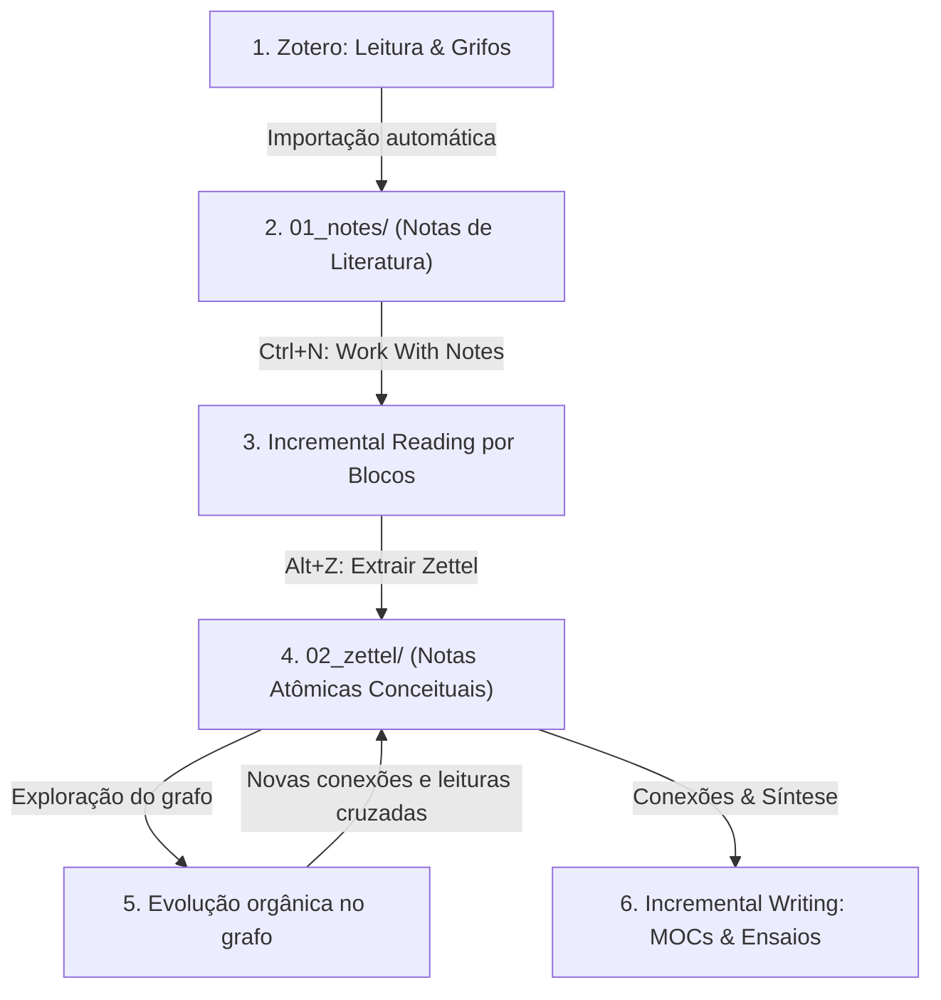

# 🧭 Guia Prático de Estudos: Zettelkasten + Incremental Reading + Incremental Writing

Este documento consolida o fluxo de trabalho do cofre `historia`, integrando a captura do Zotero, leitura incremental, atomização Zettelkasten, evolução orgânica das notas e escrita incremental.

---

---

## 🚀 O Ciclo Diário Passo a Passo

### Fase 1: Captura & Fichamento (Zotero ➔ Obsidian)
1. Faça sua leitura normalmente no **Zotero** (PDFs, livros, artigos), destacando trechos importantes e adicionando comentários.
2. No Obsidian, importe ou sincronize as anotações via **Zotero Desktop Connector**.
3. O arquivo gerado é salvo na pasta `01_notes/` com a ficha bibliográfica e a seção `%% begin annotations %%`.
4. A data de adição (`start-date::`) é preenchida automaticamente no cabeçalho.
5. Adicione a tag `#leitura` no frontmatter ou corpo da nota para que ela apareça na sua fila de leituras ativas.

---

### Fase 2: Sessão de Leitura Incremental (Incremental Reading)
1. Abra o [[meta/dataview/dashboard-ir-srs|Painel de estudo: leitura, revisão e escrita]] para ver suas leituras em andamento.
2. Abra a nota da obra que vai estudar hoje em `01_notes/`.
3. Pressione **`Ctrl+N`** (`work with notes`):
   - O Obsidian carrega o layout de trabalho com **Grafo Local**, **Links Inversos** e **Sumário**, mantendo a sua nota aberta em foco.
4. **Princípio do Incremental Reading:** Não tente processar o texto inteiro de uma vez. Foque em **1 a 3 blocos/parágrafos** de anotações por sessão.

---

### Fase 3: Atomização & Gatekeeper (Zettelkasten)
Ao encontrar um excerto relevante no texto:
1. **Selecione o trecho ou citação** que contém a ideia central.
2. Pressione **`Alt+Z`** (`extrair zettel`):
   - O Obsidian abrirá uma caixa de diálogo: *Título do Zettel Atômico*.
   - Digite um título conceitual claro e expressivo (ex: `Idealização da categoria região em Soares`).
3. **O que acontece automaticamente:**
   - Uma nova nota atômica é gerada em `02_zettel/<Título>.md`.
   - A nova nota recebe a tag `#zettel` e a referência `**Fonte:** [[Nome da Obra]]`.
   - Na sua nota de leitura original em `01_notes/`, **a citação é substituída pelo link** `[[Título do Zettel]]`.
4. Abra o novo Zettel em `02_zettel/`:
   - **Reescreva a síntese com suas próprias palavras** (paráfrase ativa).
   - Adicione conexões na seção `### Conexões` com outras ideias já existentes no seu cofre (`[[Conceito B]]`).

---

### Fase 4: Evolução Orgânica dos Zettels
As notas amadurecem pelo uso e pelo contato com outras ideias, sem depender de uma fila artificial de revisão:
1. Explore o grafo local e os backlinks a partir do Zettel em que está trabalhando.
2. Leia as notas conectadas e verifique que relações, tensões ou diferenças ficam mais claras quando colocadas lado a lado.
3. Atualize a síntese com sua compreensão atual, acrescente conexões com nexos explícitos e crie novos Zettels quando surgir uma ideia independente.
4. Retome Zettels antigos durante leituras cruzadas ou sessões de escrita; cada encontro pode aprofundar a rede e amadurecer as notas.

---

### Fase 5: Incremental Writing (Escrita Incremental e Síntese)
O Incremental Writing atua tanto na escala micro (notas) quanto macro (ensaios):
1. **Micro-Writing (Refinamento de Zettels):**
   - Ao reencontrar uma nota de `02_zettel/` pelo grafo, backlinks, leitura cruzada ou escrita, aproveite alguns minutos para **reescrever**, aprimorar termos e adicionar conexões com nexos explícitos.
2. **Macro-Writing (Ensaios e MOCs):**
   - Projetos de escrita longos (como artigos, capítulos ou ensaios em andamento) recebem a tag `#escrita` ou entram na fila do **Incremental Writing**.
   - A cada ciclo da fila, você não tenta terminar o texto de uma vez:
     - Adiciona novos links de `02_zettel/` relevantes.
     - Escreve 1 ou 2 parágrafos de transição entre ideias.
     - O texto cresce de forma acumulativa e sem o bloqueio da folha em branco.

---

### Fase 6: Conclusão de uma Obra (Fechamento do Hub)
Quando terminar de ler todos os trechos de um livro ou artigo em `01_notes/`:
1. Preencha o campo `end-date:: AAAA-MM-DD` na seção `## Index`.
2. Remova a tag `#leitura` (a obra sai da fila de leitura ativa).
3. Sua nota em `01_notes/` agora é um **Hub de Literatura Permanente**, composta pelos links atômicos dos conceitos gerados.

---

## ⌨️ Atalhos Rápidos Cadastrados

| Tecla de Atalho | Ação | Descrição |
| :--- | :--- | :--- |
| **`Ctrl+N`** | `work with notes` | Abre o workspace de trabalho sincronizado com a nota ativa. |
| **`Alt+Z`** | `extrair zettel` | Extrai o texto selecionado para `02_zettel/` e insere o link na fonte. |
| **`Ctrl+S`** | `search research notes` | Busca avançada de fichamentos e notas de pesquisa bibliográfica. |
| **`Ctrl+K`** | `extract research note` | Extração de nota de pesquisa com cabeçalho bibliográfico completo. |
